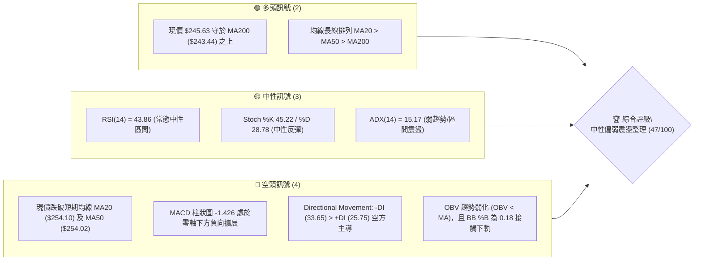
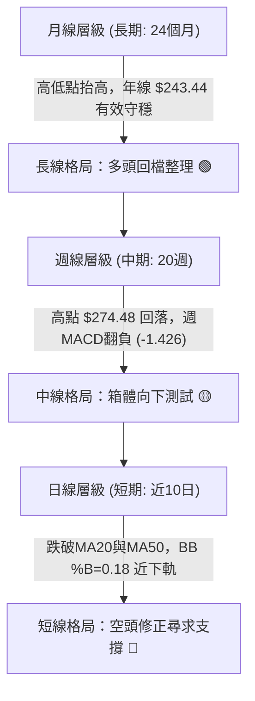
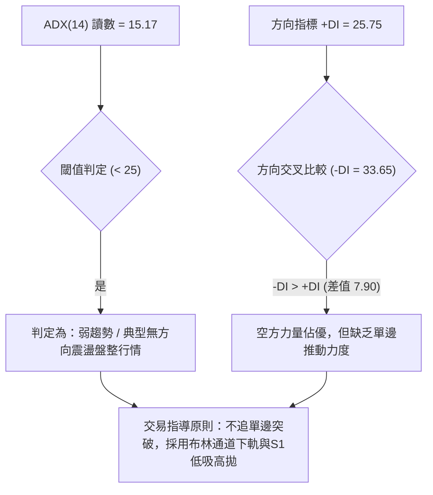
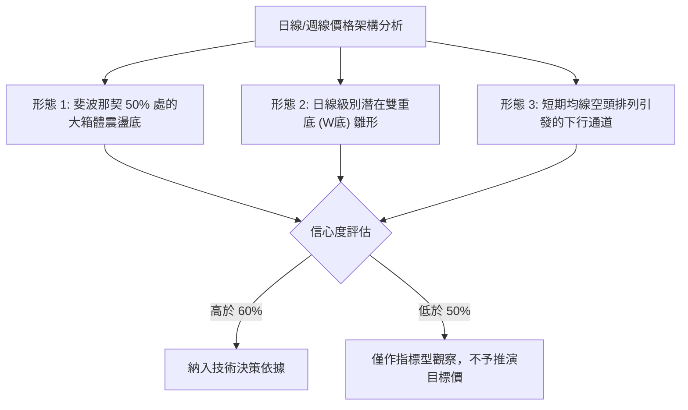
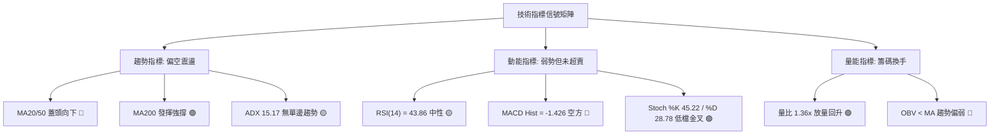
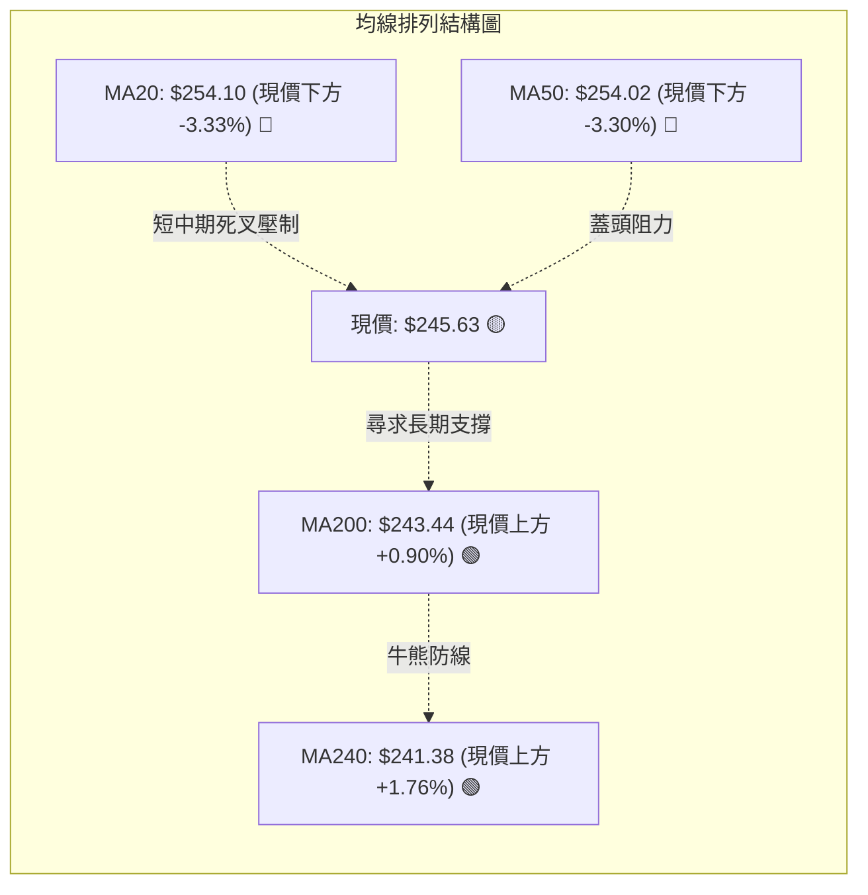
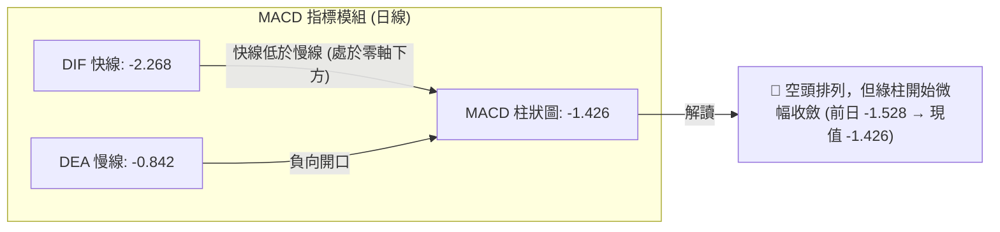
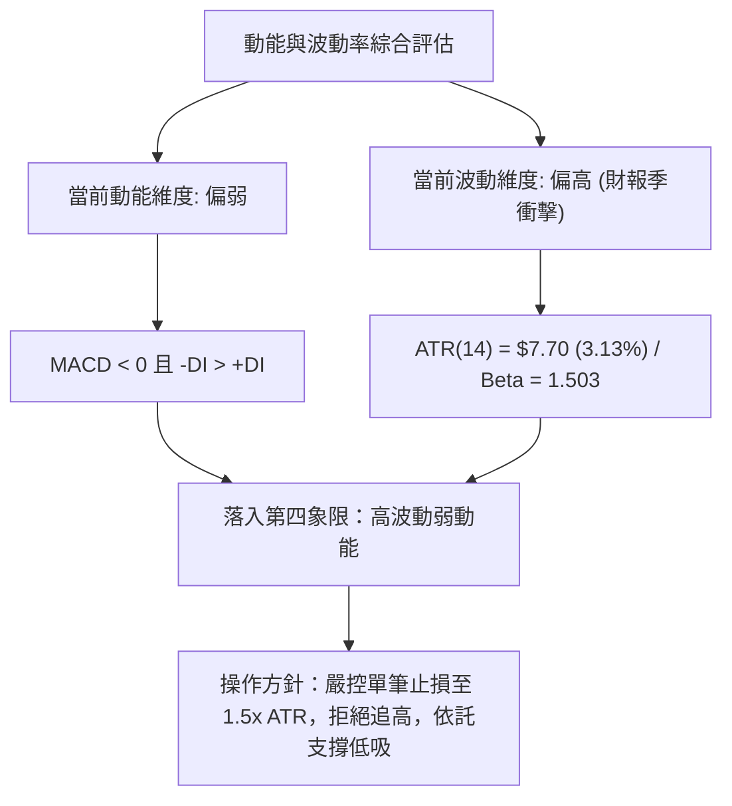
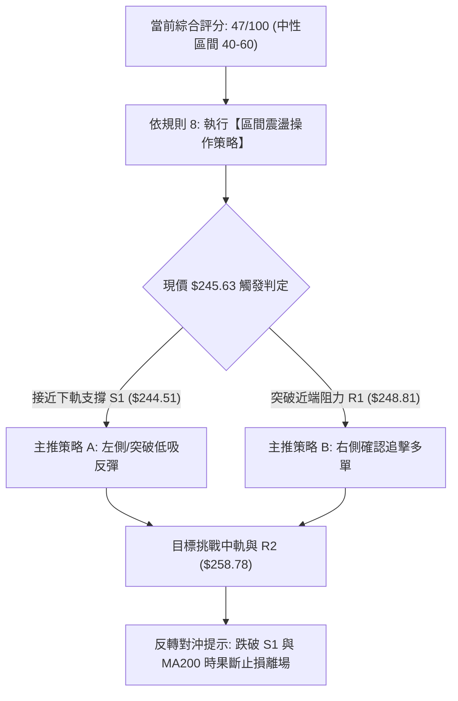
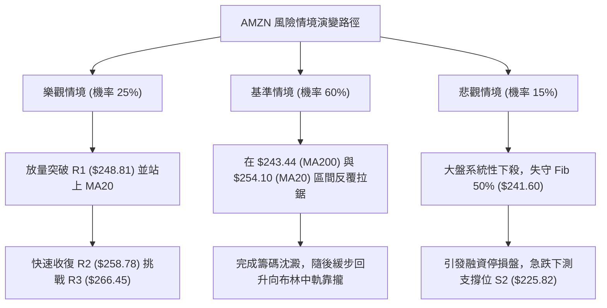

# AMZN 技術分析報告

> **報告日期**：2026-11-03 ｜ **語言**：繁體中文 ｜ **數據來源**：Yahoo Finance ｜ **當前價格**：$245.63

---

## 目錄

| 章節 | 內容 |
|------|------|
| [1. 技術面概覽](#1-技術面概覽) | 訊號儀表板、核心指標、評分卡 |
| [2. 趨勢分析](#2-趨勢分析) | 多時框趨勢、長中短期走勢 |
| [3. 圖表形態分析](#3-圖表形態分析) | 形態識別、K線組合、目標價 |
| [4. 支撐與阻力](#4-支撐與阻力) | 關鍵價位、斐波那契回調 |
| [5. 技術指標深度解讀](#5-技術指標深度解讀) | MA/RSI/MACD/布林/成交量 |
| [6. 動能與波動率](#6-動能與波動率) | 動能評估、ATR、Beta |
| [7. 多時框架總結](#7-多時框架總結) | 時框架評分矩陣 |
| [8. 交易策略建議](#8-交易策略建議) | 多空策略、風險報酬比 |
| [9. 風險提示與監控](#9-風險提示與監控) | 監控指標、風險場景 |

---

## 1. 技術面概覽

### 🎯 技術訊號儀表板



### 📊 核心指標速覽表

| 指標類別 | 指標名稱 | 當前數值 | 訊號 | 解讀 |
|----------|----------|----------|------|------|
| **價格** | 當前收盤價 | $245.63 | 🟡 | 位於52週區間54.4%處，短線承壓但未破年線 |
| **均線** | MA20 | $254.10 | 🔴 | 現價低於MA20達 -3.33%，短期動能偏空 |
| **均線** | MA50 | $254.02 | 🔴 | 現價低於MA50，中短期均線呈現蓋頭壓力 |
| **均線** | MA200 | $243.44 | 🟢 | 現價高於MA200約 +0.90%，長期牛熊分界線發揮支撐 |
| **動能** | RSI(14) | 43.86 | 🟡 | 處於40–50弱勢平衡區，未達超賣區間 (<30) |
| **動能** | MACD (12,26,9) | 柱狀圖 -1.426 | 🔴 | DIF (-2.268) < DEA (-0.842)，空方柱擴展，空頭主導 |
| **波動** | ATR(14) | $7.70 | 🟡 | 佔股價3.13%，每日波動度常態，近期受財報影響擴大 |

### 🏆 技術評分卡

```
╔══════════════════════════════════════════════════════════════╗
║                技術評分卡 — AMZN (2026-11-03)                ║
╠══════════════════════════════════════════════════════════════╣
║ 趨勢強度      ██████░░░░░░░░░░░░░░  30/100  🔴 (ADX 15.17 無明確趨勢)  ║
║ 動能指標      ████████░░░░░░░░░░░░  40/100  🔴 (MACD負值，RSI偏弱)      ║
║ 支撐穩定度    ██████████████░░░░░░  70/100  🟢 (MA200與S1守穩)          ║
║ 成交量配合    ████████░░░░░░░░░░░░  40/100  🔴 (OBV跌破均線，空方放量)  ║
║ 形態完整度    ██████████░░░░░░░░░░  50/100  🟡 (區間下軌測試，未破底)  ║
║ 均線排列      ██████████░░░░░░░░░░  50/100  🟡 (長多短空，均線糾纏)    ║
╠══════════════════════════════════════════════════════════════╣
║ 綜合評分      █████████░░░░░░░░░░░  47/100  中性偏弱區間震盪 (規則18) ║
╚══════════════════════════════════════════════════════════════╝
```
*計算依據：(30 + 40 + 70 + 40 + 50 + 50) ÷ 6 = 46.67 ≈ 47/100。*

---

## 2. 趨勢分析

### 🌐 多時框趨勢分析



### 📈 長期趨勢 — 12個月走勢圖（Unicode）

```
AMZN 月線走勢圖（2025-11 至 2026-11）
價格軸 ($)
$275 ┤                                  ●(07月 $271.58)
$270 ┤                            ●(05月 $270.64)
$265 ┤                      ●(04月 $265.06)
$260 ┤                                        ●(08月 $259.77)
$250 ┤                                              ●(09月 $249.15)
$245 ┤                                                    ●←現價 $245.63
$240 ┤                ●(01月 $239.30)                     ●(10月 $240.35)
$235 ┤  ●(11月 $233.22)
$230 ┤        ●(12月 $230.82)
$210 ┤          ●(02月 $210.00)
$205 ┤                ●(03月 $208.27 低點)
     └────────────────────────────────────────────────────────────
        11   12   01   02   03   04   05   06   07   08   09   10   11
       2025 2025 2026 2026 2026 2026 2026 2026 2026 2026 2026 2026 2026
```

#### 長期月線走勢特徵分析表

| 階段區間 | 起訖月份 | 收盤價變化 | 漲跌幅 | 結構特徵分析 |
|----------|----------|------------|--------|--------------|
| **底部築底期** | 2025-11 → 2026-03 | $233.22 → $208.27 | -10.70% | 震盪探底，於 2026-03 觸及波段低點 $208.27，量縮築底 |
| **主升浪突破** | 2026-03 → 2026-05 | $208.27 → $270.64 | +29.95% | 強勢長紅突破所有短期均線，呈現單邊多頭拉升 |
| **高位箱體頂部** | 2026-05 → 2026-07 | $270.64 → $271.58 | +0.35% | 於 2026-07 創下收盤次高 $271.58（年內高點 $287.20），多空博弈劇烈 |
| **回調修正期** | 2026-07 → 2026-10 | $271.58 → $240.35 | -11.50% | 連續4個月收陰，高點逐步下移，回測 MA200 關鍵防線 |
| **當前定位** | 2026-10 → 2026-11 | $240.35 → $245.63 | +2.20% | 於 50% 斐波那契回調位 ($241.60) 企圖展開防守反彈 |

### 📊 中期趨勢（週線分析）

```
AMZN 週線波段架構示意圖（2026-06 至 2026-11）
阻力區間 ════════════════════════════════════════════ $274.48 (08-07 高點)
          \            /
           \    /\    / 
            \  /  \  /   
震盪中樞 ────\/────\/──────────────────────────────── $254.10 (MA20/MA50 糾纏位)
              \    /
               \  / 
支撐底線 ═══════\/═══════════════════════════════════ $229.36 (10-30 週低點) / $243.44 (MA200)
```

週線層級顯示，股價自 2026-08-07 觸及高點 $274.48 後展開波段回撤，近 20 週收盤呈現「一浪低於一浪」的中期弱勢走勢。然而，2026-10-30 週K下探至 $229.36 後收於 $240.35，並於 2026-11-02 當週迅速反彈至 $245.63，顯示長期買盤在 MA200 ($243.44) 與波段低點 S1 ($244.51) 具備初步防禦共識。

### ⚡ 趨勢強度評估（ADX 解讀）



#### ADX 強度對照表

| 指標變數 | 當前讀數 | 強度區間 | 趨勢性質與市場狀態解讀 |
|----------|----------|----------|------------------------|
| **ADX(14)** | 15.17 | < 20 (極弱趨勢) | 趨勢完全停滯，市場處於區間消化與籌碼換手狀態 |
| **+DI(14)** | 25.75 | 弱多頭動能 | 買方雖有反抗，但未能形成向上主導趨勢 |
| **-DI(14)** | 33.65 | 空方主導動能 | 賣方掌控盤面節奏，惟缺乏持續摜壓動能 |
| **結論** | 空方佔優但屬盤整 | 規則 14 判定 | **ADX < 25 為盤整行情**：以日線布林通道 ($240.88–$267.32) 為主要交易區間 |

---

## 3. 圖表形態分析

### 🔍 形態識別系統



#### 形態識別與信心度評估表（依規則 15）

| 形態名稱 | 信心度 (%) | 判斷依據（嚴格引用數據） | 完成度 (%) | 目標價計算式與精確目標價 |
|----------|------------|--------------------------|------------|--------------------------|
| **箱體震盪下軌反彈** | 75% | 價格於 2026-10-30 探低 $229.36 後回升，守住波段支撐 S1 ($244.51) 與 50% 回調位 ($241.60) | 65% | 依箱體震盪中軌推算：現價 $245.63 回測突破 R1 ($248.81)，反彈目標指向箱體中軸 R2: **$258.78** |
| **潛在日線雙底 (W-Bottom)** | 55% | 2026-10-22 低點 $248.00 與 2026-10-30 低點 $229.36 形成次低點反彈，頸線為 2026-10-28 高點 $255.36 | 40% | 頸線 $255.36 + 形態高度 ($255.36 - $229.36 = $26.00) = 目標價 **$281.36**（尚未突破頸線，僅屬推算） |
| **日線下行旗形整理** | 45% | 高點由 10-20 ($265.34) 下降至 10-28 ($255.36)，但因 11-02 帶量長陽反彈，下行斜率遭破壞 | 30% | 訊號不足且信心度 < 50%，依規則 15 不強行推算，僅做指標型解讀 |

### 🕯️ 重要K線形態分析（嚴格依規則 19）

#### 近10根日K分析

| 日期 | 開盤價 | 最高價 | 最低價 | 收盤價 | 成交量 | K線形態 | 技術解讀與訊號 |
|------|--------|--------|--------|--------|--------|---------|----------------|
| **2026-10-20** | $264.08 | $265.34 | $260.42 | $262.63 | 34,927,200 | 小黑實體紡錘線 | 高位滯漲，量能一般，多頭動能轉弱 🟡 |
| **2026-10-21** | $262.71 | $264.36 | $259.29 | $262.37 | 31,214,700 | 十字陰線 | 於高檔多空爭奪，多方無法創高 🟡 |
| **2026-10-22** | $258.18 | $258.41 | $248.00 | $250.38 | 48,814,000 | 跳空中長陰線 | 放量摜破多條均線，空方強勢下殺 🔴 |
| **2026-10-23** | $248.85 | $250.01 | $246.45 | $248.00 | 25,569,000 | 縮量十字星 | 急跌後量縮暫時止跌，多空暫趨平衡 🟡 |
| **2026-10-26** | $249.47 | $250.79 | $247.23 | $249.09 | 32,696,400 | 低位微幅紅星 | 延續低檔沉澱，買盤微弱但賣壓暫竭 🟡 |
| **2026-10-27** | $250.43 | $254.68 | $248.71 | $253.10 | 34,477,800 | 溫和中陽線 | 展開超跌反彈，上測短期壓力位 🟢 |
| **2026-10-28** | $253.00 | $255.36 | $251.98 | $254.60 | 34,915,900 | 帶上影小陽線 | 觸及 MA20/MA50 糾纏區遭遇蓋頭反壓 🟡 |
| **2026-10-29** | $246.95 | $249.14 | $241.24 | $243.79 | 85,234,400 | 放量長陰破位線 | 財報前避險情緒爆發，巨量下殺逼近年線 🔴 |
| **2026-10-30** | $232.54 | $241.55 | $229.36 | $240.35 | 104,894,700 | 巨量長下影長陽棒 | 跳空低開下探 $229.36 後爆出天量大幅拉抬，典型恐慌盤清洗與長線買盤承接 🟢 |
| **2026-11-02** | $243.01 | $253.81 | $242.28 | $245.63 | 58,155,700 | 衝高回落小陽線 | 開高衝刺 $253.81 遇阻收於 $245.63，守穩 MA200，多頭延續反彈結構 🟢 |

#### 近8根週K分析

| 週結日期 | 開盤價 | 最高價 | 最低價 | 收盤價 | 週成交量 | K線形態 | 週線層級解讀 |
|----------|--------|--------|--------|--------|----------|---------|--------------|
| **2026-09-18** | $253.15 | $255.95 | $244.30 | $253.71 | 186,830,200 | 長下影紡錘紅K | 測試下軌獲得支撐，呈現高檔震盪 🟡 |
| **2026-09-25** | $256.40 | $259.49 | $245.60 | $249.67 | 196,475,200 | 衝高回落倒錘黑K | 向上試探 $259.49 遇阻，多頭動能減退 🔴 |
| **2026-10-02** | $246.63 | $253.56 | $244.73 | $251.52 | 174,917,500 | 下探回升陽十字 | 支撐位附近縮量震盪，多空僵持 🟡 |
| **2026-10-09** | $250.19 | $262.80 | $250.18 | $262.43 | 183,040,400 | 實體中長陽週K | 強勢反彈站上週均線，動能轉強 🟢 |
| **2026-10-16** | $262.50 | $263.70 | $248.60 | $250.00 | 161,689,900 | 烏雲罩頂長黑K | 創 $263.70 高點後單週重挫抹平前週漲幅 🔴 |
| **2026-10-23** | $255.25 | $265.34 | $246.45 | $248.00 | 196,713,700 | 長上影流星陰線 | 衝高 $265.34 引發獲利了結賣壓，空方佔優 🔴 |
| **2026-10-30** | $249.47 | $255.36 | $229.36 | $240.35 | 292,219,200 | 巨量長下影錘頭K | 週量放大至近三個月極值，下影線長達 $10.99，確立低檔強支撐 🟢 |
| **2026-11-02** | $243.01 | $253.81 | $242.28 | $245.63 | 58,155,700 | 溫和反彈單日K | 繼前週長下影後延續回升，收穩 MA200 🟢 |

### 📉 ASCII 走勢形態示意圖

```
AMZN 近期形態解構圖（日K層級）
$265.34 ┬  ●(10-20 高點)
        │   \
$258.78 ┼────\────────────────────── [阻力位 R2]
        │     \       ●(10-28 高點 $255.36 - 潛在頸線)
$254.10 ┼──────\─────/───\────────── [MA20/MA50 糾纏反壓區]
        │       \   /     \     ●(11-02 衝高 $253.81)
$248.81 ┼────────\─/───────\───/──── [阻力位 R1]
        │         ●         \ /     
$245.63 ┼────────────────────●───── [當前現價收盤]
$244.51 ┼─────────────────────────── [波段支撐位 S1 / MA200 $243.44]
        │                     \
$229.36 ┴                      ●(10-30 巨量長下影恐慌底)
        └─────────────────────────────────────────────────────
         10-20  10-22  10-26  10-28 10-29 10-30 11-02
```

### 🎯 形態目標價計算

根據形態學與支撐阻力結構推算：
1. **箱體波段反彈目標（主要路徑）**：
   - 下軌支撐基礎：2026-10-30 長下影確認低點支撐有效性，基點為 S1 **$244.51**。
   - 第一反彈阻力目標 T1：引自數據「阻力位 R1」= **$248.81**。
   - 第二反彈目標 T2：突破 R1 後挑戰波段中樞壓力，引自數據「阻力位 R2」= **$258.78**。
2. **極端突破擴展目標（次要路徑）**：
   - 若能帶量突破箱體中樞 R2，上方終極回補目標為數據「阻力位 R3」= **$266.45**（逼近斐波那契 23.6% 回調位 $265.68）。

---

## 4. 支撐與阻力

### 🗺️ 關鍵價位分布圖（Unicode）

```
AMZN 價位結構分布圖 (2026-11-03)
═══════════════════════════════════════════════════════════════════
$287.20 ║██████████████████████████████║ 52週歷史高點 (0.0% Fib)
$266.45 ║████████████████████████      ║ 強阻力 R3 (波段高點聚類 / 23.6% Fib $265.68)
$258.78 ║████████████████              ║ 中期阻力 R2 (反彈中樞壓力)
$254.10 ║████████████                  ║ 均線蓋頭位 (MA20 $254.10 / MA50 $254.02)
$248.81 ║████████                      ║ 近端關鍵阻力 R1 (+1.29% from price)
$245.63 ╠══════════════════════════════╣ ◄ 當前收盤價 ($245.63)
$244.51 ║▓▓▓▓▓▓▓▓▓▓▓▓▓▓▓▓              ║ 近端關鍵支撐 S1 (-0.45% from price)
$243.44 ║▓▓▓▓▓▓▓▓▓▓▓▓▓▓▓▓▓▓▓▓          ║ 牛熊分界線 (MA200 / 240日線 $241.38)
$241.60 ║▓▓▓▓▓▓▓▓▓▓▓▓▓▓▓▓▓▓▓▓▓▓        ║ 斐波那契 50.0% 黃金回調位
$225.82 ║██████████████████████        ║ 強支撐 S2 (波段低點聚類)
$220.99 ║██████████████████████████    ║ 終極強支撐 S3 (-10.03% from price)
$196.00 ║██████████████████████████████║ 52週歷史低點 (100.0% Fib)
═══════════════════════════════════════════════════════════════════
```

### 🚧 阻力位分析表（嚴格引用數據關鍵價位）

| 阻力級別 | 精確價位 | 距現價空間 (%) | 形成原因與籌碼特徵 | 突破難度評估 | 重要性等級 |
|----------|----------|----------------|--------------------|--------------|------------|
| **R1** | **$248.81** | +1.29% | 近一年波段高點聚類，與 10-23、10-26 多根日K密集平台重疊 | 🟡 中等 (需日成交量 > 5,000萬股確認) | 短線關鍵分界 |
| **R2** | **$258.78** | +5.36% | 波段高點聚類，接近 10-22 跳空缺口下沿及 MA60 ($255.86) | 🔴 較高 (密集解套賣壓集中區) | 中期波段轉強點 |
| **R3** | **$266.45** | +8.48% | 波段高點聚類，共振布林通道上軌 ($267.32) 及斐波那契 23.6% ($265.68) | 🔴 極高 (大波段箱頂反壓) | 長期強弱樞紐 |

### 🛡️ 支撐位分析表（嚴格引用數據關鍵價位）

| 支撐級別 | 精確價位 | 距現價空間 (%) | 形成原因與籌碼特徵 | 守住機率評估 | 重要性等級 |
|----------|----------|----------------|--------------------|--------------|------------|
| **S1** | **$244.51** | -0.45% | 近一年波段低點聚類，下方共振 MA200 ($243.44) 與 50% Fib ($241.60) | 🟢 70% (具強大均線保護) | 短線防守核心 |
| **S2** | **$225.82** | -8.06% | 近一年波段低點聚類，10-30 恐慌殺跌低點 ($229.36) 下方的籌碼沉澱區 | 🟢 85% (恐慌極值區) | 中期結構底線 |
| **S3** | **$220.99** | -10.03% | 近一年波段低點聚類，對應 2025 年中期多重複合平台底部 | 🟢 95% (長線價值護城河) | 長期熊市防線 |

### 📐 斐波那契回調位分析（52週區間 $196.00 → $287.20）

```
斐波那契回調標尺 (基準波段: $196.00 至 $287.20，總落差 $91.20)
0.0%  ------------------------------------------------- $287.20 (52週高點)
23.6% ------------------------------------------------- $265.68 (接近 R3 $266.45)
38.2% ------------------------------------------------- $252.36 (短線多空分水嶺)
======================== 現價 $245.63 落於 38.2% 與 50.0% 之間 ========================
50.0% ------------------------------------------------- $241.60 (多頭重要心理中軸)
61.8% ------------------------------------------------- $230.84 (黃金分割強支撐)
78.6% ------------------------------------------------- $215.52 (深度防守位)
100.0% ------------------------------------------------ $196.00 (52週低點)
```

**斐波那契結構解讀**：
1. **現價區間定位**：當前股價 $245.63 精確運行於 **38.2% ($252.36)** 與 **50.0% ($241.60)** 兩大核心回調位之間。
2. **多頭中軸支撐**：50.0% 回調位 ($241.60) 恰好與長期 MA200 ($243.44) 及布林通道下軌 ($240.88) 形成三重黃金重合共振支撐區。2026-10-30 盤中雖短暫下刺 61.8% ($230.84)，但當日收盤迅速拉回 $240.35，11-02 更是收在 $245.63，宣告 50.0% 支撐帶防守成功。
3. **上方壓力指針**：向上反彈的首要斐波那契阻力為 38.2% ($252.36)，該價位緊貼 MA20 ($254.10) 與 MA50 ($254.02)，此區域若無法帶量突破，股價仍將受制於回調通道內。

---

## 5. 技術指標深度解讀

### 🎛️ 指標訊號總覽



### 📈 移動平均線排列分析



#### 移動平均線數據對比表

| 均線週期 | 當前價位 | 乖離率 (%) | 均線歷史軌跡 | 斜率方向與技術意義 |
|----------|----------|------------|--------------|--------------------|
| **MA 5** | $247.49 | -0.75% | ▄▅▄▄▂▁▁▁▁▂▃▅▆▇████▆ | 短線下行趨緩，出現降速拐點 |
| **MA 10** | $250.99 | -2.14% | ▃▃▃▂▂▁▂▁▁▁▁▂▂▃▅▆▆▇▇ | 呈現陡峭下行，短線反彈首道均線壓制 |
| **MA 20** | $254.10 | -3.33% | █▇▆▆▄▃▂▂▁▁▁▁▁▂▂▃▄▄▄ | 中短線生命線下行，中軌壓制強烈 |
| **MA 50** | $254.02 | -3.30% | ▁▁▁▁▁▂▂▂▂▂▂▃▃▃▃▄▄▄▅ | 走平略微向下，與 MA20 形成雙重高位阻力 |
| **MA 60** | $255.86 | -4.00% | ▁▁▁▁▁▂▂▂▂▂▂▃▃▃▃▄▄▄▅ | 季線下行，為波段空方防禦線 |
| **MA 120** | $253.25 | -3.01% | ▁▂▃▄▅▆▆▇▇▇▇█████████ | 半年線開始走平，中長期動能減弱 |
| **MA 200** | $243.44 | +0.90% | 多頭排列基準線 | 長期牛熊分界線，多頭守護神，支撐強勁 |
| **MA 240** | $241.38 | +1.76% | ▁▁▁▂▂▂▃▃▄▄▄▅▅▆▆▇▇▇ | 年線穩健向上走升，確認長期多頭基調未改 |

### 📉 RSI(14) 分析

```
RSI(14) 讀數儀表 (當前值: 43.86)
0       10      20      30      40  43.86  50      60      70      80      90     100
├───────┼───────┼───────┼───────┼───▲──┼───────┼───────┼───────┼───────┼───────┤
│    極度超賣區 (<20)   │ 超賣區│ 弱勢平衡  │    強勢區     │ 超買區│ 極度超買區    │
└───────────────────────┴───────┴───────────┴───────────────┴───────┴───────────────┘
進度條展示: █████████░░░░░░░░░░░ 43.86% [🟡 偏弱中性]
```

**RSI 解讀與背離判斷**：
- **數值定位**：RSI(14) 最新讀數為 43.86，從前低 38.3 (2026-10-30) 溫和回升，脫離弱勢邊緣，重新進入常態中性區。
- **背離檢驗結論**：根據數據「RSI背離：無明顯背離（僅比較近20根K棒首尾的價格與RSI方向）」，2026-10-20 高點 $262.63 到 2026-11-02 的收盤 $245.63，價格與 RSI 均同步回落後反彈，**不存在頂背離或底背離**。這意味著當前價格下跌為常態技術性修正，非動能衰竭式暴跌。

### 📊 MACD(12/26/9) 訊號解讀



**MACD 深度分析**：
- DIF (-2.268) 處於 DEA (-0.842) 下方，且雙線均深處零軸下方，明確揭示當前中期趨勢由空頭控盤。
- 然而，觀察近兩日柱狀圖變化：從 2026-10-30 的 -1.528 回升至 2026-11-02 的 -1.426，負值柱狀體呈現縮短跡象。若後續價格能持穩於 $245.63 上方，MACD 有望在零軸下方醞釀低檔金叉，展開修復性反彈。

### 📦 布林通道分析

```
AMZN 布林通道走勢示意圖 (寬度 Bandwidth = 10.76%)
$267.32 ┬────────────────────────────────────────── 布林上軌 (BB Upper)
        │
$254.10 ┼ - - - - - - - - - - - - - - - - - - - - - 布林中軌 (MA20)
        │
$245.63 ┼───────────────────────● (現價收盤) ── %B: 0.18
        │                      /
$240.88 ┴─────────────────────●──────────────────── 布林下軌 (BB Lower)
                              10-30
```

**布林通道關鍵參數解析**：
- **上軌**：$267.32 ｜ **中軌 (MA20)**：$254.10 ｜ **下軌**：$240.88
- **布林 %B 指標**：當前數值為 **0.18**（0 代表下軌，$240.88；0.5 代表中軌，$254.10；1 代表上軌，$267.32）。
- **技術含義**：股價位於下軌上方極近距離（距下軌僅 1.97%），處於技術性超賣修復區。在 ADX=15.17 確立為盤整行情的架構下，布林下軌 $240.88 具備高勝率的邊界防守效應，不易出現持續單邊破軌暴跌，向上均值回歸中軌 $254.10 為阻力最小方向。

### 💹 成交量分析（量價配合度）

```
成交量動態分佈圖 (最新量 vs 均量)
最新成交量 (11-02) : ██████████████ 58,155,700 (量比 1.36x) 🟢 放量反彈
20日均量           : ██████████ 42,627,250
50日均量           : █████████ 37,695,454
前日成交量 (10-30) : █████████████████████████ 104,894,700 🟢 恐慌出清量
```

**量價解讀**：
1. **量價背離與換手**：2026-10-30 創出 104,894,700 的天量長下影線，為 50 日均量的 2.78 倍，顯示機構法人進場進行流動性吸收與籌碼換手。
2. **反彈量能確認**：2026-11-02 收盤上漲，成交量達 58,155,700，維持在 20 日均量之上（量比 1.36x），量價配合呈現「量增價揚」，扭轉了此前陰線放量的惡劣局勢。
3. **OBV 限制**：數據指出「OBV 趨勢：OBV < MA → 量能疲弱」，表明中長線籌碼累積結構尚未完全修復，當前量能增長暫屬超跌反彈性補量，中期全面反轉仍需等待 OBV 重新金叉其均線。

---

## 6. 動能與波動率

### ⚡ 動能評估四象限

| 象限標籤 | 動能狀態 | 波動率狀態 | 當前市場定位 | 策略應對方針 |
|----------|----------|------------|--------------|--------------|
| **第一象限 (Q1)** | 強動能 (Bullish) | 低波動 (Low Vol) | — | 趨勢穩健推進，適合重倉順勢做多 |
| **第二象限 (Q2)** | 弱動能 (Bearish) | 低波動 (Low Vol) | — | 陰跌縮量整理，市場參與度低 |
| **第三象限 (Q3)** | 強動能 (Bullish) | 高波動 (High Vol) | — | 單邊突破行情，獲利空間大但風險高 |
| **第四象限 (Q4)** | **弱動能 (Bearish)** | **高波動 (High Vol)** | **AMZN 當前定位 (✓)** | **劇烈震盪探底，反彈雜音多，以網格/箱體邊界操作為主** |



### 📊 ATR 波動率分析

- **ATR(14) 絕對值**：**$7.70**
- **ATR 佔比 (Wilder)**：**3.13%**（相對於收盤價 $245.63）
- **止損距離建議**：
  - *短線當沖/隔日沖*：1.0x ATR = **$7.70**（現價減 $7.70 = $237.93）
  - *波段交易止損*：1.5x ATR = **$11.55**（現價減 $11.55 = $234.08）
  - *結構性防守止損*：直接設於數據關鍵支撐 S1 下方或關鍵日K最低點 $229.36 下方。

### 📐 Beta 與市場相關性

- **Beta 係數**：**1.503**
- **市場相關性分析**：
  - AMZN 的 Beta 高達 1.503，呈現高貝塔進攻型品種特性，意味著當標普500指數波動 1.0% 時，AMZN 理論波動約為 1.50%。
  - 在大盤整體下挫或科技股受 AI 支出擔憂承壓時（近期新聞：「Stocks mostly down as AI concerns top」），AMZN 面臨更劇烈的系統性回撤；相反地，當大盤觸底反彈時，其具備顯著超越市場的彈性空間。

---

## 7. 多時框架總結

### 📋 時框架評分表

| 時框架 | 趨勢方向 | 動能狀態 | 均線排列狀況 | 形態結構特徵 | 綜合評分 | 操作建議方向 |
|--------|----------|----------|--------------|--------------|----------|--------------|
| **月線 (長期)** | 🟢 偏多上升 | 🟡 中性走平 | 多頭排列 (MA200向上) | 大波段上升回檔 50% | **70/100** | 逢低分批布局長線多單 |
| **週線 (中期)** | 🟡 震盪回落 | 🔴 柱狀圖負向 | 均線糾纏收斂 | $229–$274 寬幅箱體 | **45/100** | 區間波段低吸高拋 |
| **日線 (短期)** | 🔴 偏空下探 | 🟡 短線觸底 | 空頭壓制 (MA20>現價) | 測試年線長下影回升 | **40/100** | 不盲目做空，尋求短彈 |

### 🔲 綜合訊號矩陣

```
時框架訊號矩陣與多空權重對比
━━━━━━━━━━━━━━━━━━━━━━━━━━━━━━━━━━━━━━━━━━━━━━━━━━━━
維度        日線 (短期)       週線 (中期)       月線 (長期)
趨勢方向    🔴 空頭下壓       🟡 區間震盪       🟢 多頭主導
動能指標    🔴 MACD 負向      🔴 MACD 翻負      🟡 RSI 處於平衡
均線支持    🔴 跌破MA20/50    🟡 考驗MA20       🟢 MA200 穩固
成交量配合  🟢 低檔爆量換手   🟢 週K下影放量    🟡 常態換手
形態確認    🟡 潛在雙底雛形   🟡 箱體下軌支撐   🟢 階梯式墊高
━━━━━━━━━━━━━━━━━━━━━━━━━━━━━━━━━━━━━━━━━━━━━━━━━━━━
總體收斂    短線超跌反彈       中期箱體尋底     長線多頭回撤
```

### ⚖️ 多時框收斂結論（嚴格遵守規則 14）

1. **行情性質判定**：
   - 當前 **ADX(14) 讀數為 15.17**，遠低於 25 的趨勢行情閾值。
   - 依據「嚴格要求 14」之規定，**當前明確為「盤整行情（ADX < 25）」**。
2. **多時框收斂與取捨邏輯**：
   - 盤整行情中，日線級別的單邊空頭突破（如跌破短期均線）大多屬於假突破或震盪區間內的過度反應，不能作為追空的依據。
   - 交易核心邊界完全鎖定在**日線布林通道區間（下軌 $240.88 ～ 上軌 $267.32）**，並由長期核心均線 MA200 ($243.44) 與波段支撐位 S1 ($244.51) 提供極限防禦保護。
3. **方向性唯一結論**：
   - **【中性偏多，依託支撐進行區間反彈操作】**。
   - 儘管短期日線訊號偏空，但在 ADX<25 盤整架構下，中長期 MA200 與布林下軌有效守穩，日線空頭動能已在 10-30 的天量長下影中被大幅消化。結論確定為以 S1/MA200 為防守基準的區間波段做多。此結論與第 8 章策略方向嚴格保持一致。

---

## 8. 交易策略建議

### 🗺️ 策略決策流程圖



### 🧭 策略路由（依評分卡分流，規則 18）

> **當前主策略方向 = 【中性區間波段操作，偏向支撐位低吸做多】（依評分 47/100）**
> *依據：綜合評分 47/100 處於 40–60 之中性震盪區間，且 ADX=15.17 確認為盤整格局，以日線布林通道 ($240.88–$267.32) 及關鍵支撐 S1 ($244.51) 為依託，主推區間低吸操作，嚴禁追漲殺跌。*

### 🎯 價格情境階梯（Price Scenarios，嚴格引用數據關鍵價位）

| 觸發條件 | 下一目標 | 後續延伸 | 技術情境含義與操作指引 |
|----------|----------|----------|------------------------|
| **強勢突破 R1 ($248.81)** | **R2 ($258.78)** | **R3 ($266.45)** | 短線轉強，突破均線壓制，空頭回補浪展開 |
| **站穩現價區間 ($244.51–$248.81)** | **R1 ($248.81)** | — | 箱體下軌築底蓄勢，時間換取空間 |
| **跌破 S1 ($244.51) 與 MA200** | **S2 ($225.82)** | **S3 ($220.99)** | 中期轉弱，多頭防線瓦解，觸發對沖與停損 |

### 📊 情境機率分佈

| 運行情境 | 發生機率 | 主要技術依據（嚴格引用指標與歷史數據） |
|----------|----------|----------------------------------------|
| **區間震盪上行 (反彈)** | **55%** | 10-30 爆量 1.04 億股確立長下影支撐；現價守穩 MA200 ($243.44)；布林 %B=0.18 具強烈均值回歸修復需求。 |
| **箱體低位橫盤震盪** | **30%** | ADX(14) 僅 15.17，市場極度缺乏單邊推進動能；MA20 與 MA50 形成雙重阻力，需時間消化籌碼。 |
| **破位再探低點** | **15%** | MACD 柱狀圖仍為負值 (-1.426)；-DI (33.65) 壓制 +DI (25.75)；若失守 S1 可能引發程式化止損盤。 |

### 🟢 主策略詳情（區間操作策略組合）

*註：風險報酬比嚴格依規則 17 計算：(目標價 T1 − 進場價) ÷ (進場價 − 止損價)。*

| 策略要素 | 策略 A（現價低吸佈局） | 策略 B（右側突破加碼） |
|----------|------------------------|------------------------|
| **策略屬性** | 左側依託支撐逢低吸納 | 右側突破 R1 順勢跟進 |
| **進場條件** | 股價回踩 S1 不破或於現價區間企穩 | 日K收盤帶量突破阻力位 R1 |
| **進場價格** | **$245.00**（以區間中點計） | **$249.00**（突破 $248.81 後進場） |
| **目標價 T1** | **$258.78**（引用關鍵阻力 R2） | **$258.78**（引用關鍵阻力 R2） |
| **目標價 T2** | **$266.45**（引用關鍵阻力 R3） | **$266.45**（引用關鍵阻力 R3） |
| **止損價格** | **$241.00**（跌破 Fib 50% $241.60 與 MA200） | **$244.50**（跌回關鍵支撐 S1 下方） |
| **風險報酬比** | **1 : 3.45（以 T1 計）** <br>*($258.78 - $245.00) ÷ ($245.00 - $241.00) = 13.78 ÷ 4.00* | **1 : 2.17（以 T1 計）** <br>*($258.78 - $249.00) ÷ ($249.00 - $244.50) = 9.78 ÷ 4.50* |
| **擴展風報比** | **1 : 5.36（以 T2 計）** <br>*($266.45 - $245.00) ÷ 4.00 = 21.45 ÷ 4.00* | **1 : 3.88（以 T2 計）** <br>*($266.45 - $249.00) ÷ 4.50 = 17.45 ÷ 4.50* |
| **成功機率** | **60%** | **55%** |
| **建議倉位** | **15% - 20%** | **10% - 15%** |

### 🔴 反向風險觸發點（對沖提示）

- **推翻多頭假設之關鍵價位**：**$243.44（MA200）** 及 **$241.60（斐波那契 50.0% 回調位）**。
- **觸發信號**：日線收盤價實體跌破 **$241.60**，且伴隨成交量放大至 5,000 萬股以上。
- **對沖應對措施**：一旦觸發，意味著長期牛熊線徹底失守，箱體下軌破位，應立即結清所有多頭部位，或反向配置以關鍵支撐 **S2 ($225.82)** 為目標的保護性看跌期權（Put Option），切勿盲目死守。

### ⭐ 整體訊號強度評星

```
做多訊號強度：★★★☆☆  (3.0/5星 - 支撐強勁但均線壓制)
做空訊號強度：★★☆☆☆  (2.0/5星 - ADX弱勢，空頭向下空間受限)
整體可信度：  ★★★☆☆  (3.5/5星 - 區間震盪指標吻合度高)
```

---

## 9. 風險提示與監控

### ✅ 關鍵監控指標 Checklist

```
╔══════════════════════════════════════════════════════════════════╗
║               AMZN 交易風控監控清單 (Checklist)                  ║
╠══════════════════════════════════════════════════════════════════╣
║ [ ] 價格防禦：每日收盤價是否嚴格維持在 MA200 ($243.44) 之上？   ║
║ [ ] 阻力突破：盤中能否帶量越過短線分水嶺 R1 ($248.81)？         ║
║ [ ] 動能修復：MACD 柱狀圖是否持續自 -1.426 向上收斂縮減？       ║
║ [ ] 量能維持：反彈日成交量是否持穩於 20日均量 (42,627,250) 之上？ ║
║ [ ] 均線動態：現價何時突破並站穩短期生命線 MA20 ($254.10)？     ║
║ [ ] 趨勢轉變：ADX(14) 讀數是否突破 25，開啟單邊方向行情？       ║
╚══════════════════════════════════════════════════════════════════╝
```

### ⚠️ 風險場景分析



### 🛡️ 風險管理重要提醒

1. **基本面與估值風險防範**：
   - AMZN 當前滾動市盈率 P/E (Trailing) 為 19.86，遠期市盈率 P/E (Forward) 為 22.50，PEG 為 1.39，估值相對合理。
   - 惟需高度警惕其自由現金流指標：TTM 自由現金流為 **$-2.47B**（自由現金流收益率為 **-0.09%**），主要因資本支出高達 **$151.00B**（AI 基礎設施與 AWS 伺服器擴張）。在市場對科技巨頭資本回報率（ROIC）審視日益嚴苛的環境下，任何 Capex 擴大而利潤未達標的新聞均可能引發短期劇烈拋售。
2. **波動率與部位控管紀律**：
   - 鑑於其 ATR 高達 **$7.70 (3.13%)** 且 Beta 為 **1.503**，帳面波動極為劇烈。
   - 嚴格遵守「單筆交易風險不超過總資產 1.5%」之風控準則。以策略 A 為例（進場 $245.00，止損 $241.00，每股風險 $4.00），若總資金為 10 萬美元，單筆最大允許虧損為 1,500 美元，則最大建倉股數應嚴格限制在 375 股以內（約佔總資金 9.2 萬美元的 15%–18% 倉位配比）。

---

## 📋 報告總結

```
╔══════════════════════════════════════════════════════════════════╗
║                    AMZN 技術分析報告總結                         ║
╠══════════════════════════════════════════════════════════════════╣
║ 報告日期：2026-11-03                                             ║
║ 當前價格：$245.63                                                ║
║ 分析評級：⚖️ 中性偏弱區間震盪（技術評分：47/100）                 ║
╠══════════════════════════════════════════════════════════════════╣
║ 關鍵結論：                                                       ║
║ ├─ 長期趨勢：🟢 偏多上升（月線穩居 MA200 $243.44 之上）         ║
║ ├─ 中期趨勢：🟡 區間震盪（ADX=15.17 無單邊方向，布林通道震盪）  ║
║ ├─ 短期趨勢：🔴 偏空修正（受制於 MA20 $254.10 與 MA50 蓋頭）    ║
║ ├─ 關鍵支撐：S1: $244.51 (近端) ｜ S2: $225.82 (強支撐)         ║
║ ├─ 關鍵阻力：R1: $248.81 (近端) ｜ R2: $258.78 (中樞)           ║
║ └─ 分析師目標：均價 $327.08 (最高 $405.00 / 最低 $230.00，58位) ║
╠══════════════════════════════════════════════════════════════════╣
║ 最優策略組合：                                                   ║
║ 1. 🥇 最佳機會：策略 A (現價 $245 依託 S1 低吸，目標 R2 $258.78，║
║                止損 $241.00，風報比 1 : 3.45)                    ║
║ 2. 🥈 次選機會：策略 B (帶量突破 R1 $248.81 後右側追多，         ║
║                目標 R2 $258.78，止損 $244.50，風報比 1 : 2.17)   ║
║ 3. 🥉 保守選擇：空倉觀望，等待日K突破站穩 MA20 ($254.10) 後      ║
║                再行介入順勢多單                                  ║
╚══════════════════════════════════════════════════════════════════╝
```

---

> ⚠️ **免責聲明**：本報告為 AI 自動生成之技術分析，所有數據及估算均基於提供的歷史價格資訊。本報告**僅供研究與學術參考**，**不構成任何投資建議**。投資有風險，入市需謹慎。

---

*報告生成時間：2026-11-03 ｜ 數據來源：Yahoo Finance ｜ 分析框架：多時框技術分析*