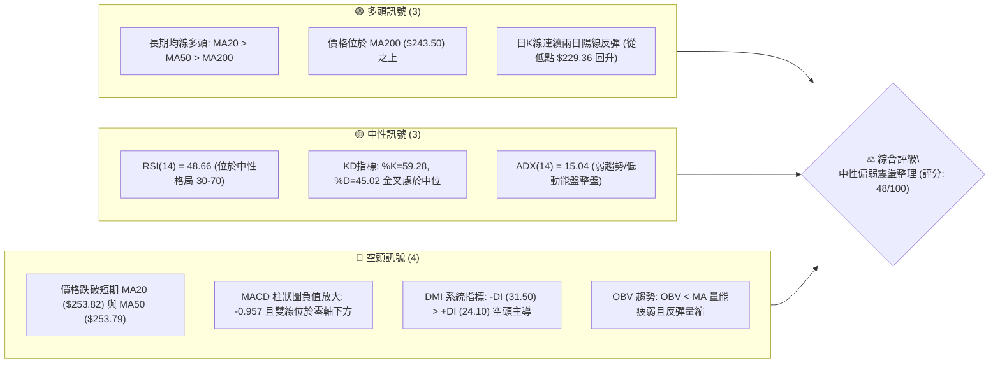
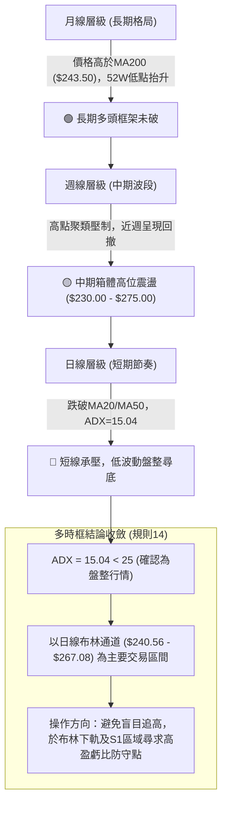
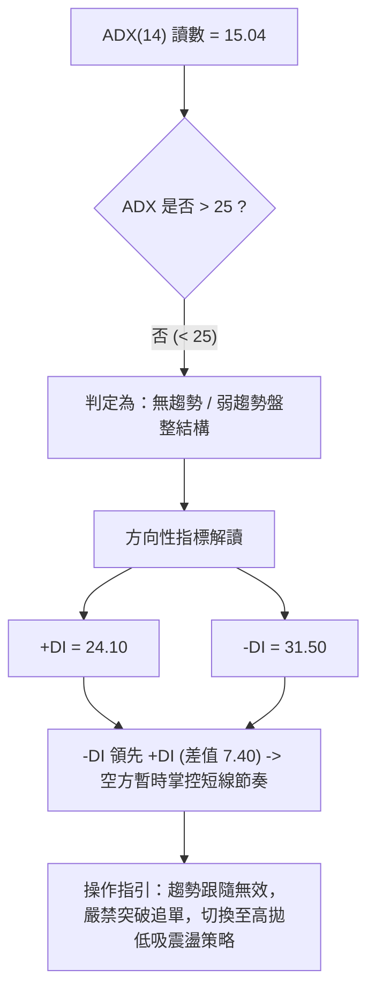
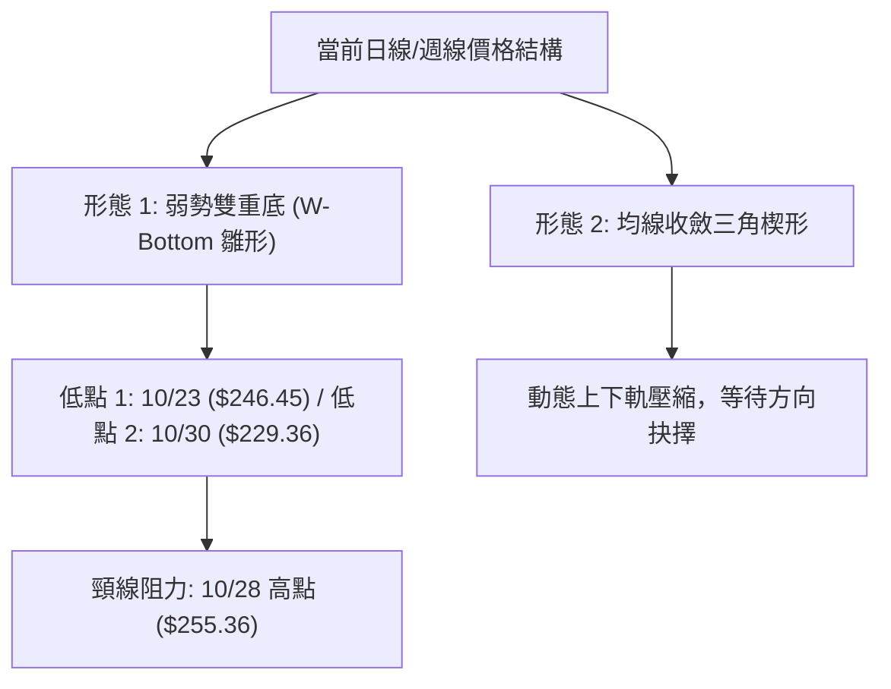
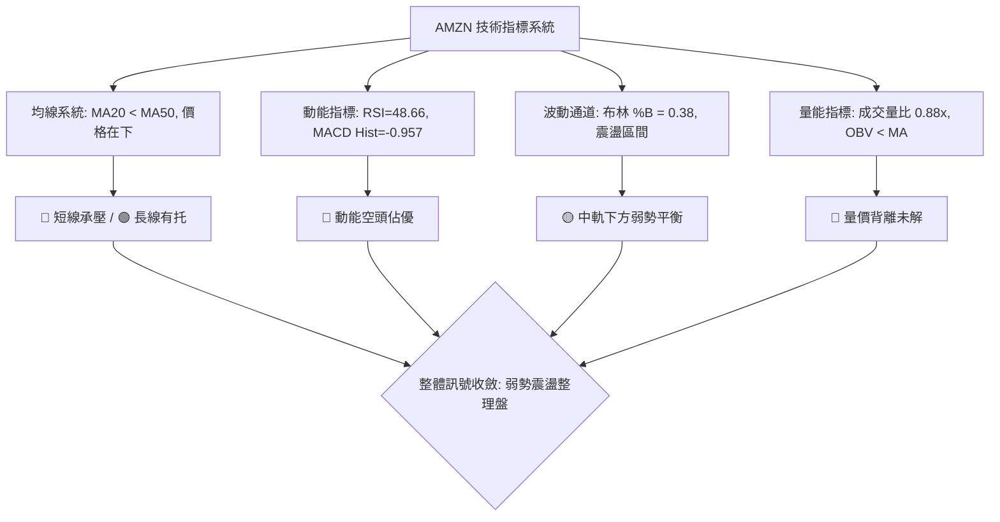
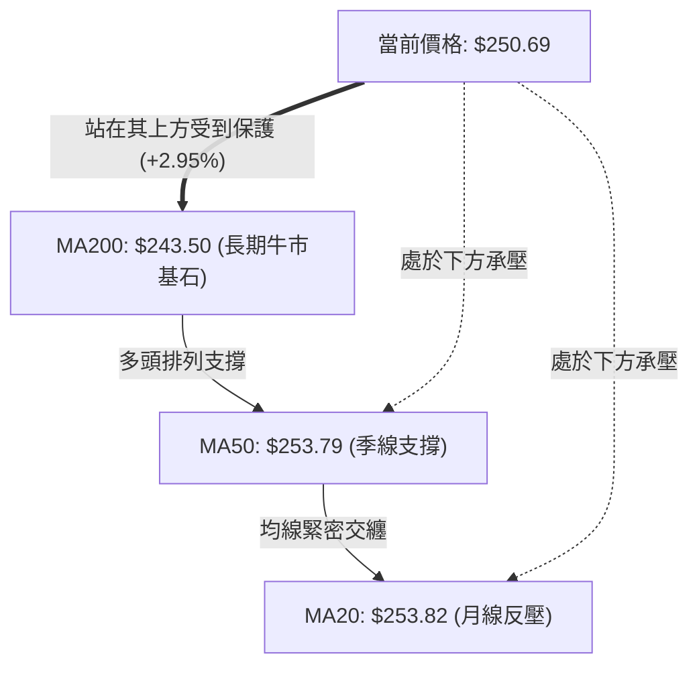
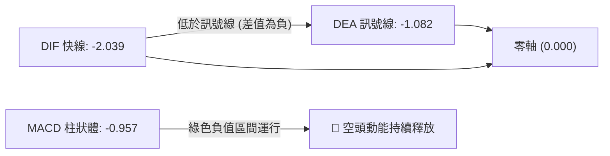
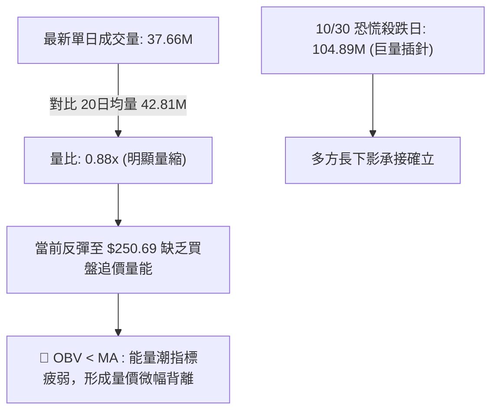
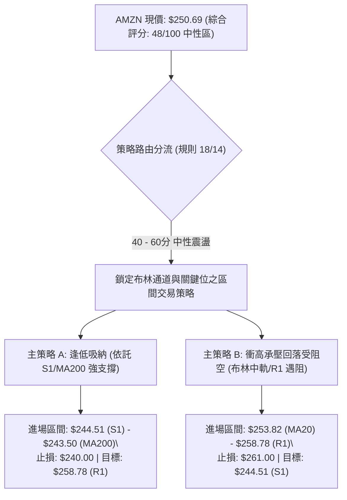
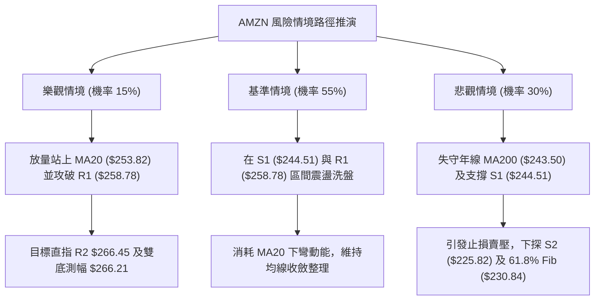

# AMZN 技術分析報告

> **報告日期**：2026-11-04 ｜ **語言**：繁體中文 ｜ **數據來源**：Yahoo Finance ｜ **當前價格**：$250.69

---

## 目錄

| 章節 | 內容 |
|------|------|
| [1. 技術面概覽](#1-技術面概覽) | 訊號儀表板、核心指標、評分卡 |
| [2. 趨勢分析](#2-趨勢分析) | 多時框趨勢、長中短期走勢 |
| [3. 圖表形態分析](#3-圖表形態分析) | 形態識別、K線組合、目標價 |
| [4. 支撐與阻力](#4-支撐與阻力) | 關鍵價位、斐波那契回調 |
| [5. 技術指標深度解讀](#5-技術指標深度解讀) | MA/RSI/MACD/布林/成交量 |
| [6. 動能與波動率](#6-動能與波動率) | 動能評估、ATR、Beta |
| [7. 多時框架總結](#7-多時框架總結) | 時框架評分矩陣 |
| [8. 交易策略建議](#8-交易策略建議) | 多空策略、風險報酬比 |
| [9. 風險提示與監控](#9-風險提示與監控) | 監控指標、風險場景 |

---

## 1. 技術面概覽

### 🎯 技術訊號儀表板



### 📊 核心指標速覽表

| 指標類別 | 指標名稱 | 當前數值 | 訊號 | 解讀 |
|----------|----------|----------|:---:|------|
| **價格** | 當前收盤價 | $250.69 | 🟡 | 位於52週區間($196.00–$287.20)之60.0%分位，處於波段震盪中軸 |
| **均線** | MA20 | $253.82 | 🔴 | 價格低於MA20，短線面臨下彎月線動態反壓 |
| **均線** | MA50 | $253.79 | 🔴 | 價格低於MA50，季線支撐轉為短壓 |
| **均線** | MA200 | $243.50 | 🟢 | 價格守在年線上方（高出約2.95%），中長期牛熊分水嶺未失守 |
| **動能** | RSI(14) | 48.66 | 🟡 | 位於40–50中性偏弱弱勢平衡區，未見極端超買或超賣 |
| **動能** | MACD (12,26,9) | -2.039 / -1.082 | 🔴 | MACD線位於訊號線下方，柱狀體為 -0.957，空方動能佔優 |
| **波動** | ATR(14) | $7.64 | 🟡 | 佔股價3.05%，波幅適中，提示單日平均震盪空間約7.6美元 |
| **趨勢** | ADX(14) | 15.04 | 🟡 | 數值低於25，代表無單邊趨勢，盤面屬於無方向震盪整理結構 |
| **通道** | 布林通道 | %B = 0.38 | 🟡 | 位於中軌($253.82)與下軌($240.56)之間，偏向弱勢震盪半區 |
| **籌碼量能** | 最新量/20日均量 | 37.65M / 42.81M | 🔴 | 量比0.88x，反彈未獲足夠買盤放量支持，量價配合欠佳 |

### 🏆 技術評分卡

```
╔══════════════════════════════════════════════════════════════╗
║                技術評分卡 — AMZN (2026-11-04)                 ║
╠══════════════════════════════════════════════════════════════╣
║ 趨勢強度 (Trend)     ███████░░░░░░░░░░░░░  35/100  🔴 空頭佔優║
║ 動能指標 (Momentum)  ████████░░░░░░░░░░░░  40/100  🔴 動能疲軟║
║ 支撐穩定度 (Support) ████████████░░░░░░░░  60/100  🟢 支撐尚穩║
║ 成交量配合 (Volume)  ████████░░░░░░░░░░░░  40/100  🔴 量能背離║
║ 形態完整度 (Pattern) ██████████░░░░░░░░░░  50/100  🟡 形態重組║
║ 均線排列 (Moving Avg)████████████░░░░░░░░  60/100  🟡 長多短空║
╠══════════════════════════════════════════════════════════════╣
║ 綜合評分 (Overall)   ██████████░░░░░░░░░░  48/100  🟡 中性觀望║
╚══════════════════════════════════════════════════════════════╝
※ 註：綜合評分由六項子評分算術平均得出：(35 + 40 + 60 + 40 + 50 + 60) ÷ 6 = 47.5 → 四捨五入為 48/100。
```

---

## 2. 趨勢分析

### 🌐 多時框趨勢分析



### 📈 長期趨勢 — 12個月走勢圖（Unicode）

```
AMZN 過去12個月月線收盤走勢圖 (2025-11 至 2026-11)
價格軸 ($)
$275 ┤                                  ●(07:271.58)
$270 ┤                          ●(05:270.64)
$265 ┤                      ●(04:265.06)      ●(08:259.77)
$260 ┤                                              
$250 ┤                                              ●(09:249.15)  ●(11:250.69 現價)
$245 ┤                                                    ●(10:240.35)
$240 ┤              ●(01:239.30)        ●(06:238.34)
$235 ┤●(11:233.22)
$230 ┤      ●(12:230.82)
$220 ┤
$210 ┤                      ●(02:210.00)
$205 ┤                          ●(03:208.27 底)
     └──────────────────────────────────────────────────────────────
      25/11 25/12 26/01 26/02 26/03 26/04 26/05 26/06 26/07 26/08 26/09 26/10 26/11
```

**走勢特徵分析表格**：

| 階段時間 | 起始價 → 結束價 | 漲跌幅 | 走勢特徵與結構意涵 |
|----------|-----------------|--------|--------------------|
| **2025/11 - 2026/01** | $233.22 → $239.30 | +2.61% | 高位箱體平台整固，籌碼均勻沉澱 |
| **2026/01 - 2026/03** | $239.30 → $208.27 | -12.97% | 春季波段深度回撤，探明年度低點結構 ($208.27) |
| **2026/03 - 2026/05** | $208.27 → $270.64 | +29.95% | 強勁主升浪展開，大陽線連續拉升並帶動MA均線金叉發散 |
| **2026/05 - 2026/07** | $270.64 → $271.58 | +0.35% | 多空拉鋸劇烈，於7月份創下收盤波段次高點 $271.58 |
| **2026/07 - 2026/10** | $271.58 → $240.35 | -11.50% | 頂部動能衰竭，逐月重心下移，回踩年線支撐區 |
| **2026/10 - 2026/11** | $240.35 → $250.69 | +4.30% | 於年線上緣 $240 附近出現技術性跌深反彈，修復日線破位架構 |

### 📊 中期趨勢（週線分析）

中期走勢圖展示近期重要壓力與支撐的空間排列：

```
中期週線空間架構圖 (最近20週核心區間)
$280 ┤               ▲ 波段天花板 (52W High $287.20 / R3 $276.65)
$270 ┤          ▲═══▲ 7-8月密集成交高點 ($271.58 - $274.48)
$265 ┤             ▲  8月回測反彈頸線 ($266.45 R2)
$260 ┤        ▲       9-10月阻力帶 ($258.78 R1)
$250 ┤─────────●───── ◄── 當前收盤價 ($250.69)，斐波那契 38.2% 回調位 ($252.36) 附近
$245 ┤    ▼           近期波段低點聚類支撐 (S1 $244.51 / MA200 $243.50)
$240 ┤  ▼             10/30恐慌低點測試位 ($240.35 / BB下軌 $240.56)
$230 ┤▼               強支撐區間 (S2 $225.82 / 斐波那契 61.8% $230.84)
```

週線指標分析顯示：週線 RSI 目前處於 48.7，MACD 柱狀體為 -0.957，儘管週 MACD 仍維持負值，但負值並未進一步擴大失控，顯示中期趨勢處於大級別箱體內的收斂調整，並非單邊主跌浪。

### ⚡ 趨勢強度評估（ADX 解讀）



**ADX 趨勢強度對照表**：

| ADX 區間 | 趨勢分類 | 盤面特徵 | 當前狀態判定 |
|:--------:|:--------:|----------|:------------:|
| **0 - 20** | **極弱趨勢 / 無方向盤整** | 均線相互糾纏，假突破頻繁，波動率收縮 | **當前處於此區間 (15.04)** 🟢 |
| **20 - 25** | **趨勢醞釀期** | 方向初現端倪，多空準備發力 | ❌ |
| **25 - 40** | **典型單邊趨勢** | 順勢交易勝率最高，均線發散推進 | ❌ |
| **40 - 60** | **強勁極端趨勢** | 走勢凌厲，動能飽和，警惕回撤 | ❌ |

---

## 3. 圖表形態分析

### 🔍 形態識別系統



**圖表形態信心度評估表（依規則 15）**：

| 形態名稱 | 信心度 | 判斷依據（引用數據） | 完成度 | 目標價（附計算式） |
|----------|:------:|----------------------|:------:|--------------------|
| **潛在雙重底 (W底)** | **55%** | 10/23 探低 $246.45 後反彈，10/30 下影線插針 $229.36 迅速收回 $240.35，形成雙針探底結構 | 65% | 頸線 $255.36 + 形態高度($255.36 - $244.51 = $10.85) = **$266.21**（接近阻力 R2 $266.45） |
| **區間矩形箱體** | **70%** | 價格持續在下軌支撐 S1 $244.51 與上方阻力 R1 $258.78 之間反覆拉鋸 | 85% | 向上破位目標：$258.78 + ($258.78 - $244.51 = $14.27) = **$273.05** |
| **頭肩頂形態** | **30%** | 左肩7月高點、頭部8月、右肩10月高點，但頸線支撐未有效破位（數據不足，僅屬假說） | 20% | *訊號不足，僅做指標型解讀，不具備可執行目標價* |

### 🕯️ 重要K線形態分析（嚴格依據近10根日K與近8根週K）

依規則 19，本節全部 K 線分析均嚴格鎖定指定區塊之真實開高低收數據：

| 週期/日期 | 開盤價 | 最高價 | 最低價 | 收盤價 | K線形態名稱 | 解讀與量價意義 | 訊號 |
|-----------|:------:|:------:|:------:|:------:|:-----------:|----------------|:----:|
| **日K 10/28** | $253.00 | $255.36 | $251.98 | $254.60 | **小陽反彈線** | 測試 MA20 壓力未果，成交量 34.91M 呈現縮量滯漲 | 🟡 |
| **日K 10/29** | $246.95 | $249.14 | $241.24 | $243.79 | **跳空大陰棒** | 跳空下行跌破MA200，成交量激增至 85.23M，空方主力宣洩籌碼 | 🔴 |
| **日K 10/30** | $232.54 | $241.55 | $229.36 | $240.35 | **長下影錘頭線** | 低開低走後在$229.36引發巨量抄底（104.89M），下影線達$10.99，多頭絕地反擊 | 🟢 |
| **日K 11/02** | $243.01 | $253.81 | $242.28 | $245.63 | **長上影小陽線** | 盤中衝高至$253.81受阻於MA20回落，成交量收縮至 58.35M，顯示解套賣壓沉重 | 🟡 |
| **日K 11/03** | $248.59 | $252.45 | $245.88 | $250.69 | **實體小陽線** | 重心進一步抬升，站穩$250關口，量能萎縮至 37.66M，呈現典型反彈量縮格局 | 🟡 |
| **週K 10/23** | $255.25 | $265.34 | $246.45 | $248.00 | **長上影轉折陰線**| 衝高遇阻於波段阻力區，多轉空跡象確立，單週成交量 196.71M | 🔴 |
| **週K 10/30** | $249.47 | $255.36 | $229.36 | $240.35 | **長下影放量錘線**| 週成交量爆出 292.22M 近期天量，確認下方 $230 區域買盤護盤強勁 | 🟢 |
| **週K 11/03** | $243.01 | $253.81 | $242.28 | $250.69 | **週中修復陽棒** | 連續修復前週跌幅，但量能僅 96.00M（週初階段），仍待後續驗證 | 🟡 |

### 📉 ASCII 走勢形態示意圖

```
AMZN 日線近兩週走勢與雙底築底示意圖
$265 ┤       ● 10/21 ($264.36)
$260 ┤        \
$255 ┤         \      ● 10/28頸線 ($255.36)
$250 ┤          \    / \         ● 11/03現價 ($250.69)
$245 ┤           ●──●   \       /
$240 ┤        10/23      ● 10/29  ● 10/30收 ($240.35)
$235 ┤       ($246.45)    \     /
$230 ┤                     ●───● 10/30插針低點 ($229.36)
     └─────────────────────────────────────────────────────
           底 1 (Left)              底 2 (Right Pin-bar)
```

### 🎯 形態目標價計算

1. **潛在雙重底反彈目標價推算**：
   - 形態頸線位置：$255.36（10/28 日K波段高點）
   - 形態底部基準：$244.51（採用支撐位 S1 計算之有效波段低點收盤帶）
   - 形態垂直高度 $H = \$255.36 - \$244.51 = \$10.85$
   - **突破頸線測幅目標** $= \text{頸線 } \$255.36 + H (\$10.85) = \mathbf{\$266.21}$（與阻力位 R2 $266.45 形成高度技術共振）
2. **區間矩形突破測幅推算**：
   - 箱體頂部：$258.78（阻力位 R1）
   - 箱體底部：$244.51（支撐位 S1）
   - 箱體厚度 $\Delta P = \$258.78 - \$244.51 = \$14.27$
   - **向上突破等距延伸** $= \$258.78 + \$14.27 = \mathbf{\$273.05}$（直逼波段強阻力 R3 $276.65 下緣）

---

## 4. 支撐與阻力

### 🗺️ 關鍵價位分布圖（Unicode）

```
AMZN 價位結構分布圖 (由 OHLCV 聚類計算)
═══════════════════════════════════════════════════════════════
$287.20 ║██████████████████████████████║ 52週歷史極值高點 (0.0% Fib)
$276.65 ║████████████████████████      ║ 強阻力 R3 (+10.36%)
$266.45 ║██████████████████            ║ 波段反彈阻力 R2 (+6.29%)
$265.68 ║▓▓▓▓▓▓▓▓▓▓▓▓▓▓▓▓▓▓            ║ 斐波那契 23.6% 回調位
$258.78 ║████████████                  ║ 短線首要阻力 R1 (+3.23%)
$253.82 ║──────────────────────────────║ 動態反壓 MA20 / 布林中軌
$252.36 ║······························║ 斐波那契 38.2% 回調位
$250.69 ╠══════════════════════════════╣ ◄── 當前收盤價 ($250.69)
$244.51 ║████████████                  ║ 近期波段關鍵支撐 S1 (-2.46%)
$243.50 ║──────────────────────────────║ 牛熊分水嶺 年線 MA200
$241.60 ║······························║ 斐波那契 50.0% 平衡中軸
$240.56 ║──────────────────────────────║ 布林通道動態下軌
$230.84 ║······························║ 斐波那契 61.8% 黃金分割強支撐
$225.82 ║██████████████████            ║ 中期強支撐 S2 (-9.92%)
$220.99 ║████████████████████████      ║ 長期防守支撐 S3 (-11.85%)
$196.00 ║██████████████████████████████║ 52週極值低點 (100.0% Fib)
═══════════════════════════════════════════════════════════════
```

### 🚧 阻力位分析表

所有數值嚴格引用「關鍵價位」區塊波段高點聚類數值：

| 阻力級別 | 準確價位 | 距現價空間 | 形成技術原因 | 突破難度評估 | 重要性級別 |
|:--------:|:--------:|:----------:|--------------|:------------:|:----------:|
| **R1** | **$258.78** | +3.23% | 近一年波段高點密集成交區下沿，近逼 MA60 ($255.41) 壓制帶 | 🟡 中等阻力（需日成交量 > 45M 配合） | 高（短期多空分水嶺） |
| **R2** | **$266.45** | +6.29% | 斐波那契 23.6% ($265.68) 共振區，8月與10月中旬反彈平台阻力 | 🔴 強阻力（積累大量套牢籌碼） | 極高（波段趨勢轉強標誌）|
| **R3** | **$276.65** | +10.36%| 7月下旬與8月上旬波段頭部頂點密集區，直逼52週高點 $287.20 | 🔴 極強阻力（歷史天花板賣壓） | 戰略級強阻力 |

### 🛡️ 支撐位分析表

所有數值嚴格引用「關鍵價位」區塊波段低點聚類數值：

| 支撐級別 | 準確價位 | 距現價空間 | 形成技術原因 | 守住機率評估 | 重要性級別 |
|:--------:|:--------:|:----------:|--------------|:------------:|:----------:|
| **S1** | **$244.51** | -2.46% | 近一年波段低點密集聚類位，且緊鄰 MA200 年線 ($243.50) | 🟢 75% 機率有效防守 | 核心防線（多頭最後堡壘）|
| **S2** | **$225.82** | -9.92% | 斐波那契 61.8% ($230.84) 下方強力買盤區，今年春季平台突破口 | 🟢 85% 機率守住 | 中期多頭基石 |
| **S3** | **$220.99** | -11.85%| 2024年底及2025年多次波段低點重合帶，跌破則長期多頭結構瓦解 | 🟢 95% 極高防禦力 | 長期牛市底線 |

### 📐 斐波那契回調位分析

依據 52 週極值區間（低點 $196.00 至高點 $287.20，總垂直空間 $91.20）計算：

| 斐波那契回調級別 | 準確價位 | 相對現價位置 | 技術解讀與行為金融分析 |
|:----------------:|:--------:|:------------:|------------------------|
| **0.0% (52W High)** | **$287.20** | 現價上方 +14.56% | 52週極限頂部，本輪牛市行情的最高阻力臨界值 |
| **23.6%** | **$265.68** | 現價上方 +5.98% | 極弱回調支撐位，現已轉化為強大反壓，靠近 R2 ($266.45) |
| **38.2%** | **$252.36** | **現價附近 (+0.67%)** | **當前多空交鋒核心分界線**。現價 $250.69 處於此位下方僅 1.67 美元，突破此處才能確認短線築底成功 |
| **50.0%** | **$241.60** | 現價下方 -3.63% | 行情中性平衡中軸，與布林下軌 ($240.56) 及年線 ($243.50) 形成強大防護緩衝墊 |
| **61.8%** | **$230.84** | 現價下方 -7.92% | 黃金分割強防守位，10/30 下影線插針至 $229.36 觸及此線立即迎來爆發性買盤 |
| **78.6%** | **$215.52** | 現價下方 -14.03%| 深度回撤防線，多頭極端防禦水位 |
| **100.0% (52W Low)**| **$196.00** | 現價下方 -21.82%| 52週循環低點，戰略估值底部 |

*位置判讀結論*：AMZN 現價 $250.69 正好卡在 **38.2% ($252.36)** 與 **50.0% ($241.60)** 回調位之間進行窄幅蓄勢，代表當前市場回調屬於多頭循環中的「健康修正區間」，並未跌入 >61.8% 的惡性空頭下挫。

---

## 5. 技術指標深度解讀

### 🎛️ 指標訊號總覽



### 📈 移動平均線排列分析



均線系統精確數值狀態評估：
- **MA5 ($247.01) / MA10 ($249.80)**：短期均線已由下向上翹頭（MA5 +1.49%、MA10 +0.36%），價格站在五日與十日均線之上，提供極短線的超跌反彈動能。
- **MA20 ($253.82) / MA50 ($253.79)**：月線與季線近乎重合，僅相差 0.03 美元，目前在 $253.80 附近形成死叉鈍化與重型共振動態天花板。
- **MA60 ($255.41) / MA120 ($253.09)**：中期均線走勢微幅下彎，限制了多頭一次性反轉突破的空間。
- **MA200 ($243.50) / MA240 ($241.50)**：長期年線與雙年線穩步上行（MA240 +3.80%），長多格局未遭破壞。

### 📉 RSI(14) 分析

當前數值：**48.66**（Wilder 計算法則）
- 進度條展示：`[██████████░░░░░░░░░░] 48.66%`
- **狀態定位**：位於 40–60 中性震盪軸線，未進入 <30 的超賣區域，亦未觸及 >70 的超買警戒。
- **背離分析判斷**：系統數據顯示「無明顯背離」。比對近 20 根 K 棒的首尾表現，價格自高點回調後在 $240–$250 築底，RSI 同步自低位回彈至 48.66，指標與價格波動步調一致，未發生價格創低指標不破低的標準底背離，亦無頂背離跡象，顯示當前為純粹的動能中立修復。

### 📊 MACD(12,26,9) 訊號解讀



- **絕對數值解讀**：MACD 線 (-2.039) 與 Signal 線 (-1.082) 雙雙浸泡於零軸以下，反映大背景受中短期空頭壓制。
- **動能演變**：柱狀體目前為 -0.957，相較於週線回調期的極端負值有所緩和，但尚未出現柱狀體收斂轉正的「金叉買入訊號」，多方尚不具備連續性單邊反攻條件。

### 📦 布林通道分析

```
布林通道 (20日, 2倍標準差) 空間分佈
$267.08 ┤═══════════════════════════════════ 上軌 (+6.54% 擴張壓力)
$260.00 ┤
$253.82 ┤─────────────────────────────────── 中軌 (MA20 動態多空線)
$250.69 ┤               ● 現價 ($250.69, %B = 0.38)
$245.00 ┤
$240.56 ┤═══════════════════════════════════ 下軌 (-4.04% 邊界支撐)
```

- **通道帶寬與形態**：通道上下軌間距為 $26.52（寬度約 10.5%），呈中度水平收斂態勢。
- **%B 指標深度解析**：%B 讀數為 **0.38**，明確指示價格落於下半通道（0 為下軌，0.5 為中軌，1 為上軌）。此位置顯示市場處於弱勢反彈格局，中軌 $253.82 為第一道難以跨越的動態阻力線。

### 💹 成交量分析（量價配合度）



- **量價背離特徵**：股價自 10/30 低點 $229.36 連續反彈至 $250.69，但成交量從 104.89M 銳減至 58.35M，再縮減至 37.66M，呈現「價漲量縮」的背離現象。此現象證明本次反彈主要為空頭回補與惜售籌碼所致，並無新主力機構大舉進場搶籌，預示一旦遭遇 MA20 反壓，極易再度遇阻回落。

---

## 6. 動能與波動率

### ⚡ 動能評估四象限

| 象限 | 動能強度 | 波動率水準 | 典型市場特徵 | 當前標的狀態判定 |
|:----:|:--------:|:----------:|--------------|:----------------:|
| **Q1 (主升/主跌浪)** | 強 (ADX>25) | 低 (ATR%<2.5%) | 穩定單邊趨勢，極佳波段持有機會 | ❌ |
| **Q2 (盤整修復期)** | **弱 (ADX<25)** | **低至中 (ATR%=3.05%)** | **動能疲弱，區間洗盤，以防守觀望為主** | **AMZN 當前定位於此象限 (Q2)** 🟢 |
| **Q3 (爆發突破期)** | 強 (ADX>25) | 高 (ATR%>4.0%) | 劇烈單邊行情，高收益伴隨極高回撤 | ❌ |
| **Q4 (恐慌震盪期)** | 弱 (ADX<25) | 高 (ATR%>4.0%) | 暴漲暴跌無方向，極易引發雙向洗盤止損 | ❌ |


### 📊 ATR 波動率分析

- **ATR(14) 讀數**：**$7.64**（佔當前股價之 3.05%，採 Wilder 平滑計算法）。
- **實務交易涵義**：
  1. AMZN 單日正常期望波動波幅約為 ±$7.64 美元。
  2. **止損設定標準**：短線波段操作建議設置 $1.5 \times \text{ATR}$（即 $1.5 \times \$7.64 = \mathbf{\$11.46}$）的安全緩衝距離，以防日內雜訊震盪引發無謂掃損。
  3. **加碼間隔距離**：若建立趨勢倉位，加碼間隔需拉開至少 $1.0 \times \text{ATR}$（即 $7.64 美元）以上，以確保資金安全邊際。

### 📐 Beta 與市場相關性

- **Beta 數值**：**1.503**。
- **解讀與意涵**：
  - AMZN 具備極強的高彈性科技權值股屬性，理論波動幅度約為 S&P 500 指數的 1.50 倍。
  - 當大盤納斯達克反彈時，AMZN 反彈動力理論上更強；但當前由於其個別技術面受制於 MA20/MA50，若大盤出現系統性回撤，AMZN 將因高 Beta 特性而承受更劇烈的向下放大拋售壓力。
  - **機構籌碼覆蓋**：機構持股佔比 68.7%，空頭部位比例僅 0.9%（Short Ratio 2.6），顯示長期機構法人並未進行大舉放空，目前主要是被動資金與對沖基金的短線調倉行為。

---

## 7. 多時框架總結

### 📋 時框架評分表

| 時框架 | 趨勢方向 | 動能狀態 | 均線排列特徵 | 關鍵圖表形態 | 評分 (1-100) | 操作指引 |
|:------:|:--------:|:--------:|:------------:|:------------:|:------------:|:--------:|
| **月線 (長期)** | 🟢 向上偏多 | 🟡 中性平緩 | 多頭排列 (股價 > MA200) | 大級別牛市回撤整固 | **70/100** | 核心長線底倉維持續抱 |
| **週線 (中期)** | 🟡 橫向震盪 | 🔴 偏弱死叉 | 箱體纏繞，壓制於布林中軌 | $230-$275 寬幅整理箱體 | **50/100** | 波段高拋低吸，降低預期 |
| **日線 (短期)** | 🔴 弱勢反彈 | 🔴 空方主導 | 壓制於 MA20/MA50 之下 | 雙底雛形但遭遇量縮阻礙 | **35/100** | 逢高減磅，等待回踩再確認 |

### 🔲 綜合訊號矩陣

```
時框跨度 ───────── 短期 (日線) ───────── 中期 (週線) ───────── 長期 (月線)
趨勢方向            🔴 看空/偏弱          🟡 震盪整理          🟢 維持多頭
動能指標            🔴 空頭佔優          🔴 弱勢收斂          🟡 中性平穩
成交量能            🔴 量價背離          🟡 爆量後萎縮        🟢 籌碼鎖定良好
形態位置            🟡 雙底反彈中        🟡 箱體中下沿        🟢 守住年線上緣
綜合權重評估        25%                  45%                  30%
```

### ⚖️ 多時框收斂結論（依規則 14 明確收斂）

1. **行情模式判斷**：
   - 當前日線 ADX(14) 讀數為 **15.04 (< 25)**，嚴格判定當前盤面**非趨勢行情，而是標準的盤整震盪行情**。
2. **多時框優先級權衡**：
   - 依據規則 14 之規定：「盤整行情（ADX<25）以日線布林通道上下軌為主要交易區間」。
   - 當前中長期（週線、月線）均線雖維持多頭框架，但日線短週期受到 MA20 ($253.82) 與 MA50 ($253.79) 的重壓，加之量能萎縮，短期內直接發動單邊暴漲的機率極低。
3. **唯一方向性結論**：
   - **中性偏空觀望，定義為布林通道內的弱勢箱體整理結構**。
   - 價格上限受制於布林中軌 $253.82 及阻力 R1 $258.78，下限受年線 MA200 ($243.50) 與支撐 S1 $244.51 保護。本結論與第 1 章技術評分卡之 **48/100（中性偏弱）** 嚴格保持一致。

---

## 8. 交易策略建議

### 🗺️ 策略決策流程圖



### 🧭 策略路由（依評分卡分流）

> **當前主策略方向 = 中性區間震盪操作（依評分 48/100）**
> 
> 由於綜合評分處於 40–60 之間，ADX 僅 15.04，市場無單邊趨勢，故本報告嚴禁推薦盲目追單的多空極端策略。主策略以**布林通道上下軌及 S1/R1 關鍵價位間的高拋低吸區間交易**為主，嚴格執行防守止損。

### 🎯 價格情境階梯（Price Scenarios）

以當前收盤價 **$250.69** 為基準，所有價位嚴格引用第 4 章數據：

| 觸發條件 | 下一目標價 | 後續延伸價位 | 行情情境含義與操作對策 |
|----------|:----------:|:------------:|------------------------|
| **強勢向上突破 R1 ($258.78)** | **R2 ($266.45)** | **R3 ($276.65)** | 短線空頭結構被徹底扭轉，多頭重啟波段攻勢，可加碼順勢跟進 |
| **受阻於 MA20 ($253.82) 震盪** | **$250.69 (現價)** | **S1 ($244.51)** | 典型的反彈遇阻弱勢整理，維持在區間內洗盤，等待新催化劑 |
| **有效向下破位 S1 ($244.51)** | **S2 ($225.82)** | **S3 ($220.99)** | 年線 MA200 失守，波段演變為深度殺跌，必須嚴格止損退出所有多單 |

### 📊 情境機率分佈

| 行情情境預測 | 機率估計 | 主要技術指標支撐依據 |
|--------------|:--------:|----------------------|
| **情境一：延續弱勢區間震盪** | **55%** | ADX = 15.04 指示無單邊趨勢，RSI 居於 48.66 中位，布林帶寬中度維持 |
| **情境二：回落測試年線支撐** | **30%** | MACD 處於零軸下方（柱狀體 -0.957），且最新量比僅 0.88x，量縮反彈動能衰竭 |
| **情境三：放量向上突破反轉** | **15%** | 必須同時突破 MA20 ($253.82) 與 R1 ($258.78)，需單日爆出 >60M 巨量方可成立 |

### 🟢 主策略詳情（區間震盪雙向策略）

依規則 17 計算風險報酬比：$\text{風險報酬比} = (\text{目標價 T1} - \text{進場價}) \div (\text{進場價} - \text{止損價})$。做空時相反。

| 策略要素 | 策略 A（區間逢低做多） | 策略 B（區間遇阻做空） |
|----------|------------------------|------------------------|
| **進場條件** | 股價回踩 S1 支撐位或年線，出現分時止跌信號 | 股價反彈至 MA20/R1 區域縮量滯漲，出現長上影線 |
| **進場價格** | **$244.51**（嚴格引用支撐位 S1） | **$256.30**（以 R1 $258.78 與 MA20 $253.82 之中點計） |
| **止損價格** | **$240.00**（跌破布林下軌 $240.56 之安全防線） | **$261.00**（突破 R1 $258.78 向上擴張 2.22 美元） |
| **目標價 T1** | **$253.82**（布林中軌 / MA20 動態反壓） | **$244.51**（近期支撐位 S1） |
| **目標價 T2** | **$258.78**（阻力位 R1） | **$240.56**（布林通道下軌） |
| **風險報酬比 (T1)** | **1 : 2.06**（以 T1 計）<br>$(253.82 - 244.51) \div (244.51 - 240.00) = 9.31 \div 4.51$ | **1 : 2.51**（以 T1 計）<br>$(256.30 - 244.51) \div (261.00 - 256.30) = 11.79 \div 4.70$ |
| **風險報酬比 (T2)** | **1 : 3.16**（以 T2 計）<br>$(258.78 - 244.51) \div (244.51 - 240.00) = 14.27 \div 4.51$ | **1 : 3.35**（以 T2 計）<br>$(256.30 - 240.56) \div (261.00 - 256.30) = 15.74 \div 4.70$ |
| **預估勝率** | 60% | 55% |
| **建議倉位** | 10% - 15% 基礎倉位 | 5% - 10% 輕倉防守試單 |

### 🔴 反向風險觸發點（對沖提示）

- **多頭止盈/止損觸發點**：若價格帶量跌破 **$243.50**（MA200 年線），多頭邏輯完全失效，必須市價離場。
- **空頭平倉/轉向觸發點**：若日線實體大陽線收盤站上 **$258.78**（R1），並伴隨單日成交量突破 60M，空頭結構終結，應立即空翻多。

### ⭐ 整體訊號強度評星

```
做多訊號強度：★★☆☆☆  (2/5 星 - 僅具備超跌支撐，缺乏向上發散量能)
做空訊號強度：★★★☆☆  (3/5 星 - 中短期均線反壓沉重，動能指標偏空)
整體可信度：  ★★★☆☆  (3/5 星 - ADX 處於低位，需嚴密防範假突破風險)
```

---

## 9. 風險提示與監控

### ✅ 關鍵監控指標 Checklist

```
╔══════════════════════════════════════════════════════════════╗
║                   盤面動態監控清單 (Checklist)               ║
╠══════════════════════════════════════════════════════════════╣
║ [ ] 價格能否有效站穩 38.2% 斐波那契回調位 ($252.36)          ║
║ [ ] 日成交量能否回升至 20日均量 (42.81M) 之上（確認量價配合） ║
║ [ ] MACD 柱狀體能否由負值 (-0.957) 持續收縮至零軸以上         ║
║ [ ] ADX(14) 讀數是否自 15.04 抬升至 20 以上（確認趨勢成型）  ║
║ [ ] 價格若回踩，MA200 年線 ($243.50) 是否出現強大下影線承接  ║
║ [ ] RSI(14) 能否突破 50 榮枯線並維持在 55 以上強勢區間       ║
╚══════════════════════════════════════════════════════════════╝
```

### ⚠️ 風險場景分析



### 🛡️ 風險管理重要提醒

1. **嚴禁震盪市中追漲殺跌**：
   - 當前市場 ADX 僅 15.04，典型的無趨勢盤整市，在布林中軌附近（$253.82）追高極易遭受反噬。一切開倉必須在區間邊緣（靠近 S1 或靠近 R1）進行。
2. **倉位配置原則**：
   - 總風險暴險不得超過投資組合總資金的 1.5%。單筆交易最大虧損額限制在總資產的 0.5% 之內。
3. **重大基本面外生變數防範**：
   - 注意近期科技股大盤（Nasdaq）與半導體族群的波動傳導；AMZN Beta 高達 1.503，在系統性拋售時回撤速度極快，必須無條件執行停損紀律。

---

## 📋 報告總結

```
╔══════════════════════════════════════════════════════════════════╗
║                   AMZN 技術分析報告總結                        ║
╠══════════════════════════════════════════════════════════════════╣
║ 報告日期：2026-11-04                                             ║
║ 當前價格：$250.69 USD                                            ║
║ 分析評級：⚖️ 中性觀望 / 區間震盪整理 (評分: 48/100)               ║
║                                                                  ║
║ 關鍵結論：                                                       ║
║ ├─ 長期趨勢：🟢 偏多（價格穩守於 MA200 $243.50 之上，長多基石在） ║
║ ├─ 中期趨勢：🟡 震盪（處於 $230 - $275 寬幅箱體消化階段）       ║
║ ├─ 短期趨勢：🔴 偏弱（受制於 MA20 $253.82 與量價背離，動能待補） ║
║ ├─ 關鍵支撐：S1 $244.51 / 年線 MA200 $243.50 / S2 $225.82         ║
║ ├─ 關鍵阻力：MA20 $253.82 / R1 $258.78 / R2 $266.45             ║
║ └─ 分析師目標：華爾街平均目標價 $326.74 (當前屬技術面修復期)     ║
║                                                                  ║
║ 最優策略組合：                                                   ║
║ 1. 🥇 最佳機會：依託支撐位 S1 ($244.51) 逢低輕倉做多，防守 $240  ║
║ 2. 🥈 次選機會：反彈至阻力位 R1 ($258.78) 縮量遇阻時反手做空    ║
║ 3. 🥉 保守選擇：完全空倉觀望，靜待日線有效突破 MA20 後再行決策  ║
╚══════════════════════════════════════════════════════════════════╝
```

---

> ⚠️ **免責聲明**：本報告為技術分析研究，所有數據、圖表及價位推演均嚴格基於所提供的歷史交易數據進行量化解構。本報告**僅供專業研究與學術參考**，**不構成任何形式的要約、招攬或具體投資建議**。市場具有高度不確定性，金融衍生品與股票交易伴隨資本虧損風險，投資者入市前應獨立評估自身風險承受能力並恪守風控紀律。

---

*報告生成時間：2026-11-04 ｜ 數據來源：Yahoo Finance ｜ 分析框架：多時框技術分析模型*