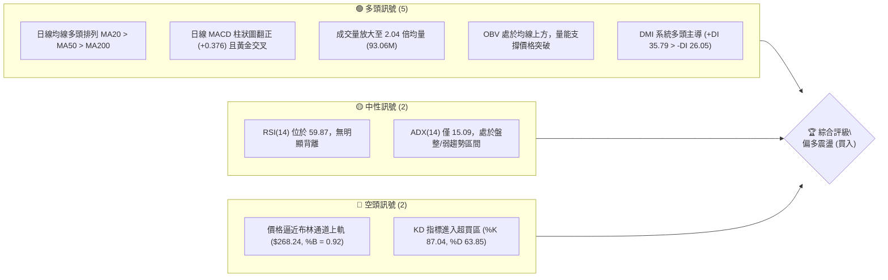
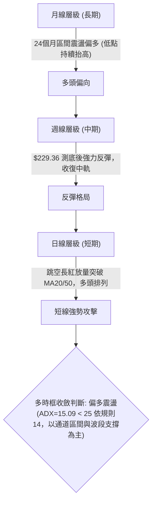
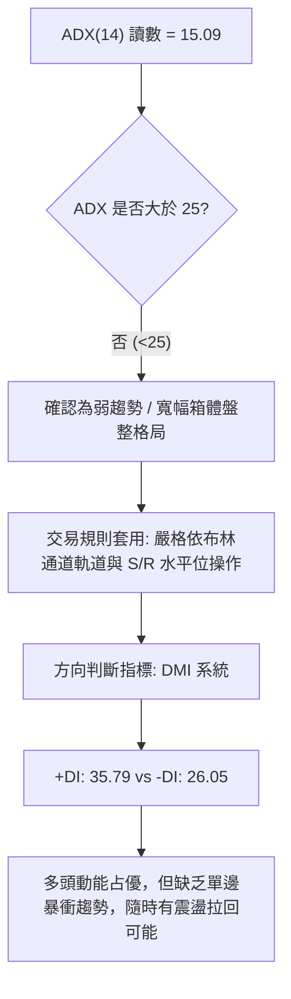
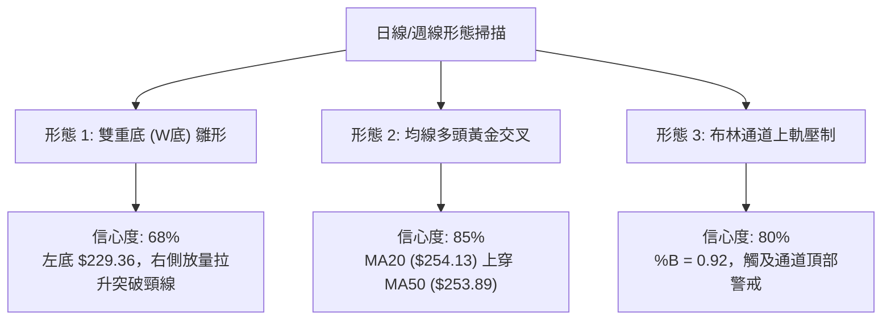
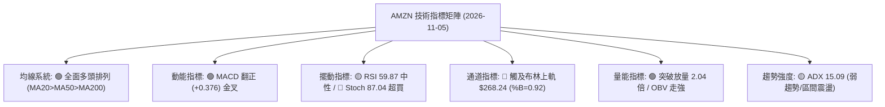
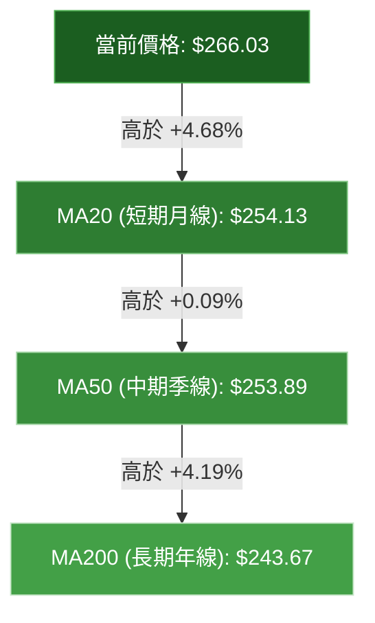
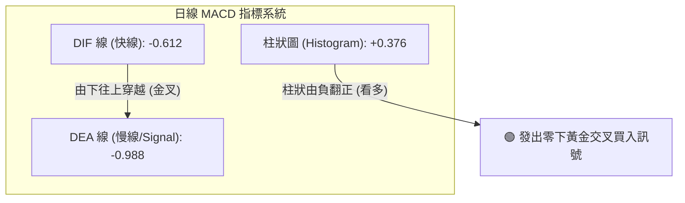
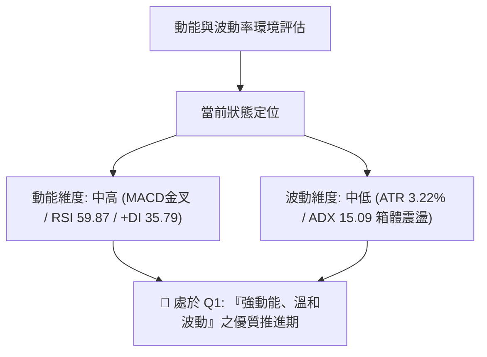
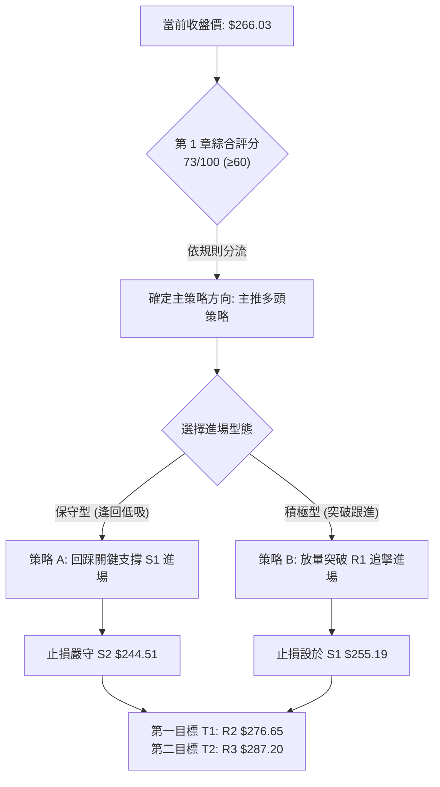
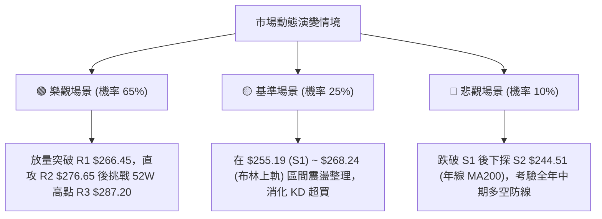

# AMZN 技術分析報告

> **報告日期**：2026-11-05 ｜ **語言**：繁體中文 ｜ **數據來源**：Yahoo Finance ｜ **當前價格**：$266.03

---

## 目錄

| 章節 | 內容 |
|------|------|
| [1. 技術面概覽](#1-技術面概覽) | 訊號儀表板、核心指標、評分卡 |
| [2. 趨勢分析](#2-趨勢分析) | 多時框趨勢、長中短期走勢 |
| [3. 圖表形態分析](#3-圖表形態分析) | 形態識別、K線組合、目標價 |
| [4. 支撐與阻力](#4-支撐與阻力) | 關鍵價位、斐波那契回調 |
| [5. 技術指標深度解讀](#5-技術指標深度解讀) | MA/RSI/MACD/布林/成交量 |
| [6. 動能與波動率](#6-動能與波動率) | 動能評估、ATR、Beta |
| [7. 多時框架總結](#7-多時框架總結) | 時框架評分矩陣 |
| [8. 交易策略建議](#8-交易策略建議) | 多空策略、風險報酬比 |
| [9. 風險提示與監控](#9-風險提示與監控) | 監控指標、風險場景 |

---

## 1. 技術面概覽

### 🎯 技術訊號儀表板



### 📊 核心指標速覽表

| 指標類別 | 指標名稱 | 當前數值 | 訊號 | 解讀 |
|----------|----------|----------|------|------|
| **價格** | 當前收盤價 | $266.03 | 🟢 | 單日大漲放量，收復 52 週區間高檔 76.8% 位置 |
| **均線** | MA20 | $254.13 | 🟢 | 現價高於 MA20 達 +4.68%，短期趨勢向上推升 |
| **均線** | MA50 | $253.89 | 🟢 | 現價高於 MA50，MA20 剛金叉 MA50 形成支撐 |
| **均線** | MA200 | $243.67 | 🟢 | 現價高於長期生命線 MA200 達 +9.18%，長線結構穩固 |
| **動能** | RSI(14) | 59.87 | 🟡 | 位於中性偏強區間，未破 70 超買警戒線，無背離 |
| **動能** | MACD 柱狀圖 | +0.376 | 🟢 | MACD 線 (-0.612) 金叉 Signal (-0.988)，動能轉多 |
| **擺動** | Stoch %K / %D | 87.04 / 63.85 | 🔴 | %K 突破 80 進入超買，短線防範獲利回吐震盪 |
| **趨勢** | ADX(14) | 15.09 | 🟡 | 數值 < 25，顯示大格局仍屬大箱體盤整，非單邊噴發 |
| **通道** | 布林通道 %B | 0.92 | 🔴 | 價格緊貼上軌 ($268.24)，上方空間受壓制 |
| **量能** | 20日成交量比 | 2.04x | 🟢 | 成交量 93.06M 遠超 20 日均量 (45.67M)，機構介入 |
| **波動** | ATR(14) | $8.58 | 🟡 | 佔現價 3.22%，屬正常波動幅度，設定止損標準參照 |

### 🏆 技術評分卡

```
╔════════════════════════════════════════════════════════════════╗
║                   技術評分卡 — AMZN (2026-11-05)              ║
╠════════════════════════════════════════════════════════════════╣
║ 趨勢強度      ████████████░░░░░░░░  60/100  🟡 中性 (ADX弱)    ║
║ 動能指標      ██████████████░░░░░░  70/100  🟢 看多 (MACD金叉) ║
║ 支撐穩定度    ████████████████░░░░  80/100  🟢 堅固 (均線匯聚) ║
║ 成交量配合    ██████████████████░░  90/100  🟢 極佳 (量比2.04x)║
║ 形態完整度    ████████████░░░░░░░░  60/100  🟡 震盪箱體反彈    ║
║ 均線排列      ████████████████░░░░  80/100  🟢 多頭排列確立    ║
╠════════════════════════════════════════════════════════════════╣
║ 綜合評分      ██████████████░░░░░░  73/100  🟢 偏多 (買入)     ║
╚════════════════════════════════════════════════════════════════╝
*註：綜合評分 = (60 + 70 + 80 + 90 + 60 + 80) ÷ 6 = 73.33，四捨五入取 73/100（依規則 18）
```

---

## 2. 趨勢分析

### 🌐 多時框趨勢分析



### 📈 長期趨勢 — 12個月走勢圖（Unicode）

依據 2025-12 至 2026-11 歷史收盤數據繪製：

```
AMZN 月線走勢圖（過去12個月：2025-12 至 2026-11）
價格 ($)
$275 ┤                                  ●(07月:$271.58)
$270 ┤                          ●(05月:$270.64)  
$265 ┤                      ●(04月:$265.06)             ●(11月:$266.03 現價)
$260 ┤                                              ●(08月:$259.77)
$250 ┤                                                  ●(09月:$249.15)
$240 ┤              ●(01月:$239.30) ●(06月:$238.34)         ●(10月:$240.35)
$230 ┤  ●(12月:$230.82)
$220 ┤
$210 ┤          ●(02月:$210.00)
$205 ┤              ●(03月:$208.27 低點)
     └──────────────────────────────────────────────────────────────
        12   01   02   03   04   05   06   07   08   09   10   11 (月份)
```

#### 走勢特徵分析表格

| 階段區間 | 起始-結束收盤價 | 漲跌幅 | 走勢特徵解讀 |
|----------|-----------------|--------|--------------|
| **2025-12 ~ 2026-03** | $230.82 → $208.27 | -9.77% | 第一季壓回築底，於 $208.27 見波段次低點，確認 52W 低點 $196.00 支撐有效。 |
| **2026-03 ~ 2026-05** | $208.27 → $270.64 | +29.95% | 強烈 V 型反轉，放量突破多道均線，奠定全年中期多頭架構。 |
| **2026-05 ~ 2026-07** | $270.64 → $271.58 | +0.35% | 高檔箱體劇烈震盪，06 月拉回 $238.34 後 07 月再度推升至 $271.58。 |
| **2026-07 ~ 2026-10** | $271.58 → $240.35 | -11.50% | 逐月回檔修正，10 月回測 $240.35（貼近斐波那契 50.0% $241.60）。 |
| **2026-10 ~ 2026-11** | $240.35 → $266.03 | +10.68% | 11 月開局強勢反彈，單週長陽包覆前週黑K，重返所有均線之上。 |

### 📊 中期趨勢（週線分析）

中期走勢呈現大型「寬幅箱體震盪」。10 月底回測 $229.36 低點後，收盤迅速拉回至 $240.35，隨後一週（2026-11-04）以大陽線收在 $266.03，確立週線等級的假跌破真反彈。

```
中期週線關鍵價位示意圖
═══════════════════════════════════════════════════════════════
$287.20 ─────────────────────────────── 52週高點 / 阻力 R3
            ▲
$276.65 ────┼────────────────────────── 波段阻力 R2
            │
$266.45 ────┼────────● ($266.03) ────── 近期阻力 R1 / 現價緊貼
            │       ▲ (大陽線拉升)
$255.19 ────┼───────┴────────────────── 波段支撐 S1 / MA20-MA50
            │
$244.51 ────┼────────────────────────── 關鍵強支撐 S2 / MA200
            ▼
$225.82 ─────────────────────────────── 中期防守支撐 S3
═══════════════════════════════════════════════════════════════
```

### ⚡ 趨勢強度評估（ADX 解讀）



#### ADX 指標強度對照表

| 指標名稱 | 實際數值 | 參考標準門檻 | 當前技術意涵 | 策略指引 |
|----------|----------|--------------|--------------|----------|
| **ADX(14)** | **15.09** | 0 ~ 20: 極弱趨勢/完全盤整<br/>20 ~ 25: 弱趨勢醞釀<br/>> 25: 強趨勢成型 | 市場無單邊單向推進動能，當前強彈屬區間擺盪的一環。 | 不宜過度追高，採取逢回踩支撐低吸、逢阻力獲利了結。 |
| **+DI** | **35.79** | 高於 -DI 且 > 25 | 多方買盤佔據主導優勢，短線推升力道強勁。 | 短線順多方方向操作，勝率較高。 |
| **-DI** | **26.05** | 低於 +DI | 空方殺跌力道衰竭，處於被動退守。 | 跌勢暫時緩解，不易形成連續崩跌。 |

---

## 3. 圖表形態分析

### 🔍 形態識別系統



#### 圖表形態信心度表格（依規則 15）

| 形態名稱 | 信心度 | 判斷依據（引用數據） | 完成度 | 目標價（附計算式，依規則 13） |
|----------|--------|----------------------|--------|------------------------------|
| **波段雙重底 (W底)** | **68%** | 2026-10-30 於低點 $229.36 獲得強支撐拉出長下影線（見支撐 S3 $225.82 附近），隨後於 2026-11-04 以大成交量 93.06M 突破 2026-10-28 波段高點頸線 $255.36。 | **85%** | 由雙底形態推算：<br/>頸線 $255.36 + 形態高度 ($255.36 - $229.36 = $26.00) = **$281.36**。<br/>*(註：此目標價由雙底形態推算；而固定阻力階梯則引用 R2 $276.65 與 R3 $287.20)* |
| **均線多頭排列交叉** | **85%** | MA20 ($254.13) > MA50 ($253.89) > MA200 ($243.67)，形成標準多頭排列，且短天期 MA5 ($249.30) 呈現陡峭向上走勢。 | **100%** | 指標型突破，無固定幾何高度，上方第一阻力看 R1 $266.45，次看 R2 $276.65。 |
| **布林上軌極限擠壓** | **80%** | 收盤價 $266.03 貼近布林上軌 $268.24，%B 高達 0.92，KD 出現 87.04 超買。 | **90%** | 形態壓制型，預期將出現回測中軌 MA20 ($254.13) 或支撐 S1 ($255.19) 的修正。 |

### 🕯️ 重要K線形態分析

依據規則 19，嚴格採用數據中的「近10根日K」與「近8根週K」開高低收進行實證辨識：

| 日期（週期） | 開盤價 | 最高價 | 最低價 | 收盤價 | K線形態名稱 | 技術解讀 | 訊號 |
|--------------|--------|--------|--------|--------|-------------|----------|------|
| **2026-10-30 (日K)** | $232.54 | $241.55 | $229.36 | $240.35 | **放量長下影線陽線 (錘頭型態)** | 低檔爆出 104.89M 巨量，盤中探底至 $229.36 後遭逢強大主力承接，下影線長達 $11.00，實體收高，確立波段落底。 | 🟢 |
| **2026-11-02 (日K)** | $243.01 | $253.81 | $242.28 | $245.63 | **跳空高開小陽線** | 跳空站回 $243 之上，開盤跳空缺口未補，確認 10-30 賣壓出盡。 | 🟢 |
| **2026-11-03 (日K)** | $248.59 | $252.45 | $245.88 | $250.69 | **窄幅整理紡錘線** | 縮量至 37.85M 進行洗盤，低點 $245.88 守穩前日低點，均線 MA5 與 MA10 向上收斂。 | 🟡 |
| **2026-11-04 (日K)** | $264.82 | $271.49 | $263.85 | $266.03 | **跳空放量長紅大陽線 (突破缺口)** | 跳空高開 $14.13，盤中最高觸及 $271.49，全日成交量 93.06M 達 2.04 倍均量，一舉攻克所有短均與斐波 23.6% 位。 | 🟢 |
| **2026-10-30 (週K)** | $249.47 | $255.36 | $229.36 | $240.35 | **週線放量測底長下影黑K** | 單週巨量 292.22M，測試 52 週中位支撐，留下長下影線。 | 🟡 |
| **2026-11-04 (週K)** | $243.01 | $271.49 | $242.28 | $266.03 | **週線光腳大陽線 (多頭吞噬)** | 以 189.26M 陽線將前週實體完全吞噬，一舉由弱勢扭轉為強勢反彈。 | 🟢 |

### 📉 ASCII 走勢形態示意圖

```
AMZN 近期日K線形態突破示意圖 (2026-10-22 至 2026-11-04)
價格 ($)
$272 ┤                                           ▲ 11-04 高點 $271.49
$268 ┤                                       ┌─┐ │  (長紅突破，留微上影)
$266 ┤───────────────────────────────────────│ │─●  現價 $266.03 (直逼 R1 $266.45)
$264 ┤                                       └─┘
$255 ┤                  ┌─┐ 頸線 $255.36 ─────┼────────────────────
$254 ┤          ┌─┐ ┌─┐ │ │ (10-28)           │
$250 ┤  ┌─┐ ┌─┐ │ │ │ │ │ │           ┌─┐ ┌─┐ │
$246 ┤  │ │ │ │ └─┘ └─┘ └─┘   ┌─┐     │ │ │ │ │
$240 ┤  │ │ └─┘               │ │ ┌─┐ └─┘ └─┘ │
$232 ┤  └─┘                   │ │ │ │         │  (11-04 跳空缺口 $252.45-$263.85)
$229 ┤                        └─┘ └─┘
$225 ┤                             │ 10-30 波段底 $229.36
     └─────────────────────────────────────────────────────────────
        10- 10- 10- 10- 10-   10- 10- 11- 11- 11-
        22  23  26  27  28    29  30  02  03  04  (交易日)
```

### 🎯 形態目標價計算

依據標準技術分析形態量度規則，雙重底（W底）目標價計算邏輯如下：
1. **頸線確認**：選取兩低點之間反彈的波段高點（2026-10-28 高點 $255.36）。
2. **形態低點**：選取近期最低點（2026-10-30 最低價 $229.36）。
3. **垂直形態高度**：
   $$\text{形態高度 } H = \$255.36 - \$229.36 = \$26.00$$
4. **目標價推算**：
   $$\text{形態推算目標價} = \text{頸線 } \$255.36 + H (\$26.00) = \mathbf{\$281.36}$$
此推算價位 \$281.36 正好落在阻力位 R2 (\$276.65) 與 52 週高點 R3 (\$287.20) 之間，具備高度幾何對稱性與技術參考價值。

---

## 4. 支撐與阻力

### 🗺️ 關鍵價位分布圖（Unicode）

```
AMZN 價位結構分布圖 (依據 OHLCV 計算聚類)
═══════════════════════════════════════════════════════════════
$287.20 ║██████████████████████████████████║ 強阻力 R3 / 52W 高點 (0.0% Fib)
        ║                                  ║
$276.65 ║████████████████████████          ║ 阻力 R2 / 波段高點聚類
        ║                                  ║
$266.45 ║██████████████████████████████    ║ 關鍵即時阻力 R1 (+0.16%)
$266.03 ╠══════════════════════════════════╣ ◄ 現價 (收盤價)
$265.68 ║──────────────────────────────────║ 斐波那契 23.6% 回調位
        ║                                  ║
$255.19 ║▓▓▓▓▓▓▓▓▓▓▓▓▓▓▓▓▓▓▓▓▓▓▓▓▓▓        ║ 近期支撐 S1 / MA20-50 密集區
$252.36 ║──────────────────────────────────║ 斐波那契 38.2% 回調位
        ║                                  ║
$244.51 ║██████████████████████████████████║ 強支撐 S2 / MA200 生命線
$241.60 ║──────────────────────────────────║ 斐波那契 50.0% 回調位
        ║                                  ║
$225.82 ║████████████████████████          ║ 波段防守強支撐 S3
═══════════════════════════════════════════════════════════════
```

### 🚧 阻力位分析表

所有價位嚴格引用自數據之「關鍵價位」區塊：

| 阻力級別 | 價位 | 形成原因 | 突破難度 | 重要性 |
|----------|------|----------|----------|--------|
| **R1** | **$266.45** | 近一年波段高點聚類位，距離現價僅 +0.16%，日K線 11-04 實體上邊界與上影線交匯處。 | 中等 | ★★★★☆<br/>短線能否延續噴射行情的試金石，站穩則開拓上行空間。 |
| **R2** | **$276.65** | 近一年次高震盪平台（2026-08-07 週收盤 $274.48 與 07 月高點聚類區）。距離現價 +3.99%。 | 高 | ★★★★☆<br/>中期空頭強力阻擊區，獲利盤與套牢盤重疊處。 |
| **R3** | **$287.20** | 52 週歷史最高價（斐波那契 0.0% 基準點），距離現價 +7.96%。 | 極高 | ★★★★★<br/>牛市終極天花板，必須配合機構連續大額買盤方能有效攻克。 |

### 🛡️ 支撐位分析表

所有價位嚴格引用自數據之「關鍵價位」區塊：

| 支撐級別 | 價位 | 形成原因 | 守住機率 | 重要性 |
|----------|------|----------|----------|--------|
| **S1** | **$255.19** | 近一年波段低點聚類位，與 MA20 ($254.13) 及 MA50 ($253.89) 構成三合一防禦帶。距離現價 -4.07%。 | 85% | ★★★★☆<br/>多頭第一道防線，回踩此位不破視為良性健康換手。 |
| **S2** | **$244.51** | 波段密集區，緊鄰年線 MA200 ($243.67) 及斐波那契 50% ($241.60)。距離現價 -8.09%。 | 92% | ★★★★★<br/>長線牛熊分水嶺，跌破此位將破壞 24 個月上升結構。 |
| **S3** | **$225.82** | 近一年最低聚類支撐，涵蓋 10-30 低點 $229.36 下方緩衝區。距離現價 -15.11%。 | 98% | ★★★★★<br/>極端恐慌拋售的終極防守底線，具有強烈防守價值。 |

### 📐 斐波那契回調位分析

基準區間：52 週低點 **$196.00**（100.0%）至 52 週高點 **$287.20**（0.0%），總波動空間為 $91.20。

| 回調比例 | 斐波那契價位 | 當前價格相對位置與技術意義 |
|----------|--------------|----------------------------|
| **0.0%** (52W High) | **$287.20** | 歷史高點，長期多頭終極目標。 |
| **23.6%** | **$265.68** | **◄ 現價 ($266.03) 剛好微幅越過此位 (+0.13%)**。此位原為回調阻力，突破後短線轉化為即時支撐。 |
| **38.2%** | **$252.36** | 位於 S1 ($255.19) 下方，緊密貼合 MA20 ($254.13) 與 MA50 ($253.89)，為強烈共振支撐區。 |
| **50.0%** | **$241.60** | 多空力量中樞點，緊貼 S2 ($244.51) 與 2026-10 月收盤價 $240.35。 |
| **61.8%** | **$230.84** | 黃金分割強防守位，2026-10-30 探底 $229.36 即在此位下方迅速抽腳拉回，形成有效支撐。 |
| **78.6%** | **$215.52** | 深度調整位，歷史數據中未被跌破。 |
| **100.0%** (52W Low) | **$196.00** | 52 週最低基底。 |

**斐波那契解讀**：
當前收盤價 **$266.03** 精準收在 **23.6% 回調位 ($265.68)** 與 **0.0% 高點 ($287.20)** 的強勢區間內。股價成功自 61.8% ($230.84) 及 50.0% ($241.60) 區域完成深蹲起跳，站上 23.6% 象徵拉回修正結束，重啟多頭測試高點循環。

---

## 5. 技術指標深度解讀

### 🎛️ 指標訊號總覽



### 📈 移動平均線排列分析



#### 各週期均線數據與排列特徵

| 均線代號 | 數值 | 現價差距 | 乖離率 (BIAS) | 排列狀態 | 走勢特徵 |
|----------|------|----------|---------------|----------|----------|
| **MA 5** | $249.30 | +$16.73 | +6.71% | 多頭最上層 | 陡峭走高，短期動能爆發 |
| **MA 10** | $250.17 | +$15.86 | +6.34% | 向上翻揚 | 快速追隨現價 |
| **MA 20** | $254.13 | +$11.90 | +4.68% | 金叉 MA50 | 布林中軌，短波段防守線 |
| **MA 50** | $253.89 | +$12.14 | +4.78% | 走平轉揚 | 中期生命線，已完成整固 |
| **MA 60** | $255.30 | +$10.73 | +4.20% | 向上助漲 | 季線位階，提供下檔支撐 |
| **MA 120** | $253.08 | +$12.95 | +5.12% | 多頭格局 | 半年線位階支撐穩定 |
| **MA 200** | $243.67 | +$22.36 | +9.18% | 穩定墊高 | 牛市基石，年線堅實 |
| **MA 240** | $241.68 | +$24.35 | +10.07% | 長期向上 | 兩年線提供長期安全底網 |

**排列總結**：均線呈現標準的多頭排列（MA20 > MA50 > MA200），價格全面凌駕於所有均線之上。然而短線 MA5 乖離率達 +6.71%，顯示短期拉升速度過快，短線有貼近 MA20 均線進行技術性乖離修正的需求。

### 📉 RSI(14) 分析

```
RSI(14) 讀數進度條：
0            30 (超賣)             50 (中軸)      59.87         70 (超買)      100
├────────────┼─────────────────────┼───────────────●─────────────┼────────────┤
[███████████████████████████████████████████████████░░░░░░░░░░░░░░░░░░░░░░░░░] 59.87%
```

- **區間評估**：RSI(14) 為 **59.87**，位於 50~70 之偏多強勢區間。既非超賣亦未達 70 之超買警戒區，代表多方攻擊仍具備發揮空間，未過度透支動能。
- **背離判斷**：依據近 20 根 K 棒的首尾對比，價格由 10 月初之高檔拉回至 $229.36 再彈升至 $266.03，RSI 同步由低檔 38.3 回升至 59.9，**無頂背離亦無底背離**現象，指標與價格運行軌跡一致，走勢健康。

### 📊 MACD(12/26/9) 訊號解讀



- **數值分析**：MACD 線 (-0.612) 高於訊號線 (-0.988)，差值（柱狀圖）呈現 **+0.376**。
- **型態解讀**：MACD 柱狀圖正式結束長達數週的負值萎縮狀態，在零軸下方完成「黃金交叉」並向上穿越翻紅。此種在零軸附近的向上交叉，通常預示波段修正行情的告終與新一輪推升波段的展開。

### 📦 布林通道分析

```
AMZN 日線布林通道 (20, 2) 結構示意圖
價格 ($)
$268.24 ────────────────────────────────────────────── 上軌 (Upper Band)
$266.03 ══════════════════════════════════════════════ ◄ 現價 (%B = 0.92, 逼近上軌)
        │
$260.00 ┤
        │
$254.13 ────────────────────────────────────────────── 中軌 (Middle Band / MA20)
        │
$247.00 ┤
        │
$240.02 ────────────────────────────────────────────── 下軌 (Lower Band)
```

- **軌道數據**：
  - 上軌：**$268.24**
  - 中軌 (MA20)：**$254.13**
  - 下軌：**$240.02**
  - 帶寬 (Bandwidth)：$(\$268.24 - \$240.02) \div \$254.13 = 11.10\%$
- **%B 深度解讀**：當前 **%B 數值為 0.92**，高度貼近上軌 1.0 極限。這表明價格短線已進入通道頂部阻力帶，若無法藉由巨量連續突破上軌引發通道喇叭口擴張，價格極易在上軌 $268.24 與阻力 R1 $266.45 遭遇獲利了結賣壓而產生技術性回抽。

### 💹 成交量分析（量價配合度）


- **量價關係**：最新單日成交量高達 93,057,800 股，相較於 20 日均量 (45,665,100) 與 50 日均量 (39,245,112)，量比達到 **2.04 倍**。在價格大漲突破 MA20 的關鍵時刻釋出雙倍均量，代表本次突破並非散戶推動，而是機構級法人買盤強勢介入。
- **能量潮 (OBV)**：數據明確指出「OBV > MA → 量能支撐上漲」。OBV 指標突破其移動平均線向上延伸，顯示資金持續呈現淨流入狀態，未發生「價漲量縮」之量價背離隱憂。

---

## 6. 動能與波動率

### ⚡ 動能評估四象限



#### 動能評估四象限對照表

| 象限代號 | 動能強度 | 波動率環境 | 當前標的狀態 | 交易策略意涵 |
|----------|----------|------------|--------------|--------------|
| **Q1** | **強** | **低/溫和** | **✓ AMZN 位於此區** | **最佳交易機會**。趨勢由溫和波動推升，回踩幅度可控，有利於建立波段順勢倉位。 |
| **Q2** | 弱 | 低 | - | 謹慎觀望。市場處於牛皮死水，資金效率低。 |
| **Q3** | 強 | 高 | - | 高風險高收益。暴漲暴跌行情，易受假突破洗盤干擾。 |
| **Q4** | 弱 | 高 | - | 避免進場。弱勢震盪殺跌，破位風險極大。 |

### 📊 ATR 波動率分析

- **ATR(14) 數值**：**$8.58**（佔當前股價之 **3.22%**）。
- **波動特性解讀**：AMZN 每日平均波動幅度約 $8.58，屬於大型科技股在財報及重大事件後的正常偏活躍水平。
- **止損與風控設置指引**：
  - 日內/超短線止損距離建議設為 $1.0 \times \text{ATR} \approx \$8.58$。
  - 波段順勢交易止損距離建議設為 $1.5 \sim 2.0 \times \text{ATR} \approx \$12.87 \sim \$17.16$。
  - 當前股價 $266.03 若回調 $1.2 \times \text{ATR}$（約扣除 $10.30$）恰好落在 **$255.73**，與波段支撐位 S1 **$255.19** 完美重合，印證技術價位的一致性。

### 📐 Beta 與市場相關性

- **Beta 係數**：**1.503**。
- **市場特徵分析**：Beta 高達 1.503，表明 AMZN 對標普 500 指數與那斯達克 100 指數具有高度放大效應。當大盤上漲 1% 時，該股理論平均推升 1.503%；反之，大盤回檔時其跌幅亦加劇。
- **融券數據驗證**：空頭比率（Short Ratio）僅 2.6 天，空頭佔流通股比例（Short % Float）僅 **0.9%**，代表市場機構並無大額放空對賭，空頭回補壓力雖小，但空方壓制力道同樣薄弱。

---

## 7. 多時框架總結

### 📋 時框架評分表

| 時框架 | 趨勢方向 | 動能狀態 | 均線排列 | 形態結構 | 綜合評分 | 戰術建議 |
|--------|----------|----------|----------|----------|----------|----------|
| **月線 (長期)** | 多頭震盪 | 偏強 (低點墊高) | MA200 遠在下方支撐 | 24個月大箱體推升 | **78/100** | 長期投資者續抱，守住年線均無憂。 |
| **週線 (中期)** | 偏多震盪 | 中性轉強 (吞噬黑K) | 回踩均線後強烈反彈 | 測底長下影反轉 | **72/100** | 波段買盤確立，拉回支撐分批佈局。 |
| **日線 (短期)** | 強勢反彈 | 強多 (量比2.04x/MACD金叉) | 短均線呈多頭排列 | 跳空長紅直逼上軌 | **70/100** | 防範觸及上軌震盪，不盲目追高。 |

### 🔲 綜合訊號矩陣

```
╔═══════════════════════════════════════════════════════════════════════╗
║                      多時框架綜合訊號矩陣                             ║
╠═══════════════════════╦═══════════════╦═══════════════╦═══════════════╣
║ 維度 / 週期           ║ 短期 (日線)   ║ 中期 (週線)   ║ 長期 (月線)   ║
╠═══════════════════════╬═══════════════╬═══════════════╬═══════════════╣
║ 趨勢方向              ║ 🟢 強力反彈   ║ 🟢 止跌回升   ║ 🟢 震盪上行   ║
║ 均線系統              ║ 🟢 多頭排列   ║ 🟡 穿越中軌   ║ 🟢 均線支撐   ║
║ 動能指標              ║ 🟢 MACD 金叉  ║ 🟡 零軸徘徊   ║ 🟢 RSI > 50   ║
║ 擺動指標              ║ 🔴 KD 超買    ║ 🟡 RSI 中性   ║ 🟢 無背離     ║
║ 成交量配合            ║ 🟢 2.04倍放量 ║ 🟢 底部放量   ║ 🟢 量價穩定   ║
╚═══════════════════════╩═══════════════╩═══════════════╩═══════════════╝
```

### ⚖️ 多時框收斂結論（依規則 14）

1. **行情性質判定**：當前 ADX(14) 讀數為 **15.09**，嚴格符合 **「ADX < 25 盤整/弱趨勢行情」** 定義。
2. **多時框收斂邏輯**：
   - 根據規則 14，在盤整/弱趨勢行情下，交易邏輯**以日線布林通道上下軌 ($240.02 ~ $268.24) 及固定支撐阻力位為主要區間依據**。
   - 週線長下影線吞噬黑K提供了下檔強烈支撐安全墊，確認了底部 $229.36~$240.35 難以跌破；然而日線現價 $266.03 已極為接近布林上軌 ($268.24) 與第一阻力 R1 ($266.45)。
3. **唯一收斂結論**：**【偏多震盪（逢回低吸，阻力獲利）】**。短線動能極強但面臨通道天花板壓制，策略方針鎖定「等待回調至 S1 附近進場做多」或「有效帶量突破 R1/布林上軌後順勢加碼」。此結論完全收斂第 1 章（73/100 偏多）、第 2 章與第 5 章指標分析。

---

## 8. 交易策略建議

### 🗺️ 策略決策流程圖



### 🧭 策略路由（依評分卡分流）

> **當前主策略方向 = 主推多頭策略（依第 1 章技術評分 73/100）**
> 
> *依據系統規則，綜合評分 73/100 ≥ 60，全案主推多頭策略（包含回踩低吸與突破加碼）。空頭部位不作為主要交易策略，僅列為「反轉風險觸發點（對沖提示）」。*

### 🎯 價格情境階梯（Price Scenarios）

價位嚴格引用自「關鍵價位」區塊：

| 觸發條件 | 下一目標 | 後續延伸 | 情境技術含義 |
|----------|----------|----------|--------------|
| **強勢突破 R1 $266.45** | **R2 $276.65** | **R3 $287.20** | 短線打破布林通道壓制，打開朝 52 週高點上攻通道。 |
| **受阻於 R1 回測現價區間** | **S1 $255.19** | **MA20 $254.13** | 消化超買指標，於 MA20 支撐帶構築次級買點。 |
| **跌破 S1 $255.19** | **S2 $244.51** | **S3 $225.82** | 短期多頭形態瓦解，進入中期年線保衛戰。 |

### 📊 情境機率分佈

| 情境劇本 | 發生機率 | 主要技術依據 |
|----------|----------|--------------|
| **情境一：強勢上行挑戰高點** | **65%** | 均線多頭排列確立；日線 MACD 零下金叉翻正；成交量放大至 2.04 倍均量；OBV > MA 表明主力吸籌完畢。 |
| **情境二：上軌遇阻區間震盪** | **25%** | ADX 僅 15.09 (<25)，顯示單邊爆發力不足；布林 %B 達 0.92 且 KD 達 87.04 超買，引發拉回整理。 |
| **情境三：跌破支撐深度修正** | **10%** | 除非突發系統性黑天鵝事件，否則在週線吞噬長下影與巨量資金承接下，跌破 S2 ($244.51) 機率甚低。 |

### 🟢 主策略詳情（多頭主推）

所有價位精確引用自「關鍵價位」區塊，風險報酬比嚴格依規則 17 計算：
$$\text{風險報酬比 (以 T1 計)} = \frac{\text{目標價 T1} - \text{進場價}}{\text{進場價} - \text{止損價}}$$

| 策略要素 | 策略 A（穩健型：回調支撐低吸） | 策略 B（動能型：強勢突破跟進） |
|----------|--------------------------------|--------------------------------|
| **進場條件** | 股價自上軌回調，在支撐 S1 獲得確認 | 股價放量大於 50M 實質突破阻力 R1 |
| **進場價格** | **$255.19**（精準引用 S1） | **$266.45**（精準引用 R1） |
| **目標價 T1** | **$276.65**（精準引用 R2） | **$276.65**（精準引用 R2） |
| **目標價 T2** | **$287.20**（精準引用 R3） | **$287.20**（精準引用 R3） |
| **止損價格** | **$244.51**（精準引用 S2） | **$255.19**（精準引用 S1） |
| **風險報酬比** | **1 : 2.01（以 T1 計）**<br/>*(算式: (276.65-255.19)÷(255.19-244.51) = 21.46÷10.68)*<br/>**1 : 3.00（以 T2 計）**<br/>*(算式: (287.20-255.19)÷(255.19-244.51) = 32.01÷10.68)* | **1 : 0.91（以 T1 計）**<br/>*(算式: (276.65-266.45)÷(266.45-255.19) = 10.20÷11.26)*<br/>**1 : 1.84（以 T2 計）**<br/>*(算式: (287.20-266.45)÷(266.45-255.19) = 20.75÷11.26)* |
| **成功機率** | **70%** | **60%** |
| **建議倉位** | **15% ~ 20%** 總投資組合 | **10%** 總投資組合 |

### 🔴 反向風險觸發點（對沖提示）

- **觸發條件 1**：日線收盤價跌破支撐位 **S1 $255.19**，視為短期突破失敗，建議主動將多頭部位減半。
- **觸發條件 2**：若價格帶量跌破長期生命線 **S2 $244.51**（MA200 關鍵防線），多頭波段架構完全被破壞，應無條件執行多頭全面止損，並可少量配置 Put 選擇權對沖現貨下跌風險至 S3 **$225.82**。

### ⭐ 整體訊號強度評星

```
做多訊號強度：★★★★☆  (4/5星 — 均線、MACD與量能高度共振，僅受制上軌)
做空訊號強度：★☆☆☆☆  (1/5星 — 均線與主力籌碼全力防守，放空逆勢風險極高)
整體可信度：  ★★★★☆  (4/5星 — 多時框訊號一致性高，量價配合真實)
```

---

## 9. 風險提示與監控

### ✅ 關鍵監控指標 Checklist

```
╔══════════════════════════════════════════════════════════════════╗
║                    AMZN 每日動態監控清單 (Checklist)             ║
╠══════════════════════════════════════════════════════════════════╣
║ [ ] 價格突破監控：收盤是否實質站上 R1 ($266.45)                  ║
║ [ ] 通道極限監控：布林通道上軌 ($268.24) 是否壓制形成長上影線   ║
║ [ ] 支撐防守監控：拉回是否守穩 S1 ($255.19) 及 MA20 ($254.13)    ║
║ [ ] 成交量能監控：回調日成交量是否縮至 45M 均量以下 (良性量縮)  ║
║ [ ] 動能趨勢監控：ADX(14) 能否自 15.09 抬升跨越 20-25 形成真趨勢║
║ [ ] 擺動指標監控：Stoch %K (87.04) 是否在高檔死叉回落至 80 以下 ║
╚══════════════════════════════════════════════════════════════════╝
```

### ⚠️ 風險場景分析



### 🛡️ 風險管理重要提醒

1. **ATR 波動風險控管**：AMZN 之 ATR 高達 $8.58，單日波動劇烈。單筆交易之最大虧損金額不得超過總帳戶淨值的 1.5% 至 2.0%。
2. **謹防假突破風險**：布林通道當前寬度僅 11.1%，且 ADX 僅 15.09，在弱趨勢環境中，股價直接追高突破上軌往往容易引發「假突破後反手洗盤」。務必嚴格遵循「不追高、等回踩」紀律。
3. **大盤系統性 Beta 傳導**：Beta 達 1.503，若美股三大指數因宏觀利率或大選後政策震盪拉回，AMZN 勢必承受放大之拋壓，需密切盯防大盤走勢連動。

---

## 📋 報告總結

```
╔════════════════════════════════════════════════════════════════╗
║                   AMZN 技術分析報告總結                        ║
╠════════════════════════════════════════════════════════════════╣
║ 報告日期：2026-11-05                                           ║
║ 當前價格：$266.03                                              ║
║ 分析評級：🟢 偏多（評分：73/100）                              ║
║                                                                ║
║ 關鍵結論：                                                     ║
║ ├─ 長期趨勢：🟢 多頭排列，24個月上升軌道未遭破壞              ║
║ ├─ 中期趨勢：🟢 週線大陽線吞噬，底部確立反彈                  ║
║ ├─ 短期趨勢：🟢 均線多頭/MACD金叉，唯短線面臨布林上軌壓制     ║
║ ├─ 關鍵阻力：R1: $266.45 │ R2: $276.65 │ R3: $287.20          ║
║ ├─ 關鍵支撐：S1: $255.19 │ S2: $244.51 │ S3: $225.82          ║
║ └─ 外資共識：強力買入（57位分析師均價 $326.74，高點 $405.00） ║
║                                                                ║
║ 最優策略組合：                                                 ║
║ 1. 🥇 最佳機會：策略 A（回踩支撐 S1 $255.19 低吸，風報比 1:2.01）║
║ 2. 🥈 次選機會：策略 B（突破阻力 R1 $266.45 追擊，風報比 1:0.91）║
║ 3. 🥉 保守選擇：等待 ADX 突破 20 趨勢明朗化後，再行介入波段倉位║
╚════════════════════════════════════════════════════════════════╝
```

---

> ⚠️ **免責聲明**：本報告為技術分析研究成果，所有技術價位、形態判斷及風報比計算均基於歷史量價客觀數據。本報告**僅供研究與學術參考**，**不構成任何形式之要約或投資買賣建議**。金融市場瞬息萬變，投資人應獨立思考並自負盈虧。

---

*報告生成時間：2026-11-05 ｜ 數據來源：Yahoo Finance ｜ 分析框架：多時框技術分析體系*