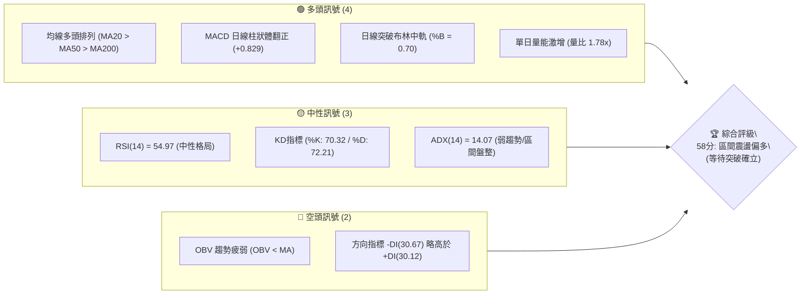
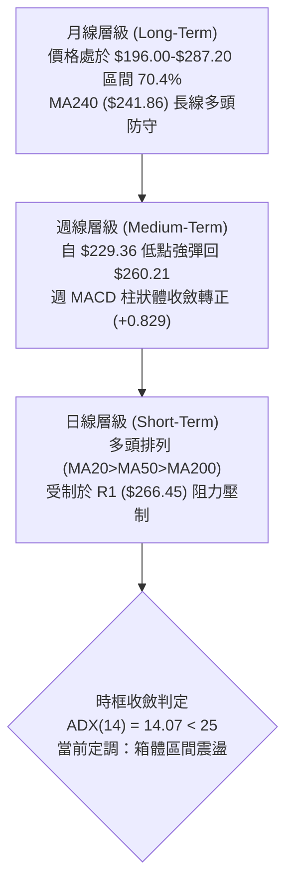
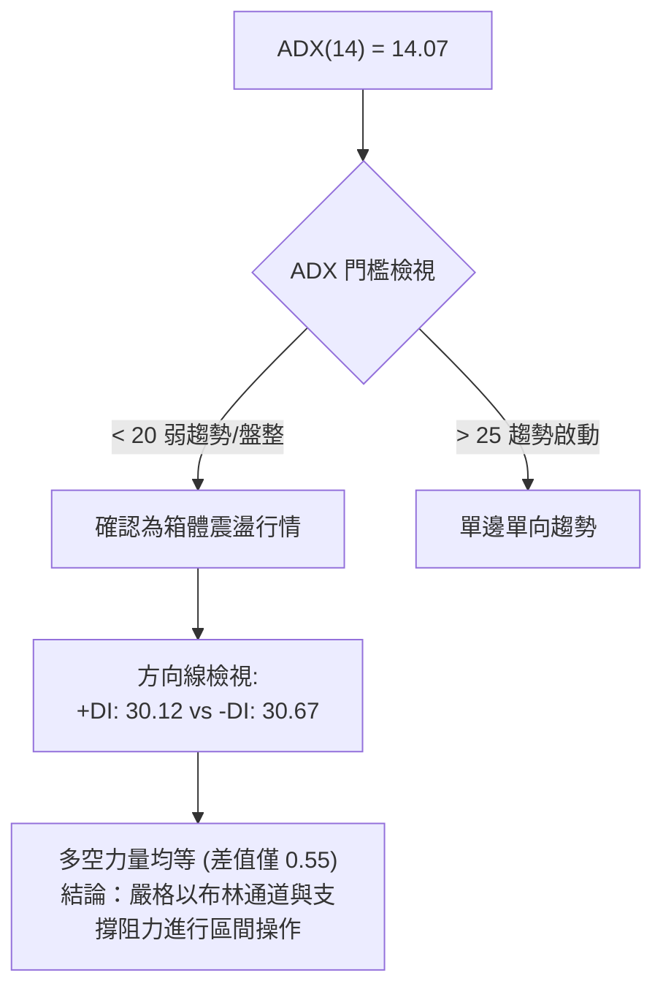
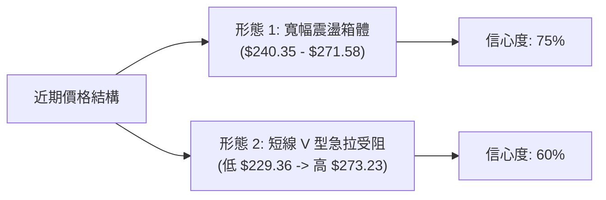
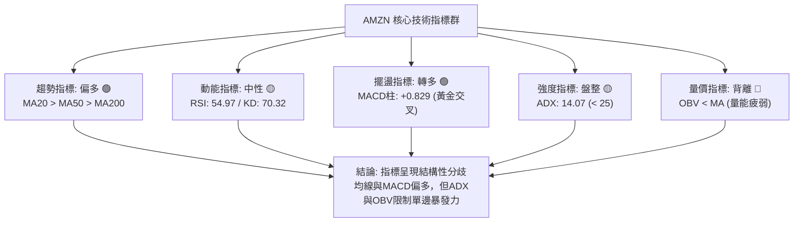
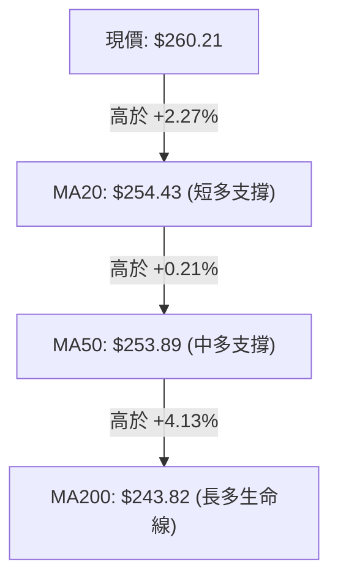
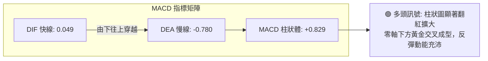
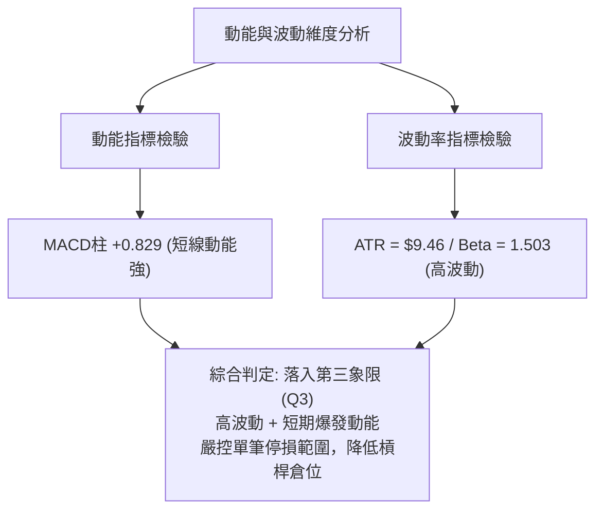
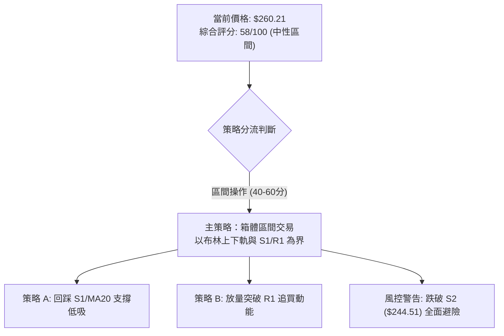
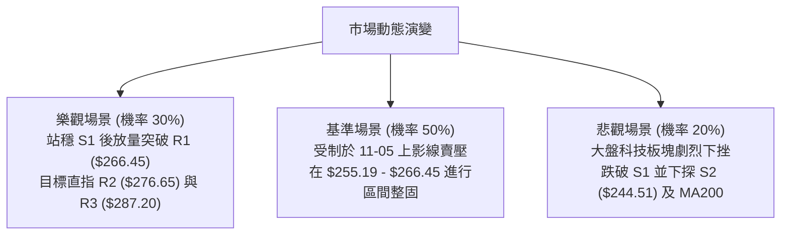

# AMZN 技術分析報告

> **報告日期**：2026-11-06 ｜ **語言**：繁體中文 ｜ **數據來源**：Yahoo Finance ｜ **當前價格**：$260.21

---

## 目錄

| 章節 | 內容 |
|------|------|
| [1. 技術面概覽](#1-技術面概覽) | 訊號儀表板、核心指標、評分卡 |
| [2. 趨勢分析](#2-趨勢分析) | 多時框趨勢、長中短期走勢、12個月走勢圖、ADX解讀 |
| [3. 圖表形態分析](#3-圖表形態分析) | 形態識別、近10日/8週K線組合、目標價推算 |
| [4. 支撐與阻力](#4-支撐與阻力) | 關鍵價位結構圖、波段阻力/支撐表、斐波那契回調 |
| [5. 技術指標深度解讀](#5-技術指標深度解讀) | 均線系統、RSI、MACD、布林通道、成交量與OBV |
| [6. 動能與波動率](#6-動能與波動率) | 動能四象限、ATR波動度與止損設定、Beta係數解讀 |
| [7. 多時框架總結](#7-多時框架總結) | 時框評分矩陣、訊號一致性、多時框收斂結論 |
| [8. 交易策略建議](#8-交易策略建議) | 決策流程、策略路由、情境階梯、主策略詳情、評星 |
| [9. 風險提示與監控](#9-風險提示與監控) | 監控Checklist、三種情境路徑、風控與倉位指引 |

---

## 1. 技術面概覽

### 🎯 技術訊號儀表板



---

### 📊 核心指標速覽表

| 指標類別 | 指標名稱 | 當前數值 | 訊號 | 專業解讀 |
|:---|:---|:---|:---:|:---|
| **價格基準** | 當前收盤價 | $260.21 | 🟢 | 站上所有主要均線，處於 52 週高低區間之 70.4% 位置 |
| **短期均線** | MA20 | $254.43 | 🟢 | 現價高於 MA20 達 +2.27%，發揮動態下檔支撐效果 |
| **中期均線** | MA50 | $253.89 | 🟢 | 現價高於 MA50 達 +2.49%，中期趨勢維持防守形態 |
| **長期均線** | MA200 | $243.82 | 🟢 | 現價高於 MA200 達 +6.72%，長線生命線穩固向上 |
| **動能指標** | RSI(14) | 54.97 | 🟡 | 位於 50 軸上方之中性常態區間，無超買或超賣警訊 |
| **指數平滑** | MACD (12,26,9) | 0.049 / -0.780 | 🟢 | 柱狀圖為 +0.829，快線由零軸下方翻揚形成黃金交叉 |
| **隨機指標** | Stoch %K / %D | 70.32 / 72.21 | 🟡 | %K 與 %D 同處 70 附近鈍化，暫未出現高檔死叉 |
| **趨勢強度** | ADX(14) | 14.07 | 🟡 | 數值遠低於 25，表明目前處於無明顯方向之「箱體盤整」 |
| **趨勢方向** | +DI / -DI | 30.12 / 30.67 | 🔴 | 空方動能與多方動能緊咬，空方暫以微弱優勢主導 |
| **通道指標** | 布林通道 | 帶寬 $240.07–$268.80 | 🟢 | %B 為 0.70，價格穩居中軌 ($254.43) 與上軌之間 |
| **量能狀態** | 20日成交量比 | 1.78x (85.36M股) | 🟡 | 單日暴量拉出上影線，伴隨 OBV < MA，籌碼換手待確認 |
| **波動風險** | ATR(14) | $9.46 (3.64%) | 🟡 | 日內平均振幅適中，操作止損距離需預留足夠緩衝 |

---

### 🏆 技術評分卡

```
╔══════════════════════════════════════════════════════════════╗
║              技術評分卡 — AMZN (2026-11-06)                 ║
╠══════════════════════════════════════════════════════════════╣
║ 趨勢強度 (Trend Strength)   █████████░░░░░░░░░░░  45/100 🟡  ║
║ 動能指標 (Momentum)         ████████████░░░░░░░░  60/100 🟢  ║
║ 支撐穩定度 (Support Level)  █████████████░░░░░░░  65/100 🟢  ║
║ 成交量配合 (Volume Flow)    ██████████░░░░░░░░░░  50/100 🟡  ║
║ 形態完整度 (Chart Pattern)  ███████████░░░░░░░░░  55/100 🟡  ║
║ 均線排列 (MA Alignment)     ███████████████░░░░░  75/100 🟢  ║
╠══════════════════════════════════════════════════════════════╣
║ 綜合評分 (Composite Score)  ████████████░░░░░░░░  58/100 🟡  ║
║ 評級結論：區間震盪偏多（等待 $266.45 阻力帶放量突破）         ║
╚══════════════════════════════════════════════════════════════╝
```

*評分標準說明：綜合評分由六大子項目（45 + 60 + 65 + 50 + 55 + 75）÷ 6 = 58.33，四捨五入計算為 58 分。*

---

## 2. 趨勢分析

### 🌐 多時框趨勢分析



---

### 📈 長期趨勢 — 12個月走勢圖（Unicode）

依據月度收盤價數據（2025-11 至 2026-11），繪製 AMZN 過去 12 個月之收盤價格走勢軌跡：

```
AMZN 月線走勢圖（過去12個月歷史收盤軌跡）
價格軸 ($)
$280 ┤                                      ● $271.58 (07月)
$270 ┤                            ● $270.64 
$260 ┤                      ● $265.06                     ● $260.21 (現價)
$250 ┤                                              ● $249.15
$240 ┤              ● $239.30               ● $238.34     ● $240.35 (10月)
$230 ┤● $233.22 ● $230.82
$220 ┤
$210 ┤                      ● $210.00
$200 ┤                          ● $208.27 (03月低點)
     └───────────────────────────────────────────────────────────
       11    12    01    02    03    04    05    06    07    08    09    10    11 (月份)
      (2025)                      (2026)
```

#### 走勢特徵分析表格

| 階段區間 | 起止月份 | 收盤區間 | 區間漲跌幅 | 結構形態特徵 |
|:---|:---|:---|:---:|:---|
| **第一階段：高檔震盪** | 2025-11 → 2026-01 | $233.22 → $239.30 | +2.61% | 圍繞 $235 軸心築底平台，多空膠著 |
| **第二階段：春季回調** | 2026-01 → 2026-03 | $239.30 → $208.27 | -12.97% | 連續兩個月長黑下挫，於 $208.27 確立波段低點 |
| **第三階段：強勁噴發** | 2026-03 → 2026-05 | $208.27 → $270.64 | +29.95% | 展開主升浪，單月大漲突破歷史壓力帶 |
| **第四階段：高檔拉回** | 2026-05 → 2026-06 | $270.64 → $238.34 | -11.93% | 獲利了結賣壓湧現，回測前波突破頸線 |
| **第五階段：創高回跌** | 2026-06 → 2026-10 | $238.34 → $240.35 | +0.84% | 07月衝刺至 $271.58 後連續3個月回落盤跌 |
| **當前階段：重啟反彈** | 2026-10 → 2026-11 | $240.35 → $260.21 | +8.26% | 10月底 $229.36 觸底回升，強勢收復 $260 關卡 |

---

### 📊 中期趨勢（週線分析）

從近 8 根週 K 棒演變觀察，AMZN 在 2026-10-30 當週一度重挫跌破 $230 關卡，下探至 52 週低點延伸之波段深水區 $229.36。隨後在 2026-11-05 當週展開強勁 V 型逆轉，單週高點觸及 $273.23，最終收在 $260.21。

```
AMZN 週線近期壓力與支撐示意圖
$280 ┤                                
$276 ┤-------------------------------- [阻力 R2: $276.65]
$272 ┤                     ▲ 週高點 $273.23
$266 ┤-------------------------------- [阻力 R1: $266.45]
$260 ┤=============◄ 現價: $260.21
$255 ┤-------------------------------- [支撐 S1: $255.19 / MA20: $254.43]
$244 ┤-------------------------------- [強支撐 S2: $244.51 / MA200: $243.82]
$230 ┤            ▼ 週低點 $229.36
     └────────────────────────────────
```

---

### ⚡ 趨勢強度評估（ADX 解讀）



#### ADX 趨勢強度量化對照表

| 指標變數 | 當前讀數 | 門檻區間 | 狀態定調 | 操作指導意義 |
|:---|:---:|:---:|:---:|:---|
| **ADX(14)** | 14.07 | 0 – 20 | **極弱趨勢 / 盤整** | 避免追高殺低，順勢突破策略易遭遇假突破，應採逆向區間低吸高拋 |
| **+DI (14)** | 30.12 | > 25 | **多頭具備動能** | 多方反彈力道充沛，自 $229.36 低點展現強力買盤支撐 |
| **-DI (14)** | 30.67 | > 25 | **空頭防守積極** | 上方拋壓依舊沉重，高檔解套賣壓在 $270 以上密集釋出 |
| **DI 差值** | -0.55 | ±5 範圍內 | **多空均勢對峙** | 兩者極度接近，代表短線暴漲暴跌後進入震盪重組期 |

---

## 3. 圖表形態分析

### 🔍 形態識別系統



#### 圖表形態信心度評估表

| 形態名稱 | 信心度 | 判斷依據（引用數據） | 完成度 | 目標價（附計算式） |
|:---|:---:|:---|:---:|:---|
| **寬幅震盪箱體** | 75% | 箱底由 10-30 收盤價 $240.35 及 S2 $244.51 構成，箱頂由 07-31 收盤價 $271.58 及 R1 $266.45 構成 | 85% | 箱頂目標：引用波段高點聚類阻力 **R1 = $266.45**；突破延伸至 **R2 = $276.65** |
| **短底回升形態** | 60% | 10-30 低點 $229.36 獲得強烈承接，連續 4 日大漲突破 MA20 ($254.43)，但 11-05 上影線回吐 | 70% | 依形態高度推算：低點 $229.36 至頸線 MA20 $254.43 差額 $25.07，等幅推算 $254.43 + $25.07 = **$279.50**（受阻於 R2 $276.65 前） |

---

### 🕯️ 重要K線形態分析

嚴格依據數據中「近 10 根日 K」與「近 8 根週 K」之實際 OHLC 數據進行逐日解構：

#### 近 10 根日 K 線形態解讀

| 日期 | 開盤價 | 最高價 | 最低價 | 收盤價 | 成交量 | K線形態特徵 | 專業技術解讀 | 訊號 |
|:---|:---:|:---:|:---:|:---:|:---:|:---|:---|:---:|
| **10-23** | 248.85 | 250.01 | 246.45 | 248.00 | 25,569,000 | 窄幅陰十字 | 多空觀望，成交量維持低水位縮量整理 | 🟡 |
| **10-26** | 249.47 | 250.79 | 247.23 | 249.09 | 32,696,400 | 微型小紅實體 | 測試下檔支撐後微幅收高，量能溫和遞增 | 🟡 |
| **10-27** | 250.43 | 254.68 | 248.71 | 253.10 | 34,477,800 | 溫和實體中陽 | 突破 $250 整數防線，上試 20 日均線壓力 | 🟢 |
| **10-28** | 253.00 | 255.36 | 251.98 | 254.60 | 34,915,900 | 緩步墊高陽線 | 穩步推升，創波段反彈收盤高點 | 🟢 |
| **10-29** | 246.95 | 249.14 | 241.24 | 243.79 | 85,234,400 | 跳空放量大長陰 | 跳空跌破短期均線，單日成交量擴大至 85M，主力出逃 | 🔴 |
| **10-30** | 232.54 | 241.55 | 229.36 | 240.35 | 104,894,700 | 長下影帶量錘頭 | 巨量下殺至 $229.36 後爆量拉回 $240.35，下影線長達 $10.99，恐慌盤湧現獲買盤承接 | 🟢 |
| **11-02** | 243.01 | 253.81 | 242.28 | 245.63 | 58,348,000 | 衝高回落小陽線 | 確認 10-30 底部有效，買盤持續消化前波套牢浮額 | 🟢 |
| **11-03** | 248.59 | 252.45 | 245.88 | 250.69 | 37,853,500 | 縮量突破實體陽 | 收復 $250 大關，空方動能減弱 | 🟢 |
| **11-04** | 264.82 | 271.49 | 263.85 | 266.03 | 93,162,200 | 跳空放量大長陽 | 巨量長陽跳空高開，一舉攻克 MA20 與 MA50，呈現強多軋空 | 🟢 |
| **11-05** | 271.43 | 273.23 | 252.27 | 260.21 | 85,365,600 | 長上影高檔倒轉陰 | 創 $273.23 高點後遭遇強大解套賣壓，長黑吞噬日內漲幅，收盤重回 $260.21 | 🔴 |

#### 近 8 根週 K 線形態解讀

| 週截止日 | 開盤價 | 最高價 | 最低價 | 收盤價 | 週成交量 | K線形態特徵 | 訊號 |
|:---|:---:|:---:|:---:|:---:|:---:|:---|:---:|
| **09-18** | 253.15 | 255.95 | 244.30 | 253.71 | 186,830,200 | 下影線整理十字星 | 🟡 |
| **09-25** | 256.40 | 259.49 | 245.60 | 249.67 | 196,475,200 | 衝高受阻轉折黑K | 🔴 |
| **10-02** | 246.63 | 253.56 | 244.73 | 251.52 | 174,917,500 | 底部防守小紅星 | 🟢 |
| **10-09** | 250.19 | 262.80 | 250.18 | 262.43 | 183,040,400 | 放量長紅穿雲突破 | 🟢 |
| **10-16** | 262.50 | 263.70 | 248.60 | 250.00 | 161,689,900 | 高檔長黑反噬 | 🔴 |
| **10-23** | 255.25 | 265.34 | 246.45 | 248.00 | 196,713,700 | 長上影假突破陰線 | 🔴 |
| **10-30** | 249.47 | 255.36 | 229.36 | 240.35 | 292,219,200 | 恐慌巨量下影大洗盤 | 🟢 |
| **11-05** | 243.01 | 273.23 | 242.28 | 260.21 | 274,729,300 | 巨幅震盪長上影大陽 | 🟡 |

---

### 📉 ASCII 走勢形態示意圖

展示 10-30 巨量探底 $229.36，隨後跳空拔高至 11-05 衝刺 $273.23 受阻之「短線急速擴散箱體」形態：

```
AMZN 近期日K級別關鍵形態示意圖
 價格 ($)
$275 ┤                           ▲ 11-05 盤中高點 $273.23 (長上影線受阻)
$270 ┤                      ┌─┐  │
$265 ┤               ┌─┐    │ │  │   [阻力 R1: $266.45]
$260 ┤               │ │    │ █──┼── ◄ 當前收盤: $260.21
$255 ┤         ┌─┐   │ │    │ │  │   [支撐 S1: $255.19 / MA20: $254.43]
$250 ┤   ┌─┐   │ │   │ │    │ │  │   
$245 ┤   │ │   │ │   │ │    │ │  │   [強支撐 S2: $244.51]
$240 ┤   │ │   │ │───┴─┴────┴─┴──┘   10-30 收盤 $240.35
$235 ┤   │ │   │ 
$230 ┤   └─┴───┘ ▼ 10-30 爆量低點 $229.36 (恐慌洗盤下影線)
     └──────────────────────────────────────────────────────────
         10-29  10-30  11-02  11-03  11-04  11-05 (交易日)
```

---

### 🎯 形態目標價計算

1. **箱體波段推算**：
   - 箱體下限取 10-30 恐慌收盤價 $240.35（亦高度重合 S2 支撐位 $244.51）。
   - 箱體上限取前期高點聚類阻力位 **R1 = $266.45**。
   - 箱體高度 $H = \$266.45 - \$240.35 = \$26.10$。
   - 向上突破目標價 = $266.45 + \$26.10 = \$292.55$（若突破 R1，波段第一目標為歷史高點阻力 **R3 = $287.20**）。
2. **回踩防守目標價**：
   - 11-05 出現長上影線拉回，短期防守目標為 20 日均線位置 **MA20 = $254.43** 與波段低點聚類支撐 **S1 = $255.19**。

---

## 4. 支撐與阻力

### 🗺️ 關鍵價位分布圖（Unicode）

```
AMZN 價位結構分布圖 (OHLCV 精確計算)
════════════════════════════════════════════════════════════════════
$287.20 ║████████████████████████████████████████║ 強阻力 R3 / 52W 高點 (0.0%)
$276.65 ║████████████████████████████            ║ 阻力 R2 (波段高點聚類)
$266.45 ║████████████████████████████████        ║ 關鍵阻力 R1 (斐波 23.6%: $265.68)
$260.21 ╠════════════════════════════════════════╣ ◄ 現價: $260.21
$255.19 ║▓▓▓▓▓▓▓▓▓▓▓▓▓▓▓▓▓▓▓▓▓▓▓▓                ║ 近期支撐 S1 (MA20: $254.43)
$244.51 ║████████████████████████████████        ║ 強支撐 S2 (MA200: $243.82)
$225.82 ║████████████████████                    ║ 終極防守 S3 (波段深水區)
════════════════════════════════════════════════════════════════════
```

---

### 🚧 阻力位分析表

*嚴格引用數據中「關鍵價位」區塊之波段高點聚類數值：*

| 阻力級別 | 精確價位 | 距現價幅標 | 技術形成原因 | 突破難度評估 | 策略重要性 |
|:---|:---:|:---:|:---|:---:|:---:|
| **R1** | **$266.45** | +2.40% | 11-04 長紅收盤價 ($266.03) 與近一年多個波段高點重疊聚類區；緊鄰斐波那契 23.6% 回調位 ($265.68) | 中等 🟡 | **極高**。短線多空分水嶺，站穩方能化解 11-05 上影線賣壓 |
| **R2** | **$276.65** | +6.32% | 08-07 週收盤價 ($274.48) 與 11-05 盤中高點 ($273.23) 構成之次級頂部籌碼套牢區 | 較高 🔴 | **高**。波段多頭獲利了結主要目標區 |
| **R3** | **$287.20** | +10.37% | 52 週最高價紀錄點 (52W High)，歷史絕對天花板阻力 | 極高 🔴 | **極高**。牛市長期趨勢全面開啟之終極關卡 |

---

### 🛡️ 支撐位分析表

*嚴格引用數據中「關鍵價位」區塊之波段低點聚類數值：*

| 支撐級別 | 精確價位 | 距現價幅標 | 技術形成原因 | 守住機率評估 | 策略重要性 |
|:---|:---:|:---:|:---|:---:|:---:|
| **S1** | **$255.19** | -1.93% | 近一年密集震盪波段低點聚類；高度貼合 MA20 ($254.43) 與布林中軌，具備均線匯聚共振效應 | 75% 🟢 | **極高**。短線回檔第一道防線，跌破則回踩加劇 |
| **S2** | **$244.51** | -6.03% | 09-18 週低點 ($244.30) 與 10-02 週低點 ($244.73) 雙底防禦線；重合 MA200 ($243.82) 牛熊生命線 | 85% 🟢 | **極高**。中長期結構防守頸線，不可失守之多頭陣地 |
| **S3** | **$225.82** | -13.22% | 10-30 恐慌殺跌低點 ($229.36) 下方之終極籌碼密集成交緩衝區 | 95% 🟢 | **中**。極端行情之黑天鵝停損防護線 |

---

### 📐 斐波那契回調位分析

*以 52 週區間之極值高點 $287.20 (0.0%) 與極值低點 $196.00 (100.0%) 計算：*

| 回調比例 | 對應價位 | 與現價之空間關係 | 技術意義與多空攻防解讀 |
|:---:|:---:|:---:|:---|
| **0.0% (52W High)** | **$287.20** | +10.37% | 歷史最高壓力，本輪大週期上行目標極限 |
| **23.6%** | **$265.68** | +2.10% | **當前直接壓制位**。現價處於其下方，11-04 與 11-05 均在此處產生劇烈震盪 |
| **38.2%** | **$252.36** | -3.02% | **黃金分割第一防守位**。剛好守在 MA20 ($254.43) 與 MA50 ($253.89) 支撐帶下方 |
| **50.0%** | **$241.60** | -7.15% | **強弱平衡中軸線**。逼近 MA200 ($243.82) 與 S2 支撐 ($244.51)，多頭中線底線 |
| **61.8%** | **$230.84** | -11.29% | 黃金分割強回調位，10-30 低點 ($229.36) 剛好打穿此位置後迅速收回，確立為假跌破 |
| **78.6%** | **$215.52** | -17.17% | 深次回調防禦位（數據中未跌破） |
| **100.0% (52W Low)**| **$196.00** | -24.68% | 52 週大底，長期價值中樞 |

> **回調區間定位判定**：當前收盤價 **$260.21** 精準落在 **23.6% ($265.68)** 與 **38.2% ($252.36)** 之間。這代表 AMZN 在自 $196.00 發動的大級別漲勢中，仍穩居強勢回調區間（保持在 38.2% 回調位之上），屬於多方架構尚未遭到破壞的良性震盪。

---

## 5. 技術指標深度解讀

### 🎛️ 指標訊號總覽



---

### 📈 移動平均線排列分析



#### 移動平均線數據全景解讀

| 均線名稱 | 當前數值 | 價格相距數值 | 距現價幅度 | 歷史走勢特徵 | 訊號評估 |
|:---|:---:|:---:|:---:|:---|:---:|
| **MA 5** | $252.58 | +$7.63 | +3.02% | 走勢呈圓弧底抬升 (▄▂▁▁▁▂▃▅▆▇) | 🟢 短線急攻 |
| **MA 10** | $251.15 | +$9.06 | +3.61% | 快速向上扣低翻揚 | 🟢 支撐穩固 |
| **MA 20** | $254.43 | +$5.77 | +2.27% | 布林帶中軌，平穩上移 | 🟢 短期多頭 |
| **MA 50** | $253.89 | +$6.32 | +2.49% | 中期基線，與 MA20 形成黃金交叉 | 🟢 中期轉強 |
| **MA 60** | $255.18 | +$5.03 | +1.97% | 季線微幅壓制但即將攻克 | 🟡 震盪整理 |
| **MA 120** | $253.04 | +$7.17 | +2.83% | 半年線走平，蓄積支撐推力 | 🟢 長期走平 |
| **MA 200** | $243.82 | +$16.39 | +6.72% | 典型牛熊分界線，維持絕對多頭斜率 | 🟢 多頭生命線 |
| **MA 240** | $241.86 | +$18.35 | +7.59% | 年線持續揚升 (▇▇▇▇▇██) | 🟢 超長多頭 |

> **均線結構總結**：呈現標準且標準度極高的 **多頭排列（MA20 > MA50 > MA200）**，且現價全面凌駕於所有短期、中期與長期均線之上。短期內 MA20 ($254.43) 與 MA50 ($253.89) 構成密集的雙重安全墊。

---

### 📉 RSI(14) 分析

- **RSI(14) 當前數值**：**54.97**
- **強度進度條**：
  `30 超賣 ░░░░░░░░░░░░░░░░░░░░ 50 ▓▓▓▓░░░░░░░░░░░░░░░░ 70 超買` (54.97 / 100)
- **區間判定**：位於 50–60 常態多方擴張區間，既未進入 70 以上之過熱超買區，亦遠離 30 之超賣悲觀區。
- **背離分析**：依據近 20 根 K 棒對比，價格在 10-30 創低 $229.36 時 RSI 跌至 38.3，隨後價格強彈至 $260.21，RSI 同步揚升至 54.97；比對首尾數據，**目前不存在頂背離或底背離**，動能與價格走勢保持同步。

---

### 📊 MACD(12/26/9) 訊號解讀



- **快慢線位置**：DIF 數值 0.049 剛好翻上零軸，DEA 信號線為 -0.780 仍在零軸下方。
- **柱狀圖動態**：柱狀體數值達 **+0.829**，連續兩週綠柱翻紅，顯示買盤正在加速聚集，具備推動短波段行情之動能。

---

### 📦 布林通道分析

```
AMZN 布林通道相對位置示意圖 (寬度: $240.07 - $268.80)
$270 ┤                                
$268 ┤─────────────────────────────────── 上軌: $268.80
$264 ┤                           
$260 ┤=================================== ◄ 現價: $260.21  [%B = 0.70]
$256 ┤
$254 ┤─────────────────────────────────── 中軌 (MA20): $254.43
$248 ┤
$240 ┤─────────────────────────────────── 下軌: $240.07
     └───────────────────────────────────
```

- **通道參數狀態**：上軌 $268.80，中軌 $254.43，下軌 $240.07，通道寬度約 $28.73 (約 11%)。
- **%B 震盪指標**：當前數值 **0.70**。價格位於中軌上方朝上軌推進，表明短線偏強。由於 11-05 盤中曾衝破上軌來到 $273.23，引發布林帶軌道外極限拉回，收盤重新落回上軌之內，屬於典型之「碰上軌回縮」，確認通道整體未顯著開口，仍處於常態震盪軌道。

---

### 💹 成交量分析（量價配合度）

1. **量能突波解讀**：
   - 最新交易日（11-05）成交量為 **85,365,600 股**。
   - 對比 20 日均量（48,006,105 股），**量比高達 1.78x**。
   - 對比 50 日均量（40,523,944 股），量能擴大超過一倍。
2. **量價隱憂（背離警訊）**：
   - 儘管單日成交量顯著放大，但 11-05 收盤拉出高達 $13.02 之長上影線（高 $273.23，收 $260.21），形成「巨量長上影」。
   - **OBV 趨勢**：系統明確標記「**OBV < MA → 量能疲弱**」。這表明過去 2-3 個月的長線資金仍在減碼，近幾日的爆量上漲並未獲得持續性累積量能（OBV）的有效背書，高度暗示主力趁反彈進行換手或逢高減持，需提防高檔量竭拉回。

---

## 6. 動能與波動率

### ⚡ 動能評估四象限

| 象限分佈 | 動能維度 | 波動維度 | AMZN 當前落點 | 狀態評估與交易環境診斷 |
|:---:|:---:|:---:|:---:|:---|
| **第一象限 (Q1)** | 強動能 | 低波動 | — | 穩定牛皮單邊上漲趨勢 |
| **第二象限 (Q2)** | 弱動能 | 低波動 | — | 狹幅無聊整理，市場缺乏參與度 |
| **第三象限 (Q3)** | **強動能** | **高波動** | **✓ 落入本象限** | **高風險高回報行情。ATR 達 $9.46 (3.64%)，ADX 雖低但短期爆發力強，單日振幅逾 8%，多空雙向洗盤加劇** |
| **第四象限 (Q4)** | 弱動能 | 高波動 | — | 混亂失控震盪，容易遭雙巴擊損 |



---

### 📊 ATR 波動率分析

- **ATR(14) 數值**：**$9.46**（佔當前股價之 **3.64%**，採 Wilder 平滑計算法）。
- **日內波動意涵**：意味著 AMZN 正常交易日內，無消息面干擾下的常態隨機波動幅度即達近 $10 美元。
- **止損與進場安全距離建議**：
  - **保守型波段止損（2.0 × ATR）**：$2.0 \times \$9.46 = \$18.92$。
  - **進取型短線止損（1.0 – 1.2 × ATR）**：$1.0 \times \$9.46 = \$9.46$ 至 $1.2 \times \$9.46 = \$11.35$。
  - **策略應用**：在 $260.21 建立倉位時，緊密止損若小於 $9.46 將極易被日內噪聲直接掃出場，止損位必須錨定在波段支撐 **S1 ($255.19)** 之下方或以 ATR 進行寬幅保護。

---

### 📐 Beta 與市場相關性

- **Beta 係數**：**1.503**。
- **市場敏感度分析**：AMZN 具備極強的高彈性科技權值股屬性，其波動幅度為標普 500 指數的 **1.5 倍**。在近期科技板塊承受 AI 交易修正壓力（新聞顯示：Wall Street AI Reality Check）下，AMZN 展現放大的波動振幅，大盤若回跌 1%，AMZN 預期跌幅達 1.5%，操作時須同步緊盯大盤風險指標。

---

## 7. 多時框架總結

### 📋 時框架評分表

| 時框架 | 趨勢方向 | 動能狀態 | 均線排列狀況 | 形態特徵結構 | 綜合評分 | 建議操作姿態 |
|:---|:---:|:---:|:---|:---|:---:|:---|
| **日線 (短線)** | 偏多 🟢 | 中性偏強 🟢 | 均線多頭排列 (MA20>50>200) | 巨量長上影線受阻於 R1 | 60/100 | 等待回調 S1 企穩或放量突破 R1 |
| **週線 (中線)** | 震盪 🟡 | 反彈收斂 🟢 | 收盤站回 MA20 與 MA50 之上 | $229.36 破底翻大長下影 | 58/100 | 以布林通道為主要交易區間高拋低吸 |
| **月線 (長線)** | 多頭 🟢 | 平穩 🟡 | 牢牢守在 MA240 ($241.86) 之上 | 52週區間 70.4% 位置震盪 | 65/100 | 長期基本盤穩固，逢低分批佈局 |

---

### 🔲 綜合訊號矩陣

```
╔══════════════════════════════════════════════════════════════════╗
║                   多時框架綜合訊號一致性矩陣                     ║
╠════════════════╦════════════╦════════════╦═══════════════════════╣
║    維度分類    ║  短期日線  ║  中期週線  ║  長期月線 (趨勢錨點)  ║
╠════════════════╬════════════╬════════════╬═══════════════════════╣
║  趨勢排列訊號  ║  🟢 看多   ║  🟡 中性   ║  🟢 看多              ║
║  動能指標訊號  ║  🟢 偏多   ║  🟢 轉強   ║  🟡 中性              ║
║  成交量配合度  ║  🔴 疲弱   ║  🟡 換手   ║  🟡 正常              ║
║  支撐阻力結構  ║  🟡 壓制   ║  🟢 企穩   ║  🟢 穩固              ║
╠════════════════╬════════════╩════════════╩═══════════════════════╣
║  訊號衝突解析  ║ 日線雖強勢翻揚，但 OBV 量能背離且遭遇 R1 強壓；  ║
║                ║ 中期週線仍處於箱體，長線雖多但 ADX 限制趨勢。   ║
╚════════════════╩═══════════════════════════════════════════════════╝
```

---

### ⚖️ 多時框收斂結論

依據多時框收斂原則（規則 14）：
1. **行情性質判定**：當前日線 **ADX(14) 讀數為 14.07**，遠低於 25 的趨勢門檻。依規則，嚴格定調目前為 **「盤整行情（Consolidation / Range-bound）」**。
2. **主導維度收斂**：在盤整行情中，不可盲目套用單邊順勢突破邏輯，必須以 **日線布林通道上下軌 ($240.07 – $268.80) 及波段支撐阻力為核心交易區間**。
3. **唯一方向性結論**：
   **【中性偏多，區間震盪整理】**。
   雖然均線呈現完美多頭排列，但由於 ADX 弱化、OBV 背離與 11-05 之長上影線，多頭無法立即發動主升浪，預期股價將在 **S1 ($255.19) 至 R1 ($266.45)** 之間進行蓄勢震盪。本結論與第 1 章評分卡（58 分）及第 8 章交易策略完全一致。

---

## 8. 交易策略建議

### 🗺️ 策略決策流程圖



---

### 🧭 策略路由（依評分卡分流）

> **當前主策略方向 = 【中性區間操作，低吸為主、突破為輔】（依綜合評分：58/100）**
> *依規則：評分處於 40–60 分區間，定調為箱體震盪操作，嚴禁單邊追高，以等待回踩支撐確認與突破信號為主。*

---

### 🎯 價格情境階梯（Price Scenarios）

*所有價位嚴格引用自第 4 章波段聚類數值與斐波那契點位：*

| 階梯層級 | 觸發條件 | 下一目標價 | 後續延伸目標 | 技術情境含義與對策 |
|:---|:---|:---:|:---:|:---|
| **牛市擴展** | 強勢放量突破 **R1 $266.45** | **R2 $276.65** | **R3 $287.20** | 短線轉強，上影線套牢籌碼被全面消化，挑戰歷史天花板 |
| **區間中樞** | 站穩現價區間 **$255.19 – $266.45** | **R1 $266.45** | **S1 $255.19** | **基準情境**。在布林中軌與上軌間反覆沉澱換手 |
| **空頭下測** | 有效跌破支撐 **S1 $255.19** | **S2 $244.51** | **S3 $225.82** | 中期轉弱，回測 MA200 牛熊分界線與恐慌起漲低點 |

---

### 📊 情境機率分佈

| 情境類別 | 發生機率 | 主要量化與技術依據 |
|:---|:---:|:---|
| **區間震盪整理** | **50%** | **ADX = 14.07** 確立無趨勢特徵；布林通道帶寬收窄；日線多空雙向拉鋸 |
| **向上突破/延續反彈**| **30%** | **MACD 柱狀體翻紅 (+0.829)**；均線呈現多頭排列；價格維持在 38.2% 回調位之上 |
| **震盪回落/再測支撐**| **20%** | **OBV < MA** 量能疲弱背離；11-05 長上影線拋壓顯著；-DI 仍微幅壓制 +DI |

---

### 🟢 主策略詳情

*風險報酬比嚴格依規則 17 計算：$(T1 - 進場價) \div (進場價 - 止損價)$，取至小數點後兩位。*

| 策略要素 | 策略 A（回踩支撐低吸 — 穩健型） | 策略 B（強勢突破追買 — 動能型） |
|:---|:---|:---|
| **策略邏輯** | 股價回測 MA20 與 S1 獲得支撐確認時進場 | 日線收盤價帶量攻克 R1 壓力時右側跟進 |
| **進場條件** | 回踩觸及 S1 且 15分/日K 出現止跌K線 | 日K收盤價突破 R1 且成交量達 50M 股以上 |
| **進場價格** | **$255.19**（精確錨定支撐位 S1） | **$266.45**（精確錨定阻力位 R1） |
| **目標價 T1** | **$266.45**（阻力位 R1） | **$276.65**（阻力位 R2） |
| **目標價 T2** | **$276.65**（阻力位 R2） | **$287.20**（強阻力 R3 / 52W高點） |
| **止損價格** | **$244.51**（強支撐位 S2 / MA200 邊緣） | **$255.19**（支撐位 S1 / 原跌破頸線） |
| **風險報酬比** | **1 : 1.05（以 T1 計）**<br/>計算式：$(266.45 - 255.19) \div (255.19 - 244.51) = 11.26 \div 10.68 = 1.054$ | **1 : 0.91（以 T1 計）**<br/>計算式：$(276.65 - 266.45) \div (266.45 - 255.19) = 10.20 \div 11.26 = 0.905$ |
| **T2 風險報酬比**| **1 : 2.01（以 T2 計）**<br/>計算式：$(276.65 - 255.19) \div (255.19 - 244.51) = 21.46 \div 10.68 = 2.009$ | **1 : 1.84（以 T2 計）**<br/>計算式：$(287.20 - 266.45) \div (266.45 - 255.19) = 20.75 \div 11.26 = 1.842$ |
| **成功機率** | 65% | 50% |
| **建議倉位** | 15% – 20% 資金倉位 | 10% 資金倉位（動能部位） |

---

### 🔴 反向風險觸發點（對沖提示）

若市場出現以下極端訊號，證明多頭防守失效，須立即執行避險或多單停損：
1. **破位警訊**：日 K 收盤價實體跌破 **S1 ($255.19)** 且 MA20 ($254.43) 失守，應減碼 50% 多頭部位。
2. **全面轉空**：帶量跌破 **S2 ($244.51)** 及 MA200 ($243.82)，意味著多頭生命線徹底瓦解，應清空多頭部位，並可考慮反手建立空頭對沖部位，下看 S3 ($225.82)。

---

### ⭐ 整體訊號強度評星

```
做多訊號強度：★★★☆☆  (3.0/5星 — 均線與MACD支撐，但受阻於上影線)
做空訊號強度：★★☆☆☆  (2.0/5星 — 長線與中線大結構多頭尚未破壞)
整體可信度：  ★★★☆☆  (3.5/5星 — 處於 ADX 盤整期，技術信號易反覆)
```

---

## 9. 風險提示與監控

### ✅ 關鍵監控指標 Checklist

```
╔══════════════════════════════════════════════════════════════════╗
║               AMZN 每日交易關鍵監控 Checklist                    ║
╠══════════════════════════════════════════════════════════════════╣
║ [ ] 價格防線：收盤價是否持續站穩 MA20 ($254.43) 與 S1 ($255.19) ║
║ [ ] 阻力消化：能否有效攻克 11-05 上影線密集壓制區 R1 ($266.45)   ║
║ [ ] 動能連續：MACD 柱狀體 (+0.829) 是否持續翻紅放大              ║
║ [ ] 擺盪指標：RSI(14) 能否穩步突破 60 大關進入強勢區間           ║
║ [ ] 量能背離：OBV 是否能扭轉疲弱劣勢並重返其移動平均線之上       ║
║ [ ] 趨勢甦醒：ADX(14) 是否由 14.07 抬升突破 20，確立單邊行情     ║
║ [ ] 外部風險：關注大盤科技股 AI 拋售潮是否引發 Beta=1.5 放大修正  ║
╚══════════════════════════════════════════════════════════════════╝
```

---

### ⚠️ 風險場景分析



---

### 🛡️ 風險管理重要提醒

1. **基本面與估值風險校準**：
   - AMZN 當前滾動市盈率 P/E (TTM) 為 **21.04**，PEG 為 **1.24**，估值處於合理區間。但其自由現金流回報率（FCF Yield TTM）為 **-1.34%**，資本支出高達 $196.08B，自由現金流為 -$37.64B，反映龐大 AI 算力基礎設施投資對現金流產生壓力。若市場對科技巨頭資本支出效益產生質疑，極易引發估值收縮。
2. **高 Beta 波動性控管**：
   - 標的 Beta 值高達 **1.503**，且 ATR 達 **$9.46**。單筆交易承受風險資金切勿超過總帳戶權益之 **1.5%**。
   - 建議總持倉暴露維持在總投資組合之 **15%–20%** 以內，嚴禁在盤整未放量突破前使用槓桿融資操作。

---

## 📋 報告總結

```
╔══════════════════════════════════════════════════════════════════╗
║                    AMZN 技術分析報告總結                        ║
╠══════════════════════════════════════════════════════════════════╣
║ 報告日期：2026-11-06                                             ║
║ 當前價格：$260.21                                                ║
║ 分析評級：⚖️ 58分 — 區間震盪偏多（等待突破確立）                 ║
╠══════════════════════════════════════════════════════════════════╣
║ 關鍵結論：                                                       ║
║ ├─ 長期趨勢：🟢 偏多（收盤價高於 MA200 $243.82 及年線）          ║
║ ├─ 中期趨勢：🟡 盤整（週線 V 型反彈但受制於高檔套牢密集群）      ║
║ ├─ 短期趨勢：🟢 偏多（均線呈現多頭排列，MACD 翻紅金叉）          ║
║ ├─ 關鍵支撐：S1: $255.19  /  S2: $244.51                         ║
║ ├─ 關鍵阻力：R1: $266.45  /  R2: $276.65                         ║
║ └─ 分析師目標：華爾街平均目標價 $326.74 (區間 $230.00 - $405.00) ║
╠══════════════════════════════════════════════════════════════════╣
║ 最優策略組合：                                                   ║
║ 1. 🥇 最佳機會：策略 A — 回踩 S1 ($255.19) 企穩低吸，風報比 1:1.05 ║
║ 2. 🥈 次選機會：策略 B — 帶量攻克 R1 ($266.45) 追買，看至 R2/R3  ║
║ 3. 🥉 防守避險：跌破 S2 ($244.51) 執行無條件嚴格止損             ║
╚══════════════════════════════════════════════════════════════════╝
```

---

> ⚠️ **免責聲明**：本報告為技術分析研究，所有數據、圖表及估算均嚴格基於所提供之歷史價格與量化指標資訊。本報告**僅供研究與學術參考**，**不構成任何個人化之投資建議或買賣邀約**。金融市場投資涉及本金虧損之高風險，投資人應自行審慎評估風險並獨立承擔交易後果。

---

*報告生成時間：2026-11-06 ｜ 數據來源：Yahoo Finance ｜ 分析框架：多時框技術分析模型*