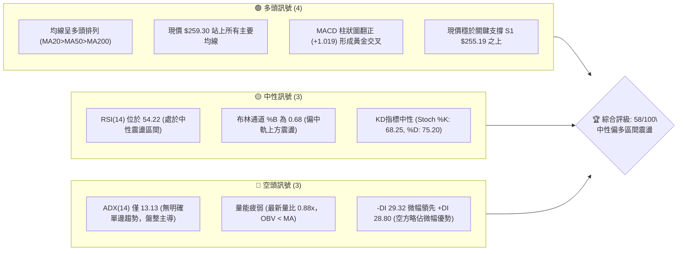
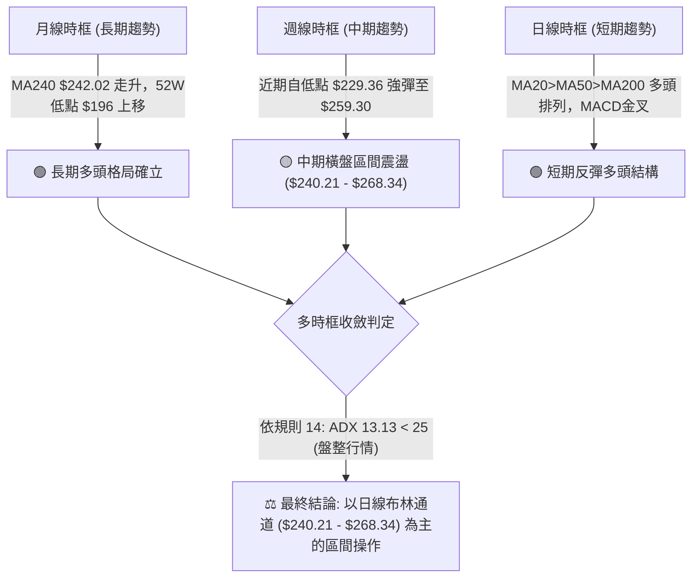
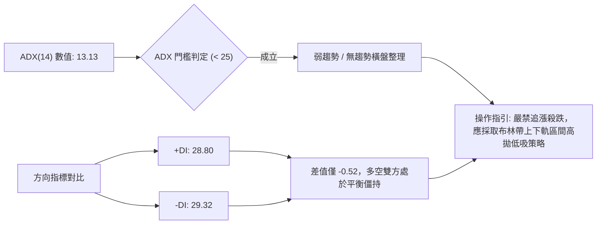
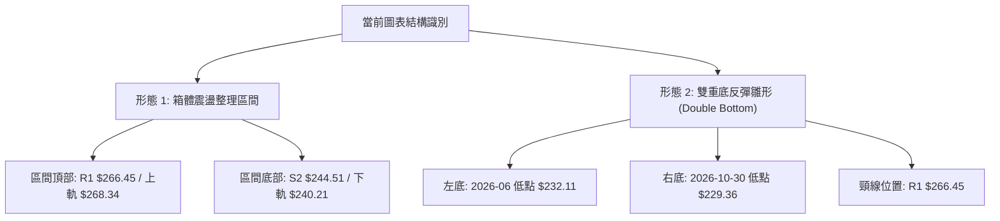
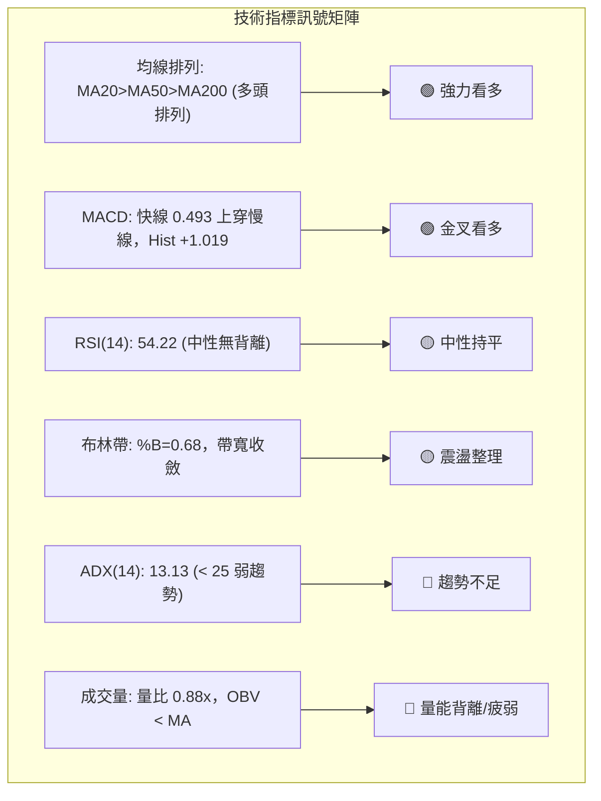
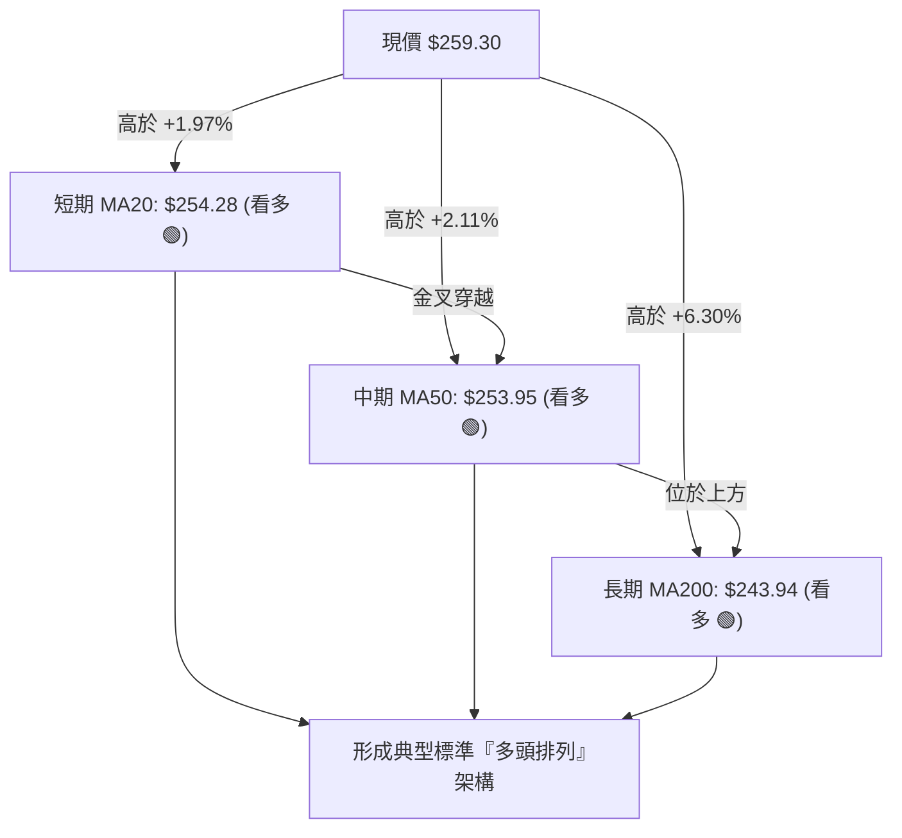
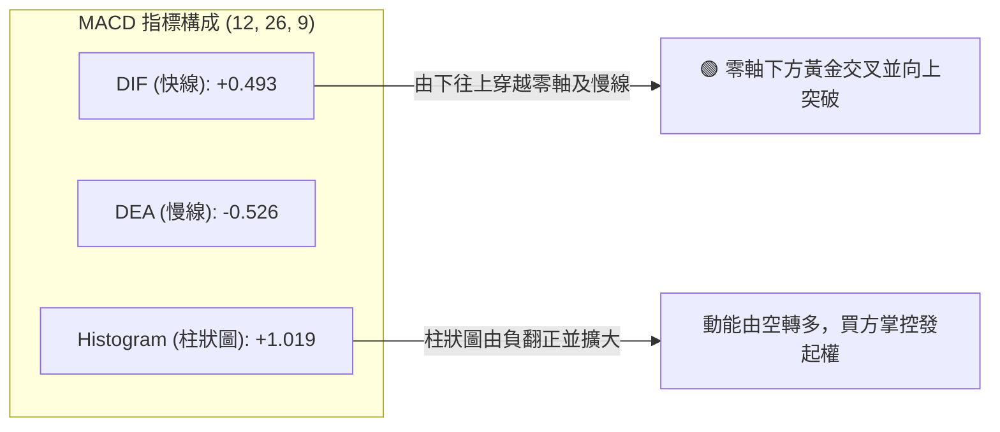
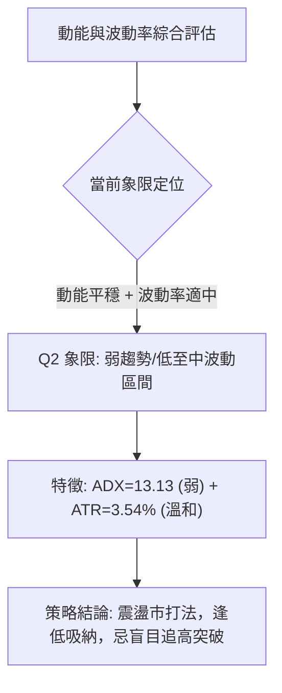
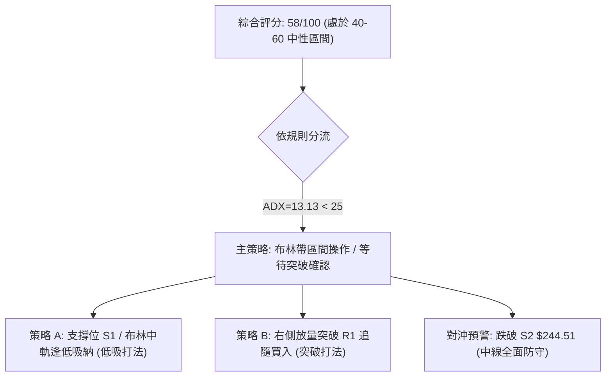
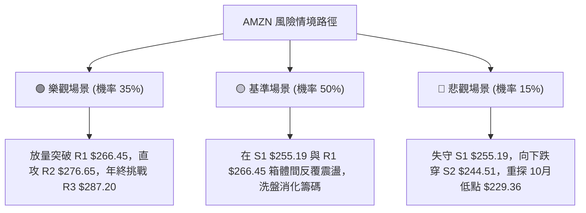

# AMZN 技術分析報告

> **報告日期**：2026-11-07 ｜ **語言**：繁體中文 ｜ **數據來源**：Yahoo Finance ｜ **當前價格**：$259.30

---

## 目錄

| 章節 | 內容 |
|------|------|
| [1. 技術面概覽](#1-技術面概覽) | 訊號儀表板、核心指標、評分卡 |
| [2. 趨勢分析](#2-趨勢分析) | 多時框趨勢、長中短期走勢 |
| [3. 圖表形態分析](#3-圖表形態分析) | 形態識別、K線組合、目標價 |
| [4. 支撐與阻力](#4-支撐與阻力) | 關鍵價位、斐波那契回調 |
| [5. 技術指標深度解讀](#5-技術指標深度解讀) | MA/RSI/MACD/布林/成交量 |
| [6. 動能與波動率](#6-動能與波動率) | 動能評估、ATR、Beta |
| [7. 多時框架總結](#7-多時框架總結) | 時框架評分矩陣 |
| [8. 交易策略建議](#8-交易策略建議) | 多空策略、風險報酬比 |
| [9. 風險提示與監控](#9-風險提示與監控) | 監控指標、風險場景 |
| [10. 報告總結](#10-報告總結) | 核心總結與執行清單 |

---

## 1. 技術面概覽

### 🎯 技術訊號儀表板



### 📊 核心指標速覽表

| 指標類別 | 指標名稱 | 當前數值 | 訊號 | 解讀 |
|----------|----------|----------|------|------|
| **價格** | 當前收盤價 | $259.30 | 🟢 | 站於 MA20 ($254.28) 與 S1 ($255.19) 之上，短線維持強勢 |
| **均線** | MA20 | $254.28 | 🟢 | 價格在均線上方 +1.97%，短線多頭支撐線 |
| **均線** | MA50 | $253.95 | 🟢 | 價格在均線上方 +2.11%，中線多空生命線向上挺進 |
| **均線** | MA200 | $243.94 | 🟢 | 價格在均線上方 +6.30%，長期牛熊分界線多頭排列確立 |
| **動能** | RSI(14) | 54.22 | 🟡 | 中性健康水準，未見超買或超賣，具備雙向彈性 |
| **動能** | MACD(12,26,9) | 0.493 / -0.526 | 🟢 | MACD 快線金叉信號線，柱狀圖 +1.019 擴張看多 |
| **趨勢** | ADX(14) | 13.13 | 🔴 | 數值遠低於 25，確認當前處於無趨勢或盤整震盪市場 |
| **通道** | 布林帶 (%B) | 0.68 | 🟡 | 價格位於中軌 ($254.28) 與上軌 ($268.34) 之間震盪 |
| **量能** | 最新成交量 / 量比 | 42,497,100 (0.88x) | 🔴 | 成交量低於 20 日均量，OBV 低於均線，量價配合稍欠動能 |
| **波動** | ATR(14) | $9.19 (3.54%) | 🟡 | 日內平均振幅適中，提供標準波動防護間距 |

### 🏆 技術評分卡

```
╔══════════════════════════════════════════════════════════════╗
║                技術評分卡 — AMZN (2026-11-07)                 ║
╠══════════════════════════════════════════════════════════════╣
║ 趨勢強度 (ADX=13.13 盤整)    █████████░░░░░░░░░░░  45/100 🟡  ║
║ 動能指標 (MACD翻正/RSI=54)  █████████████░░░░░░░  65/100 🟢  ║
║ 支撐穩定度 (站穩 S1/MA50)    ██████████████░░░░░░  70/100 🟢  ║
║ 成交量配合 (量比0.88/OBV弱)  ████████░░░░░░░░░░░░  40/100 🔴  ║
║ 形態完整度 (箱體整理待突破)  ███████████░░░░░░░░░  55/100 🟡  ║
║ 均線排列 (MA20>MA50>MA200)   ███████████████░░░░░  75/100 🟢  ║
╠══════════════════════════════════════════════════════════════╣
║ 綜合評分 (六項算術平均)      ████████████░░░░░░░░  58/100 🟡  ║
║ 評級結論: 中性偏多區間震盪 (Neutral Range-Bound Bullish)     ║
╚══════════════════════════════════════════════════════════════╝
```
*(註：綜合評分由六項子評分 (45+65+70+40+55+75) ÷ 6 = 58.33，四捨五入取整為 58/100，嚴格依規則 18 執行)*

---

## 2. 趨勢分析

### 🌐 多時框趨勢分析



### 📈 長期趨勢 — 12個月走勢圖（Unicode）

依據月度收盤數據（2025-11 至 2026-11）繪製之過去 12 個月收盤走勢：

```
AMZN 月線走勢圖（過去12個月: 2025-11 至 2026-11）
價格軸 ($)
$275 ┤                                  ●(07月 271.58)
$270 ┤                            ●(05月 270.64)
$265 ┤                      ●(04月 265.06)
$260 ┤                                        ●(08月 259.77)    ●(11月現價 259.30)
$255 ┤
$250 ┤                                              ●(09月 249.15)
$245 ┤
$240 ┤                ●(01月 239.30)                      ●(10月 240.35)
$235 ┤●(11月 233.22)        ●(06月 238.34)
$230 ┤      ●(12月 230.82)
$215 ┤
$210 ┤          ●(02月 210.00)
$205 ┤                ●(03月 208.27)
     └─────────────────────────────────────────────────────────────────────────────
       11M   12M   01M   02M   03M   04M   05M   06M   07M   08M   09M   10M   11M
      (2025)            (2026)
```

#### 走勢特徵階段劃分

| 階段區間 | 起止月份 | 價格變化 ($) | 漲跌幅 (%) | 走勢特徵與技術解讀 |
|----------|----------|--------------|------------|--------------------|
| **階段一：築底整理** | 2025-11 ~ 2026-03 | $233.22 → $208.27 | -10.70% | 震盪探底，於 2026-03 探得波段次低點 $208.27 後成功止跌 |
| **階段二：主升突破** | 2026-03 ~ 2026-05 | $208.27 → $270.64 | +29.95% | 伴隨強勁買盤突破中樞，連續大陽線推升創波段高位 |
| **階段三：高位寬幅震盪** | 2026-05 ~ 2026-07 | $270.64 → $271.58 | +0.35% | 於 6 月下探 $238.34 洗盤，隨後 7 月拉出 $271.58 月收盤峰值 |
| **階段四：回踩蓄勢** | 2026-07 ~ 2026-10 | $271.58 → $240.35 | -11.50% | 逐月陰線回調，於 10 月觸及 $229.36 低點後在布林下軌獲強支撐 |
| **階段五：重啟反彈** | 2026-10 ~ 2026-11 | $240.35 → $259.30 | +7.88% | 11 月強勢反攻收復 MA20/MA50，重返均線多頭防禦圈 |

### 📊 中期趨勢（週線分析）

```
AMZN 中期週線支撐阻力結構示意圖
價格軸 ($)
$287.20 ────────────────────────────────────────── 52W 歷史峰值阻力 (R3)
               ▲
$276.65 ───────┼────────────────────────────────── 波段高點群阻力 (R2)
               │     ┌─────────┐
$266.45 ───────┼─────┤ 頸線阻力 ├───────────────── 近一年密集高點 (R1) / 斐波 23.6% ($265.68)
               │     └─────────┘
$259.30 ═══════╪═════════════════════════════════ 【當前收盤價格位置】
               │     ┌─────────┐
$255.19 ───────┼─────┤ 關鍵支撐 ├───────────────── 波段低點聚類 (S1) / MA20 ($254.28)
               │     └─────────┘
$244.51 ───────┼────────────────────────────────── 密集回調低點 (S2) / MA200 ($243.94)
               ▼
$226.53 ────────────────────────────────────────── 深度回撤防禦線 (S3)
```

### ⚡ 趨勢強度評估（ADX 解讀）



#### ADX 強度對照與市場狀態分析

| 指標名稱 | 實際數值 | 參考臨界值 | 狀態判定 | 技術解讀 |
|----------|----------|------------|----------|----------|
| **ADX(14)** | **13.13** | 25.00 | 🔴 弱趨勢/盤整 | 市場動能缺乏單邊推動力，任何假突破機率較高 |
| **+DI** | **28.80** | 25.00 | 🟢 多方進攻中 | 買盤自 $229.36 反彈以來快速集結 |
| **-DI** | **29.32** | 25.00 | 🔴 空方主導微幅佔優 | 前期 10 月回撤陰影猶存，多頭尚未實現絕對壓制 |
| **趨勢模式** | **區間震盪** | - | 🟡 震盪市 | 依多時框收斂規則 14，以日線布林通道軌道為主要運作邊界 |

---

## 3. 圖表形態分析

### 🔍 形態識別系統



#### 形態評估與信心度表格（依規則 15）

| 形態名稱 | 信心度 (%) | 判斷依據（嚴格引用數據） | 完成度 (%) | 目標價（附計算式） |
|----------|------------|--------------------------|------------|--------------------|
| **箱體震盪整理** | **78%** | 價格受制於布林下軌 $240.21 至上軌 $268.34，且 ADX=13.13 支持盤整 | 85% | 突破箱體頂部後：箱頂 $266.45 + 高度 ($266.45 − $244.51 = $21.94) = **$288.39**（受阻於 R3 $287.20） |
| **雙重底雛形 (W底)** | **62%** | 週線 2026-07-24 低點 $232.11 與 2026-10-30 低點 $229.36 形成雙底支撐帶 | 70% | 需有效突破頸線 R1 $266.45：頸線 $266.45 + 高度 ($266.45 − $229.36 = $37.09) = **$303.54** |
| **均線黃金三角交叉** | **85%** | MA20 ($254.28) 向上金叉 MA50 ($253.95)，且均高於 MA200 ($243.94) | 100% | 指標型突破形態，以挑戰前高阻力 R2 **$276.65** 為階梯目標 |

### 🕯️ 重要K線形態分析（嚴格依規則 19）

#### 近 10 根日 K 線組合解析

| 日期 | 開盤價 ($) | 最高價 ($) | 最低價 ($) | 收盤價 ($) | 成交量 | K線形態名稱 | 技術解讀 | 訊號 |
|------|------------|------------|------------|------------|--------|-------------|----------|------|
| **10-26** | 249.47 | 250.79 | 247.23 | 249.09 | 32,696,400 | 窄幅十字星 | 成交量低迷，多空觀望，震盪築底階段 | 🟡 |
| **10-27** | 250.43 | 254.68 | 248.71 | 253.10 | 34,477,800 | 溫和陽線 | 試探上方 MA20 均線壓力，買盤逐步回流 | 🟢 |
| **10-28** | 253.00 | 255.36 | 251.98 | 254.60 | 34,915,900 | 小陽緩步推升 | 價格站上均線密集區，多頭試圖構築平台 | 🟢 |
| **10-29** | 246.95 | 249.14 | 241.24 | 243.79 | 85,234,400 | 跳空放量中陰 | 財報前避險情緒，帶量下殺跌破 MA200 支撐區 | 🔴 |
| **10-30** | 232.54 | 241.55 | 229.36 | 240.35 | 104,894,700 | 巨量長下影錘頭 | 創近月波段低點 $229.36 後爆量 V 型拉起，主力強勢護盤 | 🟢 |
| **11-02** | 243.01 | 253.81 | 242.28 | 245.63 | 58,348,000 | 陽線反彈受阻 | 向上反抽回補跳空缺口，留上影線消化套牢盤 | 🟡 |
| **11-03** | 248.59 | 252.45 | 245.88 | 250.69 | 37,853,500 | 縮量紅K線 | 多方穩紮穩打收復 $250 整數心理關口 | 🟢 |
| **11-04** | 264.82 | 271.49 | 263.85 | 266.03 | 93,162,200 | 跳空放量突破長陽 | 大幅高開站上所有均線，放量突破 R1 區域，多頭爆發 | 🟢 |
| **11-05** | 271.43 | 273.23 | 252.27 | 260.21 | 85,796,800 | 長陰帶長下影 (避雷針) | 觸及 52W 高位阻力區遭遇獲利回吐，大幅劇震下洗 | 🔴 |
| **11-06** | 259.81 | 264.18 | 258.53 | 259.30 | 42,497,100 | 縮量陰十字星 | 回調縮量至 4,249 萬股，在 S1 ($255.19) 上方企穩整固 | 🟡 |

#### 近 8 根週 K 線組合解析

| 日期 (週末) | 開盤價 ($) | 最高價 ($) | 最低價 ($) | 收盤價 ($) | 週成交量 | K線形態名稱 | 技術解讀 | 訊號 |
|-------------|------------|------------|------------|------------|----------|-------------|----------|------|
| **09-18** | 253.15 | 255.95 | 244.30 | 253.71 | 186,830,200 | 長下影紡錘線 | 測試 $244.30 獲買盤承接，均線處膠著整理 | 🟡 |
| **09-25** | 256.40 | 259.49 | 245.60 | 249.67 | 196,475,200 | 陰包陽吞噬雛形 | 高開低走跌破 $250，空方壓制增強 | 🔴 |
| **10-02** | 246.63 | 253.56 | 244.73 | 251.52 | 174,917,500 | 低位反彈小陽 | 於 S2 支撐附近縮量回升，維持底部箱體運作 | 🟡 |
| **10-09** | 250.19 | 262.80 | 250.18 | 262.43 | 183,040,400 | 中陽突破線 | 突破 $260 關卡，MACD 柱狀圖顯著轉正 | 🟢 |
| **10-16** | 262.50 | 263.70 | 248.60 | 250.00 | 161,689,900 | 長陰反噬形態 | 創高後遭遇強拋壓，直接吞沒前週大部分漲幅 | 🔴 |
| **10-23** | 255.25 | 265.34 | 246.45 | 248.00 | 196,713,700 | 倒錘頭陰線 | 衝高回落，留長上影線，表明 $265 阻力帶沉重 | 🔴 |
| **10-30** | 249.47 | 255.36 | 229.36 | 240.35 | 292,219,200 | 巨量長下影錘頭週K | 週成交量逼近 3 億股，探底 $229.36 確立底部強烈承接力 | 🟢 |
| **11-06** | 243.01 | 273.23 | 242.28 | 259.30 | 317,657,600 | 爆量長上影大陽週K | 單週大漲 +7.88%，衝擊 $273.23，奠定中線反彈基石 | 🟢 |

### 📉 ASCII 走勢形態示意圖

```
AMZN 近期日線形態示意圖（2026-10-26 至 2026-11-06）
價格 ($)
$275 ┤                                ┼ (11-05 高點 273.23)
$270 ┤                          ┌──┐  │
$265 ┤                          │  │  │   (11-04 突破大陽)
$260 ┤                          │  │  └──┤ (11-06 現價 259.30 縮量整理)
$255 ┤                ┌──┐┌──┐  │  │
$250 ┤    ┌──┐┌──┐    │  ││  │  │  │
$245 ┤    │  ││  │┌──┐│  ││  │  │  │
$240 ┤    │  ││  ││  ││  │└──┘  └──┘
$235 ┤    │  ││  ││  │└──┘ (10-30 巨量長下影打底 229.36)
$230 ┤    └──┘└──┘│  │
     └────────────────────────────────────────────────────────
         10-26 10-27 10-29 10-30 11-02 11-04 11-05 11-06
```

### 🎯 形態目標價計算

```
【箱體整理突破目標推算】
1. 震盪區間頂部 (阻力位 R1)：$266.45
2. 震盪區間底部 (支撐位 S2)：$244.51
3. 箱體垂直高度 H = $266.45 − $244.51 = $21.94
4. 向上理論突破目標價 = 頸線 $266.45 + H $21.94 = $288.39
   (此高度恰好與 52W 高點阻力 R3 $287.20 形成精確技術共振)

【雙底反彈形態目標推算】
1. 雙底有效頸線：$266.45 (近一年密集波段高點聚類)
2. 形態絕對低點：$229.36 (2026-10-30 爆量低點)
3. 雙底垂直深度 H = $266.45 − $229.36 = $37.09
4. 向上等距測幅目標價 = 頸線 $266.45 + H $37.09 = $303.54
```

---

## 4. 支撐與阻力

### 🗺️ 關鍵價位分布圖（Unicode）

```
AMZN 價位結構分布圖（嚴格依 OHLCV 與斐波那契計算）
════════════════════════════════════════════════════════════════════════
$287.20 ║████████████████████████║ 強阻力 R3 / 52W 高點 (Fib 0.0%)
$276.65 ║████████████████        ║ 阻力位 R2 / 波段高點聚類
$266.45 ║████████████████████    ║ 關鍵頸線阻力 R1 / Fib 23.6% ($265.68)
        ║                        ║
$259.30 ╠════════════════════════╣ ◄── 【當前收盤價格 $259.30】
        ║                        ║
$255.19 ║▓▓▓▓▓▓▓▓▓▓▓▓▓▓▓▓        ║ 近期核心支撐 S1 / MA20 ($254.28)
$252.36 ║▓▓▓▓▓▓▓▓▓▓▓▓            ║ 斐波那契 38.2% 回調支撐位 / MA50 ($253.95)
$244.51 ║████████████████████████║ 強支撐 S2 / MA200 ($243.94)
$241.60 ║████████████            ║ 斐波那契 50.0% 中樞平衡位 / 布林下軌 ($240.21)
$226.53 ║████████████████████    ║ 極限防禦支撐 S3 / 近一年深幅回調低點
$196.00 ║████████████████████████║ 52W 歷史底部 (Fib 100.0%)
════════════════════════════════════════════════════════════════════════
```

### 🚧 阻力位分析表

| 阻力級別 | 準確價位 | 形成技術依據 | 突破難度評估 | 技術戰略重要性 |
|----------|----------|--------------|--------------|----------------|
| **R1** | **$266.45** | 近一年波段高點密集聚類；重合斐波那契 23.6% 回調位 ($265.68) | 中等 (需成交量配合放大至 50M 以上) | **極高**。日線級別箱頂頸線，突破即打開上行通道 |
| **R2** | **$276.65** | 近一年次高點聚類；接近 11-05 衝高影線頂部 ($273.23) | 高 (上方累積前期獲利盤與套牢解套盤) | **高**。波段多頭攻勢擴展至 52W 峰值的前哨站 |
| **R3** | **$287.20** | 52 週歷史峰值點；Fib 0.0% 絕對阻力 | 極高 (歷史高點強壓，需宏觀動能共振) | **關鍵**。歷史天花板，站穩則宣告開啟全新牛市波段 |

### 🛡️ 支撐位分析表

| 支撐級別 | 準確價位 | 形成技術依據 | 守住機率評估 | 技術戰略重要性 |
|----------|----------|--------------|--------------|----------------|
| **S1** | **$255.19** | 近一年波段低點聚類；與 MA20 ($254.28) 及 MA50 ($253.95) 高度重疊 | 75% (短期多頭第一防線，均線共振支撐) | **極高**。短期強弱生命線，失守則重回弱勢震盪 |
| **S2** | **$244.51** | 近一年密集回調低點；重合 MA200 牛熊分界線 ($243.94) | 85% (年線級別支撐，中期買盤堅挺) | **關鍵**。中長期多頭底線，不容有失的核心防禦帶 |
| **S3** | **$226.53** | 近一年波段低點下沿；靠近 10-30 巨量打底低點 ($229.36) | 92% (極限恐慌低點，機構主力成本區間) | **生命線**。跌破則意味長期上升趨勢結構徹底破位 |

### 📐 斐波那契回調位分析

依據 52 週完整波動區間（低點 $196.00 至高點 $287.20）計算之精確斐波那契點位：

```
斐波那契回調層級階梯：
 0.0% (52W 峰值阻力) ─────── $287.20
23.6% 回調關鍵分水嶺 ─────── $265.68  ▲ (上方主要回調阻力)
                              │
                    現價 ─── $259.30  (位於 23.6% 與 38.2% 區間)
                              │
38.2% 回調重要支撐位 ─────── $252.36  ▼ (下方關鍵回踩支撐)
50.0% 中樞平衡位置   ─────── $241.60
61.8% 黃金分割強支撐 ─────── $230.84  (與 10-30 低點 $229.36 形成完美共振)
78.6% 深度回撤防線   ─────── $215.52
100.0% (52W 歷史谷底) ────── $196.00
```

- **位置解讀**：現價 **$259.30** 精確運行於 **38.2% ($252.36)** 與 **23.6% ($265.68)** 之間。
- **技術意義**：
  1. 價格此前在 61.8% ($230.84) 關鍵防禦位附近（最低探至 $229.36）爆量反彈，確認了黃金分割位的有效支撐。
  2. 現已強勢收復 38.2% ($252.36) 與 MA20/MA50 匯合帶，短線多頭具備向上挑戰 23.6% ($265.68) 的技術條件。
  3. 若能日線實體收盤站穩 $265.68，回調波段正式結束，後續目標將直指 0.0% ($287.20)。

---

## 5. 技術指標深度解讀

### 🎛️ 指標訊號總覽



### 📈 移動平均線排列分析



#### 完整均線系統數據一覽

| 均線名稱 | 數值 ($) | 價格相對位置 | 偏離度 (%) | 趨勢特徵 | 訊號 |
|----------|----------|--------------|------------|----------|------|
| **MA5** | $256.37 | 價格位於上方 | +1.14% | 超短線向上發散，提供即時支撐 | 🟢 |
| **MA10** | $252.28 | 價格位於上方 | +2.78% | 連續 3 日抬升，短線動能改善 | 🟢 |
| **MA20** | $254.28 | 價格位於上方 | +1.97% | 走平轉翹頭，與 MA50 形成金叉 | 🟢 |
| **MA50** | $253.95 | 價格位於上方 | +2.11% | 中期生命線，守住確認中線多頭 | 🟢 |
| **MA60** | $255.09 | 價格位於上方 | +1.65% | 季線位置，現價已成功收復 | 🟢 |
| **MA120** | $253.00 | 價格位於上方 | +2.49% | 半年線平緩向上，支撐力強 | 🟢 |
| **MA200** | $243.94 | 價格位於上方 | +6.30% | 年線牛熊分水嶺，長期多頭基石 | 🟢 |
| **MA240** | $242.02 | 價格位於上方 | +7.14% | 長週期均線呈平穩上升通道 | 🟢 |

### 📉 RSI(14) 分析

```
RSI(14) 當前狀態刻度：
0 ─────── 30 ──────────────── 54.22 ─────────── 70 ─────── 100
[ 超賣區 ]    [    中性偏多健康區間    ]   [ 超買區 ]
進度條: ██████████░░░░░░░░░░ 54.22%
```

- **超買超賣判定**：數值為 **54.22**，完全脫離超賣區（<30），且距超買區（>70）仍有充裕空間，表明市場情緒處於健康的中性略偏多狀態，既無過熱追高風險，亦無恐慌拋售壓力。
- **背離分析結論**：嚴格比對近 20 根 K 棒的首尾走勢與 RSI 曲線，價格與 RSI 均由 10 月末低位同步向上修復，**無頂背離、無底背離**。動能與價格走勢保持一致。

### 📊 MACD(12,26,9) 訊號解讀



- **MACD 快線 (0.493)** 向上突破信號線 **(-0.526)**，柱狀圖大幅翻正至 **+1.019**。
- 這是典型的「底部黃金交叉」看多訊號，且柱體持續放大，確認了近期自 $229.36 反彈以來的短期動能修復尚未結束。

### 📦 布林通道分析

```
AMZN 布林通道 (Bollinger Bands, 20, 2) 結構示意圖
價格 ($)
$268.34 ┬────────────────────────────────────────── 布林上軌 (Upper Band)
        │
$259.30 ┼────────────────── ● 現價 ($259.30, %B = 0.68)
        │
$254.28 ┼────────────────────────────────────────── 布林中軌 (Middle Band = MA20)
        │
$240.21 ┴────────────────────────────────────────── 布林下軌 (Lower Band)
```

- **軌道邊界**：上軌 **$268.34**，中軌 **$254.28**，下軌 **$240.21**。
- **帶寬與位置**：帶寬為 $28.13 (11.0%)，正處於由收斂轉向小幅走平擴張的過渡期。%B 指標為 **0.68**，表明價格處於中軌上方，朝上軌推進的通道中。
- **操作意義**：在上軌 $268.34 未被大陽線帶量突破前，應將 $268.34 視為本輪反彈的布林帶動態阻力上限。

### 💹 成交量分析（量價配合度）

- **量能規模**：最新單日成交量為 **42,497,100 股**，對比 20 日均量 **48,414,020 股**，量比僅為 **0.88x**。
- **OBV 趨勢解讀**：數據快照明確提示「**OBV < MA → 量能疲弱**」。
- **量價背離評估**：
  - 11-04 股價大幅跳空高開收大陽線時，成交量放大至 9,316 萬股；但隨後兩日（11-05 及 11-06）價格回落時，量能縮小至 4,249 萬股。
  - 雖然回調縮量符合多頭洗盤特徵，但 OBV 依然低於其均線，暗示主力資金並未呈現持續、激進的全面掃貨狀態，這也是 ADX 指標維持低迷（13.13）的核心原因——**缺乏持續增量資金的推動**。

---

## 6. 動能與波動率

### ⚡ 動能評估四象限



| 象限 | 動能維度 | 波動維度 | 歷史典型特徵 | AMZN 當前判定 | 戰略指引 |
|------|----------|----------|--------------|---------------|----------|
| **Q1** | 強動能 (ADX>25) | 低波動 (ATR<2.5%) | 穩定單邊主升浪 | - | 順勢加碼持有 |
| **Q2** | **弱動能 (ADX<25)** | **中低波動 (ATR 3.5%)** | **箱體震盪蓄勢** | **✓ (當前狀態)** | **高拋低吸，區間操作** |
| **Q3** | 強動能 (ADX>25) | 高波動 (ATR>4.5%) | 暴漲暴跌多空血洗 | - | 縮減倉位，嚴控止損 |
| **Q4** | 弱動能 (ADX<25) | 高波動 (ATR>4.5%) | 無序擴散劇烈震盪 | - | 離場觀望，避免交易 |

### 📊 ATR 波動率分析

- **ATR(14) 數值**：**$9.19**（佔當前股價之 **3.54%**，採用 Wilder 平滑算法）。
- **日內波動特徵**：該數值代表 AMZN 目前每日正常波幅約在 $9.2 左右。近期單日振幅高點出現在 11-05（最高 $273.23，最低 $252.27，單日極限振幅達 $20.96，約為 2.28 倍 ATR），表明重要財報或消息面發酵時波動率會瞬間脈衝，但隨後迅速收斂至正常水準。
- **止損距離建議**：
  - 短線交易（波段）：建議止損間距設為 **1.0 ~ 1.2 倍 ATR**（即 **$9.20 ~ $11.00**）。
  - 中線持倉（趨勢）：建議止損間距設為 **1.5 ~ 2.0 倍 ATR**（即 **$13.80 ~ $18.40**），可有效過濾如 11-05 這類日內長影線的假突破或洗盤干擾。

### 📐 Beta 與市場相關性

- **Beta 數值**：**1.503**。
- **市場特徵解讀**：AMZN 的 Beta 明顯大於 1，屬於高彈性科技成長股。當標普 500 指數或納斯達克波動 1% 時，AMZN 理論平均波動約 1.5%。
- **大盤共振效應**：在當前 ADX 為 13.13 的橫盤整理格局下，個股自身缺乏走出獨立大行情的強趨勢，其股價在布林帶區間內的擺動，極度依賴整體科技權重股指數的短線走勢帶動。

---

## 7. 多時框架總結

### 📋 時框架評分表

| 時框架 | 趨勢方向 | 動能指標 | 均線排列 | 形態結構 | 綜合評分 | 操作建議 |
|--------|----------|----------|----------|----------|----------|----------|
| **短期 (日線)** | 偏多震盪 🟢 | MACD翻正/RSI=54 🟢 | 多頭排列 (MA20>MA50) 🟢 | 震盪反彈受阻於 R1 🟡 | **65/100** | 支撐位附近低吸 |
| **中期 (週線)** | 區間橫盤 🟡 | 週MACD翻正/週RSI=54 🟢 | 守穩週線中樞之上 🟢 | 探底 $229.36 後反彈 🟢 | **60/100** | 箱體操作，等待突破 |
| **長期 (月線)** | 牛市上升 🟢 | 月線動能放緩 🟡 | 價格站於 MA240 之上 🟢 | 12個月寬幅上升通道 🟢 | **70/100** | 逢深幅回調定投配置 |

### 🔲 綜合訊號矩陣

```
┌─────────────────┬───────────┬───────────┬───────────┐
│ 分析維度        │ 短期(日線) │ 中期(週線) │ 長期(月線) │
├─────────────────┼───────────┼───────────┼───────────┤
│ 均線系統        │   🟢 多頭 │   🟢 多頭 │   🟢 多頭 │
│ 動能 (RSI/MACD) │   🟢 看多 │   🟢 看多 │   🟡 中性 │
│ 趨勢強度 (ADX)  │   🔴 盤整 │   🟡 震盪 │   🟢 趨勢 │
│ 量價配合        │   🔴 疲弱 │   🟢 爆量 │   🟡 正常 │
│ 形態定位        │   🟡 箱體 │   🟢 W底  │   🟢 向上 │
└─────────────────┴───────────┴───────────┴───────────┘
```

### ⚖️ 多時框收斂結論

> **唯一確定方向性結論：【中性偏多，區間震盪蓄勢】**
>
> **收斂取捨邏輯（嚴格落實要求 14）**：
> 1. 當前日線 ADX(14) 為 **13.13 (< 25)**，嚴格判定為**盤整行情（無單邊強趨勢）**。
> 2. 依規則 14 指引，盤整行情中**禁止採用日線級別追漲單邊策略**，必須以**日線布林通道上下軌 ($240.21 ~ $268.34)** 及波段關鍵位為核心交易邊界。
> 3. 雖然中期週線與長期月線處於偏多軌道，且日線均線呈現標準多頭排列，但在 OBV 量能不足及 ADX 偏低的前提下，價格難以直接走出單邊暴拉行情，因此第 8 章交易策略嚴格定位為：**以布林帶中下軌及關鍵支撐 S1 為依托的逢低做多區間操作，嚴禁追高**。

---

## 8. 交易策略建議

### 🗺️ 策略決策流程圖



### 🧭 策略路由（依評分卡分流）

**當前主策略方向 = 【中性偏多區間操作，以支撐位逢低佈局為主，等待帶量突破】（依綜合評分 58/100）**

### 🎯 價格情境階梯（Price Scenarios）

價位完全嚴格引用數據中「關鍵價位」區塊之波段高低點與斐波那契點位：

| 觸發條件 | 下一目標 | 後續延伸 | 情境含義與技術應對 |
|----------|----------|----------|--------------------|
| **向上突破 R1 $266.45** | **R2 $276.65** | **R3 $287.20** | 短線轉強，突破日線箱頂，上看 52W 峰值，觸發右側追買策略 |
| **站穩現價區間 ($254.28 ~ $259.30)** | **R1 $266.45** | **上軌 $268.34** | 區間震盪蓄勢，均線提供底撐，短線維持多頭震盪向上格局 |
| **有效跌破 S1 $255.19** | **S2 $244.51** | **S3 $226.53** | 中期走弱，跌破 MA20/MA50，重回下軌尋求年線支撐，必須止損 |

### 📊 情境機率分佈

| 預測情境 | 發生機率 | 主要技術數據依據 |
|----------|----------|------------------|
| **情境一：區間震盪蓄勢** | **50%** | ADX(14) 僅 13.13，布林帶 %B 為 0.68，量比僅 0.88x，量能不足以支撐單邊破位，維持箱體運動 |
| **情境二：向上反彈突破** | **35%** | 均線系統多頭排列 (MA20>MA50>MA200)，MACD 柱狀圖翻正至 +1.019，下方 S1 支撐堅固 |
| **情境三：回落深幅探底** | **15%** | OBV < MA 顯示量能疲弱，且 -DI (29.32) 略高於 +DI (28.80)，若大盤破位可能拖累回踩 S2 |

### 🟢 主策略詳情（方向依評分路由：區間多頭與突破跟進）

*註：進場價若為區間，嚴格依區間中點計算風險報酬比（規則 17）。*

| 策略要素 | 策略 A（支撐位回踩低吸 — 左側偏多） | 策略 B（突破頸線確認追買 — 右側動能） |
|----------|-------------------------------------|---------------------------------------|
| **策略定位** | 依託 S1 支撐與 MA20/MA50 共振區逢低買入 | 待日線帶量收盤突破 R1 阻力後跟進 |
| **進場條件** | 價格回踩 S1 企穩，出現 1-2 根 15分/1小時止跌陽線 | 日線實體收盤突破 $266.45 且單日成交量 > 6,000萬股 |
| **進場價格** | **$255.19**（精確引用支撐 S1） | **$266.45**（精確引用阻力 R1） |
| **目標價 T1** | **$266.45**（阻力位 R1） | **$276.65**（阻力位 R2） |
| **目標價 T2** | **$276.65**（阻力位 R2） | **$287.20**（阻力位 R3 / 52W 高點） |
| **止損價格** | **$244.51**（強支撐 S2 / MA200 年線下沿） | **$259.30**（當前價格 / 前期突破箱體頂部） |
| **風險報酬比 (以 T1 計)** | **1 : 1.05（以 T1 計）**<br>計算式: ($266.45−$255.19) ÷ ($255.19−$244.51) = 11.26 ÷ 10.68 | **1 : 1.43（以 T1 計）**<br>計算式: ($276.65−$266.45) ÷ ($266.45−$259.30) = 10.20 ÷ 7.15 |
| **風險報酬比 (以 T2 計)** | **1 : 2.01（以 T2 計）**<br>計算式: ($276.65−$255.19) ÷ ($255.19−$244.51) = 21.46 ÷ 10.68 | **1 : 2.90（以 T2 計）**<br>計算式: ($287.20−$266.45) ÷ ($266.45−$259.30) = 20.75 ÷ 7.15 |
| **預估勝率** | **65%** | **55%** |
| **建議倉位** | **15% ~ 20%** | **10% ~ 15%** |

### 🔴 反向風險觸發點（對沖提示）

- **空頭觸發點**：若日線級別跌破 **S1 ($255.19)** 且收盤失守 **MA50 ($253.95)**，宣告本輪反彈宣告衰竭。
- **極端對沖點**：一旦放量摜破 **S2 ($244.51)** 及 MA200，多頭結構全面瓦解，應立即清倉多頭，並啟動反向避險對沖，下看 S3 ($226.53)。

### ⭐ 整體訊號強度評星

```
做多訊號強度：★★★☆☆  (3.0/5星 — 均線與動能支持，惟成交量與趨勢強度偏弱)
做空訊號強度：★★☆☆☆  (2.0/5星 — 下方多重均線與密集支撐聚類，下行空間受抑)
整體可信度：  ★★★★☆  (4.0/5星 — 多時框價位計算精確，形態與技術位高度吻合)
```

---

## 9. 風險提示與監控

### ✅ 關鍵監控指標 Checklist

```
╔════════════════════════════════════════════════════════════════════╗
║                   AMZN 關鍵技術位監控清單 (Checklist)               ║
╠════════════════════════════════════════════════════════════════════╣
║ [ ] 價格突破 R1 ($266.45): 是否放量超過 5,000 萬股確認真突破        ║
║ [ ] 價格跌破 S1 ($255.19): 是否伴隨日線級別連續兩日收於下方        ║
║ [ ] ADX(14) 動態變化: 數值是否由 13.13 向上拉升突破 25 進入趨勢行情 ║
║ [ ] MACD 柱狀圖: +1.019 是否持續放大，嚴防快慢線在零軸上方高位死叉 ║
║ [ ] OBV 能量潮: 能否由當前疲弱狀態向上金叉其均線，形成量價齊揚     ║
║ [ ] ATR 異常波動: 單日價格振幅是否超過 $18.38 (2倍ATR) 誘發止損     ║
╚════════════════════════════════════════════════════════════════════╝
```

### ⚠️ 風險場景分析



### 🛡️ 風險管理重要提醒

1. **嚴禁在震盪市追高**：當前 ADX 為 13.13，任何遠離均線（如逼近布林上軌 $268.34）的追漲買單，均面臨高機率的獲利盤回吐洗盤，買點必須嚴格恪守在支撐位附近。
2. **止損紀律絕對執行**：單筆交易風險敞口嚴格控制在總資金的 **1.0% ~ 1.5%** 之內。策略 A 之止損點 $244.51 距現價約 5.7%，若達到止損位，必須無條件離場。
3. **倉位管理配置原則**：由於基本面自由現金流為負 (FCF TTM: -37.64B) 且量能未爆發，總技術多頭倉位不宜超過總投資組合的 **30%**。

---

## 10. 報告總結

```
╔══════════════════════════════════════════════════════════════════╗
║                   AMZN 技術分析報告核心總結                      ║
╠══════════════════════════════════════════════════════════════════╣
║ 報告日期：2026-11-07                                             ║
║ 當前價格：$259.30                                                ║
║ 技術評分：58 / 100 🟡 (中性偏多，區間震盪)                        ║
║ 分析評級：⚖️ 區間逢低做多 (Range-Bound Accumulate)                ║
╠══════════════════════════════════════════════════════════════════╣
║ 關鍵結論：                                                       ║
║ ├─ 長期趨勢：🟢 多頭格局 (價格遠高於 MA200 $243.94 與 MA240)      ║
║ ├─ 中期趨勢：🟡 區間震盪 (受制於 $240.21 ~ $268.34 布林軌道)      ║
║ ├─ 短期趨勢：🟢 反彈修復 (日線均線多頭排列，MACD金叉柱狀+1.019)  ║
║ ├─ 關鍵支撐：S1 $255.19 (近期核心) / S2 $244.51 (強支撐年線)     ║
║ ├─ 關鍵阻力：R1 $266.45 (箱頂頸線) / R2 $276.65 (波段高點)       ║
║ └─ 華爾街共識目標：$326.85 (當前折價約 26.05%)                   ║
╠══════════════════════════════════════════════════════════════════╣
║ 最優策略組合：                                                   ║
║ 1. 🥇 最佳機會（策略 A）：回踩支撐 S1 $255.19 低吸，止損 S2     ║
║    $244.51，目標 R1 $266.45，風險報酬比 1 : 1.05（以 T1 計）    ║
║ 2. 🥈 次選機會（策略 B）：放量突破 R1 $266.45 追買，止損         ║
║    $259.30，目標 R2 $276.65，風險報酬比 1 : 1.43（以 T1 計）    ║
║ 3. 🥉 保守選擇：空倉觀望，等待 ADX 回升至 25 以上確認單邊趨勢   ║
╚══════════════════════════════════════════════════════════════════╝
```

---

> ⚠️ **免責聲明**：本報告為 AI 自動生成之技術分析，所有數據及估算均嚴格基於所提供的歷史價格資訊。本報告**僅供研究與學術參考**，**不構成任何投資建議**。投資有風險，入市需謹慎。

---

*報告生成時間：2026-11-07 ｜ 數據來源：Yahoo Finance ｜ 分析框架：多時框技術分析體系*