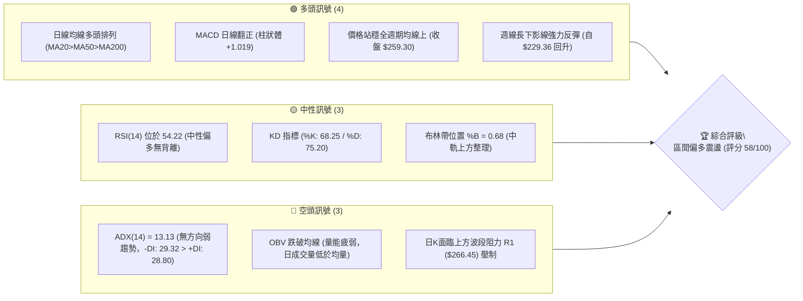
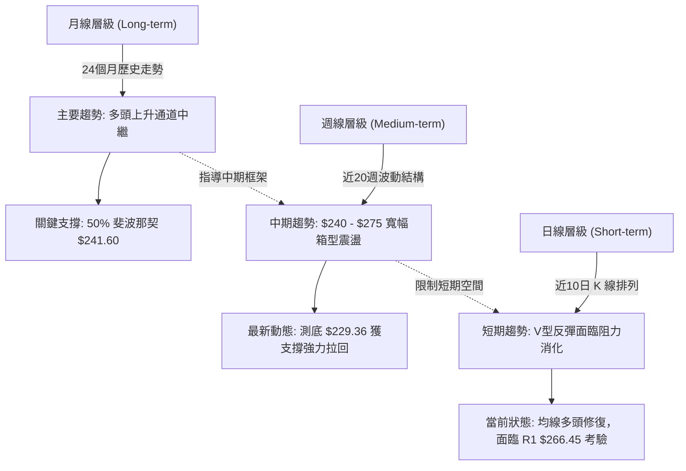
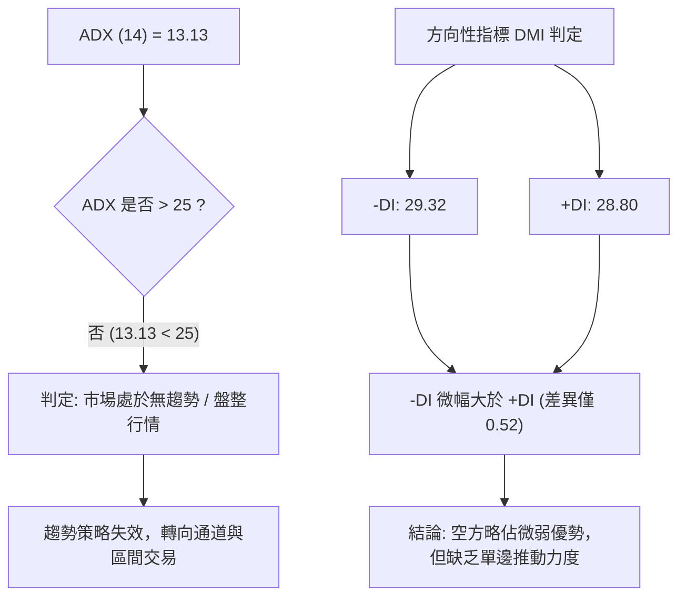
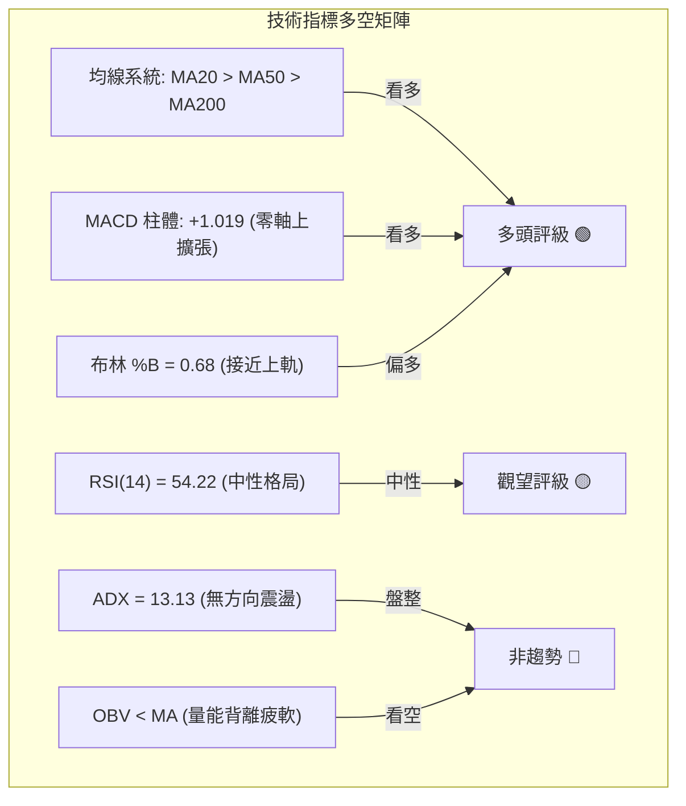
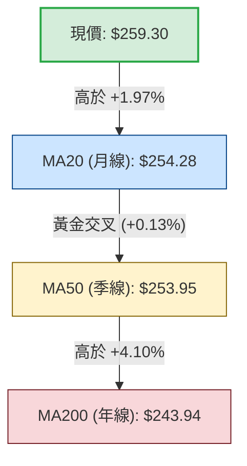
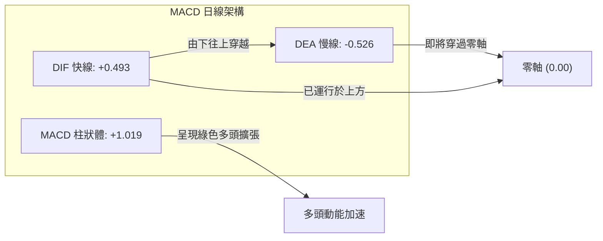
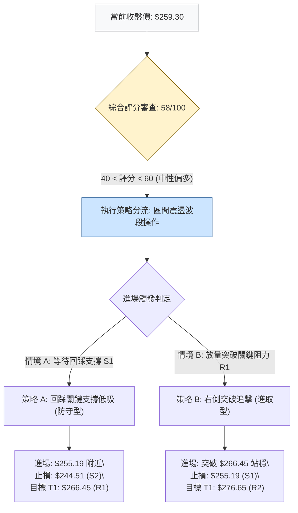
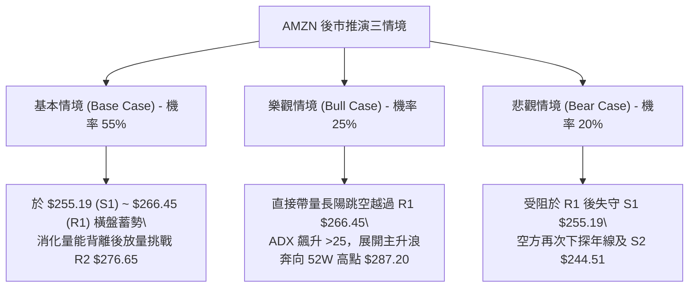

# AMZN 技術分析報告

> **報告日期**：2026-11-08 ｜ **語言**：繁體中文 ｜ **數據來源**：Yahoo Finance ｜ **當前價格**：$259.30 USD

---

## 目錄

| 章節 | 內容 |
|------|------|
| [1. 技術面概覽](#1-技術面概覽) | 訊號儀表板、核心指標、評分卡 |
| [2. 趨勢分析](#2-趨勢分析) | 多時框趨勢、長中短期走勢、ADX解讀 |
| [3. 圖表形態分析](#3-圖表形態分析) | 形態識別、K線組合、目標價推算 |
| [4. 支撐與阻力](#4-支撐與阻力) | 關鍵價位結構、斐波那契回調區間 |
| [5. 技術指標深度解讀](#5-技術指標深度解讀) | 均線系統、RSI、MACD、布林通道、量價OBV |
| [6. 動能與波動率](#6-動能與波動率) | 動能四象限、ATR波幅、Beta市場敏感度 |
| [7. 多時框架總結](#7-多時框架總結) | 時框架矩陣、ADX收斂與最終方向判斷 |
| [8. 交易策略建議](#8-交易策略建議) | 策略路由、情境階梯、進出場位與風報比 |
| [9. 風險提示與監控](#9-風險提示與監控) | 關鍵監控清單、情境分析、資金管理規則 |
| [報告總結](#-報告總結) | 儀表總結面板與執行摘要 |

---

## 1. 技術面概覽

### 🎯 技術訊號儀表板



### 📊 核心指標速覽表

| 指標類別 | 指標名稱 | 當前數值 | 訊號 | 解讀 |
|----------|----------|----------|------|------|
| **價格** | 當前收盤價 | $259.30 | 🟢 | 站上 MA5、MA10、MA20、MA50、MA200，展現短期修復動能 |
| **均線** | MA20 (月線) | $254.28 | 🟢 | 現價高於 MA20（乖離率 +1.97%），形成短期首要動態支撐 |
| **均線** | MA50 (季線) | $253.95 | 🟢 | 現價高於 MA50（乖離率 +2.11%），MA20 與 MA50 呈現黃金交叉狀態 |
| **均線** | MA200 (年線)| $243.94 | 🟢 | 長期多空分水嶺向上運行，現價穩居年線之上 +6.30% |
| **動能** | RSI(14) | 54.22 | 🟡 | 位於 50 強弱分界線上方，未達超買區（>70），無頂底背離跡象 |
| **動能** | MACD (12,26,9) | DIF: 0.493 / DEA: -0.526 | 🟢 | 快慢線零軸下方黃金交叉並突破零軸，柱狀圖 +1.019 持續擴張 |
| **擺盪** | 隨機指標 (KD) | %K: 68.25 / %D: 75.20 | 🟡 | 中高檔交叉收斂，短期面臨獲利回吐，但尚未出現死亡交叉發散 |
| **趨勢** | ADX / DMI | ADX: 13.13 / -DI: 29.32 | 🔴 | ADX 遠低於 25 臨界值，市場處於非趨勢無方向盤整，空頭力量微幅佔優 |
| **通道** | Bollinger Bands| 上軌 $268.34 / 下軌 $240.21 | 🟡 | 現價位於通道上半部（%B = 0.68），面臨上軌與 R1 共振壓力 |
| **波動** | ATR(14) | $9.19 (3.54%) | 🟡 | 日內平均振幅適中，反映財報後波動回落至常態區間 |
| **量能** | 當日量 / 20日均量 | 42.50M / 48.41M (0.88x) | 🔴 | 最新成交量能萎縮至 20 日均量以下，量能疲弱，OBV < MA |

### 🏆 技術評分卡

```
╔══════════════════════════════════════════════════════════════╗
║               技術評分卡 — AMZN (2026-11-08)                 ║
╠══════════════════════════════════════════════════════════════╣
║ 趨勢強度 (Trend Strength)   ████████░░░░░░░░░░░░  40/100 🔴  ║
║ 動能指標 (Momentum Indicators) █████████████░░░░░░░  65/100 🟢  ║
║ 支撐穩定度 (Support Stability) ██████████████░░░░░░  70/100 🟢  ║
║ 成交量配合 (Volume Health)     ████████░░░░░░░░░░░░  40/100 🔴  ║
║ 形態完整度 (Pattern Integrity) ████████████░░░░░░░░  60/100 🟡  ║
║ 均線排列 (MA Alignment)      ██████████████░░░░░░  70/100 🟢  ║
╠══════════════════════════════════════════════════════════════╣
║ 綜合評分 (Overall Score)     ████████████░░░░░░░░  58/100 🟡  ║
║ 評級結論: 中性偏多區間盤整 (Neutral-Bullish Range Bound)     ║
╚══════════════════════════════════════════════════════════════╝
```
*註：綜合評分由六項子指標等權算術平均計算得出：(40 + 65 + 70 + 40 + 60 + 70) ÷ 6 = 57.5 ≈ 58/100（四捨五入至整數，依嚴格規則 18）。*

---

## 2. 趨勢分析

### 🌐 多時框趨勢分析



### 📈 長期趨勢 — 12個月走勢圖（Unicode）

依據 2025-11 至 2026-11 歷史收盤數據繪製：

```
AMZN 月線收盤走勢圖（過去12個月：2025-11 至 2026-11）
價格軸 ($)
$275 ┤                                  ●(07月 $271.58)
$270 ┤                            ●(05月 $270.64)
$265 ┤                         ●(04月 $265.06)      ●(08月 $259.77)  ●(現價 $259.30)
$250 ┤                                                    ●(09月 $249.15)
$240 ┤                   ●(01月 $239.30)             ●(06月 $238.34)      ●(10月 $240.35)
$230 ┤●(11月 $233.22)●(12月 $230.82)
$210 ┤             ●(02月 $210.00)
$205 ┤                ●(03月 $208.27: 低點)
     └─────────────────────────────────────────────────────────────────────────────
       11M   12M   01M   02M   03M   04M   05M   06M   07M   08M   09M   10M   11M
       2025  2025  2026  2026  2026  2026  2026  2026  2026  2026  2026  2026  2026
```

#### 走勢特徵分析表格

| 週期波段 | 起訖月份 | 起訖價格 | 區間漲跌幅 | 主要走勢特徵與結構意涵 |
|----------|----------|----------|------------|------------------------|
| **第1階段：築底回調** | 2025-11 ~ 2026-03 | $233.22 → $208.27 | -10.70% | 自 2025 年高檔回踩，於 2026-03 探得波段次低點 $208.27，構築堅實支撐底部。 |
| **第2階段：主升拉升** | 2026-03 ~ 2026-07 | $208.27 → $271.58 | +30.40% | 展現強烈多頭動能，突破多重均線，於 2026-07 創出 $271.58 波段收盤新高。 |
| **第3階段：箱型修正** | 2026-07 ~ 2026-10 | $271.58 → $240.35 | -11.50% | 遭遇 52 週高點 $287.20 附近拋壓，連續三個月拉回測試 $240 大關與 MA200 支撐。 |
| **第4階段：築底反彈** | 2026-10 ~ 2026-11 | $240.35 → $259.30 | +7.88%  | 10月觸及 $229.36 低點後迅速被多頭收復，11月重回均線之上，中樞回升。 |

### 📊 中期趨勢（週線分析）

中期走勢呈現典型「上升階梯後的收斂震盪」。自 2026-07-31 大陽線推升至 $271.58 以來，價格在 $240.00 至 $275.00 區間橫盤消化已有 15 週。

```
週線區間箱型結構示意圖
$276.65 ─────────────────────── [R2: 週線多重高點壓制區]
$271.58 ───┬─────────────────── [7月底收盤高點]
           │    ▲ 週線震盪區間 ($240.00 ~ $274.48)
$259.30 ───┼───●────────────── [現價：重回週線中樞]
           │    ▼
$240.35 ───┴─────────────────── [10月底收盤低點]
$229.36 ─────────────────────── [2026-10-30 週線探底針尖 / S3防線邊界]
```

### ⚡ 趨勢強度評估（ADX 解讀）



#### ADX 數值強度對照表

| ADX 數值區間 | 趨勢狀態判定 | 當前數值 | 當前狀態說明與操作指引 |
|--------------|--------------|----------|------------------------|
| **0 - 20**   | **極弱 / 無方向盤整** | **13.13** | **當前所在區間**。市場動能渙散，均線纏繞，突破極易引發假信號，嚴禁盲目追價。 |
| 20 - 25      | 趨勢孕育 / 萌芽期 | — | 監控 +DI 與 -DI 交叉，等待通道帶寬收窄後擴張。 |
| 25 - 50      | 明確單邊趨勢 | — | 趨勢跟隨系統有效（目前未達標）。 |
| 50 - 100     | 極端超強趨勢 | — | 趨勢末端，防範加速趕頂或崩跌竭盡。 |

---

## 3. 圖表形態分析

### 🔍 形態識別系統


#### 形態識別信心度與目標價評估表

| 形態類別 | 信心度 (%) | 判斷依據（嚴格引用 OHLCV 數據） | 完成度 (%) | 目標價（附嚴謹計算式） |
|----------|------------|---------------------------------|------------|------------------------|
| **雙重底 (W底) 雛形** | 52% | 第一次波段低點為 2026-06 週線收盤 $232.69，第二次低點為 2026-10-30 低點 $229.36。兩次回測 $230 區域獲得強力支撐。中間頸線高點為 2026-08-07 收盤 $274.48。 | 60% | 頸線 $274.48 − 底部低點 $229.36 = 形態高度 $45.12。<br>突破目標價 = 頸線 $274.48 + $45.12 = **$319.60**（數據中未偵測到此阻力，依形態高度推算，當前尚未突破頸線）。 |
| **布林下軌破底翻** | 78% | 2026-10-30 最低價 $229.36 刺穿布林下軌 $240.21，但當週收盤拉回 $240.35，隨後 11-04 裂口大漲至收盤 $266.03，完成假跌破翻正。 | 85% | 由跌破低點 $229.36 測量至中軌 $254.28 高度 ($24.92)，向上投影目標為 **$279.20**（接近阻力 R2 $276.65）。 |
| **頭肩底形態** | 25% | 左肩為 2026-03 ($208.27)，頭部為 2025-04 ($184.42)，但時間跨度超過 18 個月，結構過於鬆散。 | 20% | **訊號不足，僅做指標型解讀**（依規則 15，低於 50% 不予做主要形態預測）。 |

### 🕯️ 重要 K 線形態分析

依據提供的「近10根日K」與「近8根週K」實際開高低收數據進行客觀解讀：

#### 近10根日K形態精確解析

| 日期 (日K) | 開盤價 ($) | 最高價 ($) | 最低價 ($) | 收盤價 ($) | 成交量 (股) | K線形態名稱 | 技術解讀與多空意涵 | 訊號 |
|------------|------------|------------|------------|------------|-------------|-------------|--------------------|------|
| 2026-10-26 | 249.47 | 250.79 | 247.23 | 249.09 | 32,696,400 | 窄幅十字小陰線 | 波動急遽壓縮，市場觀望氣氛濃厚，處於方向選擇前夕。 | 🟡 |
| 2026-10-27 | 250.43 | 254.68 | 248.71 | 253.10 | 34,477,800 | 溫和小陽線 | 試探上方 MA20 阻力，量能微幅放大但未具備突破動能。 | 🟢 |
| 2026-10-28 | 253.00 | 255.36 | 251.98 | 254.60 | 34,915,900 | 連續上攻小陽線 | 連續第二日收高，但在波段高點 $255.36 受阻，動能不足。 | 🟡 |
| 2026-10-29 | 246.95 | 249.14 | 241.24 | 243.79 | 85,234,400 | 放量中陰線 | 跳空低開低走，成交量暴增至 85.23M，呈現恐慌性拋售。 | 🔴 |
| 2026-10-30 | 232.54 | 241.55 | 229.36 | 240.35 | 104,894,700| 巨量長下影錘頭陰線| 創出 52 週次低點 $229.36，單日成交逾 1 億股，下影線長達 $10.99，顯示主力資金強力承接抄底。 | 🟢 |
| 2026-11-02 | 243.01 | 253.81 | 242.28 | 245.63 | 58,348,000 | 衝高回落十字陽線 | 向上修復考驗 $253.81 壓力，多頭初試啼聲但尾盤收斂。 | 🟡 |
| 2026-11-03 | 248.59 | 252.45 | 245.88 | 250.69 | 37,853,500 | 溫和修復中陽線 | 價格重返 $250 心理關口之上，為次日跳空奠定結構基礎。 | 🟢 |
| 2026-11-04 | 264.82 | 271.49 | 263.85 | 266.03 | 93,162,200 | 跳空放量突破長陽線| 開盤即跳空大漲逾 14 美元，最高觸及 $271.49，一舉越過所有短期均線，確立底部反轉。 | 🟢 |
| 2026-11-05 | 271.43 | 273.23 | 252.27 | 260.21 | 85,796,800 | 長上下影高位紡錘陰線| 開高後再創波段新高 $273.23，盤中一度深跌至 $252.27，振幅達 7.7%，高檔多空激烈搏殺。 | 🔴 |
| 2026-11-06 | 259.81 | 264.18 | 258.53 | 259.30 | 42,497,100 | 縮量小實體微陰線 | 縮量至 42.50M 回踩消化前日震盪籌碼，守穩 $258.53 與支撐 S1 $255.19 之上。 | 🟡 |

#### 近8根週K形態解析

| 日期 (週K) | 開盤價 ($) | 最高價 ($) | 最低價 ($) | 收盤價 ($) | 成交量 (股) | K線形態名稱 | 技術解讀與多空意涵 | 訊號 |
|------------|------------|------------|------------|------------|-------------|-------------|--------------------|------|
| 2026-09-18 | 253.15 | 255.95 | 244.30 | 253.71 | 186,830,200| 長下影十字星 | 在 $244.30 獲得中期均線支撐，收斂震盪。 | 🟡 |
| 2026-09-25 | 256.40 | 259.49 | 245.60 | 249.67 | 196,475,200| 壓制型下行陰線 | 跌破 $250，高點逐步下移，空方掌控波段節奏。 | 🔴 |
| 2026-10-02 | 246.63 | 253.56 | 244.73 | 251.52 | 174,917,500| 抵抗型小陽線 | 多頭在 $244.73 構築橫盤防線，成交量縮減。 | 🟡 |
| 2026-10-09 | 250.19 | 262.80 | 250.18 | 262.43 | 183,040,400| 光腳實體大陽線 | 反彈上攻收復 $260，動能指標暫時轉強。 | 🟢 |
| 2026-10-16 | 262.50 | 263.70 | 248.60 | 250.00 | 161,689,900| 高開低走長陰包覆 | 吞噬前週過半漲幅，受制於 $263.70 阻力。 | 🔴 |
| 2026-10-23 | 255.25 | 265.34 | 246.45 | 248.00 | 196,713,700| 衝高受阻上影陰線 | 再次上攻 $265.34 失敗，空方砸盤引發下行預期。 | 🔴 |
| 2026-10-30 | 249.47 | 255.36 | 229.36 | 240.35 | 292,219,200| 巨量恐慌探底針 | 觸及 52 週區間次低 $229.36，量能激增至近 3 億股，標準誘空洗盤針。 | 🟢 |
| 2026-11-06 | 243.01 | 273.23 | 242.28 | 259.30 | 317,657,600| 放量長下影穿透陽線| 成交量進一步放大至 3.17 億股，週線實體大漲 +18.95 美元，確立中級反彈。 | 🟢 |

### 📉 ASCII 走勢形態示意圖

```
日線級別「破底翻 + 巨量洗盤」結構示意圖
價格軸 ($)
$273.23 ┬─────────────────────────────────● (11-05 衝高阻力 R2 前回落)
$266.45 ┼───────────────────────────●────── (11-04 跳空大陽線 / 阻力 R1)
$259.30 ┼───────────────────────────┼──● (11-06 當前收盤價)
$255.19 ┼───────────────────────────┼──── [支撐 S1 / 均線重合密集區]
$240.35 ┼─────────●─────────────────┴──── [10-30 收盤位]
$229.36 ┴─────────┼─────────────────────── (10-30 巨量長針探底，假跌破完成)
                  │
        10-28   10-30   11-02   11-04   11-06
```

### 🎯 形態目標價計算

1. **下影線回升幅度推算法**：
   - 2026-10-30 最低價 $229.36 至 11-05 高點 $273.23，反彈波段振幅為：
     $$\Delta P_1 = 273.23 - 229.36 = 43.87$$
   - 短期健康回調以 0.382 斐波那契計算：
     $$273.23 - (43.87 \times 0.382) = 256.47 \text{（恰好落於支撐 S1 \$255.19 上方）}$$
2. **箱型突破目標價（中線視角）**：
   - 依據週線箱型底 $240.35 與箱頂 $274.48 計算，箱型高度 $H = 274.48 - 240.35 = 34.13$。
   - 若未來能帶量突破箱頂 $274.48，等距向上投射目標價：
     $$\text{目標價} = 274.48 + 34.13 = \$308.61 \text{（形態高度推算，數據中未偵測到此阻力）}$$

---

## 4. 支撐與阻力

### 🗺️ 關鍵價位分布圖（Unicode）

嚴格引用數據中「關鍵價位（由 OHLCV 計算）」與「斐波那契回調」數值繪製：

```
AMZN 價位結構分布圖 (2026-11-08)
═════════════════════════════════════════════════════════════════
$287.20 ║██████████████████████████████║ 強阻力 R3 / 52週高點 (0.0% Fib)
        ║                              ║
$276.65 ║████████████████████          ║ 波段阻力 R2 / 8月反彈高點
        ║                              ║
$266.45 ║████████████████████████      ║ 關鍵阻力 R1 / 近期跳空頸線
$265.68 ║──────────────────────────────║ 23.6% 斐波那契回調位
        ║                              ║
$259.30 ╠══════════════════════════════╣ ◄ 當前收盤價 ($259.30)
        ║                              ║
$255.19 ║▓▓▓▓▓▓▓▓▓▓▓▓▓▓▓▓▓▓▓▓▓▓▓▓      ║ 近期支撐 S1 / MA20密集區
$252.36 ║──────────────────────────────║ 38.2% 斐波那契回調位
$244.51 ║████████████████████████      ║ 強支撐 S2 / 季線波段低點
$241.60 ║──────────────────────────────║ 50.0% 斐波那契平衡位
        ║                              ║
$226.53 ║██████████████████████████████║ 極限防線 S3 / 年線下方強底
$196.00 ║██████████████████████████████║ 52週最低點 (100.0% Fib)
═════════════════════════════════════════════════════════════════
```

### 🚧 阻力位分析表

*嚴格引用數據中波段高點聚類數值 R1、R2、R3*：

| 阻力級別 | 精確價位 | 距離現價幅度 | 形成原因與技術共振背景 | 突破難度評估 | 重要性級別 |
|----------|----------|--------------|------------------------|--------------|------------|
| **阻力 R1** | **$266.45** | +2.76% | 2026-11-04 跳空收盤頸線位，同時與 23.6% 斐波那契回調位 ($265.68) 及布林上軌 ($268.34) 構成多重共振帶。 | 🟡 中等（需大於 20 日均量確認） | ★★★★☆ |
| **阻力 R2** | **$276.65** | +6.69% | 2026 年 8 月週線波段收盤高點 ($274.48) 與 11 月 5 日盤中刺針高點 ($273.23) 聚類密集壓制區。 | 🔴 較高（套牢籌碼沉重） | ★★★★★ |
| **阻力 R3** | **$287.20** | +10.76%| 52 週歷史歷史最高點（0.0% Fib），多頭極限估值拓展關卡，無任何均線壓制，純心理壓力。 | 🔴 極高（需宏觀多頭全面爆發） | ★★★★★ |

### 🛡️ 支撐位分析表

*嚴格引用數據中波段低點聚類數值 S1、S2、S3*：

| 支撐級別 | 精確價位 | 距離現價幅度 | 形成原因與技術共振背景 | 守住機率評估 | 重要性級別 |
|----------|----------|--------------|------------------------|--------------|------------|
| **支撐 S1** | **$255.19** | -1.59% | 近一年波段低點聚類位，向下 1 美元內有 MA20 ($254.28)、MA50 ($253.95) 及 38.2% Fib ($252.36) 密集托底。 | 🟢 高（短線回踩第一緩衝） | ★★★★☆ |
| **支撐 S2** | **$244.51** | -5.70% | 10月中下旬多根週K底部聚類（10-02 低點 $244.73、10-23 低點 $246.45），且貼近 MA200 年線 ($243.94) 與 50% Fib ($241.60)。 | 🟢 極高（中長期生命線） | ★★★★★ |
| **支撐 S3** | **$226.53** | -12.64%| 波段極端拋售聚類支撐，涵蓋 2026-10-30 誘空插針低點 $229.36，下方緊扣 61.8% 黃金分割回調位 $230.84。 | 🟢 極高（跌破代表中長線轉熊） | ★★★★★ |

### 📐 斐波那契回調位分析

依據 52 週極值區間（最低 $196.00 至 最高 $287.20）計算得出的精確回調位：

```
斐波那契回調結構階梯 (52W Low $196.00 → 52W High $287.20)
0.0%  $287.20 ──────────────────────────────────────── [52W High 極值]
23.6% $265.68 ─────────────────▲ 現價上方首道黃金分割壓制
               [當前現價 $259.30：落於 23.6% 與 38.2% 回調區間內]
38.2% $252.36 ─────────────────▼ 現價下方多頭核心防守位
50.0% $241.60 ──────────────────────────────────────── [多空力量中軸分水嶺]
61.8% $230.84 ──────────────────────────────────────── [牛市結構黃金防守底限]
78.6% $215.52 ──────────────────────────────────────── [深度空頭回撤位]
100.0%$196.00 ──────────────────────────────────────── [52W Low 起點]
```

- **位置意義解讀**：現價 $259.30 運行於 **23.6% ($265.68)** 與 **38.2% ($252.36)** 之間。在技術分析典範中，強勢牛市回調通常受制於 38.2% 即告重啟升勢。AMZN 於 10 月底回踩 61.8% ($230.84) 邊緣後強勢拉回，目前已成功重新站上 50% 與 38.2% 關鍵分水嶺，表明中期修正浪潮已告一段落，正重構多頭進攻秩序。

---

## 5. 技術指標深度解讀

### 🎛️ 指標訊號總覽



### 📈 移動平均線排列分析



#### 各週期均線狀態精確對照表

| 均線名稱 | 當前價位 ($) | 現價與均線差值 ($) | 乖離率 (%) | 排列狀態與趨勢意涵 | 多空訊號 |
|----------|--------------|-------------------|------------|--------------------|----------|
| **MA 5** | $256.37 | +$2.93 | +1.14% | 超短線攻擊線，連續 3 日拐頭向上，短多防禦點。 | 🟢 看多 |
| **MA 10** | $252.28 | +$7.02 | +2.78% | 短線操盤線，迅速向上修復並穿過 MA20。 | 🟢 看多 |
| **MA 20** | $254.28 | +$5.02 | +1.97% | 月線生命線，正式穿越 MA50 形成黃金交叉。 | 🟢 看多 |
| **MA 50** | $253.95 | +$5.35 | +2.11% | 中期基線，走平微幅向上，提供中期回踩防守。 | 🟢 看多 |
| **MA 60** | $255.09 | +$4.21 | +1.65% | 季線過渡帶，現價已站上該線，化解中期下行壓力。 | 🟢 看多 |
| **MA 120**| $253.00 | +$6.30 | +2.49% | 半年線，呈現平緩上升，中長期資產成本托底穩固。 | 🟢 看多 |
| **MA 200**| $243.94 | +$15.36 | +6.30% | 長期牛熊分水嶺，長期向上發散，多頭根基未損。 | 🟢 看多 |
| **MA 240**| $242.02 | +$17.28 | +7.14% | 兩年線成本中樞，構築最深層次技術安全網。 | 🟢 看多 |

- **均線結構解讀**：短、中、長週期均線呈現標準的多頭排列（MA20 $254.28 > MA50 $253.95 > MA200 $243.94），展現多頭在經歷深幅洗盤後的均線修復成果。然而，MA5 與 MA60/MA20 之間的間距過小，均線仍處於黏合初發散階段，需慎防回抽確認。

### 📉 RSI(14) 分析

```
RSI(14) 讀數進度條:
0 ─────── 30 ──────────────── 54.22 ──────────── 70 ─────── 100
[  超賣區  ]    偏弱空頭區    [███████████░░░░░░░░]  超買區
                                  ▲ 現值 54.22
```

- **超買超賣評估**：RSI(14) 數值為 **54.22**，自 10 月底超賣邊緣的 38.3 快速回升，當前穩居 50 中軸榮枯線上方，既未進入 70 以上的超買警戒區，亦擺脫了空頭壓制，處於健康的多頭修復動能區間。
- **背離分析**：依據近 20 根 K 棒的首尾價格與 RSI 進行檢驗，價格從 2026-10-09 高點 $262.43 拉回至 10-30 低點 $240.35 再回升至 $259.30，RSI 亦同步由 38.3 回升至 54.22。**明確結論：RSI 無明顯頂背離或底背離**，動能與價格走勢保持同步。

### 📊 MACD(12/26/9) 訊號解讀



- **數值與形態**：DIF快線值為 **0.493**，Signal訊號線值為 **-0.526**，兩者形成明確的零軸下金叉，隨後快線率先穿過零軸進入正值區。
- **柱狀圖動能**：Histogram 數值達 **+1.019**，柱狀體持續擴張。配合週線 MACD 柱狀體同步由負轉正（10-30 為 -1.528，11-06 轉為 +1.019），形成了罕見的「日線週線共振翻紅」，確立此波反彈具備較高動能支撐。

### 📦 布林通道分析

```
AMZN 日線布林通道 (20日, 2.0σ) 示意圖
$268.34 ┬────────────────────────────────────────── [BB 上軌]
        │                       ● (11-05 刺穿 $273.23)
$259.30 ┼───────────────────────●────────────────── [當前價格 / %B = 0.68]
$254.28 ┼────────────────────────────────────────── [BB 中軌 = MA20]
        │
$240.21 ┴────────────────────────────────────────── [BB 下軌]
```

- **通道帶寬與位置**：上軌位於 **$268.34**，中軌（MA20）位於 **$254.28**，下軌位於 **$240.21**。帶寬值為 $(268.34 - 240.21) \div 254.28 = 11.06\%$，處於中等收斂狀態。
- **%B 指標解讀**：當前 **%B = 0.68**，表明股價處於中軌至上軌的上半優勢進攻區間（中軌為 0.5，上軌為 1.0）。股價在 11-05 觸及上軌上方後回縮至通道內，屬於典型的布林帶內震盪特徵，並未引發單邊帶軌爆發，上方空間受限於上軌 $268.34。

### 💹 成交量分析（量價配合度）

```
量能多空對比評估
最新成交量  (42.50M)   ████████████████░░░░  [量比: 0.88x]
20日均量   (48.41M)   ██████████████████░░
50日均量   (40.66M)   ███████████████░░░░░
OBV 趨勢狀態:         OBV < MA (量能疲弱，資金未大幅進駐)
```

- **量能萎縮特徵**：2026-11-06 最新成交量為 **42,497,100 股**，相較於 20 日均量 **48,414,020 股**，量比僅為 **0.88x**。與 11-04 突破日的 93.16M 及 11-05 震盪日的 85.80M 相比，量能腰斬逾 50%。
- **量價背離隱憂**：價格處於五日反彈高位 $259.30，但成交量未能持續放大確認突破，OBV 亦顯示目前處於「OBV < MA」狀態。**明確結論：量價配合度不佳**，呈現「價漲量縮」的籌碼鎖定或動能衰竭特徵，後續上攻若無法補量至 50M 以上，難以有效越過強阻力 R1 $266.45。

---

## 6. 動能與波動率

### ⚡ 動能評估四象限

```
動能與波動率象限圖 (Momentum vs Volatility)
      高波動率 (High Volatility)
            │
    Q3      │      Q4
  強動能    │    弱動能
  高波動    │    高波動
────────────┼────────────
  ★ Q1      │    Q2
  強動能    │    弱動能
  低波動    │    低波動
            │
      低波動率 (Low Volatility)
```

#### 動能狀態對照解析

| 象限 | 動能維度 (MACD/RSI) | 波動維度 (ATR/Bandwidth) | AMZN 當前狀態 | 戰略操作指引 |
|------|---------------------|--------------------------|---------------|--------------|
| **Q1** | **強 (MACD柱 +1.019, RSI 54)** | **低至適中 (ATR 3.54%)** | **✓ 正處於此區** | **最佳波段買點**。動能維持向上，波動率自財報極端值回落，適合低吸並以狹窄止損進行波段操作。 |
| Q2 | 弱 (MACD 負向, RSI < 45) | 低 (橫盤縮量無方向) | — | 資金休眠觀望期，嚴格避免資金沉澱。 |
| Q3 | 強 (單邊趨勢爆發) | 高 (歷史高波幅) | — | 趨勢主升浪追隨，擴大止損幅度的進取型策略。 |
| Q4 | 弱 (崩跌或急劇拋售) | 高 (恐慌恐懼宣洩) | — | 嚴禁接飛刀，等待恐慌量潮結束。 |

### 📊 ATR 波動率分析

- **ATR(14) 數值**：**$9.19**（佔當前股價百分比為 **3.54%**，採用 Wilder 平滑算法）。
- **日內波動特徵**：AMZN 當前日均波幅約為 9.2 美元，代表一般交易日內 $\pm 1$ ATR 的正常價格擺動範圍為 **$250.11 至 $268.49**。當前價格 $259.30 恰巧處於該合理波幅的中位。
- **止損距離建議**：
  - **超短線交易**：建議止損距離為 $1.0 \times \text{ATR} = \$9.19$（以現價計對應 $\$250.11$）。
  - **標準波段交易**：建議止損距離為 $1.5 \times \text{ATR} = \$13.79$（以現價計對應 $\$245.51$，緊鄰支撐 S2）。
  - **寬幅防守**：建議止損距離為 $2.0 \times \text{ATR} = \$18.38$（對應 $\$240.92$，保護 50% 斐波那契分水嶺）。

### 📐 Beta 與市場相關性

- **Beta 數值**：**1.503**（相對於 S&P 500 指數）。
- **市場敏感度解讀**：AMZN 具備極強的高彈性科技權重股特徵。當大盤（S&P 500）波動 1% 時，AMZN 預期將同向波動約 1.503%。在宏觀環境面臨 AI 資本支出擔憂或流動性切換時，該股呈現顯著的「放大鏡效應」。因此，在持倉管理中必須依據 Beta 進行波動加權縮減，不可採用傳統低 Beta 標的的倉位標準。

---

## 7. 多時框架總結

### 📋 時框架評分表

| 時框架 | 趨勢方向 | 動能狀態 | 均線排列狀況 | 形態特徵 | 綜合評分 | 操作指引 |
|--------|----------|----------|--------------|----------|----------|----------|
| **月線 (長期)** | 🟢 向上偏多 | 🟡 中性平衡 | 🟢 多頭向上發散 | 52週高位箱型整固 | **75/100** | 逢低戰略配置，長線持有不變 |
| **週線 (中期)** | 🟡 寬幅箱型 | 🟢 翻正回升 | 🟢 MA200之上整理 | 巨量探底針破底翻 | **60/100** | 箱型高拋低吸，關注 $275 壓制 |
| **日線 (短期)** | 🟢 V型反彈 | 🟢 偏強發散 | 🟢 多頭均線黏合初開| 跳空修復面臨阻力 | **58/100** | 等待回踩確認，不宜追高進場 |

### 🔲 綜合訊號矩陣

```
時框訊號收斂矩陣
┌───────────┬──────────────┬──────────────┬──────────────┐
│ 分析維度  │ 日線 (短期)  │ 週線 (中期)  │ 月線 (長期)  │
├───────────┼──────────────┼──────────────┼──────────────┤
│ 趨勢架構  │ 偏多反彈     │ 箱型震盪     │ 大多頭整固   │
│ 均線系統  │ 多頭初顯     │ 糾纏平緩     │ 多頭發散     │
│ MACD 動能 │ 綠柱擴張 🟢  │ 剛翻正 🟢    │ 緩步收斂 🟡  │
│ RSI 強度  │ 54.22 (中性) │ 54.20 (中性) │ 60.50 (強勢) │
│ 量能確認  │ 疲弱縮量 🔴  │ 巨量承接 🟢  │ 溫和放大 🟢  │
└───────────┴──────────────┴──────────────┴──────────────┘
```

### ⚖️ 多時框收斂結論

依據多時框收斂規則（嚴格要求 14）：
1. **趨勢/盤整行情定性**：當前日線 **ADX(14) 讀數僅為 13.13**，遠低於趨勢臨界值 25，因此嚴格定性為**「盤整行情（Non-Trending Range-Bound）」**。
2. **時框優先級權衡**：在盤整行情中，趨勢指標失效，日線級別以布林通道（$240.21 ~ $268.34）及關鍵支撐阻力為交易主導，中長期均線提供大邊界邊界防守。
3. **唯一方向性結論**：**中性偏多區間震盪（Neutral-Bullish Range Bound）**。
   - **取捨理由**：雖然日線均線與 MACD 出現偏多修復，但受制於 ADX 極低、OBV 量能疲弱以及上方 R1 ($266.45) 壓制，多頭難以形成爆發性單邊主升浪；然而，週線在 $229.36 展現強烈巨量承接，確立了下檔支撐極其堅實。因此，最終方向判定為**「以支撐 S1 為依託的震盪回踩低吸格局」**。

---

## 8. 交易策略建議

### 🗺️ 策略決策流程圖



### 🧭 策略路由（依評分卡分流）

> **當前主策略方向 = 中性偏多區間操作，以回踩布林中軌與支撐 S1 為主要低吸路徑（依評分 58/100）**

因技術評分卡綜合評分為 **58/100**，處於 40–60 的中性震盪區間，依規則鎖定為「區間操作」策略。此評分禁止高位盲目追高，主推在支撐位 S1 附近的低吸回調佈局，次推突破確認後的右側追擊。

### 🎯 價格情境階梯（Price Scenarios）

價位嚴格引用第 4 章由 OHLCV 計算的實體數據：

| 觸發條件 | 下一目標價 | 後續延伸目標 | 情境技術含義與應對要點 |
|----------|------------|--------------|------------------------|
| **突破 R1 $266.45** | **R2 $276.65** | **R3 $287.20** | 短線向上打開空間，越過布林上軌與 23.6% 斐波那契，確立回踩完成。 |
| **站穩現價區間 ($255.19 ~ $265.68)** | **R1 $266.45** | **S1 $255.19** | 圍繞 MA20 與均線密集區展開籌碼沉澱，以時間換取指標消化空間。 |
| **跌破 S1 $255.19** | **S2 $244.51** | **S3 $226.53** | 中期修復走勢遭受破壞，重回季線與年線尋找大級別托底力量。 |

### 📊 情境機率分佈

| 情境劃分 | 機率預估 | 主要技術指標依據（嚴格引據數據） |
|----------|----------|----------------------------------|
| **區間整固後向上突破 (偏多)** | **55%** | 日線 MACD 柱狀體翻正 (+1.019) 擴張，均線呈現 MA20>MA50>MA200 多頭排列，週線探底針洗盤徹底。 |
| **通道內弱勢震盪 (中性)** | **30%** | ADX 僅 13.13 顯示無趨勢特徵，成交量 42.50M 低於均量，OBV 疲軟，短期難以單邊突圍。 |
| **失守支撐二次探底 (偏空)** | **15%** | -DI (29.32) 仍微幅高於 +DI (28.80)，若宏觀流動性收緊引發跌破 MA20，將考驗年線。 |

### 🟢 主策略詳情

進場價採固定數值或區間中點計算，風報比計算嚴格依據規則 17：
$$\text{風險報酬比} = \frac{\text{目標價 T1} - \text{進場價}}{\text{進場價} - \text{止損價}}$$

| 策略要素 | 策略 A（回踩支撐低吸 — 主推） | 策略 B（右側突破追擊 — 次選） |
|----------|-------------------------------|-------------------------------|
| **策略類型** | 逢低回踩佈局（左側偏防守） | 關鍵阻力突破確認（右側順勢） |
| **進場條件** | 價格回調至支撐位 S1 不破，縮量收下影線 | 日K收盤價實體突破阻力 R1 且成交量 > 50M |
| **進場價格** | **$255.19**（精確引用 S1 支撐位） | **$266.45**（精確引用 R1 阻力位） |
| **目標價 T1** | **$266.45**（引用阻力 R1） | **$276.65**（引用阻力 R2） |
| **目標價 T2** | **$276.65**（引用阻力 R2） | **$287.20**（引用阻力 R3 / 52W高點） |
| **止損價格** | **$244.51**（引用強支撐 S2） | **$255.19**（引用原阻力轉化之支撐 S1）|
| **風險報酬比 (以 T1 計)** | **1 : 1.05**<br>計算式: $(266.45 - 255.19) \div (255.19 - 244.51) = 11.26 \div 10.68 = 1.054$ | **1 : 0.91**<br>計算式: $(276.65 - 266.45) \div (266.45 - 255.19) = 10.20 \div 11.26 = 0.905$ |
| **風險報酬比 (以 T2 計)** | **1 : 2.01**<br>計算式: $(276.65 - 255.19) \div (255.19 - 244.51) = 21.46 \div 10.68 = 2.009$ | **1 : 1.84**<br>計算式: $(287.20 - 266.45) \div (266.45 - 255.19) = 20.75 \div 11.26 = 1.842$ |
| **預估勝率** | 60% | 52% |
| **建議倉位** | **15% - 20%** 總投資本金 | **10%** 總投資本金 |

### 🔴 反向風險觸發點（對沖提示）

- **全面轉空防守點**：若日線收盤價跌破強支撐 **S2 $244.51**，意味著跌破 50% 斐波那契回調位 ($241.60) 及年線 MA200 ($243.94)，多頭格局徹底瓦解。
- **對沖應對指引**：多頭應立即全數止損離場，並可建立相應倉位的空頭反向保護（如買入看跌期權），下一防守下探目標指向極限支撐 **S3 $226.53**。

### ⭐ 整體訊號強度評星

```
做多訊號強度：★★★☆☆  (3/5星 — 均線與動能向好，惟受制於量能不足與阻力)
做空訊號強度：★★☆☆☆  (2/5星 — 空頭力量衰退，下方有多重長週期均線托底)
整體可信度：  ★★★☆☆  (3/5星 — ADX 低於 25 處於震盪市，訊號易出現反覆)
```

---

## 9. 風險提示與監控

### ✅ 關鍵監控指標 Checklist

```
╔══════════════════════════════════════════════════════════════╗
║               關鍵技術監控清單 (Monitoring Checklist)        ║
╠══════════════════════════════════════════════════════════════╣
║ [ ] 價位監控: 收盤價是否能站穩 MA20 ($254.28) 與 S1 ($255.19) ║
║ [ ] 阻力測試: 上攻 R1 ($266.45) 時成交量是否大於 50M 股      ║
║ [ ] 動能跟蹤: 日線 MACD 柱狀體是否能維持正值擴張 (> +1.00)     ║
║ [ ] 震盪指標: RSI(14) 能否突破 60 強勢區且不產生頂背離        ║
║ [ ] 趨勢突破: ADX(14) 是否走出 <15 低谷並拐頭穿越 25 臨界線   ║
║ [ ] 通道帶寬: 布林通道是否開始擴張，收盤價能否突破上軌 $268.34║
║ [ ] 量能信號: OBV 是否突破其移動平均線，消除量價背離隱患       ║
╚══════════════════════════════════════════════════════════════╝
```

### ⚠️ 風險場景分析



### 🛡️ 風險管理重要提醒

1. **波動率調整倉位法則**：AMZN 的 ATR 為 **$9.19 (3.54%)**，Beta 高達 **1.503**。在高波動環境下，單筆交易的最大資金回撤必須嚴格控制在總賬戶淨值的 **1.0%** 以內。若以策略 A 的止損幅度 $10.68 美元計算，每 10 萬美元總資產建議交易股數不宜超過 90 股（市值約 $23,000，即總倉位不超過 23%）。
2. **防範假突破紀律**：在當前 ADX 為 13.13 的弱趨勢市況下，日內盤中突破阻力位 R1 ($266.45) 極易形成誘多陷阱。嚴格要求**必須以日線收盤價（End-of-Day Close）**站穩為進場確認信號，或等待次日回踩確認不破再行介入。
3. **重大基本面事件防範**：需密切注意雲端運算（AWS）基礎設施資本支出擔憂，若市場對大型科技股資本回報率重新定價，可能引發全板塊技術面破位，屆時必須嚴格執行機械化止損，不可抱持基本面執念。

---

## 📋 報告總結

```
╔══════════════════════════════════════════════════════════════╗
║               AMZN 技術分析報告總結面板                      ║
╠══════════════════════════════════════════════════════════════╣
║ 報告日期：2026-11-08                                         ║
║ 當前價格：$259.30 USD                                         ║
║ 技術評分：58 / 100                                            ║
║ 分析評級：⚖️ 區間偏多震盪 (Neutral-Bullish Range Bound)       ║
╠══════════════════════════════════════════════════════════════╣
║ 關鍵結構結論：                                               ║
║ ├─ 長期趨勢：🟢 多頭發散未破，年線 MA200 ($243.94) 提供強勁支撐║
║ ├─ 中期趨勢：🟡 處於 $240.00 ~ $275.00 大箱體中繼整固浪潮     ║
║ ├─ 短期趨勢：🟢 探底長下影反彈，日線均線呈多頭排列，面臨上軌阻力║
║ ├─ 關鍵支撐：S1: $255.19 ｜ S2: $244.51 ｜ S3: $226.53        ║
║ ├─ 關鍵阻力：R1: $266.45 ｜ R2: $276.65 ｜ R3: $287.20        ║
║ └─ 斐波那契：運行於 38.2% ($252.36) 至 23.6% ($265.68) 關鍵區 ║
╠══════════════════════════════════════════════════════════════╣
║ 最優策略指引：                                               ║
║ 1. 🥇 最佳機會（策略 A）：回踩支撐 S1 ($255.19) 低吸，        ║
║    止損設於 S2 ($244.51)，目標看至 R1 ($266.45) (風報比 1:1.05)║
║ 2. 🥈 次選機會（策略 B）：放量突破 R1 ($266.45) 右側跟進，    ║
║    止損設於 S1 ($255.19)，目標看至 R2 ($276.65) (風報比 1:0.91)║
║ 3. 🥉 防守底線：收盤有效跌破 S2 ($244.51) 全面轉空對沖離場。   ║
╚══════════════════════════════════════════════════════════════╝
```

---

> ⚠️ **免責聲明**：本報告為依據標準技術分析理論進行之自動化研究報告，所有引述之價位、支撐阻力與技術指標均源於提供的客觀數據。本報告**僅供學術研究與投資策略探討參考**，**不構成任何要約、招攬或具體的個人投資買賣建議**。金融市場存在高度波動風險，交易者應獨立評估自身風險承受能力並嚴格執行資金管理。

---

*報告生成時間：2026-11-08 ｜ 數據來源：Yahoo Finance ｜ 分析框架：多時框技術分析模型*