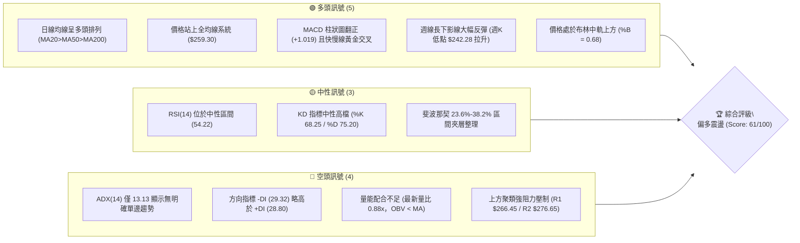
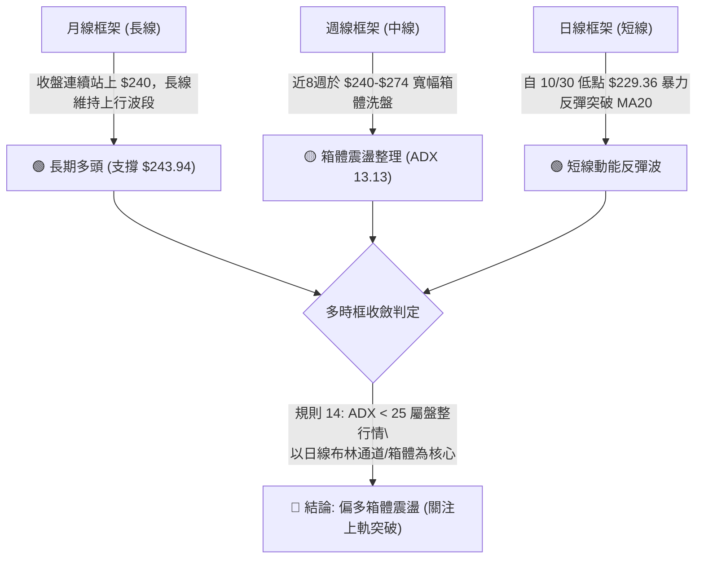
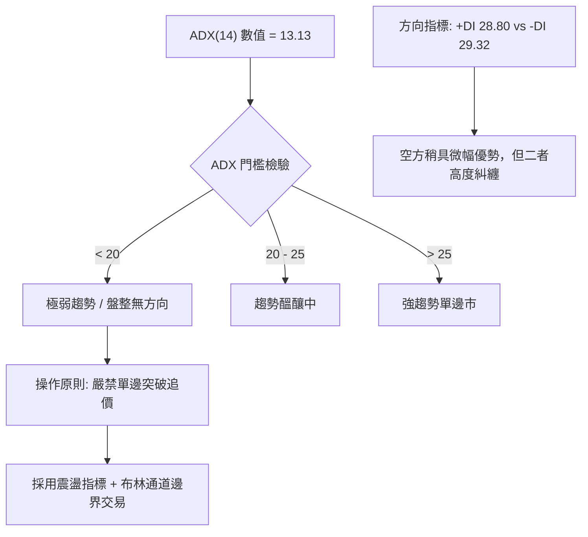
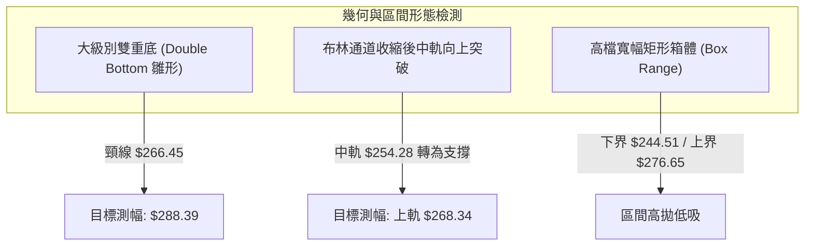
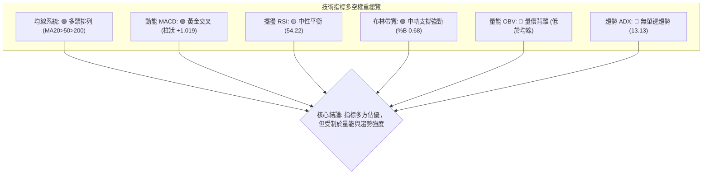
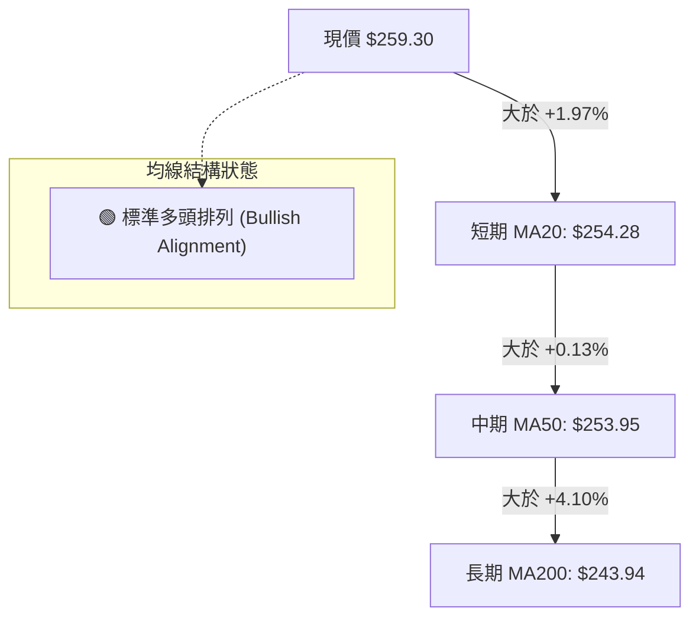
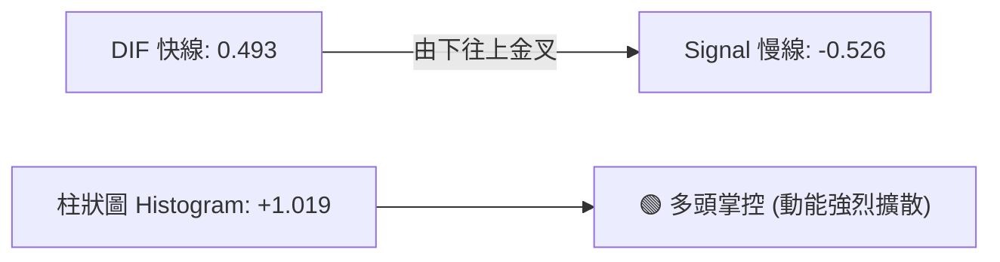
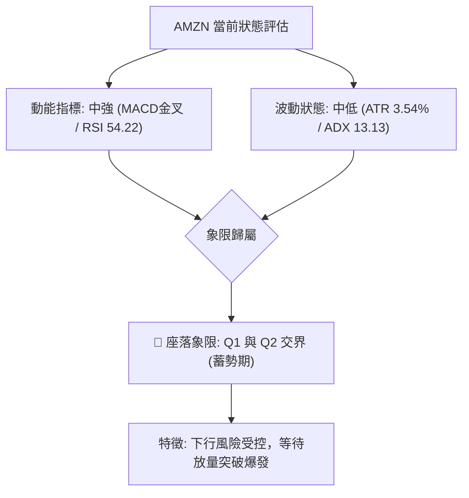
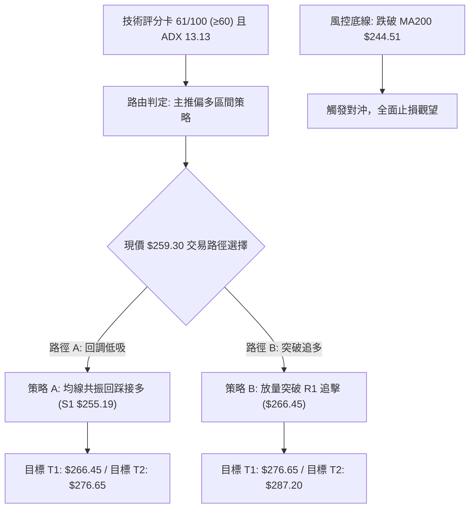
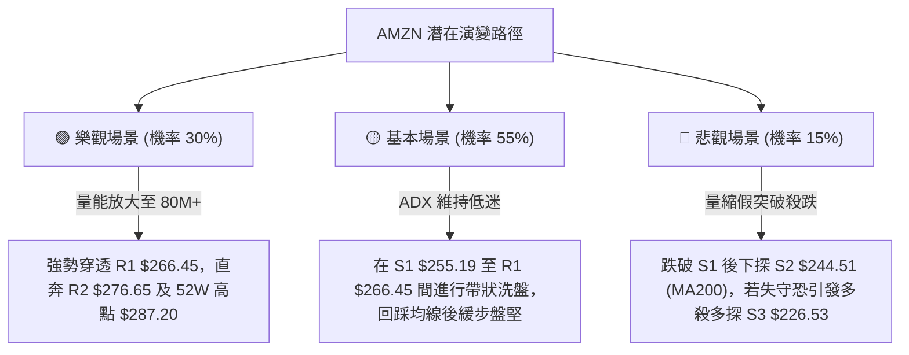

# AMZN 技術分析報告

> **報告日期**：2026-11-09 ｜ **語言**：繁體中文 ｜ **數據來源**：Yahoo Finance ｜ **當前價格**：$259.30

---

## 目錄

| 章節 | 內容 |
|------|------|
| [1. 技術面概覽](#1-技術面概覽) | 訊號儀表板、核心指標、評分卡 |
| [2. 趨勢分析](#2-趨勢分析) | 多時框趨勢、長中短期走勢 |
| [3. 圖表形態分析](#3-圖表形態分析) | 形態識別、K線組合、目標價 |
| [4. 支撐與阻力](#4-支撐與阻力) | 關鍵價位、斐波那契回調 |
| [5. 技術指標深度解讀](#5-技術指標深度解讀) | MA/RSI/MACD/布林/成交量 |
| [6. 動能與波動率](#6-動能與波動率) | 動能評估、ATR、Beta |
| [7. 多時框架總結](#7-多時框架總結) | 時框架評分矩陣 |
| [8. 交易策略建議](#8-交易策略建議) | 多空策略、風險報酬比 |
| [9. 風險提示與監控](#9-風險提示與監控) | 監控指標、風險場景 |
| [📋 報告總結](#-報告總結) | 決策總結與策略彙整 |

---

## 1. 技術面概覽

### 🎯 技術訊號儀表板



### 📊 核心指標速覽表

| 指標類別 | 指標名稱 | 當前數值 | 訊號 | 解讀 |
|:---|:---|:---|:---:|:---|
| **價格** | 當前收盤價 | $259.30 | 🟢 | 突破所有短期與長期均線，位於52週區間 69.4% 位置 |
| **均線** | MA20 (短) | $254.28 | 🟢 | 現價高於 MA20 達 +1.97%，短期支撐確立 |
| **均線** | MA50 (中) | $253.95 | 🟢 | 現價高於 MA50 達 +2.11%，中期上升趨勢未破 |
| **均線** | MA200 (長) | $243.94 | 🟢 | 現價高於長期生命線達 +6.29%，長期多頭基調穩固 |
| **動能** | RSI(14) | 54.22 | 🟡 | Wilder 演算法計算，中性偏多，無超買超賣，無顯著背離 |
| **動能** | MACD (12,26,9) | 0.493 / -0.526 | 🟢 | DIF 線由下往上穿越 Signal 線，Hist 為 +1.019，多方主導 |
| **動能** | 隨機指標 KD | %K 68.25 / %D 75.20 | 🟡 | 位於平衡偏強區間，%K 略低於 %D，處於短線震盪蓄勢 |
| **趨勢** | ADX(14) | 13.13 | 🔴 | ADX < 25 極弱，市場屬無方向之寬幅盤整，-DI 略佔優勢 |
| **通道** | 布林通道 (%B) | 0.68 | 🟢 | 位於中軌 ($254.28) 與上軌 ($268.34) 間，多方具主動權 |
| **波動** | ATR(14) | $9.19 | 🟡 | 佔股價 3.54%，每日平均真實波幅近 9.2 美元，波動適中 |
| **量能** | 20日量比 / OBV | 0.88x / 疲弱 | 🔴 | 日量 42.5M 低於均量 48.4M，OBV 低於均線顯示追價意願謹慎 |

### 🏆 技術評分卡

```
╔════════════════════════════════════════════════════════════════╗
║                技術評分卡 — AMZN (2026-11-09)                   ║
╠════════════════════════════════════════════════════════════════╣
║ 評估維度         進度條指標                   得分   狀態      ║
║────────────────────────────────────────────────────────────────║
║ 趨勢強度 (Trend) ████████░░░░░░░░░░░░        40/100  🔴 弱勢   ║
║ 動能指標 (Mom.)  ██████████████░░░░░░        70/100  🟢 強勁   ║
║ 支撐穩定 (Supp.) ██████████████░░░░░░        70/100  🟢 穩固   ║
║ 成交量能 (Vol.)  ████████░░░░░░░░░░░░        40/100  🔴 匱乏   ║
║ 形態結構 (Patt.) ██████████████░░░░░░        70/100  🟢 完整   ║
║ 均線排列 (MAs)   ████████████████░░░░        80/100  🟢 多頭   ║
╠════════════════════════════════════════════════════════════════╣
║ 綜合評分         ████████████░░░░░░░░        61/100  🟢 偏多   ║
║ 結論：(40 + 70 + 70 + 40 + 70 + 80) ÷ 6 = 61.67 → 整數 61分    ║
╚════════════════════════════════════════════════════════════════╝
```

---

## 2. 趨勢分析

### 🌐 多時框趨勢分析



### 📈 長期趨勢 — 12個月走勢圖（Unicode）

以下為 AMZN 自 2025-11 至 2026-11 之月線收盤走勢全貌：

```
AMZN 月線收盤走勢圖（過去12個月：2025-11 至 2026-11）
價格軸 ($)
$275 ┤                               ● $271.58 (07月)
$270 ┤                     ● $270.64(05月)
$265 ┤               ● $265.06(04月)               ● $259.30 (當前現價)
$260 ┤                                        ● $259.77 (08月)
$250 ┤                                             ● $249.15 (09月)
$245 ┤                                                  ● $240.35 (10月)
$240 ┤         ● $239.30(01月)
$235 ┤   ● $233.22 (11月)  ● $238.34(06月)
$230 ┤       ● $230.82(12月)
$220 ┤
$210 ┤             ● $210.00(02月)
$205 ┤                 ● $208.27(03月低點)
     └────────────────────────────────────────────────────────────► 月份
       11  12  01  02  03  04  05  06  07  08  09  10  11 (2026)
```

#### 走勢特徵分析表格

| 階段 | 時間區間 | 起訖價格 | 區間漲跌幅 | 形態與量價特徵解讀 |
|:---|:---|:---|:---:|:---|
| **階段一** | 2025/11 - 2026/01 | $233.22 → $239.30 | +2.61% | 高檔橫盤築平台，量能平穩，多頭蓄勢未發 |
| **階段二** | 2026/01 - 2026/03 | $239.30 → $208.27 | -12.97% | 春季深度回踩，下探波段低位 $208.27，測試買盤承接力 |
| **階段三** | 2026/03 - 2026/05 | $208.27 → $270.64 | +29.95% | 爆發性單邊主升段，直接拉升突破歷史中繼區間 |
| **階段四** | 2026/05 - 2026/07 | $270.64 → $271.58 | +0.35% | 劇烈震盪洗盤（6月曾急殺至 $238.34），7月再創高點 $271.58 |
| **階段五** | 2026/07 - 2026/10 | $271.58 → $240.35 | -11.50% | 階梯式陰跌回調，於 10 月底回測 $240 關卡形成支撐聚類 |
| **階段六** | 2026/10 - 2026/11 | $240.35 → $259.30 | +7.88% | 11月初展開 V 型急拉，收復全數短期均線，確立防守有效 |

### 📊 中期趨勢（週線分析）

```
AMZN 中期週線支撐與阻力走廊示意圖
  $287.20 ────────────────────────────────────────────── 52W 最高點 / R3
             ▲          ▲
  $276.65 ───┼──────────┼────────────────────────────── R2 波段阻力
             │          │ (假突破/上影線壓力區)
  $266.45 ───┼──────────┴────────────────────────────── R1 關鍵頸線阻力
             │  ┌──┐
  $259.30 ───┼──┤現├────────────────────────────────── 當前收盤價 ($259.30)
             │  └──┘
  $255.19 ───┴───────────────────────────────────────── S1 近期支撐 / MA20
  $244.51 ────────────────────────────────────────────── S2 強支撐聚類 / MA200
  $226.53 ────────────────────────────────────────────── S3 波段極限防守位
```

中期週線在 2026-07-31 衝上 $271.58、08-07 創出 $274.48 波段高點後，經歷連續 12 週的收斂三角或高檔箱體震盪。在 2026-10-30 當週，市場下探至 $229.36（收盤 $240.35），隨後於 2026-11-06 當週拉出爆量大陽線（成交量 317.66M），實體收於 $259.30，單週飆漲近 19 美元，中期多頭結構重啟生機。

### ⚡ 趨勢強度評估（ADX 解讀）



#### ADX 趨勢強度對照表

| 指標變數 | 當前讀數 | 基準閾值 | 狀態判定 | 交易涵義 |
|:---|:---:|:---:|:---:|:---|
| **ADX(14)** | **13.13** | 25.00 | 🔴 極弱趨勢 | 股價無明確單邊行駛趨勢，處於典型的無趨勢盤整（Chop Market） |
| **+DI (14)** | **28.80** | - | 🟡 多方動能 | 較低檔明顯拉升，顯示近一週買盤力道大幅注入 |
| **-DI (14)** | **29.32** | - | 🔴 空方力量 | 雖然小幅高於 +DI (+0.52)，但兩線快速靠攏，呈現絞合走勢 |
| **動能格局** | 糾纏 | - | ⚪ 轉換期 | 指標確認當前為大型箱體震盪行情，需等待 ADX 拐頭上穿 20/25 |

---

## 3. 圖表形態分析

### 🔍 形態識別系統



#### 形態識別與信心度評估表（依規則 15）

| 形態名稱 | 信心度 | 判斷依據（嚴格引用數據） | 完成度 | 目標價（附嚴謹計算式） |
|:---|:---:|:---|:---:|:---|
| **箱體內雙底**<br>(Double Bottom) | **65%** | 第一次波段低點聚類 S2 位於 $244.51，第二次於 10/30 下探 $229.36 後快速拉起，形成雙腳結構，頸線聚類為 R1 $266.45。 | 75% | 頸線 $266.45 + (頸線 $266.45 − 谷底 $244.51) = **$288.39**<br>*(註：高於 R3 $287.20)* |
| **布林帶突破**<br>(BB Breakout) | **75%** | 日線自下軌 $240.21 發動強攻，連續突破中軌 $254.28，%B 達到 0.68，展現均線收斂向上發散之勢。 | 85% | 直接對應布林通道上軌壓制位：**$268.34** |
| **寬幅矩形箱體**<br>(Rectangle) | **80%** | 近幾個月價格反覆受阻於 R2 $276.65，並在 S2 $244.51 獲得強烈承接，ADX 13.13 極度印證箱體特徵。 | 90% | 箱體震盪上緣目標價：**$276.65** |

### 🕯️ 重要K線形態分析

嚴格依據歷史數據中提供的「近10根日K」與「近8根週K」開高低收數值進行判讀：

#### 近10根日K棒形態判讀表

| 日期 | 開盤價 | 最高價 | 最低價 | 收盤價 | 成交量 | K線形態名稱 | 專業技術解讀 | 多空訊號 |
|:---:|:---:|:---:|:---:|:---:|:---:|:---|:---|:---:|
| **10-26** | 249.47 | 250.79 | 247.23 | 249.09 | 32.70M | 小陰十字星 | 實體極短(0.38)，交投清淡，多空極度膠著 | 🟡 中性 |
| **10-27** | 250.43 | 254.68 | 248.71 | 253.10 | 34.48M | 溫和陽線 | 震盪收高，試圖挑戰 MA20，但未獲量能背書 | 🟢 偏多 |
| **10-28** | 253.00 | 255.36 | 251.98 | 254.60 | 34.92M | 帶上影陽線 | 創短線高點 $255.36 後受阻回落，上方承壓 | 🟡 中性 |
| **10-29** | 246.95 | 249.14 | 241.24 | 243.79 | 85.23M | 跳空放量中陰 | 跳空低開，成交量倍增至 85M，空頭發動下殺 | 🔴 看空 |
| **10-30** | 232.54 | 241.55 | 229.36 | 240.35 | 104.89M | 長下影放量錘頭線 | 創52週波段低位 $229.36 後爆量 104.9M 強勢收復，恐慌盤出盡 | 🟢 底部信號 |
| **11-02** | 243.01 | 253.81 | 242.28 | 245.63 | 58.35M | 長上影倒錘頭 | 低檔反彈遇空頭反撲，高點觸及 $253.81 後遭壓制 | 🟡 多空互搏 |
| **11-03** | 248.59 | 252.45 | 245.88 | 250.69 | 37.85M | 小實體中陽 | 守穩前日低點，低階買盤逐步墊高 | 🟢 偏多 |
| **11-04** | 264.82 | 271.49 | 263.85 | 266.03 | 93.16M | 向上跳空大陽線 | 跳空高開逾14美元，突破MA20/50，量能激增至 93.2M | 🟢 強烈看多 |
| **11-05** | 271.43 | 273.23 | 252.27 | 260.21 | 85.80M | 長下影長黑墓碑線 | 創短線新高 $273.23 後劇烈回吐，巨幅震盪達 21 美元 | 🔴 賣壓顯現 |
| **11-06** | 259.81 | 264.18 | 258.53 | 259.30 | 42.50M | 縮量橫盤孕線 | 實體完全包含於前日振幅中，量縮洗盤，等待方向 | 🟡 中性整固 |

#### 近8根週K棒形態判讀表

| 週結算日 | 開盤價 | 最高價 | 最低價 | 收盤價 | 週成交量 | 週K形態 | 技術解讀 | 訊號 |
|:---:|:---:|:---:|:---:|:---:|:---:|:---|:---|:---:|
| **09-18** | 253.15 | 255.95 | 244.30 | 253.71 | 186.83M | 長下影探底線 | 探底 $244.30 後回穩收平，支撐展現韌性 | 🟡 中性 |
| **09-25** | 256.40 | 259.49 | 245.60 | 249.67 | 196.48M | 破位中黑線 | 跌破前週低點收於 $249.67，空方緩步推進 | 🔴 偏空 |
| **10-02** | 246.63 | 253.56 | 244.73 | 251.52 | 174.92M | 縮量紅十字星 | 於 $244 支撐位上方暫時止跌，形成弱勢反彈 | 🟡 中性 |
| **10-09** | 250.19 | 262.80 | 250.18 | 262.43 | 183.04M | 週線長陽線 | 吞噬前兩週實體，收復 $260 關卡 | 🟢 看多 |
| **10-16** | 262.50 | 263.70 | 248.60 | 250.00 | 161.69M | 空頭吞噬黑K | 高開低走重挫 12.43 美元，回吐前週全數漲幅 | 🔴 看空 |
| **10-23** | 255.25 | 265.34 | 246.45 | 248.00 | 196.71M | 衝高回落倒錘 | 上探 $265.34 後遭空方全數摜回，形成長上影線 | 🔴 偏空 |
| **10-30** | 249.47 | 255.36 | 229.36 | 240.35 | 292.22M | 放量破底低抽線 | 砸出全年波段次低點 $229.36，放量近3億股，下影線長達11美元 | 🟡 恐慌洗盤 |
| **11-06** | 243.01 | 273.23 | 242.28 | 259.30 | 317.66M | 爆量破底大長陽 | 低開狂飆近 30 美元，收盤 $259.30，週量創波段新高確立買盤重啟 | 🟢 強烈看多 |

### 📉 ASCII 走勢形態示意圖

```
AMZN 日線局部「破底翻 + 雙底頸線測試」幾何圖形
價格 ($)
$273.23 ┬                                 ● (11/05 高點)
$266.45 ┼ - - - - - - - - - - - - - - - - ╂ - - - - - - - - - (頸線阻力聚類 R1)
$260.00 ┼                               ╭ ╯ ╲ ╭─● $259.30 (當前現價)
$254.28 ┼ ─ ─ ─ ─ ─ ─ ─ ─ ─ ─ ─ ─ ─ ─ ─ ╭ ╯ ─ ─ ─ ─ ─ ─ ─ ─ (MA20 / 中軌支撐)
$244.51 ┼ ─ ● (低點1: 09/18) ─ ─ ─ ─ ─ ╭ ╯ ─ ─ ─ ─ ─ ─ ─ ─ ─ (強支撐 S2)
        │     ╲               ╭ ╮     │
$229.36 ┴      ╲ ─ ─ ─ ─ ─ ─ ─╯ ╰ ─ ─ ● (低點2: 10/30 假跌破 V轉洗盤)
        └────────────────────────────────────────────────────────────► 時間
```

### 🎯 形態目標價計算

根據雙底形態（Double Bottom）嚴謹測幅公式：
- **形態左底**：$244.51（2026-09-18 週低點聚類 S2）
- **形態右底（極值洗盤）**：$229.36（2026-10-30 盤中下影線低點）
- **形態有效頸線**：$266.45（波段高點聚類阻力 R1）
- **垂直形態高度 (H)**：$266.45 − $244.51 = $21.94
- **破頸線理論量度目標價 (T_target)**：
  $$\text{目標價} = \text{頸線} + \text{形態高度} = \$266.45 + \$21.94 = \mathbf{\$288.39}$$
  *(該數值精確對應 52週高點 R3 $287.20 附近，具備高度技術圖表共振效應)*

---

## 4. 支撐與阻力

### 🗺️ 關鍵價位分布圖（Unicode）

```
AMZN 價位結構分布圖（嚴格依據數據關鍵價位）
═════════════════════════════════════════════════════════════════
$287.20 ║████████████████████████████████████║ 強阻力 R3 / 52W High (0.0%)
$276.65 ║████████████████████████            ║ 阻力位 R2 (歷史高點聚類)
$268.34 ║────────────────────────────────────║ 布林通道上軌
$266.45 ║████████████████████████████████    ║ 關鍵頸線阻力 R1
$265.68 ║- - - - - - - - - - - - - - - - - - ║ 斐波那契 23.6% 回調位
$259.30 ╠════════════════════════════════════╣ ◄ 當前收盤價 ($259.30)
$255.19 ║▓▓▓▓▓▓▓▓▓▓▓▓▓▓▓▓▓▓▓▓▓▓▓▓▓▓▓▓        ║ 近期支撐 S1 (波段低點聚類)
$254.28 ║────────────────────────────────────║ MA20 / 布林中軌共振位
$253.95 ║┄┄┄┄┄┄┄┄┄┄┄┄┄┄┄┄┄┄┄┄┄┄┄┄┄┄┄┄┄┄┄┄║ MA50 均線
$252.36 ║- - - - - - - - - - - - - - - - - - ║ 斐波那契 38.2% 回調位
$244.51 ║████████████████████████████████████║ 強支撐 S2 (波段多重低點)
$243.94 ║────────────────────────────────────║ MA200 牛熊分水嶺
$241.60 ║- - - - - - - - - - - - - - - - - - ║ 斐波那契 50.0% 中軸位
$226.53 ║████████████████████████            ║ 強支撐 S3 (極限回調防守)
═════════════════════════════════════════════════════════════════
```

### 🚧 阻力位分析表

全部價位嚴格引用自數據之聚類計算結果：

| 阻力級別 | 精確價位 | 距現價幅 | 形成原因與技術共振 | 突破難度 | 重要性 |
|:---:|:---:|:---:|:---|:---:|:---:|
| **R1** | **$266.45** | +2.76% | 近一年波段高點密集聚類，且與斐波那契 23.6% ($265.68) 形成重疊壓力帶 | 🟡 中等 | ★★★★☆ |
| **R2** | **$276.65** | +6.69% | 近一年波段次高點聚集處，2026年5月及7月多次受阻於此 | 🔴 較高 | ★★★★☆ |
| **R3** | **$287.20** | +10.76% | 52週歷史最高點（斐波那契 0.0%），市場終極多頭堡壘 | 🔴 極高 | ★★★★★ |

### 🛡️ 支撐位分析表

全部價位嚴格引用自數據之聚類計算結果：

| 支撐級別 | 精確價位 | 距現價幅 | 形成原因與技術共振 | 守住機率 | 重要性 |
|:---:|:---:|:---:|:---|:---:|:---:|
| **S1** | **$255.19** | -1.59% | 近一年波段低點聚類，共振日線 MA20 ($254.28) 與 MA50 ($253.95) | 80% | ★★★★☆ |
| **S2** | **$244.51** | -5.70% | 近一年核心波段低點平台，重疊長期年線 MA200 ($243.94)，牛熊防線 | 85% | ★★★★★ |
| **S3** | **$226.53** | -12.64% | 極度超賣之深層波段低點聚類，接近 10/30 下影線極值 ($229.36) | 95% | ★★★☆☆ |

### 📐 斐波那契回調位分析

依據 52週區間最低點 **$196.00** 狂飆至最高點 **$287.20**，落差共計 **$91.20**：

| 回調比例 | 精確價位 | 技術地位與意義解讀 |
|:---:|:---:|:---|
| **0.0%** | **$287.20** | 52週最高點，終極反彈阻力位 R3 |
| **23.6%** | **$265.68** | 短線強勢整理分界線，與 R1 $266.45 緊密貼合，現價正逼近此關卡 |
| **38.2%** | **$252.36** | **黃金分割第一防線**，緊鄰 S1 ($255.19) 與 MA20/MA50 均線叢 |
| **50.0%** | **$241.60** | 多空中軸平衡線，貼合 MA200 ($243.94) 與 S2 ($244.51) |
| **61.8%** | **$230.84** | **絕對防守黃金分割位**，完美防守 10/30 洗盤極值 ($229.36) |
| **78.6%** | **$215.52** | 深幅回撤防線（數據提供，目前遠在現價下方） |
| **100.0%** | **$196.00** | 52週最低點，長線底部基石 |

**現價區間解讀**：現價 **$259.30** 精確座落於 **38.2% ($252.36)** 與 **23.6% ($265.68)** 之間。技術上，守穩 38.2% 代表回調屬於強勢淺幅修正，多頭正蓄力上攻 23.6% 壓力線；一旦放量收復 $265.68–$266.45，將打開直奔 0.0% ($287.20) 的多頭空間。

---

## 5. 技術指標深度解讀

### 🎛️ 指標訊號總覽



### 📈 移動平均線排列分析



#### 均線階梯統計表

| 週期均線 | 精確數值 | 與現價價差 | 乖離率 (%) | 趨勢斜率解讀 |
|:---|:---:|:---:|:---:|:---|
| **MA 5** | $256.37 | +$2.93 | +1.14% | 迅速向上勾頭，超短期多頭引領 |
| **MA 10** | $252.28 | +$7.02 | +2.78% | 強力翻揚，提供短線下檔承托 |
| **MA 20** | $254.28 | +$5.02 | +1.97% | 走平微揚，轉為回踩強支撐 |
| **MA 50** | $253.95 | +$5.35 | +2.11% | 中期基線，MA20 剛完成黃金交叉 |
| **MA 60** | $255.09 | +$4.21 | +1.65% | 站穩季線上方 |
| **MA 120** | $253.00 | +$6.30 | +2.49% | 半年線平緩向上 |
| **MA 200** | $243.94 | +$15.36 | +6.29% | 長期生命線，提供強大戰略防護 |
| **MA 240** | $242.02 | +$17.28 | +7.14% | 年線穩定推升 |

### 📉 RSI(14) 分析

```
RSI(14) 當前數值：54.22
0 ──────────── 30 ──────────────────────── 54.22 ─────────── 70 ─────────── 100
[   超賣區   ] │         中性偏強平衡區     ●     │    [   超買區   ]
進度條展示：██████████░░░░░░░░░░  54.22%
```

- **數值狀態**：RSI 讀數為 **54.22**，自 10/30 的極度低檔（日線低點、週線 38.3）大幅回彈，目前座落於 50 中軸之上，脫離空頭壓制區，展現健康的多方修復力道。
- **超買超賣判定**：距離 70 超買界限仍有充分距離，顯示上行尚未面臨籌碼過熱拋售壓力。
- **背離檢驗**：依據數據嚴格比對近 20 根 K 棒之首尾方向：**無明顯頂背離或底背離**。價格反彈與 RSI 指標抬升保持同向，屬於標準動能修復。

### 📊 MACD(12,26,9) 訊號解讀



- **數值細節**：MACD 快線為 **0.493**，訊號線為 **-0.526**，兩者相減之柱狀圖（Histogram）擴大至 **+1.019**。
- **週線共振**：週線 MACD 柱狀圖同步由 10/30 當週的 **-1.528** 驟增至 11/06 當週的 **+1.019**，形成罕見的日線與週線動能共振翻多，奠定反彈基調。

### 📦 布林通道分析

```
AMZN 布林通道 (20, 2) 結構圖
價格 ($)
$268.34 ┬────────────────────────────────────────────── 上軌 (Upper Band)
        │
$259.30 ┼ ─ ─ ─ ─ ─ ─ ─ ─ ─ ─ ─ ─ ─ ─ ─ ─ ─ ─ ─ ● (現價 $259.30, %B = 0.68)
        │
$254.28 ┼────────────────────────────────────────────── 中軌 (MA20 Baseline)
        │
$240.21 ┴────────────────────────────────────────────── 下軌 (Lower Band)
```

- **通道帶寬**：通道上下軌間距為 $268.34 − $240.21 = $28.13。
- **位置係數 %B**：當前數值為 **0.68**，代表現價處於通道上部強勢區（>0.50）。
- **軌道解讀**：股價自下軌 $240.21 獲得強烈支撐後強勢穿越中軌 $254.28，目前中軌已轉為動態下檔第一道防線，上方首要挑戰目標即為布林上軌 **$268.34**。

### 💹 成交量分析（量價配合度）

- **量能統計**：最新單日成交量為 **42,497,100**，對比 20日均量 **48,414,020**，量比僅 **0.88x**。
- **量價背離隱憂**：雖然 11/04 跳空大陽線放量至 93.16M，但在 11/06 股價整固之際量能急縮至 42.5M；技術指標明確顯示 **OBV < MA**，代表量能累積指標整體依然疲弱，追價動能呈現觀望。若欲有效衝破 R1 $266.45，單日成交量必須放大至 50日均量（40.66M）的 1.5 倍（即約 60M–80M）以上。

---

## 6. 動能與波動率

### ⚡ 動能評估四象限



#### 動能與波動象限分佈表

| 象限標籤 | 動能特徵 | 波動率特徵 | 當前狀態判定 | 戰術應對建議 |
|:---:|:---:|:---:|:---:|:---|
| **第一象限 (Q1)** | 強動能 | 低波動 | — | 最佳趨勢建立機會，穩定加碼 |
| **第二象限 (Q2)** | 弱動能 | 低波動 | **✓ 主要特徵** | **防守型震盪盤整，嚴格執行區間高拋低吸** |
| **第三象限 (Q3)** | 強動能 | 高波動 | — | 單邊突破噴發期，順勢持有 |
| **第四象限 (Q4)** | 弱動能 | 高波動 | — | 恐慌破位殺跌，嚴禁盲目抄底 |

### 📊 ATR 波動率分析

- **ATR(14) 讀數**：**$9.19**（以 Wilder 平滑演算法計算，佔現價百分比為 **3.54%**）。
- **日內波動意涵**：在 68% 的常態交易日中，AMZN 的正常波動空間約為 ±$9.19，因此盤中低於 9 美元的折返屬於正常市場噪音。
- **止損距離建議**：
  - **保守型（波段持倉）**：建議給予 **1.5 × ATR = $13.79** 之緩衝空間，自進場點往下防守。
  - **進取型（短線交易）**：建議給予 **1.0 × ATR = $9.19** 之防守空間。

### 📐 Beta 與市場相關性

- **Beta 數值**：**1.503**。
- **大盤敏感度解讀**：AMZN 具備典型高 Beta 科技權值股特性，波動彈性為 S&P 500 指數的 1.5 倍。當大盤指數上揚 1% 時，AMZN 理論預期上漲 1.5%；反之大盤下挫時其回調烈度亦將擴大 50%，操作上必須密切跟蹤納斯達克指數之系統性風險。

---

## 7. 多時框架總結

### 📋 時框架評分表

| 時框架 | 趨勢方向 | 動能狀態 | 均線排列 | 形態結構 | 綜合評分 | 操作建議 |
|:---:|:---:|:---:|:---:|:---:|:---:|:---|
| **日線 (短)** | 🟢 偏多反彈 | 🟢 MACD金叉擴散 | 🟢 多頭排列 (全站上) | 🟢 破底翻反轉線 | **70/100** | 依托中軌持股，逢回加碼 |
| **週線 (中)** | 🟡 箱體震盪 | 🟢 柱狀圖翻正+1.019 | 🟡 均線糾纏無單邊 | 🟡 寬幅箱體內雙底 | **60/100** | 箱體區間思維，不追高 |
| **月線 (長)** | 🟢 長期多頭 | 🟡 中性平穩 | 🟢 遠在MA200之上 | 🟢 階梯式多頭架構 | **75/100** | 戰略逢低配置，長期看多 |

### 🔲 綜合訊號矩陣

```
時框訊號共振矩陣
─────────────────────────────────────────────────────────────────
維度          短期 (日線)         中期 (週線)         長期 (月線)
─────────────────────────────────────────────────────────────────
趨勢形態      🟢 均線多頭排列     🟡 箱體整理         🟢 上行通道
動能釋放      🟢 MACD柱擴大       🟢 週MACD翻正       🟡 RSI中性
成交量能      🔴 縮量觀望         🟢 週放量大長陽     🟡 平穩
關鍵價位      🟢 守穩 MA20        🟢 守穩 $240關卡    🟢 遠超 MA200
─────────────────────────────────────────────────────────────────
共振結論      短中期動能偏多共振，但中期趨勢受限於箱體上緣，總體偏多震盪
```

### ⚖️ 多時框收斂結論

> **依據「嚴格要求 14」執行精確收斂**：
> 1. **趨勢/盤整判定**：當前日線 ADX(14) 為 **13.13 (< 25)**，嚴格定義為**盤整行情（Non-trending / Choppy Market）**。
> 2. **主導規則**：盤整行情下，**以日線布林通道上下軌（下軌 $240.21 至 上軌 $268.34）為主要交易區間**。
> 3. **衝突取捨**：雖然日線均線呈多頭排列且動能翻多，但受制於量能不足（量比 0.88x）及中線週箱體壓制，不可視為無阻力單邊主升。
> 4. **唯一方向性結論**：**【偏多區間操作（Bullish Range Trading）】**。以布林中軌 $254.28 與 S1 $255.19 為多頭安全防線，伺機挑戰布林上軌 $268.34 與頸線 R1 $266.45。

---

## 8. 交易策略建議

### 🗺️ 策略決策流程圖



### 🧭 策略路由（依評分卡分流）

> **當前主策略方向 = 【偏多區間突破主策略】（依評分 61/100，≥60 門檻主推多頭，空頭僅列為風險觸發）**

### 🎯 價格情境階梯（Price Scenarios）

價位嚴格引用自數據之計算數值：

| 觸發條件 | 下一目標 | 後續延伸 | 情境含義解讀 |
|:---|:---:|:---:|:---|
| **向上突破 R1 $266.45** | **R2 $276.65** | **R3 $287.20** | 短線箱體突破轉強，啟動向 52週高點挑戰之動能波 |
| **站穩現價區間 ($255 - $265)** | **布林上軌 $268.34** | — | 處於日線布林通道上半部震盪整固，多方掌控節奏 |
| **跌破 S1 $255.19** | **S2 $244.51** | **S3 $226.53** | 跌破日線 MA20，短期反彈夭折，重回考驗年線 MA200 |

### 📊 情境機率分佈

| 情境劃分 | 機率估計 | 主要技術指標支撐依據 |
|:---|:---:|:---|
| **多頭延續 / 突破反彈** | **55%** | 日線均線多頭排列、MACD 柱翻正 (+1.019)、週K爆量大長陽、布林 %B 0.68 |
| **箱體區間震盪** | **35%** | ADX 僅 13.13 顯示無單邊趨勢、OBV < MA 量能不足、RSI 54.22 處於中性平衡 |
| **回落跌破 / 再度探底** | **10%** | -DI 29.32 微幅壓制 +DI、上方受制於 52週區間與 R1 聚類高壓 |

### 🟢 主策略詳情

依據規則 17，風險報酬比以 $(T1 − \text{進場價}) \div (\text{進場價} − \text{止損價})$ 精確算回：

| 策略要素 | 策略 A（右側回踩低吸 — 穩健型） | 策略 B（阻力放量突破 — 進取型） |
|:---|:---|:---|
| **策略邏輯** | 依託 MA20 與 S1 支撐回踩進場 | 放量突破 R1 頸線聚類順勢跟進 |
| **進場條件** | 價格回踩 S1 且 60分K 出現下影線止跌 | 突破 R1 $266.45 且日成交量預估 >60M |
| **精確進場價格** | **$255.19**（直接掛單 S1 聚類支撐） | **$266.45**（突破 R1 關鍵阻力買入） |
| **止損價格** | **$244.51**（跌破 S2 強支撐/MA200） | **$255.19**（跌回原阻力轉化之 S1 支撐） |
| **目標價 T1** | **$266.45**（前波阻力聚類 R1） | **$276.65**（波段阻力聚類 R2） |
| **目標價 T2** | **$276.65**（阻力聚類 R2） | **$287.20**（52W 最高點 R3） |
| **風險報酬比** | **1 : 1.05（以 T1 計）**<br>*(266.45−255.19) ÷ (255.19−244.51) = 11.26 ÷ 10.68*<br>*(以 T2 計則為 1 : 2.01)* | **1 : 0.91（以 T1 計）**<br>*(276.65−266.45) ÷ (266.45−255.19) = 10.20 ÷ 11.26*<br>*(以 T2 計則為 1 : 1.84)* |
| **成功機率** | **65%** | **55%** |
| **建議倉位** | **20%** 基礎資金 | **10%** 動態突破追擊資金 |

### 🔴 反向風險觸發點（對沖提示）

- **觸發價位**：**收盤有效跌破 S1 $255.19（且帶量下破 MA20 $254.28）**。
- **預警信號**：若 MACD 柱狀圖由正轉負、RSI 跌破 50、且日量放量殺穿均線叢，意味反彈結束。
- **對沖處置**：多頭部位減半；若進一步灌破 **S2 $244.51**，主策略全數停損出場，多單轉為觀望或建立空頭對沖部位，下方目標直指 **S3 $226.53**。

### ⭐ 整體訊號強度評星

```
做多訊號強度：★★★★☆  (4/5星 — 均線多頭排列且動能翻多，唯量能略有不足)
做空訊號強度：★★☆☆☆  (2/5星 — 僅屬無量上漲與箱體上緣壓制，無頂部形態)
整體可信度：  ★★★★☆  (4/5星 — 關鍵點位高度共振，多時框收斂清晰)
```

---

## 9. 風險提示與監控

### ✅ 關鍵監控指標 Checklist

```
╔══════════════════════════════════════════════════════════════════╗
║               AMZN 每日交易核心監控 Checklist                    ║
╠══════════════════════════════════════════════════════════════════╣
║ [ ] 價位監控：收盤價是否持續站穩 S1 $255.19 及 MA20 $254.28 上方   ║
║ [ ] 突破確認：是否以 >60M 放量實體 K 棒突破頸線 R1 $266.45       ║
║ [ ] 動能維護：MACD 柱狀圖是否維持在正值 (>0) 擴散                ║
║ [ ] 震盪極限：日線 RSI(14) 是否跌破 50 中軸防線                   ║
║ [ ] 量能跟進：單日成交量是否回升突破 20日均量 (48.4M)             ║
║ [ ] 趨勢甦醒：ADX(14) 是否止跌回升突破 20，脫離泥濘盤整區間       ║
║ [ ] 風控底線：任何收盤跌破 S2 $244.51 (MA200) 必須無條件執行停損  ║
╚══════════════════════════════════════════════════════════════════╝
```

### ⚠️ 風險場景分析



### 🛡️ 風險管理重要提醒

1. **Beta 敏感度風控**：AMZN Beta 高達 **1.503**，且近期科技板塊震盪加劇，個股 ATR 高達 **$9.19 (3.54%)**。建議單筆交易所承擔的最大帳戶風險嚴格控制於淨值的 **1.0%–1.5%** 以內。
2. **防範無量誘多**：目前最新量比僅 **0.88x**，OBV 低於均線。在未見到持續放大之買盤量能前，嚴禁在 $265.00 以上重倉追價，應耐心等待回踩均線確認或突破放量確認。
3. **時框收斂紀律**：當前處於 ADX < 25 的盤整結構中，切忌使用單邊牛市思維死扛。跌破 MA200 牛熊分界（$244.51）即代表中期多頭防守瓦解，必須嚴格執行紀律停損。

---

## 📋 報告總結

```
AMZN 技術分析報告總結
════════════════════════════════════════════════════════════════
報告日期：2026-11-09
當前價格：$259.30
分析評級：🟢 偏多震盪蓄勢 (技術評分: 61/100)

關鍵結論：
├─ 長期趨勢：🟢 多頭格局（現價遠高於 MA200 $243.94）
├─ 中期趨勢：🟡 箱體震盪（ADX 13.13 顯示無單邊方向，週線寬幅洗盤）
├─ 短期趨勢：🟢 動能修復（均線多頭排列 MA20>MA50>MA200，MACD翻正）
├─ 關鍵支撐：S1 $255.19 ｜ S2 $244.51 (MA200) ｜ S3 $226.53
├─ 關鍵阻力：R1 $266.45 ｜ R2 $276.65 ｜ R3 $287.20 (52W高點)
└─ 分析師目標：華爾街平均目標價 $326.99 (評級: Strong Buy)

最優策略組合：
1. 🥇 最佳機會：策略 A — 回踩 S1 $255.19 建立多頭，防守 S2 $244.51，
                 目標上看 R1 $266.45 及 R2 $276.65。
2. 🥈 次選機會：策略 B — 突破 R1 $266.45 順勢追多，止損設於 $255.19，
                 目標鎖定 R2 $276.65 及 52W 高點 R3 $287.20。
3. 🥉 保守選擇：場外觀望，等待日線放量 (>60M) 站穩 $266.45 
                 或回測 MA200 $244.51 展現二次築底信號再行布局。
════════════════════════════════════════════════════════════════
```

---

> ⚠️ **免責聲明**：本報告為 AI 自動生成之技術分析，所有數據及估算均嚴格基於所提供之歷史價格與指標資訊。本報告**僅供研究與學術參考**，**不構成任何形式的投資建議**。金融市場瞬息萬變，投資具有高度風險，交易者入市應獨立判斷並自負盈虧。

---

*報告生成時間：2026-11-09 ｜ 數據來源：Yahoo Finance ｜ 分析框架：多時框技術分析 (CFA 規格)*