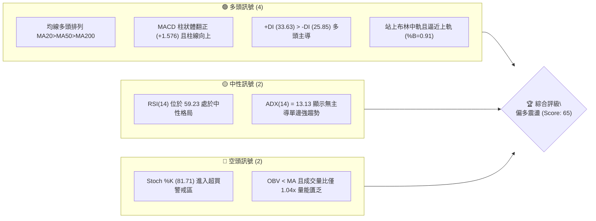
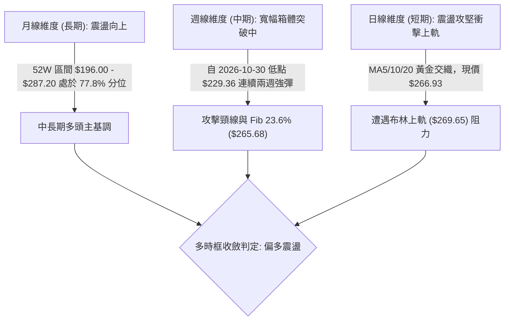
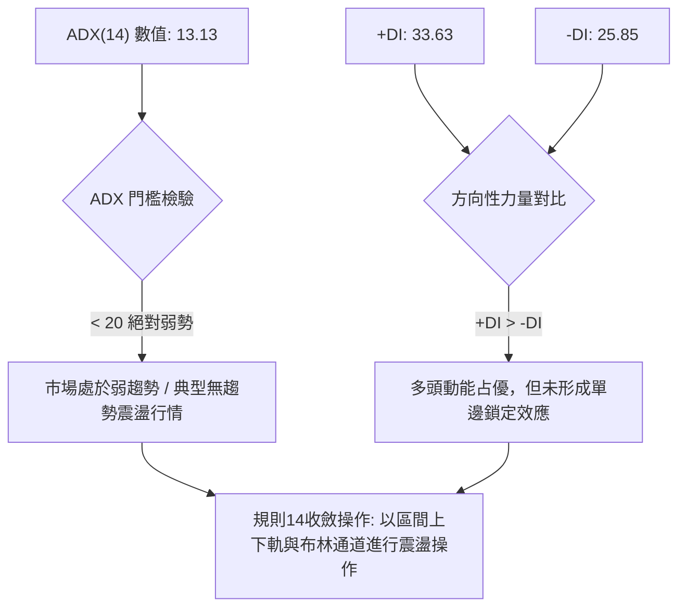
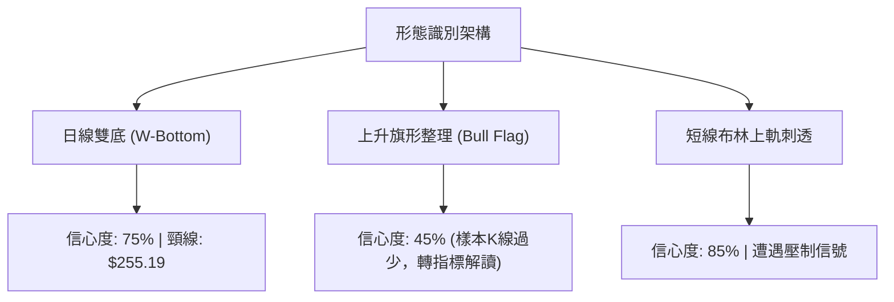
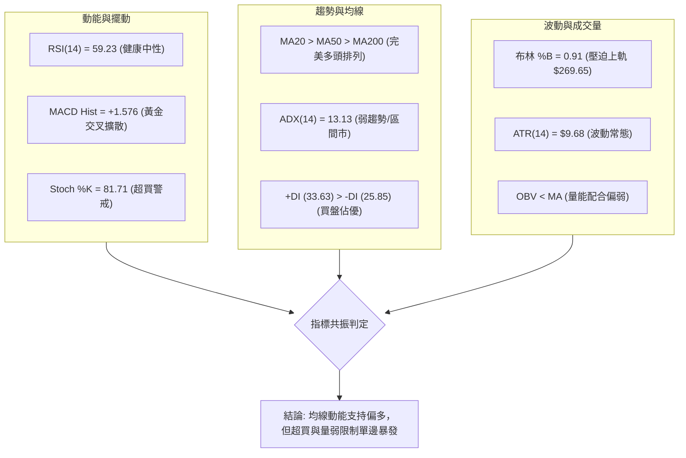
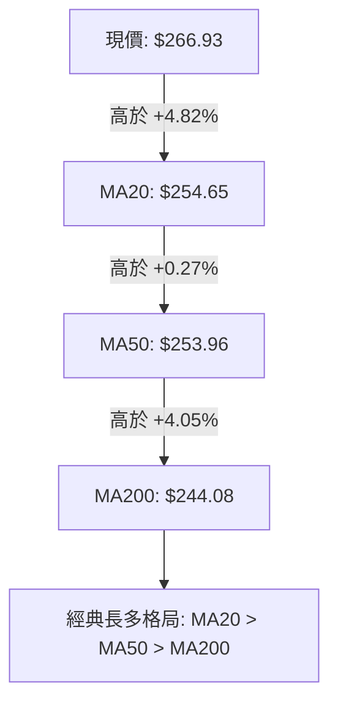
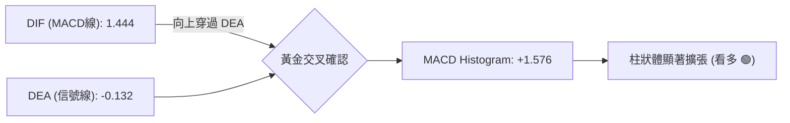
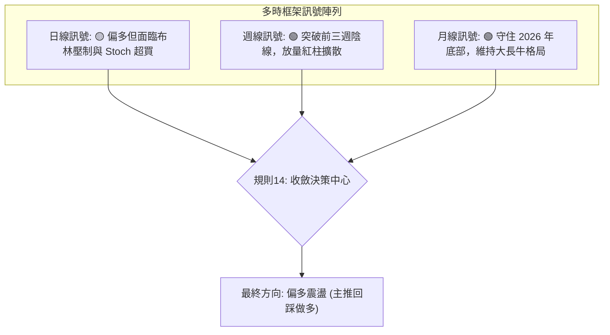
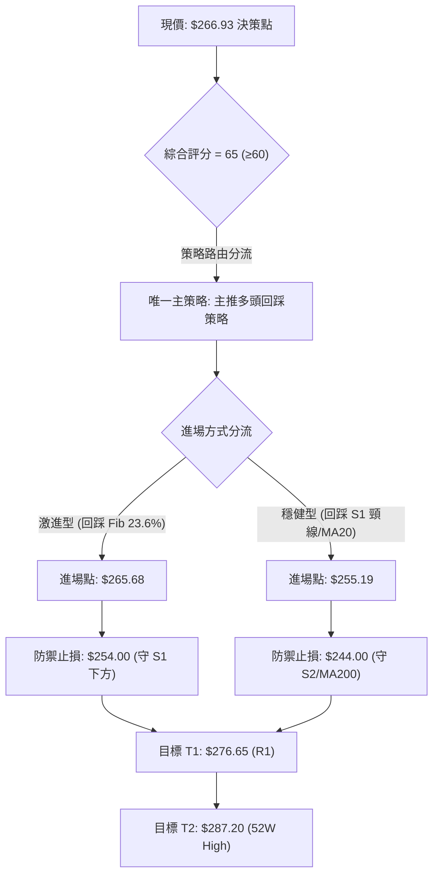
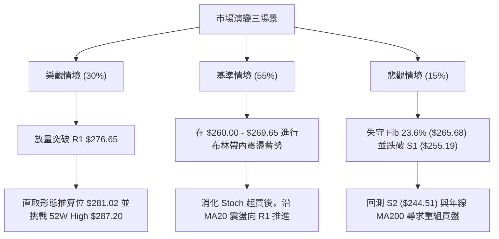

# AMZN 技術分析報告

> **報告日期**：2026-11-10 ｜ **語言**：繁體中文 ｜ **數據來源**：Yahoo Finance ｜ **當前價格**：$266.93

---

## 目錄

| 章節 | 內容 |
|------|------|
| [1. 技術面概覽](#1-技術面概覽) | 訊號儀表板、核心指標、評分卡 |
| [2. 趨勢分析](#2-趨勢分析) | 多時框趨勢、長中短期走勢 |
| [3. 圖表形態分析](#3-圖表形態分析) | 形態識別、K線組合、目標價 |
| [4. 支撐與阻力](#4-支撐與阻力) | 關鍵價位、斐波那契回調 |
| [5. 技術指標深度解讀](#5-技術指標深度解讀) | MA/RSI/MACD/布林/成交量 |
| [6. 動能與波動率](#6-動能與波動率) | 動能評估、ATR、Beta |
| [7. 多時框架總結](#7-多時框架總結) | 時框架評分矩陣 |
| [8. 交易策略建議](#8-交易策略建議) | 多空策略、風險報酬比 |
| [9. 風險提示與監控](#9-風險提示與監控) | 監控指標、風險場景 |

---

## 1. 技術面概覽

### 🎯 技術訊號儀表板



### 📊 核心指標速覽表

| 指標類別 | 指標名稱 | 當前數值 | 訊號 | 解讀 |
|----------|----------|----------|------|------|
| **價格** | 當前收盤價 | $266.93 | 🟢 | 位於52週區間 77.8% 高位，站上所有主要天期均線 |
| **均線** | MA20 | $254.65 | 🟢 | 現價高於 MA20 達 +4.82%，短期多頭架構穩固 |
| **均線** | MA50 | $253.96 | 🟢 | 現價高於 MA50，MA20 黃金交叉 MA50 |
| **均線** | MA200 | $244.08 | 🟢 | 長期多空分水嶺獲明確支撐，現價高於其 +9.36% |
| **動能** | RSI(14) | 59.23 | 🟡 | 位於中性偏多區間 (50–70)，未見背離但動能未過熱 |
| **動能** | MACD (12,26,9) | 1.444 / -0.132 | 🟢 | DIF 線由下往上穿過 DEA，Histogram 為 +1.576 |
| **擺動** | Stoch %K / %D | 81.71 / 73.43 | 🔴 | 進入超買區域 (>80)，短線追價面臨獲利回吐風險 |
| **趨勢** | ADX(14) | 13.13 | 🟡 | 遠低於 25 臨界線，確認處於寬幅區間震盪結構 |
| **趨勢** | 方向指標 (+DI/-DI) | 33.63 / 25.85 | 🟢 | 多方買盤佔據相對主動權 (+DI 處於上方) |
| **波動** | 布林通道 (%B) | 0.91 | 🟡 | 現價緊貼上軌 ($269.65)，短線存在均值回歸拉回壓力 |
| **波動** | ATR(14) | $9.68 | 🟡 | 佔股價 3.63%，每日正常波幅約 $9.68，屬中等波動 |
| **量能** | 成交量 / 20日均量 | 51.42M / 49.66M | 🔴 | 量比 1.04x，OBV 趨勢疲弱，量價未能爆發性配合 |

### 🏆 技術評分卡

```
╔══════════════════════════════════════════════════════════════════╗
║                技術評分卡 — AMZN (2026-11-10)                   ║
╠══════════════════════════════════════════════════════════════════╣
║ 評估維度      進度顯示條                     得分   評級狀態     ║
║ ──────────────────────────────────────────────────────────────── ║
║ 趨勢強度      ████████░░░░░░░░░░░░          40/100   🟡 (ADX<25) ║
║ 動能指標      ██████████████░░░░░░          70/100   🟢 (MACD強) ║
║ 支撐穩定度    ████████████████░░░░          80/100   🟢 (均線群密)║
║ 成交量配合    ████████░░░░░░░░░░░░          40/100   🔴 (OBV弱)  ║
║ 形態完整度    ██████████████░░░░░░          70/100   🟢 (雙底反彈)║
║ 均線排列      ██████████████████░░          90/100   🟢 (完美多頭)║
╠══════════════════════════════════════════════════════════════════╣
║ 綜合評分      █████████████░░░░░░░          65/100   🟢 偏多震盪 ║
║ (依規則18: [40 + 70 + 80 + 40 + 70 + 90] / 6 = 65.0 四捨五入)   ║
╚══════════════════════════════════════════════════════════════════╝
```

---

## 2. 趨勢分析

### 🌐 多時框趨勢分析



### 📈 長期趨勢 — 12個月走勢圖（Unicode）

```
AMZN 月線走勢圖（過去12個月：2025-12 至 2026-11）
價格軸 ($)
$275 ┤                                  ● 271.58 (07月)
$270 ┤                     ● 270.64(05)      │       ● 266.93(11月現價)
$265 ┤               ● 265.06(04)            │   ● 259.77(08)
$250 ┤                                       │       │   ● 249.15(09)
$240 ┤         ● 239.30(01)                  │       │       │   ● 240.35(10)
$230 ┤ ● 230.82(12)  │                       │       │       │       │
$220 ┤                │   ● 210.00(02)       │       │       │       │
$210 ┤                │       │   ● 208.27(03)│       │       │       │
$200 ┤                │       │       │       │       │       │       │
     └─┬───────┬───────┬───────┬───────┬───────┬───────┬───────┬───────┬───────┬────
     25-12   26-01   26-02   26-03   26-04   26-05   26-06   26-07   26-08   26-09  26-10  26-11
```

#### 長期走勢特徵分析表格

| 階段 | 時間區間 | 起始價 → 結束價 | 區間幅度 | 核心特徵描述 |
|------|----------|-----------------|----------|--------------|
| 第一階段：春季回踩 | 2025-12 至 2026-03 | $230.82 → $208.27 | -9.77% | 測試長期支撐，於 $208.27 形成年內次低點防線 |
| 第二階段：春季噴發 | 2026-03 至 2026-05 | $208.27 → $270.64 | +29.95% | 強烈單邊上升，迅速修復均線並奠定多頭架構 |
| 第三階段：高位盤整 | 2026-05 至 2026-07 | $270.64 → $271.58 | +0.35% | 於 6 月見 $238.34 洗盤回踩後拉起，測試歷史高位 |
| 第四階段：秋季修正 | 2026-07 至 2026-10 | $271.58 → $240.35 | -11.50% | 階梯式回調，最低探至 $229.36，回測 MA200 |
| 第五階段：防禦反擊 | 2026-10 至 2026-11 | $240.35 → $266.93 | +11.06% | 季報與買盤強勢介入，以大陽線重回 Fib 23.6% 上方 |

### 📊 中期趨勢（週線分析）

```
AMZN 週線關鍵壓力與支撐示意圖
價格 ($)
$287.20 ──────────────────────────────────────── 52W 高點 (R2 強阻力)
           │
$276.65 ───┼──────────────────────────────────── 波段高點聚類 (R1 阻力)
           │          ▲
$266.93 ───┼──────────┼───────────────────────── 當前收盤價 ($266.93)
           │          ▼
$255.19 ───┼──────────────────────────────────── 近期波段密集支撐 (S1)
           │
$244.51 ───┼──────────────────────────────────── MA200 / 核心波段低點 (S2 強支撐)
           │
$226.53 ──────────────────────────────────────── 深度回撤防線 (S3)
```

中期走勢顯示，自 2026-10-30 當週打出低點 $229.36 以來，週線以連續兩根放量長陽（11-06 週成交 317.73M、11-09 當週已達 51.42M）展開強勁 V 型反轉，MACD 週柱狀體自 -1.528 迅速翻正至 +1.576，顯示中期修正已經結束，進入針對前高 $276.65 及 $287.20 的重新測試階段。

### ⚡ 趨勢強度評估（ADX 解讀）



#### ADX 強度對照表

| 指標名稱 | 實際數據 | 標準區間判定 | 實務意義與交易指引 |
|----------|----------|--------------|--------------------|
| **ADX(14)** | 13.13 | 0–20 (極弱趨勢/震盪) | 嚴禁採取單邊追價突破策略，極易形成假突破；必須以區間思維對待 |
| **+DI (14)** | 33.63 | > 25 (買方動能活躍) | 多方力量佔據主導，價格傾向沿震盪區間上沿推進 |
| **-DI (14)** | 25.85 | 邊界平衡區間 (賣壓受控) | 空方賣壓在自 $229.36 反彈後被大幅吸收，未見主動殺跌盤 |
| **行情定性** | 弱趨勢多頭偏向 | 震盪收斂向攻擊過渡 | 規則14指示：ADX<25 必須以日線布林上下軌（$239.64–$269.65）為核心依託 |

---

## 3. 圖表形態分析

### 🔍 形態識別系統



#### 形態識別評估表

| 形態 | 信心度 | 判斷依據（引用數據） | 完成度 | 目標價（附計算式） |
|------|--------|----------------------|--------|--------------------|
| **短波段雙底 (W-Bottom)** | 75% | 第一底為 2026-10-30 低點 $229.36，第二低點為 2026-11-02 之 $242.28（高於前低），突破頸線 $255.19 (S1) | 100% (已突破頸線) | 頸線 $255.19 + 形態高度 ($255.19 - $229.36 = $25.83) = **$281.02**（由形態高度推算） |
| **寬幅箱體震盪** | 70% | 下邊界獲 S2 聚類支撐 ($244.51)，上邊界受限於 R1 ($276.65) 與前高聚類 | 80% (處於箱體上半部) | 箱體上軌目標 = **$276.65** (R1 阻力位) |
| **旗形突破** | 40% | 數據中未偵測到完整旗桿旗面，信心度不足 50% | N/A（數據未提供） | 訊號不足，依規則 15 僅做指標型解讀（布林向上推升） |

### 🕯️ 重要 K 線形態分析

依規則 19，本節分析嚴格基於提供的近 10 根日 K 與近 8 根週 K 原始數據：

#### 近 10 根日 K 棒形態解讀

| 日期 (日K) | 開 | 高 | 低 | 收 | K線形態 | 解讀 | 訊號 |
|------------|----|----|----|----|---------|------|------|
| 2026-10-27 | 250.43 | 254.68 | 248.71 | 253.10 | 窄幅小陽線 | 震盪築底階段，波動受限 | 🟡 |
| 2026-10-28 | 253.00 | 255.36 | 251.98 | 254.60 | 蓄勢小陽線 | 向上試探 MA20，但量能未放大 | 🟡 |
| 2026-10-29 | 246.95 | 249.14 | 241.24 | 243.79 | 跳空中陰線 | 放量破位下殺，空頭動能釋放 | 🔴 |
| 2026-10-30 | 232.54 | 241.55 | 229.36 | 240.35 | 長下影長陰棒 (成交104.89M) | 巨量恐慌盤湧出，探底 $229.36 獲得逢低買盤強力承接 | 🟢 |
| 2026-11-02 | 243.01 | 253.81 | 242.28 | 245.63 | 低開震盪陽線 | 測試 $242.28 形成更高低點，確認止跌 | 🟢 |
| 2026-11-03 | 248.59 | 252.45 | 245.88 | 250.69 | 溫和上揚中陽棒 | 穩健收復 $250.00 關卡，空頭回補 | 🟢 |
| 2026-11-04 | 264.82 | 271.49 | 263.85 | 266.03 | 跳空突破大陽棒 (成交93.16M) | 突破 S1 頸線，多頭以大缺口展開單邊攻擊 | 🟢 |
| 2026-11-05 | 271.43 | 273.23 | 252.27 | 260.21 | 寬幅劇震陰棒 (振幅20.96) | 高位爆量分歧，盤中回踩 $252.27 釋放賣壓 | 🟡 |
| 2026-11-06 | 259.81 | 264.18 | 258.53 | 259.30 | 縮量十字星 / 孕線 | 暴跌後的多空平衡，買盤守住 $258.53 | 🟡 |
| 2026-11-09 | 269.32 | 275.34 | 266.91 | 266.93 | 長上影假陰十字 | 跳空開高觸及 $275.34 逼近 R1，遇阻回落，收盤仍守住跳空缺口 | 🟡 |

#### 近 8 根週 K 棒形態解讀

| 日期 (週末) | 開 | 高 | 低 | 收 | K線形態 | 解讀 | 訊號 |
|------------|----|----|----|----|---------|------|------|
| 2026-09-25 | 256.40 | 259.49 | 245.60 | 249.67 | 週中陰線 | 弱勢下探，跌破中期均線 | 🔴 |
| 2026-10-02 | 246.63 | 253.56 | 244.73 | 251.52 | 下影小陽星 | 於 $244.73 展現買盤支撐 | 🟡 |
| 2026-10-09 | 250.19 | 262.80 | 250.18 | 262.43 | 週長陽棒 | 多頭反撲，測試區間上沿 | 🟢 |
| 2026-10-16 | 262.50 | 263.70 | 248.60 | 250.00 | 衝高回落大陰棒 | 上檔賣壓沉重，長上影壓制 | 🔴 |
| 2026-10-23 | 255.25 | 265.34 | 246.45 | 248.00 | 倒錘頭週陰線 | 二次衝高受挫，趨勢轉向再探底 | 🔴 |
| 2026-10-30 | 249.47 | 255.36 | 229.36 | 240.35 | 放量破位錘頭陰棒 (成交292.22M)| 破底翻結構，長下影線確立 $229.36 為階段性鐵底 | 🟢 |
| 2026-11-06 | 243.01 | 273.23 | 242.28 | 259.30 | 巨量吞噬大陽棒 (成交317.73M)| 吞噬前三週陰線實體，奠定反轉基石 | 🟢 |
| 2026-11-09 | 269.32 | 275.34 | 266.91 | 266.93 | 週初高開上影陽線 | 延續衝高勢頭，但觸及布林通道上軌受阻 | 🟡 |

### 📉 ASCII 走勢形態示意圖

```
AMZN 日線雙底 (W底) 突破結構
價格 ($)
$276.65 ┤                                                  [R1 阻力位]
$275.34 ┤                                      ▲ 11/09 高點
$266.93 ┤                                      ● 現價突破區
$255.19 ┼───────────── 頸線突破位置 (S1) ─────── 
$245.63 ┤                           ● 11/02
$240.35 ┤             ● 10/30      / 第二低點 $242.28
$229.36 ┴────────────●────────────┴─────────────────────────
                  第一低點 $229.36
                  (放量恐慌底)
```

### 🎯 形態目標價計算

1. **雙底形態推算目標**：
   - 頸線位置 ($NL$) = $255.19（對應波段支撐聚類 S1）
   - 形態底部低點 ($V_{low}$) = $229.36（2026-10-30 盤中最低價）
   - 形態垂直高度 ($H$) = $255.19 - $229.36 = **$25.83**
   - 形態理論目標價 ($T_{pattern}$) = 頸線 + 垂直高度 = $255.19 + $25.83 = **$281.02**（由雙底形態高度推算）
2. **與關鍵價位聚類重合性**：
   - 該目標價 $281.02 位於 R1 ($276.65) 與 R2 ($287.20，52W High) 之間，顯示若突破 R1，多頭慣性極高機率向 $281.02–$287.20 區間延伸。

---

## 4. 支撐與阻力

### 🗺️ 關鍵價位分布圖（Unicode）

```
AMZN 價位結構分布圖
═══════════════════════════════════════════════════════════════════
$287.20 ║██████████████████████████████║ 強阻力 R2 / 52W High (0.0% Fib)
$276.65 ║████████████████████          ║ 關鍵阻力 R1 (波段高點聚類)
$269.65 ║▓▓▓▓▓▓▓▓▓▓▓▓▓▓▓▓              ║ 動態阻力 (布林通道上軌)
$266.93 ╠══════════════════════════════╣ ◄ 當前收盤價
$265.68 ║░░░░░░░░░░░░░░░░              ║ 極微支撐 (Fib 23.6% 回調位)
$255.19 ║████████████████████████      ║ 核心支撐 S1 (頸線 / MA60 / 波段低點聚類)
$252.36 ║▒▒▒▒▒▒▒▒▒▒▒▒▒▒▒▒              ║ 中繼支撐 (Fib 38.2% 回調位)
$244.51 ║██████████████████████████████║ 強支撐 S2 (波段低點聚類 / 貼近MA200)
$226.53 ║██████████████████████████████║ 終極防線 S3 (年內深度回撤支撐)
═══════════════════════════════════════════════════════════════════
```

### 🚧 阻力位分析表

| 阻力級別 | 價位 | 形成原因 | 突破難度 | 重要性 |
|----------|------|----------|----------|--------|
| **動態阻力** | $269.65 | 布林通道上軌，日線 %B 達 0.91 嚴重緊繃 | 中等 | 🟢 決定短線是否進入鈍化噴發 |
| **R1** | $276.65 | 近一年波段高點聚類區，11-09 盤中高點 $275.34 逼近此處解套盤阻力 | 較高 | 🟡 中期多空重奪定價權的防線 |
| **R2** | $287.20 | 52 週歷史高點，斐波那契 0.0% 絕對頂部 | 極高 | 🔴 歷史套牢盤密集區，需巨量確認 |

### 🛡️ 支撐位分析表

| 支撐級別 | 價位 | 形成原因 | 守住機率 | 重要性 |
|----------|------|----------|----------|--------|
| **即時支撐** | $265.68 | 斐波那契 23.6% 回調位，現價 ($266.93) 緊貼上方 | 65% | 🟡 短線多頭強弱防線 |
| **S1** | $255.19 | 近一年波段低點聚類，重合 MA20 ($254.65) 與 MA50 ($253.96) | 85% | 🟢 短中期多頭生命線，雙底頸線 |
| **S2** | $244.51 | 近一年波段低點聚類，貼近 MA200 ($244.08) 及 Fib 50.0% ($241.60) | 95% | 🔴 長期牛熊分界基石 |
| **S3** | $226.53 | 近一年波段低點聚類，低於 10-30 低點 $229.36，終極極端避險位 | 99% | 🔴 總體下行防護底線 |

### 📐 斐波那契回調位分析

依據 52 週波動區間（高點 $287.20，低點 $196.00，垂直振幅 $91.20），計算各級回調點位：

```
斐波那契黃金分割架構 (52W High $287.20 → 52W Low $196.00)
 0.0% ── $287.20  (52W High)
           │
23.6% ── $265.68  ◄ 現價 $266.93 緊貼其上 (+0.47%)
           │
38.2% ── $252.36  (貼近 MA20/MA50 均線叢)
           │
50.0% ── $241.60  (貼近 S2 $244.51 與 MA200 $244.08)
           │
61.8% ── $230.84  (貼近 10-30 恐慌低點 $229.36)
           │
78.6% ── $215.52
           │
100.0% ── $196.00  (52W Low)
```

- **位置解讀**：當前價格 $266.93 精準落在 **0.0% ($287.20)** 與 **23.6% ($265.68)** 之間。
- **技術意涵**：股價成功收復 23.6%（$265.68），此處轉化為第一道技術防線。在黃金分割理論中，強勢回調若能穩守 23.6% 關口，暗示主升浪動能未被破壞，價格具備直接向上攻擊 0.0% 原高點（$287.20）的結構條件；反之若跌破 $265.68，行情將再次向下回測 38.2%（$252.36）的均線密集支撐帶。

---

## 5. 技術指標深度解讀

### 🎛️ 指標訊號總覽



### 📈 移動平均線排列分析



#### 各天期移動平均線狀態詳解表

| 天期 | 當前數值 | 現價偏離度 | 斜率與方向 | 支撐阻力屬性 | 技術含義解讀 |
|------|----------|------------|------------|--------------|--------------|
| **MA 5** | $260.63 | +2.42% | ▲ 急速向上 | 短線極限支撐 | 極短線多頭攻擊發起線，提供短線回檔第一緩衝 |
| **MA 10** | $254.06 | +5.06% | ▲ 陡峭向上 | 短線回調支撐 | 與 MA50 形成重疊共振區，支撐力道強固 |
| **MA 20** | $254.65 | +4.82% | ▲ 轉折向上 | 布林通道中軌 | 月線級生命線，突破後確立短線反轉成功 |
| **MA 50** | $253.96 | +5.11% | ▲ 平緩微升 | 季線中期防線 | 與 MA20 形成黃金交叉，確立中期底部已現 |
| **MA 60** | $255.16 | +4.61% | ▲ 走平回揚 | 重合 S1 頸線 | 歷史密集成交帶，提供強勁技術面護城河 |
| **MA120** | $253.06 | +5.48% | ▲ 走平 | 半年線防禦層 | 坐落於 $253 附近，加強了 $252–$255 支撐帶實力 |
| **MA200** | $244.08 | +9.36% | ▲ 穩步上揚 | 年線牛熊分水嶺| 長期多頭趨勢指針，現價遠離年線，多頭根基健全 |
| **MA240** | $242.19 | +10.21% | ▲ 穩健爬升 | 超長期底線 | 貼近 S2 ($244.51)，構成結構性買盤駐紮地盤 |

### 📉 RSI(14) 分析

```
RSI(14) 動能進度指示
0            30                  50         59.23      70           100
├────────────┼───────────────────┼────────────●────────┼─────────────┤
[  超賣區間  ]     弱勢整理       [   健康多頭   ] 警戒  [  超買極端   ]
進度條: ████████████░░░░░░░░ 59.23%
```

- **數值與區間**：RSI(14) 坐落於 **59.23**。既脫離了 50 軸線的多空拉鋸區，又未跨入 70 超買紅線，處於標準的「多頭推升健康區」。
- **背離分析判斷**：
  - 根據近 20 根 K 棒數據，首尾價格（由 10 月中旬約 $250 水準上升至現價 $266.93）與 RSI（由 45 提升至 59.23）同步走高。
  - **明確結論**：**RSI 無頂背離，亦無底背離**。動能與價格同向攀升，反映反彈具備實際買盤推動，而非動能竭盡的虛漲。

### 📊 MACD(12,26,9) 訊號解讀



- **數值解讀**：MACD 快線（1.444）於零軸上方持續拉開與慢線（-0.132）的差距，慢線亦即將翻上零軸。柱狀體數值達 **+1.576**，較上週的 -1.528 呈現爆發性回升。
- **背離判定**：週線級別 MACD 自 10-30 的 -1.528 快速回正，未見指標與價格創高背離現象。日線 MACD 連續 5 日處於紅柱遞增週期，顯示動能多頭占優。

### 📦 布林通道分析

```
AMZN 日線布林通道 (20, 2) 結構示意圖
價格 ($)
$269.65 ────────────────────────────────────── 上軌 (Band Top)
          ░░░░░░░░░░░░░░░░░░░░░░░░░░░░░░░░░░░ 
$266.93 ─────────────● 現價 (%B = 0.91) ─────── 逼近通道極限
          ░░░░░░░░░░░░░░░░░░░░░░░░░░░░░░░░░░░ 
$254.65 ────────────────────────────────────── 中軌 (MA20)
          ▒▒▒▒▒▒▒▒▒▒▒▒▒▒▒▒▒▒▒▒▒▒▒▒▒▒▒▒▒▒▒▒▒▒▒ 
$239.64 ────────────────────────────────────── 下軌 (Band Bottom)
```

- **通道寬度與位置**：通道上軌為 **$269.65**，中軌為 **$254.65**，下軌為 **$239.64**。當前布林 %B 達 **0.91**。
- **邊界效應解析**：當 %B 突破 0.80 且逼近 1.00 時，若缺乏成交量暴增（Walking the band）的配合，價格通常會受到上軌的統計學壓制而引發均值回歸（Mean Reversion）。11-09 日 K 線最高衝至 $275.34 刺穿上軌後，收盤被壓回至 $266.93，收在上軌之內，明確驗證了 $269.65 上軌阻力的實質存在。

### 💹 成交量分析（量價配合度）

- **量能數據對比**：最新單日成交量為 **51,419,400 股**，對比 20 日均量 **49,659,815 股**，量比僅為 **1.04x**；相較於 50 日均量 **40,702,882 股** 略有擴大。
- **OBV（能量潮）深度透視**：
  - 當前技術快照明確指出：**OBV 趨勢疲弱，OBV < MA**。
  - **量價背離結論**：雖然價格連續收復失地並突破頸線，但 OBV 線仍在均線下方徘徊，且量比僅為 1.04x，顯示機構資金追價意願謹慎，多以被動空頭回補與存量博弈為主。此種「價格創波段新高、量能未破均線」的輕度量價背離，提示投資人不可在靠近阻力位（R1 $276.65）處過度激進追多。

---

## 6. 動能與波動率

### ⚡ 動能評估四象限

| 象限 | 動能強度 | 波動率水準 | 特徵描述 | 標的當前定位 | 交易執行指南 |
|------|----------|------------|----------|--------------|--------------|
| **Q1 (高動能·低波動)** | 強 (RSI>60, MACD>0) | 低 (ATR%<3.0%) | 溫和單邊主升 | ░░░░░░░░░░ | 趨勢持股，拉回加碼 |
| **Q2 (弱動能·低波動)** | 弱 (RSI 40–50) | 低 (ATR%<3.0%) | 沉悶窄幅盤整 | ░░░░░░░░░░ | 觀望為主，減少操作 |
| **Q3 (強動能·中高波動)** | **強 (MACD+1.57, +DI>33)** | **中 (ATR% 3.63%)** | **波段攻堅震盪** | **████ 命中 (AMZN)** | **區間上沿減碼，回踩買進** |
| **Q4 (弱動能·高波動)** | 弱 (破位下行) | 高 (ATR%>5.0%) | 恐慌崩跌走勢 | ░░░░░░░░░░ | 嚴格停損，空頭主導 |

- **維度判定**：AMZN 坐落於 **Q3 象限**。MACD 紅柱快速放大、+DI 大於 -DI 賦予其偏多動能，但 ATR 達 3.63%，伴隨日線 10-30 與 11-05 的大振幅，呈現「強動能震盪」態勢。

### 📊 ATR 波動率分析

- **ATR 數值**：ATR(14) 數值為 **$9.68**（佔股價比例 **3.63%**）。
- **風控與止損設定依據**：
  - **短線波動緩衝區**：日內單邊隨機噪音極限為 1.0 倍 ATR（約 $9.70）。
  - **技術防守設定**：多頭策略安全止損距離應不小於 1.5 倍 ATR，即 $9.68 × 1.5 = **$14.52**；或直接依託技術結構點（如跌破 S1 頸線 $255.19）。若以現價 $266.93 減去 $14.52，落點約為 $252.41，恰好與 Fib 38.2% 回調位（$252.36）形成共振保護。

### 📐 Beta 與市場相關性

- **Beta 數值**：**1.503**。
- **大盤聯動性解讀**：AMZN 屬於高彈性大型科技成長股，波動幅度為標普500指數（S&P 500）的 1.5 倍。在近期新聞提及科技股受 AI 基礎設施及大盤千點反彈帶動下，AMZN 具備充沛的向上貝塔溢價。但需警惕若總體市場回調，其回撤烈度亦將大於指數。

---

## 7. 多時框架總結

### 📋 時框架評分表

| 時框架 | 趨勢方向 | 動能狀態 | 均線排列 | 形態完整度 | 綜合評分 | 建議操作策略 |
|--------|----------|----------|----------|------------|----------|--------------|
| **月線 (長期)** | 🟢 多頭推升 | 🟡 中性平穩 | 🟢 位於年線上方 | 🟢 52W高位強勢震盪 | **75/100** | 長期投資者底倉續抱 |
| **週線 (中期)** | 🟢 V型反攻 | 🟢 MACD翻紅 | 🟢 突破短期均線 | 🟢 放量吞噬破底翻 | **70/100** | 波段操作逢回調布局 |
| **日線 (短期)** | 🟡 逼近阻力 | 🟡 超買與量背離 | 🟢 多頭排列 | 🟡 布林上軌壓制 | **55/100** | 暫停追高，等待拉回 |

### 🔲 綜合訊號矩陣



### ⚖️ 多時框收斂結論

嚴格執行「嚴格要求 14」與「規則 18」：
1. **行情定性**：當前 ADX(14) 數值為 **13.13**，遠低於 25 臨界線，技術架構**嚴格歸類為「盤整行情 / 寬幅區間震盪行情」**。
2. **主導收斂規則**：在盤整行情中，單邊均線追價有效性降低，**交易必須以日線布林通道（下軌 $239.64 至 上軌 $269.65）為核心執行區間**。
3. **時框衝突取捨**：雖然週線與長期均線維持完美多頭（均線評分 90），但日線 Stoch 已達 81.71 進入超買，布林 %B 達 0.91 且逼近上軌 $269.65，加之 OBV 疲弱。因此，日線不能採取「追高突破」，而必須遵循週線的多頭趨勢，**以「逢拉回支撐做多」為單一核心方向**。
4. **唯一方向性結論**：**【偏多震盪】**（綜合評分 65/100）。

---

## 8. 交易策略建議

### 🗺️ 策略決策流程圖



### 🧭 策略路由（依評分卡分流）

> **當前主策略方向 = 多頭回踩佈局（依綜合評分 65/100，評級偏多）**
> 
> 依據規定，綜合評分 ≥60 嚴格禁止兩頭下注，報告全面主推多頭策略；空頭僅作為極端下破風險與對沖提示。

### 🎯 價格情境階梯（Price Scenarios）

價位嚴格引用技術數據中提供的點位：

| 觸發條件 | 下一目標 | 後續延伸 | 情境含義 |
|----------|----------|----------|----------|
| **強勢突破 R1 $276.65** | R2 **$287.20** | 形態推算 **$281.02** | 多頭全面打開上升通道，挑戰歷史新高 |
| **站穩 Fib 23.6% $265.68** | R1 **$276.65** | 布林上軌 **$269.65** | 消化上軌壓力，維持高位強勢震盪衝堅 |
| **回踩跌破 S1 $255.19** | S2 **$244.51** | S3 **$226.53** | 雙底反彈夭折，重新回歸年線大級別防守 |

### 📊 情境機率分佈

| 情境 | 機率 | 主要依據 |
|------|------|----------|
| **高位震盪後蓄勢上攻** | **55%** | 均線多頭排列完整，MACD 柱狀體大幅擴張 (+1.576)，+DI (33.63) 佔優 |
| **區間震盪（回踩S1確認）** | **35%** | ADX 僅 13.13 顯示無主導趨勢，Stoch 81.71 超買，OBV 量能尚未突破 |
| **深度回落再測低點** | **10%** | S1 頸線與 S2 年線具備多重防護，除非遭遇系統性黑天鵝，機率極低 |

### 🟢 主策略詳情（方向：多頭逢低布局）

嚴格執行規則 17 之風險報酬比公式：
$$\text{RRR} = \frac{\text{目標價 } T_1 - \text{進場價}}{\text{進場價} - \text{止損價}}$$

| 策略要素 | 策略 A（現價/回踩短多策略） | 策略 B（穩健回踩頸線多頭策略） |
|----------|-----------------------------|--------------------------------|
| **進場條件** | 企穩斐波那契 23.6% 回調位確認獲支撐 | 回測雙底頸線 S1 及 MA20/MA50 均線叢 |
| **進場價格** | **$265.68** (Fib 23.6% 價位) | **$255.19** (S1 支撐位) |
| **目標價 T1** | **$276.65** (引用 R1 阻力位) | **$276.65** (引用 R1 阻力位) |
| **目標價 T2** | **$287.20** (引用 R2 / 52W High) | **$287.20** (引用 R2 / 52W High) |
| **止損價格** | **$254.00** (設於 S1 頸線 $255.19 與 MA20 下方)| **$244.00** (設於 S2 $244.51 與 MA200 下方)|
| **風險報酬比** | **1 : 0.94**（以 T1 計）<br>*(276.65-265.68)/(265.68-254.00) = 10.97/11.68*<br>另：**1 : 1.84**（以 T2 計，21.52/11.68） | **1 : 1.92**（以 T1 計）<br>*(276.65-255.19)/(255.19-244.00) = 21.46/11.19*<br>另：**1 : 2.86**（以 T2 計，32.01/11.19） |
| **成功機率** | 60% | 75% |
| **建議倉位** | 10%–15% 輕倉試單 | 20%–25% 標準波段倉位 |

### 🔴 反向風險觸發點（對沖提示）

- **觸發條件**：若日 K 線實體收盤**放量跌破 S1 ($255.19)**，代表雙底突破確立為假突破。
- **對沖處置**：多頭應立即停損或將部位減半，空頭投機者可啟動對沖空單，下看目標 **S2 ($244.51)**，極端下看 **S3 ($226.53)**，對沖止損必須嚴設於 **$257.00** 之上。

### ⭐ 整體訊號強度評星

```
╔═══════════════════════════════════════════════╗
║ 做多訊號強度：★★★★☆  (4/5星 - 均線動能齊備)  ║
║ 做空訊號強度：★☆☆☆☆  (1/5星 - 逆勢風險極高)  ║
║ 整體可信度：  ★★★★☆  (4/5星 - 數據指標收斂)  ║
╚═══════════════════════════════════════════════╝
```

---

## 9. 風險提示與監控

### ✅ 關鍵監控指標 Checklist

```
╔══════════════════════════════════════════════════════════════════╗
║                   盤面日常關鍵監控 CHECKLIST                     ║
╠══════════════════════════════════════════════════════════════════╣
║ [ ] 價位是否持續守穩 Fib 23.6% ($265.68) 之上？                  ║
║ [ ] 日線布林通道上軌 ($269.65) 是否被有效帶量向上推開？         ║
║ [ ] 成交量是否放大突破 20 日均量 (49.66M) 以化解 OBV 疲弱背離？   ║
║ [ ] Stoch %K (81.71) 是否形成高位死叉向下跌破 80 超買線？        ║
║ [ ] ADX(14) (13.13) 是否開始抬頭突破 20，釋放單邊趨勢信號？     ║
║ [ ] 頸線 S1 ($255.19) 與 MA20 ($254.65) 防線是否完好無損？      ║
╚══════════════════════════════════════════════════════════════════╝
```

### ⚠️ 風險場景分析



### 🛡️ 風險管理重要提醒

1. **避免布林通道極限處盲目追高**：當前布林 %B 達 0.91，緊貼上軌 $269.65，且日 K 留有上影線，統計學上短線回調概率遠大於直接跳空大漲。嚴禁在現價直接滿倉市價追入，耐心等待回踩。
2. **波動防禦與部位控制**：AMZN 的 ATR 為 $9.68，單日波動率逾 3.6%，且 Beta 高達 1.503。單筆交易承受風險資金應嚴格限制在總資產的 1%–2% 以內，止損嚴格掛單於預設價位，杜絕心理猶豫。
3. **宏觀與基本面事件鎖定**：近期新聞提及 CPI 通膨數據發布在即，科技股對利率與債券收益率極度敏感，高 Beta 特性可能放大波動，需防範外圍總體經濟環境突發性擾動引發的假突破。

---

## 📋 報告總結

```
AMZN 技術分析報告總結
══════════════════════════════════════════════════════════════════
報告日期：2026-11-10
當前價格：$266.93
分析評級：🟢 偏多震盪 (綜合評分: 65 / 100)

關鍵結論：
├─ 長期趨勢：🟢 位於 MA200 ($244.08) 上方，長多基石完好
├─ 中期趨勢：🟢 週線放量吞噬陰線，突破頸線完成雙底反彈
├─ 短期趨勢：🟡 遭遇布林上軌 ($269.65) 與 Stoch 超買壓制，震盪難免
├─ 關鍵支撐：S1: $255.19 (頸線) ｜ S2: $244.51 (年線/核心底)
├─ 關鍵阻力：R1: $276.65 (波段高點) ｜ R2: $287.20 (52W High)
└─ 分析師目標：共識均價 $326.99 (最高 $405.00，最低 $230.00)

最優策略組合：
1. 🥇 最佳機會：等待價格回踩 S1 頸線 $255.19 (策略B) 進場，
               停損 $244.00，目標 T1 $276.65，風報比 1:1.92。
2. 🥈 次選機會：激進者於 Fib 23.6% 處 $265.68 (策略A) 輕倉介入，
               停損 $254.00，目標 T1 $276.65，目標 T2 $287.20。
3. 🥉 保守選擇：空手觀望，靜待日線帶量衝破 R1 $276.65 且 ADX 突破 
               20 之趨勢確立訊號，再順勢進場搭乘主升浪。
══════════════════════════════════════════════════════════════════
```

---

> ⚠️ **免責聲明**：本報告為 AI 自動生成之技術分析，所有數據及估算均基於提供的歷史價格資訊。本報告**僅供研究與學術參考**，**不構成任何投資建議**。投資有風險，入市需謹慎。

---

*報告生成時間：2026-11-10 ｜ 數據來源：Yahoo Finance ｜ 分析框架：多時框技術分析*