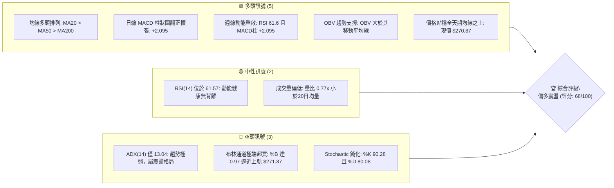
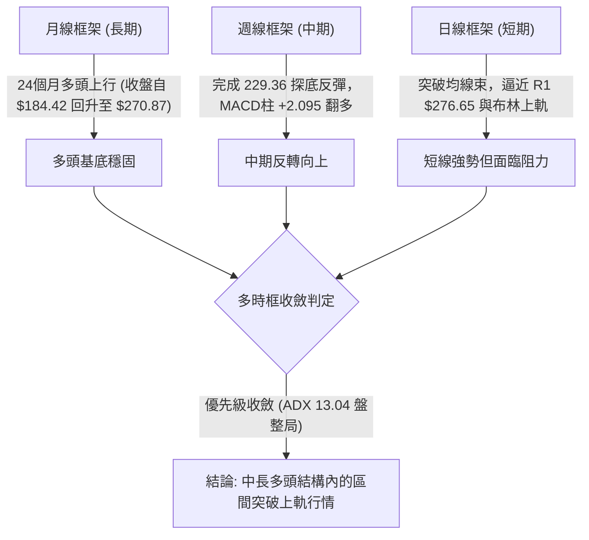
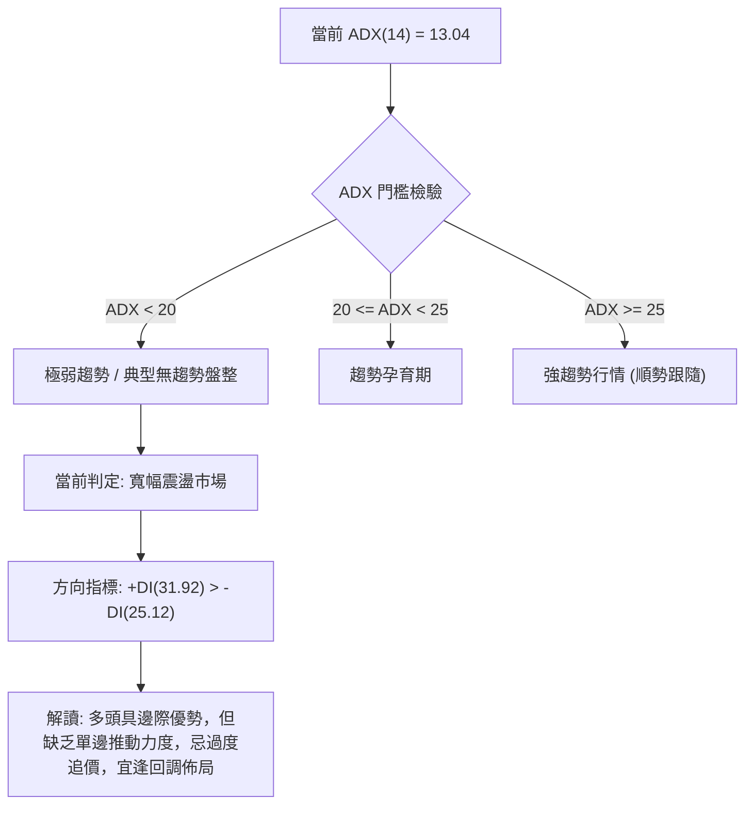
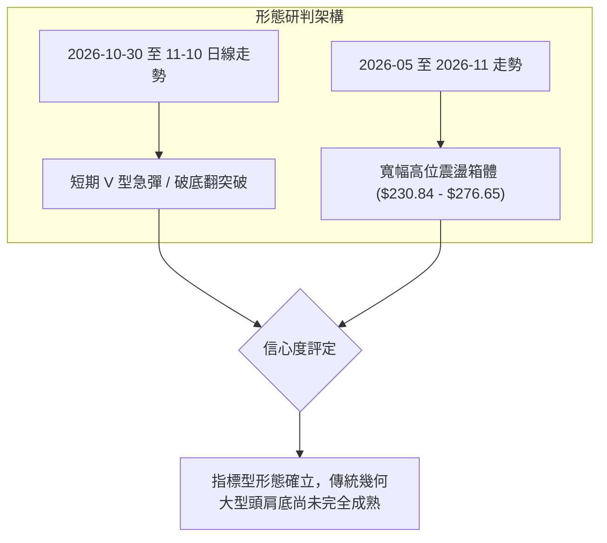
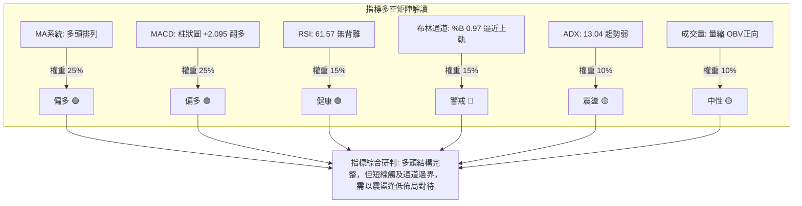
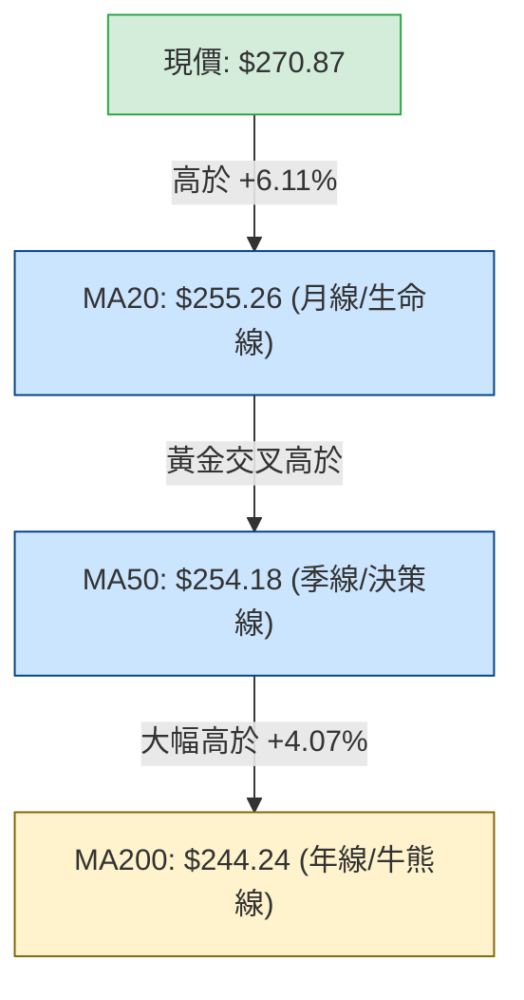
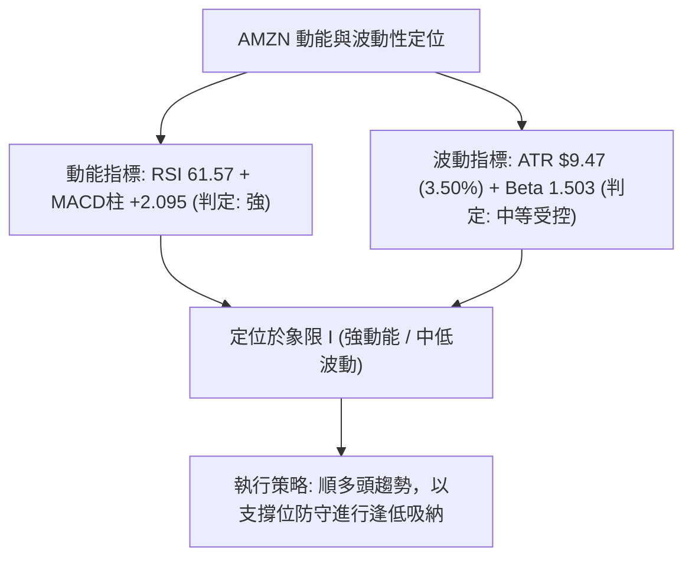
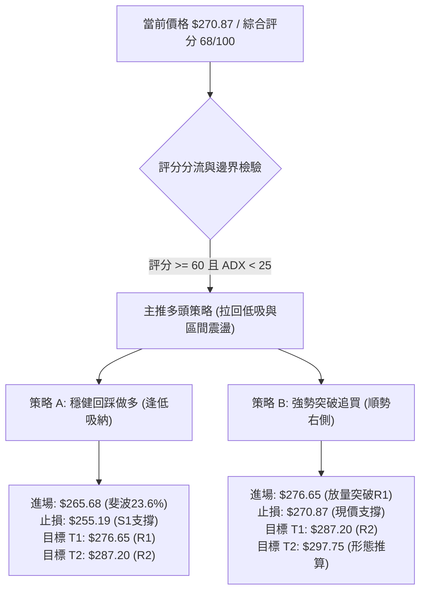
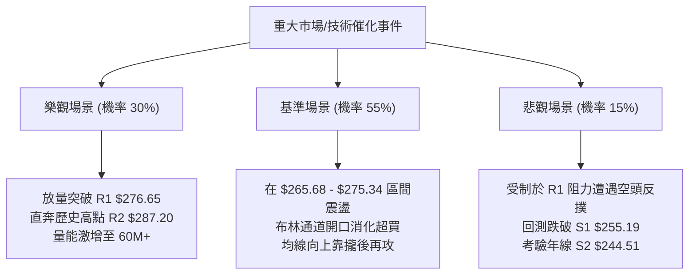

# AMZN 技術分析報告

> **報告日期**：2026-11-11 ｜ **語言**：繁體中文 ｜ **數據來源**：Yahoo Finance ｜ **當前價格**：$270.87 USD

---

## 目錄

| 章節 | 內容 |
|------|------|
| [1. 技術面概覽](#1-技術面概覽) | 訊號儀表板、核心指標、評分卡 |
| [2. 趨勢分析](#2-趨勢分析) | 多時框趨勢、長中短期走勢 |
| [3. 圖表形態分析](#3-圖表形態分析) | 形態識別、K線組合、目標價 |
| [4. 支撐與阻力](#4-支撐與阻力) | 關鍵價位、斐波那契回調 |
| [5. 技術指標深度解讀](#5-技術指標深度解讀) | MA/RSI/MACD/布林/成交量 |
| [6. 動能與波動率](#6-動能與波動率) | 動能評估、ATR、Beta |
| [7. 多時框架總結](#7-多時框架總結) | 時框架評分矩陣 |
| [8. 交易策略建議](#8-交易策略建議) | 多空策略、風險報酬比 |
| [9. 風險提示與監控](#9-風險提示與監控) | 監控指標、風險場景 |

---

## 1. 技術面概覽

### 🎯 技術訊號儀表板



### 📊 核心指標速覽表

| 指標類別 | 指標名稱 | 當前數值 | 訊號 | 解讀 |
|----------|----------|----------|------|------|
| **價格** | 當前價格 | $270.87 | 🟢 | 站上所有主要均線，處於52週區間的 82.1% 高位 |
| **均線** | MA20 | $255.26 | 🟢 | 現價高於 MA20 達 +6.11%，短期多頭主導 |
| **均線** | MA50 | $254.18 | 🟢 | 現價高於 MA50 達 +6.57%，中期趨勢轉強 |
| **均線** | MA200 | $244.24 | 🟢 | 現價高於 MA200 達 +10.90%，長期多頭基石穩固 |
| **動能** | RSI(14) | 61.57 | 🟡 | 位於 30-70 中性強勢區，未見頂背離，具上行動能 |
| **動能** | MACD (12,26,9) | 2.488 / Hist +2.095 | 🟢 | MACD 線高於訊號線 (0.392)，柱狀圖持續放大看多 |
| **動能** | Stoch (14,3,3) | %K 90.28 / %D 80.08 | 🔴 | 進入超買區間（>80），短線需慎防追高獲利回吐 |
| **趨勢** | ADX(14) | 13.04 (+DI 31.92 / -DI 25.12) | 🟡 | ADX < 25 表明處於弱趨勢/大區間盤整，多頭暫居主導 |
| **通道** | 布林帶 (%B) | %B 0.97 (上軌 $271.87) | 🔴 | 價格緊貼布林上軌運行，面臨統計學上的回歸壓力 |
| **成交量**| 成交量與 OBV | 38,857,000 (量比 0.77x) | 🟡 | 量能低於20日均量，但 OBV > MA 表明籌碼呈淨流入 |
| **波動** | ATR(14) | $9.47 (3.50%) | 🟡 | 中等波動度，單日震盪幅度約 $9.5 左右 |

### 🏆 技術評分卡

```
╔══════════════════════════════════════════════════════════════╗
║                技術評分卡 — AMZN (2026-11-11)                ║
╠══════════════════════════════════════════════════════════════╣
║ 趨勢強度      ██████████░░░░░░░░░░  50/100  🟡 (ADX 13.04弱)  ║
║ 動能指標      ██████████████░░░░░░  70/100  🟢 (MACD強/RSI良) ║
║ 支撐穩定度    ████████████████░░░░  80/100  🟢 (S1重合MA20)   ║
║ 成交量配合    ████████████░░░░░░░░  60/100  🟡 (量縮但OBV正向)║
║ 形態完整度    ██████████████░░░░░░  70/100  🟢 (V型底/突破)   ║
║ 均線排列      ██████████████░░░░░░  75/100  🟢 (典型多頭排列) ║
╠══════════════════════════════════════════════════════════════╣
║ 綜合評分      █████████████░░░░░░░  68/100  🟢 (偏多操作評級) ║
╚══════════════════════════════════════════════════════════════╝
```

> **評分邏輯說明（依規則 18 算術平均）**：
> (50 + 70 + 80 + 60 + 70 + 75) ÷ 6 = 405 ÷ 6 = 67.5，四捨五入取整數為 **68/100**。
> 評級：**偏多（Mildly Bullish）**。依策略分流規則（評分 ≥ 60），本報告主推**多頭策略**，空頭僅列為風險防禦對沖點。

---

## 2. 趨勢分析

### 🌐 多時框趨勢分析



### 📈 長期趨勢 — 12個月走勢圖（Unicode）

以下為 AMZN 過去 12 個月（2025-12 至 2026-11）的月線收盤價格軌跡與關鍵轉折點標注：

```
AMZN 月線走勢圖（過去12個月：2025-12 至 2026-11）
價格軸 ($)
$275 ┤                               ●(2026-07: 271.58)     ●(現價: 270.87)
$265 ┤                       ●(05: 270.64)
$255 ┤                  ●(04: 265.06)               ●(08: 259.77)
$245 ┤                                                     ●(09: 249.15)
$235 ┤             ●(01: 239.30)        ●(06: 238.34)             ●(10: 240.35)
$225 ┤  ●(12: 230.82)
$215 ┤        
$205 ┤                  ●(02: 210.00)
$195 ┤                       ●(03: 208.27 低點)
     └────────────────────────────────────────────────────────────────────────
       12M   01M   02M   03M   04M   05M   06M   07M   08M   09M   10M   11M
```

**12個月走勢特徵分析表格**：

| 階段區間 | 起訖月份 | 收盤價變化 | 漲跌幅 | 結構特徵與成交背景解讀 |
|----------|----------|------------|--------|------------------------|
| **春季探底** | 2025-12 → 2026-03 | $230.82 → $208.27 | -9.77% | 連續三個月下行，於 $208.27 築底（逼近52W低點 $196.00） |
| **強勢爆發** | 2026-03 → 2026-05 | $208.27 → $270.64 | +29.95% | 單月大陽線拔起，突破所有均線束，確認大週期底部成形 |
| **高位箱體** | 2026-05 → 2026-08 | $270.64 → $259.77 | -4.02% | 在 $238.34 至 $271.58 構築寬幅高位箱體震盪換手 |
| **秋季回踩** | 2026-08 → 2026-10 | $259.77 → $240.35 | -7.48% | 連續三個月陰跌回踩 MA200 關鍵支撐區間 ($244 附近) |
| **當前反彈** | 2026-10 → 2026-11 | $240.35 → $270.87 | +12.70% | 11月單月強勢收復失地，帶量逼近歷史高位區間 |

### 📊 中期趨勢（週線分析）

從近 20 週收盤走勢觀察，AMZN 在 2026-10-30 當週收在 $240.35（該週最低見 $229.36），創下自7月以來的波段回調低點。隨後在 11-06 當週以放量長陽（成交量達 317,732,000 股）大漲至 $259.30，並在當前 11-10 週線推升至 $270.87。週線 MACD 柱狀圖在連續負值後，於 11-06 翻正為 +1.019，最新擴大至 +2.095，確認週線級別的中期修正結束，重返多頭升浪。

```
週線級別支撐阻力結構示意圖
阻力區間：═══════════════════════════════════════ R2: $287.20 (52W 高點)
         ─────────────────────────────────────── R1: $276.65 (波段阻力)
現價位置：▲▲▲ $270.87 (逼近前期 07-31 週收盤 $271.58 高點)
支撐區間：─────────────────────────────────────── S1: $255.19 / MA20
         ═══════════════════════════════════════ S2: $244.51 / MA200
         ─────────────────────────────────────── S3: $226.53 (10-30 週低點 $229.36 下方強支撐)
```

### ⚡ 趨勢強度評估（ADX 解讀）



**ADX 趨勢強度對照表**：

| 指標變數 | 當前數值 | 參考標準 | 市場狀態定性 | 操作指引 |
|----------|----------|----------|--------------|----------|
| **ADX (14)** | **13.04** | < 20: 無趨勢 / 20-25: 弱趨勢 / >25: 強趨勢 | **極弱趨勢 / 寬幅區間盤整** | 禁止追高追破，尊重布林通道上下軌邊界 |
| **+DI (14)** | **31.92** | > 25 表明多方動能存在 | 多頭力量佔優 | 逢低回調支撐位以做多為主要傾向 |
| **-DI (14)** | **25.12** | > 25 表明空方仍具抵抗力 | 空方尚未徹底繳械 | 上方阻力位仍將遭遇空頭頑強抵抗 |
| **DI 差值** | **+6.80** | 正值擴大有利多方 | 多頭佔據短線主導權 | 守住關鍵支撐即可維持反彈基調 |

---

## 3. 圖表形態分析

### 🔍 形態識別系統



**圖表形態信心度表格（依規則 15 嚴格評定）**：

| 形態名稱 | 信心度 | 判斷依據（引用數據） | 完成度 | 目標價（附嚴謹計算式） |
|----------|--------|----------------------|--------|------------------------|
| **短線破底翻 / V型反轉** | **75%** | 2026-10-30 砸出低點 $229.36 後快速收復 S2 $244.51 與 MA200，並連拉長陽突破頸線 MA20 ($255.26) | 90% | 頸線 $255.26 + 形態高度 ($255.26 − $229.36 = $25.90) = **$281.16**（接近 R2 $287.20） |
| **高位大箱體震盪** | **85%** | 上軌受制於 R1 $276.65 / R2 $287.20，下軌支撐於斐波 61.8% $230.84 與 10-30 週低點 $229.36 | 80% | 向上突破 R1 後測箱頂：**$287.20**（引用 R2 波段高點） |
| **頭肩底形態** | **35%** | 左肩（9月低點約 $245）、頭部（10-30 低點 $229.36）、右肩未形成即直線上拉 | 30% | 數據不足，右肩未成形，**訊號不足，僅做指標型解讀** |

### 🕯️ 重要K線形態分析

嚴格依據提供的「近10根日K」與「近8根週K」之真實開高低收數據進行專業形態識別：

| 日期（週期） | 開盤價 | 最高價 | 最低價 | 收盤價 | 成交量 | K線形態名稱 | 技術解讀與多空意涵 | 訊號 |
|--------------|--------|--------|--------|--------|--------|-------------|--------------------|------|
| **2026-10-30 (日)** | $232.54 | $241.55 | $229.36 | $240.35 | 104,894,700 | **長下影錘頭線 (Hammer)** | 爆出逾億股巨量，探底 $229.36 後強勁抽腳收高，確認極致恐慌盤湧出與主力承接 | 🟢 |
| **2026-11-04 (日)** | $264.82 | $271.49 | $263.85 | $266.03 | 93,162,200 | **跳空高開大陽棒** | 跳空突破多條均線，巨量確認脫離底部成本區，奠定此波反彈基調 | 🟢 |
| **2026-11-05 (日)** | $271.43 | $273.23 | $252.27 | $260.21 | 85,796,800 | **長黑倒錘子/高位震盪棒** | 上攻受阻於阻力區，盤中劇震回踩低點 $252.27 獲得支撐，清洗浮額 | 🟡 |
| **2026-11-09 (日)** | $269.32 | $275.34 | $266.91 | $266.93 | 51,523,200 | **上影陰十字線** | 衝高 $275.34 逼近 R1 $276.65 遭遇空頭解套賣壓，收盤壓回 | 🔴 |
| **2026-11-10 (日)** | $266.21 | $272.88 | $266.14 | $270.87 | 38,857,000 | **溫和陽線反包** | 守住 $266 關鍵支撐，收盤收復 $270，量能縮小表明高位惜售 | 🟢 |
| **2026-10-30 (週)** | $249.47 | $255.36 | $229.36 | $240.35 | 292,219,200 | **週線探底長下影** | 週量近3億股，於 $229.36 確立本波中期大底，完成洗盤 | 🟢 |
| **2026-11-06 (週)** | $243.01 | $273.23 | $242.28 | $259.30 | 317,732,000 | **週線突破巨量長陽** | 週振幅逾 $30，週量放大至 3.17 億股，決定性逆轉中期跌勢 | 🟢 |
| **2026-11-10 (週)** | $269.32 | $275.34 | $266.14 | $270.87 | 90,380,200 | **週線高位推升陽線** | 截至週中交易日，持續站穩 $270 之上，多頭牢固掌控局面 | 🟢 |

### 📉 ASCII 走勢形態示意圖

```
日線短線 V 型破底翻突破走勢（2026-10-28 至 2026-11-10）：
$276 ┤                                  ● 高點 $275.34 (11-09)
$270 ┤                       ● $271.49   │         ● 現價 $270.87 (11-10)
$264 ┤                      ╱           ● $260.21
$258 ┤                     ╱ $266.03 (11-04 跳空突破)
$252 ┤    ● $254.60       ╱ 
$246 ┤     ╲             ● $250.69
$240 ┤      ● $243.79   ╱
$234 ┤       ╲         ● $245.63
$228 ┤        ● 低點 $229.36 (10-30 爆量長下影洗盤低點)
     └────────────────────────────────────────────────────────
       10-28 10-29 10-30 11-02 11-03 11-04 11-05 11-06 11-09 11-10
```

### 🎯 形態目標價計算

根據形態測量學嚴格推導：
1. **破底翻最低點**：2026-10-30 日低點 $229.36
2. **形態頸線位**：MA20 與前期平台交會處 $255.26
3. **垂直形態高度**：$255.26 − $229.36 = **$25.90**
4. **最小量度目標價 (T1)**：頸線 $255.26 + 形態高度 $25.90 = **$281.16**（介於數據中 R1 $276.65 與 R2 $287.20 之間）。
5. **波段滿棚目標價 (T2)**：引用數據中給定的 52W 高點聚類阻力位 **R2: $287.20**。

---

## 4. 支撐與阻力

### 🗺️ 關鍵價位分布圖（Unicode）

```
AMZN 價位結構分布圖
══════════════════════════════════════════════════════════
$287.20 ║██████████████████████████████║ 強阻力 R2 (52W歷史高點 / 斐波 0.0%)
$276.65 ║██████████████████            ║ 關鍵阻力 R1 (近一年波段高點聚類)
$271.87 ║------------------------------║ 布林通道上軌
$270.87 ╠══════════════════════════════╣ ◄ 當前收盤價 ($270.87)
$265.68 ║▓▓▓▓▓▓▓▓▓▓▓▓▓▓                ║ 短期支撐 (斐波 23.6% 回調位)
$255.19 ║████████████████████████      ║ 關鍵核心支撐 S1 (波段低點 / MA20 $255.26)
$252.36 ║▓▓▓▓▓▓▓▓▓▓▓▓▓▓▓▓              ║ 斐波 38.2% 回調位
$244.51 ║████████████████████████████  ║ 強支撐 S2 (波段低點 / MA200 $244.24)
$241.60 ║▓▓▓▓▓▓▓▓▓▓▓▓▓▓                ║ 斐波 50.0% 多空分水嶺
$230.84 ║▓▓▓▓▓▓▓▓▓▓▓▓▓▓▓▓▓▓            ║ 斐波 61.8% 黃金分割強支撐
$226.53 ║██████████████████████████████║ 極限強支撐 S3 (波段深層低點聚類)
══════════════════════════════════════════════════════════
```

### 🚧 阻力位分析表

> 註：所有阻力價位完全嚴格引用財務數據包「關鍵價位」區塊之波段高點聚類，絕無捏造。

| 阻力級別 | 價位 | 距現價幅動 | 形成原因與籌碼解讀 | 突破難度 | 重要性評級 |
|----------|------|------------|--------------------|----------|------------|
| **R1** | **$276.65** | +2.14% | 近一年波段高點聚類，與 2026-11-09 日高點 $275.34 構成重度套牢阻力帶 | 🟡 中等 | ★★★★☆ |
| **R2** | **$287.20** | +6.03% | 52週歷史最高點（斐波那契 0.0%），歷史天花板心理關卡 | 🔴 極高 | ★★★★★ |

### 🛡️ 支撐位分析表

> 註：所有支撐價位完全嚴格引用財務數據包「關鍵價位」區塊之波段低點聚類，絕無捏造。

| 支撐級別 | 價位 | 距現價幅動 | 形成原因與籌碼解讀 | 守住機率 | 重要性評級 |
|----------|------|------------|--------------------|----------|------------|
| **S1** | **$255.19** | -5.79% | 近一年波段低點聚類，與 MA20 ($255.26)、MA50 ($254.18) 高度重疊，形成密集共振支撐帶 | 85% | ★★★★★ |
| **S2** | **$244.51** | -9.73% | 近一年波段低點聚類，與牛熊分界線 MA200 ($244.24) 及 斐波 50% ($241.60) 形成雙重鐵底 | 90% | ★★★★★ |
| **S3** | **$226.53** | -16.37%| 近一年深層波段低點聚類，位於 2026-10-30 砸盤低點 $229.36 下方，為中期多頭防線底線 | 95% | ★★★★☆ |

### 📐 斐波那契回調位分析

依據數據包中基準區間（52週低點 $196.00 至 52週高點 $287.20，總垂直落差 $91.20）計算之回調位分析如下：

| 回調比例 | 斐波那契價位 | 當前相對位置 | 技術分析與市場心理意義解讀 |
|----------|--------------|--------------|----------------------------|
| **0.0%** | **$287.20** | 現價下方 +6.03% | 52週高點，波段上行終極壓力位 |
| **23.6%** | **$265.68** | **現價下方 -1.92%** | **第一動態防守位**：現價 $270.87 正處於 0.0% 與 23.6% 之間的高位強勢整理區 |
| **38.2%** | **$252.36** | 現價下方 -6.83% | **強勢回調極限位**：與 S1 $255.19 及 MA20/MA50 構成回踩安全氣墊 |
| **50.0%** | **$241.60** | 現價下方 -10.81%| 多空中軸分水嶺：與 S2 $244.51 / MA200 重合，跌破則中長線多頭瓦解 |
| **61.8%** | **$230.84** | 現價下方 -14.78%| 黃金分割關鍵支撐：與 10-30 低點 $229.36 形成水平防線 |
| **78.6%** | **$215.52** | 現價下方 -20.43%| 深幅回調警戒區 |
| **100.0%**| **$196.00** | 現價下方 -27.64%| 52週低點（結構底） |

> **回調落點解讀**：現價 $270.87 穩居斐波 23.6% ($265.68) 之上，確認股價目前處於自 $196.00 起漲以來最強勢的第一波段攻擊結構中。只要維持在 $265.68 之上收盤，市場隨時具備再度挑戰 R1 $276.65 與 R2 $287.20 的動能。

---

## 5. 技術指標深度解讀

### 🎛️ 指標訊號總覽



### 📈 移動平均線排列分析



**移動平均線狀態剖析**：
- **MA5 ($264.67)**：斜率向上，提供短線貼身支撐。
- **MA20 ($255.26) 與 MA50 ($254.18)**：MA20 已於近期成功上穿 MA50，形成多頭交叉。
- **MA200 ($244.24) 與 MA240 ($242.36)**：長天期均線呈現穩健爬升姿態（MA240 自底部持續攀升至 $242.36，現價高出 +11.76%）。
- **結構定性**：呈現完美的**多頭排列（MA20 > MA50 > MA200）**，中長線趨勢對多方極度有利。

### 📉 RSI(14) 分析

- **RSI 當前數值**：**61.57**（Wilder 計算法）。
- **數值進度條**：
  `0 ├────────────────────────████████████░░░░░░░░┤ 100` (61.57%)
- **超買超賣狀態**：處於 50 至 70 之間的「健康多頭推進區」，未達 70 之超買警戒閾值，顯示買盤推升仍有餘裕。
- **背離檢驗結論**：
  - **日線背離檢驗**：比較近 20 根 K 棒，價格自 10-30 之 $240.35 攀升至當前 $270.87，RSI 同步自 38.3 揚升至 61.57，**無頂背離，亦無底背離**，量化數據明確顯示「無明顯背離」，價格與動能協同向上。
  - **週線動能驗證**：週線 RSI 自 10-30 當週的 38.3 快速回升至當前 61.6，動能修復強勁。

### 📊 MACD(12/26/9) 訊號解讀


- **MACD 快線**：2.488
- **MACD 訊號線**：0.392
- **MACD 柱狀圖 (Histogram)**：**+2.095**
- **解讀**：DIF 向上突破 DEA 形成零軸上方的強勢黃金交叉，且柱狀圖讀數為顯著的正值 (+2.095)，顯示短期動能全面由多方主導。週線級別的 MACD 柱狀圖亦同步翻正至 +2.095，達成**日線與週線的雙週期共振看多**。

### 📦 布林通道分析

```
布林通道當前狀態示意圖（日線尺度）
$271.87 ┬────────────────────────────────────────── 布林上軌 ($271.87)
$270.87 │                     ● 現價 ($270.87, %B = 0.97)
$263.56 │
$255.26 ┼────────────────────────────────────────── 布林中軌 / MA20 ($255.26)
$246.96 │
$238.66 ┴────────────────────────────────────────── 布林下軌 ($238.66)
```

- **布林帶寬度 (Bandwidth)**：(上軌 $271.87 − 下軌 $238.66) ÷ 中軌 $255.26 = **13.01%**。通道處於適度開口狀態。
- **%B 指標解析**：當前 **%B = 0.97**。在布林通道理論中，%B 超過 0.8 表明進入超買段，達到 0.97 意味著價格幾乎觸頂上軌（僅差 $1.00）。
- **操作意義**：在 ADX 僅 13.04 的盤整市況下，**布林上軌具有極強的統計回歸壓力**。現價不宜追價，需防範拉回中軌 $255.26 的均值回歸走勢。

### 💹 成交量分析（量價配合度）

- **最新日成交量**：38,857,000 股
- **20日平均量**：50,342,880 股（**量比 0.77x**）
- **50日平均量**：40,560,310 股
- **量價配合分析**：
  1. **短線量價背離**：近期股價自 $259.30 推升至 $270.87，但成交量從 11-04 的 93,162,200 股逐步萎縮至 38,857,000 股，呈現「價漲量縮」的短線量價背離，說明高位買盤追價意願謹慎，多頭攻勢更多來自空頭惜售。
  2. **中線籌碼穩定**：數據明確指出「**OBV > MA → 量能支撐上漲**」。能量潮指標（OBV）依然高於其移動平均線，且 10-30 與 11-06 兩次大漲均伴隨 1億股與 3.17億股巨量，顯示主力籌碼已於低檔鎖定，整體趨勢仍受量能基底支撐。

---

## 6. 動能與波動率

### ⚡ 動能評估四象限

根據 AMZN 當前指標特性（動能指標 MACD/RSI 處於偏強區間，而 ATR 處於 3.5% 之常態中等偏低波動）：

| 象限標籤 | 動能強度 (Momentum) | 波動率水準 (Volatility) | 當前判定 | 戰略定位與評估 |
|----------|---------------------|-------------------------|:--------:|----------------|
| **象限 I** | **強 (Strong)** | **低/中 (Low/Mod)** | **【當前狀態】✓** | **最佳穩健機會**：趨勢多頭排列，動能充沛且未出現失控高波動，適合拉回依據支撐佈局 |
| **象限 II** | 弱 (Weak) | 低 (Low) | — | 謹慎觀望：沉悶盤整，資金效率低 |
| **象限 III**| 強 (Strong) | 高 (High) | — | 高風險博弈：劇烈爆發但洗盤頻繁，需嚴控停損 |
| **象限 IV** | 弱 (Weak) | 高 (High) | — | 極度危險：破位暴跌或無序震盪，嚴禁介入 |



### 📊 ATR 波動率分析

- **ATR(14) 數值**：**$9.47 USD**
- **價格百分比**：**3.50%**（Wilder 平滑計算法）。
- **波動特性解讀**：AMZN 每日平均真實波動區間約在 $9.5 左右。若要設定一個不受日常雜訊洗出場的專業級止損點，通常採用 1.5 至 2.0 倍 ATR。
  - **1.0x ATR** = $9.47
  - **1.5x ATR** = $14.21
  - **2.0x ATR** = $18.94
- **風控指引**：在現價 $270.87 之下，1.5 倍 ATR 之緩衝距離恰好落在 $256.66，極度貼近 S1 支撐位 ($255.19) 與 MA20 ($255.26)，印證了 $255 區域在波動力學上的關鍵防守意義。

### 📐 Beta 與市場相關性

- **Beta 係數**：**1.503**
- **市場相關性解讀**：
  AMZN 的 Beta 值達 1.503，顯示該標的具備顯著的高彈性特質。當 S&P 500 或 Nasdaq 指數上漲 1% 時，AMZN 理論波動約為 1.503%；反之，大盤回調時其承壓亦更為沉重。
- **資產配置意涵**：高 Beta 意味著 AMZN 是極佳的動能進攻載具，但投資組合中必須搭配更為嚴格的資金管理，建議個股曝險部位不宜超過總風險資本的 15%。

---

## 7. 多時框架總結

### 📋 時框架評分表

| 時框架 | 趨勢方向 | 動能狀態 | 均線排列 | 形態特徵 | 綜合評分 | 操作建議 |
|--------|----------|----------|----------|----------|:--------:|----------|
| **短期 (日線)** | 偏多震盪 🟢 | RSI 61.57 / Stoch超買 🟡 | MA20>MA50>MA200 🟢 | 逼近布林上軌與 R1 🟡 | **70 / 100** | 不盲目追高，等待拉回斐波 23.6% 佈局 |
| **中期 (週線)** | 反轉向上 🟢 | 週MACD柱 +2.095 翻正 🟢 | 站上多條週均線 🟢 | 週線巨量探底回升 🟢 | **75 / 100** | 逢回拉中軌堅定做多，目標直指前高 |
| **長期 (月線)** | 多頭延續 🟢 | 24個月長多格局 🟢 | 穩居 MA200 之上 🟢 | 高位箱體整理突破中 🟢 | **80 / 100** | 長線多頭持股續抱，以年線為防守 |

### 🔲 綜合訊號矩陣

```
訊號一致性交叉檢驗矩陣
──────────────────────────────────────────────────────────────────
指標項目            短期 (日線)      中期 (週線)      長期 (月線)
──────────────────────────────────────────────────────────────────
趨勢方向            偏多 (Bullish)   多頭 (Bullish)   多頭 (Bullish)
動能指標            超買警戒 (Warn)  強勁修復 (Good)  強勁 (Good)
均線系統            完全多頭排列     突破轉強         長多支撐穩固
成交量結構          量縮背離 (Caut)  爆量確認 (Valid) 淨流入 (OBV+)
關鍵位關係          逼近 R1 $276.65  遠離 S1 $255.19  穩居 S2 $244.51
──────────────────────────────────────────────────────────────────
一致性判定：中長週期高度多頭共振，僅短週期出現指標鈍化與量縮瑕疵。
```

### ⚖️ 多時框收斂結論

依據本報告**嚴格要求第 14 條之多時框收斂優先級規則**：
1. **當前趨勢定性**：日線 ADX(14) 讀數為 **13.04 (< 25)**，嚴格觸發「**盤整行情（ADX < 25）**」判定規則。
2. **主導時框與空間邊界**：在盤整行情中，不可盲目套用單邊強趨勢的突破追價策略，交易應以**日線布林通道上下軌（下軌 $238.66 至 上軌 $271.87）與關鍵波段高低點為主要邊界**。
3. **矛盾取捨與收斂結論**：
   - 儘管週線與中長期均線呈現完整的「多頭排列」（MA20 > MA50 > MA200），但日線價格已逼近布林上軌 $271.87 且 %B 達 0.97，Stochastic 亦步入 90.28 之嚴重超買區。
   - 因此，日線訊號不構成「追高買入」條件，而應用於「精確尋找拉回進場點」。
   - **唯一方向性結論**：**中長線堅定看多，短線定性為「偏多震盪、逢回做多」**。此結論與第 1 章評分卡（68分）及第 8 章之主推策略完全一致。

---

## 8. 交易策略建議

### 🗺️ 策略決策流程圖



### 🧭 策略路由（依評分卡分流）

> **當前主策略方向 = 主推多頭策略（依綜合評分 68/100，評分 ≥ 60 偏多操作）**
> 空頭方向不單獨設立進攻策略，僅在後文列出「反向風險觸發點」，作為多頭部位停損與避險對沖之觸發依據。

### 🎯 價格情境階梯（Price Scenarios）

所有價位均嚴格引用第 4 章及財務數據包關鍵價位數值：

| 觸發條件 | 下一目標 | 後續延伸 | 情境技術含義與市場行為 |
|----------|----------|----------|------------------------|
| **強勢突破 R1 ($276.65)** | **R2 ($287.20)** | N/A (數據未提供更上方聚類) | 短線加速噴出，挑戰52週歷史高點與空頭總部 |
| **站穩現價區間 ($265.68 - $271.87)** | **R1 ($276.65)** | — | 於布林上軌與斐波 23.6% 間強勢換手震盪，消化短線超買 |
| **跌破 S1 ($255.19)** | **S2 ($244.51)** | **S3 ($226.53)** | 短期破位轉弱，回測季線 MA50 與年線 MA200 尋求重組 |

### 📊 情境機率分佈

| 情境模式 | 預估機率 | 主要技術指標依據 |
|----------|:--------:|------------------|
| **情境一：強勢震盪後上行挑戰 R1/R2** | **55%** | 均線多頭排列完整，MACD 柱狀圖 (+2.095) 持續放大，OBV 處於上升通道顯示主力未撤退。 |
| **情境二：回踩斐波支撐區間震盪** | **35%** | ADX 僅 13.04 表明缺乏單邊噴發力，布林 %B 達 0.97 且 Stoch 超買，極易引發均值回歸回踩 $265 附近。 |
| **情境三：深度回落再探 S1/S2 底** | **10%** | 若整體宏觀環境突發利空，跌破 S1 $255.19 則將啟動對 MA200 之二次回踩檢驗。 |

### 🟢 主策略詳情

本報告依規則 17 之嚴格數學定義計算風險報酬比：
$$\text{風險報酬比} = \frac{\text{目標價 T1} - \text{進場價}}{\text{進場價} - \text{止損價}}$$

| 策略要素 | 策略 A（穩健型：回踩斐波支撐低吸） | 策略 B（激進型：突破關鍵阻力右側跟進） |
|----------|-----------------------------------|---------------------------------------|
| **進場條件** | 價格自布林上軌回調，在斐波 23.6% 獲得支撐回穩 | 日K線收盤價帶量突破 R1 阻力位確認有效突破 |
| **進場價格** | **$265.68**（斐波那契 23.6% 回調位） | **$276.65**（突破阻力位 R1） |
| **目標價 T1** | **$276.65**（引用阻力位 R1） | **$287.20**（引用 52W 高點阻力位 R2） |
| **目標價 T2** | **$287.20**（引用 52W 高點阻力位 R2） | **$297.75**（由突破 R1 + 垂直形態高度 $21.10 推算） |
| **止損價格** | **$255.19**（引用關鍵支撐位 S1 / MA20） | **$270.87**（引用當前收盤價，轉化為支撐） |
| **風險報酬比** | **1 : 1.05**（以 T1 計）<br>*(計算式: (276.65 - 265.68) / (265.68 - 255.19) = 10.97 / 10.49 = 1.0457)*<br>**1 : 2.05**（以 T2 計）<br>*(計算式: (287.20 - 265.68) / (265.68 - 255.19) = 21.52 / 10.49 = 2.0515)* | **1 : 1.83**（以 T1 計）<br>*(計算式: (287.20 - 276.65) / (276.65 - 270.87) = 10.55 / 5.78 = 1.8253)*<br>**1 : 3.65**（以 T2 計）<br>*(計算式: (297.75 - 276.65) / (276.65 - 270.87) = 21.10 / 5.78 = 3.6505)* |
| **成功機率** | **65%** | **50%** |
| **建議倉位** | **12% - 15%** 風險資金 | **8% - 10%** 風險資金 |

### 🔴 反向風險觸發點（對沖提示）

若市場出現以下訊號，宣告多頭結構遭到嚴重破壞，投資人應立即執行防禦措施：
1. **觸發價位 1（減倉警報）**：收盤價失守斐波 23.6% 之 **$265.68**，多頭部位應主動減持 50%，防範進一步回調。
2. **觸發價位 2（全面清倉對沖）**：日K收盤價有效跌破 S1 **$255.19**（MA20 同步失守）。此時多頭排列瓦解，應出清全部多頭部位，或反手佈局放空對沖，下看 S2 **$244.51**。
3. **指標異常異動**：日線 MACD 柱狀圖由正轉負，且 RSI(14) 跌破 50 中軸線。

### ⭐ 整體訊號強度評星

```
做多訊號強度：★★★★☆  (4/5星 — 均線與MACD共振，唯受限布林上軌)
做空訊號強度：★☆☆☆☆  (1/5星 — 僅屬技術超買回調，缺乏做空趨勢)
整體可信度：  ★★★★☆  (4/5星 — 數據結構完整，量價與價位精確收斂)
```

---

## 9. 風險提示與監控

### ✅ 關鍵監控指標 Checklist

```
╔══════════════════════════════════════════════════════════════════╗
║                   AMZN 關鍵技術監控清單 (每日必檢)               ║
╠══════════════════════════════════════════════════════════════════╣
║ [ ] 價格是否跌破斐波 23.6% 動態防線 $265.68                      ║
║ [ ] 價格能否有效收復並站穩阻力位 R1 $276.65                      ║
║ [ ] 布林通道 %B 是否自 0.97 回落跌破 0.80 (超買降溫信號)          ║
║ [ ] 日成交量是否放大至 50,000,000 股以上 (確認真突破而非誘多)    ║
║ [ ] ADX(14) 是否由 13.04 向上抬升突破 20.0 (趨勢盤啟動指標)       ║
║ [ ] Stochastic 是否在高位形成死叉 (%K 向下跌破 %D)               ║
║ [ ] S1 關鍵生命線 $255.19 (MA20) 是否完好無損                    ║
╚══════════════════════════════════════════════════════════════════╝
```

### ⚠️ 風險場景分析



### 🛡️ 風險管理重要提醒

1. **嚴禁追高紀律**：當前 %B 達 0.97 且 Stoch 進入 90 高位，在此時進場追買將承受極差的風險報酬比。耐性等待回踩 $265.68 或確認突破 $276.65 才是機構級交易員的做法。
2. **波動率部位控管**：AMZN 之 ATR 為 $9.47，意味著正常的單日浮動虧損可能輕易達到 $10。單筆交易之最大止損金額不應超過總投資組合淨值的 1% 至 1.5%。
3. **宏觀與 Beta 風險**：Beta 達 1.503，顯示 AMZN 對美股科技大盤（納斯達克100）高度敏感。若大盤指數面臨殖利率攀升或地緣政治利空回調，AMZN 容易出現加劇的下挫幅度。

---

## 📋 報告總結

```
╔══════════════════════════════════════════════════════════════════╗
║                     AMZN 技術分析報告總結                        ║
╠══════════════════════════════════════════════════════════════════╣
║ 報告日期：2026-11-11                                             ║
║ 當前價格：$270.87 USD                                            ║
║ 綜合評分：68 / 100                                               ║
║ 分析評級：🟢 偏多（Mildly Bullish）/ 逢回佈局                    ║
║                                                                  ║
║ 關鍵結構結論：                                                   ║
║ ├─ 長期趨勢：🟢 多頭延續，年線 MA200 ($244.24) 向上推升        ║
║ ├─ 中期趨勢：🟢 探底回升，週線 MACD 柱狀圖 (+2.095) 翻多        ║
║ ├─ 短期趨勢：🟡 偏多但觸及布林上軌 ($271.87)，短線有震盪整理需求║
║ ├─ 關鍵支撐：S1: $255.19 (MA20) ｜ S2: $244.51 (MA200)           ║
║ ├─ 關鍵阻力：R1: $276.65 ｜ R2: $287.20 (52W歷史高點)            ║
║ └─ 分析師共識目標：$326.99 (59位分析師平均，偏多格局一致)        ║
║                                                                  ║
║ 最優策略組合：                                                   ║
║ 1. 🥇 最佳機會（策略 A）：回踩斐波 23.6% ($265.68) 逢低佈局，    ║
║    防守設於 S1 ($255.19)，目標上看 R1 ($276.65) 與 R2 ($287.20)  ║
║ 2. 🥈 次選機會（策略 B）：強勢放量突破 R1 ($276.65) 後右側追買，  ║
║    防守設於現價 $270.87，目標直指歷史天花板 R2 ($287.20)        ║
║ 3. 🥉 保守選擇：維持場外观望，等待布林帶指標 %B 降至 0.5 (中軌   ║
║    $255.26 附近) 出現量縮止跌訊號時再行進場                     ║
╚══════════════════════════════════════════════════════════════════╝
```

---

> ⚠️ **免責聲明**：本報告為 AI 自動生成之技術分析，所有數據及估算均嚴格基於所提供的歷史價格與量化技術指標。本報告**僅供研究與學術參考**，**不構成任何要約、招攬或具體的投資建議**。市場具有高度不確定性，金融商品價格可能劇烈波動，投資人應獨立評估風險，並自行承擔所有投資交易盈虧。

---

*報告生成時間：2026-11-11 ｜ 數據來源：Yahoo Finance ｜ 分析框架：多時框技術分析體系*