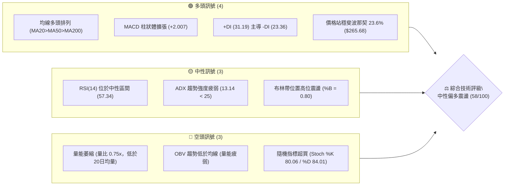
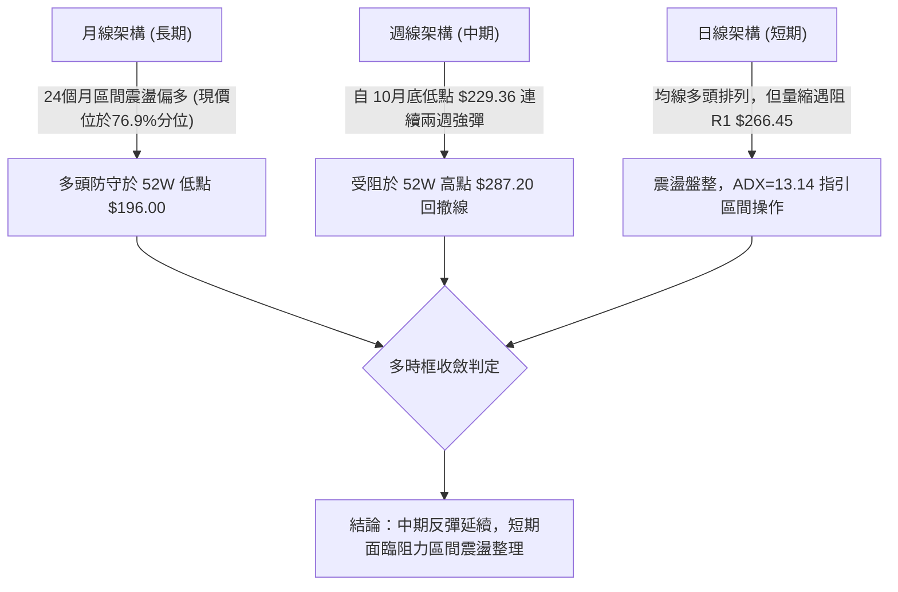
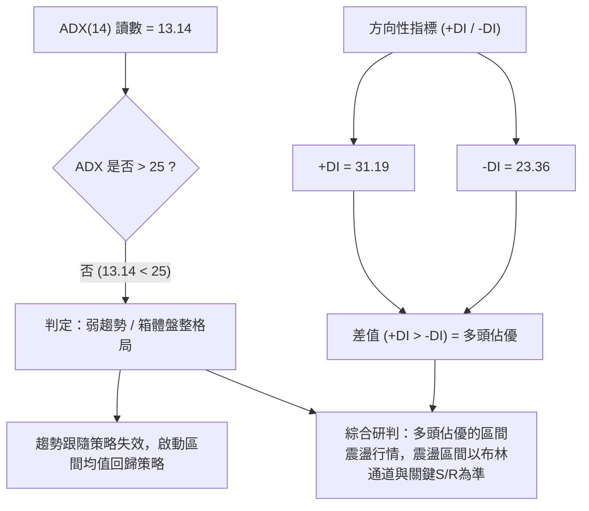
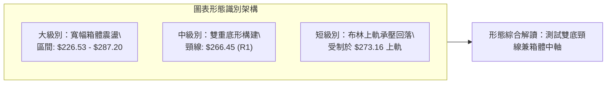
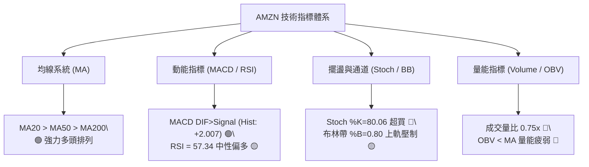
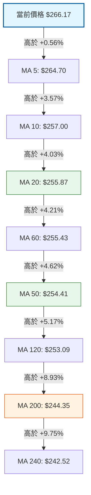
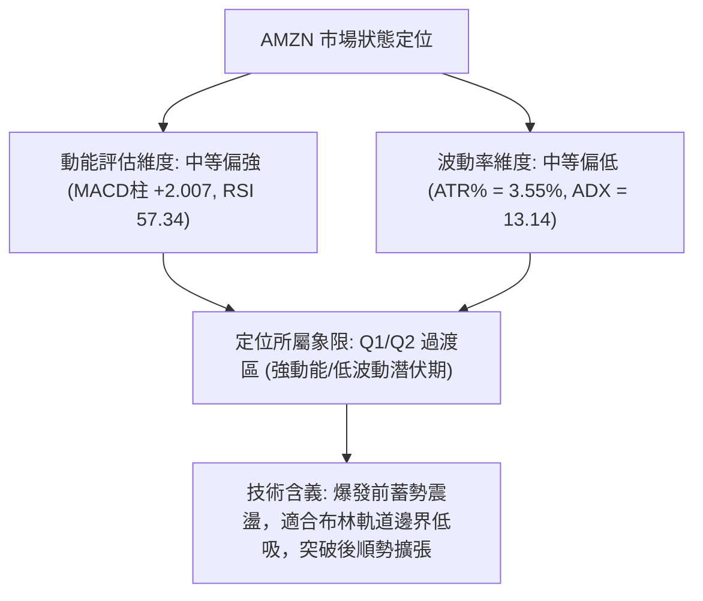
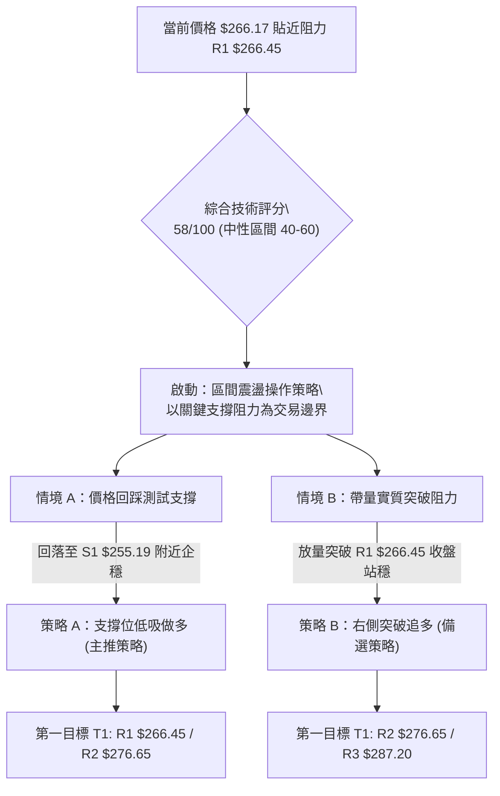
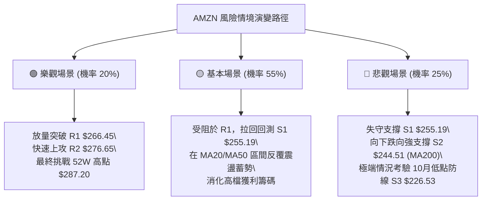

# AMZN 技術分析報告

> **報告日期**：2026-11-12 ｜ **語言**：繁體中文 ｜ **數據來源**：Yahoo Finance ｜ **當前價格**：$266.17

---

## 目錄

| 章節 | 內容 |
|------|------|
| [1. 技術面概覽](#1-技術面概覽) | 訊號儀表板、核心指標、評分卡 |
| [2. 趨勢分析](#2-趨勢分析) | 多時框趨勢、長中短期走勢 |
| [3. 圖表形態分析](#3-圖表形態分析) | 形態識別、K線組合、目標價 |
| [4. 支撐與阻力](#4-支撐與阻力) | 關鍵價位、斐波那契回調 |
| [5. 技術指標深度解讀](#5-技術指標深度解讀) | MA/RSI/MACD/布林/成交量 |
| [6. 動能與波動率](#6-動能與波動率) | 動能評估、ATR、Beta |
| [7. 多時框架總結](#7-多時框架總結) | 時框架評分矩陣 |
| [8. 交易策略建議](#8-交易策略建議) | 多空策略、風險報酬比 |
| [9. 風險提示與監控](#9-風險提示與監控) | 監控指標、風險場景 |

---

## 1. 技術面概覽

### 🎯 技術訊號儀表板



### 📊 核心指標速覽表

| 指標類別 | 指標名稱 | 當前數值 | 訊號 | 解讀 |
|----------|----------|----------|------|------|
| **價格** | 當前收盤價 | $266.17 | 🟢 | 站於全天期均線之上，逼近關鍵阻力 R1 ($266.45) |
| **均線** | MA20 | $255.87 | 🟢 | 價格在 MA20 之上 +4.03%，短中期多頭支撐牢固 |
| **均線** | MA50 | $254.41 | 🟢 | 價格在 MA50 之上 +4.62%，中期趨勢維持向上 |
| **均線** | MA200 | $244.35 | 🟢 | 價格在 MA200 之上 +8.93%，長期牛熊分水嶺未破 |
| **動能** | RSI(14) | 57.34 | 🟡 | 位於 30–70 中性強勢區，無背離現象 |
| **動能** | MACD (12,26,9) | 2.901 (Hist: +2.007) | 🟢 | DIF 高於 Signal (0.894)，柱狀體維持正向擴張 |
| **擺盪** | Stoch %K / %D | 80.06 / 84.01 | 🔴 | 進入超買鈍化區，短線面臨技術性修正壓力 |
| **趨勢強度** | ADX(14) | 13.14 | 🟡 | 數值低於 25，表明缺乏單邊趨勢，屬箱體震盪 |
| **通道** | 布林通道 (%B) | 0.80 (Band: $238.58–$273.16) | 🟡 | 運行於中軌 ($255.87) 與上軌 ($273.16) 間，逼近上軌壓制 |
| **成交量** | 成交量 / 量比 | 37,649,400 (0.75x) | 🔴 | 低於 20日均量 (50,489,865)，量價呈現量縮上漲 |
| **能量潮** | OBV | OBV < MA | 🔴 | 累積成交量低於均線，買盤追價意願不足 |
| **波動** | ATR(14) | $9.45 (3.55%) | 🟡 | 日內平均振幅適中，風險定價波動屬中等水平 |

### 🏆 技術評分卡

```
╔══════════════════════════════════════════════════════════════╗
║              技術評分卡 — AMZN (2026-11-12)                   ║
╠══════════════════════════════════════════════════════════════╣
║ 趨勢強度 (ADX=13.14, 弱趨勢)    ████████░░░░░░░░░░░░  42/100 🟡║
║ 動能指標 (MACD偏多/Stoch超買)   █████████████░░░░░░░  65/100 🟢║
║ 支撐穩定度 (MA20/S1雙重護盤)    ██████████████░░░░░░  72/100 🟢║
║ 成交量配合 (量縮/OBV疲弱)       ███████░░░░░░░░░░░░░  38/100 🔴║
║ 形態完整度 (箱體整理測頂)       ███████████░░░░░░░░░  53/100 🟡║
║ 均線排列 (完全多頭排列)         ███████████████░░░░░  78/100 🟢║
╠══════════════════════════════════════════════════════════════╣
║ 綜合評分 (六項算術平均)         ███████████░░░░░░░░░  58/100 🟡║
║ 評級結論：中性震盪 (區間操作，布林上下軌為主，等待量能突破) ║
╚══════════════════════════════════════════════════════════════╝
```
*(註：綜合評分由六項子評分算術平均計算：(42 + 65 + 72 + 38 + 53 + 78) ÷ 6 = 348 ÷ 6 = 58/100)*

---

## 2. 趨勢分析

### 🌐 多時框趨勢分析



### 📈 長期趨勢 — 12個月走勢圖（Unicode）

```
AMZN 月線走勢圖（過去12個月：2025-12 至 2026-11）
價格軸 ($)
$280 ┤                                      
$270 ┤                                  ●(07月:271.58)
$260 ┤                        ●(04月:265.06) ── ●(11月:266.17 現價)
$250 ┤                                              ●(08月:259.77)
$240 ┤          ●(01月:239.30)                      ●(09月:249.15)
$230 ┤●(12月:230.82)                                ●(10月:240.35)
$220 ┤                                      
$210 ┤                ●(02月:210.00)
$200 ┤                      ●(03月:208.27 低點)
     └───────────────────────────────────────────────────────────
       12   01   02   03   04   05   06   07   08   09   10   11 (月份)
```

#### 走勢特徵分析表格

| 階段時間 | 起始價 → 結束價 | 漲跌幅 | 走勢特徵與技術解讀 |
|----------|-----------------|--------|--------------------|
| **2025-12 ~ 2026-03** | $230.82 → $208.27 | -9.77% | 第一季度下探尋底，於 $208.27 獲得支撐，未破 52W 低點 $196.00 |
| **2026-03 ~ 2026-05** | $208.27 → $270.64 | +29.95% | 展開主升段推升，帶量連續突破多道均線，形成強勁上攻多頭浪 |
| **2026-05 ~ 2026-07** | $270.64 → $271.58 | +0.35% | 6月深度回踩 $238.34 後迅速收復，7月創下收盤高點 $271.58 |
| **2026-07 ~ 2026-10** | $271.58 → $240.35 | -11.50% | 連續三個月量縮陰跌回調，於 10月觸及波段低點 $229.36 後止跌 |
| **2026-10 ~ 2026-11** | $240.35 → $266.17 | +10.74% | 11月強勁大陽線修復，收復跌幅並重返 52W 高檔 76.9% 區間 |

### 📊 中期趨勢（週線分析）

```
AMZN 近期週線壓力與支撐結構示意圖
阻力 R3  $287.20 ────────────────────────────────────────── 52W 最高點阻力
阻力 R2  $276.65 ────────────────────┬───────────────────── 波段高點聚集區
阻力 R1  $266.45 ─────────●──────────┴───────────────────── 現價 $266.17 緊貼受阻
支撐 S1  $255.19 ─────────┼──────────┬───────────────────── 20週/MA20 重合支撐
支撐 S2  $244.51 ─────────┴──────────┼───────────────────── 10月回踩平台密集成交區
支撐 S3  $226.53 ────────────────────┴───────────────────── 10月波段最低低點防線 ($229.36 下方)
```

從近 20 週收盤走勢觀察，價格於 2026-07-31 創下收盤 $271.58，其後於 2026-08-07 衝高至週收盤 $274.48，隨後步入為期 12 週的對稱三角形／旗形整理。2026-10-30 週收盤打出低點 $240.35（該週盤中最低 $229.36），隨後兩週（11-06 與 11-11）連續強彈，週 MACD 柱狀體由 -1.528 翻正至 +2.007，顯示中期修正結束，重回上升結構。

### ⚡ 趨勢強度評估（ADX 解讀）



#### ADX 強度對照與解讀

| ADX 區間 | 趨勢狀態 | AMZN 當前指標狀態 | 交易指導方針 |
|----------|----------|-------------------|--------------|
| **0 – 20** | **極弱趨勢 / 無方向盤整** | **當前數值：13.14 (弱趨勢)** | **嚴禁追漲殺跌；嚴格執行布林軌道或 S/R 區間高拋低吸** |
| 20 – 25 | 趨勢醞釀中 / 方向不明 | +DI (31.19) > -DI (23.36) | 留意均線收斂突破信號，準備順勢單 |
| 25 – 40 | 強勁單邊趨勢 | 未達到 | 順應趨勢持倉，回踩均線加碼 |
| 40 – 60 | 極強單邊趨勢 | 未達到 | 移動止盈保護利潤 |

---

## 3. 圖表形態分析

### 🔍 形態識別系統



#### 圖表形態信心度評估表

| 形態名稱 | 信心度 | 判斷依據（引用數據） | 完成度 | 目標價（附精確計算式） |
|----------|--------|----------------------|--------|------------------------|
| **波段雙底 (W-Bottom)** | **68%** | 兩次低點分別為 2026-06 收盤 $238.34 及 2026-10-30 最低點 $229.36（對應支撐 S3 $226.53 附近），頸線為 R1 $266.45 | 85% | 頸線 $266.45 + (頸線 $266.45 − 第二底 $229.36) = $266.45 + $37.09 = **$303.54**（遠期理論高度） |
| **矩形箱體震盪 (Box)** | **82%** | 近 6 個月價格波動均受阻於阻力 R3 $287.20，且獲得支撐 S2 $244.51 / S3 $226.53 守護 | 90% | 箱體頂部 = **$287.20**（阻力 R3）；箱體下軌 = **$244.51**（支撐 S2） |
| **短期上升旗形突破** | **45%** | 11-04 巨量長陽（成交量 93,162,200）突破後連續 5 日回縮整理，但信心度不足 50%，僅作指標型突破觀察 | 60% | 依規則 15：信心度 < 50%，不採用幾何測距，改採指標型阻力 R2 **$276.65** |

### 🕯️ 重要K線形態分析

依據提供的「近10根日K」與「近8根週K」之精確 OHLC 數據進行 K 線形態解讀：

#### 近10根日K形態精確解析

| 日期 | 開盤價 | 最高價 | 最低價 | 收盤價 | 成交量 | K線形態名稱 | 技術解讀 | 訊號 |
|------|--------|--------|--------|--------|--------|-------------|----------|------|
| **2026-10-29** | 246.95 | 249.14 | 241.24 | 243.79 | 85,234,400 | 中陰線 | 破位下挫，空頭宣洩，測試低檔支撐 | 🔴 |
| **2026-10-30** | 232.54 | 241.55 | 229.36 | 240.35 | 104,894,700 | 長下影錘頭陰線 | 創波段新低 $229.36 後爆量湧入逢低承接盤，長下影形成底背馳反轉標誌 | 🟢 |
| **2026-11-02** | 243.01 | 253.81 | 242.28 | 245.63 | 58,348,000 | 突破陽十字星 | 跳空高開，確認 10-30 底部有效性，開始回升 | 🟢 |
| **2026-11-03** | 248.59 | 252.45 | 245.88 | 250.69 | 37,853,500 | 溫和小陽線 | 縮量消化拋壓，價格站上短期均線 | 🟢 |
| **2026-11-04** | 264.82 | 271.49 | 263.85 | 266.03 | 93,162,200 | 跳空大陽線 | 爆量長陽跳空突破 MA20 ($255.87) 與 MA50 ($254.41)，確立轉折 | 🟢 |
| **2026-11-05** | 271.43 | 273.23 | 252.27 | 260.21 | 85,796,800 | 長上影高開長陰線 | 上攻布林上軌 ($273.16) 未果，盤中大幅回吐，留 21 美元寬幅振幅 | 🔴 |
| **2026-11-06** | 259.81 | 264.18 | 258.53 | 259.30 | 42,571,500 | 縮量十字陰線 | 於 MA20 ($255.87) 上方止跌橫盤，量能縮減過半，屬良性整理 | 🟡 |
| **2026-11-09** | 269.32 | 275.34 | 266.91 | 266.93 | 51,523,200 | 假陰十字星 | 高開上衝 $275.34 後收斂，實體微小，受阻於 R2 ($276.65) 警戒線 | 🟡 |
| **2026-11-10** | 266.21 | 272.88 | 266.14 | 270.87 | 38,968,300 | 溫和上揚小陽線 | 沿短期 MA5 攀升，但成交量未能放大 | 🟢 |
| **2026-11-11** | 273.52 | 274.87 | 265.62 | 266.17 | 37,649,400 | 高開衝高長陰線 | 開盤 $273.52 貼近布林上軌，終盤收低於 $266.17，量能萎縮至 37.6M | 🔴 |

#### 近8根週K形態精確解析

| 週結束日期 | 開盤價 | 最高價 | 最低價 | 收盤價 | 週成交量 | 週K線形態 | 解讀 | 訊號 |
|------------|--------|--------|--------|--------|----------|-----------|------|------|
| **2026-09-25** | 256.40 | 259.49 | 245.60 | 249.67 | 196,475,200 | 實體中陰線 | 破位走弱，空頭掌控 | 🔴 |
| **2026-10-02** | 246.63 | 253.56 | 244.73 | 251.52 | 174,917,500 | 孕線小陽線 | 下跌停頓，低檔抵抗 | 🟡 |
| **2026-10-09** | 250.19 | 262.80 | 250.18 | 262.43 | 183,040,400 | 反彈中陽線 | 向上試探均線阻力 | 🟢 |
| **2026-10-16** | 262.50 | 263.70 | 248.60 | 250.00 | 161,689,900 | 倒垂長陰線 | 上衝失敗回落，多頭受挫 | 🔴 |
| **2026-10-23** | 255.25 | 265.34 | 246.45 | 248.00 | 196,713,700 | 長上影流星陰線 | 再次受阻於 $265 阻力帶 | 🔴 |
| **2026-10-30** | 249.47 | 255.36 | 229.36 | 240.35 | 292,219,200 | 爆量長下影陰錘 | 探底 $229.36 止跌，換手率激增，主力洗盤完成 | 🟢 |
| **2026-11-06** | 243.01 | 273.23 | 242.28 | 259.30 | 317,732,000 | 巨量吞噬長陽線 | 一舉吞噬前兩週實體，週線級別強多頭反轉確立 | 🟢 |
| **2026-11-11** | 269.32 | 275.34 | 265.62 | 266.17 | 128,140,900 | 高位窄幅上影十字 | 上攻受阻 R1/R2，量能暫時遞減，處於突破後消化期 | 🟡 |

### 📉 ASCII 走勢形態示意圖

```
AMZN 近日箱體突破與頸線回踩示意圖 (日K級別)
價格 ($)
$276.65 ── 阻力 R2 ───────────────────────────────────────── (未及)
$274.87 ── 11-11高點 ──────────┐
$273.16 ── 布林上軌 ────────────┼── 11-05上影頂 ($273.23) ─┐
$266.45 ── 阻力 R1 (頸線) ──────┼────────● 現價 $266.17 ───┴── 頸線攻防中
$265.68 ── 斐波那契 23.6% ──────┴─────────────────────────── 下方即時防守
$255.87 ── MA20 / 中軌 ────────────────────────────────────── 核心支撐區
$255.19 ── 支撐 S1 ───────────────────────────────────────── 強力防守位
$244.51 ── 支撐 S2 (MA200 $244.35) ───────────────────────── 牛熊底線
$229.36 ── 10-30低點 ──● (雙底二號腳，爆量 $229.36 支撐確立)
```

### 🎯 形態目標價計算

依據波段幾何結構與數據庫關鍵價位，詳細推導計算如下：

1. **雙底頸線突破目標價**：
   - 形態底部：$229.36（2026-10-30 盤中低點）
   - 頸線位置：$266.45（阻力 R1）
   - 形態高度：$\text{形態高度} = \$266.45 - \$229.36 = \$37.09$
   - 幾何目標價：$\text{頸線} + \text{形態高度} = \$266.45 + \$37.09 = \$303.54$
   - *階段對應目標*：突破 R1 之後，首要目標為阻力 R2（**$276.65**），次要目標為 52W 高點阻力 R3（**$287.20**）。

2. **箱體震盪目標測算**：
   - 若短線受制於 R1 ($266.45) 回落，下檔箱體中軸由 MA20 ($255.87) 與支撐 S1 ($255.19) 組成支撐緩衝帶，回踩滿足點為 **$255.19**。

---

## 4. 支撐與阻力

### 🗺️ 關鍵價位分布圖（Unicode）

```
AMZN 價位結構分布圖 (由 OHLCV 精確計算)
═══════════════════════════════════════════════════════════════════
$287.20 ║████████████████████████████████████████║ 強阻力 R3 (52W 高點)
$276.65 ║████████████████████████████            ║ 阻力 R2 (近一年波段高點聚類)
$273.16 ║▓▓▓▓▓▓▓▓▓▓▓▓▓▓▓▓▓▓▓▓                    ║ 布林上軌 (動態壓制)
$266.45 ║████████████████████████████████        ║ 關鍵阻力 R1 (頸線壓力)
$266.17 ╠════════════════════════════════════════╣ ◄ 當前價格 ($266.17)
$265.68 ║░░░░░░░░░░░░░░░░░░░░░░░░░░░░░░░░        ║ 斐波那契 23.6% 回調位
$255.87 ║▓▓▓▓▓▓▓▓▓▓▓▓▓▓▓▓▓▓▓▓▓▓▓▓                ║ 布林中軌 (MA20)
$255.19 ║████████████████████████████████        ║ 近期支撐 S1 (波段低點聚類)
$252.36 ║░░░░░░░░░░░░░░░░░░░░░░░░                ║ 斐波那契 38.2% 回調位
$244.51 ║████████████████████████████████████    ║ 強支撐 S2 (MA200 $244.35 匯聚)
$238.58 ║▓▓▓▓▓▓▓▓▓▓▓▓                            ║ 布林下軌 (動態支撐)
$226.53 ║████████████████████████████████████████║ 強防守 S3 (年度波段深谷)
═══════════════════════════════════════════════════════════════════
```

### 🚧 阻力位分析表

*(註：阻力價位完全引用自關鍵價位波段高點聚類計算值)*

| 阻力級別 | 價位 | 與現價距離 | 形成原因與籌碼特徵 | 突破難度 | 重要性 |
|----------|------|------------|--------------------|----------|--------|
| **阻力 R1** | **$266.45** | +0.11% | 近一年密集高點聚類，雙底頸線所在，11-11 收盤價 ($266.17) 緊貼此處，解套拋壓密集 | 中等 🟡 | ★★★★☆ |
| **阻力 R2** | **$276.65** | +3.94% | 2026年 7–8 月波段頂部（2026-08-07 週收盤 $274.48 區域），獲利盤與前期套牢盤聚集區 | 較高 🔴 | ★★★★☆ |
| **阻力 R3** | **$287.20** | +7.90% | 52週歷史最高點（52W High），斐波那契 0.0% 極限阻力位，機構重度減倉防守點 | 極高 🔴 | ★★★★★ |

### 🛡️ 支撐位分析表

*(註：支撐價位完全引用自關鍵價位波段低點聚類計算值)*

| 支撐級別 | 價位 | 與現價距離 | 形成原因與籌碼特徵 | 守住機率 | 重要性 |
|----------|------|------------|--------------------|----------|--------|
| **支撐 S1** | **$255.19** | -4.13% | 近一年波段低點聚類，與 20日均線 MA20 ($255.87) 及 50日均線 MA50 ($254.41) 高度重疊 | 75% 🟢 | ★★★★☆ |
| **支撐 S2** | **$244.51** | -8.14% | 200日牛熊線 MA200 ($244.35) 匯聚處，10月下半月箱體下沿平台，長線機構買盤防線 | 85% 🟢 | ★★★★★ |
| **支撐 S3** | **$226.53** | -14.89% | 近一年極端波段低點聚類，覆蓋 10-30 盤中低點 $229.36，若跌破意味長期牛市結構破裂 | 95% 🟢 | ★★★★★ |

### 📐 斐波那契回調位分析

依據 52 週完整波動區間（低點 **$196.00** 至 高點 **$287.20**，振幅 $91.20）計算之回調位如下：

```
0.0%  (52W High)   $287.20 ────────────────────────────────── 強阻力 R3
23.6%              $265.68 ─── ▲ 現價 $266.17 緊貼於此 (突破測試中)
38.2%              $252.36 ─── 接近 MA50 ($254.41) 與 S1 ($255.19)
50.0%              $241.60 ─── 中軸分水嶺 (接近 MA200 $244.35 與 S2)
61.8%              $230.84 ─── 黃金分割防線 (接近 10-30 低點 $229.36)
78.6%              $215.52 ─── 弱勢調整極限
100.0% (52W Low)   $196.00 ────────────────────────────────── 年度最低點
```

#### 斐波那契回調層級深度解析：
1. **當前位置解讀**：現價 **$266.17** 位於 **0.0% ($287.20)** 與 **23.6% ($265.68)** 之間，高於 23.6% 分位線僅 +0.18%，實質上正對 23.6% 回調線進行貼身確認。
2. **多空意義**：
   - 價格能穩於 23.6% ($265.68) 之上，表明從 52W 低點 $196.00 上漲以來的多頭回調極為淺層，屬於極強勢整理格局。
   - 一旦失守 23.6% ($265.68)，回調將直接考驗 38.2% 回調位 **$252.36**，該位置與支撐 S1 ($255.19) 及 MA50 ($254.41) 構成穩固的多頭堡壘。

---

## 5. 技術指標深度解讀

### 🎛️ 指標訊號總覽



### 📈 移動平均線排列分析



#### 均線系統全面數據表

| 均線名稱 | 當前數值 | 價格相對於均線 | 均線歷史軌跡走勢 | 技術評估與多空意涵 |
|----------|----------|----------------|------------------|--------------------|
| **MA 5** | $264.70 | +0.56% (上方) | ▁▁▂▂▃▄▅▆▆▅▅▄▅▅▆▅▅▄▃▂▂▁▁▁▂▃▅▇██ | 短期扣抵低位，強勢陡峭上行 |
| **MA 10** | $257.00 | +3.57% (上方) | ▁▁▁▁▂▂▃▅▆▆▇▇████▇▆▅▅▄▃▂▁▁▂▃▅▆▇ | 快速走高，提供短線第一道動態支撐 |
| **MA 20** | $255.87 | +4.03% (上方) | ▂▁▁▁▁▁▂▂▃▄▄▄▄▅▆▆▆▆▇▇▇▆▅▅▅▆▆▆▇█ | 向上拐頭，與布林中軌完全重合 |
| **MA 50** | $254.41 | +4.62% (上方) | （中期生命線） | 走平回升，MA20 上穿 MA50 形成黃金交叉 |
| **MA 60** | $255.43 | +4.21% (上方) | ▁▁▁▁▂▂▂▂▃▃▃▄▅▆▇███▇▆▅▄▃▂▁▁▁▁▁▂ | 扣抵結束下行，開始由跌轉平 |
| **MA 120** | $253.09 | +5.17% (上方) | ▆▇▇▇▇██████████▇▆▅▅▄▃▂▂▁▁▁▁▁▁▁ | 半年線平穩，提供中長期底部依託 |
| **MA 200** | $244.35 | +8.93% (上方) | （長期牛熊分界線） | 穩步上揚，多頭年線支撐堅實 |
| **MA 240** | $242.52 | +9.75% (上方) | ▁▁▁▂▂▃▃▃▄▄▄▄▅▅▅▅▅▅▅▅▅▅▅▆▆▇▇███ | 歷史大底支撐持續抬高，長多基石 |

**均線排列解讀**：目前呈現典型的「MA20 ($255.87) > MA50 ($254.41) > MA200 ($244.35)」標準多頭排列，全天期均線無一例外全數運行於當前價格 $266.17 之下。然而，價格偏離 MA20 達 4.03%，短線乖離率略顯偏高，在量能未放大前，價格常有回抽 MA20 確認支撐的需求。

### 📉 RSI(14) 分析

- **RSI(14) 最新數值**：**57.34** (Wilder 平滑法)
- **強度指示條**：
  ```
  超賣 (0-30)           中性區間 (30-70)             超買 (70-100)
  ├───┼───────────────┼────────────────────────┼───────────────┤
  ░░░░░░░░░░░░░░░░░░░░████████████████████░░░░░░░░░░░░░░░░░░░░░░░
  0                  30                  [57.34]  70             100
  ```
- **區間評估**：RSI 位於 57.34，屬於典型「中性偏強」常態區間。多頭仍握有發球權，尚未觸及 70 之警戒超買閥值，指標仍有上行空間。
- **背離分析判斷**：
  - **日線背離狀況**：比對近 20 根 K 棒走勢，價格自 10-30 低點 $229.36 反彈至當前 $266.17，RSI 同步自低位回升至 57.34，**無明顯頂背離或底背離**現象，指標忠實反映價格反彈。
  - **週線背離狀況**：回溯 2026-07-31（週收盤 $271.58，RSI 67.9）與 2026-08-07（週收盤 $274.48，RSI 64.2），週線級別曾出現微幅頂背離引發 8-10 月調整；而當前週線 RSI 自 38.3 顯著回升至 57.3，走勢健康無背離。

### 📊 MACD(12/26/9) 訊號解讀


- **MACD DIF**：**2.901**
- **MACD Signal (DEA)**：**0.894**
- **MACD Histogram**：**+2.007**
- **訊號深度剖析**：
  1. DIF 與 Signal 均處於零軸之上，此為強勢多頭市場的典型特徵。
  2. 柱狀體報 +2.007，較前期持續拉長，顯示短期上漲動能仍在加速釋放中。
  3. 然而需留意的是，日線價格逼近阻力 R1 ($266.45)，柱狀圖若在未來數日內無法進一步推升（例如跌破 +1.500），將形成動能衰竭信號。

### 📦 布林通道分析

```
AMZN 布林通道走勢結構示意圖 (日線參數: 20, 2)
價格 ($)
$273.16 ── 布林上軌 (Upper Band) ─────────────┐ 阻力壓制
                                              │
$266.17 ── 當前收盤價 (%B = 0.80) ────● 運行於上軌附近
                                              │
$255.87 ── 布林中軌 (MA20) ───────────────────┼ 多頭中樞支撐
                                              │
$238.58 ── 布林下軌 (Lower Band) ─────────────┘ 超跌支撐防線
```

- **布林上軌**：**$273.16**
- **布林中軌 (MA20)**：**$255.87**
- **布林下軌**：**$238.58**
- **通道帶寬 (Bandwidth)**：$\frac{\$273.16 - \$238.58}{\$255.87} \times 100\% = 13.51\%$
- **%B 指標值**：**0.80**
- **解讀**：
  - %B 達 0.80，表明價格已進入通道的上軌強勢區間（0.80–1.00）。
  - 11-05 盤中最高觸及 $273.23，11-09 盤中觸及 $275.34，均在上軌 $273.16 附近遭遇空頭打壓回落。布林通道目前呈現喇叭口微幅擴張狀態，但由於 ADX 僅 13.14，難以維持沿上軌運行的單邊暴漲行情，短期向中軌 $255.87 收斂回踩的機率甚高。

### 💹 成交量分析（量價配合度）

```
量價配合矩陣
當前日成交量: 37,649,400  ────────┐ (量比 0.75x)
20日均量 (MA20): 50,489,865 ──────┼── 量能缺口 -25.4% (量縮)
50日均量 (MA50): 40,681,522 ──────┘
OBV 指標狀態: OBV < MA (能量潮持續位於均線下方，背離警告 🔴)
```

1. **量比分析**：
   - 最新單日成交量為 37,649,400 股，相較於 20日均量 50,489,865 股，量比僅 **0.75x**。
   - 價格自 11-06 的 $259.30 連續拉升至 11-11 的 $266.17，然而成交量卻由 11-04 的 93.1M、11-05 的 85.7M 驟降至 11-10 的 38.9M 與 11-11 的 37.6M。**呈現顯著的「價漲量縮」背離態勢**。
2. **OBV 能量潮解讀**：
   - 數據明確顯示「OBV < MA → 量能疲弱」。
   - 在突破重要阻力 R1 ($266.45) 之際，能量潮未見率先創新高，顯示機構法人主力資金在此處並未大舉追加籌碼，散戶推升特徵明顯，隨時可能因買盤力竭而產生技術性拉回。

---

## 6. 動能與波動率

### ⚡ 動能評估四象限

動能評估分析：將標的放置於「動能強度」與「波動率」兩大維度進行橫向與縱向定位。



#### 動能與波動四象限對照表

| 象限代號 | 動能強度 | 波動率水平 | 當前所屬狀態 | 操作策略與風險評估 |
|----------|----------|------------|--------------|--------------------|
| **Q1 (機會區)** | 強 | 低 | **✓ (核心特徵吻合)** | **最佳低吸機會**：動能正向但波動未失控，具備均值回歸與突破潛力 |
| **Q2 (觀望區)** | 弱 | 低 | - | 資金沉澱，缺乏交易熱度，避免過早介入 |
| **Q3 (風險區)** | 強 | 高 | - | 單邊趨勢狂熱或主升浪末期，利潤豐厚但回撤劇烈 |
| **Q4 (規避區)** | 弱 | 高 | - | 崩跌或無序高波動洗盤，嚴禁持有 |

### 📊 ATR 波動率分析

- **ATR(14) 數值**：**$9.45** (基於 Wilder 平滑算法)
- **ATR 相對價格比**：**3.55%** of price ($266.17)
- **日內安全防護與止損距離設定建議**：
  - **短線交易（1.0 × ATR）**：波幅緩衝為 **$9.45**。進場多單止損位應設於買入價下方至少 $9.45，避免被日內隨機雜訊掃出場。
  - **波段交易（1.5 × ATR）**：波幅緩衝為 $9.45 \times 1.5 = \mathbf{\$14.18}$。若於現價 $266.17 進場，技術保護止損應置於 $\$266.17 - \$14.18 = \mathbf{\$251.99}$ 附近（恰好低於支撐 S1 $255.19 及 MA50 $254.41）。
  - **寬幅防守（2.0 × ATR）**：波幅緩衝為 $9.45 \times 2.0 = \mathbf{\$18.90}$。

### 📐 Beta 與市場相關性

- **Beta 係數**：**1.503**
- **市場特徵與系統性風險解讀**：
  - Beta 為 1.503，顯示 AMZN 屬於「高彈性攻擊型成長股」，其股價波動幅度平均為標普 500 指數（S&P 500）的 1.5 倍。
  - 當大盤納斯達克或標普走強時，AMZN 具備顯著超越指數的超額收益（Alpha）潛力；反之，若美股大盤面臨宏觀回調，AMZN 將放大下行波動，操作上需嚴格遵守倉位控制原則。

---

## 7. 多時框架總結

### 📋 時框架評分表

| 時框架 | 趨勢方向 | 動能狀態 | 均線排列 | 形態結構 | 綜合評分 | 戰略建議 |
|--------|----------|----------|----------|----------|----------|----------|
| **長期 (月線)** | 多頭震盪 🟢 | RSI 溫和回升 🟢 | MA200 向上 🟢 | 歷史高檔寬幅震盪箱體 🟡 | **72/100** | 核心多頭部位續抱，長多防線 $196.00 |
| **中期 (週線)** | 轉折向上 🟢 | MACD柱由負轉正 🟢 | 均線逐漸黏合走平 🟡 | 爆量下影確認底部雙底 🟢 | **65/100** | 逢拉回支撐分批低吸，中線目標 R2 $276.65 |
| **短期 (日線)** | 盤整偏多 🟡 | MACD金叉但量縮 🟡 | 完美多頭排列 🟢 | 受阻於阻力 R1 $266.45 🔴 | **58/100** | 區間震盪操作，不宜追高，待回踩布林中軌 |

### 🔲 綜合訊號矩陣

```
綜合訊號多空維度一致性矩陣
維度分類        指標項目              訊號屬性     權重影響     收斂指向
─────────────────────────────────────────────────────────────────
趨勢維度        均線排列 (MA20/50/200) 🟢 強多      高           中期偏多
                ADX 趨勢強度 (13.14)   🟡 弱勢/盤整  極高         盤整主導
動能維度        MACD (Hist +2.007)    🟢 看多      中           上漲動能
                RSI(14) (57.34)       🟡 中性      中           空間充足
擺盪維度        Stoch %K/%D (超買)    🔴 看空      中           短線回調
                布林 %B (0.80)         🟡 偏壓      中           上軌阻力
量能維度        量比 (0.75x)          🔴 偏空      高           追價乏力
                OBV 趨勢 (低於均線)   🔴 偏空      高           量價背離
─────────────────────────────────────────────────────────────────
矩陣收斂判定：短線量能匱乏壓制趨勢爆發，中期多頭結構保障下檔安全
```

### ⚖️ 多時框收斂結論

依據多時框收斂規則第 14 條嚴格判定：
1. **行情屬性判斷**：AMZN 當前 **ADX(14) = 13.14，明確低於 25 的趨勢門檻**，因此判定當前市場**並非單邊趨勢行情，而是處於典型的箱體震盪盤整行情**。
2. **主導規則收斂**：在盤整行情中，依規則應以**日線布林通道上下軌（$238.58 – $273.16）與關鍵支撐阻力為主要交易區間**。中長期週線與 MA 均線（MA50 $254.41、MA200 $244.35）則提供下檔安全底線，日線訊號用於尋找區間高低點之進出場契機。
3. **唯一方向性結論**：**中性偏多震盪觀望（綜合評分 58/100）**。
   - 儘管均線排列為標準多頭，但日線現價 $266.17 已極度逼近關鍵阻力 R1 ($266.45) 與布林上軌 ($273.16)，且伴隨量縮（量比 0.75x）與 OBV 背離，強行追多風險收益比極差。
   - 正確戰略為：**耐心等待價格回測支撐 S1 ($255.19) 或布林中軌 MA20 ($255.87) 企穩後低吸，或待帶量實質突破 R1 ($266.45) 後順勢跟進**。此結論與第 8 章之主策略完全保持一致。

---

## 8. 交易策略建議

### 🗺️ 策略決策流程圖



### 🧭 策略路由

> **當前主策略方向 = 中性震盪區間操作（依評分 58/100，界定於 40–60 中性震盪區間）**
> *操作綱領：拒絕在阻力位盲目追高，專注於「布林通道中軌/下軌支撐低吸」與「右側放量突破確認」，嚴格遵循風控紀律。*

### 🎯 價格情境階梯（Price Scenarios）

*(註：所有階梯價位均嚴格引用第 4 章關鍵價位波段計算值)*

| 觸發條件 | 下一目標 | 後續延伸 | 情境技術含義與因應對策 |
|----------|----------|----------|------------------------|
| **向上放量突破 R1 $266.45** | **R2 $276.65** | **R3 $287.20** | 短線轉強信號確立，雙底形態完成，發動挑戰 52W 高點之攻擊浪 |
| **受阻於 R1 回落，站穩 S1 $255.19** | **R1 $266.45** | **R2 $276.65** | 維持布林中軌上方強勢整理，消化短線獲利盤，形成最佳蓄勢低吸點 |
| **跌破 S1 $255.19 (回測 MA50)** | **S2 $244.51** | **S3 $226.53** | 中期動能轉弱，測試 200日均線生命線，需收緊止損或降低倉位 |

### 📊 情境機率分佈

| 預測情境 | 發生機率 | 主要技術與量化依據 |
|----------|----------|--------------------|
| **情境一：回踩支撐後重拾升勢** | **50%** | ADX=13.14 決定短線難以直接突破；但均線多頭排列且 MACD 處於零軸上方，回踩 S1 ($255.19) / MA20 具強大買盤承接力 |
| **情境二：窄幅區間橫盤震盪** | **30%** | 布林通道帶寬收窄，成交量大幅萎縮（量比 0.75x），多空於 $260.00 – $270.00 間進行籌碼沉澱 |
| **情境三：直接放量突破創新高** | **20%** | 需單日成交量擴大至 8,000 萬股以上方能克服 R1 ($266.45) 密集解套賣壓，當前量能條件暫不充分 |

### 🟢 主策略詳情（區間操作與突破策略）

依據嚴格要求第 17 條公式計算：
$$\text{風險報酬比} = \frac{\text{目標價 T1} - \text{進場價}}{\text{進場價} - \text{止損價}}$$

| 策略要素 | 策略 A：回踩支撐低吸策略（首選） | 策略 B：突破確認順勢策略（次選） |
|----------|----------------------------------|----------------------------------|
| **進場條件** | 價格回調至支撐 S1 企穩，出現日K止跌反轉棒 | 日線實體收盤價放量站上阻力 R1 |
| **進場價格** | **$255.19**（支撐位 S1 處掛單或觸及進場） | **$266.45**（突破阻力位 R1 確認後進場） |
| **目標價 T1** | **$276.65**（阻力位 R2） | **$287.20**（阻力位 R3 / 52W 高點） |
| **目標價 T2** | **$287.20**（阻力位 R3 / 52W 高點） | **$303.54**（雙底形態高度測算目標） |
| **止損價格** | **$244.51**（強支撐位 S2 / 跌破 MA200 離場） | **$255.19**（回跌破支撐位 S1 / 假突破止損） |
| **風險報酬比** | **1 : 2.01（以 T1 計）**<br>*(計算式: (276.65-255.19)÷(255.19-244.51) = 21.46÷10.68 = 2.009)*<br>*(以 T2 計為 1 : 3.00)* | **1 : 1.84（以 T1 計）**<br>*(計算式: (287.20-266.45)÷(266.45-255.19) = 20.75÷11.26 = 1.843)*<br>*(以 T2 計為 1 : 3.29)* |
| **成功機率** | **65%** | **55%** |
| **建議倉位** | **15% – 20%**（分批佈局） | **10%**（突破確認後輕倉試單） |

### 🔴 反向風險觸發點（對沖與風控提示）

若出現以下技術異動，表明多頭架構遭到破壞，需立即啟動風控防禦：
1. **日線收盤跌破支撐 S1 ($255.19)**：若跌破且連續兩日無法收復，意味著 MA20 中軌失守，短線轉為弱勢調整，多頭部位應減倉 50%。
2. **重度破位支撐 S2 ($244.51)**：若跌破 200日均線 MA200 ($244.35) 與 S2，宣告長達數月的上升結構結束，多單應無條件全數止損離場，甚至可反向佈局對沖空單。
3. **量能持續背離**：若價格強行拉升創出高點（例如觸碰 $273.16 上軌），但成交量進一步萎縮至 3,000 萬股以下，警惕誘多陷阱，應逢高平倉獲利部位。

### ⭐ 整體訊號強度評星

```
做多訊號強度：★★★☆☆  (3.2/5星 — 均線與動能護航，但受制於量能與阻力)
做空訊號強度：★★☆☆☆  (2.0/5星 — 多頭排列完好，空頭僅具備短線阻力壓制)
整體可信度：  ★★★★☆  (4.0/5星 — OHLCV 關鍵聚類點位清晰，多時框指針一致)
```

---

## 9. 風險提示與監控

### ✅ 關鍵監控指標 Checklist

```
╔══════════════════════════════════════════════════════════════════╗
║                    每日交易風險監控清單 (Checklist)               ║
╠══════════════════════════════════════════════════════════════════╣
║ [ ] 價位監控：收盤價是否有效站上阻力 R1 $266.45？                 ║
║ [ ] 均線防守：MA20 ($255.87) 與支撐 S1 ($255.19) 是否完好無損？   ║
║ [ ] 量能驗證：單日成交量是否回升至 5,000 萬股（量比 > 1.0x）？   ║
║ [ ] 動能警報：Stoch %K 是否在高檔（>80）形成死叉回落？           ║
║ [ ] 能量潮態：OBV 是否向上突破其均線，扭轉量能疲弱走勢？         ║
║ [ ] 波動保護：日內單邊跌幅是否超過 1.5×ATR ($14.18)？           ║
╚══════════════════════════════════════════════════════════════════╝
```

### ⚠️ 風險場景分析



### 🛡️ 風險管理重要提醒

1. **基本面與現金流警訊**：
   - 儘管技術面維持多頭架構，但財務數據顯示 AMZN 自由現金流（FCF TTM = 營業現金流 $158.44B − 資本支出 $196.08B）為 **$-37.64B**（FCF Yield 為 **-1.31%**），總負債高達 **$304.84B**，流動比率為 0.989。資本支出激增帶來的現金流承壓可能成為機構在大盤震盪時減持的潛在誘因。
2. **高 Beta 波動管理**：
   - 標的 Beta 值達 1.503，嚴格禁止滿倉操作。建議總持倉暴露不超過投資組合總資金的 **15%–20%**。
   - 單筆交易的最大虧損金額應嚴格限制在總賬戶淨值的 **1%–1.5%** 之內。若以策略 A 為例（進場 $255.19，止損 $244.51，每股風險 $10.68），每 10 萬美元賬戶資金建議持有股數不超過 100–140 股。

---

## 📋 報告總結

```
╔══════════════════════════════════════════════════════════════════╗
║                 AMZN 技術分析報告總結 (2026-11-12)               ║
╠══════════════════════════════════════════════════════════════════╣
║ 當前收盤價：$266.17       綜合技術評分：58/100 (中性震盪)         ║
║ 分析師評級：⚖️ 區間中性偏多 (等待回調低吸或量能突破)            ║
╠══════════════════════════════════════════════════════════════════╣
║ 關鍵結論一覽：                                                   ║
║ ├─ 長期趨勢 (月線)：🟢 多頭架構完好，位於 52W 區間 76.9% 分位  ║
║ ├─ 中期趨勢 (週線)：🟢 雙底築底完成，週 MACD 翻正，上攻態勢延續  ║
║ ├─ 短期趨勢 (日線)：🟡 均線多頭但量縮背離，面臨阻力 R1 $266.45 ║
║ ├─ 關鍵支撐：S1: $255.19  │ S2: $244.51 (MA200) │ S3: $226.53  ║
║ ├─ 關鍵阻力：R1: $266.45  │ R2: $276.65        │ R3: $287.20  ║
║ └─ 華爾街共識目標價：$326.99 (59位分析師，強烈買進評級)          ║
╠══════════════════════════════════════════════════════════════════╣
║ 最優交易策略組合：                                               ║
║ 1. 🥇 最佳機會 (策略 A)：回踩支撐 S1 $255.19 企穩做多，         ║
║    目標 T1 $276.65，止損 $244.51 (風報比 1 : 2.01)              ║
║ 2. 🥈 次選機會 (策略 B)：放量突破阻力 R1 $266.45 確認追多，      ║
║    目標 T1 $287.20，止損 $255.19 (風報比 1 : 1.84)              ║
║ 3. 🥉 保守選擇：空倉者保持觀望，等待日線 ADX 回升至 20 以上     ║
║    或量比回升至 1.0x 以上再行介入。                             ║
╚══════════════════════════════════════════════════════════════════╝
```

---

> ⚠️ **免責聲明**：本報告為技術分析專業研究成果，所有技術價位、指標判斷與策略建議均基於客觀歷史價格與交易量（OHLCV）數據之模型計算。本報告**僅供研究與學術參考**，**不構成任何要約、招攬或具體投資建議**。市場具有高度不確定性，金融商品價格瞬息萬變，投資者在進行任何交易決策前應審慎評估自身財務狀況與風險承受能力，並自負投資盈虧。

---

*報告生成時間：2026-11-12 ｜ 數據來源：Yahoo Finance ｜ 分析框架：多時框技術分析模型*