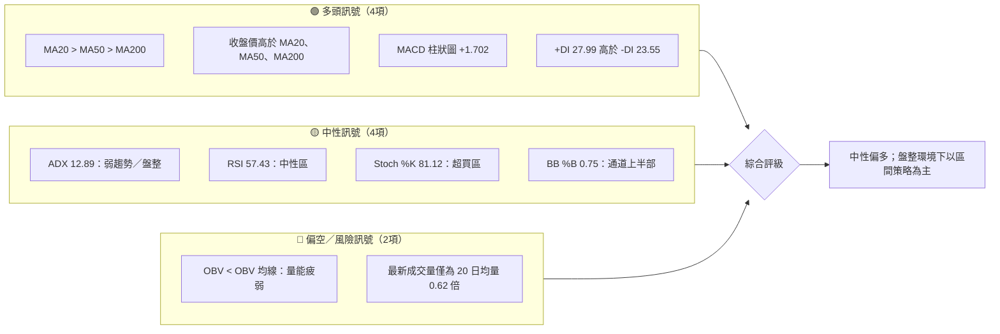
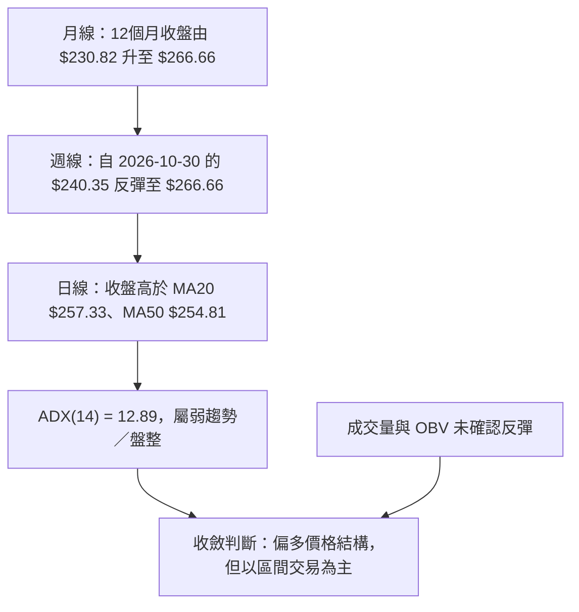
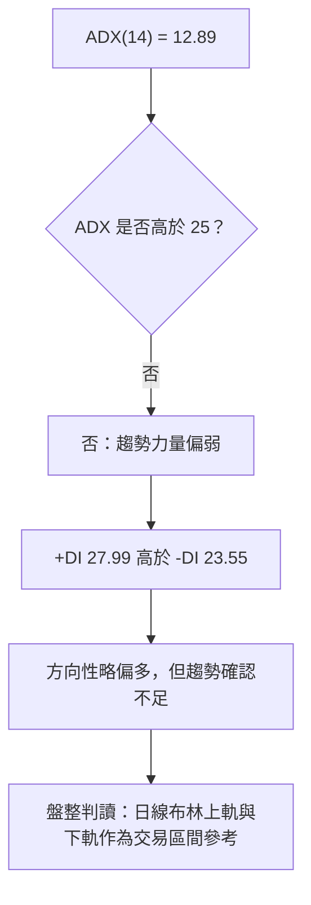
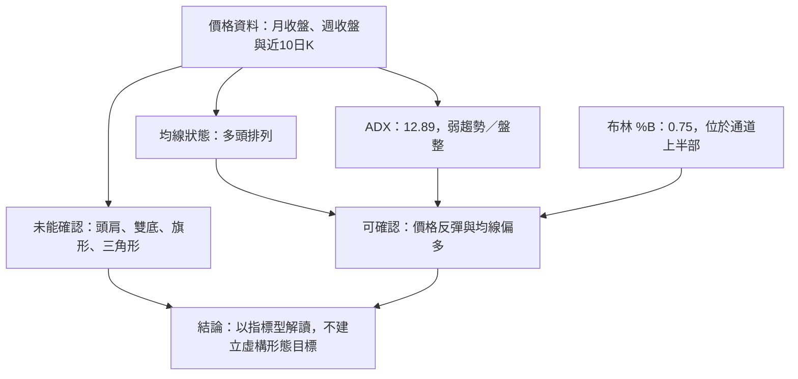
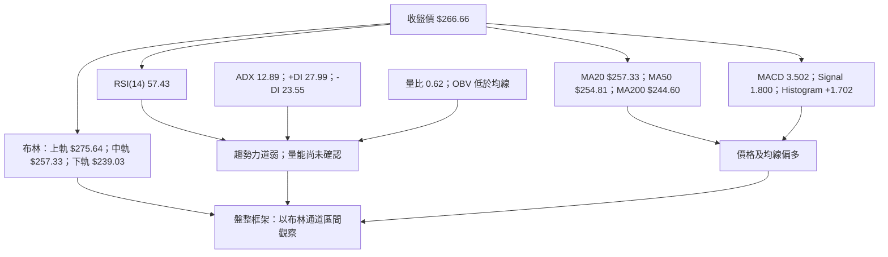
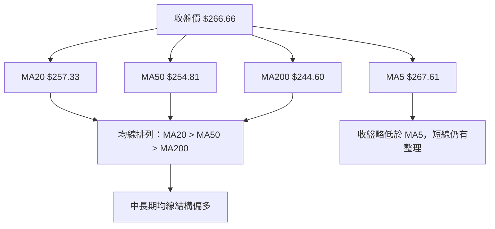
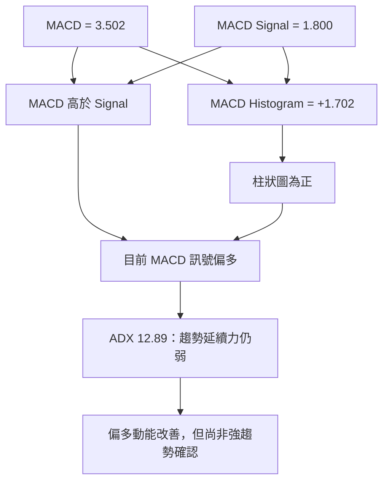
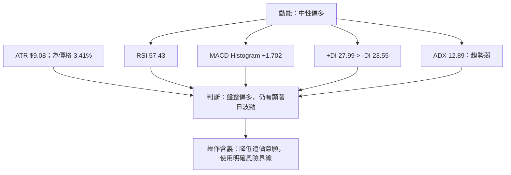
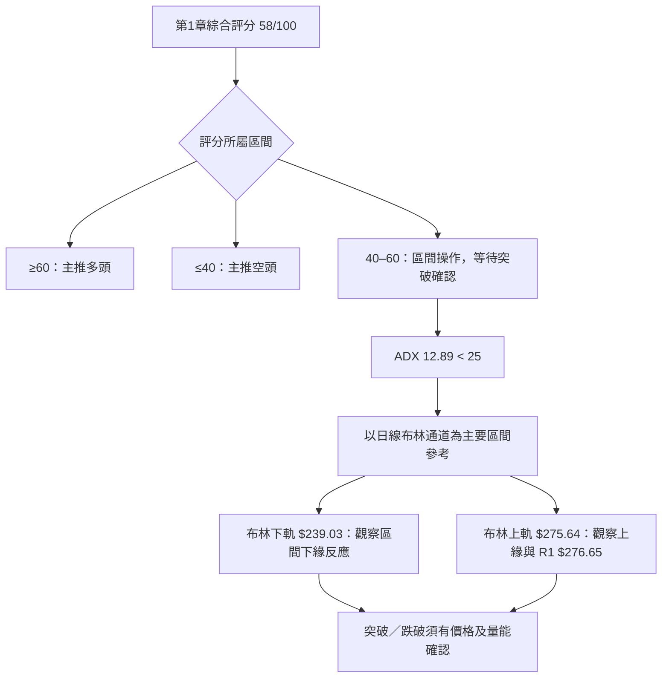
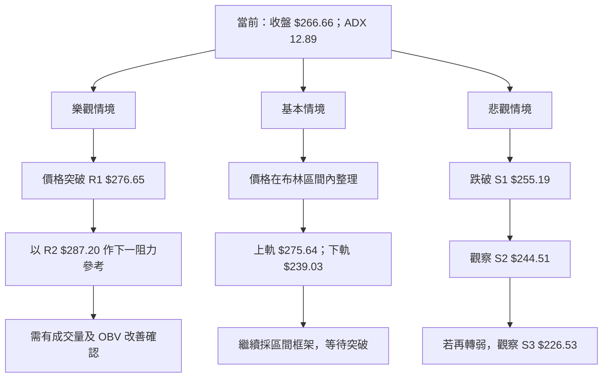

# AMZN 技術分析報告

> **報告日期**：2026-11-14 ｜ **語言**：繁體中文 ｜ **數據來源**：使用者提供之 Yahoo Finance 技術數據 ｜ **當前價格**：**$266.66**

---

## 目錄

| 章節 | 內容 |
|------|------|
| [1. 技術面概覽](#1-技術面概覽) | 訊號儀表板、核心指標、評分卡 |
| [2. 趨勢分析](#2-趨勢分析) | 多時框趨勢、長中短期走勢 |
| [3. 圖表形態分析](#3-圖表形態分析) | 形態識別、K線組合、目標價 |
| [4. 支撐與阻力](#4-支撐與阻力) | 關鍵價位、斐波那契回調 |
| [5. 技術指標深度解讀](#5-技術指標深度解讀) | MA/RSI/MACD/布林/成交量 |
| [6. 動能與波動率](#6-動能與波動率) | 動能評估、ATR、Beta |
| [7. 多時框架總結](#7-多時框架總結) | 時框架評分矩陣 |
| [8. 交易策略建議](#8-交易策略建議) | 區間策略、風險報酬比 |
| [9. 風險提示與監控](#9-風險提示與監控) | 監控指標、風險場景 |

---

## 1. 技術面概覽

### 🎯 技術訊號儀表板

AMZN 的長短期均線偏多、MACD 柱狀圖轉正，但 ADX 僅 12.89，代表目前缺乏強趨勢；成交量與 OBV 亦未充分確認上行。綜合而言，價格結構偏多，但適用的交易框架是**盤整區間操作、等待突破確認**，而非追逐趨勢行情。



### 📊 核心指標速覽表

| 指標類別 | 指標名稱 | 當前數值 | 訊號 | 解讀 |
|----------|----------|----------:|:----:|------|
| 價格 | 收盤價 | **$266.66** | 🟡 | 高於各主要均線，仍低於近期阻力 R1 $276.65 |
| 區間 | 52 週高／低 | $287.20／$196.00 | 🟡 | 現價處於 52 週區間 77.5% 位置 |
| 均線 | MA20 | $257.33 | 🟢 | 收盤價高於 MA20，短期價格結構偏強 |
| 均線 | MA50 | $254.81 | 🟢 | 收盤價高於 MA50 |
| 均線 | MA200 | $244.60 | 🟢 | 收盤價高於長期均線 |
| 動能 | RSI(14) | 57.43 | 🟡 | 30–70 中性區，尚未極端超買 |
| 動能 | MACD | 3.502 | 🟢 | MACD 高於訊號線 1.800，柱狀圖為正 |
| 動能 | Stoch %K／%D | 81.12／81.33 | 🟡 | 位於超買區，短線追高風險上升 |
| 趨勢 | ADX(14) | 12.89 | 🟡 | 低於 25，判定弱趨勢／盤整 |
| 波動 | ATR(14) | $9.08 | 🟡 | 約為股價 3.41%，單日波動幅度不低 |
| 量能 | 量比 | 0.62 倍 | 🔴 | 最新成交量低於 20 日均量 |
| 量能 | OBV 趨勢 | OBV < MA | 🔴 | 量能未有效確認近期價格反彈 |

### 🏆 技術評分卡

評分以各項 0–100 分表示。六項分數反映當前價格狀態及訊號品質，綜合評分依要求採算術平均，四捨五入為整數：

\[
(58+62+62+35+45+85)\div6=57.83\approx58
\]

```text
╔══════════════════════════════════════════════════════════════════╗
║                 技術評分卡 — AMZN（2026-11-14）                 ║
╠══════════════════════════════════════════════════════════════════╣
║ 趨勢強度      ████████████░░░░░░░░  58/100  🟡 ADX偏弱、均線向上 ║
║ 動能指標      ████████████░░░░░░░░  62/100  🟡 MACD正值、Stoch偏高║
║ 支撐穩定度    ████████████░░░░░░░░  62/100  🟡 多層支撐可供參考   ║
║ 成交量配合    ███████░░░░░░░░░░░░░  35/100  🔴 量比0.62、OBV偏弱  ║
║ 形態完整度    █████████░░░░░░░░░░░  45/100  🟡 明確幾何形態不足   ║
║ 均線排列      █████████████████░░░  85/100  🟢 MA20>MA50>MA200    ║
╠══════════════════════════════════════════════════════════════════╣
║ 綜合評分      ████████████░░░░░░░░  58/100  🟡 中性；區間操作為主 ║
╚══════════════════════════════════════════════════════════════════╝
```

**評分說明：**

- **趨勢強度 58/100**：均線方向有利多方，但 ADX 12.89 顯示趨勢力度不足。
- **動能指標 62/100**：MACD 柱狀圖為正、RSI 位於中性偏強區；Stochastic 已超買，故不給更高分。
- **支撐穩定度 62/100**：S1、S2、S3 提供分層參考，但價格位於現價區間偏上方，支撐尚未在本次資料中重新測試。
- **成交量配合 35/100**：最新日成交量低於 20 日與 50 日均量，OBV 低於其均線。
- **形態完整度 45/100**：近月價格有反彈與回撤，但資料不足以高信心確認典型幾何形態。
- **均線排列 85/100**：MA20、MA50、MA200 多頭排列，收盤價亦在三者之上。

---

## 2. 趨勢分析

### 🌐 多時框趨勢分析



**多時框判讀：**

- **月線／較長週期**：12 個月價格整體抬升，2026 年 4 月以後價格區間較 2026 年初提高；但期間仍有明顯回落，不宜視為穩定直線上漲。
- **週線／中期**：2026-10-30 收於 $240.35，之後週線收盤回升至 $259.30、再至 $266.66，短期反彈結構明確。
- **日線／短期**：收盤 $266.66 位於 MA20、MA50、MA200 之上；但低於 MA5 $267.61，且接近上方阻力區，短線動能並非毫無阻力。
- **趨勢框架優先級**：ADX 低於 25，依本報告規則歸類為盤整環境，交易區間判斷以日線布林通道上下軌為主；中長期均線方向用於辨識偏向，不覆蓋盤整判定。

### 📈 長期趨勢 — 12 個月走勢圖

以下逐月收盤價採用提供的月度價格資料。圖形為 ASCII 示意，縱向位置按價格區間排列；並不代表月內高低價。

```text
AMZN 月線走勢圖（2025-12 至 2026-11；月收盤）
價格（美元）

$280 ┤
$270 ┤                                  ● 2026-05 $270.64
$260 ┤                                         ● 2026-08 $259.77
     ┤                                ● 2026-04 $265.06
$250 ┤                                               ● 2026-09 $249.15
     ┤                                                   ● 2026-10 $240.35
$240 ┤      ● 2026-01 $239.30
     ┤             ● 2026-02 $210.00  ● 2026-03 $208.27
$230 ┤ ● 2025-12 $230.82                         ● 2026-06 $238.34
     ┤                                                    ● 2026-11 $266.66
$220 ┤
     └─────────────────────────────────────────────────────────────
       Dec25 Jan26 Feb26 Mar26 Apr26 May26 Jun26 Jul26 Aug26 Sep26 Oct26 Nov26
       $230.82 $239.30 $210.00 $208.27 $265.06 $270.64 $238.34
       $271.58 $259.77 $249.15 $240.35 $266.66
```

**12 個月資料中的關鍵高低：**

- 12 個月月收盤最高值：**$271.58（2026-07）**。
- 12 個月月收盤最低值：**$208.27（2026-03）**。
- 最新月收盤：**$266.66（2026-11）**。
- 提供的 52 週高低價是 **$287.20／$196.00**，屬於不同口徑的區間極值，不應與月收盤最高、最低混為一談。
- 2026-04、2026-05、2026-07 月收盤快速回升，之後 2026-10 回落、2026-11 反彈，顯示價格波動較大。

### 走勢特徵分析表

| 階段 | 月度收盤資料 | 價格變化 | 技術特徵 |
|------|--------------|----------|----------|
| 2025-12 → 2026-01 | $230.82 → $239.30 | **+3.67%** | 小幅上行，月收盤改善 |
| 2026-01 → 2026-03 | $239.30 → $208.27 | **-12.97%** | 連續回落，長期趨勢承受壓力 |
| 2026-03 → 2026-05 | $208.27 → $270.64 | **+29.95%** | 強勁反彈，月度走勢快速修復 |
| 2026-05 → 2026-06 | $270.64 → $238.34 | **-11.94%** | 反彈後顯著回吐 |
| 2026-06 → 2026-07 | $238.34 → $271.58 | **+13.94%** | 再度反彈，月收盤升至近一年高區 |
| 2026-07 → 2026-10 | $271.58 → $240.35 | **-11.50%** | 月收盤連續回落，趨勢進入整理 |
| 2026-10 → 2026-11 | $240.35 → $266.66 | **+10.94%** | 當前反彈，但仍需阻力突破與量能確認 |

> 漲跌幅以相鄰指定月份收盤價計算，四捨五入至小數點後兩位。2026-11 僅代表提供的截至 2026-11-13 收盤數據。

### 📊 中期趨勢（週線分析）

近期週收盤由 2026-10-30 的 $240.35 回升至 2026-11-13 的 $266.66。週線 MACD 柱狀圖亦由 2026-10-30 的 -1.528 轉為 2026-11-06 的 +1.019，再升至 2026-11-13 的 +1.702，顯示中期反彈動能改善。

```text
AMZN 近期週線壓力／支撐示意（價位依提供數據）

$287.20 ───────────────────────── 52週高／R2 阻力
$276.65 ───────────────────────── R1 波段高點聚類
$275.34 ───────────────────────── 2026-11-13 週高
$266.66 ───────────────●───────── 最新收盤
$259.30 ───────────────────────── 2026-11-06 週收盤
$255.19 ───────────────────────── S1 支撐
$244.51 ───────────────────────── S2 支撐
$240.35 ───────────────────────── 2026-10-30 週收盤
$229.36 ───────────────────────── 2026-10-30 週低
$226.53 ───────────────────────── S3 支撐
```

**週線解讀：**

- 2026-11-06 週成交量為 317,732,000，高於 2026-11-13 週的 194,012,500；反彈期間週量曾放大，但最新一週成交量回落。
- 2026-11-13 週 RSI 為 57.4，與日線 RSI 57.43 相近，屬中性偏強，而非極端超買。
- 2026-11-13 週收盤 $266.66 尚未突破 R1 $276.65；上方阻力仍是反彈能否延續的關鍵驗證區。
- 週線資料支持「反彈延續」，但不足以單獨確認新一輪強趨勢。

### ⚡ 趨勢強度評估（ADX 解讀）



| ADX 區間 | 常見解讀 | AMZN 當前狀態 |
|----------|----------|----------------|
| 低於 20 | 趨勢力量弱、常見盤整 | **12.89：符合** |
| 20–25 | 趨勢可能形成，但仍須確認 | 不適用 |
| 高於 25 | 趨勢較明確 | 不符合 |
| 高於 40 | 強趨勢區，仍須觀察方向 | 不符合 |

**結論：** ADX 衡量趨勢強度，並不直接判斷多空方向。當前 +DI 高於 -DI，表示方向性略偏多；但 ADX 只有 12.89，故不能把這種方向優勢解讀成已確認的強勢上升趨勢。

---

## 3. 圖表形態分析

### 🔍 形態識別系統

近 12 個月月收盤與近 20 週收盤顯示，股價有反彈、回落與再反彈，但已提供資料不足以可靠確認頭肩頂、雙底、三角形、旗形等具備清晰頸線或形態高度的幾何形態。依形態信心度規則，以下只保留有數據依據的判斷。



| 形態／結構 | 信心度 | 判斷依據（引用資料） | 完成度 | 目標價 |
|------------|-------:|----------------------|-------:|--------|
| 多頭均線排列 | **85%** | MA20 $257.33 > MA50 $254.81 > MA200 $244.60；收盤 $266.66 高於三者 | 已成立，持續有效 | 不屬幾何形態；不另推算形態目標 |
| 自 2026-10-30 起的週線反彈 | **75%** | 週收盤由 $240.35 升至 $259.30、再至 $266.66；週 MACD 柱由 -1.528 轉為 +1.702 | 反彈已形成，延續待確認 | 以既有 R1 $276.65、R2 $287.20 作為阻力參考 |
| 雙底 | **低於 50%** | 週線低點序列不足以確認兩次相近低點及頸線結構 | 訊號不足 | **數據中未偵測到** |
| 頭肩頂／底 | **低於 50%** | 缺乏可確認的左右肩與頸線幾何結構 | 訊號不足 | **數據中未偵測到** |
| 三角形／旗形 | **低於 50%** | 缺乏足夠的收斂趨勢線、波幅收縮或旗桿／旗面的可驗證資料 | 訊號不足 | **數據中未偵測到** |

**形態分析原則：** 不以幾個相鄰價格點強行推定複雜圖形；本報告的主要技術依據是均線、ADX、布林通道、動能與量能。

### 🕯️ 重要 K 線形態分析

只依近 10 根日 K 與近 8 根週 K 的開、高、低、收資料判斷。下表選取具有較清楚方向訊號或具代表性的 K 棒；列示形態僅描述該根 K 棒本身，未使用其他日期推測 K 線組合。

| 日期／時框 | 開 | 高 | 低 | 收 | K 線特徵 | 解讀 | 訊號 |
|------|------:|------:|------:|------:|----------|------|:----:|
| 2026-11-04 日K | $264.82 | $271.49 | $263.85 | $266.03 | 小實體、上影較長 | 當日高點後回落，顯示高位賣壓；不足以單獨確認反轉 | 🟡 |
| 2026-11-05 日K | $271.43 | $273.23 | $252.27 | $260.21 | 長陰實體、上下影線 | 賣方主導，日內振幅明顯；當日收盤低於開盤 | 🔴 |
| 2026-11-09 日K | $269.32 | $275.34 | $266.91 | $266.93 | 長上影、收盤接近低位 | 上方價格曾觸及較高位置但未守住，反映上方供給 | 🔴 |
| 2026-11-10 日K | $266.21 | $272.88 | $266.14 | $270.87 | 紅K、下影短 | 買方推升收盤，短線回穩，但未突破近期阻力 | 🟢 |
| 2026-11-11 日K | $273.52 | $274.87 | $265.62 | $266.17 | 長陰實體 | 開盤高於前一日收盤後回落，短線賣壓再現 | 🔴 |
| 2026-11-13 日K | $269.56 | $270.05 | $263.91 | $266.66 | 小陰實體、上下影線 | 收盤低於開盤，且收盤未靠近日高；顯示短線整理 | 🟡 |
| 2026-10-30 週K | $249.47 | $255.36 | $229.36 | $240.35 | 長陰實體，區間寬 | 該週賣壓明顯；低點低於收盤不少，亦有下影 | 🔴 |
| 2026-11-06 週K | $243.01 | $273.23 | $242.28 | $259.30 | 大型陽K、全週波幅大 | 週內反彈顯著，但收盤低於週高 | 🟢 |
| 2026-11-13 週K | $269.32 | $275.34 | $263.91 | $266.66 | 小陰實體、上下影線 | 前週反彈後整理，週收盤仍高於 $259.30 | 🟡 |

**日線吞噬型態判斷：** 2026-11-05 日 K 的實體由 $271.43 開、收於 $260.21；2026-11-04 日 K 實體由 $264.82 開、收於 $266.03。前者開盤高於前一根收盤、收盤低於前一根開盤，因此其實體涵蓋前一根實體，可描述為**看跌實體吞噬**。這是短線警示，但單一 K 線組合不能推翻週線反彈與多頭均線排列。

### 📉 ASCII 走勢形態示意圖

以下為資料可支持的「反彈—遇阻—整理」示意，不宣稱為旗形、三角形或雙底：

```text
AMZN 近週線反彈結構（週收盤示意）

$276.65  R1 ──────────────────────────────────────  第一阻力
$266.66  最新收盤                          ●───────  反彈後整理
$259.30  2026-11-06 週收盤        ●───────┘
$255.19  S1 ──────────────────────────────────────  中間支撐
$248.00  2026-10-23 週收盤    ●
$240.35  2026-10-30 週收盤 ●                         近期波段低收盤
$226.53  S3 ──────────────────────────────────────  更深層支撐
          10/23            10/30        11/06    11/13
```

### 🎯 形態目標價計算

- **頭肩／雙底／三角形／旗形目標：** 未能以現有資料確認頸線、形態高度或可靠的突破點，因此**數據中未偵測到**，不建立目標價。
- **技術阻力參考：** R1 $276.65、R2 $287.20，均為提供數據中的波段高點聚類，不是由本報告另行推算的形態目標。
- **價格回升的確認條件：** 價格須向上突破 R1，並觀察成交量是否同步改善；否則反彈仍可能維持在盤整區間內。
- **價格轉弱的確認條件：** 收盤跌破 S1 $255.19，代表價格回到較重要支撐下方；再以 S2 $244.51、S3 $226.53 作為下方已列明價位參考。

---

## 4. 支撐與阻力

### 🗺️ 關鍵價位分布圖

下圖只採用提供的關鍵價位與收盤價；未添加自行估算的 R3 或其他支撐阻力。

```text
AMZN 價位結構分布圖（美元）
══════════════════════════════════════════════════════════════

$287.20 ║████████████████████████║ R2／52週高／強阻力
$276.65 ║████████████████████    ║ R1／近一年波段高點聚類
$266.66 ╠════════════●═══════════╣ 現價；高於布林中軌
$265.68 ║························║ Fib 23.6% 回調位
$257.33 ║──────── 布林中軌／MA20 ──────────────────────────
$255.19 ║▓▓▓▓▓▓▓▓▓▓▓▓▓▓▓▓▓▓▓▓▓▓║ S1／近一年波段低點聚類
$252.36 ║························║ Fib 38.2% 回調位
$244.51 ║████████████████████████║ S2／近一年波段低點聚類
$241.60 ║························║ Fib 50.0% 回調位
$230.84 ║························║ Fib 61.8% 回調位
$226.53 ║████████████████████    ║ S3／近一年波段低點聚類
$215.52 ║························║ Fib 78.6% 回調位
$196.00 ║────────────────────────║ 52週低

══════════════════════════════════════════════════════════════
```

### 🚧 阻力位分析表

| 阻力級別 | 價位 | 形成原因 | 突破難度 | 重要性 |
|----------|------:|----------|----------|--------|
| R1 | **$276.65** | 近一年波段高點聚類；接近 2026-11-13 週高 $275.34 | 中等偏高：現價需上漲約 3.75% | 高；短線反彈延續的第一個確認點 |
| R2 | **$287.20** | 52 週高點，亦為提供資料中的 R2 | 高：需上漲約 7.70%，且屬 52 週高位 | 高；突破後才有較明確的高位延伸訊號 |
| R3 | **N/A（數據未提供）** | 關鍵價位區塊未列出 R3 | N/A（數據未提供） | N/A（數據未提供） |

### 🛡️ 支撐位分析表

| 支撐級別 | 價位 | 形成原因 | 守住機率評估 | 重要性 |
|----------|------:|----------|--------------|--------|
| S1 | **$255.19** | 近一年波段低點聚類 | 中等；有均線附近價格結構支持，但缺乏近期回測確認 | 高；短線區間重要防線 |
| S2 | **$244.51** | 近一年波段低點聚類；接近 MA200 $244.60，但兩者並非同一計算來源 | 中等；長期均線位置提供額外觀察參考 | 高；跌破 S1 後的重要支撐層 |
| S3 | **$226.53** | 近一年波段低點聚類 | 未能僅據靜態資料量化；屬更深層支撐 | 中高；中期轉弱後的下方參考 |
| 其他支撐 | **N/A（數據未提供）** | 關鍵價位區塊未列出 | N/A（數據未提供） | N/A（數據未提供） |

> 「守住機率評估」是技術結構的定性判斷，不代表統計回測機率。

### 📐 斐波那契回調位分析

以下直接引用所提供的 52 週區間斐波那契數值：

| 回調比例 | 價位 | 相對現價 $266.66 的位置 |
|---------:|------:|-------------------------|
| 0.0%（52 週高） | $287.20 | 高於現價 |
| 23.6% | $265.68 | 現價略高於此位 |
| 38.2% | $252.36 | 低於現價 |
| 50.0% | $241.60 | 低於現價 |
| 61.8% | $230.84 | 低於現價 |
| 78.6% | $215.52 | 低於現價 |
| 100.0%（52 週低） | $196.00 | 低於現價 |

**解讀：**

- 現價 $266.66 位於 23.6% 回調位 **$265.68** 與 52 週高 **$287.20** 之間。
- 現價與 23.6% 回調位相差約 $0.98；就斐波那契參考而言，現價仍處於區間較高端。
- 若價格向下回落，38.2% 回調位 $252.36 與 S1 $255.19、MA20 $257.33 分屬不同參考系統；不能將三者混成同一精確支撐位。
- 若價格向上延伸，$287.20 同時是 52 週高點及既有 R2，屬重要壓力參考。
- 斐波那契線是價格區間的技術參考，不代表必然反轉或支撐。

---

## 5. 技術指標深度解讀

### 🎛️ 指標訊號總覽



### 📈 移動平均線排列分析



| 均線 | 數值 | 收盤價相對位置 | 資料所示均線方向 | 判讀 |
|------|------:|----------------|------------------|------|
| MA5 | $267.61 | 收盤低於 MA5 $0.95 | 下行，-0.36% | 短期價格略低於極短均線 |
| MA10 | $261.99 | 收盤高於 MA10 $4.67 | 上行，+1.78% | 短線反彈仍在 |
| MA20 | $257.33 | 收盤高於 MA20 $9.33 | 上行，+3.62% | 短期趨勢支撐偏正面 |
| MA50 | $254.81 | 收盤高於 MA50 $11.85 | 上行資訊由排列／走勢數據支持 | 中短期結構偏多 |
| MA200 | $244.60 | 收盤高於 MA200 $22.06 | 上行結構由長均線排列支持 | 長期趨勢背景偏多 |

**整合解讀：**

- **價格對均線：** 收盤高於 MA10、MA20、MA50、MA200，只有 MA5 略高於收盤，顯示短線局部整理與中期均線偏多並存。
- **均線排列：** MA20 > MA50 > MA200，是正向排列；若回落至均線區，需觀察支撐是否有效，而不是假設均線必定守住。
- **趨勢確認不足：** ADX 12.89 與多頭均線排列有所矛盾。較合理的解讀是「中長期結構偏多，但目前未進入強趨勢行情」。
- **短線執行：** 不宜只因均線偏多便忽略 R1 $276.65、低量與 Stochastic 超買。

### 📉 RSI(14) 分析

```text
RSI(14) 強度尺
0          30              50             70             100
|-----------|---------------|--------------|---------------|
             超賣區          中性區         超買區
                                    ▲
                                  57.43

進度條：██████░░░░ 57.43 / 100
區間判斷：🟡 中性，略偏強；尚未進入 70 以上超買區
```

- **數值：** RSI(14) 為 57.43，落在常用 30–70 中性區間。
- **動能方向：** RSI 位於 50 上方，表示價格動能略偏正面，但與極強動能仍有差距。
- **超買／超賣：** 目前沒有 RSI 超買或超賣訊號。Stochastic 超買並不等於 RSI 同時超買，兩者週期與計算方式不同。
- **背離判斷：** 提供資料明確標示「近 20 根 K 棒首尾比較：無明顯 RSI 背離」。因此，**RSI 頂背離：無明顯訊號；RSI 底背離：無明顯訊號**。
- **限制：** 此結論依資料包所用的首尾比較方法；無法據此聲稱對所有局部波峰、波谷均完成逐點背離檢查。

### 📊 MACD(12/26/9) 訊號解讀



- **MACD 線：** 3.502，高於訊號線 1.800。
- **MACD 柱狀圖：** +1.702，表示 MACD 線與訊號線之差為正，當前動能結構偏多。
- **週線交叉印證：** 近 20 週資料中的 MACD 柱狀圖由 2026-10-30 的 -1.528 轉為 2026-11-06 的 +1.019，再至 2026-11-13 的 +1.702，與價格反彈方向一致。
- **與 ADX 的關係：** MACD 轉正是方向性／動能訊號；ADX 12.89 表明趨勢強度仍低。因此較準確的表述是「反彈動能改善」，而不是「已形成高把握度趨勢突破」。
- **MACD 背離判斷：** 提供的是 MACD 單一截面數值及週線 MACD 柱狀圖，缺少完整日線 MACD 序列與可比較的日線價格波峰資料。故 **MACD 頂背離／底背離：數據不足以確認；目前未能偵測到可驗證的明確背離**。不可把「沒有足夠資料」誤寫成「確定沒有背離」。

### 📦 布林通道分析

```text
AMZN 布林通道（當前快照）

$275.64 ─────────────── 上軌 ───────────────────────────
                         ↑ 現價距上軌 $8.98
$266.66 ─────────────── 現價 ●
                         BB %B = 0.75
$257.33 ─────────────── 中軌／MA20 ─────────────────────
                         現價高於中軌 $9.33
$239.03 ─────────────── 下軌 ───────────────────────────
                         現價距下軌 $27.63

通道上下軌差：$36.61（$275.64 − $239.03）
```

- **布林 %B = 0.75：** 現價位於通道上半部，偏強但尚未觸及上軌。
- **中軌位置：** 中軌為 $257.33，與 MA20 相同；收盤高於中軌，短期價格結構偏多。
- **上軌位置：** 上軌 $275.64 與阻力 R1 $276.65 接近，兩者差 $1.01。若價格接近此區，應觀察突破是否伴隨成交量，而非只因觸及上軌便判定突破。
- **下軌位置：** 下軌 $239.03。依盤整環境規則，布林上下軌可作區間參考，但不保證價格一定在觸及後反轉。
- **帶寬解讀：** 提供數據沒有同一套歷史布林帶寬時間序列，故無法判斷帶寬是否正收縮或擴張；帶寬變化趨勢為 **N/A（數據未提供）**。

### 💹 成交量分析（量價配合度）

| 成交量指標 | 數值 | 與價格的關係 | 評價 |
|------------|------:|--------------|------|
| 最新日成交量 | 31,076,200 | 低於 20 日及 50 日均量 | 🔴 |
| 20 日均量 | 50,033,870 | 最新量約為其 0.62 倍 | 🔴 |
| 50 日均量 | 40,980,858 | 最新量亦低於 50 日均量 | 🟡偏弱 |
| 最新週成交量 | 194,012,500 | 低於 2026-11-06 週的 317,732,000 | 🟡 |
| OBV | OBV < MA | 量能未確認價格上行 | 🔴 |

```text
量價確認矩陣
價格方向／量能狀態              量能配合判讀
價格上行 + 成交量擴大            偏正面確認
價格上行 + 成交量偏低            可能是量能不足的反彈  ← 當前較接近
價格下行 + 成交量擴大            賣壓確認
價格下行 + 成交量收縮            賣壓減弱或整理，需再確認
```

**OBV 與量價結論：**

- 價格自 2026-10-30 週收盤 $240.35 反彈至 $266.66，但最新週量較 2026-11-06 週量低。
- 日線最新量比只有 0.62 倍，OBV 低於其均線，表示累積量能尚未確認價格上行。
- 這不等同於已形成明確量價頂背離；較恰當結論是**量價配合偏弱，反彈確認度不足**。
- 若價格突破 R1 $276.65，同時量能改善，才會提升突破的可信度；若價格在低量下受阻，應防範回到區間。

---

## 6. 動能與波動率

### ⚡ 動能評估四象限

此處將動能方向與波動風險分開評估。RSI 57.43、MACD 柱狀圖為正、DI 略偏多，代表動能中性偏多；ATR 為股價 3.41%，日波動仍須納入部位風險管理。

| 象限 | 動能 | 波動 | 常見意義 | AMZN 當前狀態 |
|------|------|------|----------|----------------|
| Q1 | 強 | 低 | 動能延續且波動可控 | 未符合：ADX 低，ATR 比率 3.41% |
| Q2 | 弱 | 低 | 低活躍度盤整 | 部分接近，但 MACD 已轉正 |
| Q3 | 強 | 高 | 高風險、高報酬趨勢行情 | 未確認：有反彈動能，ADX 不足 |
| Q4 | 弱／中性 | 中高 | 區間行情，等待方向確認 | **目前最接近；動能略偏多但趨勢不強** |



### 📊 ATR 波動率分析

- **ATR(14)：$9.08**，約為股價 $266.66 的 **3.41%**。
- ATR 是平均真實波幅的估計，描述一段期間常見價格波動幅度，不代表未來一定上漲或下跌 $9.08。
- 對區間策略而言，若止損距離遠小於常見日波動，容易受到一般價格震盪觸發；若止損距離較大，則必須相應縮小倉位，控制每筆交易的金額風險。
- 本報告的交易策略止損使用已提供的關鍵價位，不自行以 ATR 推導新的支撐或目標價。
- **ATR 停損倍數最佳值：N/A（未提供回測資料）**。不同策略、持有期與波動階段的最佳倍數需以回測驗證，不能僅靠當前快照指定。

| 波動指標 | 數值 | 技術含義 |
|----------|------:|----------|
| ATR(14) | $9.08 | 單日波動參考 |
| ATR／股價 | 3.41% | 相對波動不低，需控制部位 |
| 股價／ATR | 約 29.36 個 ATR | 只作尺度比較，不是目標價或預測 |

### 📐 Beta 與市場相關性

- **Beta：1.503。** 依提供值，AMZN 的歷史市場敏感度高於 1，表示其過往價格波動相對市場可能更大。
- Beta 不等於每天一定比大盤多漲或多跌 50.3%，亦不代表相關性本身；它是估計期間與模型下的系統性風險指標。
- **相關係數：N/A（數據未提供）**；不能由 Beta 直接推算 AMZN 與市場的相關係數。
- **Beta 估計期間：N/A（數據未提供）**；因此不宜把 1.503 視為固定不變的公司特徵。
- 配合 ATR／股價 3.41%，高 Beta 與相對較大的日波動共同指向：若採用區間交易，應以風險金額而非固定股數設定倉位。

---

## 7. 多時框架總結

### 📋 時框架評分表

時框架評分是基於本次資料截面所作的技術判斷；只有第 1 章的綜合評分 **58/100** 是按六項評分算術平均而得，並作為後續策略路由依據。

| 時框架 | 趨勢方向 | 動能 | 均線排列 | 形態 | 綜合評分 | 建議 |
|--------|----------|------|----------|------|----------:|------|
| 月線／長期 | 偏多但波動大 | 中性 | 月線均線數據未提供 | 多月反彈與回撤交替 | 59/100 | 不追逐月線短期急升；觀察月度結構延續 |
| 週線／中期 | 反彈偏多 | 改善 | 週線均線數據未提供 | 週收盤自 $240.35 回升 | 62/100 | 觀察能否突破 R1，並確認成交量 |
| 日線／短期 | 偏多但盤整 | MACD 正值、Stoch 超買 | MA20>MA50>MA200 | 幾何形態不足，價格在布林上半區 | 58/100 | 依 ADX 盤整規則，以日線布林區間為主要框架 |
| 綜合 | **中性偏多** | 動能改善但確認不足 | 多頭排列 | 尚無高信心幾何形態 | **58/100** | **區間操作，等待突破確認** |

### 🔲 綜合訊號矩陣

| 維度 | 日線 | 週線 | 月線／長期 | 跨時框一致性 |
|------|------|------|------------|--------------|
| 價格方向 | 收盤高於主要均線 | 由 $240.35 反彈至 $266.66 | 近月收盤自 $240.35 回升至 $266.66 | 偏多一致，但不能等同強趨勢 |
| 動能 | RSI 中性、MACD 正值 | 週 MACD 柱轉正並升至 +1.702 | 長期動能指標未提供 | 日、週較正面 |
| 趨勢強度 | ADX 12.89 | 週線 ADX 未提供 | 月線 ADX 未提供 | 只有日線顯示趨勢偏弱 |
| 均線 | MA20>MA50>MA200 | 週線均線未提供 | 月線均線未提供 | 日線偏多，其他時框不能補推 |
| 量能 | 量比 0.62，OBV < MA | 最新週量低於前週 | 月線量能未提供 | 量能確認不足 |
| 關鍵區域 | 布林 $239.03–$275.64 | R1 $276.65、S1 $255.19 | 52 週高低 $287.20／$196.00 | 靠近上方阻力，須觀察突破品質 |

### ⚖️ 多時框收斂結論

1. **行情分類：盤整／弱趨勢。** 日線 ADX 為 12.89，低於 25。
2. **盤整時框優先：** 依規則，以日線布林通道上軌 $275.64、下軌 $239.03 為主要區間參考，而非僅憑中長期均線排列追逐多頭。
3. **方向偏向：** 均線排列、MACD、+DI 與近期週收盤反彈均偏多；但量比及 OBV 偏弱，且價格接近上軌與 R1，限制偏多訊號強度。
4. **唯一方向性結論：** **中性觀望，略偏多；以盤整區間操作為主，等待突破確認。**
5. 本結論與第 1 章 **58/100 中性評分**及第 5 章「盤整偏多」一致，也與第 8 章的區間策略路由一致。

---

## 8. 交易策略建議

### 🗺️ 策略決策流程圖



### 🧭 策略路由

**當前主策略方向 = 區間操作、等待突破確認（依評分 58/100）。**

評分為中性區間，故不將多頭或空頭設定為強力單邊方向。以下兩套是**條件式區間策略**，不是同時建立多空部位的建議：

- 策略 A：等待價格回落至日線布林下軌參考區，評估區間反彈。
- 策略 B：若價格到達 R1 區域卻未能有效突破，才考慮區間上緣回落風險；必須等待價格反應確認，不能預先假設阻力必然有效。
- 所列價位均取自提供的布林通道、關鍵價位或當前收盤價。未列出資料支持的延伸目標，不自行補造。

### 🎯 價格情境階梯（Price Scenarios）

| 觸發條件 | 下一目標 | 後續延伸 | 情境含義 |
|----------|----------|----------|----------|
| 突破 R1 **$276.65** | R2 **$287.20** | R3：**N/A（數據未提供）** | 突破短線阻力；若無量能確認，突破可信度有限 |
| 價格在布林通道內震盪 | — | — | 上軌 **$275.64**、下軌 **$239.03** 為區間參考；等待突破確認 |
| 跌破 S1 **$255.19** | S2 **$244.51** | S3 **$226.53** | 短中期結構轉弱；逐層觀察下方支撐 |
| 跌破日線布林下軌 **$239.03** | S2 **$244.51** 為既有關鍵位，但低於觸發價的先後關係需留意 | S3 **$226.53** | 布林下軌與 S2 的相對位置不同；不能視為順序目標。需以實際支撐區重新確認 |

> 布林下軌 $239.03 低於 S2 $244.51，因此若價格先跌穿 S2，之後才會觸及 $239.03。交易計畫應依價位由高至低排列，不應把布林下軌誤寫成跌破 S2 後的第一個目標。

### 📊 情境機率分佈

以下是基於目前技術截面的**主觀情境權重**，不是回測結果或保證機率；總和為 100%。

| 情境 | 機率 | 主要依據 |
|------|-----:|----------|
| 上行／反彈延續 | **35%** | 收盤高於 MA20、MA50、MA200；MACD 柱狀圖 +1.702；週線近期收盤回升；但須面對 R1 $276.65 與量能不足 |
| 區間震盪 | **40%** | ADX 12.89 明顯低於 25；RSI 57.43 屬中性；布林 %B 0.75，價格仍在通道內 |
| 回落／再測支撐 | **25%** | OBV 低於均線、日量比 0.62、Stochastic 超買；價格若受阻於上軌／R1，可能回測 S1 $255.19 |

### 🟢 主策略詳情（盤整區間條件式策略）

#### 策略 A：布林下軌附近的條件式區間反彈

- 只有在價格回落至下軌附近並出現止跌或動能回穩跡象時才考慮；本表進場價是提供數據中的當前布林下軌快照，不保證未來仍固定不變。
- **風險報酬比定義：** 多單以 `(目標價 − 進場價) ÷ (進場價 − 止損價)` 計算。
- T1、T2 均採用已提供的支撐／阻力或現價，不另造技術目標。

| 策略要素 | 策略 A：條件式區間反彈 |
|----------|-------------------------|
| 進場條件 | 價格回落至布林下軌參考位，並觀察是否出現止跌；若無止跌確認，不進場 |
| 進場價格 | **$239.03**（單一價；引用當前布林下軌快照） |
| 止損價格 | **$226.53**（S3；支撐失守代表區間反彈假設轉弱） |
| 目標價 T1 | **$255.19**（S1） |
| 目標價 T2 | **$266.66**（當前收盤價；作為上方區間回歸參考） |
| 風險報酬比 | T1：風險 $239.03−$226.53=$12.50；報酬 $255.19−$239.03=$16.16；**1 : 1.29（以 T1 計）** |
| 風險報酬比（T2） | 報酬 $266.66−$239.03=$27.63；**1 : 2.21（以 T2 計）** |
| 成功機率估計 | **約 45%**，主觀估計；ADX 盤整符合區間交易，但 OBV 偏弱 |
| 建議倉位 | **帳戶資金的 0–1% 風險預算內**，依止損距離換算股數；不代表固定投入 0–1% 資金 |

#### 策略 B：R1 阻力區失敗後的條件式區間回落

這是中性盤整框架下的條件式上緣回落策略，不是主推空頭趨勢交易。只有價格到達阻力區、未能有效突破且轉弱訊號出現時才考慮；若放量突破 R1，不應依此假設反向放空。

| 策略要素 | 策略 B：條件式阻力回落 |
|----------|-------------------------|
| 進場條件 | 價格觸及／進入 R1 區域後未能有效突破，且出現轉弱確認 |
| 進場價格 | **$276.65**（R1；單一價） |
| 止損價格 | **$287.20**（R2；上破 52 週高阻力參考，反向假設失效） |
| 目標價 T1 | **$266.66**（當前收盤價） |
| 目標價 T2 | **$255.19**（S1） |
| 風險報酬比 | 空單以 `(進場價 − 目標價) ÷ (止損價 − 進場價)` 計算；風險 $287.20−$276.65=$10.55，T1 報酬 $276.65−$266.66=$9.99；**1 : 0.95（以 T1 計）** |
| 風險報酬比（T2） | T2 報酬 $276.65−$255.19=$21.46；**1 : 2.03（以 T2 計）** |
| 成功機率估計 | **約 40%**，主觀估計；ADX 支持區間環境，但價格高於主要均線且 MACD 為正 |
| 建議倉位 | 若具備放空資格，僅使用小額風險預算；總交易風險不超過帳戶資金的 0–1% |

**策略執行注意：**

- 策略 A 的進場位是目前快照的布林下軌，未來會隨價格變動；若下軌上移或下移，應使用當時實際指標重新評估，不要把 $239.03 當成永久有效的固定數字。
- 策略 B 的進場價 $276.65 與止損 $287.20 均為關鍵價位；若價格帶量突破 R1，應停止把上緣視為必然回落點。
- 風險報酬比不等同於期望值；交易成本、滑價、跳空與實際成交價格均會影響結果。
- 兩種策略皆須等待各自觸發條件，**不表示在當前價格同時建立多空部位**。

### 🔴 反向風險觸發點（對沖提示）

| 目前區間思路 | 可能推翻該思路的價位／訊號 |
|--------------|----------------------------|
| 下軌反彈策略 | 價格跌破 S3 $226.53；表示既定支撐參考失效，應重新評估而非加碼攤平 |
| R1 回落策略 | 價格有效突破 R1 $276.65，並進一步向 R2 $287.20 推進；若成交量同步改善，放空邏輯需撤銷 |
| 中性盤整判斷 | ADX 之後升至 25 以上且價格帶量突破區間；須改用趨勢跟隨邏輯，不能沿用盤整策略 |
| 量能疲弱判斷 | 成交量持續改善且 OBV 回到其均線之上；將削弱「反彈缺乏量能確認」的負面判斷 |

### ⭐ 整體訊號強度評星

```text
做多訊號強度：★★★☆☆  (3/5星)
做空訊號強度：★★☆☆☆  (2/5星)
整體可信度：  ★★★☆☆  (3/5星)
```

- 做多訊號高於做空訊號，主要來自均線排列與 MACD；但量能與 ADX 降低趨勢訊號的可信度。
- 做空訊號較弱，不足以支持無條件的趨勢性放空；僅在 R1 受阻且出現轉弱確認時，才考慮區間回落策略。

---

## 9. 風險提示與監控

### ✅ 關鍵監控指標 Checklist

```text
╔══════════════════════════════════════════════════════════════════╗
║                AMZN 技術風險監控清單（2026-11-14）              ║
╠══════════════════════════════════════════════════════════════════╣
║ □ 收盤是否站上 R1 $276.65？                                     ║
║ □ 若突破 R1，成交量是否高於近期均量並獲 OBV 支持？               ║
║ □ 價格是否守住 S1 $255.19？                                     ║
║ □ 若跌破 S1，是否向 S2 $244.51 延伸？                           ║
║ □ MACD 柱狀圖是否維持正值，或重新轉負？                         ║
║ □ RSI 是否跌破 50，或升至 70 以上？                             ║
║ □ ADX 是否升至 25 以上，代表行情可能由盤整轉為趨勢？            ║
║ □ Stochastic 是否由超買區回落，並伴隨價格走弱？                 ║
║ □ OBV 是否仍低於均線？是否與價格走勢出現更多不一致？            ║
║ □ ATR／股價是否顯著變化，需調整部位大小？                       ║
╚══════════════════════════════════════════════════════════════════╝
```

| 監控項目 | 當前基準 | 需注意的變化 |
|----------|----------|--------------|
| R1 阻力 | $276.65 | 突破並持續站穩才提升反彈延續可信度 |
| R2 阻力 | $287.20 | 52 週高；突破後資料中沒有更高的 OHLCV 關鍵阻力 |
| S1 支撐 | $255.19 | 跌破時短線區間結構轉弱 |
| S2 支撐 | $244.51 | 若 S1 失守，進一步觀察此價位 |
| S3 支撐 | $226.53 | 下行風險較深時的既有支撐參考 |
| RSI | 57.43 | 觀察是否跌破 50 或升至 70 以上 |
| MACD Histogram | +1.702 | 若轉負，偏多動能可能減弱 |
| ADX | 12.89 | 升至 25 以上，需重新判斷趨勢／盤整分類 |
| 量比 | 0.62 | 突破或跌破時應觀察是否有成交量確認 |
| OBV | 低於均線 | 若持續落後價格，反彈確認度仍偏低 |

### ⚠️ 風險場景分析



| 情境 | 可能觸發 | 技術含義 | 監控與應對 |
|------|----------|----------|------------|
| 樂觀 | 放量突破 R1 $276.65 | 短線反彈可能向 R2 $287.20 延伸 | 觀察量能、OBV、ADX 是否同步改善；不預設突破必然成功 |
| 基本 | ADX 維持低位，價格於布林通道內波動 | 盤整持續，短線多空訊號交錯 | 依關鍵支撐阻力控制風險，避免在區間中央過度交易 |
| 悲觀 | 跌破 S1 $255.19，且 MACD 轉弱／OBV 進一步下行 | 價格可能下探 S2 $244.51、S3 $226.53 | 減少曝險，重新檢視區間反彈假設；不以攤平取代風險管理 |

### 🛡️ 風險管理重要提醒

1. **高波動與 Beta 風險**
   - ATR 為 $9.08、約股價 3.41%；Beta 為 1.503。
   - 市場波動、公司消息或產業變動可能造成價格跳動，實際成交可能偏離預設止損價。

2. **突破假訊號風險**
   - ADX 12.89，趨勢強度弱；盤整環境中的上破、下破可能很快失敗。
   - 價格穿越 R1 或 S1 不等同有效突破，應結合收盤位置、成交量、OBV 與後續價格行為判斷。

3. **量能確認不足**
   - 最新成交量僅為 20 日均量 0.62 倍，且 OBV 低於均線。
   - 低量上漲不一定立即反轉，但代表確認度較低；提高追價門檻較為審慎。

4. **指標滯後與矛盾**
   - 均線與 MACD 偏多，但 ADX 低、Stochastic 超買、OBV 偏弱。
   - 不應將單一指標當成交易理由；多個獨立訊號一致時，判斷品質通常較佳。

5. **止損與倉位**
   - 先決定交易可承受的最大金額損失，再按進場價與止損價的距離計算股數。
   - 若止損距離較大，股數應下降；不可因為偏好某一方向而放寬止損或無限制加碼。
   - 策略 A 與 B 為條件式區間策略，未觸發前不應視為必須下單。

6. **交易成本與執行差異**
   - 風險報酬比依指定價位計算，未包含手續費、滑價、稅務或跳空。
   - 真實成交若與假設進場價不同，應以實際價格重新計算風險報酬比。

---

## 📋 報告總結

```text
╔══════════════════════════════════════════════════════════════════╗
║                    AMZN 技術分析報告總結                        ║
╠══════════════════════════════════════════════════════════════════╣
║ 報告日期：2026-11-14                                             ║
║ 當前價格：$266.66                                                ║
║ 分析評級：🟡 中性偏多；盤整行情，等待突破確認                    ║
║ 技術綜合評分：58/100（六項子評分算術平均）                       ║
╠══════════════════════════════════════════════════════════════════╣
║ 關鍵結論：                                                       ║
║ ├─ 長期趨勢：🟡 月度收盤高於年內低位，但波動大、期間有回撤       ║
║ ├─ 中期趨勢：🟢 週收盤自 $240.35 反彈至 $266.66                 ║
║ ├─ 短期趨勢：🟡 均線多頭排列；ADX 低，仍屬盤整框架              ║
║ ├─ 關鍵支撐：S1 $255.19；其下 S2 $244.51、S3 $226.53            ║
║ ├─ 關鍵阻力：R1 $276.65；其上 R2 $287.20                        ║
║ ├─ 布林區間：下軌 $239.03；中軌 $257.33；上軌 $275.64           ║
║ ├─ 量能狀態：量比 0.62，OBV < MA，尚未確認價格反彈              ║
║ └─ 分析師共識均值：$326.72（分析師目標，非本報告技術目標）      ║
╠══════════════════════════════════════════════════════════════════╣
║ 最優策略組合：                                                   ║
║ 1. 🥇 條件式區間策略：等待回落至布林下軌參考區並確認止跌         ║
║ 2. 🥈 突破觀察：放量突破 R1 $276.65 後，再觀察 R2 $287.20         ║
║ 3. 🥉 風險控制：跌破 S1 $255.19 後重新評估，不盲目攤平           ║
╚══════════════════════════════════════════════════════════════════╝
```

> ⚠️ **免責聲明**：本報告為根據使用者提供的價格與技術指標資料所作之技術分析，僅供研究與學術參考，不構成投資建議或買賣要約。技術指標、情境機率與策略評估均有不確定性；實際價格可能受市場、公司消息、流動性與交易執行影響。投資有風險，入市需謹慎。

---

*報告生成時間：2026-11-14 ｜ 數據來源：使用者提供之 Yahoo Finance 資料 ｜ 分析框架：多時框技術分析*