# AVAV 技術分析報告

> **報告日期**：2026-10-11 ｜ **語言**：繁體中文 ｜ **數據來源**：Yahoo Finance ｜ **當前價格**：$137.11

---

## 目錄

| 章節 | 內容 |
|------|------|
| [1. 技術面概覽](#1-技術面概覽) | 訊號儀表板、核心指標、評分卡 |
| [2. 趨勢分析](#2-趨勢分析) | 多時框趨勢、長中短期走勢 |
| [3. 圖表形態分析](#3-圖表形態分析) | 形態識別、K線組合、目標價 |
| [4. 支撐與阻力](#4-支撐與阻力) | 關鍵價位、斐波那契回調 |
| [5. 技術指標深度解讀](#5-技術指標深度解讀) | MA/RSI/MACD/布林/成交量 |
| [6. 動能與波動率](#6-動能與波動率) | 動能評估、ATR、Beta |
| [7. 多時框架總結](#7-多時框架總結) | 時框架評分矩陣 |
| [8. 交易策略建議](#8-交易策略建議) | 多空策略、風險報酬比 |
| [9. 風險提示與監控](#9-風險提示與監控) | 監控指標、風險場景 |

---

## 1. 技術面概覽

### 🎯 技術訊號儀表板

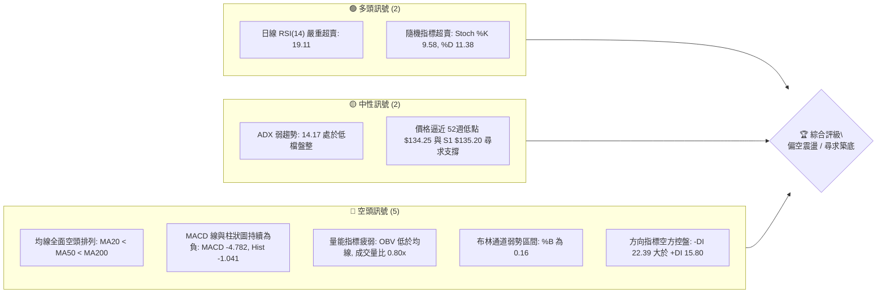

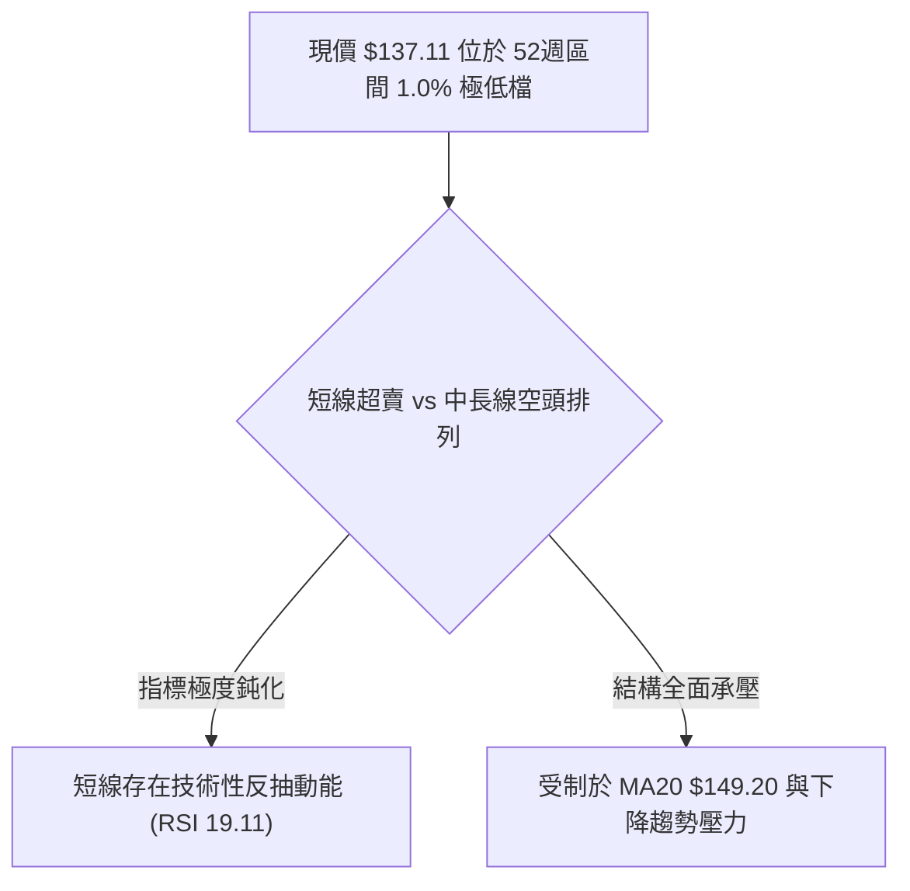

### 📊 核心指標速覽表

| 指標類別 | 指標名稱 | 當前數值 | 訊號 | 解讀 |
|----------|----------|----------|:----:|------|
| **價格** | 當前價格 | $137.11 | 🔴 | 位於 52週低點（$134.25）上方僅 2.13%，距 52週高點跌幅達 67.19% |
| **均線** | MA20 | $149.20 | 🔴 | 股價低於 MA20 達 8.10%，短期下行趨勢顯著 |
| **均線** | MA50 | $157.05 | 🔴 | 股價低於 MA50 達 12.70%，中期格局完全處於壓制狀態 |
| **均線** | MA200 | $198.76 | 🔴 | 股價低於 MA200 達 31.02%，長期牛熊分界線失守，技術性熊市特徵 |
| **動能** | RSI(14) | 19.11 | 🟢 | 進入極度超賣區（< 30），下行動能耗竭，存在超跌反彈契機 |
| **動能** | MACD | -4.782 | 🔴 | DIF 線處於零軸下方，且低於訊號線（-3.741），柱狀圖為 -1.041 |
| **動能** | Stoch %K / %D | 9.58 / 11.38 | 🟢 | 進入極度超賣鈍化區間（< 20），空方極致擠壓 |
| **趨勢** | ADX(14) | 14.17 | 🟡 | 數值低於 25，顯示當前下行斜率趨緩，市場處於弱趨勢或低位盤整 |
| **趨勢** | 方向指標 (+DI / -DI) | 15.80 / 22.39 | 🔴 | -DI 高於 +DI，空方仍掌握價格主控權 |
| **通道** | 布林通道 (%B) | 0.16 | 🔴 | 貼近布林下軌（$131.26），整體通道持續向下開口 |
| **量能** | OBV 與量比 | 0.80x (1.25M) | 🔴 | 成交量低於 20日均量（1.57M），OBV 低於均線，量價未見攻擊訊號 |
| **波動** | ATR(14) | $6.59 | 🟡 | 佔現價 4.80%，波動幅度維持中高水位，風控空間需擴大 |

### 🏆 技術評分卡

```
╔══════════════════════════════════════════════════════════════════╗
║                技術評分卡 — AVAV (2026-10-11)                  ║
╠══════════════════════════════════════════════════════════════════╣
║ 趨勢強度 (Trend)      ██████░░░░░░░░░░░░░░  30/100  🔴 空頭排列  ║
║ 動能指標 (Momentum)    ████████░░░░░░░░░░░░  40/100  🟡 極度超賣  ║
║ 支撐穩定度 (Support)  ██████████░░░░░░░░░░  50/100  🟡 臨近前低  ║
║ 成交量配合 (Volume)   ██████░░░░░░░░░░░░░░  30/100  🔴 量能退潮  ║
║ 形態完整度 (Pattern)  ████████░░░░░░░░░░░░  40/100  🔴 破位尋底  ║
║ 均線排列 (Moving Avg) ████░░░░░░░░░░░░░░░░  20/100  🔴 空頭排列  ║
╠══════════════════════════════════════════════════════════════════╣
║ 綜合評分 (Overall)    ███████░░░░░░░░░░░░░  35/100  🔴 偏空弱勢  ║
╚══════════════════════════════════════════════════════════════════╝
```

---

## 2. 趨勢分析

### 🌐 多時框趨勢分析

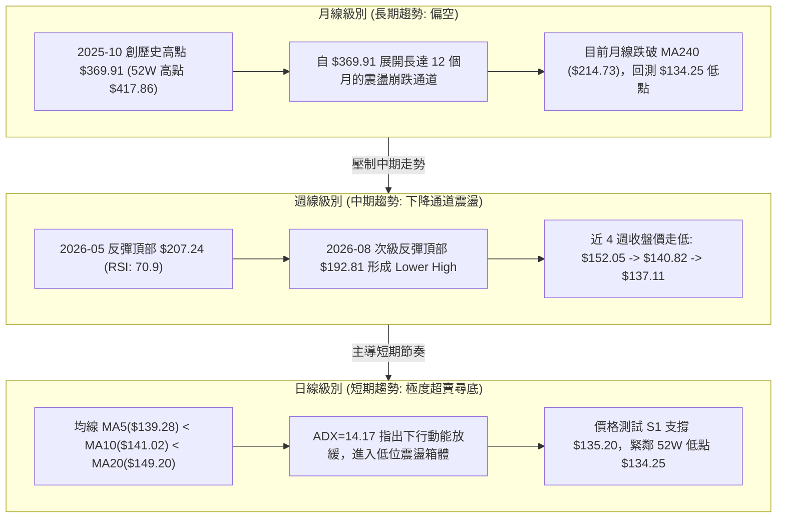

### 📈 長期趨勢 — 12個月走勢圖（Unicode）

```
AVAV 月線走勢圖（過去12個月：2025-11 至 2026-10）
價格軸 ($)
$370 ┤                                     (2025-10 高點 $369.91)
$340 ┤
$310 ┤
$280 ┤ ● (2025-11: $279.46)    ● (2026-01: $278.39)
$250 ┤          ● ($241.89)           ● (2026-02: $252.25)
$220 ┤                                            ● (2026-05: $207.24)
$190 ┤                                      ●     ● ($195.02)
$160 ┤                                            ● ($183.05)   ● (2026-06: $165.07)
$140 ┤                                                                ●    ●    ●   ●←現價 $137.11
$130 ┤                                                                (07) (08) (09) (10)
     └──────────────────────────────────────────────────────────────────────────
       11    12    01    02    03    04    05    06    07    08    09    10 (月份)
      2025  2025  2026  2026  2026  2026  2026  2026  2026  2026  2026  2026
```

#### 走勢特徵分析表格

| 階段區間 | 起止月份 | 價格變化 | 漲跌幅 | 走勢特徵與結構解讀 |
|:---|:---:|:---:|:---:|:---|
| **第一階段：高位劇烈派發** | 2025-11 ~ 2025-12 | $279.46 → $241.89 | -13.44% | 脫離歷史頂部 $369.91 後出現首輪長陰回撤，多頭高位獲利了結。 |
| **第二階段：次級反彈中繼** | 2026-01 ~ 2026-02 | $278.39 → $252.25 | -9.39% | 弱勢反抽確認頭部成形，未創歷史新高即告衰竭，籌碼鬆動。 |
| **第三階段：恐慌性主跌浪** | 2026-03 ~ 2026-04 | $183.05 → $195.02 | +6.54% | 擊穿 $200.00 整數關卡，最低跌至 $183.05，隨後技術性反抽。 |
| **第四階段：假突破與再破位** | 2026-05 ~ 2026-06 | $207.24 → $165.07 | -20.35% | 5月反抽至 $207.24 觸及壓力後，6月暴跌至 $165.07，均線徹底空頭排列。 |
| **第五階段：低位弱勢陰跌盤整** | 2026-07 ~ 2026-10 | $149.37 → $137.11 | -8.21% | 走勢於 $140–$150 弱勢盤整，成交量退潮，正回測 52週低點 $134.25。 |

### 📊 中期趨勢（週線分析）

```
近期週線壓力與支撐架構圖 ($)
$210 ┤─────────────────────────────── 週線波段高點 ($207.24, 2026-05-31)
$200 ┤─────────────────────────────── R3 強阻力 ($200.38) / MA200 ($198.76)
$190 ┤                 ● ($192.81, 08-16) 次級高點
$180 ┤
$170 ┤
$160 ┤                 ● ($159.95, 09-20) 弱勢高點 ── R1 阻力位 ($162.30)
$150 ┤                 ─ ─ ─ ─ ─ ─ ─ ─ ─ ─ ─ ─ ─ ─ ─ MA20 ($149.20)
$140 ┤                             ● ($137.11 現價)
$134 ┤════════════════════════════════ S1 支撐 ($135.20) / 52W 低點 ($134.25)
```

中期週線在 2026-05-31 達到 $207.24 後，高點持續下移（2026-08-16 的 $192.81，隨後為 2026-09-20 的 $159.95），呈現標準的下降趨勢浪型（Lower Highs & Lower Lows）。然而，2026-09-13 週成交量曾爆出 20,402,600 股的天量，但後續多頭未能站穩 $160，顯示上方套牢賣壓沉重。

### ⚡ 趨勢強度評估（ADX 解讀）

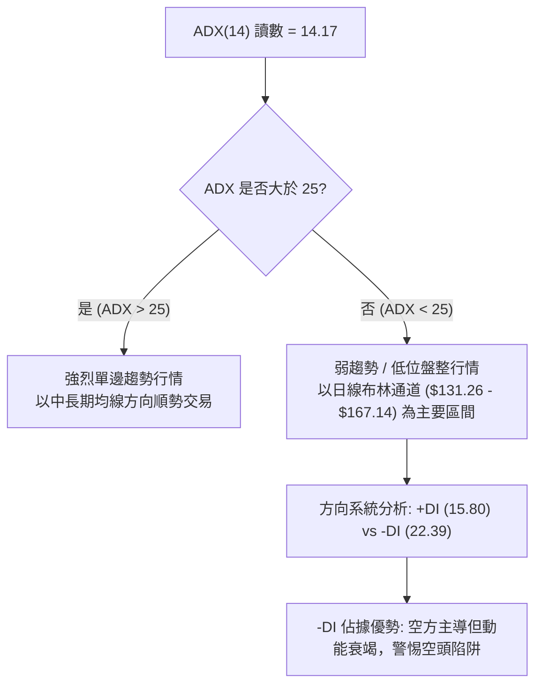

| ADX 區間 | 趨勢分類 | AVAV 當前狀態 (ADX=14.17) | 操作策略意涵 |
|:---:|:---:|:---:|:---|
| 0 – 20 | 極弱 / 無趨勢盤整 | **當前落點 (14.17)** | 單邊殺跌動能已鈍化，轉入低檔震盪打底階段，不宜追空。 |
| 20 – 25 | 趨勢萌芽 / 弱趨勢 | - | 觀察價格是否向布林帶某一軌道發起突破。 |
| 25 – 50 | 強趨勢行情 | - | 順應中長週期趨勢方向操作。 |
| 50 – 100 | 極強 / 趨勢過度延伸 | - | 警惕趨勢反轉或劇烈洗盤。 |

---

## 3. 圖表形態分析

### 🔍 形態識別系統

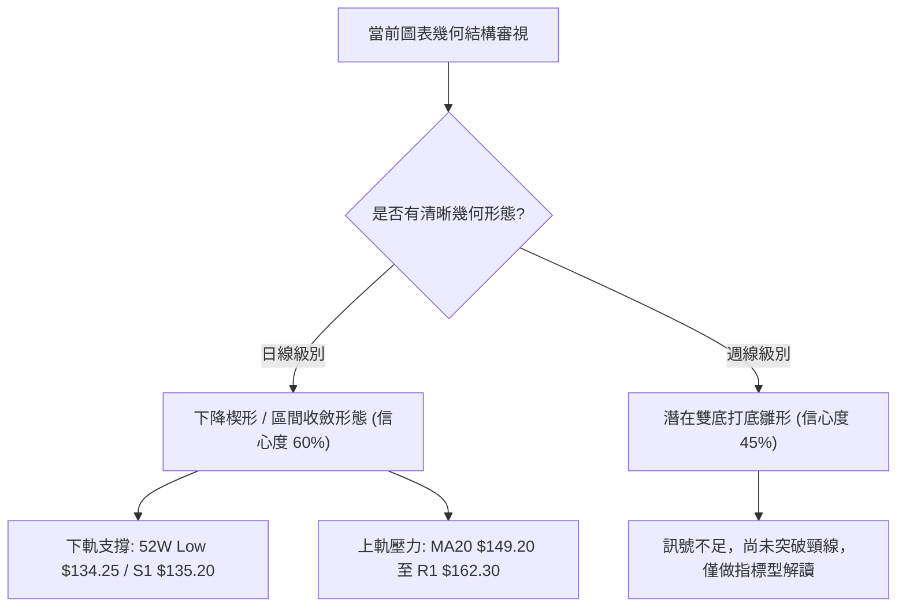

#### 形態識別與信心度評估表

| 形態名稱 | 信心度 | 判斷依據（引用數據） | 完成度 | 目標價（附計算式） |
|:---|:---:|:---|:---:|:---|
| **低位下降收斂楔形** | 60% | 價格在 2026-06-28 低點 $137.95、近期低點 $137.11 與支撐 S1 $135.20 附近波動，高點則自 $159.95 向下收斂，波動率 ATR($6.59) 收縮。 | 75% | 突破楔形上軌（MA20 $149.20），量度目標價 = 頸線突破點 $149.20 + 楔形起點震盪高度 ($159.95 - $137.11 = $22.84) = **$172.04**（受阻於 R2 $168.00 附近）。 |
| **潛在低位雙重底 (W底)** | 45% | 第一底為 2026-06-28 週收盤 $137.95（或 52週低點 $134.25），第二底為當前 2026-10-11 之 $137.11。兩次低點相距 15 週，落於 S1 $135.20 支撐帶。 | 50% | 依規則 15：**信心度 < 50%，數據不足以確認頸線突破，僅做指標型解讀**。頸線未站穩 $160 前不確立。 |

### 🕯️ 重要K線形態分析

| 週/月份 | 收盤價 | K線形態名稱 | 技術解讀 | 訊號方向 |
|:---:|:---:|:---|:---|:---:|
| 2026-07-05 | $190.89 | 大陽反彈十字破局 | 週成交量激增至 18.3M 股，自 $137.95 報復性反彈，顯示低檔承接買盤強烈。 | 🟢 局部強多 |
| 2026-08-16 | $192.81 | 高位受阻長上影 | 測試 $195–$200 重壓區受挫，週 RSI 升至 73.5 超買，多頭力竭。 | 🔴 頂部力竭 |
| 2026-09-13 | $146.71 | 天量下影十字星 | 週量爆出 20.4M 股（近 20 週天量），收盤回升至 $146.71，籌碼發生劇烈換手。 | 🟡 震盪築底 |
| 2026-10-04 | $140.82 | 連續弱勢中陰線 | 跌破 20日均線，空方再度下壓，成交量縮減至 6.77M 股，賣壓逐步枯竭。 | 🔴 短線偏空 |
| 2026-10-11 | $137.11 | 逼近前低錘頭測試 | 實體收於 $137.11，測試 S1 支撐 $135.20，日線 RSI 觸及 19.11 嚴重超賣。 | 🟢 超賣止跌 |

### 📉 ASCII 走勢形態示意圖

```
AVAV 關鍵形態示意圖：低檔收斂楔形與前低支撐考驗
價格 ($)
$170 ┤
$165 ┤       ● (09-20 高點 $159.95)
$160 ┤        \
$155 ┤         \
$150 ┤          \                  ──────── MA20 / 楔形上軌壓力區 ($149.20)
$145 ┤           \        ● ($146.71)
$140 ┤  ● ($137.95) \     /     \
$137 ┤   \           \   /       ●← 當前價格 ($137.11) 測試楔形下軌
$135 ┤════●═══════════●═══════════════════ S1 關鍵支撐 ($135.20)
$134 ┤    └─ 52W Low ($134.25)
     └────────────────────────────────────
      06-28       09-13   09-20  10-11 (時間)
```

### 🎯 形態目標價計算

根據日線「低位下降收斂楔形」形態之幾何推算：
- **形態底部基點**：$137.11（測試 S1 $135.20 與 52週低點 $134.25）
- **形態波段高點**：2026-09-20 高點 $159.95
- **形態垂直高度**：$159.95 - $137.11 = $22.84
- **有效向上突破頸線**：需日線實體站上 MA20（$149.20）
- **理論推算目標價**：
  $$\text{Target} = \$149.20 + \$22.84 = \$172.04$$
- **對照關鍵價位**：理論目標價 $172.04 接近數據提供之阻力位聚類 **R2: $168.00** 與 **R1: $162.30**，突破後下一級別重要關卡即為 **R3: $200.38**。

---

## 4. 支撐與阻力

### 🗺️ 關鍵價位分布圖（Unicode）

```
AVAV 價位結構分布圖
═══════════════════════════════════════════════════════════════════
$200.38 ║████████████████████████████████║ 強阻力 R3 (波段高點 / MA200)
$168.00 ║██████████████████████          ║ 阻力 R2 (反彈形態頸線高度)
$162.30 ║████████████████████████        ║ 關鍵阻力 R1 (前波高點聚類)
$149.20 ║┈┈┈┈┈┈┈┈┈┈┈┈┈┈┈┈┈┈┈┈┈┈┈┈        ║ 短期中樞 (MA20 / 布林中軌)
$137.11 ╠════════════════════════════════╣ ◄ 現價 ($137.11)
$135.20 ║▓▓▓▓▓▓▓▓▓▓▓▓▓▓▓▓▓▓▓▓▓▓▓▓        ║ 近期核心支撐 S1
$134.25 ║████████████████████████████████║ 52週歷史低點 (破位止損線)
═══════════════════════════════════════════════════════════════════
```

### 🚧 阻力位分析表

*註：價位嚴格引用技術數據「關鍵價位」區塊。*

| 阻力級別 | 價位 | 距現價幅動 | 形成原因 | 突破難度 | 重要性 |
|:---:|:---:|:---:|:---|:---:|:---:|
| **R1** | **$162.30** | +18.37% | 近一年波段高點聚類區，疊加 MA60（$155.73）與 MA120（$164.20）密集交織套牢區。 | 🟢 中等 | ★★★★☆ |
| **R2** | **$168.00** | +22.53% | 近一年次級震盪平台頂部，布林通道上軌（$167.14）重疊處。 | 🟡 較高 | ★★★★☆ |
| **R3** | **$200.38** | +46.15% | 近一年重要多空大分水嶺，長期 MA200（$198.76）與歷史密集成交區所在地。 | 🔴 極高 | ★★★★★ |

### 🛡️ 支撐位分析表

*註：價位嚴格引用技術數據「關鍵價位」區塊。*

| 支撐級別 | 價位 | 距現價幅動 | 形成原因 | 守住機率 | 重要性 |
|:---:|:---:|:---:|:---|:---:|:---:|
| **S1** | **$135.20** | -1.39% | 近一年波段低點聚類核心支撐，空頭多輪打壓均在此處出現減速。 | 70% | ★★★★★ |
| **52W Low** | **$134.25** | -2.09% | 過去 52 週絕對低點，市場最後心理防線，跌破將引發新一輪停損恐慌。 | 65% | ★★★★★ |
| **S2 / 延伸** | 數據未偵測到 | — | *數據中未偵測到更低波段低點聚類，以下軌 $131.26 為動態緩衝。* | — | — |

### 📐 斐波那契回調位分析

*基準區間：52週低點 $134.25 至 52週高點 $417.86（極差 $283.61）*

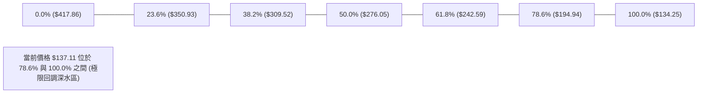

| 斐波那契比例 | 價位 | 距現價幅度 | 技術意義解讀 |
|:---:|:---:|:---:|:---|
| **0.0% (52W High)** | $417.86 | +204.76% | 本輪兩年大牛市頂部終點。 |
| **23.6%** | $350.93 | +155.95% | 第一級回調位，已嚴重跌破。 |
| **38.2%** | $309.52 | +125.75% | 多頭核心結構回撤位，失守代表長期趨勢逆轉。 |
| **50.0%** | $276.05 | +101.33% | 多空平衡中軸（2026年1月曾於此處短暫反彈）。 |
| **61.8%** | $242.59 | +76.93% | 黃金分割防禦點，失守後宣告徹底進入空頭主導。 |
| **78.6%** | $194.94 | +42.18% | 極限回撤防線，恰與當前 MA200 ($198.76) 與 R3 ($200.38) 聚類。 |
| **現價落點** | **$137.11** | — | **目前位於 78.6% ($194.94) 與 100.0% ($134.25) 之間，回調深度達 98.99%。** |
| **100.0% (52W Low)**| $134.25 | -2.09% | 完整回吐 52 週全部漲幅，形成宏觀大雙底或無底深淵的決戰價位。 |

---

## 5. 技術指標深度解讀

### 🎛️ 指標訊號總覽

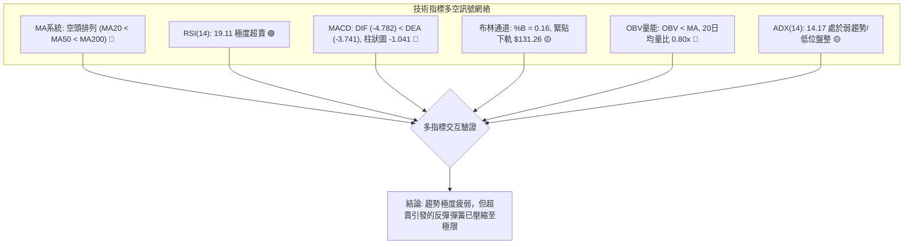

### 📈 移動平均線排列分析

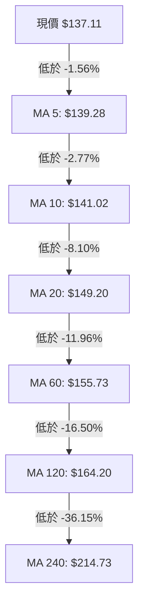

#### 均線數據分析矩陣

| 均線名稱 | 當前價位 | 距現價差距 | 乖離率 (BIAS) | 排列狀態 | 走勢特徵解讀 |
|:---:|:---:|:---:|:---:|:---:|:---|
| **MA5** | $139.28 | -$2.17 | -1.56% | 空頭排列 | 極短期受壓，連 5 日線都未能突破，壓制下行。 |
| **MA10** | $141.02 | -$3.91 | -2.77% | 空頭排列 | 短線第一道動態阻力線，連續多日下穿。 |
| **MA20** | $149.20 | -$12.09 | -8.10% | 空頭排列 | 月線中樞快速下移，負乖離率達 -8.10%，具技術修復需求。 |
| **MA50** | $157.05 | -$19.94 | -12.70% | 空頭排列 | 中期生命線傾斜向下，構成強壓。 |
| **MA60** | $155.73 | -$18.62 | -11.96% | 空頭排列 | 與 MA50 形成死叉後的發散下行。 |
| **MA120**| $164.20 | -$27.09 | -16.50% | 空頭排列 | 半年線持續走低，壓制一切中期反彈企圖。 |
| **MA200**| $198.76 | -$61.65 | -31.02% | 空頭排列 | 長期牛熊分界線遙遙在上，整體趨勢定性為空頭市場。 |
| **MA240**| $214.73 | -$77.62 | -36.15% | 空頭排列 | 年線級別大幅下挫，上方套牢盤深重。 |

### 📉 RSI(14) 分析

- **當前 RSI(14) 數值**：**19.11**
- **進度條展示**：
  $$\text{RSI 強度}：\text{███░░░░░░░░░░░░░░░░░}\quad 19.11\% \quad \text{🟢 極度超賣}$$
- **超買超賣區間判定**：通常 RSI < 30 即屬於超賣，AVAV 目前跌至 19.11，已進入近兩年極端超賣區域（僅少數幾次回調曾達到 16–20 區間）。
- **背離判斷**：
  - **日線級別**：當前價格 $137.11 逼近 52週低點 $134.25，RSI 為 19.11；對照 2026-09-06 週低點 $144.65 時 RSI 為 16.9。價格創下更低點但 RSI 未破前低，呈現**潛在微弱底背離雛形**，但尚未得到日線大陽線的右側確認。
  - **結論**：**無明確強底背離**（需等待金叉確認），但超賣鈍化嚴重，單邊殺跌風險大增。

### 📊 MACD(12/26/9) 訊號解讀

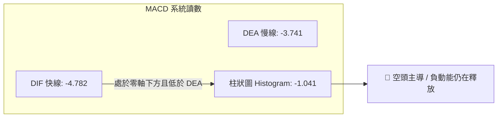

- **MACD 快線 (DIF)**：-4.782
- **MACD 訊號線 (DEA)**：-3.741
- **MACD 柱狀圖 (Histogram)**：-1.041
- **解讀**：DIF 運行於零軸之下且死叉 DEA，柱狀圖連續處於負值區間（-1.041），顯示空頭能量仍在宣洩。然而，柱狀圖絕對值並未出現幾何級數放大，與 2026-06-28（-4.576）或 2026-08-30（-4.073）的主跌浪相比，綠柱動能呈現縮減態勢，暗示空方動能逐漸衰竭。

### 📦 布林通道分析

```
布林通道 (20, 2) 結構示意圖 ($)
$167.14 ┤───────────────────────────────── 上軌 (Upper Band)
$160.00 ┤
$155.00 ┤
$149.20 ┤─ ─ ─ ─ ─ ─ ─ ─ ─ ─ ─ ─ ─ ─ ─ ─ ─ 中軌 (Middle Band / MA20)
$140.00 ┤
$137.11 ┤································· 現價 (%B = 0.16)
$131.26 ┤───────────────────────────────── 下軌 (Lower Band)
```

- **布林上軌**：$167.14
- **布林中軌 (MA20)**：$149.20
- **布林下軌**：$131.26
- **帶寬與位置分析**：
  - 當前通道寬度為 $35.88（佔中軌 24.05%），帶寬維持擴張後的平移狀態。
  - **%B 指標為 0.16**，價格深度貼近布林下軌（$131.26）。在 ADX 僅為 14.17 的低趨勢環境下，%B 低於 0.20 通常代表價格已進入通道超賣極限，具備向中軌（$149.20）均值回歸的強烈技術慣性。

### 💹 成交量分析（量價配合度）

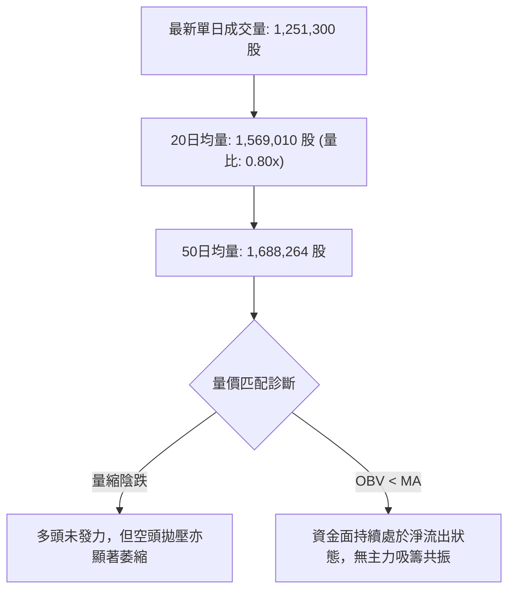

- **量比與均量**：最新成交量 1.25M 股，相較 20日均量（1.57M）量比僅 0.80x，低於 50日均量（1.69M）。
- **量價背離診斷**：價格下跌伴隨成交量縮小（無恐慌放量拋售），屬於典型的「縮量陰跌探底」。
- **OBV 趨勢解讀**：OBV 指標持續位於其均線下方，顯示整體能量潮未見底背離抬升，資金進場意願極為保守，機構以觀望為主。

---

## 6. 動能與波動率

### ⚡ 動能評估四象限

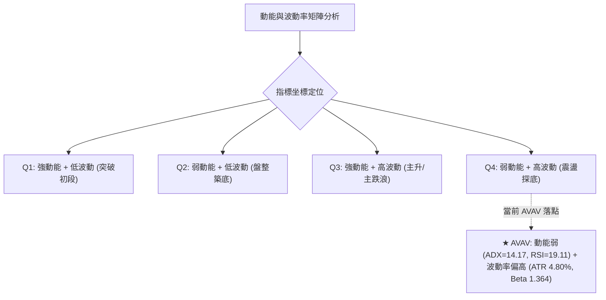

| 象限 | 動能維度 | 波動維度 | AVAV 當前狀態 | 交易策略與風險評估 |
|:---:|:---:|:---:|:---:|:---|
| **Q1** | 強動能 | 低波動 | — | 最理想順勢突破機會。 |
| **Q2** | 弱動能 | 低波動 | — | 沉寂休整期，適合網格與低吸。 |
| **Q3** | 強動能 | 高波動 | — | 趨勢主升浪或恐慌主跌浪。 |
| **Q4** | **弱動能** | **高波動** | **✓ 當前落點** | **震盪探底階段**：下行動能雖減速但價格振幅大，假突破頻繁，不可重倉追價，以防守型區間策略為主。 |

### 📊 ATR 波動率分析

- **當前 ATR(14)**：**$6.59**
- **ATR 佔比 (ATR % of Price)**：
  $$\frac{\$6.59}{\$137.11} = 4.80\%$$
- **波動特徵解讀**：單日波動近 5%，屬於高 Beta 成長型/軍工防衛標的之典型高波動特徵。
- **風控止損距離建議**：
  - **極短線動態止損（1.0 × ATR）**：$\$137.11 - \$6.59 = \$130.52$
  - **波段交易安全止損（1.5 × ATR）**：$\$137.11 - (\$6.59 \times 1.5) = \$127.23$
  - **緊縮防守止損（0.5 × ATR）**：$\$137.11 - (\$6.59 \times 0.5) = \$133.82$（剛好落於 52週低點 $134.25 下方）

### 📐 Beta 與市場相關性

- **Beta 係數**：**1.364**
  - **市場敏感度**：AVAV 的波動幅度比標普 500 指數高出 36.4%，在大盤下挫時具有較高的放大下行風險，在大盤反彈時亦具備更高的彈性。
- **空頭部位比例 (Short Interest)**：
  - **Short % of Float**：**12.8%**
  - **Short Ratio (空頭回補天數)**：**2.21 天**
  - **軋空潛力評估**：12.8% 的放空比例處於偏高水平，一旦價格守穩 S1 $135.20 並向上突破 MA20 $149.20，2.21 天的回補天數容易觸發短線軋空（Short Squeeze）連鎖反應。

---

## 7. 多時框架總結

### 📋 時框架評分表

| 時框架 | 趨勢方向 | 動能狀態 | 均線排列 | 圖表形態 | 綜合評分 | 建議操作策略 |
|:---:|:---:|:---:|:---:|:---:|:---:|:---|
| **長期 (月線)** | 🔴 強烈空頭 | 弱勢下行 | 空頭排列 (跌破 MA240) | 歷史大頂部派發後破位 | **25/100** | 嚴禁長線大資金盲目抄底 |
| **中期 (週線)** | 🔴 空頭下行 | 負動能收斂 | 空頭排列 (MA20<MA50) | 下降通道收斂雛形 | **35/100** | 反彈減碼套牢盤，等待右側放量 |
| **短期 (日線)** | 🟡 低檔震盪 | 🟢 極度超賣 | 空頭發散 (MA5<MA20) | 測試 S1 $135.20 支撐 | **45/100** | 輕倉博弈超跌技術性反抽 |

### 🔲 綜合訊號矩陣

```
╔══════════════════════════════════════════════════════════════════╗
║                    多時框綜合訊號一致性矩陣                      ║
╠══════════════════════════════════════════════════════════════════╣
║ 維度         短期 (日線)          中期 (週線)          長期 (月線) ║
║ 趨勢方向     🔴 偏空尋底          🔴 空頭下行          🔴 熊市結構 ║
║ 動能狀態     🟢 RSI 19.11 超賣    🔴 MACD 處負軸       🔴 動能衰退 ║
║ 均線系統     🔴 空頭壓制          🔴 均線死叉          🔴 跌破年線 ║
║ 量價結構     🟡 縮量陰跌          🟡 天量換手後回落    🔴 資金流出 ║
║ 一致性判定   【多空衝突】短期超賣嚴重 vs 中長期趨勢全面看空      ║
╚══════════════════════════════════════════════════════════════════╝
```

### ⚖️ 多時框收斂結論

依據多時框收斂嚴格規則進行定性：
1. **趨勢強度定性**：當前 **ADX(14) 讀數為 14.17**，明確低於閾值 25，市場**非單邊趨勢行情，而是處於弱趨勢/低位盤整行情**。
2. **主導框架收斂**：在 ADX < 25 的盤整結構中，依照規則應**以日線布林通道（下軌 $131.26 至 上軌 $167.14）為主要交易區間**。中長期均線（MA200 $198.76）維持空頭排列，代表上方空間受到天花板壓制。
3. **唯一方向性結論**：**【偏空觀望，區間低吸博反彈】**。
   - 儘管宏觀大結構偏空，但空方極致擠壓已使日線 RSI（19.11）與 Stoch %K（9.58）進入極端超賣區域。空頭在此處追空面臨極高盈虧比風險，因此當前節奏為**「空頭趨勢中的超跌盤整段」**，操作上以依託 S1 支撐的高盈虧比短線超跌反彈為主，或在反彈觸及中軌/阻力位時順勢放空。

---

## 8. 交易策略建議

### 🗺️ 策略決策流程圖

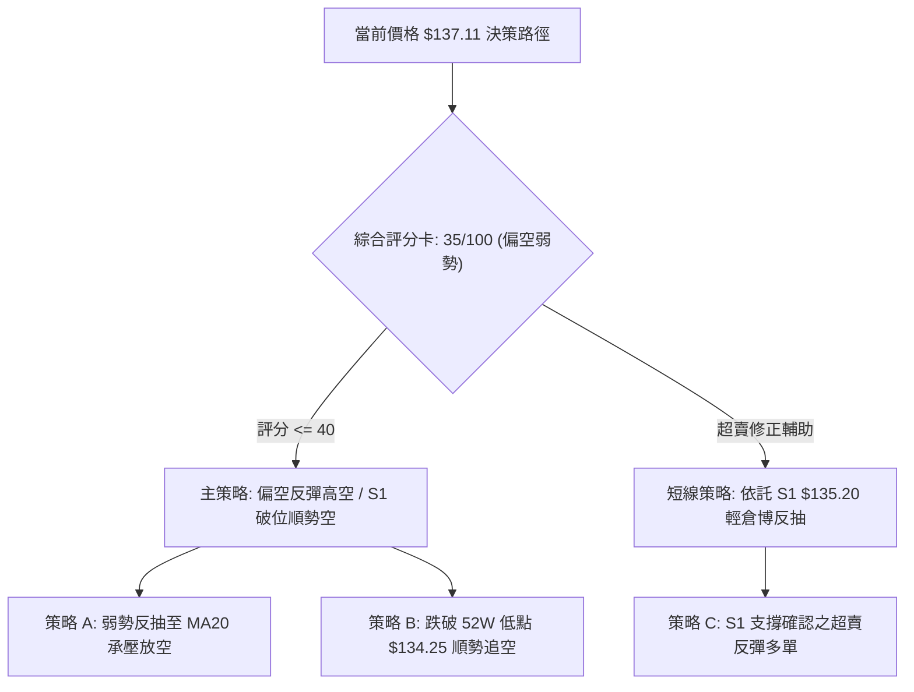

### 🧭 策略路由（依評分卡分流）

> **當前主策略方向 = 偏空弱勢，以反彈高空為主、超跌反抽為輔（依綜合評分 35/100）**

因技術評分卡綜合評分為 **35/100（≤ 40）**，系統**主推偏空交易架構**（反彈阻力位放空或破位空），多頭策略僅作為超賣極值下的嚴格風控短線對沖提示。

### 🎯 價格情境階梯（Price Scenarios）

*價位嚴格引用第 4 章及數據庫核心數值：*

| 觸發條件 | 下一目標 | 後續延伸 | 情境含義與操作指引 |
|:---|:---:|:---:|:---|
| **強勢突破 R1 $162.30** | R2 $168.00 | R3 $200.38 | 中期格局逆轉，空頭全面平倉，多頭展開波段行情。 |
| **反抽受阻 MA20 $149.20** | S1 $135.20 | $134.25 | 短線超賣修復完畢，空頭再度控盤，最佳順勢放空點。 |
| **守穩現價 $137.11 ~ S1 $135.20** | MA20 $149.20 | R1 $162.30 | 箱體低檔築底，展開均值回歸反彈走勢。 |
| **有效跌破 52W 低點 $134.25** | 布林下軌 $131.26 | 數據未偵測支撐 | 結構徹底破位，引發停損拋售潮，順勢下看深淵。 |

### 📊 情境機率分佈

| 情境分類 | 發生機率 | 主要技術依據 |
|:---|:---:|:---|
| **情境一：超跌技術性反抽至 MA20** | **45%** | RSI(14) 達 19.11 極度超賣，Stoch %K 9.58，價格貼近布林下軌（%B=0.16），空頭動能衰竭。 |
| **情境二：S1 至 MA20 窄幅弱勢震盪** | **35%** | ADX 僅 14.17 處於弱趨勢，量比 0.80x 資金觀望，成交量未見顯著攻擊信號。 |
| **情境三：直接擊穿 $134.25 破位下殺** | **20%** | 全均線系統空頭排列，OBV 疲軟，-DI 佔據主導，若大盤重挫可能引發多殺多。 |

### 🟢 主策略詳情（方向依上方路由）

#### 策略 A（主推：反抽受阻順勢放空） vs 策略 B（輔助：破位順勢空）

| 策略要素 | 策略 A：反抽 MA20 受阻放空 (主策略) | 策略 B：跌破 52W 低點追空 (破位策略) | 策略 C：S1 超跌搏反彈 (反向對沖) |
|:---|:---:|:---:|:---:|
| **操作方向** | 🔴 做空 (Short) | 🔴 做空 (Short) | 🟢 做多 (Long) |
| **進場條件** | 股價反彈至 MA20 附近出現上影受阻 | 實體跌破 52W 低點 $134.25 且放量 | 價格於 S1 $135.20 獲支撐且 RSI 金叉 |
| **進場價格** | **$149.20** (MA20 / 布林中軌) | **$133.50** (確認跌破 $134.25) | **$137.11** (現價分批低吸) |
| **止損價格** | **$155.73** (MA60 壓力線上方) | **$137.11** (現價反向站回止損) | **$133.80** (跌破 52W 低點 $134.25) |
| **目標價 T1** | **$137.11** (現價位置) | **$131.26** (布林下軌位置) | **$149.20** (MA20 / 布林中軌) |
| **目標價 T2** | **$135.20** (S1 支撐位) | 數據未偵測到 (動態追蹤 1.5 ATR) | **$162.30** (阻力位 R1) |
| **風險空間** | $6.53 (4.38%) | $3.61 (2.70%) | $3.31 (2.41%) |
| **報酬空間 (T1)** | $12.09 (8.10%) | $2.24 (1.68%) | $12.09 (8.82%) |
| **風險報酬比** | **1 : 1.85** | **1 : 0.62** (T2 延伸至 1:1.5) | **1 : 3.65** |
| **成功機率** | 60% | 45% | 50% |
| **建議倉位** | **15%** | **8%** | **5% (嚴格輕倉試單)** |

### 🔴 反向風險觸發點（對沖提示）

若已建立空頭部位，出現下列訊號時必須立即執行停損或多頭對沖：
1. **收盤價實體突破 R1 $162.30**：代表下跌常態結構遭到實質破壞，多頭扭轉均線排列。
2. **日線 MACD 出現零下強烈金叉且柱狀圖翻正大於 +2.0**：代表中期反彈浪正式展開。
3. **單日成交量放大至 20日均量的 2.5 倍以上（> 3.9M 股）且收長大陽線**：主力大資金入場進駐訊號。

### ⭐ 整體訊號強度評星

```
做多訊號強度：★★☆☆☆  (2.0/5星) ── 僅依託超賣修復，勝率中等但盈虧比佳
做空訊號強度：★★★☆☆  (3.5/5星) ── 順應中長週期大勢，但現價追空盈虧比較差
整體可信度：  ★★★☆☆  (3.0/5星) ── ADX<25 震盪市，需提防假突破與來回洗盤
```

---

## 9. 風險提示與監控

### ✅ 關鍵監控指標 Checklist

```
╔══════════════════════════════════════════════════════════════════╗
║                 AVAV 每日盤後關鍵技術監控清單                    ║
╠══════════════════════════════════════════════════════════════════╣
║ [ ] 52週低點防線: 收盤價是否跌破 $134.25 (破位即減碼/停損)       ║
║ [ ] RSI(14) 動態: 是否向上突破 30.0 脫離極度超賣區 (觸發反彈)     ║
║ [ ] 成交量能監控: 單日成交量是否突破 1,569,010 股 (均量放大確認) ║
║ [ ] MA20 動態位置: 價格是否測試 $149.20 中軌壓力 (空單進場點)    ║
║ [ ] MACD 柱狀圖: 負值 -1.041 是否開始收斂向上 (空頭動能衰減)     ║
║ [ ] 軋空指標追蹤: 放空比例 12.8% 是否伴隨暴量拉升 (Short Squeeze)║
╚══════════════════════════════════════════════════════════════════╝
```

### ⚠️ 風險場景分析

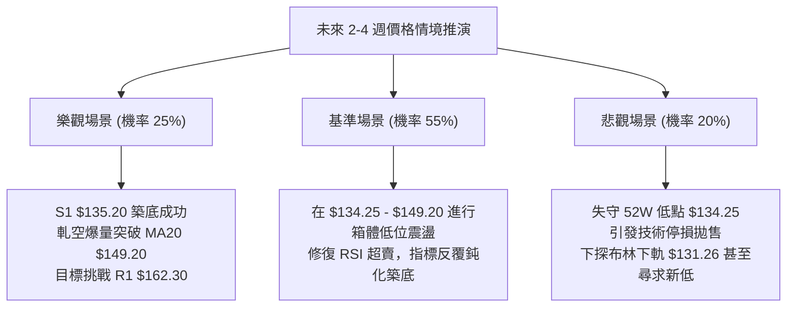

### 🛡️ 風險管理重要提醒

1. **基本面與估值風險疊加**：
   - AVAV 目前 TTM EPS 為 **$-4.05**，淨利率為 **-10.1%**，自由現金流為 **$-25.92M**。在缺乏獲利支撐的背景下，股價估值 Forward P/E 仍高達 30.83，技術面破位可能引發基本面機構投資者（持股佔比高達 88.3%）的進一步砍倉。
2. **波動率與部位規模控制（Position Sizing）**：
   - 當前 ATR 高達 **$6.59（佔比 4.80%）**，單日潛在波動劇烈。建議單一交易部位風險敞口嚴格限制於總投資組合資金的 **1.0%** 以內。若以 $3.31 止損空間計算，單筆建倉股數不宜過重。
3. **流動性陷阱**：
   - 儘管機構持股比例高，但近一日成交量僅 1.25M 股，處於近期偏低水平，若市場遭遇突發利空，買盤薄弱可能導致開盤跳空跌破支撐位。

---

## 📋 報告總結

```
╔══════════════════════════════════════════════════════════════════╗
║                    AVAV 技術分析報告總結                         ║
╠══════════════════════════════════════════════════════════════════╣
║ 報告日期：2026-10-11                                            ║
║ 當前價格：$137.11                                                ║
║ 分析評級：⚖️ 偏空震盪 / 區間弱勢築底 (評分: 35/100)               ║
║                                                                  ║
║ 關鍵結論：                                                       ║
║ ├─ 長期趨勢：🔴 空頭市場 (跌破年線 MA240 $214.73，月線持續下挫)  ║
║ ├─ 中期趨勢：🔴 弱勢空頭 (波段高點下移，承壓於 MA50 $157.05)    ║
║ ├─ 短期趨勢：🟡 極端超賣震盪 (RSI 19.11，貼近 52W 低點 $134.25)  ║
║ ├─ 關鍵支撐：S1: $135.20 / 52W Low: $134.25                     ║
║ ├─ 關鍵阻力：MA20: $149.20 / R1: $162.30 / R2: $168.00          ║
║ └─ 分析師目標共識：$217.60 (低標 $148.57 / 高標 $315.00)         ║
║                                                                  ║
║ 最優策略組合：                                                   ║
║ 1. 🥇 最佳機會：等待反彈至 MA20 ($149.20) 受阻時順勢放空 (策略 A) ║
║ 2. 🥈 次選機會：現價依託 S1 ($135.20) 嚴格止損輕倉博超跌反彈    ║
║ 3. 🥉 保守選擇：完全空倉觀望，等待日線有效突破 MA20 並放量確立  ║
╚══════════════════════════════════════════════════════════════════╝
```

---

> ⚠️ **免責聲明**：本報告為技術分析研究成果，所有數據、圖表及估算均嚴格基於所提供之歷史價格與技術指標資訊。本報告**僅供研究與學術參考**，**不構成任何證券買賣之投資建議**。金融市場具有高度風險，交易者應獨立評估風險並自負盈虧。

---

*報告生成時間：2026-10-11 ｜ 數據來源：Yahoo Finance ｜ 分析框架：多時框技術分析*