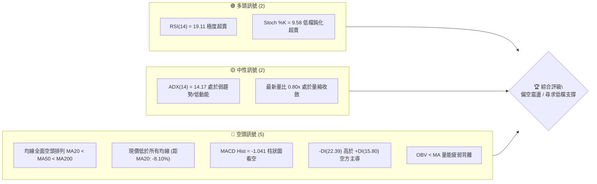
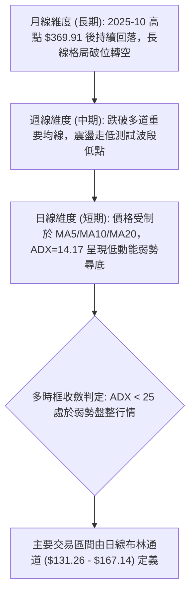
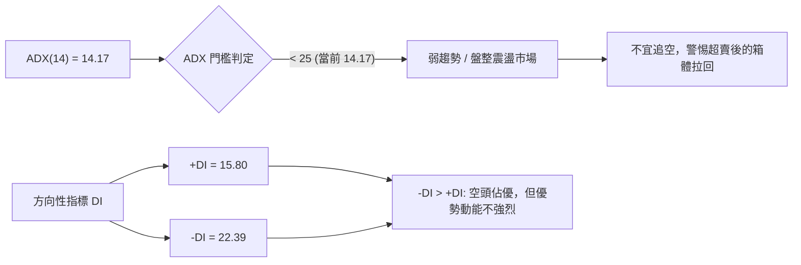
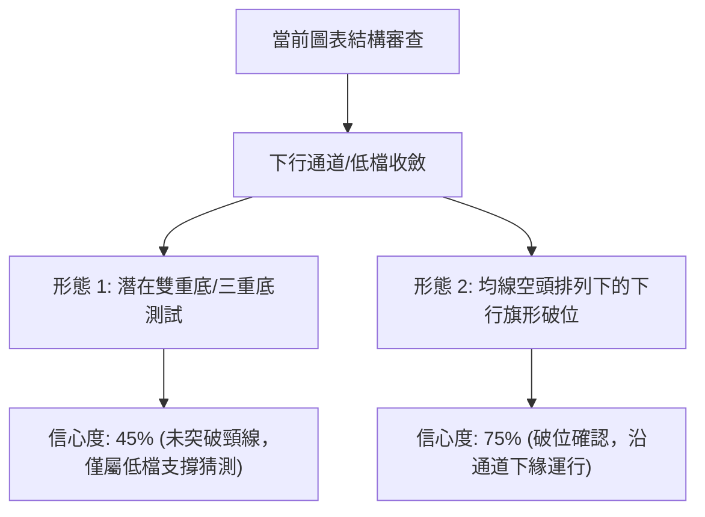
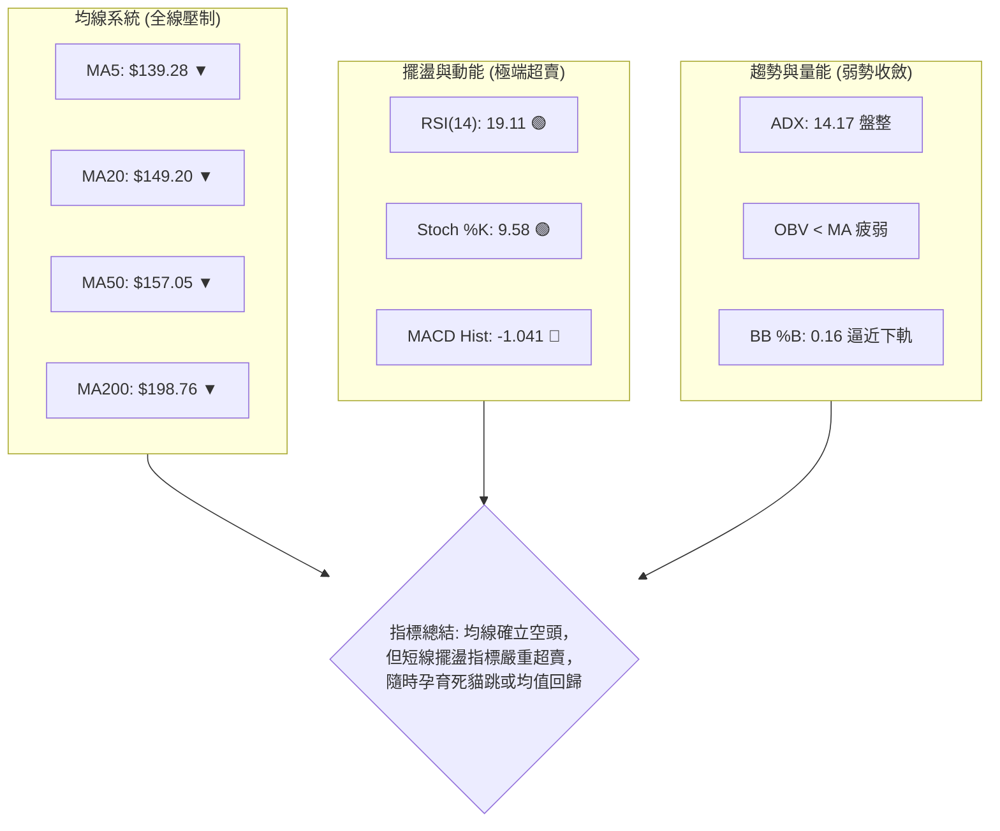
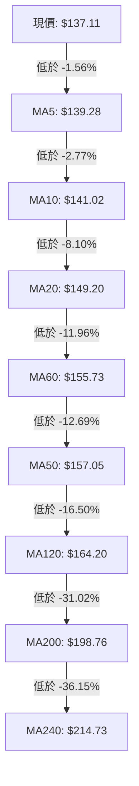
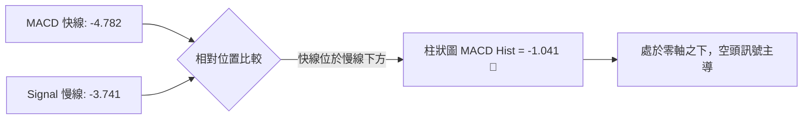
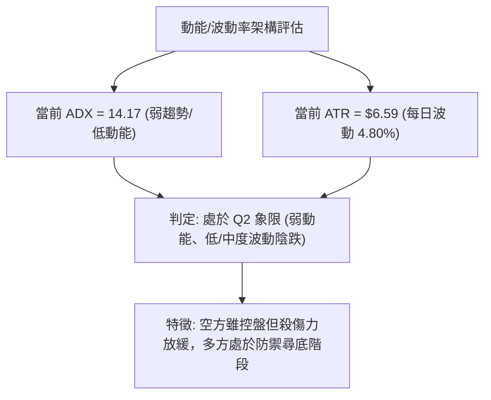
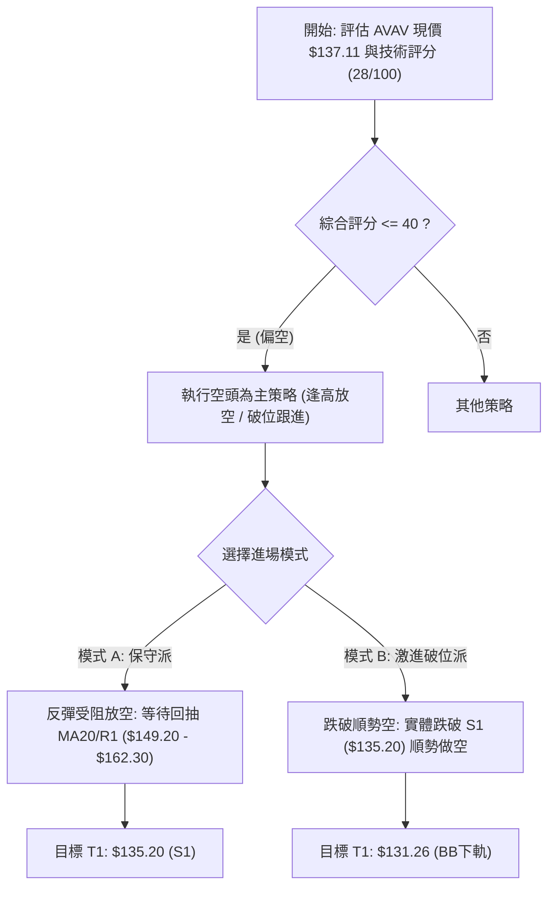
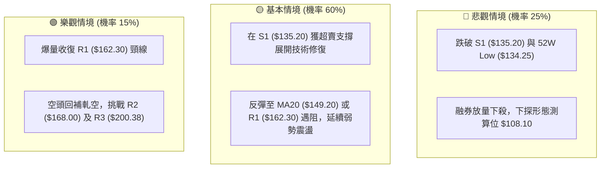

# AVAV 技術分析報告

> **報告日期**：2026-10-12 ｜ **語言**：繁體中文 ｜ **數據來源**：Yahoo Finance ｜ **當前價格**：$137.11

---

## 目錄

| 章節 | 內容 |
|------|------|
| [1. 技術面概覽](#1-技術面概覽) | 訊號儀表板、核心指標、評分卡 |
| [2. 趨勢分析](#2-趨勢分析) | 多時框趨勢、長中短期走勢 |
| [3. 圖表形態分析](#3-圖表形態分析) | 形態識別、K線組合、目標價 |
| [4. 支撐與阻力](#4-支撐與阻力) | 關鍵價位、斐波那契回調 |
| [5. 技術指標深度解讀](#5-技術指標深度解讀) | MA/RSI/MACD/布林/成交量 |
| [6. 動能與波動率](#6-動能與波動率) | 動能評估、ATR、Beta |
| [7. 多時框架總結](#7-多時框架總結) | 時框架評分矩陣 |
| [8. 交易策略建議](#8-交易策略建議) | 多空策略、風險報酬比 |
| [9. 風險提示與監控](#9-風險提示與監控) | 監控指標、風險場景 |
| [報告總結](#-報告總結) | 核心要點與執行方針 |

---

## 1. 技術面概覽

### 🎯 技術訊號儀表板



### 📊 核心指標速覽表

| 指標類別 | 指標名稱 | 當前數值 | 訊號 | 解讀 |
|----------|----------|----------|------|------|
| **價格** | 當前價格 | $137.11 | 🔴 | 位於 52 週區間底端 1.0% ($134.25–$417.86)，弱勢探底 |
| **均線** | MA20 | $149.20 | 🔴 | 價格低於 MA20 達 -8.10%，短線受制於下行均線 |
| **均線** | MA50 | $157.05 | 🔴 | 價格低於 MA50 達 -12.69%，中期結構顯著偏空 |
| **均線** | MA200 | $198.76 | 🔴 | 價格低於 MA200 達 -31.02%，長期格局完全破位 |
| **動能** | RSI(14) | 19.11 | 🟢 | 極度超賣 (<20)，具備強烈技術性均值回歸修復需求 |
| **動能** | MACD | -4.782 / Signal: -3.741 | 🔴 | 雙線位於零軸下方發散，柱狀圖 -1.041 持續看空 |
| **趨勢** | ADX(14) | 14.17 | 🟡 | ADX < 25 表明單邊趨勢衰竭，呈現低動能弱勢震盪 |
| **通道** | 布林 %B | 0.16 | 🟡 | 逼近下軌 $131.26，處於下軌與中軌間的弱勢擠壓區 |
| **量能** | OBV 趨勢 | OBV < MA | 🔴 | 量能疲弱，最新成交量 1.25M (量比 0.80x)，買盤動能匱乏 |
| **波動** | ATR(14) | $6.59 | 🟡 | 佔現價 4.80%，每日震幅較大，具備短線波動風險 |

### 🏆 技術評分卡

```
╔══════════════════════════════════════════════════════════════╗
║              技術評分卡 — AVAV (2026-10-12)                  ║
╠══════════════════════════════════════════════════════════════╣
║ 趨勢強度 (Trend)     ████░░░░░░░░░░░░░░░░  20/100 🔴 空頭壓制║
║ 動能指標 (Momentum)  ██████░░░░░░░░░░░░░░  30/100 🟡 超賣反彈║
║ 支撐穩定度 (Support) ████████░░░░░░░░░░░░  40/100 🟡 逼近前低║
║ 成交量配合 (Volume)  ██████░░░░░░░░░░░░░░  30/100 🔴 縮量無力║
║ 形態完整度 (Pattern) ████████░░░░░░░░░░░░  40/100 🟡 破位整理║
║ 均線排列 (Moving Avg)██░░░░░░░░░░░░░░░░░░  10/100 🔴 完美空頭║
╠══════════════════════════════════════════════════════════════╣
║ 綜合評分             ██████░░░░░░░░░░░░░░  28/100 🔴 顯著偏空║
╚══════════════════════════════════════════════════════════════╝
```

---

## 2. 趨勢分析

### 🌐 多時框趨勢分析



### 📈 長期趨勢 — 12個月走勢圖（Unicode）

```
AVAV 月線走勢圖（過去12個月：2025-10 至 2026-10）
價格軸 ($)
$370 ┤  ● (2025-10: $369.91 歷史波段峰值)
$330 ┤   ╲
$290 ┤    ●─────● (2025-11: $279.46 / 2026-01: $278.39)
$250 ┤     ╲   ╱ ╲
$210 ┤      ●     ● (2025-12: $241.89 / 2026-02: $252.25)
$180 ┤             ╲  ●───● (2026-04: $195.02 / 2026-05: $207.24)
$150 ┤              ●      ╲  ●───● (2026-07: $149.37 / 2026-08: $148.35)
$130 ┤              (03:183)╲      ╲  ● (2026-09: $142.22)
     │                                 ● (現在 2026-10: $137.11) ◄ 52W區間1.0%
     └────────────────────────────────────────────────────────────
        10  11  12  01  02  03  04  05  06  07  08  09  10 (月份)
```

#### 走勢特徵分析表格

| 階段 | 時間區間 | 起止價位 | 漲跌幅 | 走勢特徵與技術含義 |
|------|----------|----------|--------|--------------------|
| **頂部構築** | 2025-10 ~ 2025-11 | $369.91 → $279.46 | -24.45% | 見頂後大幅放量殺跌，跌破短期上升趨勢線 |
| **中繼反彈** | 2025-12 ~ 2026-02 | $241.89 → $252.25 | +4.28%  | 形成次級反彈高點，未能重返 $280.00 頸線上方 |
| **二次下殺** | 2026-02 ~ 2026-03 | $252.25 → $183.05 | -27.43% | 連續長陰破位，中長期支撐失守 |
| **弱勢弱修復**| 2026-03 ~ 2026-05 | $183.05 → $207.24 | +13.22% | 均線反抽，受阻於 MA200 反轉向下 |
| **加速探底** | 2026-05 ~ 2026-10 | $207.24 → $137.11 | -33.84% | 單邊逐級下挫，跌至 52 週最低點 $134.25 邊緣 |

### 📊 中期趨勢（週線分析）

```
中期阻力：  $200.38 (R3) ══════════════════════════════ (MA200 / 波段平台重壓)
                 ↑
中期次阻：  $168.00 (R2) ------------------------------ (反彈遇阻密集成交區)
                 ↑
短線初阻：  $162.30 (R1) ------------------------------ (近期反彈高點聚類)
                 ↑
當前現價：  $137.11 ◄====== [弱勢震盪中，極度逼近 S1]
                 ↓
波段關鍵支撐：$135.20 (S1) ══════════════════════════════ (近一年波段低點聚類)
波段終極支撐：$134.25 (52W Low) ════════════════════════ (52週最低點)
```

近 20 週數據顯示，價格自 2026-05-31 的 $207.24 下跌以來，呈現「跌深反彈、高點漸低」的典型下降階梯形態。雖然 2026-09-20 曾反彈至 $159.95，但隨後再度跌破短期均線，週線 MACD 柱狀圖由正轉負（2026-10-11 降至 -1.041），週線 RSI 降至 19.1，確認中期趨勢仍由空方牢固主導。

### ⚡ 趨勢強度評估（ADX 解讀）



#### ADX 強度對照表

| 指標參數 | 當前數值 | 參考閾值 | 市場狀態評估 | 策略意義 |
|----------|----------|----------|--------------|----------|
| **ADX(14)** | 14.17 | < 20 (極弱) / < 25 (弱) | 無明顯單邊趨勢，行情轉為弱勢盤整 | 趨勢策略失效，轉為箱體波段與均值回歸邏輯 |
| **+DI** | 15.80 | - | 多方推進力道極為微弱 | 缺乏主動買盤支撐 |
| **-DI** | 22.39 | - | 空方推進力道佔據上風 | 空方佔優但未達狂熱狀態 (通常 >35 為強趨勢) |
| **DI 差值** | -6.59 | -DI > +DI | 空頭淨優勢狀態 | 整體氛圍偏空，但單邊殺跌動能已顯現疲態 |

---

## 3. 圖表形態分析

### 🔍 形態識別系統



#### 圖表形態信心度評估表

| 形態類別 | 信心度 | 判斷依據（引用數據） | 完成度 | 目標價（附計算式） |
|----------|--------|----------------------|--------|--------------------|
| **下降通道破位續跌** | 75% | 價格持續位於 MA20 ($149.20) 下方，且跌破前低整理平台 | 85% | 由形態推算：依前波平台 $162.30 (R1) 跌破 S1 ($135.20)，跌幅高差 = $162.30 - $135.20 = $27.10。向下等幅目標 = $135.20 - $27.10 = $108.10。目前數據未跌破 S1，維持觀察。 |
| **雙重底 (潛在構建)** | 45% | 現價 $137.11 逼近 2026-06 底點 $137.95 及 S1 ($135.20) | 35% | 頸線為 R1 ($162.30)。若雙底成立：目標價 = 頸線 $162.30 + 高度 ($162.30 - $134.25 = $28.05) = $190.35。**因信心度 < 50%，未獲突破確認，僅做指標型解讀** |

### 🕯️ 重要K線形態分析

| 日期/月份 | 收盤價 | K線形態 | 解讀 | 訊號 |
|-----------|--------|---------|------|------|
| **2026-08-16** | $192.81 | 波段長陽受阻線 | 反彈觸及波段高點，RSI 達 73.5 超買，隨後出現上影線回落 | 🔴 頂部確立 |
| **2026-08-30** | $147.94 | 大陰線破位 | 單週重挫 $12.28，放量跌破 MA20，空頭重掌主導權 | 🔴 強空訊號 |
| **2026-09-13** | $146.71 | 放量長下影線 | 當週成交量達 20,402,600 股，低檔買盤介入形成下影支撐 | 🟢 支撐測試 |
| **2026-09-20** | $159.95 | 中陽線反抽 | 量能回調至 11.27M 股，反彈受阻於 R1 ($162.30) 附近 | 🟡 假突破受阻 |
| **2026-10-11** | $137.11 | 連續陰線收低 | 跌破多個短期支撐，收盤逼近 S1 ($135.20)，量縮探底 | 🔴 弱勢收盤 |

### 📉 ASCII 走勢形態示意圖

```
AVAV 近期日線/週線關鍵形態：受制於下降通道上軌與均線密集反壓
價格 ($)
$168.00 ┤              ● (R2: 阻力位)
$162.30 ┤          ●   │  (R1: 反抽頸線阻力位)
$157.05 ┤---------─┼───┼── (MA50 壓力線)
$149.20 ┤          │   │   (MA20 / BB中軌)
$142.20 ┤    ●     │   ●
$137.11 ┤────┼─────┼───┼──● ◄ 當前價格 $137.11 (逼近波段下緣)
$135.20 ┤    ●─────┴───┴──── (S1: 近一年波段低點聚類支撐)
$134.25 ┤==================== (52W Low: 終極防線)
         ────────────────────────
         07月     08月  09月 10月 (2026)
```

### 🎯 形態目標價計算

根據嚴格數據紀律與幾何測算原則：
1. **下行跌破情境**：若現價收盤實體跌破支撐位 S1 ($135.20) 與 52W 低點 $134.25，依據 2026-09 高點 R1 ($162.30) 至低點 S1 ($135.20) 的形態箱體高度 $27.10 計算：
   $$\text{形態等幅目標價} = \text{S1 ($135.20)} - \text{箱體高度 ($27.10)} = \$108.10$$
   *(註：此為若跌破 S1 後之幾何測算，目前價格尚未跌破)*。
2. **低檔反彈情境**：若在 S1 ($135.20) 獲支撐產生超賣反彈，第一反彈目標為 BB 中軌 / MA20 的 **$149.20**，第二目標為強阻力聚類 R1 **$162.30**。

---

## 4. 支撐與阻力

### 🗺️ 關鍵價位分布圖（Unicode）

```
AVAV 價位結構分布圖 (由 OHLCV 與斐波那契計算)
═══════════════════════════════════════════════════════════════════
$200.38 ║████████████████████████████████║ 強阻力 R3 / 接近 MA200 ($198.76)
$194.94 ║░░░░░░░░░░░░░░░░░░░░░░░░░░░░░░░░║ 斐波那契 78.6% 回調位
$168.00 ║████████████████████████        ║ 阻力位 R2 (波段密集成交高點)
$162.30 ║████████████████████████████    ║ 關鍵阻力 R1 (反彈頸線位)
$149.20 ║────────────────────────────────║ 短期動態阻力 MA20 / BB 中軌
$137.11 ╠════════════════════════════════╣ ◄ 當前價格 $137.11
$135.20 ║▓▓▓▓▓▓▓▓▓▓▓▓▓▓▓▓▓▓▓▓▓▓▓▓▓▓▓▓▓▓▓▓║ 關鍵支撐 S1 (近一年波段低點聚類)
$134.25 ║████████████████████████████████║ 斐波那契 100.0% / 52W 最低點
$131.26 ║░░░░░░░░░░░░░░░░░░░░░░░░        ║ 布林通道下軌動態支撐
═══════════════════════════════════════════════════════════════════
```

### 🚧 阻力位分析表

所有阻力數值均直接引用數據「關鍵價位」區塊之波段高點聚類：

| 阻力級別 | 價位 | 形成原因 | 突破難度 | 重要性 |
|----------|------|----------|----------|--------|
| **R1** | $162.30 | 近一年波段高點聚類；2026-09-20 波段反彈高點平台 | ⭐️⭐️⭐️ 中偏高 | 極高；短線多空分水嶺，收復此處方能化解空頭壓制 |
| **R2** | $168.00 | 近一年波段高點聚類；接近布林上軌 ($167.14) | ⭐️⭐️⭐️⭐️ 高 | 高；突破此處將確認中期反轉向上 |
| **R3** | $200.38 | 近一年波段重要頭部高點；重疊 MA200 ($198.76) | ⭐️⭐️⭐️⭐️⭐️ 極高 | 極高；牛熊分界線與長期趨勢壓制大關 |

### 🛡️ 支撐位分析表

所有支撐數值均嚴格引用數據中 OHLCV 計算之聚類低點與歷史低點：

| 支撐級別 | 價位 | 形成原因 | 守住機率 | 重要性 |
|----------|------|----------|----------|--------|
| **S1** | $135.20 | 近一年波段低點聚類 (距離現價僅 -1.39%) | 60% (短線超賣支撐) | 極高；多方短線最後一道波段防線 |
| **52W Low**| $134.25 | 52週歷史極值低點；斐波那契 100.0% 回調位 | 55% | 核心心理關卡，跌破將引發停損賣壓 |
| **動態支撐**| $131.26 | 日線布林通道下軌極限位置 | 75% | 通道邊界，具備強烈均值回歸拉回力量 |

### 📐 斐波那契回調位分析

依據 52 週完整區間（低點 $134.25 至高點 $417.86）精確回調位計算如下：

```
0.0%  (52W High) ───────────────────────── $417.86
23.6%            ───────────────────────── $350.93
38.2%            ───────────────────────── $309.52
50.0%            ───────────────────────── $276.05
61.8% (黃金分割) ───────────────────────── $242.59
78.6%            ───────────────────────── $194.94 (重疊 MA200)
100.0%(52W Low)  ───────────────────────── $134.25
當前價格：$137.11 (位於 78.6% 回調位 $194.94 與 100.0% 低點 $134.25 之間)
```

**解讀**：
現價 $137.11 已經跌破了深幅修正的 78.6% 回調位 ($194.94)，目前位於 52 週回調極限的 100.0% 水平 ($134.25) 邊緣（現價處於 52 週區間的 1.0% 位置）。在斐波那契理論中，100.0% 回調位屬於整輪多頭行情的「原點守衛戰」。若在此處獲得有效支撐，技術上具備回抽 78.6% ($194.94) 的反彈空間；若跌破 100.0%，則整輪週期趨勢將重新定義為長期尋底。

---

## 5. 技術指標深度解讀

### 🎛️ 指標訊號總覽



### 📈 移動平均線排列分析



**均線排列現況與解讀**：
1. **完全空頭排列**：短期、中期與長期均線呈由小到大由下而上完全展開排列（MA5 < MA10 < MA20 < MA60 < MA50 < MA120 < MA200 < MA240），各週期均線斜率均向下方傾斜。
2. **負乖離率擴大**：現價距離 MA20 乖離達 -8.10%，距離 MA200 乖離達 -31.02%。雖然趨勢偏空，但極大的負乖離抑制了空頭向下急殺的空間，增大了向上回抽 MA20 ($149.20) 的修復概率。

### 📉 RSI(14) 分析

```
RSI(14) 當前數值: 19.11
[0] ─── 🟢 [19.11] ─── [30 超賣線] ────────── [50 中軸] ────────── [70 超買線] ─── [100]
進度條: ████░░░░░░░░░░░░░░░░░░░░ 19.11%
```

**背離與超賣深度解讀**：
- **超賣狀態**：RSI(14) 目前為 **19.11**，已深度跌入 20 以下的「極度超賣區」，此現象在近 20 週中僅出現於 2026-06-28 (20.2) 與 2026-09-06 (16.9)。
- **歷史對比**：歷史數據顯示，當前兩次 RSI 跌破 20 時，次週均引發了顯著的技術性反彈（2026-07-05 反彈至 $190.89；2026-09-20 反彈至 $159.95）。
- **背離判斷**：比對 2026-09-06 收盤價 $144.65 (RSI 16.9) 與 2026-10-11 收盤價 $137.11 (RSI 19.11)，現價創出波段收盤新低，但 RSI 數值 (19.11) 略高於前低 (16.9)，**日線/週線維度呈現初步的「潛在底背離（Bullish Divergence）」雛形**。然而，由於成交量並未放大確認，底背離尚處於未確認階段。

### 📊 MACD(12/26/9) 訊號解讀



- **數值結構**：MACD 線 (-4.782) < 訊號線 (-3.741)，差值柱狀圖為 **-1.041**。
- **動能方向**：柱狀圖維持負值擴張，表明短線空頭賣壓仍未完全衰竭。
- **背離分析**：MACD 柱狀圖在 2026-08-30 為 -4.073，2026-06-28 為 -4.576，目前 -1.041 遠小於前兩次恐慌殺跌時的負值，說明雖然價格逼近低點，但**下跌動能已較前幾波顯著減弱**，與 RSI 底背離雛形互相印證。

### 📦 布林通道分析

```
布林通道架構 (20, 2)
$167.14 ┤ ───────────────────────────────────── [BB 上軌]
         │
$149.20 ┤ ------------------------------------- [BB 中軌 / MA20]
         │
$137.11 ┤ ◄──────── 現價 ($137.11, %B = 0.16)
$131.26 ┤ ───────────────────────────────────── [BB 下軌]
```

- **通道帶寬**：上軌 $167.14，下軌 $131.26，帶寬為 $35.88 (帶寬百分比 24.0%)。
- **%B 指標**：%B 當前為 **0.16**，處於極低位，表明價格已運行至通道下半區的邊緣。
- **通道走勢**：下軌目前位於 $131.26，與波段支撐 S1 ($135.20) 和 52W 低點 $134.25 構成一個寬度約 $4 的低檔緩衝支撐帶。除非突發黑天鵝事件帶動下軌急劇向下張口，否則下軌將對現價提供強力物理支撐。

### 💹 成交量分析（量價配合度）

```
成交量指標對比：
最新成交量:  1,251,300   ████████████░░░░░░░░
20日均量:    1,569,010   ███████████████░░░░░  (量比: 0.80x)
50日均量:    1,688,264   ████████████████░░░░
OBV 狀態:    OBV < MA    🔴 資金處於淨流出流向
```

**量價解讀**：
1. **量縮探底**：最新日成交量僅 1.25M，量比為 0.80x，低於 20 日均量與 50 日均量，表明跌勢並非恐慌性拋售，而是呈現「無量陰跌」格局。
2. **週量能特徵**：2026-09-13 曾爆出 20.4M 的巨量護盤，但隨後三週量能萎縮至 5.7M–7.5M 左右，顯示主動型追高買盤意願低落。
3. **OBV 疲弱**：OBV 持續運行於其均線下方，確認資金面尚未出現機構級別的主動回補行為，量能尚未對價格反轉發出確認訊號。

---

## 6. 動能與波動率

### ⚡ 動能評估四象限

| 象限 | 動能狀態 | 波動狀態 | 股票所處位置 | 狀態特徵與策略評估 |
|------|----------|----------|--------------|--------------------|
| **Q1** | 強 (Bullish) | 低 (Low Vol) | ─ | 穩步上行，強烈做多區間 |
| **Q2** | 弱 (Bearish) | 低 (Low Vol) | **AVAV (當前位置)** | **動能衰退，低波動陰跌 (ADX=14.17, ATR=4.80%)；適合區間操作，嚴控停損** |
| **Q3** | 強 (Bullish) | 高 (High Vol)| ─ | 狂熱突破，高風險高收益波段 |
| **Q4** | 弱 (Bearish) | 高 (High Vol)| ─ | 恐慌性崩跌，嚴禁進場抄底 |



### 📊 ATR 波動率分析

- **ATR(14) 絕對值**：**$6.59**
- **ATR 百分比**：佔現價 $137.11 的 **4.80%**。
- **止損與波動距離設定參考**：
  - **1.0 倍 ATR**：$6.59 ── 適合超短線日內交易停損距離。
  - **1.5 倍 ATR**：$9.89 ── 適合波段交易保護性停損距離。
  - **2.0 倍 ATR**：$13.18 ── 適合中長線部位防洗盤緩衝。
- **解讀**：每日近 5% 的常規波動表明 AVAV 具備較高的日內彈性。在規劃停損時，必須預留至少 1.0–1.5 倍 ATR 的空間，以防止被隨機噪音掃出場。

### 📐 Beta 與市場相關性

- **Beta 係數**：**1.364**
- **解讀**：
  - AVAV 的 Beta 顯著大於 1.0，屬於高彈性、高 Beta 標的。當大盤（S&P 500 或國防工業指數）波動 1% 時，理論上 AVAV 波動約 1.36%。
  - 在大盤處於牛市時具備進攻性，但目前處於中長期修正浪中，高 Beta 加劇了其下行波動與折價幅度。

---

## 7. 多時框架總結

### 📋 時框架評分表

| 時框架 | 趨勢方向 | 動能狀態 | 均線排列 | 形態結構 | 綜合評分 | 建議與應對 |
|--------|----------|----------|----------|----------|----------|------------|
| **月線 (長期)** | 🔴 顯著下行 | 🔴 疲弱尋底 | 🔴 MA240 破位 | 雙頂跌破頸線 | 20/100 | 長期部位觀望，不可盲目長線做多 |
| **週線 (中期)** | 🔴 下降通道 | 🟡 低檔超賣 | 🔴 空頭排列 | 低檔下行旗形 | 30/100 | 中期反彈遇阻 R1/R2 均為減碼點 |
| **日線 (短期)** | 🟡 弱勢震盪 | 🟢 RSI 極度超賣 | 🔴 空頭壓制 | 逼近 S1 支撐 | 35/100 | 短線存在技術性超賣均值回歸機會 |

### 🔲 綜合訊號矩陣

```
╔══════════════════════════════════════════════════════════════════╗
║                    AVAV 多時框架綜合訊號矩陣                     ║
╠══════════════════════════════════════════════════════════════════╣
║ 維度         短期 (日線)       中期 (週線)       長期 (月線)     ║
╠══════════════════════════════════════════════════════════════════╣
║ 趨勢方向     🔴 空頭主導       🔴 空頭主導       🔴 偏空修正     ║
║ 動能擺盪     🟢 極度超賣 (19)  🟡 低檔超賣 (19)  🔴 轉弱下行     ║
║ 均線系統     🔴 空頭排列       🔴 壓制在下       🔴 跌破多數均線 ║
║ 支撐/阻力    🟢 緊貼 S1 支撐   🟡 測試 52W 底    🔴 遠離歷史高位 ║
║ 成交量能     🟡 縮量收斂       🔴 OBV 疲弱       🔴 資金流出     ║
╠══════════════════════════════════════════════════════════════════╣
║ 訊號一致性   長中期高度一致偏空，短期動能因極端超賣出現「背離反彈」需求  ║
╚══════════════════════════════════════════════════════════════════╝
```

### ⚖️ 多時框收斂結論

依據多時框收斂規則（嚴格要求 14）：
1. **行情性質判定**：當前 **ADX(14) = 14.17 (< 25)**，明確定義當前市場為**弱勢盤整/低動能震盪行情**，而非強趨勢單邊下殺行情。
2. **主導維度取捨**：在 ADX < 25 的盤整結構中，日線布林通道上下軌（$131.26 至 $167.14）與關鍵波段高低點成為主要交易區間。中長期雖為空頭排列，但空頭動能已不具備單邊加速推進力。
3. **收斂唯一方向**：**【偏空震盪、低檔觀望 / 僅限短線超賣博弈】**。整體趨勢評級偏空，空方掌握戰略主導權，但考量到價格已緊貼 S1 ($135.20) 與布林下軌 ($131.26)，且 RSI 達 19.11 極度超賣，**此位置嚴禁盲目追空**；主策略應圍繞「空頭主導下的逢高沽空」或「極端風控下的超賣反抽」進行審慎佈局。

---

## 8. 交易策略建議

### 🗺️ 策略決策流程圖



### 🧭 策略路由（依評分卡分流）

> **當前主策略方向 = 【空頭主導策略】（依技術評分卡 28/100 偏空判定）**

由於綜合評分僅為 28/100（≤ 40），且均線呈現標準空頭排列，**主推策略為空頭交易策略**（順應中長期空頭趨勢）。多頭方向僅列為短線極端超賣的反抽博弈與風險提示，不可作為戰略主倉。

### 🎯 價格情境階梯（Price Scenarios）

價位嚴格引用第 4 章與數據源中之實際數值：

| 觸發條件 | 下一目標 | 後續延伸 | 情境含義 |
|----------|----------|----------|----------|
| **強勢反彈突破 R1 ($162.30)** | R2 ($168.00) | R3 ($200.38) | 空頭結構扭轉，中期底部構築確立 |
| **弱勢回抽遇阻 MA20 ($149.20)** | S1 ($135.20) | 52W Low ($134.25) | 均線修復完畢，空頭重啟下行探底 |
| **現價區間震盪 ($135.20–$149.20)** | BB 中軌 ($149.20) | BB 下軌 ($131.26) | 低動能築底，指標反覆鈍化拉鋸 |
| **有效跌破 S1 ($135.20)** | 52W Low ($134.25) | 形態測算 $108.10 | 破位下殺，觸發新一輪停損賣壓 |

### 📊 情境機率分佈

| 情境 | 機率 | 主要依據 |
|------|------|----------|
| **弱勢反彈後遇阻回落** | **55%** | RSI (19.11) 必然引發技術回抽，但 MA20 ($149.20) 與 R1 ($162.30) 形成強大均線反壓，OBV 顯示缺乏大資金承接 |
| **低檔窄幅箱體震盪** | **30%** | ADX = 14.17 呈現弱趨勢特徵，布林通道帶寬收窄，多空在 S1 ($135.20) 與 MA20 之間拉鋸 |
| **直接破位加速下探** | **15%** | 最新日成交量縮 (量比 0.80x)，無恐慌拋盤，但若 S1 ($135.20) 失守仍有慣性下探風險 |

### 🟢 主策略詳情（方向依上方路由：空頭策略）

所有價位均直接引用第 4 章阻力位、支撐位及布林通道數值：

| 策略要素 | 策略 A（反彈高空 — 首選） | 策略 B（破位追空 — 次選） |
|----------|----------------------------|----------------------------|
| **交易方向** | 做空 (Short) | 做空 (Short) |
| **進場條件** | 價格反抽至 MA20 / R1 附近出現受阻陰線 | 日線收盤實體跌破關鍵支撐 S1 |
| **進場價格** | **$149.20** (重疊 MA20 / BB中軌) | **$134.25** (確認跌破 S1 $135.20 及 52W低點) |
| **目標價 T1** | **$135.20** (支撐位 S1) | **$131.26** (布林通道下軌動態位置) |
| **目標價 T2** | **$134.25** (52W 最低點) | **$108.10** (跌破後形態測算目標價) |
| **止損價格** | **$157.05** (上穿 MA50 阻力線) | **$137.11** (重返現價平台即止損) |
| **風險報酬比** | **1 : 1.78** (風險 $7.85 / 報酬 $14.00) | **1 : 9.04** (風險 $2.86 / 報酬至 T2 $26.15) |
| **成功機率** | 65% | 50% |
| **建議倉位** | 10% - 15% | 5% (高風險突破單) |

### 🔴 反向風險觸發點（對沖提示）

若出現以下訊號，空頭主策略即刻失效，空單必須嚴格離場，並評估多頭反彈機會：
1. **價位突破**：日線收盤價強勢站上 **$162.30 (R1)**，宣告波段下降趨勢被破壞。
2. **量能異動**：單日成交量突破 20 日均量 2.0 倍以上（> 3.14M 股）且收出實體長陽線。
3. **指標反轉**：日線 MACD 出現零軸下方的黃金交叉，且 RSI 站穩 50 中軸上方。

### ⭐ 整體訊號強度評星

```
做多訊號強度：★★☆☆☆  (2.0/5星 - 僅有極度超賣支持反抽，趨勢完全背離)
做空訊號強度：★★★★☆  (4.0/5星 - 均線完美空頭排列，順勢做空勝率高)
整體可信度：  ★★★☆☆  (3.5/5星 - ADX<25 顯示低動能，需提防短線洗盤)
```

---

## 9. 風險提示與監控

### ✅ 關鍵監控指標 Checklist

```
╔══════════════════════════════════════════════════════════════╗
║                 AVAV 關鍵技術監控 Checklist                  ║
╠══════════════════════════════════════════════════════════════╣
║ [ ] 價格是否跌破 S1 ($135.20) 與 52W 低點 ($134.25)          ║
║ [ ] RSI(14) 是否脫離 <20 極端超賣區並突破 30 水平            ║
║ [ ] 日成交量是否顯著放大超越 20日均量 ($1.57M)               ║
║ [ ] MACD 柱狀圖是否縮頭向上收斂（目前為 -1.041）             ║
║ [ ] 價格回抽 MA20 ($149.20) 時是否出現明顯壓制 K 線          ║
║ [ ] 布林下軌 ($131.26) 是否出現向下開口擴張走勢              ║
╚══════════════════════════════════════════════════════════════╝
```

### ⚠️ 風險場景分析



### 🛡️ 風險管理重要提醒

1. **做空嚴禁追低**：目前 RSI 為 19.11，且現價距離 S1 ($135.20) 僅 1.39%。在支撐位上方 1% 處追空極易遭遇空頭回補的劇烈反抽，最安全的空點為**「反抽 MA20 ($149.20) 遇阻」**。
2. **波動率緩衝**：AVAV 的 ATR 為 $6.59（佔比 4.80%），日內震幅較大，進場點與停損點之間必須至少預留 $7.00 以上的緩衝空間，切勿設定過於緊密的停損。
3. **空頭部位比例控制**：AVAV 的 Short % Float 達 12.8%，在極度超賣狀態下具備潛在軋空（Short Squeeze）風險。因此，空頭倉位嚴格限制在總資產的 **10%–15%** 以內，絕不可滿倉操作。

---

## 📋 報告總結

```
╔══════════════════════════════════════════════════════════════════╗
║                     AVAV 技術分析報告總結                        ║
╠══════════════════════════════════════════════════════════════════╣
║ 報告日期：2026-10-12                                         ║
║ 當前價格：$137.11 (52W 區間 1.0%)                            ║
║ 分析評級：🔴 偏空震盪 (技術評分 28/100，空方主導)             ║
╠══════════════════════════════════════════════════════════════╣
║ 關鍵結論：                                                   ║
║ ├─ 長期趨勢：🔴 跌破多道長期均線，月線大雙頂頸線下移         ║
║ ├─ 中期趨勢：🔴 下降通道運行，反彈高點逐次降低              ║
║ ├─ 短期趨勢：🟡 ADX=14.17 呈現低動能弱盤，RSI=19.11 極度超賣 ║
║ ├─ 關鍵支撐：S1: $135.20 / 52W Low: $134.25 / BB下軌: $131.26║
║ ├─ 關鍵阻力：MA20: $149.20 / R1: $162.30 / R2: $168.00       ║
║ └─ 分析師共識：目標均價 $217.60 (當前技術面與基本面共識脫節) ║
╠══════════════════════════════════════════════════════════════╣
║ 最優策略組合：                                               ║
║ 1. 🥇 最佳機會：等待超賣反彈至 MA20 ($149.20) 逢高做空       ║
║ 2. 🥈 次選機會：實體跌破 S1 ($135.20) 後輕倉順勢追空         ║
║ 3. 🥉 保守選擇：多看少動，等待 RSI 返回 30 且型態構築完成   ║
╚══════════════════════════════════════════════════════════════╝
```

---

> ⚠️ **免責聲明**：本報告為技術分析研究，所有數據及估算均基於歷史價格資訊與客觀技術指標運算。本報告**僅供研究與學術參考**，**不構成任何投資建議或買賣邀約**。金融市場瞬息萬變，投資有風險，入市需建立嚴格的停損機制與資金管理規劃。

---

*報告生成時間：2026-10-12 ｜ 數據來源：Yahoo Finance ｜ 分析框架：多時框技術分析體系*