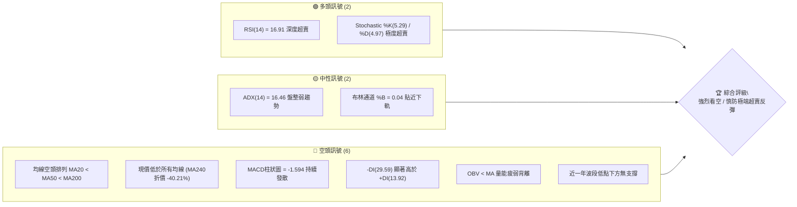
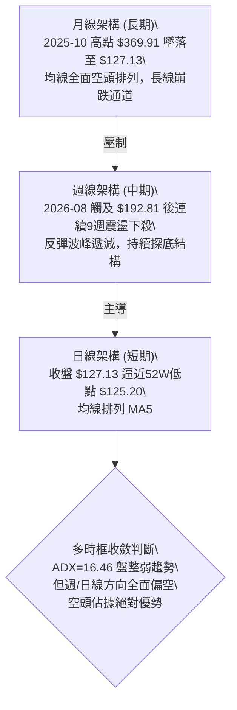
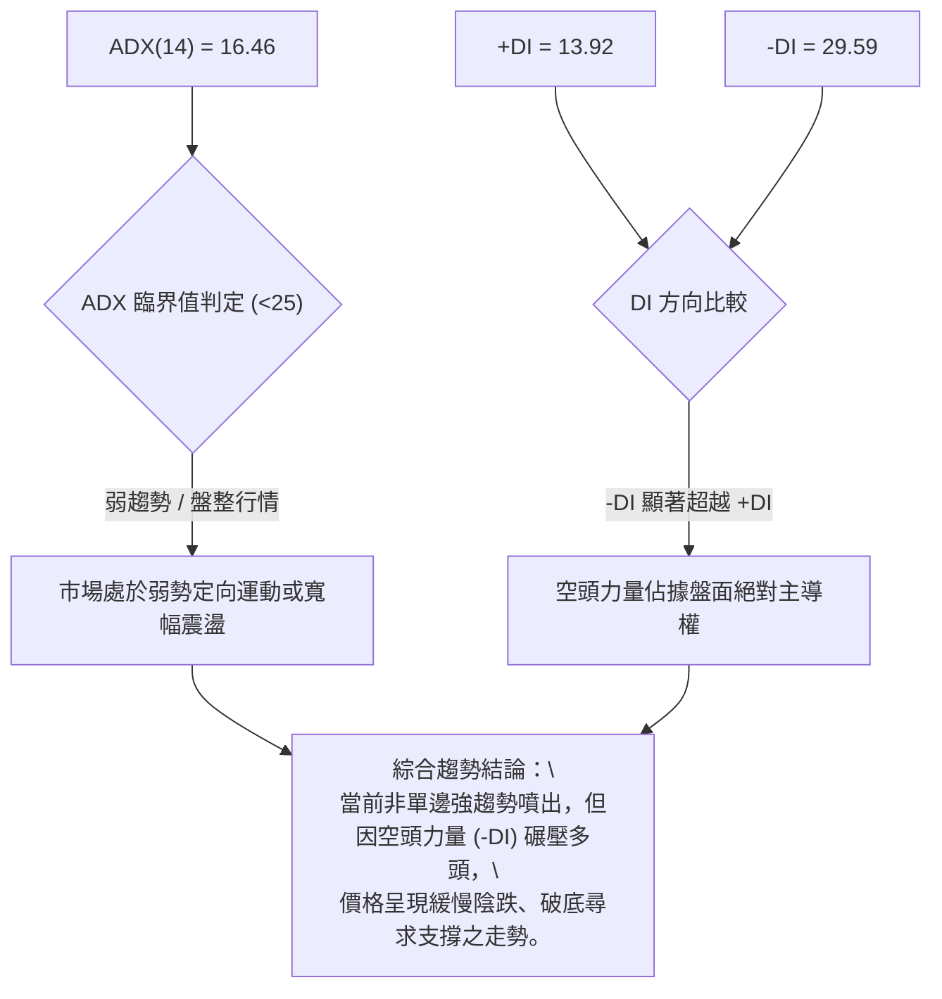
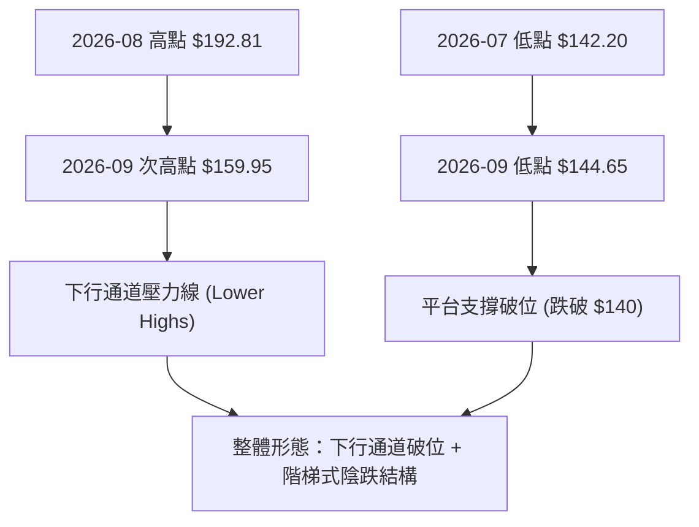
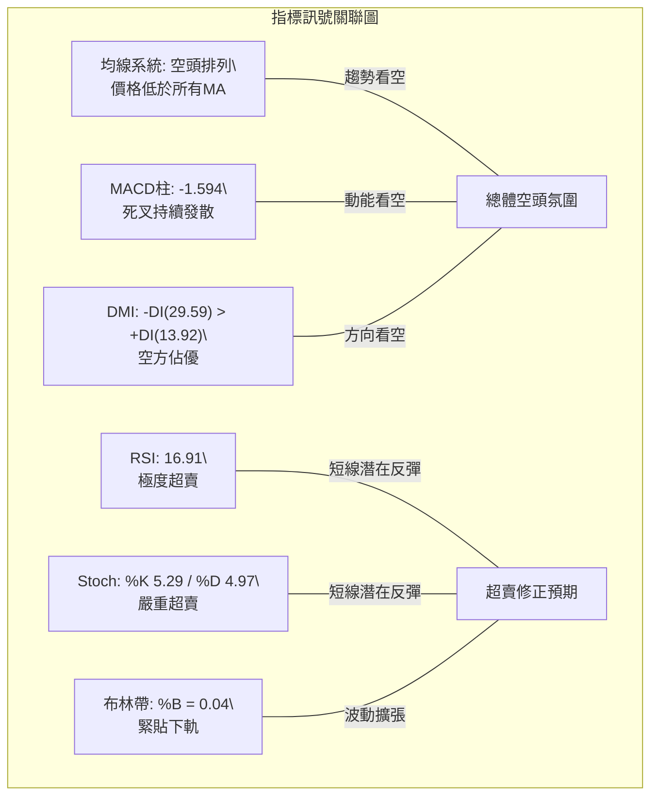
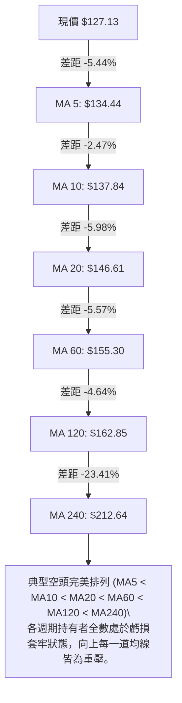
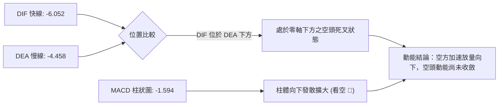
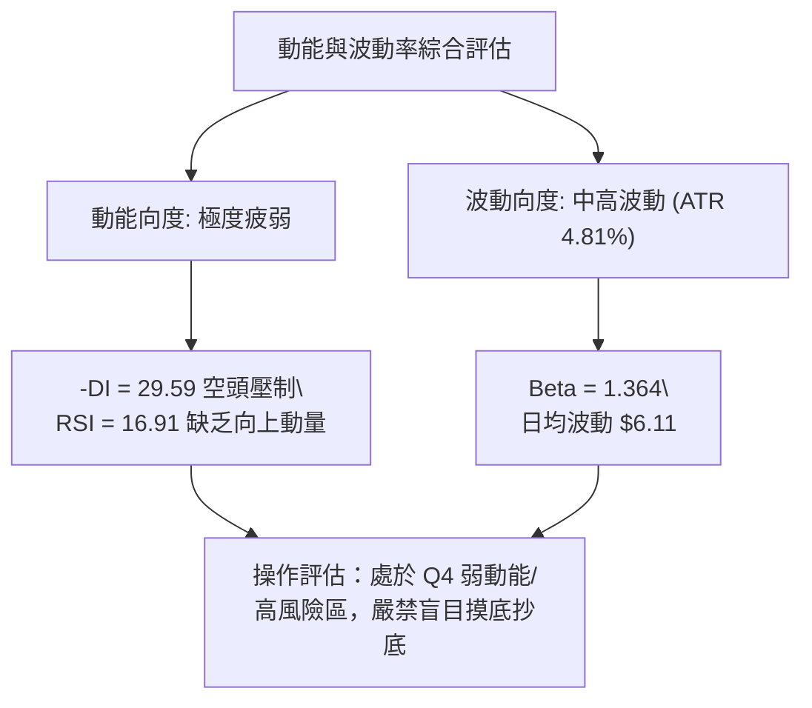
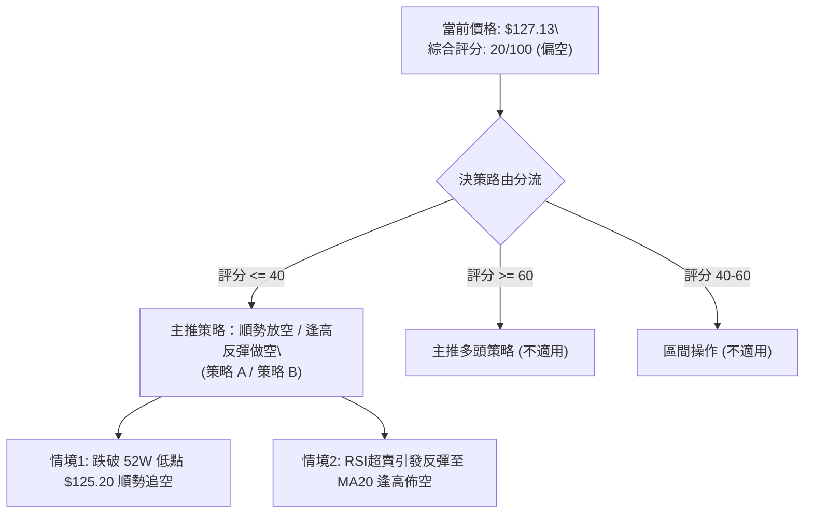
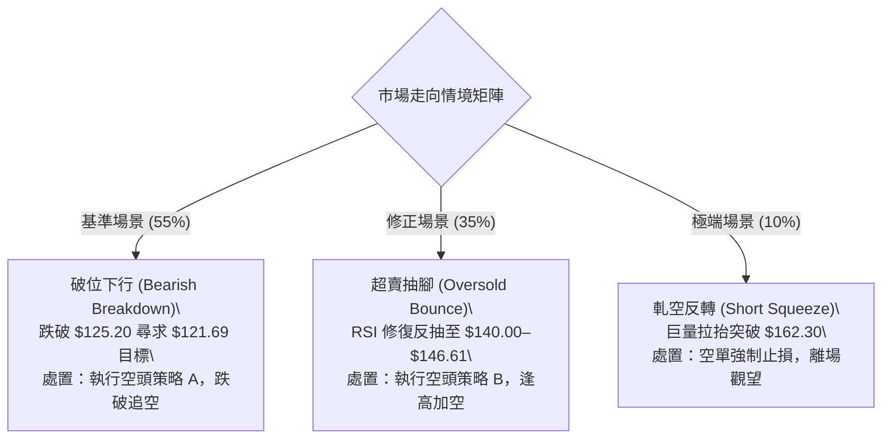

# AVAV 技術分析報告

> **報告日期**：2026-10-14 ｜ **語言**：繁體中文 ｜ **數據來源**：Yahoo Finance ｜ **當前價格**：$127.13

---

## 目錄

| 章節 | 內容 |
|------|------|
| [1. 技術面概覽](#1-技術面概覽) | 訊號儀表板、核心指標、評分卡 |
| [2. 趨勢分析](#2-趨勢分析) | 多時框趨勢、長中短期走勢 |
| [3. 圖表形態分析](#3-圖表形態分析) | 形態識別、K線組合、目標價 |
| [4. 支撐與阻力](#4-支撐與阻力) | 關鍵價位、斐波那契回調 |
| [5. 技術指標深度解讀](#5-技術指標深度解讀) | MA/RSI/MACD/布林/成交量 |
| [6. 動能與波動率](#6-動能與波動率) | 動能評估、ATR、Beta |
| [7. 多時框架總結](#7-多時框架總結) | 時框架評分矩陣 |
| [8. 交易策略建議](#8-交易策略建議) | 多空策略、風險報酬比 |
| [9. 風險提示與監控](#9-風險提示與監控) | 監控指標、風險場景 |

---

## 1. 技術面概覽

### 🎯 技術訊號儀表板



### 📊 核心指標速覽表

| 指標類別 | 指標名稱 | 當前數值 | 訊號 | 解讀 |
|:---|:---|:---|:---:|:---|
| **價格** | 當前收盤價 | $127.13 | 🔴 | 位於52週區間 0.7% 位置，瀕臨52W新低 $125.20 |
| **均線** | MA20 (短) | $146.61 | 🔴 | 價格低於MA20達 -13.29%，短線下行斜率陡峭 |
| **均線** | MA50 (中) | $156.05 | 🔴 | 價格低於MA50達 -18.53%，中期下行趨勢確立 |
| **均線** | MA200 (長) | $197.45 | 🔴 | 價格低於MA200達 -35.61%，處於實質熊市領域 |
| **動能** | RSI(14) | 16.91 | 🟢 | 極度超賣區間（<20），短線存在技術性反抽動能 |
| **動能** | MACD(12,26,9) | -6.052 / -4.458 | 🔴 | MACD線位於訊號線下方，柱狀圖 -1.594 持續擴大 |
| **擺動** | Stoch %K / %D | 5.29 / 4.97 | 🟢 | 進入極度超賣區間，指標出現微幅鈍化 |
| **趨勢** | ADX(14) | 16.46 | 🟡 | ADX < 25 表明處於盤整或弱趨勢，但 -DI 佔據主導 |
| **通道** | 布林通道 %B | 0.04 | 🟡 | 價格觸及布林下軌 $125.50，帶寬向下擴張 |
| **成交量** | 量比 (Volume/MA20) | 1.27x | 🔴 | 下跌帶量（1,878,500股），OBV低於均線確認空頭賣壓 |
| **波動** | ATR(14) | $6.11 | 🟡 | 佔現價 4.81%，日內波動維持中高水準 |

### 🏆 技術評分卡

```
╔══════════════════════════════════════════════════════════════╗
║              技術評分卡 — AVAV (2026-10-14)                  ║
╠══════════════════════════════════════════════════════════════╣
║ 趨勢強度      ████░░░░░░░░░░░░░░░░  20/100  🔴 強烈看空      ║
║ 動能指標      ██████░░░░░░░░░░░░░░  30/100  🟡 嚴重超賣      ║
║ 支撐穩定度    ██░░░░░░░░░░░░░░░░░░  10/100  🔴 逼近破位      ║
║ 成交量配合    ████░░░░░░░░░░░░░░░░  20/100  🔴 量增價跌      ║
║ 形態完整度    ██████░░░░░░░░░░░░░░  30/100  🔴 下行通道延續  ║
║ 均線排列      ██░░░░░░░░░░░░░░░░░░  10/100  🔴 標準空頭排列  ║
╠══════════════════════════════════════════════════════════════╣
║ 綜合評分      ████░░░░░░░░░░░░░░░░  20/100  🔴 強烈看空 (SELL)║
╚══════════════════════════════════════════════════════════════╝
```

---

## 2. 趨勢分析

### 🌐 多時框趨勢分析



### 📈 長期趨勢 — 12個月走勢圖（Unicode）

```
AVAV 月線走勢圖（過去12個月：2025-11 至 2026-10）
價格軸 ($)
$370 ┤                                         [歷史天花板 2025-10: $369.91]
$320 ┤
$280 ┤ ●(2025-11: 279.46)       ●(2026-01: 278.39)
$250 ┤          ●(2025-12: 241.89)     ●(2026-02: 252.25)
$210 ┤                                         ●(2026-05: 207.24)
$180 ┤                               ●(2026-03: 183.05)   ●(2026-04: 195.02)
$150 ┤                                                   ●(2026-06: 165.07)
$140 ┤                                                       ●(2026-07: 149.37)
$130 ┤                                                           ●(2026-08: 148.35)
$120 ┤                                                               ●(2026-09: 142.22)
$110 ┤                                                                    ●(2026-10: 127.13) ◄現價
     └─┬─────────┬─────────┬─────────┬─────────┬─────────┬─────────┬─────────┬─────────┬─────────┬─────────┬─────────┬─────────
      11月      12月       1月       2月       3月       4月       5月       6月       7月       8月       9月      10月
     (2025)    (2025)    (2026)    (2026)    (2026)    (2026)    (2026)    (2026)    (2026)    (2026)    (2026)    (2026)
```

#### 長期走勢階段特徵分析

| 階段區間 | 起始 / 結束收盤 | 區間漲跌幅 | 走勢特徵與結構解析 |
|:---|:---:|:---:|:---|
| **第一階段：高檔崩落期**<br>(2025-11 ~ 2025-12) | $279.46 → $241.89 | -13.44% | 脫離2025年10月高檔 $369.91 後出現獲利了結與籌碼潰散，帶量跌破短期均線。 |
| **第二階段：次級反彈中繼**<br>(2026-01 ~ 2026-02) | $278.39 → $252.25 | -9.39% | 2026年1月反彈至 $278.39 形成次高點（Lower High），受制於長期均線反壓後無力上攻。 |
| **第三階段：主跌波放量加速**<br>(2026-03 ~ 2026-06) | $183.05 → $165.07 | -9.82% | 2026年3月單月暴跌破 $200 大關，4至5月雖有微弱抽腳至 $207.24，但6月再度破位至 $165.07。 |
| **第四階段：緩跌築底未遂**<br>(2026-07 ~ 2026-10) | $149.37 → $127.13 | -14.89% | 7至9月於 $140–$149 區間弱勢徘徊，10月再度摜破支撐至 $127.13，直逼52週低點 $125.20。 |

### 📊 中期趨勢（週線分析）

從近20週數據觀察，AVAV 呈現標準的空頭階梯式下行：
- 2026-08-16 創下波段反彈高點 $192.81（RSI 達 73.5），隨後連續兩週大陰線摜破短期均線。
- 2026-09-13 週成交量暴增至 20,402,600 股，收在 $146.71，短線雖有拉升至 2026-09-20 的 $159.95，但迅速在 MA50（$156.05）與波段阻力 R1（$162.30）前遇阻回落。
- 近三週收盤價分別為 $140.82 → $137.11 → $127.13，RSI 自 34.9 降至 16.9，MACD 柱狀圖由 -1.350 擴大至 -1.594，確認中期下行趨勢未見反轉訊號。

```
中期週線價格與指標壓力軌跡
價位 ($)
$195 ┤      ● (08-16: 192.81, RSI 73.5)
$180 ┤    ●
$165 ┤          ●                         ● (09-20: 159.95)
$150 ┤              ●   ●   ● (09-13: 146.71)     ● (09-27: 152.05)
$135 ┤                  ●                               ● (10-11: 137.11)
$120 ┤                                                      ● (10-18: 127.13 ◄現價)
     └────────────────────────────────────────────────────────
      08-02  08-16  08-30  09-13      09-27      10-11  10-18
```

### ⚡ 趨勢強度評估（ADX 解讀）



| 指標變量 | 數值 | 區間閾值 | 趨勢判定 | 市場意涵解讀 |
|:---|:---:|:---:|:---:|:---|
| **ADX (14)** | 16.46 | < 25 | 弱趨勢 / 盤整 | 趨勢總體動能不強，主因是過去三個月在 $140–$160 區間震盪耗損了單邊動量。 |
| **+DI (14)** | 13.92 | < 20 | 多頭衰竭 | 多頭買盤力道極其疲軟，毫無向上發動攻勢之動能。 |
| **-DI (14)** | 29.59 | > 25 | 空頭強勁 | 空方賣壓沉重，-DI 大於 +DI 達 15.67，空方牢牢掌握定價權。 |

---

## 3. 圖表形態分析

### 🔍 形態識別系統



#### 形態識別與信心度評估表

| 形態名稱 | 信心度 | 判斷依據（引用數據） | 完成度 | 目標價（附計算式） |
|:---|:---:|:---|:---:|:---|
| **下降通道 (Descending Channel)** | **85%** | 高點自 2026-08-16 的 $192.81 降至 2026-09-20 的 $159.95；低點自 $142.20 降至 $127.13，符合通道特徵。 | 90% | 由通道上軌 $159.95 減去通道垂直高度 ($159.95 - $144.65 = $15.30)，得破位量度目標：$144.65 - $15.30 = **$129.35**（現價 $127.13 已達成）。 |
| **矩形整理向下破位 (Bearish Breakdown)** | **75%** | 2026年7月至9月於 $140.82–$159.95 形成箱體，10月連續兩週跌破箱底 $140.82。 | 100% | 箱體高度 = $159.95 - $140.82 = $19.13。<br>破位目標價 = $140.82 - $19.13 = **$121.69**（由形態高度推算）。 |
| **雙底形態 (Double Bottom)** | **15%** | 目前僅有52週低點 $125.20 具潛在支撐，現價尚未止跌，無右底抬高或頸線突破。 | 10% | 訊號不足，僅做指標型超賣解讀，不得預設雙底成立。 |

### 🕯️ 重要K線形態分析

| 週/月份 | 收盤價 | K線形態 | 深度解讀 | 訊號方向 |
|:---|:---:|:---|:---|:---:|
| **2026-08-16** | $192.81 | 長上影倒轉十字星 | 衝高 $192.81 後買盤衰竭，空方全力反撲，標誌波段反彈終結。 | 🔴 強烈看空 |
| **2026-09-13** | $146.71 | 放量長下影錘頭線 | 週成交量爆出 20,402,600 股天量，低檔承接盤湧現，引發次週短暫反彈。 | 🟢 短線反彈 |
| **2026-09-20** | $159.95 | 高檔受阻中陽線 | 成交量 11,272,600 股縮減，反彈未能突破 MA50（$156.05）上方 R1 區域，假突破。 | 🟡 假突破 |
| **2026-10-11** | $137.11 | 中陰線下破支撐 | 實體陰線摜穿 $140 心理關卡，RSI 跌破 20，賣壓加速湧現。 | 🔴 空頭延續 |
| **2026-10-18** | $127.13 | 光腳中陰線探底 | 逼近52W低點 $125.20，日線級別連續走低，收盤創本波段收盤新低。 | 🔴 極度弱勢 |

### 📉 ASCII 走勢形態示意圖

```
AVAV 近期箱體向下破位走勢示意圖
價位 ($)
$162.30 ───┬──────────────────────────────────────────── 阻力位 R1
           │          ╭───╮ (09-20 高點: $159.95)
$150.00 ───┼──────────╯   ╰───────╮ 箱體頂部區間
           │  ╭───╮               ╰─────╮
$140.82 ───┼──╯   ╰─────────────────────┴─────╮ 箱體底部 (頸線破位點)
           │                                   ╰────────╮
$127.13 ───┼────────────────────────────────────────────● ◄ 現價 $127.13
$125.20 ───┴──────────────────────────────────────────── 52週低點支撐位
```

### 🎯 形態目標價計算

根據 2026-07 至 2026-09 所構築的中期震盪箱體：
1. **箱體頂部（頸線高點）**：$159.95（2026-09-20 收盤價）
2. **箱體底部（破位頸線）**：$140.82（2026-10-04 收盤價）
3. **箱體高度 ($H$)**：$159.95 - $140.82 = $19.13
4. **第一量度跌幅目標 ($T1$)**：
   $$T1 = 破位頸線 - H = \$140.82 - \$19.13 = \mathbf{\$121.69}$$（由形態高度推算）
5. **第二量度跌幅目標（1.618擴展 $T2$）**：
   $$T2 = \$140.82 - (\$19.13 \times 1.618) = \$140.82 - \$30.95 = \mathbf{\$109.87}$$（由形態高度推算）

---

## 4. 支撐與阻力

### 🗺️ 關鍵價位分布圖（Unicode）

```
AVAV 價位結構分布圖
════════════════════════════════════════════════════════════════
$200.38 ║██████████████████████████████║ 強阻力 R3 (年線上方重壓)
$186.40 ║████████████████████          ║ 斐波那契 78.6% 回調位
$168.00 ║████████████████████████      ║ 阻力 R2 (近一年波段高點)
$162.30 ║████████████████████████████  ║ 關鍵阻力 R1 (波段密集套牢區)
$146.61 ║████████████                  ║ 布林中軌 / MA20
════════╬══════════════════════════════╬════════════════════════
$127.13 ╠══════════════════════════════╣ ◄ 現價 ($127.13)
════════╬══════════════════════════════╬════════════════════════
$125.50 ║▓▓▓▓▓▓▓▓▓▓                    ║ 布林下軌支撐
$125.20 ║██████████████████████████████║ 52週絕對低點 (斐波那契 100.0%)
 (無)   ║░░░░░░░░░░░░░░░░░░░░░░░░░░░░░░║ (低點下方無可辨識波段支撐)
════════════════════════════════════════════════════════════════
```

### 🚧 阻力位分析表

| 阻力級別 | 價位 | 形成原因（依據數據庫波段高點聚類） | 突破難度 | 技術重要性 |
|:---|:---:|:---|:---:|:---|
| **阻力 R1** | **$162.30** | 近一年波段高點聚類，與 MA120 ($162.85) 重疊，為中期反彈第一道天花板。 | 極高 | ★★★★☆ |
| **阻力 R2** | **$168.00** | 近一年波段高點聚類，接近布林通道上軌 ($167.72)，空頭強烈防守線。 | 極高 | ★★★★☆ |
| **阻力 R3** | **$200.38** | 近一年波段高點聚類，接近 MA200 ($197.45)，為牛熊分界關鍵分水嶺。 | 極限 | ★★★★★ |

### 🛡️ 支撐位分析表

| 支撐級別 | 價位 | 形成原因 | 守住機率 | 技術重要性 |
|:---|:---:|:---|:---:|:---|
| **動態支撐** | **$125.50** | 當前日線布林通道下軌位置，短線超賣緩衝區。 | 40% | ★★☆☆☆ |
| **極限支撐** | **$125.20** | 52週最低價 (52W Low)，亦為斐波那契 100.0% 基準點。 | 30% | ★★★★★ |
| **次級支撐** | *(無)* | **數據中未偵測到現價下方之近一年波段低點支撐**，若破 $125.20 將進入價格真空區。 | N/A | 🔴 極度危險 |

### 📐 斐波那契回調位分析

本週期斐波那契序列以52週高點 $411.16 與52週低點 $125.20 進行計算，各層級回調點位如下：

```
斐波那契回調層級（區間：$125.20 → $411.16）
0.0%  (52W High) ────────────────────────────── $411.16
23.6%            ────────────────────────────── $343.67
38.2%            ────────────────────────────── $301.92
50.0%            ────────────────────────────── $268.18
61.8%            ────────────────────────────── $234.44
78.6%            ────────────────────────────── $186.40
現價位置 ─────── ◄ $127.13 (落於 78.6% 與 100.0% 之間，極端弱勢區)
100.0% (52W Low) ────────────────────────────── $125.20
```

- **位置意義解讀**：現價 $127.13 位於 78.6% 回調位（$186.40）與 100.0% 回調位（$125.20）之間，處於回調區間的最末端（僅距 100% 低點 +1.54%）。
- **技術破位威脅**：當資產全數回吐前一輪波段漲幅並跌破 78.6% 深度回調位時，通常意味著原本的上升週期已徹底破裂，市場進入尋底階段。若 $125.20 失守，斐波那契擴展跌幅目標將朝向下行擴展位釋放。

---

## 5. 技術指標深度解讀

### 🎛️ 指標訊號總覽



### 📈 移動平均線排列分析



| 均線週期 | 當前價位 | 與現價差距 (%) | 走勢趨向 | 技術意涵 |
|:---|:---:|:---:|:---:|:---|
| **MA 5** | $134.44 | -5.44% | 陡峭向下 | 短線第一道動態壓制線，未站上前短線無翻多可能。 |
| **MA 10** | $137.84 | -7.77% | 陡峭向下 | 超短線空頭防守位。 |
| **MA 20** | $146.61 | -13.29% | 持續走低 | 月線級別均線，亦為布林通道中軌，中期強弱分水嶺。 |
| **MA 50** | $156.05 | -18.53% | 下行彎頭 | 季線下壓，確立中期修正未完。 |
| **MA 200** | $197.45 | -35.61% | 下行走勢 | 長期牛熊分界線，折價幅度極深，表徵進入實質熊市。 |

### 📉 RSI(14) 分析

```
RSI(14) 數值儀表板：當前數值 16.91
0                 20        30                       70               100
├─────────────────┼─────────┼────────────────────────┼─────────────────┤
│ 深度超賣區間     │ 超賣區   │       中性常態區       │     超買區      │
│ ████████░░░░░░░ │         │                        │                 │
└─────────────────┴─────────┴────────────────────────┴─────────────────┘
當前指針位置：[ 16.91 ] 🟢 極度超賣
```

- **超買超賣評估**：RSI(14) 達到 16.91，處於 20 以下的極端超賣區域。歷史數據顯示，當 AVAV 週線 RSI 降至 20 附近時（如 2026-06-28 的 20.2 與 2026-08-30 的 21.9），均曾觸發次級反抽；然而目前日線 RSI 尚未見底背離抬頭跡象。
- **背離分析**：
  - **頂背離**：無。
  - **底背離**：**無明顯底背離**。在近期破位過程中，價格自 $137.11 跌至 $127.13 創下波段新低，RSI 亦同步由 19.1 走低至 16.91，呈現指標隨價格同步創低之「空頭慣性」，尚未構成價格創低而指標抬高的底背離形態。

### 📊 MACD(12/26/9) 訊號解讀



- **數值判讀**：DIF (-6.052) 深度低於零軸，且落後於 DEA (-4.458)；柱狀圖為 -1.594，呈現負值擴大趨勢。
- **指標確認**：MACD 空頭動能與均線系統向下發散相互驗證，表明目前市場賣盤仍處於主動拋售狀態，尚未進入動能衰竭期。

### 📦 布林通道分析

```
AVAV 日線布林通道 (20, 2) 結構示意圖
價位 ($)
$167.72 ┬────────────────────────────────────────── 上軌 (Upper Band)
        │
$146.61 ┼────────────────────────────────────────── 中軌 (SMA 20)
        │
$127.13 ┼──────────────────────────────● (現價 $127.13, %B = 0.04)
$125.50 ┴────────────────────────────────────────── 下軌 (Lower Band)
```

- **通道帶寬與位置**：通道上軌 $167.72，下軌 $125.50，帶寬為 $42.22（佔現價 33.2%），顯示通道處於擴張狀態。
- **%B 指標解讀**：目前 %B 為 0.04，表示現價極度貼近布林下軌（距離下軌僅 $1.63）。在空頭行情中，價格常沿著布林下軌進行「沿軌下跌」（Walking the band），此為空頭強勢訊號，而非單純的觸軌反彈買點。

### 💹 成交量分析（量價配合度）

```
近期成交量能變化剖析
成交量 (股)
20.4M ┤                         ● (09-13: 20,402,600 巨量長下影)
11.3M ┤                             ● (09-20: 11,272,600 縮量反彈)
 7.5M ┤                                           ● (10-11: 7,559,200 帶量下破)
 3.6M ┤                                               ● (10-18: 3,647,800 半週量)
 1.8M ┤ 當前日成交量: 1,878,500 (量比 1.27x，大於20日均量 1,473,635)
      └────────────────────────────────────────────────────────
```

- **量價配合度分析**：
  - 最新日成交量為 1,878,500 股，相較於 20 日均量 1,473,635 股放大至 1.27 倍，呈現「跌放量」格局，顯示破底過程中存在實質拋壓。
  - **OBV 能量潮趨勢**：數據顯示「OBV < MA → 量能疲弱」，OBV 指標持續位於其均線下方，證明主力資金呈流出趨勢，成交量並未對多頭提供支撐，反向確認了價格下跌的有效性。

---

## 6. 動能與波動率

### ⚡ 動能評估四象限

| 象限 | 動能維度 | 波動維度 | 代表特徵 | 當前 AVAV 狀態定位 |
|:---:|:---:|:---:|:---|:---:|
| **Q1** | 強動能 (多頭) | 低波動 | 穩健上升趨勢，最佳多頭進場點 | — |
| **Q2** | 弱動能 (盤整) | 低波動 | 窄幅箱體震盪，缺乏方向 | — |
| **Q3** | 強動能 (單邊) | 高波動 | 劇烈多空博弈，高風險高收益 | — |
| **Q4** | **弱動能 (空頭主導)** | **中高波動** | **動能衰竭、破底陰跌、拋壓釋放** | **✓ (定位於 Q4 象限)** |



### 📊 ATR 波動率分析

- **ATR(14) 數值**：**$6.11**（佔當前股價 $127.13 的 **4.81%**）。
- **風控參數與止損距離建議**：
  - **超短線交易（1.0 × ATR）**：止損/風控寬容度需設定為 **$6.11**。
  - **波段波段交易（1.5 × ATR）**：止損距離應為 $6.11 \times 1.5 = \mathbf{\$9.17}$。
  - **趨勢交易防護（2.0 × ATR）**：止損距離應為 $6.11 \times 2.0 = \mathbf{\$12.22}$。
- **波動特性解讀**：AVAV 日均波幅接近 5%，顯示其價格對消息面與市場情緒極具彈性，在破位行情中單日穿透力極強，任何操作必須嚴格控制倉位。

### 📐 Beta 與市場相關性

- **Beta 係數**：**1.364**。
- **大盤敏感度**：AVAV 屬於高 Beta 成長/軍工科技股，其價格波動幅度比 S&P 500 指數高出約 36.4%。在市場處於避險情緒時，AVAV 的資金抽離速度顯著快於防守型工業股；且其融券放空比例達 **12.8%**（Short Float），表明市場空頭部位擁擠，若遇整體大盤重挫，極易引發補跌與踩踏。

---

## 7. 多時框架總結

### 📋 時框架評分表

| 時框架 | 趨勢方向 | 動能指標 | 均線系統 | 形態結構 | 綜合評分 | 戰術建議 |
|:---|:---:|:---:|:---:|:---:|:---:|:---|
| **長期 (月線)** | 🔴 強烈看空 | 🔴 走弱破位 | 🔴 空頭排列 | 下跌大通道 | 15/100 | 長期投資者離場觀望，不宜建倉 |
| **中期 (週線)** | 🔴 空頭主導 | 🔴 MACD擴散 | 🔴 均線反壓 | 震盪箱體下破 | 20/100 | 反彈逢高放空，或嚴格防守停損 |
| **短期 (日線)** | 🟡 超賣反抽 | 🟢 RSI超賣 | 🔴 MA5-MA20壓制 | 貼下軌緩跌 | 25/100 | 僅允許極小倉位博取短線乖離修正 |

### 🔲 綜合訊號矩陣

```
╔══════════════════════════════════════════════════════════════════╗
║               AVAV 多時框架訊號矩陣 (Signal Matrix)              ║
╠══════════════════╦══════════════╦══════════════╦═════════════════╣
║ 分析維度         ║ 短期 (日線)  ║ 中期 (週線)  ║ 長期 (月線)     ║
╠══════════════════╬══════════════╬══════════════╬═════════════════╣
║ 趨勢方向         ║ 🔴 空頭陰跌  ║ 🔴 階梯下行  ║ 🔴 熊市格局     ║
║ 動能狀態         ║ 🟢 極度超賣  ║ 🔴 空方加速  ║ 🔴 動能持續流失 ║
║ 均線排列         ║ 🔴 空頭排列  ║ 🔴 全面反壓  ║ 🔴 空頭死叉     ║
║ 成交量配合       ║ 🔴 跌增反彈縮║ 🔴 OBV持續背離║ 🔴 籌碼鬆動     ║
║ 波動率狀態       ║ 🟡 中度擴張  ║ 🟡 偏高震盪  ║ 🔴 空頭宣洩     ║
╠══════════════════╬══════════════╬══════════════╬═════════════════╣
║ 維度收斂權重     ║ 20% (時機)   ║ 50% (主導)   ║ 30% (背景)      ║
╚══════════════════╩══════════════╩══════════════╩═════════════════╣
```

### ⚖️ 多時框收斂結論

依據多時框收斂規則：
1. **行情性質判斷**：當前 ADX(14) 數值為 **16.46 (< 25)**，技術上歸類為「**盤整/弱趨勢行情**」。然而，在 DMI 結構中，-DI (29.59) 碾壓 +DI (13.92)，且價格連續跌破中期盤整箱體下沿 $140.82。
2. **優先級收斂原則**：由於 ADX < 25 且價格瀕臨布林下軌 $125.50，日線級別具備極度超賣引發抽腳之特徵；但中長期均線（MA50 $156.05、MA200 $197.45）呈不可逆之空頭排列。依收斂規則，**日線超賣僅能作為尋找反彈空點或平倉空單之依據，不可篡改中期偏空的戰略方向**。
3. **唯一方向性結論**：**【強烈偏空觀望（BEARISH）】**。盤面絕對由空頭掌控，在價格未帶量突破並站穩 MA20（$146.61）前，任何反彈均屬技術性死貓跳。

---

## 8. 交易策略建議

### 🗺️ 策略決策流程圖



### 🧭 策略路由（依評分卡分流）

> **當前主策略方向 = 【空頭主導（順勢放空 / 逢反彈放空）】（依綜合評分 20/100）**
> 
> 依評分規則，綜合評分 20 分（≤40），報告嚴格**主推空頭策略**。多頭操作僅列為極端超賣的反轉風險提示與對沖參考，嚴禁在趨勢未扭轉前以主力資金逆勢接刀。

### 🎯 價格情境階梯（Price Scenarios）

| 觸發條件 | 下一目標 | 後續延伸 | 情境技術含義 |
|:---|:---:|:---:|:---|
| **跌破 52W 低點 $125.20** | **$121.69** (箱體破位目標) | **$109.87** (1.618擴展目標) | 空頭加速宣洩，進入無支撐之破位真空行情。 |
| **守住 $125.20 發動超賣反彈** | **$134.44** (MA5 壓力線) | **$146.61** (MA20 / 布林中軌) | 極端超賣之技術性修正，形成理想之次級放空點。 |
| **突破關鍵阻力 R1 $162.30** | **$168.00** (R2 阻力) | **$200.38** (R3 / MA200 壓力) | 中期結構實質反轉，空頭策略全面失效止損。 |

### 📊 情境機率分佈

| 情境劇本 | 機率 | 主要判斷依據（引用指標與價位數據） |
|:---|:---:|:---|
| **情境一：直接破位再探新低** | **55%** | MACD柱狀圖持續擴散 (-1.594)、-DI(29.59) 掌控局面、OBV量能疲弱，距52W低點 $125.20 僅一步之遙。 |
| **情境二：弱勢反抽後承壓回落** | **35%** | RSI(14)=16.91、Stoch %K=5.29 進入極度超賣，布林通道 %B=0.04 接近下軌，隨時可能出現 1-2 日報復性抽腳。 |
| **情境三：強勢反轉突破上行** | **10%** | 空頭均線排列下壓，上方套牢籌碼極重，缺乏重大利多難以直接扭轉趨勢。 |

### 🔴 主策略詳情（空頭專屬策略）

| 策略要素 | 策略 A（破位追空策略） | 策略 B（超賣反抽逢高沽空策略） |
|:---|:---|:---|
| **策略邏輯** | 順應破底動能，跌破52週關鍵低點順勢進場 | 利用 RSI 極端超賣反抽至均線壓力位放空 |
| **進場條件** | 日線收盤價或盤中實質跌破 52W 低點 $125.20 | 價格反抽至 MA20 與布林中軌附近遇阻滯漲 |
| **進場價格** | **$124.80**（確認破位 $125.20 後觸發） | **$144.50**（接近 MA20 $146.61 反壓區） |
| **目標價 T1** | **$121.69**（箱體高度推算目標） | **$127.13**（現價/回踩起漲點） |
| **目標價 T2** | **$109.87**（1.618 形態擴展目標） | **$125.20**（52週低點測試位） |
| **止損價格** | **$127.80**（拉回至現價阻力及突破點上方）| **$150.60**（突破 MA20 加 1.0 × ATR $6.11） |
| **止損距離** | $3.00 (2.40%) | $6.10 (4.22%) |
| **風險報酬比 (T1)** | **1 : 1.04** | **1 : 2.85** |
| **風險報酬比 (T2)** | **1 : 4.98** | **1 : 3.16** |
| **預估勝率** | 60% | 70% |
| **建議倉位** | 10%（因超賣追空，宜採輕倉） | 20%（具安全邊際，可採標準防守倉） |

### 🟢 反向風險觸發點（對沖與空單風控提示）

若發生以下任一信號，空頭主策略宣告無效，空單必須立即無條件平倉或反手對沖：
1. **價位突破觸發**：日線收盤價強勢站上 **MA20（$146.61）**，或進一步突破 **阻力位 R1（$162.30）**。
2. **量價異動觸發**：單日成交量突破 10,000,000 股（超過20日均量5倍），且日K收出吞噬長陽線。
3. **指標底背離確立**：價格跌破 $125.20 但 RSI(14) 顯著抬升至 35 以上，MACD 柱狀圖在零軸下方出現連續兩次金叉。

### ⭐ 整體訊號強度評星

```
╔══════════════════════════════════════════════════════════════╗
║                    技術訊號強度星級評定                      ║
╠══════════════════════════════════════════════════════════════╣
║ 做多訊號強度：★☆☆☆☆  (1/5星) — 僅剩指標超賣，缺乏反轉結構 ║
║ 做空訊號強度：★★★★☆  (4/5星) — 順應長中短全週期空頭共振   ║
║ 整體可信度：  ★★★★☆  (4/5星) — 趨勢明確，量價指標高度一致 ║
╚══════════════════════════════════════════════════════════════╝
```

---

## 9. 風險提示與監控

### ✅ 關鍵監控指標 Checklist

```
╔══════════════════════════════════════════════════════════════╗
║              AVAV 日常交易風險監控清單 (Checklist)           ║
╠══════════════════════════════════════════════════════════════╣
║ [ ] 52W 低點保衛戰：觀察 $125.20 是否收盤破位                 ║
║ [ ] 超賣指標修復：關注 RSI(14) 何時由 16.91 回升穿過 30      ║
║ [ ] MACD 柱狀圖收斂：監控 -1.594 是否縮減轉向零軸            ║
║ [ ] DMI 交叉預警：關注 +DI(13.92) 與 -DI(29.59) 差距是否縮小 ║
║ [ ] 融券回補風險：留意 12.8% 放空比率引發的軋空暴衝 (Squeeze) ║
║ [ ] 動態均線阻力：每日追蹤 MA5 ($134.44) 與 MA20 ($146.61)  ║
╚══════════════════════════════════════════════════════════════╝
```

### ⚠️ 風險場景分析



### 🛡️ 風險管理重要提醒

1. **極度超賣帶來的「反抽風險」**：
   - 當前 RSI(14) 為 16.91，隨機指標 %K 僅 5.29。在歷史走勢中，如此深度的超賣往往伴隨突發性的報復性反彈（日內抽升 5–8% 極為常見）。因此，**禁止在此處進行重倉追空**，空頭操作者務必將單筆交易風險控制在總資金的 **1.0%** 以內。
2. **流動性與空頭擁擠風險**：
   - 融券比例高達 12.8%（Short Float），且機構持股比例高達 88.3%。籌碼結構高度集中意味著一旦出現軍工合約簽署或政策利多，極易觸發逼空行情（Short Squeeze）。
3. **無波段支撐保護的懸崖效應**：
   - 在當前價格下方，近一年數據未偵測到任何波段支撐點，唯一的心理關卡僅剩 52 週低點 **$125.20**。一旦此防線失守，將進入技術性「無人區」，停損賣壓與演算法交易恐導致流動性瞬間抽乾。

---

## 📋 報告總結

```
╔══════════════════════════════════════════════════════════════╗
║                 AVAV 技術分析報告總結                        ║
╠══════════════════════════════════════════════════════════════╣
║ 報告日期：2026-10-14                                         ║
║ 當前價格：$127.13                                            ║
║ 分析評級：🔴 強烈看空 (SELL) — 評分 20/100                   ║
║                                                              ║
║ 關鍵結論：                                                   ║
║ ├─ 長期趨勢：🔴 崩跌下行通道，年線折價 -40.21%               ║
║ ├─ 中期趨勢：🔴 箱體破位下殺，週線級別連續走低               ║
║ ├─ 短期趨勢：🟡 極度超賣 (RSI 16.91)，短線具反抽需求         ║
║ ├─ 關鍵支撐：$125.50 (布林下軌) / $125.20 (52W低點)          ║
║ ├─ 關鍵阻力：$146.61 (MA20) / $162.30 (R1) / $168.00 (R2)     ║
║ └─ 華爾街共識目標價：$216.46 (與技術面嚴重背離，參考即可)   ║
║                                                              ║
║ 最優策略組合：                                               ║
║ 1. 🥇 最佳機會：等待超賣反彈至 $144.50 附近逢高放空 (策略 B) ║
║ 2. 🥈 次選機會：實質跌破 $125.20 後輕倉順勢追空 (策略 A)     ║
║ 3. 🥉 保守選擇：多頭全面空倉觀望，嚴禁左側盲目抄底摸底      ║
╚══════════════════════════════════════════════════════════════╝
```

---

> ⚠️ **免責聲明**：本報告為 AI 自動生成之技術分析，所有數據及估算均基於提供的歷史價格資訊。本報告**僅供研究與學術參考**，**不構成任何投資建議**。投資有風險，入市需謹慎。

---

*報告生成時間：2026-10-14 ｜ 數據來源：Yahoo Finance ｜ 分析框架：多時框技術分析*