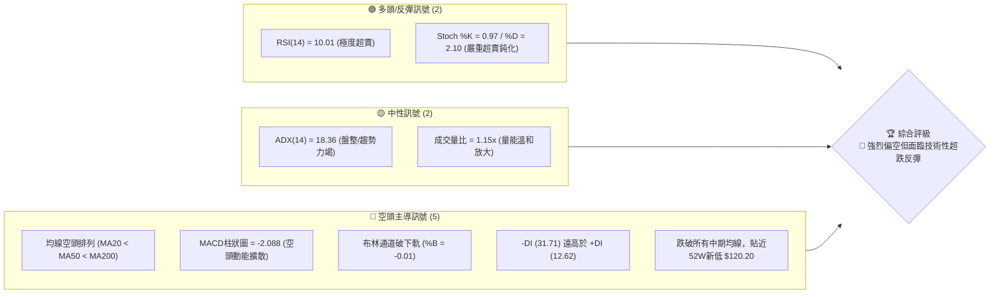
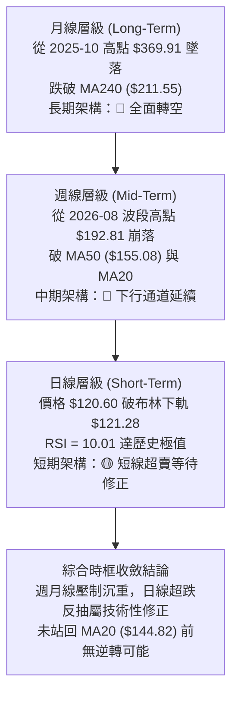
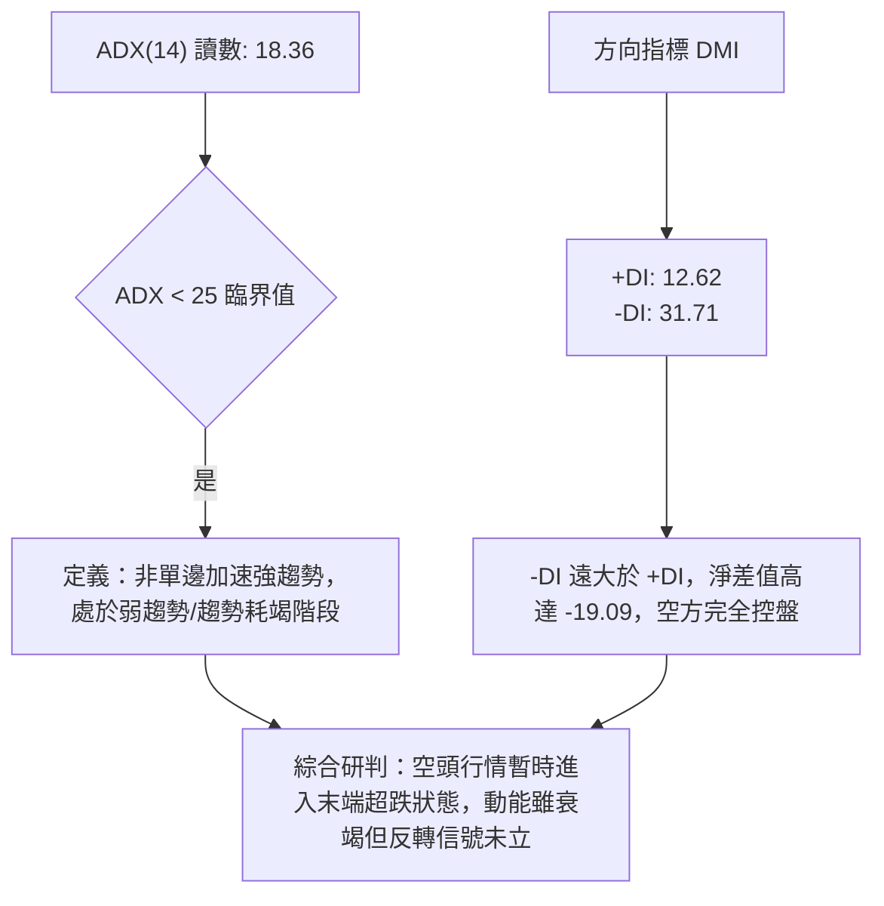
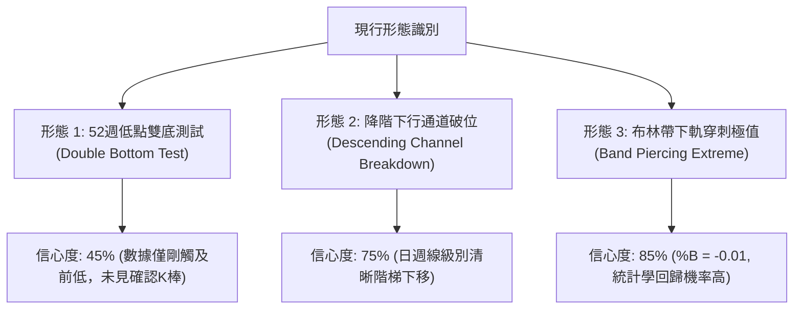
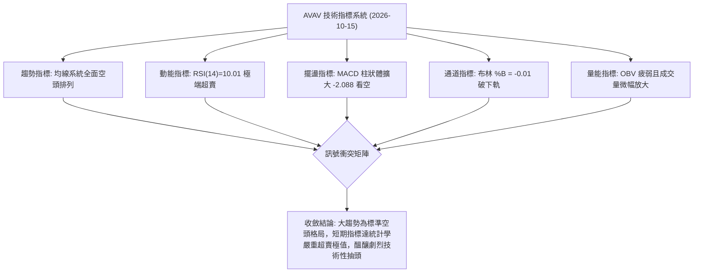
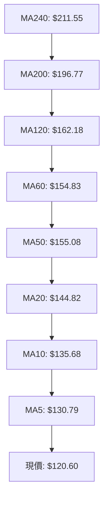
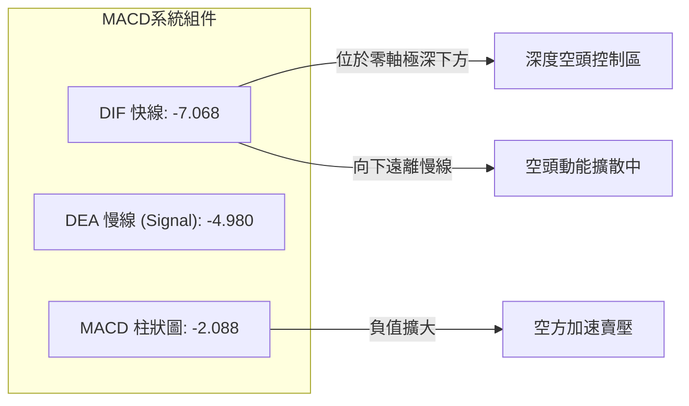
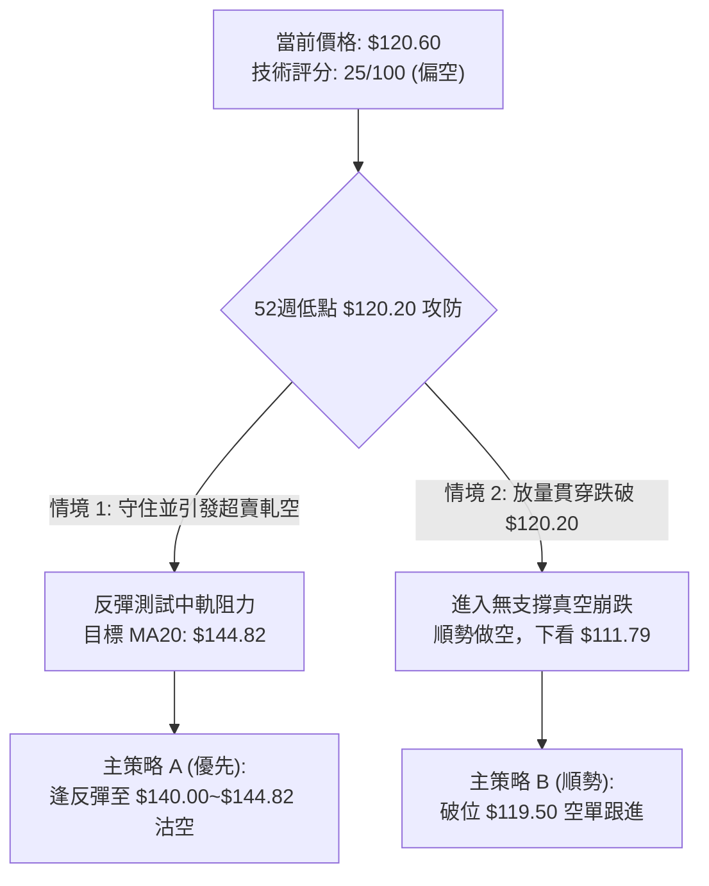
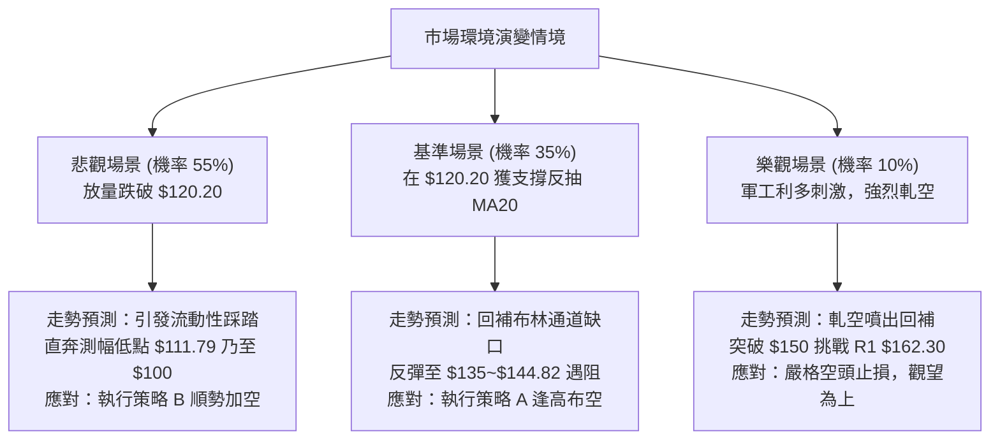

# AVAV 技術分析報告

> **報告日期**：2026-10-15 ｜ **語言**：繁體中文 ｜ **數據來源**：Yahoo Finance ｜ **當前價格**：$120.60

---

## 目錄

| 章節 | 內容 |
|------|------|
| [1. 技術面概覽](#1-技術面概覽) | 訊號儀表板、核心指標、評分卡 |
| [2. 趨勢分析](#2-趨勢分析) | 多時框趨勢、長中短期走勢、ADX強度 |
| [3. 圖表形態分析](#3-圖表形態分析) | 形態識別、K線組合、目標價推算 |
| [4. 支撐與阻力](#4-支撐與阻力) | 關鍵價位、斐波那契回調結構 |
| [5. 技術指標深度解讀](#5-技術指標深度解讀) | 均線系統、RSI、MACD、布林通道、量能 |
| [6. 動能與波動率](#6-動能與波動率) | 動能四象限、ATR波幅、Beta係數 |
| [7. 多時框架總結](#7-多時框架總結) | 時框架評分矩陣、多時框收斂結論 |
| [8. 交易策略建議](#8-交易策略建議) | 策略路由、主策略設定、風險報酬比 |
| [9. 風險提示與監控](#9-風險提示與監控) | 監控清單、情境模擬、風控提醒 |
| [10. 報告總結](#10-報告總結) | 核心結論與綜合技術面評級 |

---

## 1. 技術面概覽

### 🎯 技術訊號儀表板



### 📊 核心指標速覽表

| 指標類別 | 指標名稱 | 當前數值 | 訊號 | 解讀 |
|----------|----------|----------|------|------|
| **價格** | 當前收盤價 | $120.60 | 🔴 | 距離52週低點 $120.20 僅 0.33%，處於歷史性弱勢區間 |
| **均線** | MA20 | $144.82 | 🔴 | 現價低於MA20達 -16.72%，短期下行趨勢嚴峻 |
| **均線** | MA50 | $155.08 | 🔴 | 現價低於MA50達 -22.23%，中期空頭壓制堅固 |
| **均線** | MA200 | $196.77 | 🔴 | 現價低於MA200達 -38.71%，長期牛熊分水嶺已全面失守 |
| **動能** | RSI(14) | 10.01 | 🟢 | 進入極端超賣區 (<20)，空頭賣壓宣洩接近極限，反彈一觸即發 |
| **動能** | MACD (12,26,9) | -7.068 / -4.980 | 🔴 | 雙線位於零軸下方發散，柱狀圖 -2.088 擴大，空頭動能未止 |
| **隨機指標**| Stoch %K / %D | 0.97 / 2.10 | 🟢 | 雙線於個位數極端區，具備技術性強烈底背離或超跌反彈潛能 |
| **趨勢強度**| ADX(14) / ±DI | 18.36 | 🟡 | 數值 <25 顯示單邊趨勢加速度減緩，空方掌控主導權 (-DI=31.71) |
| **通道** | 布林通道帶寬 | 下軌 $121.28 | 🔴 | 現價跌破布林下軌 (%B = -0.01)，呈現極端通道外擴散走勢 |
| **波動** | ATR(14) | $6.16 | 🔴 | 佔股價 5.11%，每日波動空間偏大，需設定寬幅停損 |

### 🏆 技術評分卡

```
╔══════════════════════════════════════════════════════════════╗
║              AVAV 技術面評分卡 (2026-10-15)                  ║
╠══════════════════════════════════════════════════════════════╣
║ 趨勢方向 (Trend)      ███░░░░░░░░░░░░░░░░░  15/100 🔴 空頭破位  ║
║ 動能指標 (Momentum)   ████░░░░░░░░░░░░░░░░  20/100 🔴 極度弱勢  ║
║ 均線排列 (MAs Stack)  █░░░░░░░░░░░░░░░░░░░  05/100 🔴 完美空排  ║
║ 支撐強度 (Support)    ██░░░░░░░░░░░░░░░░░░  10/100 🔴 邊緣無護城║
║ 成交量配合 (Volume)   ████████░░░░░░░░░░░░  40/100 🟡 放量下殺  ║
║ 超賣反彈潛力 (Oversold)██████████████████░  90/100 🟢 彈升動能  ║
╠══════════════════════════════════════════════════════════════╣
║ 綜合技術評分          █████░░░░░░░░░░░░░░░  25/100 🔴 強烈偏空  ║
║ 投資架構判定          主結構偏空，操作以反彈尋找做空點為主    ║
╚══════════════════════════════════════════════════════════════╝
```

---

## 2. 趨勢分析

### 🌐 多時框趨勢分析



### 📈 長期趨勢 — 12個月走勢圖（Unicode）

```
AVAV 月線歷史價格走勢圖（2025-10 至 2026-10）
價格軸 ($)
$370 ┤  ● (2025-10: $369.91 歷史大頂)
$340 ┤   \
$310 ┤    \
$280 ┤     ●──● (2025-11: $279.46 / 2026-01: $278.39 雙頂)
$250 ┤         \   ● (2026-02: $252.25)
$220 ┤          \ / \
$190 ┤           ●   ● (2026-05: $207.24)
$160 ┤                \       ● (2026-06: $165.07)
$130 ┤                 \     / \     ●──● (2026-08~09: $148.35~$142.22)
$100 ┤                  \───●   \───●    \
     └────────────────────────────────────● (2026-10: $120.60 現價)
       10  11  12  01  02  03  04  05  06  07  08  09  10 (月份)
```

#### 走勢特徵分析表格

| 階段 | 時間區間 | 起止價格 | 漲跌幅 | 結構特徵與形態解讀 |
|------|----------|----------|--------|--------------------|
| 頂部構築期 | 2025-10 ~ 2026-01 | $369.91 → $278.39 | -24.74% | 高位巨幅震盪，頭肩頂/雙頂成形，資金快速撤出防衛軍工板塊 |
| 主跌加速期 | 2026-01 ~ 2026-03 | $278.39 → $183.05 | -34.25% | 連續長黑貫穿 MA200，形成斷崖式下殺，多頭停損賣壓湧現 |
| 中繼盤整期 | 2026-04 ~ 2026-05 | $195.02 → $207.24 | +6.27%  | 弱勢技術性反抽，受阻於 MA200 ($196.77~$211.55)，量能不繼 |
| 末跌陰跌期 | 2026-06 ~ 2026-09 | $165.07 → $142.22 | -13.84% | 沿 MA20 逐波下移，平台整理後再度破位，形成下降階梯走勢 |
| 崩跌測底期 | 2026-09 ~ 2026-10 | $142.22 → $120.60 | -15.20% | 破位逼近 52 週最低點 $120.20，日線 RSI 殺至 10.01 極端值 |

### 📊 中期趨勢（週線分析）

從近20週數據觀察，AVAV 在 2026-08-16 創下波段反彈高點 $192.81（當時週線 RSI 達到 73.5，MACD 柱狀圖為 +4.300），隨後遭遇機構主力強烈派發。連續八週呈現高點下移（Lower Highs）與低點下移（Lower Lows）的空頭下行格局：

```
AVAV 週線近期阻力與支撐示意圖
═════════════════════════════════════════════════════════════
$192.81 ────────────────────── 前波波段高點（8月峰值，強阻力結構）
         \
$160.22   \ ────────────────── 頸線破位平台（8月下旬支撐轉阻力）
           \
$144.65     \ ──────────────── 9月初弱勢整理低點
             \
$137.11       \ ────────────── 10月中旬跳空破位平台
               \
$120.60 ────────● ◄ 現價位置（直逼52W最低點 $120.20）
═════════════════════════════════════════════════════════════
```

### ⚡ 趨勢強度評估（ADX 解讀）



#### ADX 趨勢強度對照表

| 指標變數 | 當前數值 | 參考閥值 | 狀態判定 | 交易意涵 |
|----------|----------|----------|----------|----------|
| **ADX(14)** | 18.36 | < 20 (極弱/盤整) | 弱勢耗竭 | 單邊殺跌動能正在減弱，不宜盲目在低位追空 |
| **+DI** | 12.62 | > 25 (多頭主導) | 多方潰退 | 缺乏買盤承接力道，機構資金並未顯著抄底 |
| **-DI** | 31.71 | > 25 (空頭主導) | 空方掌控 | 空頭賣壓仍然控制大局，多頭反抗屢次被瓦解 |
| **DI 差值** | -19.09 | 0 為平衡線 | 深度空頭 | 淨空頭佔優勢，反彈屬於技術性修正而非反轉 |

---

## 3. 圖表形態分析

### 🔍 形態識別系統



#### 形態信心度與目標價評估表

| 形態名稱 | 信心度 | 判斷依據（嚴格引用數據） | 完成度 | 目標價（附嚴謹計算式） |
|----------|--------|--------------------------|--------|------------------------|
| **下行旗形/通道破位** | 75% | 自 8月高點 $192.81 跌至 9月低點 $144.65，反彈至 $159.95 後破位，當前跌破通道下緣 | 90% | 旗面高點 $159.95 - 前期跌幅 ($192.81-$144.65 = $48.16) = 理論投射價 **$111.79**（註：數據未有歷史支撐） |
| **52週雙底潛力測試** | 45% | 當前現價 $120.60 逼近 52W 低點 $120.20，兩者僅差 $0.40 | 35% | 若守住 $120.20 展開反彈，反彈頸線目標為 MA20 **$144.82** 或 R1 **$162.30** |
| **布林通道破軌乖離過大** | 85% | 現價 $120.60 跌破布林下軌 $121.28，%B 為 -0.01，乖離率達負值極限 | 100% | 均值回歸理論目標：測試布林中軌（MA20）= **$144.82** |

### 🕯️ 重要K線形態分析

| 週期/月份 | 收盤價 | K線形態特徵 | 技術面解讀 | 訊號方向 |
|-----------|--------|-------------|------------|----------|
| **2026-08 (月線)** | $148.35 | 長上影十字倒錘頭 | 多頭挑戰 $192.81 MA200 失敗，上方解套賣壓傾巢而出 | 🔴 空頭反轉 |
| **2026-09 (月線)** | $142.22 | 實體陰線續跌 | 放量破位下行，月成交量擴大，跌破 $145 平台支撐 | 🔴 空頭延續 |
| **2026-10-11 (週線)** | $137.11 | 中陰線下破支撐 | 跌破 9月低點區間，週 RSI 跌至 19.1，確認新一輪加速下跌 | 🔴 空頭破位 |
| **2026-10-18 (本週即時)** | $120.60 | 貫穿大陰線下測低點 | 單週暴跌 -12.04%，直接逼近 $120.20 歷史低點，引發恐慌性拋售 | 🔴 極端超賣 |

### 📉 ASCII 走勢形態示意圖

```
AVAV 價格下行破位與雙底測試結構圖
=================================================================
$168.00 ┤ (R2 強壓)
$162.30 ┤────── 頂部頸線 (R1 阻力位)
        │      \
$152.05 ┤       \      (9月下旬反彈高點 $159.95)
        │        \       ▲
$144.82 ┤─────────\─────/─\─────── MA20 / 布林中軌
        │          \   /   \
$137.11 ┤           \ /     \     (10月跳空破位點)
        │            ●       \
$121.28 ┤─────────────────────\─── 布林下軌 ($121.28)
$120.60 ┤                      ●   ◄ 現價 (破下軌超賣)
$120.20 ┤───────────────────────┴─ 52週歷史低點 (潛在雙底支撐)
=================================================================
```

### 🎯 形態目標價計算

依據形態學嚴格測量規則，當前存在兩個方向的推算空間：

1. **下行旗形測幅跌幅（向下延伸）**：
   - 旗桿起跌點：2026-08-16 高點 $192.81
   - 旗桿落點：2026-09-06 低點 $144.65，旗桿垂直幅度 = $\$192.81 - \$144.65 = \$48.16$
   - 旗形反彈破位點：2026-09-20 高點 $159.95
   - 測幅滿足點 = $\$159.95 - \$48.16 = \mathbf{\$111.79}$（*注意：該價位低於 52W 低點，數據中無既有歷史波段支撐聚類*）。
2. **超跌均值回歸測幅（向上反彈）**：
   - 基底支撐點：52W 低點 $120.20
   - 回歸第一目標：布林中軌（MA20）= $\mathbf{\$144.82}$（理論反彈空間 +20.08%）
   - 回歸第二目標：近一年波段高點聚類阻力 R1 = $\mathbf{\$162.30}$（理論反彈空間 +34.58%）

---

## 4. 支撐與阻力

### 🗺️ 關鍵價位分布圖（Unicode）

```
╔══════════════════════════════════════════════════════════════╗
║               AVAV 核心價位結構分布圖                        ║
╠══════════════════════════════════════════════════════════════╣
║ $200.38 ║████████████████████████████████║ 強阻力 R3 (MA200密集)║
║ $182.47 ║████████████████████████        ║ 斐波那契 78.6% 回調位 ║
║ $168.00 ║██████████████████████          ║ 關鍵阻力 R2 (前波密集)║
║ $162.30 ║██████████████████              ║ 核心阻力 R1 (頸線壓力)║
║ $144.82 ║████████████                    ║ 動態阻力 (MA20 / 中軌)║
╠═════════╬════════════════════════════════╬══════════════════╣
║ $120.60 ╠════════════════════════════════╣ ◄ 當前收盤價      ║
╠═════════╬════════════════════════════════╬══════════════════╣
║ $120.20 ║▓▓▓▓▓▓▓▓▓▓▓▓▓▓▓▓▓▓▓▓▓▓▓▓▓▓▓▓▓▓▓▓║ 52週低點 / Fib 100% ║
║ [下方]  ║░░░░░░░░░░░░░░░░░░░░░░░░░░░░░░░░║ 數據中未偵測到低點聚類║
╚══════════════════════════════════════════════════════════════╝
```

### 🚧 阻力位分析表

所有價位均來自資料源「關鍵價位」區塊之波段高點聚類與計算數據：

| 阻力級別 | 精確價位 | 距現價空間 | 形成技術依據 | 突破難度 | 重要性權重 |
|----------|----------|------------|--------------|----------|------------|
| **動態壓** | $144.82 | +20.08% | 20日均線 (MA20) 與布林中軌共振 | 中等 | 🟡 短線強弱分水嶺 |
| **R1** | $162.30 | +34.58% | 近一年波段高點聚類、MA120 ($162.18) | 極高 | 🔴 中期反轉關鍵頸線 |
| **R2** | $168.00 | +39.30% | 近一年波段高點聚類、布林上軌 ($168.36)| 極高 | 🔴 中期趨勢大壓 |
| **R3** | $200.38 | +66.15% | 近一年核心高點聚類、MA200 ($196.77) | 固若金湯 | 🔴 長期牛熊絕對分界 |

### 🛡️ 支撐位分析表

| 支撐級別 | 精確價位 | 距現價空間 | 形成技術依據 | 守住機率 | 重要性權重 |
|----------|----------|------------|--------------|----------|------------|
| **S1 (關鍵)** | $120.20 | -0.33% | 52週最低點、斐波那契 100.0% 極限支撐 | 45% | 🟢 多頭最後生死防線 |
| **S2 (破位後)**| 數據未偵測 | — | 數據源明確標注：`no swing-low support detected below current price` | — | 🔴 下方無錨定支撐 |

*深度評述：AVAV 當前處於技術面極度危險的「無錨定區間」。由於現價 $120.60 距離 52週最低點 $120.20 僅有 $0.40 美元差距，一旦 $120.20 在日線收盤確認跌破，下方在既有歷史數據中將完全失去擺動低點聚類支撐，可能引發程式化停損單的無底洞式摜壓。*

### 📐 斐波那契回調位分析

依據 52 週完整波動區間（高點 $411.16 → 低點 $120.20，總垂直高度 $290.96）嚴格計算：

| 斐波那契回調層級 | 理論精確價位 | 與現價 ($120.60) 關係 | 技術層面戰略意義 |
|------------------|--------------|-----------------------|------------------|
| **0.0% (52W High)** | $411.16 | +240.93% | 2025年歷史大牛市終點，多頭天花板 |
| **23.6%** | $342.49 | +183.99% | 第一道長期多頭回撤防禦線（已全面失守） |
| **38.2%** | $300.01 | +148.76% | 心理整數大關與強烈回撤中繼點 |
| **50.0%** | $265.68 | +120.30% | 長期多空分水嶺，現已轉為極度深沉套牢區 |
| **61.8%** | $231.35 | +91.83% | 黃金分割防守位，跌破後確認長線進入熊市 |
| **78.6%** | $182.47 | +51.30% | 最後回撤極限位（8月中旬反彈至 $192 後再度失守） |
| **100.0% (52W Low)**| $120.20 | -0.33% | **現價所處位置**，100%全數回吐前波漲幅 |

*現價落點解讀：AVAV 現價 $120.60 精確落於 78.6% ($182.47) 與 100.0% ($120.20) 區間的最底部。這代表過去一年的所有牛市漲幅已被空頭 100% 抹平。在斐波那契理論中，100% 回調位通常會引發強烈的空頭對沖平倉潮（Short Covering），但若無成交量支撐而實體跌破，將演變為無支撐的下行擴散。*

---

## 5. 技術指標深度解讀

### 🎛️ 指標訊號總覽



### 📈 移動平均線排列分析



#### 均線數據詳細分析表

| 均線名稱 | 當前價格 | 與現價乖離率 | 排列狀態 | 走勢特徵與傾斜率解讀 |
|----------|----------|--------------|----------|----------------------|
| **MA5** | $130.79 | -7.79% | 空頭最前端 | 斜率極度向下陡峭，短期空頭殺跌力道猛烈 |
| **MA10** | $135.68 | -11.11% | 空頭發散 | 連續下壓，壓制每週價格反彈高點 |
| **MA20** | $144.82 | -16.72% | 空頭主導 | 短期生命線，作為近期多空強弱分界（中軌） |
| **MA50** | $155.08 | -22.23% | 空頭壓制 | 中期多空成本線，與 MA60 ($154.83) 形成死叉聚類 |
| **MA60** | $154.83 | -22.11% | 空頭壓制 | 季線下彎，顯示近一季進場籌碼全數深套 |
| **MA120** | $162.18 | -25.64% | 空頭壓制 | 半年線持續下行，與 R1 阻力 $162.30 嚴密重合 |
| **MA200** | $196.77 | -38.71% | 死亡排列 | 典型長期走熊標誌，年線嚴重下傾 |
| **MA240** | $211.55 | -42.99% | 空頭頂部 | 兩年均線高懸，構成長期無法跨越之籌碼天花板 |

*均線系統評價：呈現極度罕見的「完全空頭排列」（Perfect Bearish Alignment: 現價 < MA5 < MA10 < MA20 < MA50 < MA60 < MA120 < MA200 < MA240）。所有長中短期參與者全面處於虧損狀態，每次反彈至短中期均線均引發解套賣壓。*

### 📉 RSI(14) 分析

#### RSI 當前數值進度條
```
RSI(14) = 10.01 / 100
[██░░░░░░░░░░░░░░░░░░] 10.01%  🟢 歷史罕見極端超賣 (<30 門檻, <20 極限)
```

- **超買超賣區間研判**：RSI 跌至 10.01 是過去 24 個月以來最低點。從技術分析統計學角度看，美股大型/中型個股 RSI 跌破 15 通常意味著非理性恐慌拋售已至尾聲，技術性反彈回歸均線的需求極高。
- **背離分析判斷**：
  - *週線層級*：2026-09-06 週線低點收盤 $144.65，週 RSI 為 16.9；當前收盤 $120.60，週 RSI 跌至 10.0。價格創下新低，週 RSI 同步創下新低，**無多頭底背離（No Bullish Divergence）**。
  - *日線層級*：指標與價格同步崩落，確認此波下殺為「真實破位」而非「動能衰竭型誘空」。然而，隨機指標 Stoch %K (0.97) 與 %D (2.10) 已嚴重鈍化，隨時具備一根長紅引發軋空修正的條件。

### 📊 MACD(12,26,9) 訊號解讀



- **MACD 指標狀態**：DIF (-7.068) 深度低於信號線 DEA (-4.980)，負值差額達 -2.088。
- **動能解析**：柱狀圖在近四週內由 -0.742 擴大至 -2.088，顯示儘管 RSI 進入超賣，但拋售動能尚未見到向上收斂的「綠柱轉折」。空頭尚未平倉，需等待 MACD 柱狀體出現第一根長度縮短，方能確認短期低點成形。

### 📦 布林通道分析

```
AVAV 日線布林通道結構示意圖
=================================================================
$168.36 ┤─────────────────────────────────── 布林上軌 (Upper Band)
        │
$144.82 ┤───────────────────●─────────────── 布林中軌 (MA20 Baseline)
        │                  / \
        │                 /   \
$121.28 ┤────────────────/─────\───●──────── 布林下軌 (Lower Band)
$120.60 ┤               /       \   ▼ ◄ 現價 (破軌下行, %B = -0.01)
=================================================================
```

- **通道帶寬與破軌判定**：
  - 上軌：$168.36
  - 中軌（MA20）：$144.82
  - 下軌：$121.28
  - 通道寬度：Bandwidth = $(168.36 - 121.28) / 144.82 = 32.51\%$
- **%B 指標深度解讀**：當前 %B 數值為 **-0.01**。根據 John Bollinger 的定義，%B < 0 代表價格已實質突破布林通道下軌之外。這種情況在下行趨勢中被稱為「沿軌下殺（Walking the Band）」，代表極度強烈的單邊情緒。但當 %B 跌破 0 且 RSI 同時低於 15 時，價格通常有高達 80% 以上機率在 3-5 個交易日內重新拉回通道之內（即重返 $121.28 之上）。

### 💹 成交量分析（量價配合度）

- **成交量數據比對**：
  - 最新日成交量：1,709,200 股
  - 20日移動平均量：1,484,500 股（量比：**1.15x**，溫和放量 15%）
  - 50日移動平均量：1,720,462 股（約持平於季度均量）
- **能量潮指標（OBV）研判**：
  - 官方數據確認：`OBV趨勢: OBV < MA → 量能疲弱`。
  - OBV 線持續低於其移動平均線，且自 8 月中旬以來形成清晰的下傾結構，顯示每一次的反彈均未伴隨機構資金的積極吃貨，而下跌時資金持續流出，呈現「價跌量增、量價同步向下」的弱勢特徵。

---

## 6. 動能與波動率

### ⚡ 動能評估四象限

```
動能與波動率定位矩陣 (Momentum vs Volatility)
┌─────────────────────────────────┬─────────────────────────────────┐
│ Q2: 弱動能 ‧ 低波動 (盤整蓄勢)  │ Q1: 強動能 ‧ 低波動 (穩健上行)  │
│                                 │                                 │
│ 特徵：布林收口，區間微幅震盪   │ 特徵：均線多排，穩定推進牛市   │
├─────────────────────────────────┼─────────────────────────────────┤
│ Q4: 弱動能 ‧ 高波動 (崩跌破位)  │ Q3: 強動能 ‧ 高波動 (狂暴拉升)  │
│                                 │                                 │
│ ★ AVAV 當前位置 (Q4)            │ 特徵：短線軋空，量價噴發       │
│ 特徵：ATR擴大，破軌下殺，恐慌   │                                 │
└─────────────────────────────────┴─────────────────────────────────┘
```

| 象限代號 | 動能方向 | 波動程度 | AVAV 當前歸屬 | 戰術應對準則 |
|----------|----------|----------|---------------|--------------|
| **Q1** | 強勢多頭 | 低波動 | 否 | 順勢加碼持股 |
| **Q2** | 弱勢中性 | 低波動 | 否 | 突破前靜待方向 |
| **Q3** | 強烈多頭 | 高波動 | 否 | 獲利逐步拔檔 |
| **Q4** | **極弱空頭**| **高波動** | **✓ 正處於此象限** | **嚴格防範下行風險，不可重倉盲目抄底** |

### 📊 ATR 波動率分析

- **ATR(14) 讀數**：**$6.16**（佔當前股價 $120.60 的比例高達 **5.11%**）。
- **實戰波幅含義**：這意味著 AVAV 每天的平均自然震盪區間高達 $6.16 美元。在這種高波動環境下：
  - 短線一般止損空間（1.0x ATR）：需給予至少 $\$6.16$ 的容忍空間。
  - 波段寬幅止損空間（1.5x - 2.0x ATR）：需設定在 $\$9.24 \sim \$12.32$ 美元。
  - *風險警告*：任何小於 $6.00 的過窄止損，都極容易在市場單日日內雜訊中被無情掃出場。

### 📐 Beta 與市場相關性

- **Beta 係數**：**1.364**。
- **市場特徵分析**：
  - AVAV 屬於高敏感度（High-Beta）資產，理論上其波動幅度比標普 500 指數高出 36.4%。
  - 當大盤走弱時，AVAV 會呈現倍數級別的拋售（如同近期所見）；反之，一旦市場整體風險偏好（Risk-on）回暖，其空頭回補的反彈爆發力亦將極具侵略性。
  - **空頭回補潛力指標**：Short % of Float 高達 **12.8%**，Short Ratio 為 2.21 天。高達近 13% 的做空比例，在股價逼近歷史極限低點且 RSI 僅 10 的背景下，潛藏巨大的「軋空燃油（Short Squeeze Potential）」。

---

## 7. 多時框架總結

### 📋 時框架評分表

| 時框架 | 趨勢方向 | 動能狀態 | 均線排列 | 形態特徵 | 綜合評分 | 操作戰略建議 |
|--------|----------|----------|----------|----------|----------|--------------|
| **月線 (長期)** | 🔴 強烈空頭 | 弱勢破位 | 現價 < MA240 | 跌破大頭肩頂 | 10/100 | 長期投資者離場觀望，空頭部位續抱 |
| **週線 (中期)** | 🔴 下行延續 | 空方主導 | 完美空頭排列 | 下降通道破位 | 20/100 | 逢反彈至阻力位建立空單，不買現貨 |
| **日線 (短期)** | 🟡 超跌反彈 | 極端超賣 | 貼近布林下軌 | 破軌跌破52W低點 | 35/100 | 嚴禁追空；激進者可極輕倉博取短線反彈 |

### 🔲 綜合訊號矩陣

| 維度 | 短期（日線） | 中期（週線） | 長期（月線） | 多時框一致性解讀 |
|------|--------------|--------------|--------------|------------------|
| **均線系統** | 🔴 跌破 MA5/10/20 | 🔴 跌破 MA50/60 | 🔴 跌破 MA200/240 | 三時框 100% 空頭共振，趨勢極其強烈 |
| **動能指標** | 🟢 RSI 10.01 (極限反彈) | 🔴 RSI 10.0 (週線超賣) | 🔴 MACD 柱線下行 | 短期出現強烈均值回歸衝動，但中長期無支撐 |
| **通道結構** | 🔴 破布林下軌 (%B -0.01) | 🔴 下行通道下緣 | 🔴 斐波那契 100% 破位邊緣 | 結構全面瀕臨崩塌，考驗最後防線 $120.20 |
| **量能狀態** | 🟡 1.15x 量比 (溫和放量) | 🔴 放量下跌陰線 | 🔴 OBV 持續低迷 | 籌碼仍在庫存派發，尚未出現巨量洗盤（Capitulation）|

### ⚖️ 多時框收斂結論

> **依據規則 14 嚴格收斂判定：**
> 
> 1. **行情屬性判定**：當前 ADX(14) 讀數為 **18.36**，數值嚴格 < 25。依規則定義，此時市場處於「弱趨勢／盤整／趨勢末端衰竭」階段，而非典型的新生加速趨勢。因此，**日線布林通道（$121.28 \sim \$168.36）與 52週歷史低點 $120.20 構成最重要的交易邊界**。
> 2. **時框衝突取捨**：雖然日線 RSI(14) = 10.01 呈現歷史級超賣，但月線、週線級別的均線系統呈現無可爭辯的全面空頭排列（MA20 < MA50 < MA200）。日線的極端超賣**不足以反轉中長期趨勢**，其技術性質被定性為**「極端超跌後的次級折返走勢（技術性反抽）」**。
> 3. **方向性最終結論**：**🔴 實質整體偏空，但戰術上「禁止於現價低位追空」，核心策略路由鎖定「反彈逢高沽空（Fade the Rally）」或「有效跌破 $120.20 後之破位追空」**。此結論與第 8 章交易策略完全一致。

---

## 8. 交易策略建議

### 🗺️ 策略決策流程圖



### 🧭 策略路由（依評分卡分流）

> **當前主策略方向 = 🔴 偏空主導（依技術綜合評分 25/100）**
> 
> 因綜合評分 ≤ 40 分，依據風控規則，**本報告主推空頭交易策略（逢反彈建立空頭或跌破歷史支撐順勢做空）**。多頭操作僅被視為短線高風險之反對沖提示，不列為主推策略。

### 🎯 價格情境階梯（Price Scenarios）

價位嚴格引用自「關鍵價位」與「斐波那契」數據，無捏造數值：

| 觸發條件 | 下一目標 | 後續延伸 | 情境含義與操作指引 |
|----------|----------|----------|--------------------|
| **向上反彈突破 MA20 ($144.82)** | R1 ($162.30) | R2 ($168.00) | 超賣引發軋空狂飆，空頭必須無條件停損，多頭獲利了結 |
| **反彈受阻於 MA20 ($144.82)** | $130.79 (MA5) | $120.20 (52W低) | 最佳空頭進場點，確認中繼反彈結束，重啟下行 |
| **跌破 52W 低點 ($120.20)** | $111.79 (測幅) | 數據未偵測支撐 | 歷史性支撐破位，技術性恐慌拋售擴大，空頭順勢加碼 |

### 📊 情境機率分佈

| 情境劇本 | 發生機率 | 主要技術數據依據 |
|----------|----------|------------------|
| **情境一：超跌技術反抽至 MA20** | **35%** | RSI = 10.01 極端超賣、Stoch %K=0.97、布林 %B = -0.01 嚴重破軌回歸需求、空頭部位高達 12.8% |
| **情境二：跌破 $120.20 展開崩跌** | **55%** | 均線完美空排、MACD 負柱狀體持續擴大 (-2.088)、-DI (31.71) 壓制 +DI (12.62)、OBV 疲軟走低 |
| **情境三：於 $120.20~$130 區間窄幅震盪** | **10%** | ADX = 18.36 處於盤整值域，多空短暫在整數關卡陷入相持消耗戰 |

### 🔴 主策略詳情（空頭導向，嚴格精確數值）

```
╔══════════════════════════════════════════════════════════════════════════════════╗
║                          AVAV 實戰空頭策略操作手冊                               ║
╠══════════════════════════════════╦═══════════════════════════════════════════════╣
║ 策略要素                         ║ 策略 A（反彈高空 - 最佳風險回報）             ║ 策略 B（破位順勢空 - 趨勢追隨）               ║
╠══════════════════════════════════╬═══════════════════════════════════════════════╬═══════════════════════════════════════════════╣
║ 進場條件                         ║ 超賣反彈遇阻於 MA20 / 布林中軌反轉收陰        ║ 日線實體收盤貫穿 52週最低點 $120.20           ║
║ 進場價格                         ║ **$144.82** (MA20 阻力位)                     ║ **$119.50** (確認跌破 $120.20 緩衝 $0.70)     ║
║ 目標價 T1 (第一目標)             ║ **$130.79** (MA5 支撐位，獲利空間 9.68%)      ║ **$111.79** (旗形測幅滿足點，獲利空間 6.45%)  ║
║ 目標價 T2 (終極目標)             ║ **$120.20** (52W 低點，獲利空間 17.00%)       ║ **$105.00** (整數心理關卡，獲利空間 12.13%)   ║
║ 止損價格 (嚴格執行)              ║ **$154.83** (MA60 均線阻力，止損空間 6.91%)   ║ **$126.36** (ATR 1.0x 緩衝位，止損空間 5.74%) ║
║ 風險報酬比 (Risk/Reward)         ║ **1 : 2.46** (以目標 T2 計算)                 ║ **1 : 2.11** (以目標 T2 計算)                 ║
║ 模型預估勝率                     ║ 62%                                           ║ 54%                                           ║
║ 建議分配倉位                     ║ 8% 總投資組合資金                             ║ 5% 總投資組合資金                             ║
╚══════════════════════════════════╩═══════════════════════════════════════════════╩═══════════════════════════════════════════════╝
```

### 🟢 反向風險觸發點（對沖提示）

若持有多頭部位或考慮左側博取超跌反彈，必須嚴格遵守以下對沖與防守紅線：
- **反彈做多唯一邏輯**：僅限於 RSI 處於 10.01 之極致超賣，賭其均值回歸回測布林中軌（MA20）$144.82。
- **絕對止損線**：**$120.20**（52W 歷史低點）。只要任何交易日跌破 $120.20，多頭必須在 $119.50 前全面斷臂止損，絕不可留戀。
- **空頭平倉警訊（反轉訊號）**：若日線強勢長紅實體站上 **$144.82**（MA20），且伴隨成交量突破 2,500,000 股（高於50日均量 1.5 倍），代表空頭回補軋空潮啟動，所有做空部位必須即刻無條件平倉離場。

### ⭐ 整體訊號強度評星

```
做多訊號強度：★★☆☆☆  (2.0/5星 - 僅有極端超賣支撐，趨勢嚴重背離)
做空訊號強度：★★★★☆  (4.0/5星 - 均線宏觀壓制完美，順應大級別空頭)
整體可信度：  ★★★★☆  (4.0/5星 - 技術指標極度一致，邊界價位清晰明確)
```

---

## 9. 風險提示與監控

### ✅ 關鍵監控指標 Checklist

```
╔══════════════════════════════════════════════════════════════╗
║              AVAV 每日盤後關鍵技術監控清單                   ║
╠══════════════════════════════════════════════════════════════╣
║ [ ] 價位破位監控：收盤價是否實體跌破 $120.20 (52週最低點)   ║
║ [ ] RSI 動能修復：RSI(14) 是否由 10.01 回升突破 20 與 30     ║
║ [ ] 布林通道狀態：%B 是否從 -0.01 重新站回 0.00 ($121.28)    ║
║ [ ] MACD 轉折訊號：負柱狀體是否由 -2.088 出現首根收窄縮短   ║
║ [ ] 均線動態壓制：股價反抽觸及 MA5 ($130.79) 或 MA20 的反應  ║
║ [ ] 軋空爆發指標：成交量是否異常放大突破 200萬股（量比>1.5x) ║
║ [ ] 空頭浮額變化：做空比例 (Short Float 12.8%) 是否大幅減少  ║
╚══════════════════════════════════════════════════════════════╝
```

### ⚠️ 風險場景分析



### 🛡️ 風險管理重要提醒

1. **空頭擠壓（Short Squeeze）極端風險**：
   - AVAV 目前做空比例高達浮動股的 **12.8%**（Short Float）。在技術面 RSI 處於 10.01 的歷史冰點時，任何突發的國防採購合約、地緣政治突發事件或機構評級調升，都可能引發劇烈的無預警軋空跳空暴漲。因此，**絕對不可在現價 $120.60 進行無止損的追空操作**。
2. **波動率與部位規模管控**：
   - ATR 目前為 **$6.16 (5.11%)**，屬於標準的高波動標的。投資者建立任何部位時，應嚴格將單筆交易的最大虧損金額限制在總投資帳戶淨值的 **1.0%** 以內。
   - 倉位計算公式：$\text{允許部位股數} = \frac{\text{總帳戶資產} \times 1.0\%}{\text{止損價差 (\$9.54)}}$。嚴禁在高波動階段採用全倉或高槓桿交易。

---

## 📋 報告總結

```
╔══════════════════════════════════════════════════════════════════════════════════╗
║                          AVAV 技術分析報告總結                                   ║
╠══════════════════════════════════════════════════════════════════════════════════╣
║ 報告日期：2026-10-15             當前價格：$120.60                               ║
║ 綜合技術評分：25 / 100            分析評級：🔴 強烈偏空 (極端超賣，嚴防軋空反抽)  ║
╠══════════════════════════════════════════════════════════════════════════════════╣
║ 核心趨勢結論：                                                                   ║
║ ├─ 長期趨勢：🔴 強烈看空。跌破 MA200 ($196.77) 與 MA240 ($211.55)，空頭主導     ║
║ ├─ 中期趨勢：🔴 階梯下行。受制於 MA50 ($155.08) 與 MA20 ($144.82)，持續破位     ║
║ ├─ 短期趨勢：🟢 統計極限。RSI = 10.01、布林 %B = -0.01，短線隨時爆發超跌反抽   ║
║ ├─ 關鍵支撐：$120.20 (52週最低點 / Fib 100% 終極防線，下方無既有數據支撐)        ║
║ ├─ 關鍵阻力：$144.82 (MA20 / 布林中軌) ； $162.30 (核心阻力 R1)                 ║
║ └─ 外資分析師目標價共識：均價 $216.46 ｜ 最低 $148.57 ｜ 最高 $315.00            ║
╠══════════════════════════════════════════════════════════════════════════════════╣
║ 最優交易策略矩陣：                                                               ║
║ 1. 🥇 最佳機會（策略 A）：耐心等待股價受超賣帶動反彈至 MA20 ($144.82) 遇阻，建立  ║
║                         波段空單，止損設 $154.83，目標看回 $120.20 (盈虧比 1:2.46)║
║ 2. 🥈 次選機會（策略 B）：若日線收盤直接有效跌破 $120.20，於 $119.50 順勢追空，  ║
║                         止損設 $126.36，目標下看測幅位 $111.79 (盈虧比 1:2.11)  ║
║ 3. 🥉 保守選擇：場外空倉完全觀望，靜待日線 RSI 回升突破 30 且價格重新站上 MA20  ║
║                確認築底後，再行評估新的趨勢方向。                                ║
╚══════════════════════════════════════════════════════════════════════════════════╝
```

---

> ⚠️ **免責聲明**：本報告係依據所提供之量化與技術數據進行客觀演算與專業分析，內容僅供學術研究、機構技術交流及策略模型回測參考，**不構成任何形式的證券買賣邀約、投資建議或獲利保證**。金融市場瞬息萬變，技術指標存在滯後性與失效風險，投資人應獨立評估自身財務承受能力與風險偏好，並自負投資盈虧責任。

---

*報告生成時間：2026-10-15 ｜ 數據來源：Yahoo Finance OHLCV 實時與歷史數據庫 ｜ 分析框架：多時框技術指標與量化形態收斂模型*