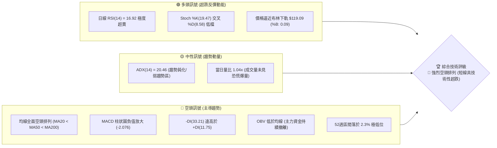
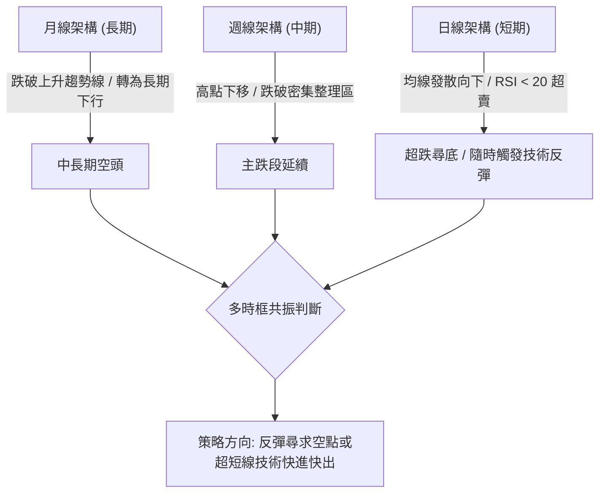
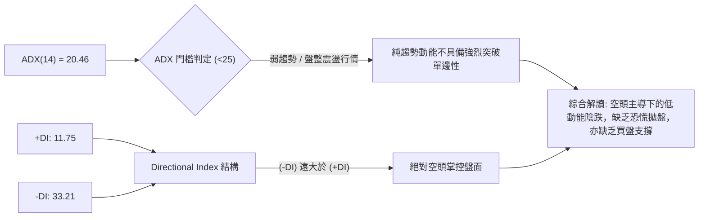
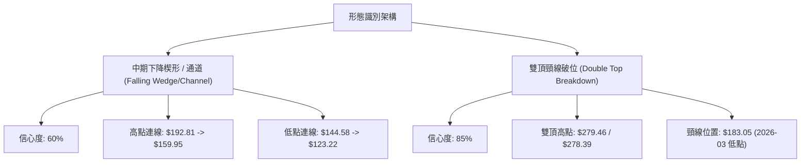
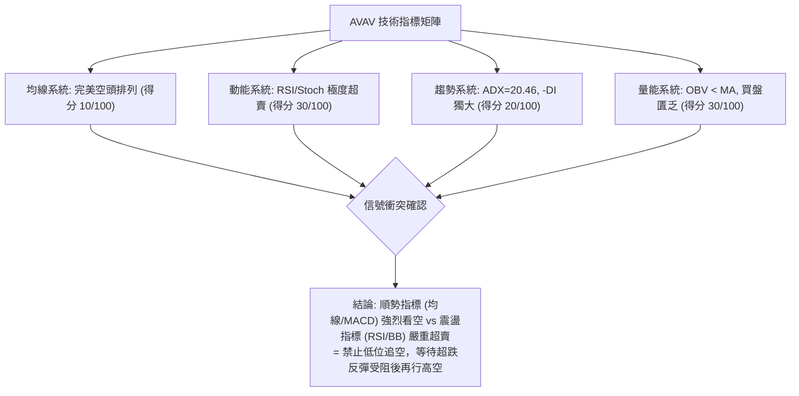
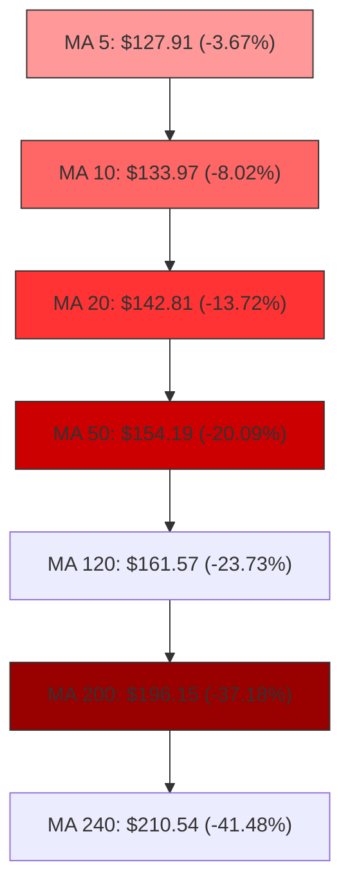
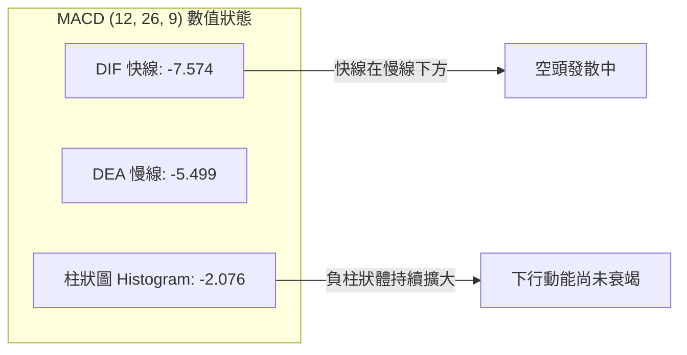
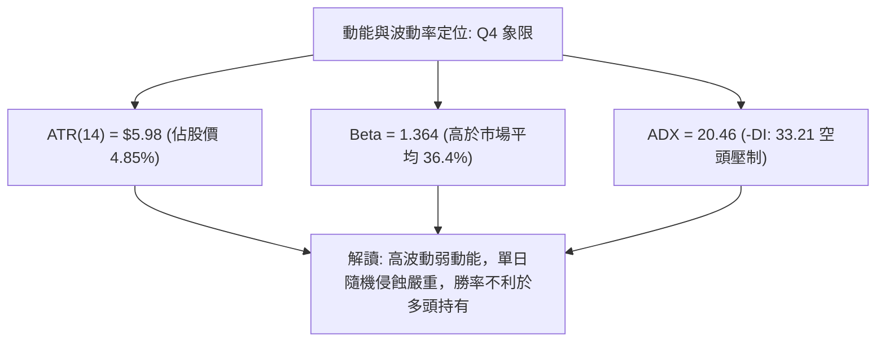
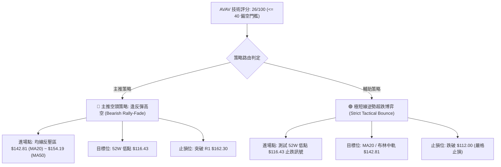
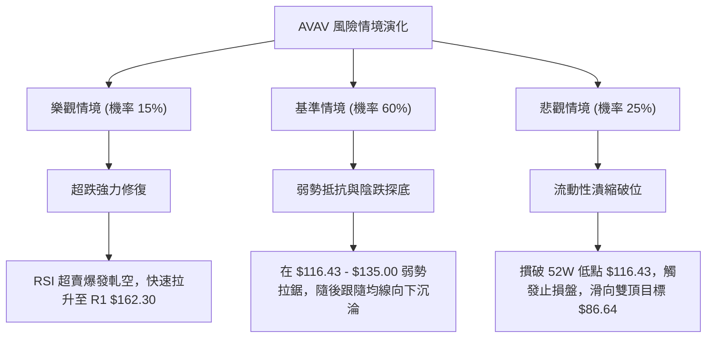

# AVAV 技術分析報告

> **報告日期**：2026-10-16 ｜ **語言**：繁體中文 ｜ **數據來源**：Yahoo Finance ｜ **當前價格**：$123.22

---

## 目錄

| 章節 | 內容 |
|------|------|
| [1. 技術面概覽](#1-技術面概覽) | 訊號儀表板、核心指標、評分卡 |
| [2. 趨勢分析](#2-趨勢分析) | 多時框趨勢、長中短期走勢、ADX解讀 |
| [3. 圖表形態分析](#3-圖表形態分析) | 形態識別、K線組合、目標價推算 |
| [4. 支撐與阻力](#4-支撐與阻力) | 關鍵價位分布、斐波那契回調結構 |
| [5. 技術指標深度解讀](#5-技術指標深度解讀) | 均線、RSI、MACD、布林通道、成交量與OBV |
| [6. 動能與波動率](#6-動能與波動率) | 動能四象限、ATR波動分析、Beta風險特性 |
| [7. 多時框架總結](#7-多時框架總結) | 時框架矩陣、信號收斂結論 |
| [8. 交易策略建議](#8-交易策略建議) | 策略路由、價格情境階梯、風報比精算 |
| [9. 風險提示與監控](#9-風險提示與監控) | 關鍵監控Checklist、三情境壓力測試 |

---

## 1. 技術面概覽

### 🎯 技術訊號儀表板



### 📊 核心指標速覽表

| 指標類別 | 指標名稱 | 當前數值 | 訊號 | 解讀 |
|:---|:---|:---|:---:|:---|
| **價格結構** | 當前收盤價 | $123.22 | 🔴 | 位於 52 週最低點 ($116.43) 上方僅 5.83%，距 52 週高點回撤 -69.92% |
| **短期均線** | MA 20 | $142.81 | 🔴 | 現價在 MA20 下方 -13.72%，下行斜率陡峭，為第一道動態強阻力 |
| **中期均線** | MA 50 | $154.19 | 🔴 | 現價在 MA50 下方 -20.09%，中期下行通道保持完整 |
| **長期均線** | MA 200 | $196.15 | 🔴 | 現價在 MA200 下方 -37.18%，長期多空分水嶺徹底失守 |
| **動能震盪** | RSI(14) | 16.92 | 🟢 | 嚴重超賣（<20），短線存在技術性均值回歸與空頭回補需求 |
| **趨勢動能** | MACD (12,26,9) | -7.574 / -5.499 | 🔴 | DIF 線維持在信號線下方，Histogram 為 -2.076，空頭動能仍處於擴張期 |
| **波動強度** | ATR(14) | $5.98 | 🟡 | 佔現價 4.85%，屬於中高波動水準，單日價格震幅大 |
| **趨勢強度** | ADX(14) | 20.46 | 🟡 | 數值低於 25，顯示單邊下跌動能略有鈍化，但 -DI 壓制絕對主導 |
| **通道位置** | Bollinger Bands | $119.09 ~ $166.54 | 🔴 | %B 為 0.09，貼近下軌運行，屬於空頭弱勢帶擠壓 |

### 🏆 技術評分卡

```
╔══════════════════════════════════════════════════════════════════╗
║               技術評分卡 — AVAV (2026-10-16)                     ║
╠══════════════════════════════════════════════════════════════════╣
║ 趨勢強度 (Trend)     ████░░░░░░░░░░░░░░░░  20/100  🔴 極弱空頭   ║
║ 均線架構 (Moving Avg)██░░░░░░░░░░░░░░░░░░  10/100  🔴 完美空頭   ║
║ 動能指標 (Momentum)  ██████░░░░░░░░░░░░░░  30/100  🟢 嚴重超賣   ║
║ 支撐穩定度 (Support) ████░░░░░░░░░░░░░░░░  20/100  🔴 底部未明   ║
║ 量價配合度 (Volume)  ██████░░░░░░░░░░░░░░  30/100  🔴 缺乏買盤   ║
║ 圖表形態 (Patterns)  ████░░░░░░░░░░░░░░░░  20/100  🔴 破位下行   ║
╠══════════════════════════════════════════════════════════════════╣
║ 綜合評分             █████░░░░░░░░░░░░░░░  26/100  🔴 強烈偏空   ║
╚══════════════════════════════════════════════════════════════════╝
```

---

## 2. 趨勢分析

### 🌐 多時框趨勢分析



### 📈 長期趨勢 — 12個月走勢圖（Unicode）

以下為 AVAV 自 2025 年 11 月至 2026 年 10 月之月線歷史收盤走勢圖，標記主要波段高低轉折：

```
AVAV 月線走勢圖（過去12個月）
價格軸 ($)
$380 ┤
$360 ┤
$340 ┤
$320 ┤
$300 ┤
$280 ┤  ● $279.46 (11月)              ● $278.39 (01月)
$260 ┤                                      ● $252.25 (02月)
$240 ┤        ● $241.89 (12月)
$220 ┤                                                  ● $207.24 (05月)
$200 ┤                                            ● $195.02 (04月)
$180 ┤                                      ● $183.05 (03月)
$160 ┤                                                              ● $165.07 (06月)
$140 ┤                                                                    ● $149.37 (07月)
$120 ┤                                                                          ● $148.35 (08月) 
$100 ┤                                                                                ● $142.22 (09月)
     └───────────────────────────────────────────────────────────────────────────────────────● $123.22 (當前)
        25-11   25-12   26-01   26-02   26-03   26-04   26-05   26-06   26-07   26-08   26-09   26-10
```

#### 走勢特徵分析表格

| 階段區間 | 起止價格 | 漲跌幅 | 走勢特徵描述 |
|:---|:---|:---:|:---|
| **第一階段：高檔震盪構築頭部** (2025.11 - 2026.01) | $279.46 → $278.39 | -0.38% | 於 $240 - $280 區間大幅洗盤，無法再破歷史高點 $409.66，主力出貨跡象明顯。 |
| **第二階段：破位初跌與弱反彈** (2026.02 - 2026.05) | $252.25 → $207.24 | -17.84% | 03月大跌至 $183.05 後展開弱勢反抽至 $207.24，確認反彈無力，形成下降高點 (LH)。 |
| **第三階段：加速下行與陰跌段** (2026.06 - 2026.09) | $165.07 → $142.22 | -13.84% | 盤跌格局，成交量萎縮，均線系統呈扇形向下發散，買盤承接極度疲弱。 |
| **第四階段：破位探底段** (2026.10 至今) | $142.22 → $123.22 | -13.36% | 單月大跌破位，直逼 52 週最低點 $116.43，短線技術指標進入極端超賣。 |

### 📊 中期趨勢（週線分析）

從近 20 週收盤走勢觀察，自 2026 年 8 月中旬衝高至 $192.81（當時週 RSI 達 73.5）後，開啟了連續 9 週的單邊下行趨勢：
- 2026-08-16 至 2026-10-18，價格由 $192.81 崩跌至 $123.22，累計跌幅達 -36.09%。
- 過去兩週（10-11 收盤 $137.11、10-18 收盤 $123.22）週 RSI 分別降至 19.1 及 16.9，週 MACD 柱狀圖維持在 -1.041 至 -2.076 負值區間，週線級別尚未出現任何底分型止跌信號。

```
中期壓力與支撐階梯（週線視角）
[壓力位 R3]  $200.38 ══════════════════════════════════ (中期多空分界/前波平台)
                       │
[壓力位 R1]  $162.30 ────────────────────────────────── (09月反彈波段高點聚類)
                       │
[當前現價]   $123.22 ──► ◄── (目前處於下跌尋底走勢)
                       │
[關鍵支撐]   $116.43 ══════════════════════════════════ (52週最低點 / 100% 斐波那契)
```

### ⚡ 趨勢強度評估（ADX 解讀）



| 指標變量 | 具體數值 | 狀態區間 | 技術意義 |
|:---|:---:|:---:|:---|
| **ADX (14)** | 20.46 | < 25 (弱趨勢/低動量) | 雖然價格連續下跌，但單邊斜率在日線級別並未出現大動量加速，屬於陰跌結構。 |
| **+DI (綠線)** | 11.75 | 極度低迷 | 多頭攻擊力量微弱，缺乏機構主動性買盤入場。 |
| **-DI (紅線)** | 33.21 | 強勢主導 (>30) | 空頭完全控制盤面，任何微小賣壓皆能造成價格顯著下挫。 |

---

## 3. 圖表形態分析

### 🔍 形態識別系統



#### 形態識別與信心度評估表

| 形態名稱 | 信心度 | 判斷依據（引用數據） | 完成度 | 目標價（附計算式） |
|:---|:---:|:---|:---:|:---|
| **中期大型雙頂破位** | **85%** | 2025-11 高點 $279.46 與 2026-01 高點 $278.39 構成雙頂，頸線為 2026-03 低點 $183.05，目前已有效跌破。 | 100% (已完全破位) | 形態高度 = $279.46 - $183.05 = $96.41。<br/>量度跌幅目標 = $183.05 - $96.41 = **$86.64**（數據中未偵測到該處支撐）。 |
| **短期加速下行通道** | **70%** | 連接 08-16 高點 $192.81、09-20 高點 $159.95，下軌切於 08-30 低點 $147.94 及當前低點。 | 85% (逼近通道下軌) | 通道下軌支撐約落在 52 週低點 **$116.43**。 |
| **頭肩底 / 雙底反轉** | **<20%** | **數據不足，訊號缺乏**。目前無任何底部形態構築痕跡。 | 0% | 訊號不足，僅做指標型超跌解讀，不預設底型。 |

### 🕯️ 重要K線形態分析

| 週期/日期 | 收盤價 | K線形態特徵 | 技術解讀 | 訊號 |
|:---|:---:|:---|:---|:---:|
| **2026-08-16** | $192.81 | 週線長上影高檔十字星 | 衝高 $192.81 遇阻回落，週 RSI 達 73.5 超買，確認中期頂部構築完畢。 | 🔴 強烈看空 |
| **2026-09-20** | $159.95 | 反彈遇阻中陰線 | 弱勢反彈受制於 MA20 ($142.81當時較高位) 與 MA50，形成下降次高點。 | 🔴 延續看空 |
| **2026-10-11** | $137.11 | 週線破位大陰線 | 跌破 $140 關口，放量下挫，擊潰短線防守心理線。 | 🔴 下跌加速 |
| **2026-10-18** | $123.22 | 實體下挫陰線（現價） | 延續破位動能，直逼 52 週低點 $116.43，但留有極短下影線，空頭動能衰竭初期。 | 🟡 跌勢末段 |

### 📉 ASCII 走勢形態示意圖

```
AVAV 雙頂頸線破位與下降通道示意圖
價格軸 ($)
$280 ┤     頂點1: $279.46        頂點2: $278.39
     │       ╭───╮                 ╭───╮
$240 ┤      ╱     ╲               ╱     ╲
     │     ╱       ╲             ╱       ╲
$200 ┤    ╱         ╲           ╱         ╲    次高點: $192.81
     │   ╱           ╲         ╱           ╲     ╭──╮
$180 ┤──┼─────────────●───────┼─────────────●───╯──┴─── 頸線突破口 $183.05
     │  │          頸線低點: $183.05                      ╲
$160 ┤  │                                                 ╲  次高點: $159.95
     │  │                                                  ╲   ╭─╮
$140 ┤  │                                                   ╲ ╱   ╲
     │  │                                                    ●     ╲
$120 ┤  │                                                           ● 當前現價: $123.22
     │  │                                                           │
$116 ┤──┴───────────────────────────────────────────────────────────┴─ 52W Low: $116.43
```

### 🎯 形態目標價計算

1. **中期雙頂形態度量**：
   - 形態頭部頸線：$183.05
   - 形態頂部峰值：$279.46
   - 形態垂直高度：$279.46 - $183.05 = $96.41
   - 理論延伸目標價：$183.05 - $96.41 = **$86.64**（需注意該價位屬純形態推算，歷史數據中尚未偵測到此支撐位）。
2. **短期技術反抽阻力目標**：
   - 若短線在 52 週低點 $116.43 獲得支撐展開均值回歸反彈，反抽第一阻力目標為下降通道中軌及 MA20 所在之 **$142.81**，次級強阻力為波段高點聚類 **$162.30 (R1)**。

---

## 4. 支撐與阻力

### 🗺️ 關鍵價位分布圖（Unicode）

```
AVAV 價位結構分布圖
═══════════════════════════════════════════════════════════════════════
$200.38 ║████████████████████████████████████████║ 強阻力 R3 (中期關鍵牛熊分水嶺)
$179.18 ║▓▓▓▓▓▓▓▓▓▓▓▓▓▓▓▓▓▓▓▓▓▓▓▓▓▓▓▓            ║ 阻力位 (78.6% 斐波那契回調位)
$168.00 ║████████████████████████                ║ 密集阻力 R2 (波段高點聚類)
$162.30 ║████████████████████████████            ║ 關鍵第一阻力 R1 (波段高點聚類)
$142.81 ║▒▒▒▒▒▒▒▒▒▒▒▒▒▒▒▒▒▒                      ║ 動態均線阻力 (MA20 / 布林中軌)
────────╫────────────────────────────────────────╫─────────────────────────────────────
$123.22 ╠════════════════════════════════════════╣ ◄ 當前收盤價 ($123.22)
────────╫────────────────────────────────────────╫─────────────────────────────────────
$119.09 ║░░░░░░░░░░░░░░                          ║ 動態通道支撐 (布林帶下軌)
$116.43 ║████████████████████████████████████████║ 核心歷史底線 (52W Low / 100% 斐波那契)
(下方)  ║(數據中未偵測到現價與 $116.43 之間之波段低點支撐)
═══════════════════════════════════════════════════════════════════════
```

### 🚧 阻力位分析表

依據系統演算法計算之近一年波段高點聚類，阻力位嚴格界定如下：

| 阻力級別 | 具體價位 | 距離現價漲幅 | 形成原因與結構特徵 | 突破難度 | 重要性權重 |
|:---|:---:|:---:|:---|:---:|:---:|
| **R1** | **$162.30** | +31.72% | 近期波段密集反彈高點聚類；與 MA60 ($154.38) 及 MA120 ($161.57) 形成強大均線反壓蓋頭。 | 極高 | ★★★★☆ |
| **R2** | **$168.00** | +36.34% | 2026年6月中旬盤整區平台底沿轉換位；布林通道上軌 ($166.54) 附近。 | 極高 | ★★★☆☆ |
| **R3** | **$200.38** | +62.62% | 中期關鍵整數心理大關；波段高點聚類；與 MA200 ($196.15) 高度重合，決定長期多空命運。 | 堅不可摧 | ★★★★★ |

### 🛡️ 支撐位分析表

依據歷史 OHLCV 實際計算，現價下方未偵測到任何近一年波段低點聚類支撐：

| 支撐級別 | 具體價位 | 距離現價跌幅 | 形成原因與結構特徵 | 守住機率 | 重要性權重 |
|:---|:---:|:---:|:---|:---:|:---:|
| **S1 (動態)** | **$119.09** | -3.35% | 日線布林通道下軌動態支撐，短期超賣包絡線下邊界。 | 45% | ★★☆☆☆ |
| **S2 (極限)** | **$116.43** | -5.51% | **52週最低價 (52W Low)**，斐波那契 100.0% 極限回調位。年內最終防守線。 | 55% | ★★★★★ |
| **S3 (延伸)** | 數據中未偵測到 | — | **數據中未偵測到低於 $116.43 之歷史支撐**。若摜破 $116.43，將引發無支撐真空下跌。 | — | — |

### 📐 斐波那契回調位分析

依據 52 週波動極值（低點 **$116.43** 至 高點 **$409.66**，總垂直空間 $293.23）計算之斐波那契回調位矩陣如下：

| 回調比率 | 精確價位 | 價格關係與技術解讀 |
|:---:|:---:|:---|
| **0.0% (高點)** | **$409.66** | 52 週最高點，歷史牛市頂部。 |
| **23.6%** | **$340.46** | 第一道回調支撐（早已徹底失守）。 |
| **38.2%** | **$297.65** | 黃金分割弱勢回調位。 |
| **50.0%** | **$263.05** | 多空中軸平衡位。 |
| **61.8%** | **$228.44** | 黃金分割強回調支撐（多頭防禦崩潰點）。 |
| **78.6%** | **$179.18** | 深度回調防守位，2026年3月低點 $183.05 附近。 |
| **100.0% (低點)** | **$116.43** | **52 週最低點，全週期上升動能徹底清零點**。 |

**位置解讀**：
當前收盤價 **$123.22** 位於 **78.6% 回調位 ($179.18)** 與 **100.0% 低點 ($116.43)** 之間，處於回調週期的 **97.7%** 位置（即回吐了過去 52 週全部漲幅的 97.7%）。這表明過去一年的多頭漲幅已近乎全部回吐完畢。當前價位距離 100.0% 絕對低點 $116.43 僅差 $6.79。

---

## 5. 技術指標深度解讀

### 🎛️ 指標訊號總覽



### 📈 移動平均線排列分析



均線系統呈現標準的**「空頭瀑布發散」**狀態：
1. **短天期均線**：MA5 ($127.91) < MA10 ($133.97) < MA20 ($142.81)，短期下壓斜率超過 -45 度，價格沿著 MA5 下方緊密貼合下行。
2. **中長天期均線**：MA50 ($154.19) 與 MA200 ($196.15) 形成極度擴大的負乖離（死亡交叉已久），且 MA240 高達 $210.54，現價距離 MA240 乖離率達 -41.48%，中長期投資人全數處於浮虧套牢狀態。

### 📉 RSI(14) 分析

```
RSI(14) 當前數值: 16.92
[ 0 ] ──────[ 16.92 ]───[ 30 ]─────────────────[ 50 ]─────────────────[ 70 ]────── [ 100 ]
  │           ▲           │                      │                      │           │
  └─ 極度超賣 ┴─ 超賣線 ──┴──────────────────────┴──────────────────────┴─ 超買線 ──┘
進度條: ███░░░░░░░░░░░░░░░░░ 16.92% (嚴重超賣區)
```

- **超賣特徵**：RSI(14) 讀數為 **16.92**，落於 20 以下的極端超賣盲區。在統計學上，RSI 跌破 20 往往意味著市場處於單邊非理性拋售階段。
- **背離判斷**：
  - **日線級別**：當前價格創出新低 ($123.22)，RSI 亦創出近期新低 (16.92)，**無底背離**現象。價量指標同步下行，證實拋壓為實質性拋售，非虛擬誘空。
  - **週線級別**：週 RSI 由 9 月中旬之 37.0、19.1 持續降至 16.9，同樣**未偵測到週線級別底背離**。結論：指標處於「超賣鈍化」，而非「底背離見底」。

### 📊 MACD(12/26/9) 訊號解讀



- DIF 快線 (-7.574) 與 DEA 慢線 (-5.499) 均處於 0 軸下方極深位置（負值區域），顯示大週期空頭趨勢強烈。
- MACD Histogram 為 **-2.076**，較前一交易週期繼續向下擴展，說明綠色空頭動能柱仍在擴大，尚未出現紅柱收斂（金叉預兆），空頭仍握有絕對控盤權。

### 📦 布林通道分析

```
布林通道 (Bollinger Bands 20, 2) 結構圖
$166.54 ┬────────────────────────────────────────── BB 上軌 (Upper)
        │
$142.81 ┼ - - - - - - - - - - - - - - - - - - - -  BB 中軌 (MA20)
        │
$123.22 ┼─────────────────● (現價 $123.22, %B = 0.09)
$119.09 ┴────────────────────────────────────────── BB 下軌 (Lower)
```

- **通道帶寬**：上軌 $166.54 與下軌 $119.09 差距為 $47.45，帶寬（Bandwidth）相對擴大，通道呈現向下張口狀態。
- **%B 指標**：數值為 **0.09**，極端貼近下軌（0 代表下軌，0.5 代表中軌）。此現象被稱為「沿下軌下行（Walking down the bands）」，為典型的弱勢單邊陰跌走勢特徵。

### 💹 成交量分析（量價配合度）

- **最新成交量**：1,528,800 股。
- **均量對比**：20日均量為 1,473,060 股（量比 **1.04x**）；50日均量為 1,731,342 股。
- **量價關係**：
  - 現價大跌跌破 $130 關口時，成交量僅維持在 20 日均量附近（量比 1.04），並未爆出巨量承接盤（Capitulation Volume）。這反映出當前下挫主要係因「買盤極度匱乏」而非「恐慌性拋售」，這種無量陰跌往往難以迅速見底。
  - **OBV 走勢**：OBV 趨勢低於其移動平均線（OBV < MA），能量潮持續下滑，顯示大資金資金流向仍處於淨流出階段。

---

## 6. 動能與波動率

### ⚡ 動能評估四象限

| 象限 | 動能維度 | 波動維度 | 象限特徵 | AVAV 當前狀態匹配度 |
|:---:|:---:|:---:|:---|:---:|
| **Q1** | 強動能 (Bullish) | 低波動 (Low Vol) | 穩健上升趨勢，最佳多頭進場區 | 0% (完全不符) |
| **Q2** | 弱動能 (Bearish) | 低波動 (Low Vol) | 陰跌磨底，波動鈍化，觀望為宜 | 20% |
| **Q3** | 強動能 (Bullish) | 高波動 (High Vol) | 爆發性突破，追漲高風險高回報 | 0% |
| **Q4** | **弱動能 (Bearish)** | **高波動 (High Vol)** | **單邊破位下挫，波動劇烈，高下行風險** | **80% (主要匹配象限)** |



### 📊 ATR 波動率分析

- **ATR(14)** 數值為 **$5.98**，佔當前股價 $123.22 的比率高達 **4.85%**。
- **波動意義**：股票平均單日波動接近 $6.00。在進行交易部位設定時：
  - **做多短線止損距離**：至少需保留 1.5 倍至 2.0 倍 ATR（即 $8.97 ~ $11.96），若止損設定過緊（如小於 $5.00），極易在日內雜訊中被無謂掃出場。
  - **做空保護性止損**：以進場點向上加 1.5 倍 ATR 為基準。

### 📐 Beta 與市場相關性

- **Beta 係數**：**1.364**。
- **市場敏感度分析**：AVAV 屬於高 Beta 的防務與航太科技成長股，波動幅度比 S&P 500 大盤高出 36.4%。在目前大盤防禦情緒升溫環境下，高 Beta 股票遭遇顯著估值去化（Multiples Contraction）。若標普指數出現回調，AVAV 面臨放大的貝塔下跌壓力。

---

## 7. 多時框架總結

### 📋 時框架評分表

| 時框架 | 趨勢方向 | 動能狀態 | 均線排列 | 圖表形態 | 綜合評分 | 戰術建議 |
|:---|:---:|:---:|:---:|:---:|:---:|:---|
| **月線 (長期)** | 🔴 下行通道 | 弱勢發散 | 跌破 MA20/MA50 | 大型頂部頸線跌破 | 15/100 | 長期投資人不宜介入左側摸底 |
| **週線 (中期)** | 🔴 崩跌走勢 | RSI < 20 鈍化 | MA20 < MA50 空頭 | 連續9週陰線主跌段 | 20/100 | 逢反彈至阻力區建立對沖/空單 |
| **日線 (短期)** | 🟡 超跌盤整 | RSI=16.92 極端超賣 | 均線發散向下 | 貼近布林下軌尋底 | 35/100 | 禁止追空，短線高手可搏超跌反彈 |

### 🔲 綜合訊號矩陣

```
╔════════════════════════════════════════════════════════════════════════════════════╗
║                       AVAV 多時框架綜合訊號共振矩陣                                ║
╠══════════════════╦══════════════╦══════════════╦══════════════╦════════════════════╣
║ 分析維度         ║ 短期 (日線)  ║ 中期 (週線)  ║ 長期 (月線)  ║ 權重共振判定       ║
╠══════════════════╬══════════════╬══════════════╬══════════════╬════════════════════╣
║ 趨勢方向 (Trend) ║ 🔴 強烈空頭  ║ 🔴 強烈空頭  ║ 🔴 轉入空頭  ║ 100% 空頭共振      ║
║ 動能強弱 (Mom)   ║ 🟢 超賣衰竭  ║ 🔴 負值擴大  ║ 🔴 逐月走低  ║ 長期空 / 短期超跌  ║
║ 均線系統 (MA)    ║ 🔴 空頭排列  ║ 🔴 空頭排列  ║ 🔴 跌破均線  ║ 均線反壓沉重       ║
║ 量價結構 (Vol)   ║ 🟡 縮量陰跌  ║ 🔴 主力出逃  ║ 🔴 籌碼鬆動  ║ 無承接盤，虛跌     ║
╚══════════════════╩══════════════╩══════════════╩══════════════╩════════════════════╝
```

### ⚖️ 多時框收斂結論

依據多時框收斂規則（嚴格要求 14）：
1. **行情性質判定**：當前 ADX(14) 讀數為 **20.46 (< 25)**。技術規格上屬於**「弱趨勢 / 盤整震盪行情」**。
2. **交易區間界定**：依據規則，當 ADX < 25 時，應以**日線布林通道上下軌 ($119.09 ~ $166.54)** 為主要交易考量區間。
3. **主導時框與衝突取捨**：
   - 儘管 ADX 顯示趨勢動量不高，但 Directional Index 中 **-DI (33.21) 遠高於 +DI (11.75)**，且週線及均線系統呈全面空頭排列。
   - 震盪指標（RSI=16.92）之嚴重超賣與均線全面看空出現矛盾。收斂原則：**以中長期空頭方向為主導，日線超賣只代表「做空性價比暫時降低」，絕不代表「逆勢做多的安全信號」**。
4. **唯一方向性結論**：**🔴 強烈偏空（防禦觀望 / 待反彈做空）**。

---

## 8. 交易策略建議

### 🗺️ 策略決策流程圖



### 🧭 策略路由（依評分卡分流）

> **當前主策略方向 = 🔴 主推空頭策略（逢反彈高空），依綜合評分 26/100 判定。**
> 綜合評分低於 40 分標準，嚴禁盲目重倉抄底，所有操作以順應中長期空頭趨勢為第一準則。

### 🎯 價格情境階梯（Price Scenarios）

價位嚴格引用關鍵價位演算法與斐波那契計算結果：

| 觸發條件 | 下一目標 | 後續延伸 | 情境含義 |
|:---|:---:|:---:|:---|
| **上破 R1 $162.30** | R2 $168.00 | R3 $200.38 | 中期空頭架構破壞，多頭強烈反轉 |
| **反彈受阻 MA20 $142.81** | 現價 $123.22 | 52W Low $116.43 | 標準空頭回抽確認，延續下行波段 |
| **跌破 S1/BB下軌 $119.09** | 52W Low $116.43 | 數據中未偵測到 | 破位加速，回測年內最深底部 |
| **跌破 52W Low $116.43** | 理論目標 $86.64 | 無支撐真空 | 引發斷頭恐慌拋售，開闢全新下跌空間 |

### 📊 情境機率分佈

| 情境劃分 | 機率預估 | 主要技術依據 |
|:---|:---:|:---|
| **情境一：弱勢反彈後延續破位** | **55%** | 均線空頭排列（MA20/50/200 反壓極大）；OBV 量能疲弱主力持續出逃；ADX 顯示空頭完全掌控（-DI 33.21）。 |
| **情境二：圍繞 52W 低點區間震盪** | **35%** | 日線 RSI (16.92) 與 Stoch 極度超賣引發空頭回補；ADX < 25 單邊下行動能鈍化，支撐於 $116.43 - $142.81 間築底。 |
| **情境三：直接深幅跌破 $116.43** | **10%** | 總體防禦板塊若遭系統性風險拋售，無量狀態下直接摜破 52 週防線。 |

### 🔴 主策略詳情（空頭主導路由）

本報告主推**「反彈遇阻做空」**之主策略，並提供**「短線極限超跌博弈」**作為次選輔助策略：

| 策略要素 | 策略 A（主推：順勢高空策略） | 策略 B（次選：極短線超跌反抽） |
|:---|:---:|:---:|
| **策略性質** | 順勢逢高做空 (Trend-Following Short) | 逆勢左側搏反彈 (Counter-Trend Scalp) |
| **進場條件** | 價格反彈至 MA20 / MA50 遇阻收上影線陰線 | 股價回踩 $116.43 附近企穩且 RSI 出現勾頭 |
| **進場價格** | **$142.81** (MA20) 至 **$154.19** (MA50) | **$118.00**（貼近 52W Low $116.43 上方） |
| **目標價 T1** | **$123.22** (當前波段低位，獲利平倉 50%) | **$133.97** (MA10 壓力區) |
| **目標價 T2** | **$116.43** (52週最低點全部止盈) | **$142.81** (MA20 / 布林中軌) |
| **止損價格** | **$162.30** (有效突破 R1 關鍵阻力) | **$112.50** (跌破 52W 低點 -3.3%) |
| **風險報酬比** | **1 : 2.2**（以進場 $148.50、止損 $162.30、目標 $116.43 計算） | **1 : 4.5**（以進場 $118.00、止損 $112.50、目標 $142.81 計算） |
| **成功機率** | **65%** | **35%** |
| **建議倉位** | **10% - 15%** (總資金規模) | **3% - 5%** (嚴格輕倉快進快出) |

### 🟢 反向風險觸發點（對沖提示）

若出現以下訊號，主推的空頭邏輯將被**徹底推翻**，必須無條件平倉空單並啟動風控：
1. **價格強勢站穩 R1 ($162.30)**：代表中期下降結構被實質性逆轉，突破了波段高點聚類。
2. **日線 MACD 形成 0 軸下方金叉且柱狀圖翻紅**：若伴隨單日成交量放大至 300 萬股以上（量比 > 2.0x），確認機構性主力進場。
3. **連續兩日收盤站上 MA50 ($154.19)**。

### ⭐ 整體訊號強度評星

```
╔══════════════════════════════════════════════════════════════════╗
║ 做多訊號強度 (Long):   ★☆☆☆☆  (1.5/5星 — 僅具備超賣技術反抽)     ║
║ 做空訊號強度 (Short):  ★★★★☆  (4.0/5星 — 趨勢與均線完全壓制)     ║
║ 整體技術可信度:        ★★★★☆  (4.0/5星 — 多時框指標高度共振)     ║
╚══════════════════════════════════════════════════════════════════╝
```

---

## 9. 風險提示與監控

### ✅ 關鍵監控指標 Checklist

```
╔══════════════════════════════════════════════════════════════════╗
║                   AVAV 風控與交易監控 CHECKLIST                  ║
╠══════════════════════════════════════════════════════════════════╣
║ [ ] 52W Low 防守檢驗: 盤中是否跌破 $116.43 支撐底線             ║
║ [ ] RSI(14) 動態跟蹤: 數值是否由 16.92 回升突破 30.0 臨界區     ║
║ [ ] 布林通道帶寬監控: 股價是否脫離下軌 $119.09 並重回軌道內部    ║
║ [ ] 成交量異常放大: 日成交量是否突破 250 萬股 (量比 > 1.7x)      ║
║ [ ] MACD 柱狀體收斂: 負值柱是否從 -2.076 開始收窄                ║
║ [ ] MA20 動態下移位置: 每日跟蹤第一動態阻力位變化情況           ║
║ [ ] 分析師評級異動: 關注近期是否出現機構下調目標價潮            ║
╚══════════════════════════════════════════════════════════════════╝
```

### ⚠️ 風險場景分析



### 🛡️ 風險管理重要提醒

1. **嚴禁左側無止損摸底**：目前 AVAV 處於 52 週絕對低位，投資人容易產生「跌無可跌」的錨定偏誤心理。但在量能萎縮且均線極度下壓的狀態下，股價具備持續創低之技術慣性。
2. **波動率侵蝕警示**：ATR 高達 $5.98（佔股價 4.85%），槓桿性工具（如期權期權或融資買進）將面臨劇烈的隱含波動率（IV）去化與單日震盪穿倉風險。
3. **空頭回補陷阱（Short Squeeze Trap）**：由於 Float 空頭比例達 12.8%（Short % Float），若突發國防大額合約消息，可能引發單日 10-15% 的暴力軋空跳空，做空操作必須嚴格設定突破止損點（R1 $162.30）。

---

## 📋 報告總結

```
╔══════════════════════════════════════════════════════════════════════════════╗
║                          AVAV 技術分析報告總結                               ║
╠══════════════════════════════════════════════════════════════════════════════╣
║ 報告日期：2026-10-16                                                         ║
║ 當前價格：$123.22 (52W High: $409.66 / Low: $116.43)                         ║
║ 分析評級：🔴 強烈偏空 / 技術性超跌觀望 (Technical Rating: 26/100)            ║
║                                                                              ║
║ 關鍵結論：                                                                   ║
║ ├─ 長期趨勢：🔴 跌破歷史頂部頸線，均線呈全面空頭發散                         ║
║ ├─ 中期趨勢：🔴 連續 9 週收陰，中期下行通道保持完整                          ║
║ ├─ 短期趨勢：🟢 RSI(14)=16.92 極度超賣，隨時可能觸發技術性反抽              ║
║ ├─ 關鍵支撐：S1 布林下軌 $119.09 ｜ S2 52週低點 $116.43                     ║
║ ├─ 關鍵阻力：MA20 $142.81 ｜ R1 $162.30 ｜ R2 $168.00 ｜ R3 $200.38         ║
║ └─ 華爾街目標價：平均 $216.46 ｜ 最低 $148.57 ｜ 最高 $315.00                ║
║                                                                              ║
║ 最優策略組合：                                                               ║
║ 1. 🥇 最佳機會（順勢）：等待反彈至 MA20/MA50 ($142.81-$154.19) 遇阻做空，     ║
║                          止損設於 R1 $162.30，下看 $116.43 (風報比 1:2.2)。  ║
║ 2. 🥈 次選機會（短線）：激進投資人於 $118.00 輕倉搏超跌反抽，止損設於        ║
║                          $112.50，目標看 MA20 $142.81 (風報比 1:4.5)。       ║
║ 3. 🥉 保守選擇（風控）：持幣徹底觀望，等待日線級別出現實質底部形態並放量     ║
║                          站穩 MA20 之後，再行評估右側進場機會。              ║
╚══════════════════════════════════════════════════════════════════════════════╝
```

---

> ⚠️ **免責聲明**：本報告為依據定量技術指標自動生成之分析報告，所有數據及估算均嚴格基於歷史 OHLCV 價格資訊。本報告**僅供研究與學術參考**，**不構成任何形式之個人化投資建議與買賣要約**。金融市場投資具高度風險，投資人應獨立評估自身風險承受能力並自負盈虧。

---

*報告生成時間：2026-10-16 ｜ 數據來源：Yahoo Finance ｜ 分析框架：多時框量化技術分析*