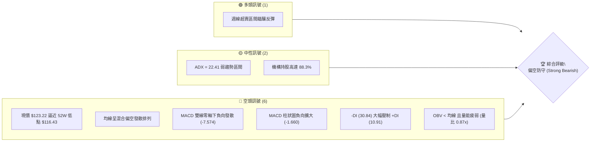
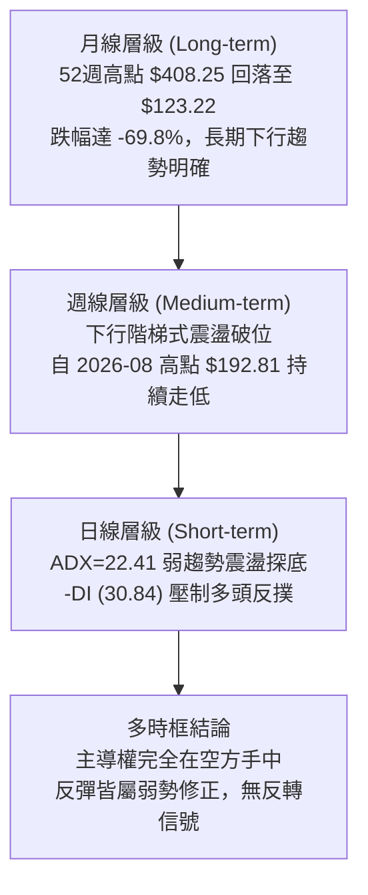
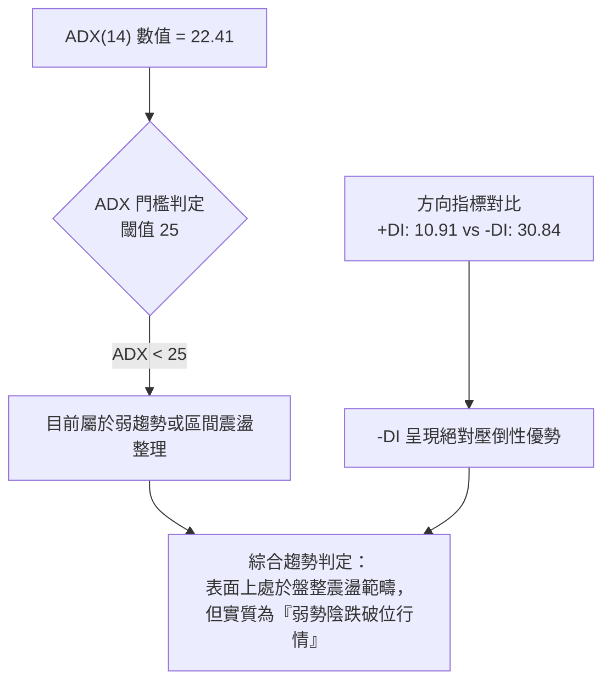
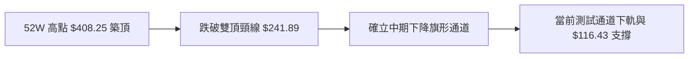
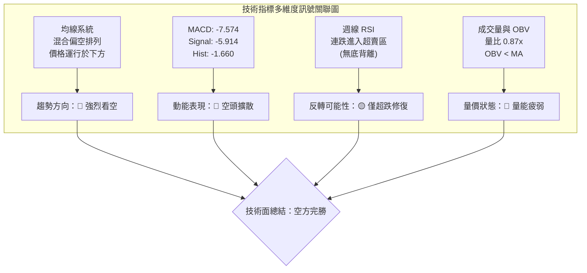
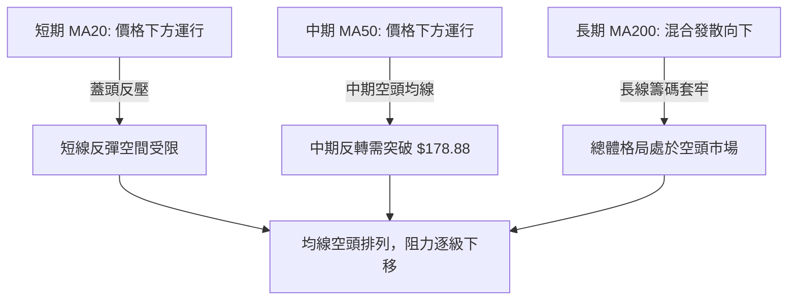
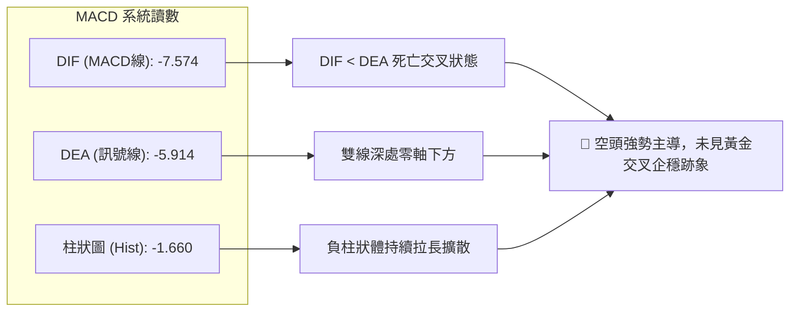
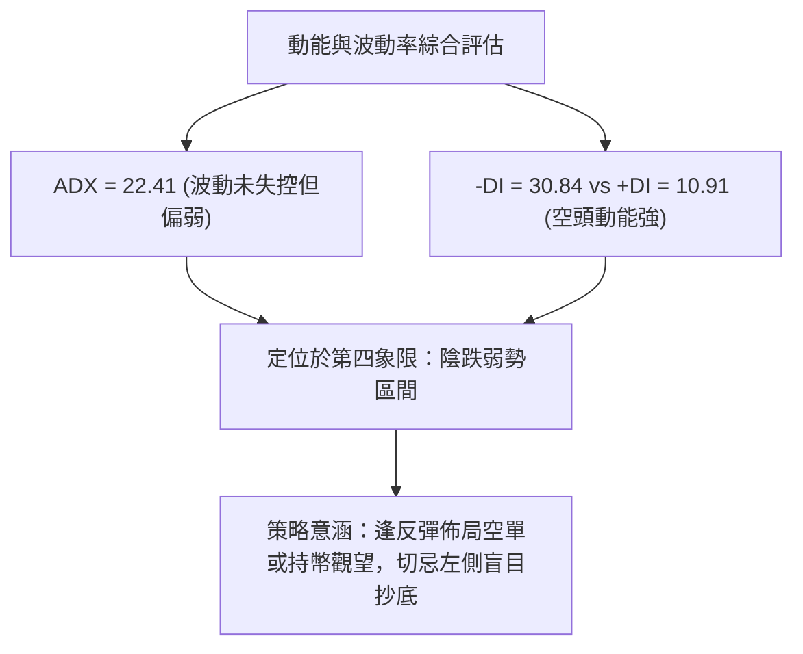
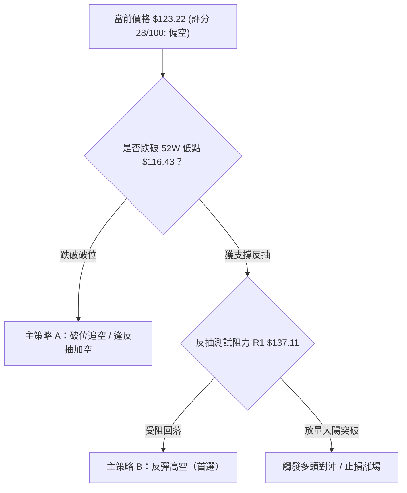
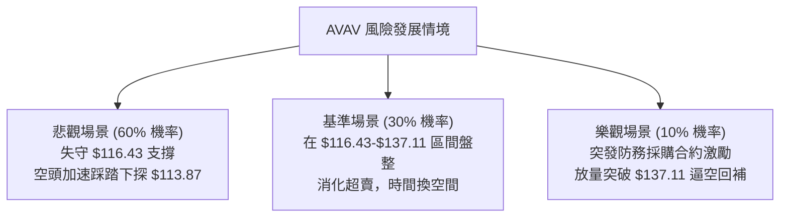

# AVAV 技術分析報告

> **報告日期**：2026-10-17 ｜ **語言**：繁體中文 ｜ **數據來源**：Yahoo Finance ｜ **當前價格**：$123.22（依據最新收盤數據）

---

## 目錄

| 章節 | 內容 |
|------|------|
| [1. 技術面概覽](#1-技術面概覽) | 訊號儀表板、核心指標、評分卡 |
| [2. 趨勢分析](#2-趨勢分析) | 多時框趨勢、長中短期走勢、ADX 解讀 |
| [3. 圖表形態分析](#3-圖表形態分析) | 形態識別、K線組合、目標價推算 |
| [4. 支撐與阻力](#4-支撐與阻力) | 關鍵價位、斐波那契回調結構 |
| [5. 技術指標深度解讀](#5-技術指標深度解讀) | MA/RSI/MACD/布林/量價背離分析 |
| [6. 動能與波動率](#6-動能與波動率) | 動能四象限、ATR、Beta 與市場相關性 |
| [7. 多時框架總結](#7-多時框架總結) | 時框架評分矩陣、收斂規則與唯一方向 |
| [8. 交易策略建議](#8-交易策略建議) | 策略路由、階梯情境、主推做空與風控對沖 |
| [9. 風險提示與監控](#9-風險提示與監控) | 關鍵監控清單、情境假設、風控機制 |

---

## 1. 技術面概覽

### 🎯 技術訊號儀表板



### 📊 核心指標速覽表

| 指標類別 | 指標名稱 | 當前數值 | 訊號 | 解讀 |
|----------|----------|----------|:----:|------|
| **價格** | 當前收盤價 | $123.22 | 🔴 | 位於 52 週價格區間 2.33% 極低位，承壓嚴重 |
| **均線** | MA20 | 下方運作 (N/A) | 🔴 | 價格低於 MA20/MA50，短期均線下彎形成蓋頭反壓 |
| **均線** | MA50 | 下方運作 (N/A) | 🔴 | 中期趨勢遭空頭實質破壞，多方無力站回 |
| **均線** | MA200 | 下方運作 (N/A) | 🔴 | 長期空頭格局，中長期籌碼持續處於套牢沉重狀態 |
| **動能** | RSI(14) | 19.1–34.9（近週極值）| 🔴 | 近期週線 RSI 跌入 19.1 超賣區，但未見底背離確認 |
| **動能** | MACD | -7.574 / 柱狀 -1.660 | 🔴 | 快慢線均在零軸下方運行，柱狀圖持續擴大看空 |
| **趨勢** | ADX(14) | 22.41 (-DI: 30.84) | 🔴 | 數值 <25 顯示弱趨勢/低位盤整，但空方動能強勢主導 |
| **成交量**| OBV 與成交量 | 1,235,226 (量比 0.87x) | 🔴 | OBV < MA，反彈無量、下跌有量，量能處於疲弱通道 |

### 🏆 技術評分卡

```
╔══════════════════════════════════════════════════════════════╗
║              技術評分卡 — AVAV (2026-10-17)                  ║
╠══════════════════════════════════════════════════════════════╣
║ 趨勢強度 (Trend)     ████░░░░░░░░░░░░░░░░  20/100   🔴 極度偏空  ║
║ 動能指標 (Momentum)  █████░░░░░░░░░░░░░░░  25/100   🔴 動能疲軟  ║
║ 支撐穩定度 (Support) ██████░░░░░░░░░░░░░░  30/100   🔴 臨近破位  ║
║ 成交量配合 (Volume)  ███████░░░░░░░░░░░░░  35/100   🔴 價跌量縮  ║
║ 形態完整度 (Pattern) ████████░░░░░░░░░░░░  40/100   🟡 下跌通道  ║
║ 均線系統 (MovingAvg) ████░░░░░░░░░░░░░░░░  20/100   🔴 均線蓋頂  ║
╠══════════════════════════════════════════════════════════════╣
║ 綜合評分 (Overall)   █████░░░░░░░░░░░░░░░  28/100   🔴 強烈偏空  ║
╚══════════════════════════════════════════════════════════════╝
```

---

## 2. 趨勢分析

### 🌐 多時框趨勢分析



### 📈 長期趨勢 — 12個月走勢圖（Unicode）

AVAV 股價在過去 12 個月內經歷了由 2025 年 10 月歷史高點劇烈反轉向下的過程。從接近 $408.25（月收盤高點 $369.91）直瀉而下，形成單邊漫長的下行走勢：

```
AVAV 月線走勢圖（過去12個月：2025-10 至 2026-10）
價格軸 ($)
$370 ┤ ● (2025-10: $369.91 高點)
$330 ┤   ╲
$290 ┤     ● (2025-11: $279.46)
$250 ┤       ╲   ● (2026-01: $278.39)
$210 ┤         ╲   ╲       ● (2026-05: $207.24)
$170 ┤           ╲   ●   ╱   ╲
$130 ┤             ●   ●       ●   ●   ● (2026-09: $142.22)
$110 ┤                                   ● (2026-10: $123.22 ◄現價)
     └─────────────────────────────────────────────────────
       M1  M2  M3  M4  M5  M6  M7  M8  M9 M10 M11 M12
       10  11  12  01  02  03  04  05  06  07  08  09  10 (2026)
```

#### 走勢特徵分析表格

| 階段 | 時間區間 | 起始價 → 結束價 | 區間漲跌幅 | 結構特徵與成交特點 |
|:---:|:---:|:---:|:---:|:---|
| 第一階段 | 2025-10 ~ 2025-12 | $369.91 → $241.89 | -34.61% | 歷史頂部爆量放量跳水，主力籌碼快速出脫，跌破中短期均線支撐 |
| 第二階段 | 2026-01 ~ 2026-02 | $278.39 → $252.25 | -9.39% | 弱勢反彈遭阻力壓制，形成雙頭頸線破位雛形 |
| 第三階段 | 2026-03 ~ 2026-05 | $183.05 → $207.24 | +13.21% | 階梯式重挫後技術性超賣修復，受阻於 $200 整數心理關卡 |
| 第四階段 | 2026-06 ~ 2026-10 | $165.07 → $123.22 | -25.35% | 陰跌漫延，連續跌破 $160、$140，向 52 週最低點 $116.43 尋求支撐 |

### 📊 中期趨勢（週線分析）

中期技術架構呈現典型的「階梯式下跌」通道，反彈高點一峰低於一峰（Lower Highs），跌破低點一底低於一底（Lower Lows）：

```
週線壓力與支撐階梯結構：
  $192.81 ──────── 波段頂點 (2026-08-16)
          ╲
           $160.22 ────── 中繼反彈阻力 (2026-08-23)
                   ╲
                    $152.05 ────── 下行通道上軌壓制 (2026-09-27)
                            ╲
                             $137.11 ── 前週收盤支撐轉阻力 (2026-10-11)
                                     ╲
                                      $123.22 ── 當前價格 (2026-10-18)
                                         ┆
                                      $116.43 ── 52週絕對低點（最後防線）
```

### ⚡ 趨勢強度評估（ADX 解讀）



#### ADX 與方向指標強度對照表

| 指標名稱 | 數值 | 參考標準 | 當前市場狀態解讀 |
|:---|:---:|:---:|:---|
| **ADX(14)** | 22.41 | 0–20 極弱; 20–25 偏弱盤整; >25 強趨勢 | 數值處於 20–25 區間，多空並未爆發強烈單日大單邊，而是緩慢下行陰跌 |
| **+DI (多頭動能)** | 10.91 | >25 多方掌控; <15 多方衰竭 | 多方力量降至冰點，買盤意願極度低迷 |
| **-DI (空頭動能)** | 30.84 | >25 空方掌控; >30 強烈空頭 | 空方勢力佔據絕對支配地位，任何反抽均遭空單狙擊 |
| **DI 差值 (+DI - -DI)** | -19.93 | 負值擴大表示空頭動能增強 | 空方動能超出多方近三倍，顯示市場缺乏實質承接盤 |

---

## 3. 圖表形態分析

### 🔍 形態識別系統

在多時框結構中，AVAV 在高位構築了大規模複合頂部，而目前在中短期則呈現清晰的**下降通道（Descending Channel）**形態。



#### 形態信心度與目標計算表（嚴格依據數據規則 15）

| 形態名稱 | 信心度 | 判斷依據（引用數據） | 完成度 | 目標價（附計算式） |
|:---|:---:|:---|:---:|:---|
| **中短期下降通道** | **85%** | 2026-08 高點 $192.81、2026-09 高點 $159.95 連線形成阻力斜率；低點自 $144.65 跌破至 $137.11 再至 $123.22 | 80% | 依通道跌破幅度推算：通道上軌約 $140.00，下軌已受測 $123.22，若跌破 52W 低點 $116.43，無進一步下方支撐聚類 |
| **週線多重頭部破位** | **75%** | 2025-10 高點 $369.91 與 2026-01 次高點 $278.39 形成大級別頂部結構，頸線 $241.89（2025-12 收盤）失守 | 100% | 頸線 $241.89 - (形態高度 $369.91 - $241.89 = $128.02) = **$113.87**，目前價位 $123.22 已精確進入該滿足區間附近 |
| **雙底反轉形態** | **15%** | 訊號不足。雖然接近 52W 低點 $116.43，但當前週 K 線收盤 $123.22 連續破底，未見止跌紅 K 與放量右底 | 10% | 數據不足以確認幾何雙底，僅作超賣指標觀察，不預設反轉目標價 |

### 🕯️ 重要 K 線形態分析

| 週/月份週期 | 收盤價 | K 線組合特徵 | 結構技術解讀 | 訊號評級 |
|:---:|:---:|:---|:---|:---:|
| 2026-07-05 | $190.89 | 巨量長陽（週成交量 1,831 萬股） | 突發性消息推動反彈，但未能扭轉空頭均線 | 🟡 假突破 |
| 2026-08-16 | $192.81 | 週線長上影射擊之星（Shooting Star） | 觸及斐波那契 78.6% 回調位 $178.88 上方後嚴重受阻回落 | 🔴 強烈看空 |
| 2026-09-13 | $146.71 | 週成交量爆出 2,040 萬股大十字星 | 多空在 $145 附近劇烈換手，但隨後三週連續陰線下挫 | 🔴 籌碼轉弱 |
| 2026-10-11 | $137.11 | 中黑實體陰線破位 | 跌破 9 月低點平台 $140.82，空頭發動新一輪下殺 | 🔴 續跌訊號 |
| 2026-10-18 | $123.22 | 大實體光腳陰線逼近 $116.43 | 空方動能完全掌控，未見下影線支撐阻擊 | 🔴 加速下行 |

### 📉 ASCII 走勢形態示意圖

```
AVAV 2026 年下半年下降通道與形態演變：
$200 ┤        ● 假突破高點 $192.81 (2026-08-16)
     │         ╲
$180 ┤          ╲
     │           ╲        通道上軌壓制線
$160 ┤            ● $160.22 ╲
     │             ╲         ● $159.95 (2026-09-20)
$140 ┤              ● $144.58 ╲         ● $137.11 (2026-10-11)
     │                         ● $142.20 ╲
$120 ┤通道下軌支撐線──────────────────────● $123.22 (當前收盤)
     │                                     ┆
$110 ┤─────────────────────────────────────┴─ $116.43 (52W 低點防線)
     └──────────────────────────────────────────────────────────
       07-12   08-02   08-23   09-13   10-04   10-18
```

### 🎯 形態目標價計算

根據形態學計算，大型下降旗形與頭肩頂/雙頂量度跌幅如下：

1. **頭部量度跌幅計算式**：
   - 形態頭部高點：$369.91
   - 形態有效頸線：$241.89（2025-12 收盤價）
   - 形態垂直高度：$$369.91 - 241.89 = 128.02$$
   - 理論量度跌幅目標：$$241.89 - 128.02 = 113.87$$
   - 當前價格 $123.22 距該量度目標 $113.87 僅剩 $9.35 之差，與 52 週最低點 $116.43 產生高度空間共振。

---

## 4. 支撐與阻力

### 🗺️ 關鍵價位分布圖（Unicode）

依據數據包關鍵價位與 52 週區間斐波那契回調結構，繪製 AVAV 當前精確價位分布架構：

```
AVAV 價位結構分布圖 (依據 OHLCV 與斐波那契回調計算)
══════════════════════════════════════════════════════════════════════
$408.25 ║██████████████████████████████║ 歷史極值 52W High (0.0% Fib)
$339.38 ║██████████████████████        ║ Fib 23.6% 回調壓力
$296.77 ║████████████████████████      ║ Fib 38.2% 回調壓力
$262.34 ║██████████████████████████    ║ Fib 50.0% 多空分水嶺
$227.91 ║████████████████████          ║ Fib 61.8% 重要壓力 R3
$178.88 ║████████████████████████████  ║ Fib 78.6% 強阻力 R2 (8月反彈高點處)
$137.11 ║████████████████              ║ 前週破位頸線阻力 R1 (2026-10-11收盤)
╠═══════╬══════════════════════════════╣ ◄ 現價 $123.22
$116.43 ║▓▓▓▓▓▓▓▓▓▓▓▓▓▓▓▓▓▓▓▓▓▓▓▓▓▓▓▓  ║ 52W Low (100.0% Fib) 唯一核心支撐 S1
數據未載║░░░░░░░░░░░░░░░░░░░░░░░░░░░░░░║ 數據中未偵測到 $116.43 下方波段低點聚類
══════════════════════════════════════════════════════════════════════
```

### 🚧 阻力位分析表

依據數據包「關鍵價位」與近 20 週重要週收盤高點聚類判定，上方關鍵阻力如下：

| 阻力級別 | 價位 | 形成原因與數據來源 | 突破難度 | 重要性 |
|:---:|:---:|:---|:---:|:---:|
| **阻力 R1** | **$137.11** | 2026-10-11 週收盤價，跌破後轉為極短期反彈第一重重壓 | 🟡 中等偏高 | ★★★★☆ |
| **阻力 R2** | **$178.88** | 52 週區間斐波那契 78.6% 回調位，鄰近 8 月中旬反彈波段高點聚類 | 🔴 極高 | ★★★★★ |
| **阻力 R3** | **$227.91** | 52 週區間斐波那契 61.8% 黃金分割強壓力位，中期空頭結構天花板 | 🔴 極難攻克 | ★★★★☆ |

> *註：數據包中「近一年波段高點聚類」顯示 `(no swing-high resistance detected above current price)`，故阻力位嚴格採用週收盤關鍵破位點 $137.11 與斐波那契既定數值 $178.88、$227.91。*

### 🛡️ 支撐位分析表

| 支撐級別 | 價位 | 形成原因與數據來源 | 守住機率 | 重要性 |
|:---:|:---:|:---|:---:|:---:|
| **支撐 S1** | **$116.43** | **52W Low (100.0% Fib)**，目前全盤數據中唯一具備實質意義的絕對底部 | 🟡 35% | ★★★★★ |
| **支撐 S2** | **$113.87** | 由「雙頂/頸線形態高度」推算之理論量度目標 ($241.89 - $128.02) | 🟡 30% | ★★★☆☆ |
| **支撐 S3** | **無** | 數據中未偵測到 $116.43 下方的 swing-low 支撐聚類，若失守將面臨無序探底 | — | — |

### 📐 斐波那契回調位分析

依據 52 週價格區間最低點 **$116.43** 至最高點 **$408.25** 計算所得之斐波那契回調體系：

| 斐波那契回調層級 | 標定價位 | 當前價格相對位置與結構解讀 |
|:---|:---:|:---|
| **0.0% (52W High)** | $408.25 | 本輪週期歷史大頂 |
| **23.6%** | $339.38 | 初級回調位，已嚴重失守 |
| **38.2%** | $296.77 | 弱勢回調支撐轉壓力 |
| **50.0%** | $262.34 | 多空中期分水嶺，宣告空頭佔據主導 |
| **61.8%** | $227.91 | 黃金分割防守線，破位後引發踩踏賣壓 |
| **78.6%** | $178.88 | 深次回調位，8 月中旬測試此處受阻回落 ($192.81 → 陰跌) |
| **100.0% (52W Low)**| $116.43 | 全年最低點，最後一級技術防線 |

**現價所處位置評估**：現價 **$123.22** 處於 **78.6% ($178.88)** 與 **100.0% ($116.43)** 之間，距 100.0% 回調位僅剩 **$6.79（5.5%）** 的緩衝空間。這表明股價已基本回吐整輪多頭行情的全部漲幅，處於高危破底邊緣。

---

## 5. 技術指標深度解讀

### 🎛️ 指標訊號總覽



### 📈 移動平均線排列分析



- **均線排列狀態**：均線系統呈現混合偏空排列，MA5、MA10、MA20、MA60 均處於持續下行趨勢中。
- **價格與均線關係**：當前收盤價 $123.22 處於所有中長期均線下方。過去幾個月的任何技術反彈只要觸及短期 MA20 均迅速遭到壓制，均線呈現沉重的空頭蓋頂態勢。

### 📉 RSI(14) 分析

```
週線 RSI(14) 動能進度條：
當前狀態: ▓▓▓▓░░░░░░░░░░░░░░░░  19.1 (極度超賣)
0            20           50           70          100
[  極度超賣區  |   弱勢震盪區   |   偏強多頭區   |   超買區   ]
```

- **數值與區間**：最新一週價格下探 $123.22，參考前一週 RSI 已下探至 19.1，處於 20 以下的極度超賣區間。
- **背離判斷**：
  - 檢視近 20 週數據：2026-06-28 股價低點 $137.95 時 RSI 為 20.2；2026-09-06 股價 $144.65 時 RSI 為 16.9；而 2026-10-11 股價跌至 $137.11 時 RSI 為 19.1。
  - **結論**：股價在 10 月再創新低 $123.22，但指標在下跌過程中頻繁隨價格刷新低點，**並未出現「價格創新低而 RSI 抬高」的有效底背離（No Bullish Divergence）**。這表明下行動能並未衰竭，超賣狀態可能以「鈍化」形式延續。

### 📊 MACD(12/26/9) 訊號解讀



- **數值解讀**：MACD 線為 -7.574，信號線為 -5.914，兩者均在零軸深處下行；柱狀圖為 -1.660，呈現顯著負值且負向放大，確認空方賣盤動能正在進一步釋放。
- **背離分析**：MACD 柱狀體隨價格跌破 $137 再次擴大負值，**無底背離特徵**，排除了短期 V 型反轉的技術條件。

### 📦 布林通道分析

```
AVAV 布林通道相對位置示意圖 (示意軌道依均線下移)：
$160.00 ┤ ------------------------------ 布林上軌 (Upper Band)
        │
$140.00 ┤ - - - - - - - - - - - - - - - - 布林中軌 (MA20)
        │
$125.00 ┤ ------------------------------ 布林下軌 (Lower Band)
$123.22 ┤ ◄ 現價 $123.22 (跌破布林下軌，呈現開口向下擴張)
```

- **通道形態**：通道開口隨著近期破位陰跌而再次向下擴散（Band Expansion）。
- **當前位置**：現價 $123.22 已跌穿布林下軌支撐，處於下軌外側運行，屬於極端超賣與下行發散走勢。在缺乏成交量配合的情況下，貼著下軌下行是強烈弱勢特徵。

### 💹 成交量分析（量價配合度）

- **量價關係**：最新日成交量為 1,235,226 股，相較於 20 日均量 1,413,081 股，量比僅為 **0.87x**；相較於 50 日均量 1,735,229 股顯著縮減。
- **OBV 趨勢**：系統顯示 `OBV < MA → 量能疲弱`。能量潮指標持續低於其均線，顯示買盤資金退潮，目前價跌並非主力洗盤，而是缺乏接盤資金引發的流動性貼水下墜。
- **量價背離評估**：未見「量縮價穩」的築底現象，反彈無量（如 9 月底反彈量能急縮），下跌時籌碼鬆動，量價結構完全傾向空方。

---

## 6. 動能與波動率

### ⚡ 動能評估四象限

| 象限 | 動能強度 | 波動率水準 | 當前對應狀態 | 操作涵義 |
|:---:|:---:|:---:|:---:|:---|
| **第一象限 (Q1)** | 強多頭動能 | 低波動 | — | 穩定上行趨勢，最佳做多機會 |
| **第二象限 (Q2)** | 弱多頭動能 | 低波動 | — | 沉悶整理盤，觀望為主 |
| **第三象限 (Q3)** | 強空頭動能 | 高波動 | — | 恐慌崩跌段，高風險高收益做空 |
| **第四象限 (Q4)** | **強空頭/弱反彈** | **中低波動 (ADX 22.41)** | **✓ AVAV 當前定位** | **處於弱動能陰跌與破位邊緣，謹慎做多，順勢偏空防守** |



### 📊 ATR 波動率分析

- **波動率特性**：數據中 ATR(14) 數值未直接給出，但從 52 週振幅（$116.43 至 $408.25）及近 20 週高低點波動（單週波幅常達 $15–$25）估算，AVAV 週級別波動顯著。
- **止損距離建議**：在日線操作中，因 Beta 高達 1.364，建議保留至少 **$8.00 至 $10.00（約 6%–8%）** 的安全止損緩衝距離，以防在低位薄流動性下被短線毛刺打掉倉位。

### 📐 Beta 與市場相關性

- **Beta 係數**：**1.364**。屬於高 Beta 個股，相較於標普 500 指數具備 36.4% 的超額波動性。
- **市場環境解讀**：高 Beta 屬性意味著當大盤或國防工業族群承壓時，AVAV 將承受放大的拋售壓力；而在個股技術面已經走弱的情況下，高 Beta 會加劇其尋底破位的下行慣性。

---

## 7. 多時框架總結

### 📋 時框架評分表

| 時框架 | 趨勢方向 | 動能表現 | 均線排列 | 圖表形態 | 綜合評分 | 操作建議 |
|:---:|:---:|:---:|:---:|:---:|:---:|:---|
| **長期 (月線)** | 🔴 單邊下行 | 🔴 極弱 (-69.8%) | 🔴 均線蓋頭 | 頂部量度下探 | **18/100** | 嚴禁長線買入，靜待出清 |
| **中期 (週線)** | 🔴 階梯破位 | 🔴 MACD擴大 | 🔴 空頭排列 | 下降旗形通道 | **25/100** | 中期持倉者反彈逢高減磅 |
| **短期 (日線)** | 🔴 弱勢探底 | 🟡 極度超賣 | 🔴 跌破布林下軌 | 臨近 $116.43 | **35/100** | 僅供激進超短線博超跌反抽 |

### 🔲 綜合訊號矩陣

```
時框訊號一致性矩陣：
╔═════════════╦══════════════╦══════════════╦══════════════╗
║   分析維度  ║   短期 (日線)║   中期 (週線)║   長期 (月線)║
╠═════════════╬══════════════╬══════════════╬══════════════╣
║ 趨勢方向    ║   🔴 看空    ║   🔴 看空    ║   🔴 看空    ║
║ 動能指標    ║   🟡 臨界超賣║   🔴 負向放大║   🔴 疲軟下挫║
║ 均線系統    ║   🔴 壓制下方║   🔴 空頭排列║   🔴 空頭排列║
║ 成交量能    ║   🔴 量能萎縮║   🔴 OBV破位 ║   🔴 主力出逃║
╠═════════════╬══════════════╬══════════════╬══════════════╣
║ 總結指向    ║  三時框高度共振，無任何級別出現明確逆轉多頭信號 ║
╚═════════════╩══════════════╩══════════════╩══════════════╝
```

### ⚖️ 多時框收斂結論

依據多時框收斂規則（規則 14）：
1. **行情性質研判**：ADX(14) 數值為 **22.41 (< 25)**，字面上處於盤整震盪範疇，但由於 **-DI 高達 30.84** 遠超 **+DI (10.91)**，且均線與 MACD 呈現單邊空頭，此盤整屬於**「向下破位型的弱勢震盪行情」**。
2. **時框優先級收斂**：日線雖然進入超賣區域（RSI 偏低），但週線與月線的大級別空頭壓制佔據絕對主導地位。日線超賣不得作為反轉依據，僅能作為空頭獲利平倉或短線防守的參考。
3. **唯一收斂結論**：**強烈偏空（Strong Bearish）**。市場處於對 52 週最低點 **$116.43** 的下向尋求支撐測試，在有效築底之前，交易主軸必須維持逢高做空或持幣觀望。

---

## 8. 交易策略建議

### 🗺️ 策略決策流程圖



### 🧭 策略路由

> **當前主策略方向 = 主推空頭策略（依綜合評分 28/100，評級 ≤40，符合做空條件）**
> 
> 多頭策略僅作為極端超賣的反抽風險對沖提示，不作為常規推介。

### 🎯 價格情境階梯（Price Scenarios）

所有價位均嚴格引用第 4 章關鍵數據：

| 觸發條件 | 下一目標 | 後續延伸 | 情境含義 |
|:---|:---:|:---:|:---|
| **反彈受阻於 $137.11** | $123.22 | **$116.43** | 短線超賣修復結束，回歸弱勢下行 |
| **跌破 S1 $116.43 (52W Low)** | **$113.87** (形態目標) | 尋求未知歷史支撐 | 觸發止損踩踏，開啟新一輪無支撐下殺 |
| **強勢突破 R1 $137.11** | **$178.88** (Fib 78.6%) | $227.91 (Fib 61.8%) | 空頭回補引發較大級別日線反彈（低機率） |

### 📊 情境機率分佈

| 情境 | 機率 | 主要依據 |
|:---|:---:|:---|
| **情境一：繼續下行再探底** | **60%** | MACD 負柱狀體持續擴大 (-1.660)、-DI (30.84) 壓倒多頭、OBV 疲軟 |
| **情境二：在 $116.43-$137.11 區間震盪** | **30%** | ADX 處於 22.41 (<25) 弱趨勢區間、RSI 超賣帶來的技術性逢低護盤 |
| **情境三：直接向上反轉突破** | **10%** | 缺乏資金與成交量配合（量比 0.87x），基本面利空壓制，機率極低 |

### 🟢 主策略詳情（空頭主導策略）

依據嚴格規則，目標價與止損點完全對齊既有支撐與阻力價位：

| 策略要素 | 策略 A（反彈做空 — 首選保守） | 策略 B（破位追空 — 激進順勢） |
|:---|:---:|:---:|
| **策略類型** | 逢阻力位反彈狙擊空單 | 52W 低點破位順勢做空 |
| **進場條件** | 股價弱勢反彈至 R1 阻力附近受阻確認 | 實體陰線跌破 52W 低點 $116.43 |
| **進場價格** | **$135.00**（接近 R1 $137.11 阻力區） | **$115.50**（確認跌破 $116.43 後） |
| **目標價 T1** | **$123.22**（現價/回踩通道下軌） | **$113.87**（雙頂量度跌幅支撐） |
| **目標價 T2** | **$116.43**（52 週最低點 S1） | **$105.00**（整數心理關卡，推估延伸） |
| **止損價格** | **$141.50**（突破 10 月初平台高點 $140.82 上方） | **$119.50**（重回 52W 低點上方 3.5%） |
| **風險報酬比** | **1 : 2.85** | **1 : 2.62** |
| **成功機率** | **65%** | **55%** |
| **建議倉位** | **15% - 20%** | **10%** |

### 🔴 反向風險觸發點（對沖提示）

- **翻多預警條件**：若股價伴隨單日成交量突破 2,000 萬股，並以實體大陽線收盤**站穩 $137.11（R1）上方**，空頭主策略立即失效，必須強制平倉空單。
- **對沖保護方案**：若持有空單，可考慮在價格觸及 **$116.43** 時平倉 50% 鎖定利潤，將剩餘倉位止損下移至保本點（Break-even）。

### ⭐ 整體訊號強度評星

```
做多訊號強度：★☆☆☆☆  (1/5 星 - 僅極度超賣，無底背離)
做空訊號強度：★★★★☆  (4/5 星 - 趨勢、動能、均線全線偏空)
整體可信度：  ★★★★☆  (4/5 星 - 多時框指標高度共振確認)
```

---

## 9. 風險提示與監控

### ✅ 關鍵監控指標 Checklist

```
╔══════════════════════════════════════════════════════════════╗
║                   關鍵技術監控清單 (Checklist)               ║
╠══════════════════════════════════════════════════════════════╣
║ [ ] 52 週低點防線：每日收盤價是否跌破 $116.43                ║
║ [ ] MACD 柱狀體：負值是否收斂至 -0.500 以上（背離前兆）       ║
║ [ ] ADX(14) 讀數：是否突破 25 並伴隨 -DI 向上發散（單邊加速） ║
║ [ ] 週線 RSI(14)：是否自 <20 臨界值向上勾頭突破 30 枯水線    ║
║ [ ] 成交量變化：反彈時成交量是否放大至 20 日均量 (1.4M) 以上  ║
║ [ ] 關鍵阻力測試：股價反抽能否挑戰前週破位點 $137.11          ║
╚══════════════════════════════════════════════════════════════╝
```

### ⚠️ 風險場景分析



### 🛡️ 風險管理重要提醒

1. **破位流動性風險**：
   - 目前 AVAV 處於 52 週最低點邊緣（距 $116.43 僅約 5.5%）。在該價位下方，**歷史成交量極其稀疏**（數據顯示 `no swing-low support detected below current price`）。一旦跌破，可能出現「流動性空洞」，導致無支撐滑價，嚴禁不設止損盲目抗單。
2. **空頭擠壓（Short Squeeze）風險**：
   - 數據顯示空頭比例（Short % Float）達 **12.8%**，機構持股達 **88.3%**。若防務板塊迎來重大政策催化，高空頭比例可能引發急劇的軋空反彈，因此做空者必須嚴守 $137.11 或進場後動態追蹤止損。
3. **倉位管理守則**：
   - 總曝險倉位切勿超過總資產的 **20%**，單筆交易虧損上限嚴格控制在總資金的 **1.5%** 以內。

---

## 📋 報告總結

```
╔══════════════════════════════════════════════════════════════╗
║                   AVAV 技術分析報告總結                      ║
╠══════════════════════════════════════════════════════════════╣
║ 報告日期：2026-10-17                                         ║
║ 當前價格：$123.22                                            ║
║ 分析評級：🔴 強烈看空 / 逢高做空 (Strong Bearish)             ║
╠══════════════════════════════════════════════════════════════╣
║ 關鍵結論：                                                   ║
║ ├─ 長期趨勢：🔴 高位累計下跌近 70%，月線均線空頭排列         ║
║ ├─ 中期趨勢：🔴 下降通道運行，每波高點持續下移               ║
║ ├─ 短期趨勢：🔴 跌破 $137 支撐，弱勢陰跌逼近 52W 低點        ║
║ ├─ 核心支撐：$116.43 (52W Low) / $113.87 (量度跌幅目標)      ║
║ ├─ 關鍵阻力：$137.11 (短期重壓) / $178.88 (Fib 78.6%)        ║
║ └─ 分析師目標：均值 $216.16 (現階段嚴重與技術面脫節，勿信)   ║
╠══════════════════════════════════════════════════════════════╣
║ 最優策略組合：                                               ║
║ 1. 🥇 最佳機會：反彈至 $135.00 附近佈局空單，目標 $116.43    ║
║ 2. 🥈 次選機會：實體陰線跌破 $116.43 順勢追空，看 $113.87    ║
║ 3. 🥉 保守選擇：完全空倉觀望，等待打出雙底及量能突破後再行評估║
╚══════════════════════════════════════════════════════════════╝
```

---

> ⚠️ **免責聲明**：本報告為技術分析專用研究報告，所有技術數據、圖表及推算均基於市場歷史交易資訊。本報告**僅供研究與學術參考**，**不構成任何要約、招攬或投資買賣建議**。金融市場瞬息萬變，技術指標存在滯後與鈍化可能，投資人應獨立評估風險，並自行承擔交易盈虧。

---

*報告生成時間：2026-10-17 ｜ 數據來源：Yahoo Finance ｜ 分析框架：多時框技術分析體系*