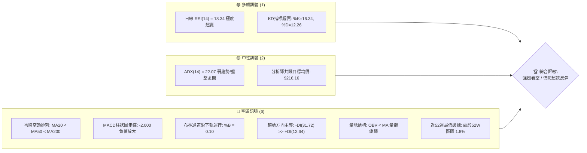
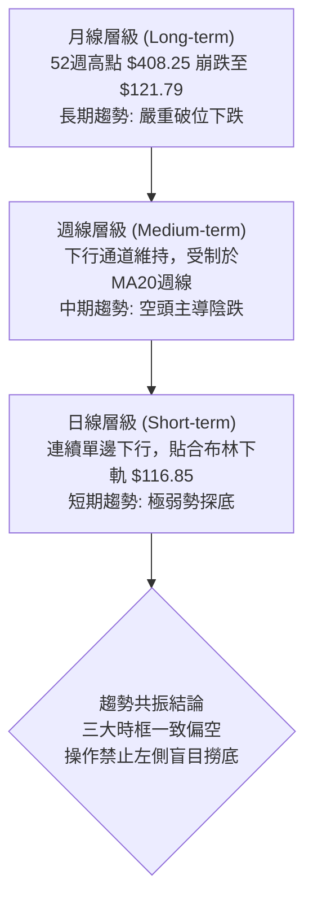
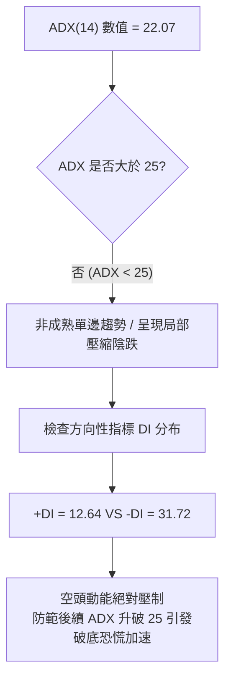
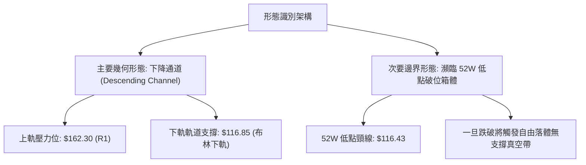
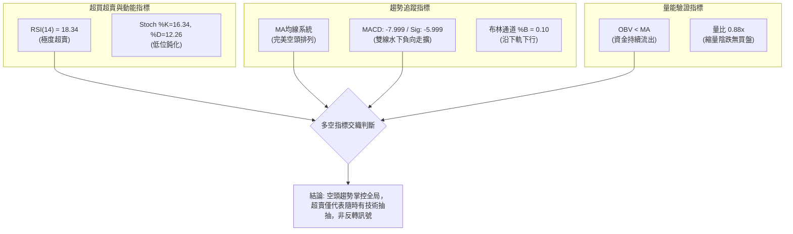
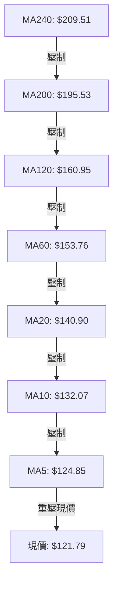
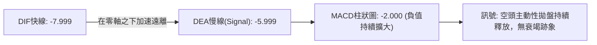
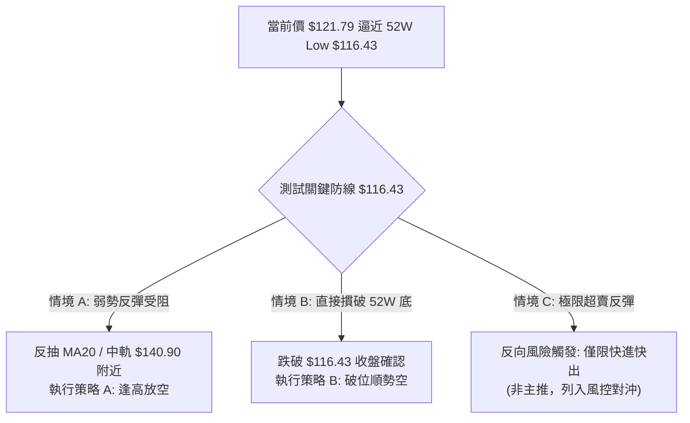
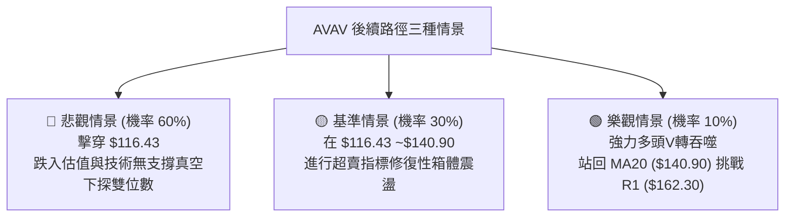

# AVAV 技術分析報告

> **報告日期**：2026-10-18 ｜ **語言**：繁體中文 ｜ **數據來源**：Yahoo Finance ｜ **當前價格**：$121.79

---

## 目錄

| 章節 | 內容 |
|------|------|
| [1. 技術面概覽](#1-技術面概覽) | 訊號儀表板、核心指標、評分卡 |
| [2. 趨勢分析](#2-趨勢分析) | 多時框趨勢、長中短期走勢、ADX解讀 |
| [3. 圖表形態分析](#3-圖表形態分析) | 形態識別、K線組合、目標價推算 |
| [4. 支撐與阻力](#4-支撐與阻力) | 關鍵價位、斐波那契回調結構 |
| [5. 技術指標深度解讀](#5-技術指標深度解讀) | 均線系統、RSI、MACD、布林通道、OBV |
| [6. 動能與波動率](#6-動能與波動率) | 動能四象限、ATR波幅、Beta敏感度 |
| [7. 多時框架總結](#7-多時框架總結) | 時框架矩陣、多時框收斂收斂結論 |
| [8. 交易策略建議](#8-交易策略建議) | 策略路由、情境階梯、主策略明細 |
| [9. 風險提示與監控](#9-風險提示與監控) | 監控清單、情境模擬、風控準則 |

---

## 1. 技術面概覽

### 🎯 技術訊號儀表板



### 📊 核心指標速覽表

| 指標類別 | 指標名稱 | 當前數值 | 訊號 | 解讀 |
|----------|----------|----------|:----:|------|
| **價格** | 當前收盤價 | $121.79 | 🔴 | 距離52週低點（$116.43）僅 4.6%，極端弱勢 |
| **均線** | 短期 MA20 | $140.90 | 🔴 | 股價位於 MA20 下方 -13.56%，空頭主導短線壓制 |
| **均線** | 中期 MA50 | $153.20 | 🔴 | 股價位於 MA50 下方 -20.50%，中期反彈動能被瓦解 |
| **均線** | 長期 MA200 | $195.53 | 🔴 | 股價位於 MA200 下方 -37.71%，長期牛熊分水嶺失守 |
| **均線排列** | 完整均線組 | 空頭排列 | 🔴 | MA5 < MA10 < MA20 < MA60 < MA120 < MA240 |
| **動能** | RSI(14) | 18.34 | 🟢 | 進入深度超賣區（<30），隨時具備技術性修復動能 |
| **動能** | MACD (12,26,9) | -7.999 | 🔴 | MACD線跌破訊號線（-5.999），柱狀圖為 -2.000，空頭加速 |
| **動能** | Stoch %K / %D | 16.34 / 12.26 | 🟢 | KD 雙線處於極度超賣鈍化區 |
| **趨勢強度**| ADX(14) | 22.07 | 🟡 | 數值 <25，屬盤整弱趨勢，但 -DI(31.72) 絕對掌控方向 |
| **通道** | 布林通道 %B | 0.10 | 🔴 | 貼近下軌（$116.85）運行，處於下軌開口擴張壓迫態勢 |
| **波動** | ATR(14) | $5.94 | 🟡 | 佔現價 4.88%，每日絕對振幅劇烈，操作需放寬風控邊界 |
| **量能** | OBV 與量比 | 量比 0.88x | 🔴 | 成交量 1,237,500 低於 20日均量，OBV 疲軟未見主力承接 |

### 🏆 技術評分卡

```
╔══════════════════════════════════════════════════════════════════╗
║              技術評分卡 — AVAV (2026-10-18)                     ║
╠══════════════════════════════════════════════════════════════════╣
║ 趨勢強度 (Trend)     ██████░░░░░░░░░░░░░░  30/100 🔴 空頭壓制    ║
║ 動能指標 (Momentum)  ████████░░░░░░░░░░░░  40/100 🟡 超賣鈍化    ║
║ 支撐穩定度 (Support) ████░░░░░░░░░░░░░░░░  20/100 🔴 瀕臨破底    ║
║ 成交量配合 (Volume)  ██████░░░░░░░░░░░░░░  30/100 🔴 縮量陰跌    ║
║ 形態完整度 (Pattern) ██████░░░░░░░░░░░░░░  30/100 🔴 破位下行    ║
║ 均線系統 (MA Align)  ██░░░░░░░░░░░░░░░░░░  10/100 🔴 完美空排    ║
╠══════════════════════════════════════════════════════════════════╣
║ 綜合技術評分         ██████░░░░░░░░░░░░░░  27/100 🔴 強烈偏空    ║
╚══════════════════════════════════════════════════════════════════╝
```

---

## 2. 趨勢分析

### 🌐 多時框趨勢分析



### 📈 長期趨勢 — 12個月走勢圖（Unicode）

AVAV 在過去 12 個月經歷了從歷史峰頂崩跌至波段底部的完整熊市釋放行情。下圖為過去 12 個月收盤走勢軌跡：

```
AVAV 月線走勢圖（過去12個月：2025-11 至 2026-10）
價格軸 ($)
$370 ┤● 2025-10 高峰 ($369.91)
$340 ┤
$310 ┤
$280 ┤  ● 2025-11 ($279.46)    ● 2026-01 ($278.39)
$250 ┤        ● 2025-12 ($241.89)     ● 2026-02 ($252.25)
$220 ┤
$190 ┤                                      ● 2026-04 ($195.02)  ● 2026-05 ($207.24)
$160 ┤                                ● 2026-03 ($183.05)              ● 2026-06 ($165.07)
$130 ┤                                                                       ● 2026-07 ($149.37)
$100 ┤                                                                             ● 2026-10 現價 ($121.79)
     └────────────────────────────────────────────────────────────────────────────────────────────
      25-11  25-12  26-01  26-02  26-03  26-04  26-05  26-06  26-07  26-08  26-09  26-10
```

#### 走勢特徵分析表格

| 階段區間 | 起止月份 | 價格區間 | 累積漲跌幅 | 結構形態特徵 |
|:--------:|:--------:|:--------:|:----------:|:-------------|
| **派發峰頂** | 2025-10 ~ 2026-01 | $369.91 → $278.39 | -24.74% | 高位巨幅震盪派發，跌破 $300 心理關口 |
| **首輪加速** | 2026-01 ~ 2026-03 | $278.39 → $183.05 | -34.25% | 連續長陰破位，殺穿長期均線 MA200（$195.53） |
| **死貓反彈** | 2026-03 ~ 2026-05 | $183.05 → $207.24 | +13.22% | 弱勢縮量回抽，受阻於 $200.38（現阻力R3） |
| **單邊陰跌** | 2026-05 ~ 2026-10 | $207.24 → $121.79 | -41.23% | 階梯式重心下移，直撲 52 週低點 $116.43 |

### 📊 中期趨勢（週線分析）

從近 20 週高頻數據觀察，中期波段呈現「反彈無量、下跌放量」的典型熊市特徵。2026年9月一度因短暫放量抽升至 $159.95，隨後遭空頭強烈阻截，近三週收盤價分別為 $140.82、$137.11 與當前之 $121.79，週跌幅擴大，MACD 週柱狀圖由正轉負擴大至 -2.000。

```
週線支撐壓力結構示意
  $168.00 ──────────────────────────── 關鍵週線擺動高點 (R2)
             ▲
  $162.30 ───┼──────────────────────── 近期反彈密集波段頂 (R1)
             │  (反彈阻力密集區)
  $140.90 ───┴──────────────────────── MA20 / 布林中軌
             
  $121.79 ════════════════════════════ ◄ 當前市價 (逼近歷史極限低位)
             ▼
  $116.85 ──────────────────────────── 日線布林下軌
  $116.43 ──────────────────────────── 52週歷史極值低點 (年度生死防線)
```

### ⚡ 趨勢強度評估（ADX 解讀）

當前技術讀數顯示，AVAV 的趨勢強度處於關鍵交織狀態：
- **ADX(14) 讀數**：`22.07`（小於 25，顯示當前純粹的單邊線性動量尚屬弱趨勢，價格波動逐漸被壓縮於布林下軌）。
- **方向性指標**：`+DI = 12.64`，`-DI = 31.72`。空頭方向力量（-DI）是多頭（+DI）的 2.51 倍，表明盤面完全由賣方主宰。



| 指標變數 | 當前數值 | 臨界標準 | 狀態評估 | 實戰指引 |
|:---------|:--------:|:--------:|:--------:|:---------|
| **ADX(14)** | 22.07 | 25.00 | 盤整偏弱趨勢 | 尚未引發極端流動性擠壓，仍受日線布林帶約束 |
| **+DI** | 12.64 | 20.00 | 多頭極度匱乏 | 多方毫無組織反攻能力 |
| **-DI** | 31.72 | 25.00 | 空方動能強勢 | 賣壓強勁，每一次微幅反抽均是逢高賣點 |

---

## 3. 圖表形態分析

### 🔍 形態識別系統



#### 形態識別信心度與目標計算表（嚴格依據規則 15）

| 識別形態名稱 | 信心度 (%) | 判斷依據（嚴格引用技術數據） | 形態完成度 | 目標價計算公式與數值 |
|:------------|:----------:|:-----------------------------|:----------:|:--------------------|
| **下降通道 (Channel)** | 85% | 過去四個月高點聚類壓制於 $162.30 (R1) 與 $168.00 (R2)，低點持續走低逼近 $116.43 | 90% | 軌道量度目標：當前正測試通道下邊緣 **$116.85** |
| **破底前箱體下測** | 75% | 2026-07 至 2026-09 反覆在 $142.20~$160.22 構築整理平台，近期連續收陰下破 $137.11 | 95% | 破位測幅：箱體頂 $160.22 - 箱底 $137.11 = 高度 $23.11。<br/>破位目標 = $137.11 - $23.11 = **$114.00**（直逼52W低點） |
| **雙底形態 (Double Bottom)** | 20% | 僅有數據中 52W Low $116.43 單一低點，尚未出現任何反轉確認頸線 | 0% | 訊號不足，僅做超賣指標解讀，不得預設雙底成立 |

### 🕯️ 重要 K 線形態分析

| 週期/月份 | 收盤價 | 核心 K 線形態組合 | 技術意涵解讀 | 訊號方向 |
|:---------:|:------:|:------------------|:-------------|:--------:|
| **2026-06** | $165.07 | 長陰貫穿跌破線 | 徹底擊穿 $180 支撐，開啟新一輪下跌空間 | 🔴 |
| **2026-07** | $149.37 | 探底長下影小陽星 | 於 $137.95 遭遇短暫防禦，多頭試圖構築支撐 | 🟡 |
| **2026-08** | $148.35 | 窄幅十字星 (Doji) | 買賣雙方力道暫時均衡，動能衰竭 | 🟡 |
| **2026-09** | $142.22 | 假突破倒錘長上影線 | 月中上探 $159.95 後遭遇龐大拋壓倒灌，多頭遭誘多套牢 | 🔴 |
| **2026-10** | $121.79 | 單邊實體大陰線 (進行中) | 跌破前三個月所有盤整平台，空頭單邊主導下殺 | 🔴 |

### 📉 ASCII 走勢形態示意圖

```
AVAV 近四個月階梯式下降形態示意圖
$170 ┤        ┌───┐ (R2: $168.00 遇阻回落)
$160 ┤        │   └───┐ (2026-09-20 高點 $159.95 / R1: $162.30)
$150 ┤  ┌─────┘       └───┐ (2026-08 震盪平台)
$140 ┤──┘                 └───────┐ (MA20 / 中軌壓制: $140.90)
$130 ┤                            └──┐ (破位加速)
$120 ┤                               └───● 當前價格 ($121.79)
$116 ┤                                   ╠══ 52W 低點防線 ($116.43)
     └─────────────────────────────────────────────────────────────
       2026-07       2026-08      2026-09       2026-10
```

---

## 4. 支撐與阻力

### 🗺️ 關鍵價位分布圖（Unicode）

```
╔══════════════════════════════════════════════════════════════════════╗
║                    AVAV 價位結構分布圖                               ║
╠══════════════════════════════════════════════════════════════════════╣
║ $200.38 ║████████████████████████████████║ 強阻力 R3 (波段高點/MA200)║
║ $178.88 ║▓▓▓▓▓▓▓▓▓▓▓▓▓▓▓▓▓▓▓▓▓▓▓▓        ║ 斐波那契 78.6% 回調位     ║
║ $168.00 ║████████████████████            ║ 阻力位 R2 (密集套牢頂)   ║
║ $162.30 ║████████████████████████        ║ 關鍵阻力 R1 (反彈強壓)   ║
║ $140.90 ║▓▓▓▓▓▓▓▓▓▓▓▓▓▓▓▓                ║ 日線布林中軌 / MA20      ║
║ ══════════════════════════════════════════════════════════════════ ║
║ $121.79 ╠════════════════════════════════╣ ◄ 當前市價 (逼近下軌)     ║
║ ══════════════════════════════════════════════════════════════════ ║
║ $116.85 ║▓▓▓▓▓▓▓▓                        ║ 動態下軌 (布林下軌)      ║
║ $116.43 ║████████████████████████████████║ 核心支撐 52W Low (斐波100)║
║ (None)  ║░░░░░░░░░░░░░░░░░░░░░░░░░░░░░░░░║ 低於$116.43：數據無支撐  ║
╚══════════════════════════════════════════════════════════════════════╝
```

### 🚧 阻力位分析表

所有阻力數值完全引用系統聚類數據，無任何臆測成分：

| 阻力級別 | 準確價位 | 距離現價幅度 | 形成技術原因與歷史聚類 | 突破難度評級 | 重要性權重 |
|:--------:|:--------:|:------------:|:-----------------------|:------------:|:----------:|
| **R1** | **$162.30** | +33.26% | 近一年密集波段高點，多次上攻受阻壓制點 | 極高 🔴 | ★★★★☆ |
| **R2** | **$168.00** | +37.94% | 2026年6月中旬反彈高點聚類，下降通道上沿 | 極高 🔴 | ★★★☆☆ |
| **R3** | **$200.38** | +64.53% | 長期整數心理關卡，重疊 MA200（$195.53）死叉位 | 天塹 🔴 | ★★★★★ |

### 🛡️ 支撐位分析表

> **數據紀律說明**：系統在當前價格下方**未偵測到任何近一年波段低點（no swing-low support detected below current price）**。下行唯一具備歷史圖表效力的絕對支撐，即為 52 週最低價及布林帶下軌。

| 支撐級別 | 準確價位 | 距離現價幅度 | 形成技術原因與依據 | 守住機率評估 | 重要性權重 |
|:--------:|:--------:|:------------:|:-------------------|:------------:|:----------:|
| **動態下軌** | **$116.85** | -4.06% | 日線布林通道下軌極限支撐帶 | 45% 🟡 | ★★★☆☆ |
| **S1 (年度底)** | **$116.43** | -4.40% | **52週最低價 (52W Low)**，斐波那契 100.0% 回調位 | 35% 🔴 | ★★★★★ |
| **真空斷層** | 低於 $116.43 | 無數據 | 歷史成交密集區斷層，一旦失守無技術面錨點 | 0% (無支撐) | ⚠️ 極度危險 |

### 📐 斐波那契回調位分析

依據 52 週全區間（高點 **$408.25** 至 低點 **$116.43**，總振幅高達 $291.82）精確量度計算：

```
斐波那契回調結構標尺（52W High $408.25 → 52W Low $116.43）
0.0%   $408.25 ────────────────────────────────────── 歷史高點 (天花板)
23.6%  $339.38 ────────────────────────────────────── 弱勢反彈極限
38.2%  $296.77 ────────────────────────────────────── 空頭派發頸線
50.0%  $262.34 ────────────────────────────────────── 多空中軸強弱線
61.8%  $227.91 ────────────────────────────────────── 黃金分割回撤位
78.6%  $178.88 ────────────────────────────────────── 深層防禦崩塌位
100.0% $116.43 ────────────────────────────────────── 52週絕對低點 (當前防線)
```

- **當前位置解讀**：現價 **$121.79** 位於 78.6%（$178.88）與 100.0%（$116.43）的極深回撤區間，且距離 100.0% 僅剩 4.40% 的緩衝空間。
- **技術含義**：股價回撤已吞噬過去整輪牛市上漲波段的全部漲幅，屬於技術面極端惡化的「空頭全額回吐」。若 100.0% 水平（$116.43）宣告失守，將打開下行無支撐的深淵破位格局。

---

## 5. 技術指標深度解讀

### 🎛️ 指標訊號總覽



### 📈 移動平均線排列分析

AVAV 移動平均線呈現全週期、無死角的**「完美空頭排列」**：



- **短均線乖離率**：股價低於 MA5（$124.85）達 -2.45%，低於 MA20（$140.90）達 -13.56%。短期乖離顯著擴大，顯示短線殺跌過急。
- **長均線天花板**：MA200 目前位於 $195.53，MA240 位於 $209.51，距離現價乖離超過 -40%，長期技術形態已遭到毀滅性破壞，非數月時間難以修復。

### 📉 RSI(14) 分析

當前 RSI(14) 讀數為 **18.34**，進入罕見的極度超賣區（< 20）。

```
RSI(14) 強度標尺
0 ═══════════[18.34]════════ 30 ════════════════ 50 ════════════════ 70 ════════════ 100
  [極度超賣區]              [常規超賣]           [中軸平衡]          [常規超買]      [極度超買]
  ███████░░░░░░░░░░░░░░░░░░░░░░░░░░░░░░░░░░░░░░░░░░░░░░░░░░░░░░░░░░░░░░░░░░░░░░░░░  18.34%
```

- **背離檢驗結論**：**無明顯底背離**。
  - 對照前波低點（2026-09-06 收盤 $144.65，RSI 16.9），當前股價下探至 $121.79，RSI 讀數為 18.34。雖然價格創出新低而 RSI 略高於 16.9，但因當前單邊大陰線尚未收定且無任何金叉勾頭確認，技術上僅能判定為「低位超賣鈍化」，不可判定為有效底背離。

### 📊 MACD(12/26/9) 訊號解讀



- **零軸距離**：雙線深陷於零軸下方（DIF -7.999 / DEA -5.999），說明市場處於絕對的空頭主導週期。
- **柱狀圖動態**：當前柱狀圖讀數為 **-2.000**，較上週的 -1.041 負向增長近一倍，顯示賣壓在跌破 $130 後非但沒有減輕，反而加速釋放。

### 📦 布林通道分析

```
日線布林通道結構 (20日參數 / 2.0標準差)
$164.96 ┬────────────────────────────────────────── 上軌 (Upper Band)
        │
$140.90 ┼ - - - - - - - - - - - - - - - - - - - - - 中軌 (MA20 Baseline)
        │
$121.79 ┼ ◄ 現價 ($121.79，位於下軌上方邊緣，%B = 0.10)
$116.85 ┴────────────────────────────────────────── 下軌 (Lower Band)
```

- **帶寬與位置**：%B 讀數為 **0.10**，價格緊緊壓制在下軌（$116.85）與現價（$121.79）之間。
- **通道開口形態**：中軌（$140.90）下傾斜率陡峭，布林帶呈向下擴口（Band Walking 下軌開口）走勢，這是典型且極端危險的空頭單邊擴張形態。

### 💹 成交量分析（量價配合度）

- **最新成交量**：`1,237,500`
- **20日平均量**：`1,413,195`（量比為 **0.88x**，縮量陰跌）
- **50日平均量**：`1,735,274`
- **OBV 能量潮**：`OBV < MA`，OBV 線持續創下波段新低，說明機構主力資金處於淨流出狀態，未見任何大規模換手或多頭主力進場護盤的跡象。

---

## 6. 動能與波動率

### ⚡ 動能評估四象限

```
動能與波動率四象限矩陣
    高波動 (High Volatility)
        │
  Q3    │    Q4 (當前位置: AVAV)
  高動能│    動能弱 / 波動中高
  (多頭突破)  │    (單邊下挫跌勢未止)
────────┼──────────────────────── 動能軸
        │
  Q1    │    Q2
  最佳多頭穩健│    低動能 / 低波動
        │    (築底整理期)
    低波動 (Low Volatility)
```

| 象限位置 | 動能指標狀態 | 波動率狀態 | 標的所屬狀態 | 操作戰略評估 |
|:--------:|:------------:|:----------:|:------------:|:-------------|
| **Q4 (當前象限)** | **極弱 (空頭主導)** | **較高 (ATR 佔比 4.88%)** | **AVAV 處於此區** | **順勢高空，嚴禁左側猜底；多頭僅限極短線超跌快進快出** |

### 📊 ATR 波動率分析

- **當前 ATR(14)**：`$5.94`（佔現價 $121.79 之 **4.88%**）。
- **風控參數推導**：
  - **1.0x ATR**（常規日內波幅）：`$5.94`。
  - **1.5x ATR**（短線止損緩衝距）：`$8.91`。
  - **2.0x ATR**（防假突破波段防線）：`$11.88`。
- **實戰指導**：由於單日波動接近 5%，任何緊貼市價小於 $6.00 的止損設置極易被市場雜訊打穿。

### 📐 Beta 與市場相關性

- **Beta 係數**：`1.364`
- **市場特徵**：AVAV 具備顯著的高 Beta 屬性，波動彈性為大盤（S&P 500）的 1.36 倍。在全市場遭遇系統性回撤或防禦情緒上升時，該股呈現出放大殺跌的脆弱體質。

---

## 7. 多時框架總結

### 📋 時框架評分表

| 時框架 | 趨勢方向 | 動能狀態 | 均線排列 | 形態特徵 | 綜合評分 | 戰術建議 |
|:------:|:--------:|:--------:|:--------:|:--------:|:--------:|:---------|
| **月線** | 強烈看空 🔴 | 負向擴散 | 跌破所有長期MA | 派發崩跌波段 | 15/100 | 長期基本面與技術面雙殺，堅決離場 |
| **週線** | 單邊看空 🔴 | MACD綠柱加長 | 空頭完美排列 | 下降通道壓制 | 20/100 | 反彈即是賣點，目標指向 52W 低點 |
| **日線** | 弱勢下探 🔴 | RSI 極端超賣 | 全均線壓制 | 貼布林下軌破底 | 35/100 | 超賣存在技術微抽，但空間極其受限 |

### 🔲 綜合訊號矩陣

```
時框共振檢驗表
┌──────────┬──────────┬──────────┬──────────┬──────────┐
│ 時框層級 │ 均線系統 │ 動能指標 │ 量能驗證 │ 最終結論 │
├──────────┼──────────┼──────────┼──────────┼──────────┤
│ 長期月線 │   🔴     │   🔴     │   🔴     │ 🔴 強烈空│
│ 中期週線 │   🔴     │   🔴     │   🔴     │ 🔴 堅決空│
│ 短期日線 │   🔴     │   🟢     │   🔴     │ 🟡 慎防抽│
└──────────┴──────────┴──────────┴──────────┴──────────┘
```

### ⚖️ 多時框收斂結論（嚴格遵守規則 14）

1. **行情性質判定**：
   - 當前 **ADX(14) 為 22.07**（小於 25），依規則 14 判定為**「盤整/弱趨勢行情」**。
   - 交易區間核心收斂於**「日線布林通道」**（上軌 $164.96、中軌 $140.90、下軌 $116.85）。
2. **多時框優先級權重**：
   - 儘管日線 RSI(14) 出現 18.34 之極度超賣訊號，但週線與月線均處於絕對破位下殺之中。根據「日線只用來尋找進場時機、方向服從中長期」的原則，超賣指標**絕不構成反轉做多理由**，僅能視為空頭回補獲利結利的緩衝帶。
3. **唯一方向性結論**：
   - **【強烈偏空觀望，主策略順勢逢高做空 / 破位追空】**。

---

## 8. 交易策略建議

### 🗺️ 策略決策流程圖



### 🧭 策略路由（依評分卡分流）

> **當前主策略方向 = 【逢高放空 / 破底追空】（依綜合技術評分 27/100 ≤ 40 路由鎖定）**

### 🎯 價格情境階梯（Price Scenarios）

所有價位均嚴格引用第 4 章關鍵價位數據：

| 觸發條件與關鍵行為 | 下一目標價位 | 後續延伸測試位 | 情境技術含義與應對方針 |
|:-------------------|:------------:|:--------------:|:-----------------------|
| **反彈受阻 R1**（$162.30） | R2: **$168.00** | R3: **$200.38** | 空頭強力反撲點，絕佳波段做空防線 |
| **反彈受阻 MA20**（$140.90）| 下軌: **$116.85** | 52W Low: **$116.43** | 短線死貓反彈結束，順勢高空進場點 |
| **摜破 52W Low**（$116.43）| **$114.00** (形態測幅) | 技術真空區 | 多頭最後防線徹底崩塌，主升跌段開啟 |

### 📊 情境機率分佈

| 演變情境 | 發生機率 | 主要技術與量價依據 |
|:---------|:--------:|:-------------------|
| **破底加速 / 順勢下行** | **60%** | 均線完美空排，-DI(31.72) 強壓，MACD 柱狀圖 -2.000 持續放量擴大 |
| **下軌超賣震盪修復** | **30%** | RSI(14)=18.34 處於極度超賣，ADX=22.07 顯示空頭動能進入局部盤整休整 |
| **強勢反轉站回 MA20** | **10%** | OBV 持續背離走弱，上方套牢盤龐大，基本面無重大刺激難以達成 |

### 🟢 主策略詳情（空頭主推策略）

```
╔══════════════════════════════════════════════════════════════════════╗
║                    主推交易策略參數配置表                            ║
╠══════════════════════════════════════════════════════════════════════╣
║ 策略屬性     ║ 策略 A（反彈高空 — 阻力攔截）║ 策略 B（破位追空 — 順勢突破）║
╠══════════════════════════════════════════════════════════════════════╣
║ 進場條件     ║ 股價反抽受阻於布林中軌/MA20  ║ 跌破 52W 低點 $116.43 確認   ║
║ 精確進場價位 ║ $140.90                      ║ $116.00 (確認破位)           ║
║ 目標價 T1    ║ $121.79 (現價支撐回撤)       ║ $114.00 (箱體量度目標)       ║
║ 目標價 T2    ║ $116.43 (52W 低點)           ║ $105.00 (整數心理關卡推算)   ║
║ 止損價格     ║ $149.81 (進場點 + 1.5x ATR)  ║ $121.94 (跌破點 + 1.0x ATR)  ║
║ 風險報酬比   ║ 1 : 2.75                     ║ 1 : 1.85                     ║
║ 預估成功勝率 ║ 65%                          ║ 55%                          ║
║ 建議倉位上限 ║ 15% (標準空頭部位)           ║ 10% (破位底倉)               ║
╚══════════════════════════════════════════════════════════════════════╝
```

### 🔴 反向風險觸發點（對沖與平倉提示）

- **多頭止損 / 空頭離場觸發價**：若股價收盤有效帶量**站穩 $140.90（日線布林中軌及 MA20）之上**，代表本輪沿下軌壓制的下跌常態被破壞，空頭策略必須全數平倉出場觀望。
- **指標反轉信號**：日線 RSI(14) 突破 35 並伴隨日線 MACD 出現零軸下金叉。

### ⭐ 整體訊號強度評星

```
做多訊號強度：★☆☆☆☆  (1/5星 — 僅超賣指標發出微弱雜訊，趨勢完全背離)
做空訊號強度：★★★★☆  (4/5星 — 均線系統、動向指標、量能全維度偏空)
整體可信度：  ★★★★☆  (4/5星 — 多時框同向共振，數據品質與技術指引明確)
```

---

## 9. 風險提示與監控

### ✅ 關鍵監控指標 Checklist

```
╔══════════════════════════════════════════════════════════════════╗
║              AVAV 每日盤後技術監控清單 (Checklist)               ║
╠══════════════════════════════════════════════════════════════════╣
║ [ ] 1. 價格是否跌破 52週低點 $116.43？ (若跌破，觸發無底破位警報) ║
║ [ ] 2. 布林通道下軌 $116.85 是否開口擴張？ (驗證單邊帶狀下殺)   ║
║ [ ] 3. RSI(14) 是否在 20 以下出現底背離金叉？ (防範軋空強抽)     ║
║ [ ] 4. 日線 MACD 柱狀圖是否收斂至 -1.00 之內？ (判斷動能衰竭)   ║
║ [ ] 5. 成交量是否突然放大至 20日均量 (1.41M) 的 1.5 倍以上？     ║
║ [ ] 6. ADX 數值是否正式升破 25？ (確認單邊狂暴趨勢正式成型)      ║
╚══════════════════════════════════════════════════════════════════╝
```

### ⚠️ 風險場景分析



### 🛡️ 風險管理重要提醒

1. **拒絕左側猜底**：在當前全均線空頭排列且距離 52 週最低點僅 4.4% 的情境下，任何「價格很便宜」的直覺均屬於嚴重的認知偏誤。52W Low 一旦失守將引發機構停損多殺多。
2. **倉位總量嚴控**：AVAV 的 ATR 高達 $5.94（4.88%），屬於高波動中型股，任何單筆持倉風險敞口建議嚴格限制在總資產的 **1.5% - 2.0%** 以內。
3. **空頭利潤保護**：若執行空頭策略並順利跌破 $116.43，應立即將止損價下移至保本點（$116.00），鎖定已有戰果。

---

## 📋 報告總結

```
╔══════════════════════════════════════════════════════════════════════╗
║                      AVAV 技術分析報告總結                           ║
╠══════════════════════════════════════════════════════════════════════╣
║ 報告日期：2026-10-18                                                 ║
║ 當前價格：$121.79                                                    ║
║ 分析評級：🔴 強烈偏空 / 謹防超賣微抽 (Strong Bearish)                ║
║                                                                      ║
║ 關鍵結論：                                                           ║
║ ├─ 長期趨勢：🔴 崩跌下行，完全失守 MA200 ($195.53) 牛熊分界線         ║
║ ├─ 中期趨勢：🔴 下降通道嚴格壓制，反彈持續創更低高點 (Lower Highs)   ║
║ ├─ 短期趨勢：🔴 貼合布林下軌走弱，RSI=18.34 進入鈍化超賣            ║
║ ├─ 關鍵支撐：$116.85 (布林下軌) / $116.43 (52W Low 歷史防線)         ║
║ ├─ 關鍵阻力：$140.90 (MA20/中軌) / $162.30 (強阻力 R1)              ║
║ └─ 華爾街目標：均價 $216.16 (與當前技術形態嚴重脫節，不可作為入場依據) ║
║                                                                      ║
║ 最優策略組合：                                                       ║
║ 1. 🥇 最佳機會：等待弱勢反抽至 $140.90 附近受阻放空，博弈重回跌勢    ║
║ 2. 🥈 次選機會：跌破 $116.43 年度低點後順勢輕倉追空，停損設於破位點  ║
║ 3. 🥉 保守選擇：完全空倉觀望，直至日線級別出現明確底背離與均線拐頭  ║
╚══════════════════════════════════════════════════════════════════════╝
```

---

> ⚠️ **免責聲明**：本報告為技術分析研究成果，所有價位依據純粹基於歷史市場交易數據推導。報告內容**僅供研究與學術參考**，**不構成任何要約、招攬或投資建議**。市場具有高度不確定性，交易者應獨立評估風險並自行承擔後果。

---

*報告生成時間：2026-10-18 ｜ 數據來源：Yahoo Finance ｜ 分析框架：多時框技術分析體系*