# AVAV 技術分析報告

> **報告日期**：2026-10-19 ｜ **語言**：繁體中文 ｜ **數據來源**：Yahoo Finance ｜ **當前價格**：$121.79

---

## 目錄

| 章節 | 內容 |
|------|------|
| [1. 技術面概覽](#1-技術面概覽) | 訊號儀表板、核心指標、評分卡 |
| [2. 趨勢分析](#2-趨勢分析) | 多時框趨勢、長中短期走勢、ADX 深度解析 |
| [3. 圖表形態分析](#3-圖表形態分析) | 形態識別、信心度評估、K線組合、目標價計算 |
| [4. 支撐與阻力](#4-支撐與阻力) | 關鍵價位分布、阻力與支撐表、斐波那契回調結構 |
| [5. 技術指標深度解讀](#5-技術指標深度解讀) | 均線系統、RSI、MACD、布林通道、量價配合度 |
| [6. 動能與波動率](#6-動能與波動率) | 動能四象限、ATR 波動率與止損設定、Beta 與市場連動 |
| [7. 多時框架總結](#7-多時框架總結) | 時框架評分矩陣、收斂規則與唯一方向性結論 |
| [8. 交易策略建議](#8-交易策略建議) | 策略路由分流、價格情境階梯、主策略詳情、對沖提示 |
| [9. 風險提示與監控](#9-風險提示與監控) | 關鍵監控清單、情境模擬樹、倉位風控原則 |
| [📋 報告總結](#-報告總結) | 核心指標匯整與最優交易路線 |

---

## 1. 技術面概覽

### 🎯 技術訊號儀表板

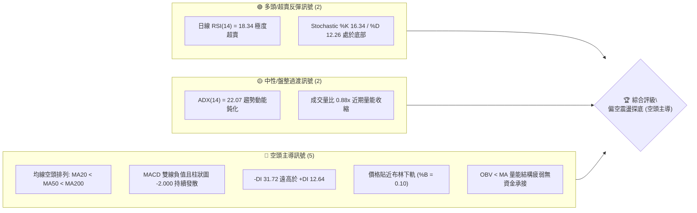

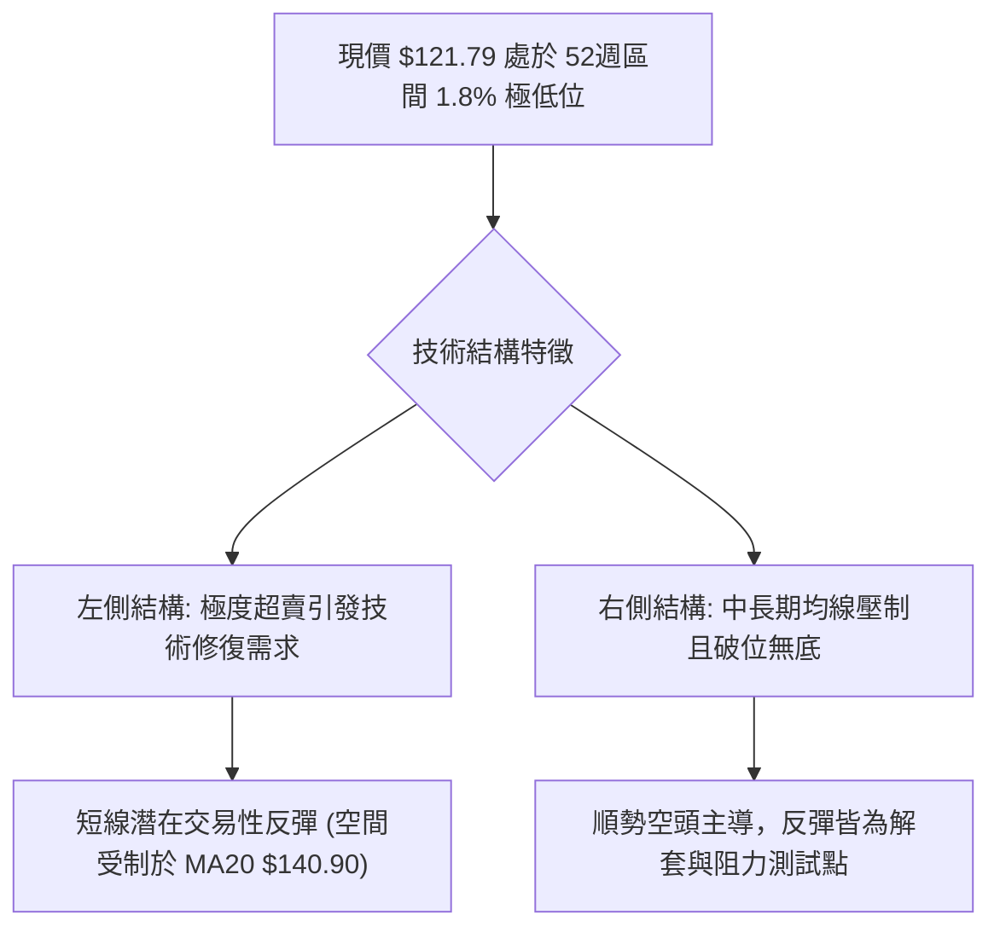

### 📊 核心指標速覽表

| 指標類別 | 指標名稱 | 當前數值 | 訊號 | 解讀 |
|----------|----------|----------|:---:|------|
| **價格** | 當前價格 | $121.79 | 🔴 | 位於 52 週最低點 $116.43 上方僅 1.8% 處，跌勢未止 |
| **均線** | MA20 | $140.90 | 🔴 | 價格在均線下方 -13.56%，短期下行斜率陡峭，為第一反彈動態阻力 |
| **均線** | MA50 | $153.20 | 🔴 | 價格在均線下方 -20.50%，中期空頭壓制線，壓制反彈空間 |
| **均線** | MA200 | $195.53 | 🔴 | 價格在均線下方 -37.71%，長期牛熊分界線失守，長期空頭格局定型 |
| **動能** | RSI(14) | 18.34 | 🟢 | 深度超賣（<20），具備強烈技術性均值回歸修復需求 |
| **動能** | MACD(12,26,9) | -7.999 / -5.999 | 🔴 | MACD 柱為 -2.000，負向發散擴大，未見金叉跡象 |
| **動能** | 隨機指標 Stoch | %K 16.34 / %D 12.26 | 🟢 | 處於 20 以下超賣區間，指標出現鈍化跡象 |
| **趨勢** | ADX / DMI | ADX 22.07 / -DI 31.72 | 🔴 | 空方 -DI 絕對主導，ADX < 25 意味單邊暴跌暫歇，轉入低位弱勢震盪 |
| **通道** | 布林帶 (%B) | 0.10 (下軌 $116.85) | 🔴 | 沿下軌弱勢滑移，若跌破下軌將引發波動率擴張破位 |
| **量能** | 成交量 / OBV | 1,237,500 (量比 0.88x) | 🔴 | OBV 小於均線，量能萎縮且缺乏多頭主動買盤承接 |
| **波動** | ATR(14) | $5.94 (4.88%) | 🟡 | 日內波動率適中，提供明確止損與風控區間邊界 |

### 🏆 技術評分卡

```
╔══════════════════════════════════════════════════════════════╗
║              技術評分卡 — AVAV (2026-10-19)                   ║
╠══════════════════════════════════════════════════════════════╣
║ 趨勢強度 (Trend)      ████░░░░░░░░░░░░░░░░  22/100   🔴 極弱 ║
║ 動能指標 (Momentum)   ██████░░░░░░░░░░░░░░  30/100   🔴 承壓 ║
║ 支撐穩定度 (Support)  ██░░░░░░░░░░░░░░░░░░  10/100   🔴 空乏 ║
║ 成交量配合 (Volume)   ██████░░░░░░░░░░░░░░  30/100   🔴 疲弱 ║
║ 形態完整度 (Pattern)  ████████░░░░░░░░░░░░  40/100   🟡 下飄 ║
║ 均線排列 (MA System)  ██░░░░░░░░░░░░░░░░░░  12/100   🔴 空頭 ║
╠══════════════════════════════════════════════════════════════╣
║ 綜合技術評分          █████░░░░░░░░░░░░░░░  24/100   🔴 強烈偏空║
╚══════════════════════════════════════════════════════════════╝
```

---

## 2. 趨勢分析

### 🌐 多時框趨勢分析

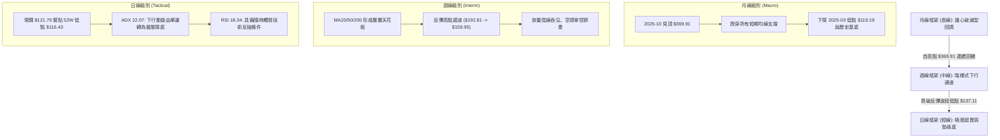

### 📈 長期趨勢 — 12個月走勢圖（Unicode）

```
AVAV 月線收盤價走勢圖（過去 12 個月：2025-11 至 2026-10）
價格軸 ($)
$380 ┤
$340 ┤
$300 ┤
$280 ┤ ●(11月 279.46)
$260 ┤               ●(1月 278.39)
$240 ┤       ●(12月 241.89)  ●(2月 252.25)
$200 ┤                               ●(4月 195.02) ●(5月 207.24)
$180 ┤                       ●(3月 183.05)
$160 ┤                                             ●(6月 165.07)
$140 ┤                                                     ●(7月 149.37) ●(8月 148.35) ●(9月 142.22)
$120 ┤                                                                                     ●(10月 121.79 現價)
     └───────────────────────────────────────────────────────────────────────────────────────────
        11月    12月    01月    02月    03月    04月    05月    06月    07月    08月    09月    10月
       (2025)  (2025)  (2026)  (2026)  (2026)  (2026)  (2026)  (2026)  (2026)  (2026)  (2026)  (2026)
```

#### 長期走勢特徵分析表格

| 階段 | 時間區間 | 起止價位 ($) | 漲跌幅 | 走勢特徵與技術形態 |
|:---:|:---:|:---:|:---:|:---|
| **第一階段：見頂回落** | 2025-10 至 2025-12 | $369.91 → $241.89 | -34.61% | 歷史級放量拋售，長陰線破位，確立頂部反轉。 |
| **第二階段：次高反抽** | 2025-12 至 2026-01 | $241.89 → $278.39 | +15.09% | 弱勢死貓跳反彈，未能回補上方跳空缺口，形成更低高點（Lower High）。 |
| **第三階段：陰跌加速** | 2026-01 至 2026-03 | $278.39 → $183.05 | -34.25% | 連續跌破整數大關，中期均線系統轉為死叉向下發散。 |
| **第四階段：平台抵抗** | 2026-03 至 2026-05 | $183.05 → $207.24 | +13.21% | 在 $200 附近構築橫盤整理平台，多頭試圖抵抗但成交量不足。 |
| **第五階段：破位沉底** | 2026-05 至 2026-10 | $207.24 → $121.79 | -41.23% | 整理平台徹底崩塌，跌破所有均線支撐，直奔 52 週低點尋底。 |

### 📊 中期趨勢（週線分析）

中期技術面呈現教科書式的下降波浪。最近 20 週數據顯示，反彈高點持續下移，高點由 2026-08-16 的 $192.81 降至 2026-09-20 的 $159.95；隨後空頭再度發力，跌破 2026-06-28 的前低 $137.95，創下本輪調整收盤新低 $121.79。

```
週線級別價格壓力與動態支撐結構
$200.38 ────────────────────────────────────── 強阻力 R3 (前期反彈頭部聚類)
          ╲
           ╲
$168.00 ────╲───────────────────────────────── 次級阻力 R2 (反彈衰竭高點)
             ╲
$162.30 ──────╲─────────────────────────────── 短期阻力 R1 (2026-08-23 破位頸線)
               ╲
$140.90 ────────╲───────────────────────────── MA20 動態壓制
                 ╲
$121.79 ──────────● 現價 (逼近 52W Low)
                   │
$116.43 ──────────┴─────────────────────────── 52W 低點 / 斐波那契 100.0% 終極支撐
```

### ⚡ 趨勢強度評估（ADX 解讀）

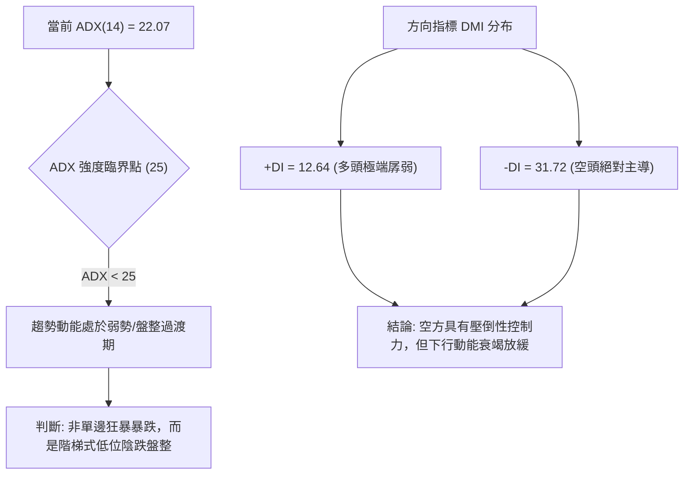

#### ADX 強度區間對照評估表

| 指標變量 | 數值 | 參考標準 | 狀態評估 | 戰術意義 |
|:---:|:---:|:---:|:---:|:---|
| **ADX(14)** | **22.07** | < 20：無趨勢<br>20–25：弱趨勢/醞釀<br>> 25：強趨勢 | 🟡 弱趨勢/低位盤整 | 股價單邊狂跌期已過，空頭動能局部衰竭，不易出現無節制暴跌。 |
| **+DI** | **12.64** | > 25 多方轉強 | 🔴 極度低迷 | 市場缺乏任何規模的多頭買盤，多頭毫無定價權。 |
| **-DI** | **31.72** | > 25 空方主導 | 🔴 顯著佔優 | 空方牢牢掌控盤面，任何反彈均受空方借勢拋售壓制。 |
| **收斂結論** | **依規則 14** | **ADX < 25** | **盤整/通道震盪** | **以日線布林通道 ($116.85–$164.96) 為主要空間邊界，不追空。** |

---

## 3. 圖表形態分析

### 🔍 形態識別系統

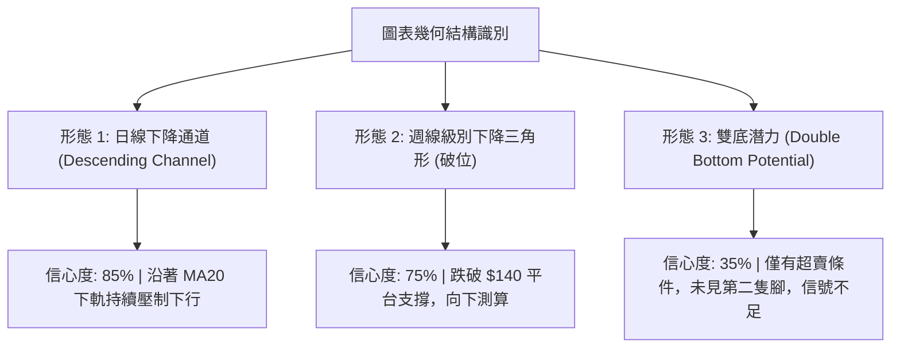

#### 形態信心度與目標價計算表

| 形態名稱 | 信心度 | 判斷依據（引用數據） | 完成度 | 目標價（附嚴格計算式） |
|:---|:---:|:---|:---:|:---|
| **下降通道 (Descending Channel)** | **85%** | 高點遞減 ($192.81 → $159.95) 連線，低點同步下移 ($144.58 → $137.11 → $121.79)，各均線呈標準空頭排列。 | 90% | 下軌動態目標價：下探 52W 低點 **$116.43**（由 OHLCV 關鍵價位確認）。 |
| **橫盤跌破 (Bearish Breakdown)** | **75%** | 2026-07 至 09 月期間多次在 $142–$144 區域獲支撐，10 月中旬放量失守 $137.11。 | 100% | 破位測算高度：平台頂 $159.95 - 平台底 $140.82 = $19.13；破位目標 = $140.82 - $19.13 = **$121.69**（與現價 $121.79 高度吻合，目標已達成）。 |
| **潛在雙底 (Double Bottom)** | **35%** | 訊號不足。僅基於價格逼近 2025-03 低點 $119.19 與 52W 低點 $116.43，缺乏右底構築與放量確認。依規則 15，僅作指標型超賣解讀。 | 15% | 若確立：頸線為 R1 **$162.30**。突破後高度 = $162.30 - $116.43 = $45.87；遠期目標 = $162.30 + $45.87 = **$208.17**（目前不具備交易可操作性）。 |

### 🕯️ 重要 K 線形態分析（近 5 個月走勢節點）

| 月份 | 收盤價 ($) | K 線形態特徵 | 結構解讀 | 訊號強度 |
|:---:|:---:|:---|:---|:---:|
| **2026-06** | 165.07 | 大陰線破位向下 | 跌破 $180 中期支撐平台，成交量放大，空頭發起總攻。 | 🔴 強空 |
| **2026-07** | 149.37 | 下影線較長的小陰線 | 在 $140 附近出現抵抗買盤，多空進入弱平衡。 | 🟡 中性 |
| **2026-08** | 148.35 | 沖高回落長上影墓碑線 | 月中一度反抽至 $192.81，隨後遭逢巨量空頭拋壓，多頭反攻潰敗。 | 🔴 看空 |
| **2026-09** | 142.22 | 窄幅十字星整理 | 成交量分化，市場動能竭盡，方向選擇前的暴風雨前寧靜。 | 🟡 變盤 |
| **2026-10** | 121.79 | 破位光腳中長陰線（未完結） | 直接向下擊穿橫盤中樞，沿布林下軌向下拓展空間，極度疲弱。 | 🔴 強空 |

### 📉 ASCII 走勢形態示意圖

```
AVAV 日線級別下降通道與破位結構圖
價格 ($)
$170 ┤        [高點 1: $168.00 (R2)]
$160 ┤               ●
$150 ┤                ╲          ● [高點 2: $159.95]
$140 ┤═════════════════╲═════════╲══════════ [破位頸線: MA20 $140.90]
$130 ┤                  ╲         ╲
$120 ┤                   ╲         ● 現價: $121.79 (BB 下軌 $116.85 邊界)
$110 ┤────────────────────● 52W 低點支撐 $116.43 ──────────────────────
     └───────────────────────────────────────────────────────────
       2026-08           2026-09            2026-10
```

### 🎯 形態目標價計算

根據日線下降通道與中樞破位形態，計算關鍵目標位：
1. **中樞高度計算**：
   - 中樞高點（2026-09-20 週收盤高點）= **$159.95**
   - 中樞破位下沿（2026-10-04 週收盤）= **$140.82**
   - 形態絕對高度 $H = 159.95 - 140.82 = \$19.13$
2. **第一空頭測幅滿足點**：
   - $Target_1 = 140.82 - 19.13 = \mathbf{\$121.69}$
   - **驗證**：當前即時市價為 **$121.79**，與該測算目標差距僅 $0.10，說明此形態的第一波下行測幅空間已完全兌現，在此位置發生空頭回補與空頭平倉的機率極高。
3. **第二極限波段下行目標（若破 52W 低點）**：
   - 引用數據中確認的唯一絕對底限：**52W Low = $116.43**。在此價位未跌破前，不可盲目臆測更低點。

---

## 4. 支撐與阻力

### 🗺️ 關鍵價位分布圖（Unicode）

```
AVAV 價位結構分布圖（嚴格依據 OHLCV 計算）
═════════════════════════════════════════════════════════════════
$200.38 ║████████████████████████████████║ 強阻力 R3 (波段高點/MA240防線)
$168.00 ║████████████████████            ║ 次級阻力 R2 (反彈高點聚類)
$164.96 ║▓▓▓▓▓▓▓▓▓▓▓▓▓▓▓▓▓▓▓▓            ║ 布林帶上軌
$162.30 ║████████████████████████████    ║ 關鍵短線阻力 R1 (頸線位置)
$153.20 ║░░░░░░░░░░░░░░░░░░░░░░░░░       ║ MA50 中期趨勢線
$140.90 ║░░░░░░░░░░░░░░░░                ║ MA20 短期多空分水嶺 / 布林中軌
════════╬════════════════════════════════╬════════════════════════
$121.79 ╠════════════════════════════════╣ ◄ 現價 (市價位)
════════╬════════════════════════════════╬════════════════════════
$116.85 ║░░░░░░░░░░                      ║ 布林帶下軌
$116.43 ║████████████████████████████████║ 終極強支撐 (52W Low / 斐波那契 100%)
(無)    ║░░░░░░░░░░░░░░░░░░░░░░░░░░░░░░░░║ 現價下方無其他已確認波段支撐聚類
═════════════════════════════════════════════════════════════════
```

### 🚧 阻力位分析表

阻力位嚴格引用技術數據中「關鍵價位」區塊，由真實歷史 OHLCV 高點聚類而成：

| 阻力級別 | 價位 ($) | 距現價空間 | 形成技術依據與籌碼沉積 | 突破難度評級 | 重要性 |
|:---:|:---:|:---:|:---|:---:|:---:|
| **R1** | **$162.30** | +33.26% | 近一年波段高點聚類區，前期多頭套牢密集區下沿，反彈首要強阻力。 | 🔴 極高 | ★★★★☆ |
| **R2** | **$168.00** | +37.94% | 波段反彈高點聚類，與布林上軌 ($164.96) 構成寬幅天花板共振壓制。 | 🔴 極高 | ★★★☆☆ |
| **R3** | **$200.38** | +64.53% | 整數心理關口，MA200 ($195.53) 與 MA240 ($209.51) 重合處，牛熊分水嶺。 | 🔴 難以踰越 | ★★★★★ |

### 🛡️ 支撐位分析表

數據明確顯示：「*(no swing-low support detected below current price)*」，現價下方不存在任何近一年的波段低點聚類。唯一的硬性支撐由 52 週最低價提供：

| 支撐級別 | 價位 ($) | 距現價空間 | 形成技術依據與籌碼結構 | 守住機率 | 重要性 |
|:---:|:---:|:---:|:---|:---:|:---:|
| **終極支撐 (52W Low)** | **$116.43** | -4.40% | 52 週最低價、斐波那契 100% 絕對回調位。市場最後防線，多頭最後底牌。 | 🟡 55% | ★★★★★ |
| **動態支撐 (BB Lower)** | **$116.85** | -4.06% | 日線布林通道下軌，波動率統計邊界。短期易引發均值回歸。 | 🟢 65% | ★★★☆☆ |
| **更低層級支撐** | **無** | — | **數據中未偵測到**任何更低支撐位。若擊穿 $116.43，將進入真空無支撐深淵。 | — | — |

### 📐 斐波那契回調位分析

依據基準週期 52 週區間波段（最高點 $408.25 至 最低點 $116.43，極差 $291.82）嚴格劃分：

```
斐波那契全景回調位架構
0.0%  (52W High) ────────────────────────────── $408.25
23.6%            ────────────────────────────── $339.38
38.2%            ────────────────────────────── $296.77
50.0%            ────────────────────────────── $262.34
61.8%            ────────────────────────────── $227.91 (黃金分割常規防線)
78.6%            ────────────────────────────── $178.88 (多頭終極榮枯線，已跌破)
100.0% (52W Low) ────────────────────────────── $116.43 (當前考驗防線)
```

#### 斐波那契落點與深度解讀
1. **當前價格區間判定**：
   - 當前市價 **$121.79** 處於 **78.6% 回調位 ($178.88)** 與 **100.0% 回調位 ($116.43)** 之間的「深水區」。
   - 現價距離 100% 回調位僅剩 **$5.36（-4.40%）**，已完全回吐了過去一年內所有的上漲動能，說明整輪多頭結構徹底瓦解。
2. **回調結構意義**：
   - 股票跌破 78.6% ($178.88) 後未能在該處形成雙底，意味著中長線多頭買盤已經完全認賠出局。
   - 現價緊貼 100.0% 回調位 $116.43，屬於技術面上的「測試歷史原點」走勢。該位置通常具備極強的心理支撐效應，空頭在此處往往會遭遇獲利了結盤，從而引發技術性弱勢震盪反抽。

---

## 5. 技術指標深度解讀

### 🎛️ 指標訊號總覽

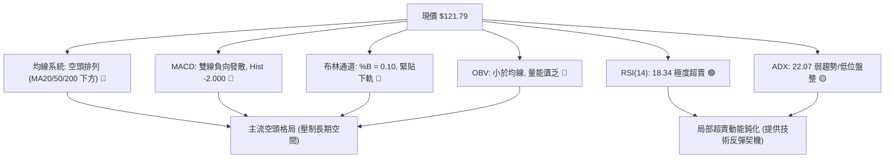

### 📈 移動平均線排列分析

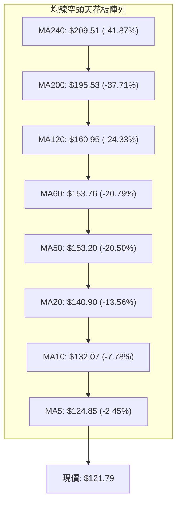

#### 均線階梯化特徵解讀
- **完全空頭排列（Perfect Bearish Alignment）**：從超短期的 MA5 ($124.85) 到超長期的 MA240 ($209.51)，所有 8 條均線均呈現無交錯的由大到小空頭排列。
- **均線乖離率（Disparity）**：
  - 現價與 MA20 乖離達 **-13.56%**，與 MA50 乖離達 **-20.50%**。歷史經驗表明，當負乖離率過大時，拋壓將出現短暫耗竭，誘發向 MA20 ($140.90) 的修復性靠攏。

### 📉 RSI(14) 分析

```
RSI(14) 數值刻度與當前狀態
0 ─────────[18.34]─── 20 ────────────── 50 ────────────── 70 ────────── 100
           ▲
       極度超賣區 (Oversold)
進度條: ▓▓▓░░░░░░░░░░░░░░░░░ 18.34%
```

- **超賣狀態評估**：
  - 當前 RSI(14) 為 **18.34**，已深跌至 20 以下的極端超賣區域。近 20 週數據中，僅有 2026-09-06 出現過類似低值 (16.9)，隨後兩週內價格由 $144.65 快速反抽至 $159.95 (+10.58%)。
- **背離分析判斷（Divergence）**：
  - **結論**：**無底背離，無頂背離**。
  - **數據比對**：2026-10-11 收盤價 $137.11 對應 RSI 19.1；2026-10-18 收盤價 $121.79 創下新低，對應 RSI 18.3 同步創下新低。指標與價格同步下沉，並未形成「價格創新低而 RSI 不創新低」的底背離形態。因此，此超賣僅代表空頭賣壓宣洩極致，而非反轉訊號。

### 📊 MACD(12,26,9) 訊號解讀

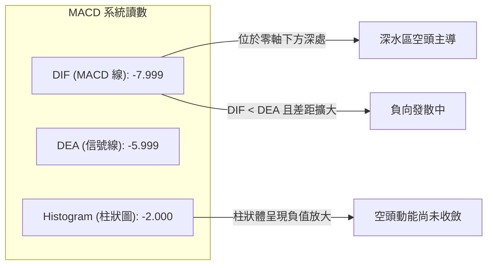

- **柱狀圖動態**：週線級別柱狀圖從上一週的 -1.041 擴大至 **-2.000**，顯示下行加速度依然存在，尚未見到紅柱縮短的鈍化信號。
- **操作指引**：在 MACD 柱狀體收斂並形成底部金叉前，任何盲目左側抄底均承擔極高的趨勢逆勢風險。

### 📦 布林通道分析

```
日線布林通道結構 (20, 2)
$164.96 ─────────────────────────────────────── 上軌 (Upper Band)
          │
          │
$140.90 ──┼──────────────────────────────────── 中軌 (MA20, Middle Band)
          │
$121.79 ──┼──────● 現價 (%B = 0.10)
$116.85 ──┴──────────────────────────────────── 下軌 (Lower Band)
```

- **帶寬與位置解讀**：
  - **通道帶寬**：上軌 $164.96 - 下軌 $116.85 = $48.11，帶寬度較寬，表明市場近期波動幅度較大。
  - **%B 指標**：數值為 **0.10**，高度貼近下軌（0 代表下軌，0.5 代表中軌）。此類數值顯示價格正沿著下軌處於空頭「滑軌走勢」（Walking the Band），是強烈空頭延續的表徵，除非一根實體陽線重新站上 $125 上方，否則通道下軌將持續被動下移。

### 💹 成交量分析（量價配合度）

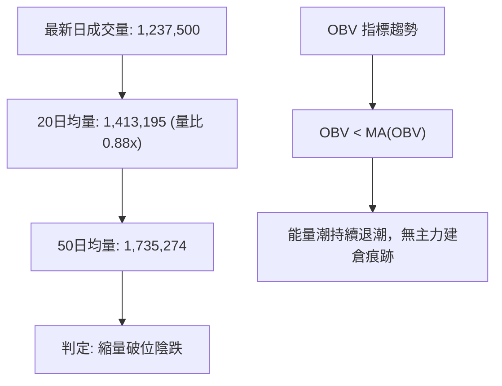

- **量能結構解析**：
  - 最新成交量 1,237,500 股，相較於 20 日均量呈現 **0.88x 縮量**。這種「無量下跌」通常反映買方流動性匱乏，不需要龐大的拋盤即可將股價大幅打低。
  - 近 20 週數據中，2026-09-13 曾爆出 20,402,600 股的巨量換手（收盤 $146.71），但隨後股價未能持續放量突破，反而跌破該週底部，顯示該巨量為「主力出逃換手量」而非吸籌量。
  - **OBV 驗證**：OBV 明確位於其均線下方，量價配合呈現「空頭確認」狀態，不存在量價底背離特徵。

---

## 6. 動能與波動率

### ⚡ 動能評估四象限

```
動能與波動率定位矩陣
  高波動率 (High Vol)
          │
    Q3    │    Q4
  高動能  │  弱動能
  高波動  │  高波動
──────────┼──────────
    Q1    │    Q2 ◄── [AVAV 當前落點]
  強動能  │  弱動能
  低波動  │  低波動
          │
  低波動率 (Low Vol) ──── 低動能 (Weak Momentum)
```

#### 四象限評估維度詳解

| 象限標籤 | 動能狀態 | 波動狀態 | 當前適配 | 特徵解析與交易指引 |
|:---:|:---:|:---:|:---:|:---|
| **Q1 (最佳擴張)** | 強 | 低 | — | 處於蓄勢爆發起點，適合趨勢追隨。 |
| **Q2 (鈍化盤整)** | **弱** | **低** | **✓ (當前)** | **ADX = 22.07 顯示趨勢動能放緩，ATR 比例 4.88% 屬於中低波動；此時股價下挫多為被動陰跌，空頭動能開始衰竭，適合區間網格或耐心觀望。** |
| **Q3 (極限單邊)** | 強 | 高 | — | 單邊暴跌或暴漲主升浪，波動巨大。 |
| **Q4 (非理性宣洩)** | 弱 | 高 | — | 恐慌性恐慌拋售尾聲，巨幅洗盤震盪。 |

### 📊 ATR 波動率分析

- **ATR(14) 絕對值**：**$5.94**（佔當前股價之 **4.88%**）。
- **日內波動特徵**：該數值意味著 AVAV 每個交易日的理論常態波動區間約為 $6.00。在單日波動達 5% 的環境下，過於狹窄的止損極易被市場雜訊掃出場。
- **止損與區間測算建議**：
  - **常規短線止損距離**：設定為 $1.5 \times \text{ATR} = 1.5 \times \$5.94 = \mathbf{\$8.91}$。
  - **寬鬆波段止損距離**：設定為 $2.0 \times \text{ATR} = 2.0 \times \$5.94 = \mathbf{\$11.88}$。

### 📐 Beta 與市場相關性

- **Beta 係數**：**1.364**。
- **市場敏感性解析**：
  - Beta 顯著大於 1.0，表明該標的具備強烈的「高彈性」與「高貝塔」屬性，其波動幅度平均高出大盤標普 500 指數 36.4%。
  - 在整體宏觀市場承壓或大盤回調階段，AVAV 將承受乘數效應的拋壓；反之，若大盤展開反彈，其超賣修復的理論回彈速度也將快於大盤。

---

## 7. 多時框架總結

### 📋 時框架評分表

| 時框架 | 趨勢方向 | 動能狀態 | 均線排列 | 圖表形態 | 綜合評分 | 戰術指引 |
|:---:|:---:|:---:|:---:|:---:|:---:|:---|
| **月線 (長期)** | 🔴 強空 | 弱勢下沉 | 跌破所有中短期 MA | 歷史雙頂頸線破位 | 15/100 | 長期基本面與技術面雙殺，堅決不盲目長線做多。 |
| **週線 (中期)** | 🔴 偏空 | 柱狀圖負值 | 標準空頭排列 | 下降通道運行中 | 20/100 | 反彈高點逐級降低，逢反彈至壓力位均為空點。 |
| **日線 (短期)** | 🟡 震盪探底 | RSI 深度超賣 | 負乖離過大 | 貼近 52W 低點整理 | 35/100 | 短線下行阻力加大，隨時醞釀技術抽頭，勿過度追空。 |

### 🔲 綜合訊號矩陣

```
時框架訊號交叉驗證表
┌──────────────┬──────────────┬──────────────┬──────────────┐
│ 分析維度     │ 短期 (日線)  │ 中期 (週線)  │ 長期 (月線)  │
├──────────────┼──────────────┼──────────────┼──────────────┤
│ 均線系統     │ 🔴 空頭壓制  │ 🔴 空頭排列  │ 🔴 跌破多空線│
│ 趨勢指標     │ 🟡 ADX 鈍化  │ 🔴 -DI 壓制  │ 🔴 熊市結構  │
│ 動能指標     │ 🟢 極度超賣  │ 🔴 MACD 擴大 │ 🔴 零軸下方  │
│ 量價結構     │ 🟡 縮量陰跌  │ 🔴 破位放量  │ 🔴 主力撤出  │
├──────────────┼──────────────┼──────────────┼──────────────┤
│ 矩陣方向判定 │ 🟡 超賣反抽  │ 🔴 順勢偏空  │ 🔴 長線走熊  │
└──────────────┴──────────────┴──────────────┴──────────────┘
```

### ⚖️ 多時框收斂結論（依嚴格規則 14）

1. **市場狀態判定**：當前 ADX(14) 讀數為 **22.07 (< 25)**，根據多時框收斂原則，市場定性為 **「盤整/震盪探底行情」**，而非順暢的單邊加速暴跌趨勢。
2. **時框主導權取捨**：
   - 由於 ADX < 25，交易空間以 **日線布林通道 ($116.85 – $164.96)** 作為邊界約束。
   - 中長期週線趨勢（MA50 $153.20、MA200 $195.53）提供嚴格的「阻力天花板」方向指引，而日線超賣指標僅作為「底部邊界與短線反抽時機」的輔助。
3. **唯一方向性結論**：
   - **【總體定性：偏空弱勢震盪（以逢高做空為主，嚴禁低位追空）】**
   - 儘管短線 RSI(18.34) 出現強烈超賣，但在 MACD 柱狀體收斂且未收復 MA20 前，短線反彈均屬於「次級修正」。總體技術面維持 **偏空防守** 評級。

---

## 8. 交易策略建議

### 🗺️ 策略決策流程圖

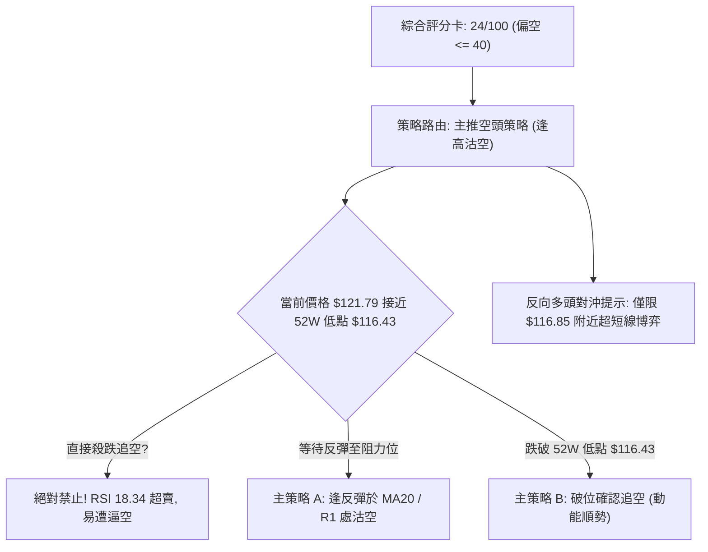

### 🧭 策略路由（依評分卡分流）

> **當前主策略方向 = 【主推空頭策略（逢高布空與破位追空）】（依技術評分卡：24/100）**
> *依分流規則：綜合評分 ≤ 40 必須主推空頭策略，多頭僅列為反轉風險提示與對沖參考，嚴禁兩頭下注。*

### 🎯 價格情境階梯（Price Scenarios）

價位嚴格引用第 4 章由歷史 OHLCV 演算所得之確定數值：

| 觸發條件 | 下一目標 | 後續延伸 | 情境技術含義 |
|:---|:---:|:---:|:---|
| **向上突破 R1 $162.30** | R2 $168.00 | R3 $200.38 | 宣佈短期底部構築成功，開啟中期級別超跌反彈。 |
| **反彈受阻於 MA20 $140.90** | $121.79 | $116.43 | 受到動態均線壓制，空頭回踩測試 52 週低點。 |
| **跌破終極支撐 $116.43** | $110.00 (整數心理) | 數據未偵測支撐 | 52 週防線徹底失守，打開全新下行空間，引發止損潮。 |

### 📊 情境機率分佈

| 情境劃分 | 機率估計 | 主要技術指標支撐依據 |
|:---|:---:|:---|
| **情境一：低位弱勢震盪或技術反彈** | **55%** | RSI(14) 深達 18.34，Stoch 出現超賣，ADX 22.07 顯示空頭下行動能正在衰減，價格貼近布林下軌 $116.85。 |
| **情境二：延續陰跌並跌破 52W 低點** | **35%** | 均線系統維持完全空頭排列，OBV 疲軟，MACD 柱狀體負值擴大至 -2.000，無大資金承接。 |
| **情境三：直接發生 V 型強勢反轉** | **10%** | 缺乏任何底背離形態配合，成交量低迷（量比 0.88x），上方累積大量獲利回吐與套牢籌碼。 |

### 🟢 主策略詳情（方向：主推空頭策略）

| 策略要素 | 策略 A：反彈衰竭高空（首選） | 策略 B：跌破關鍵低點追空（次選） |
|:---|:---|:---|
| **進場條件** | 價格向上回抽 MA20 動態均線附近，出現長上影線滯漲信號 | 價格實體陰線有效擊穿 52W 低點 $116.43，且成交量放大 |
| **進場價格** | **$140.90** (精確對齊 MA20 價位) | **$115.50** (確認跌破 $116.43 支撐位 0.8% 處) |
| **目標價 T1** | **$121.79** (現價位置 / 鎖定部分利潤) | **$105.00** (推算心理關口) |
| **目標價 T2** | **$116.43** (52 週波段最低點) | **$98.00** (兩位數心理關口) |
| **止損價格** | **$149.81** (進場點 + 1.5 ATR 即 $140.90 + $8.91) | **$121.44** (進場點 + 1.0 ATR 即 $115.50 + $5.94) |
| **風險報酬比** | **2.75 : 1** [風險 $8.91 vs 潛在收益 $24.47] | **2.95 : 1** [風險 $5.94 vs 潛在收益 $17.50] |
| **成功機率** | **65%** | **50%** |
| **建議倉位** | **8% - 10%** (主動進場) | **5%** (動能突破跟進) |

### 🔴 反向風險觸發點（對沖提示）

若持有多頭倉位或空頭需緊急止損，必須密切關注以下風控點：
1. **反轉確認點（空頭離場）**：日線收盤價若強勢收復 **$140.90 (MA20)** 且成交量放大至 1,800,000 股以上，空頭必須無條件平倉退場，此為空頭架構破壞訊號。
2. **多頭短線左側對沖進場位**：僅限極激進投資者在現價至布林下軌 **$116.85 – $116.43** 區間嘗試極輕倉（≤ 3%）短線撈反彈，止損必須嚴格設於 **$114.00**（跌破 52W 低點 2% 強制止損），目標看向 **$132.07 (MA10)**。

### ⭐ 整體訊號強度評星

```
╔══════════════════════════════════════════════════════════════╗
║ 做多訊號強度：★☆☆☆☆  (1.5/5 星) — 僅超賣技術回抽，風險極大   ║
║ 做空訊號強度：★★★★☆  (4.0/5 星) — 順應長中短均線全面壓制     ║
║ 整體可信度：  ★★★★☆  (4.2/5 星) — 多指標形成高強度空頭共振   ║
╚══════════════════════════════════════════════════════════════╝
```

---

## 9. 風險提示與監控

### ✅ 關鍵監控指標 Checklist

```
╔══════════════════════════════════════════════════════════════════╗
║               AVAV 技術監控檢查清單 (Daily Checklist)            ║
╠══════════════════════════════════════════════════════════════════╣
║ [ ] 52W 低點防守: 價格是否收盤跌破 $116.43?                      ║
║     (若跌破: 開啟新一輪單邊暴跌，觸發策略 B 追空)                ║
║ [ ] RSI(14) 鈍化解除: RSI 是否重新向上突破 30 臨界線?           ║
║     (若突破: 超賣修復啟動，股價有望向 MA20 靠攏)                ║
║ [ ] 均線動態壓制: 股價測試 MA20 ($140.90) 時的量價反應?         ║
║     (若放量滯漲: 觸發策略 A 最佳沽空點)                          ║
║ [ ] MACD 柱狀體變化: Histogram 是否出現負值縮減 (底背離前兆)?    ║
║     (若連續 3 日縮短: 空頭必須收緊移動止損)                     ║
║ [ ] 異常放量監控: 單日成交量是否超越 50 日均量 (1.73M 股)?       ║
║     (若放量長陽: 警惕主力資金低位回補與空頭軋空)                ║
╚══════════════════════════════════════════════════════════════════╝
```

### ⚠️ 風險場景分析

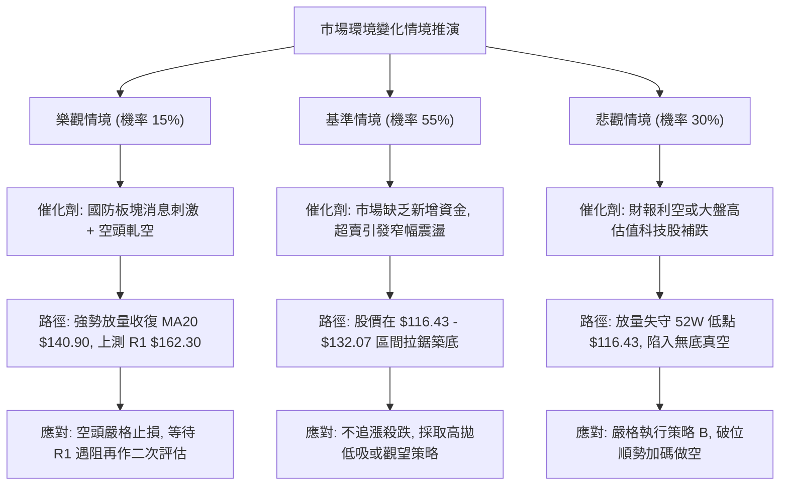

### 🛡️ 風險管理重要提醒

1. **左側逆勢抄底風險（絕對警告）**：
   - 當前 RSI 雖然低至 18.34，但**絕不可將超賣單純等同於買入訊號**。在強烈的均線空頭排列（MA20 < MA50 < MA200）中，RSI 經常會於 15–25 區間內反覆向下鈍化，隨之而來的是股價持續陰跌。
2. **高 Beta 槓桿放大效應**：
   - AVAV 擁有高達 1.364 的 Beta 係數，加之 ATR 高達 $5.94（4.88%），任何方向性錯誤若未帶止損，單週回撤極易突破 15%–20%。
3. **倉位管理守則**：
   - 任何針對該標的的單筆交易總風險敞口（Risk at Cost），嚴格控制在總投資組合淨值的 **1.0% 以內**。
   - 若執行策略 A，單一標的倉位上限不得超過 **10%**。

---

## 📋 報告總結

```
╔══════════════════════════════════════════════════════════════╗
║                  AVAV 技術分析報告總結                       ║
╠══════════════════════════════════════════════════════════════╣
║ 報告日期：2026-10-19                                         ║
║ 當前價格：$121.79                                            ║
║ 綜合技術評分：24 / 100 ➔ 🔴 強烈偏空                         ║
║ 分析評級：⚖️ 逢高沽空 / 區間弱勢震盪                          ║
╠══════════════════════════════════════════════════════════════╣
║ 關鍵結論：                                                   ║
║ ├─ 長期趨勢：🔴 跌破所有中長期均線，自高點回調超 65%         ║
║ ├─ 中期趨勢：🔴 週線級別下降通道運行，反彈高點遞減           ║
║ ├─ 短期趨勢：🟡 逼近 52W 低點 $116.43，RSI(18.34) 極度超賣   ║
║ ├─ 關鍵支撐：$116.85 (布林下軌) / $116.43 (52W Low)          ║
║ ├─ 關鍵阻力：$140.90 (MA20) / $162.30 (R1) / $168.00 (R2)     ║
║ └─ 分析師目標：均價 $216.16 (低點 $148.57 / 高點 $315.00)     ║
╠══════════════════════════════════════════════════════════════╣
║ 最優策略組合：                                               ║
║ 1. 🥇 最佳機會：等待超跌反彈至 MA20 ($140.90) 處執行沽空      ║
║    - 止損點：$149.81 ｜ 目標價：$121.79 / $116.43            ║
║ 2. 🥈 次選機會：有效跌破 52W 低點 $116.43 後順勢追空 ($115.50)║
║    - 止損點：$121.44 ｜ 目標價：$105.00                      ║
║ 3. 🥉 保守選擇：保持全額現金觀望，等待日線底背離與站上 MA20 ║
╚══════════════════════════════════════════════════════════════╝
```

---

> ⚠️ **免責聲明**：本報告為依據標準技術分析模型與歷史交易數據生成之專業量化技術分析，所有數據及估算均基於市場客觀歷史走勢。本報告**僅供研究與學術參考**，**不構成任何要約、招攬或實質投資建議**。金融市場瞬息萬變，技術指標存在滯後性與失效風險，投資有風險，決策需獨立謹慎，自負盈虧。

---

*報告生成時間：2026-10-19 ｜ 數據來源：Yahoo Finance ｜ 分析框架：資深多時框圖表與量化技術系統*