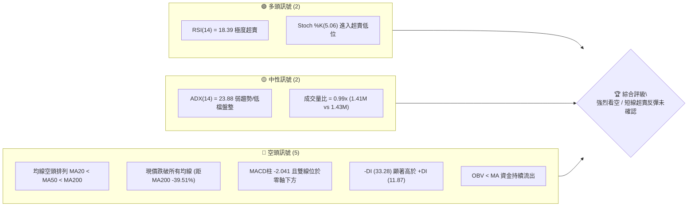
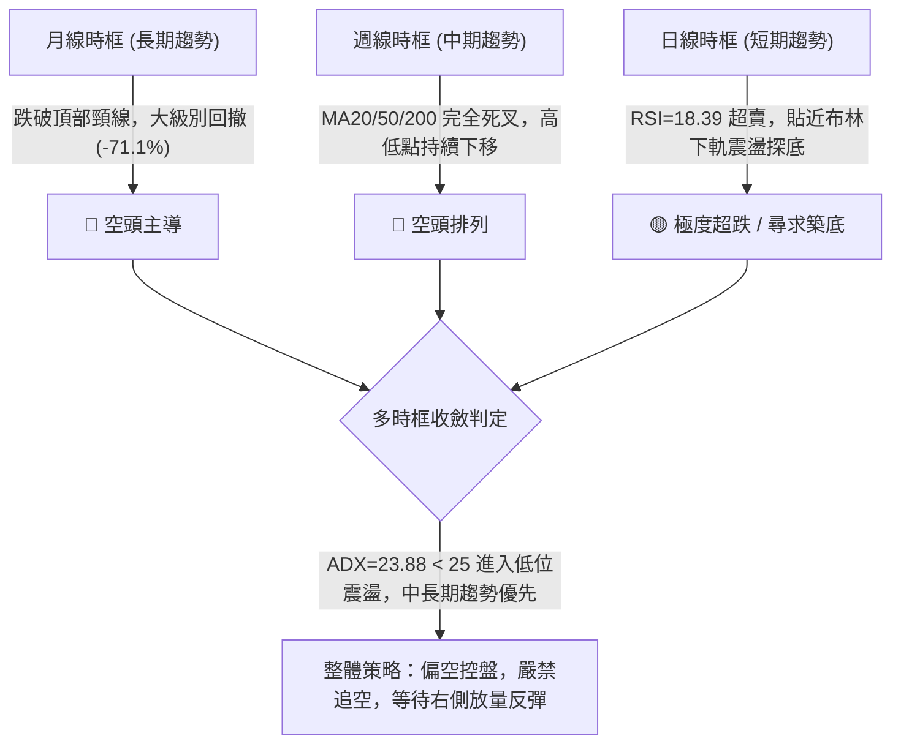
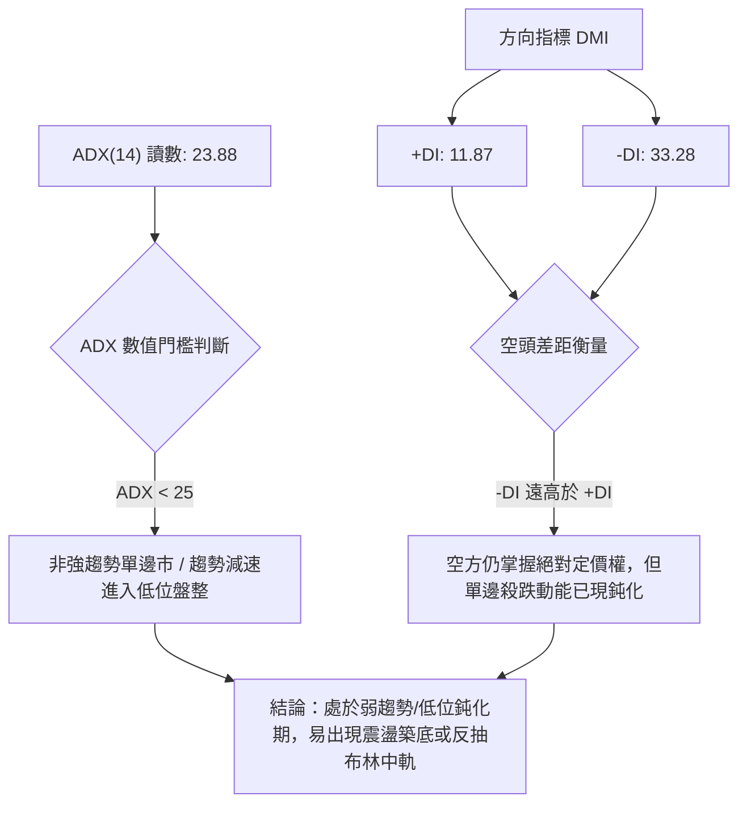
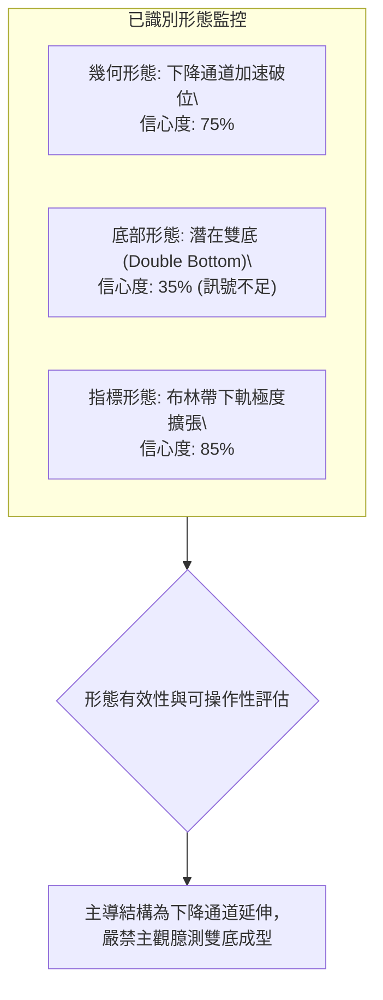
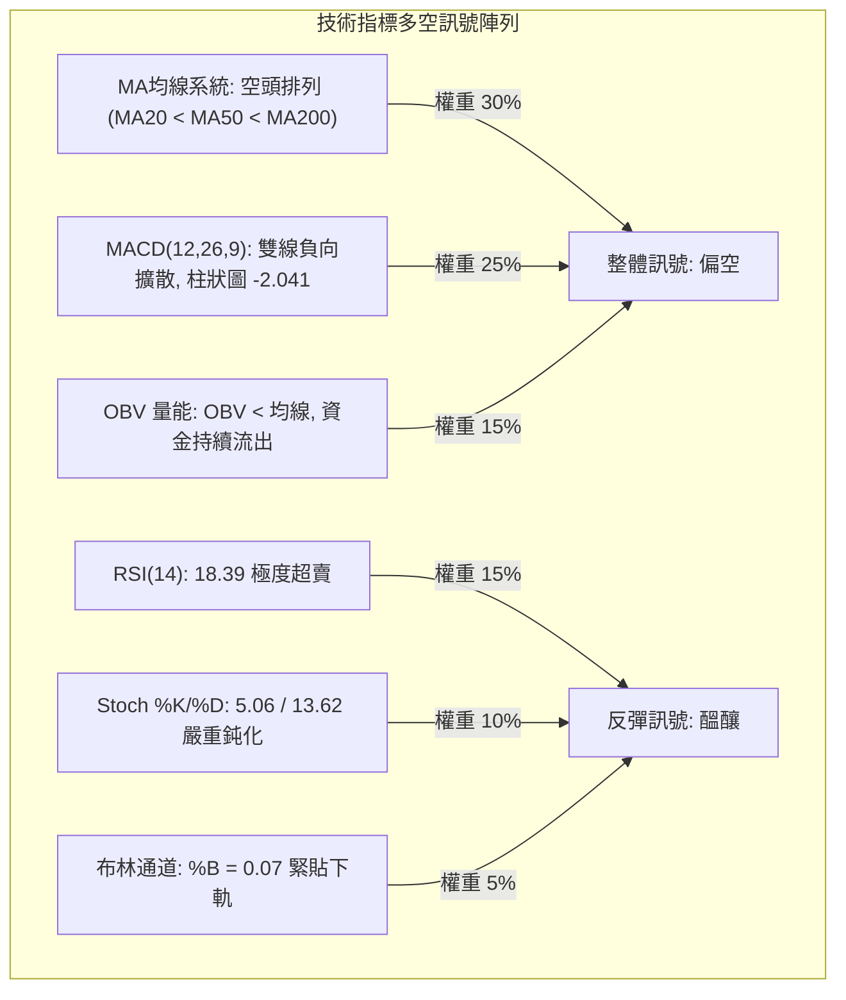
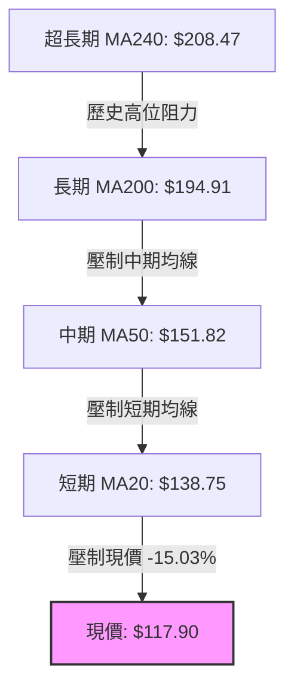
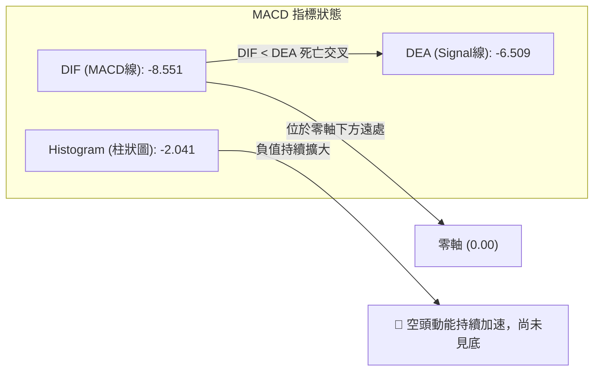
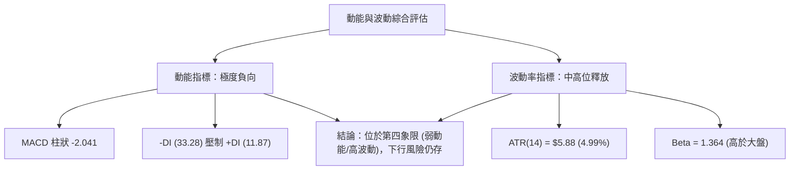
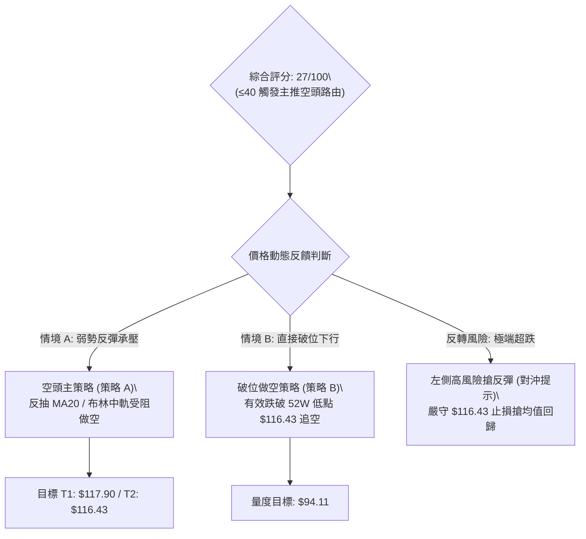
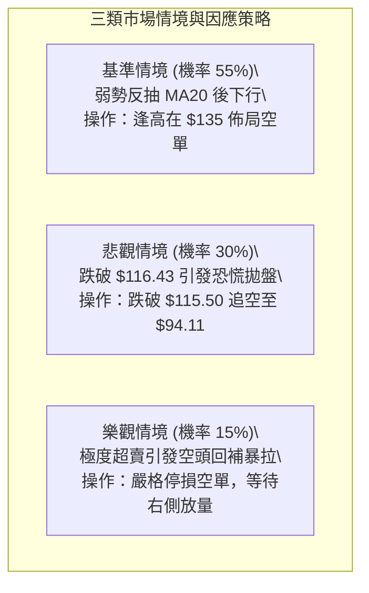

# AVAV 技術分析報告

> **報告日期**：2026-10-20 ｜ **語言**：繁體中文 ｜ **數據來源**：Yahoo Finance ｜ **當前價格**：$117.90

---

## 目錄

| 章節 | 內容 |
|------|------|
| [1. 技術面概覽](#1-技術面概覽) | 訊號儀表板、核心指標、評分卡 |
| [2. 趨勢分析](#2-趨勢分析) | 多時框趨勢、長中短期走勢 |
| [3. 圖表形態分析](#3-圖表形態分析) | 形態識別、K線組合、目標價 |
| [4. 支撐與阻力](#4-支撐與阻力) | 關鍵價位、斐波那契回調 |
| [5. 技術指標深度解讀](#5-技術指標深度解讀) | MA/RSI/MACD/布林/成交量 |
| [6. 動能與波動率](#6-動能與波動率) | 動能評估、ATR、Beta |
| [7. 多時框架總結](#7-多時框架總結) | 時框架評分矩陣 |
| [8. 交易策略建議](#8-交易策略建議) | 多空策略、風險報酬比 |
| [9. 風險提示與監控](#9-風險提示與監控) | 監控指標、風險場景 |

---

## 1. 技術面概覽

### 🎯 技術訊號儀表板



### 📊 核心指標速覽表

| 指標類別 | 指標名稱 | 當前數值 | 訊號 | 解讀 |
|----------|----------|----------|------|------|
| **價格** | 當前價格 | $117.90 | 🔴 | 位於52週區間 0.5% 分位，逼近歷史波段極低點 |
| **均線** | MA20 | $138.75 | 🔴 | 現價低於MA20達 -15.03%，短期下行趨勢嚴峻 |
| **均線** | MA50 | $151.82 | 🔴 | 價格受壓於中期生命線下方 -22.34% |
| **均線** | MA200 | $194.91 | 🔴 | 長期牛熊分界線失守，折價幅度達 -39.51% |
| **動能** | RSI(14) | 18.39 | 🟢 | 深度進入超賣區 (<30)，具潛在均值回歸修復動力 |
| **動能** | MACD(12,26,9) | -8.551 / -6.509 | 🔴 | 雙線負值運行，柱狀圖 -2.041 顯示空頭動能仍佔優 |
| **動能** | Stoch %K / %D | 5.06 / 13.62 | 🟢 | 隨機指標鈍化於超賣區，醞釀低檔金叉預期 |
| **趨勢** | ADX(14) | 23.88 | 🟡 | ADX < 25 表明單邊趨勢動能遞減，逐漸轉入低位盤整 |
| **趨勢** | DMI (+DI / -DI)| 11.87 / 33.28 | 🔴 | 空頭主導力量 (-DI) 遠超多頭力量 (+DI) |
| **通道** | 布林通道 %B | 0.07 | 🔴 | 價格緊貼布林下軌（$114.54），顯示超跌下沉 |
| **成交量**| OBV 走勢 | OBV < MA | 🔴 | 量能持續疲弱，主動性承接買盤尚未顯著進場 |
| **波動** | ATR(14) | $5.88 | 🟡 | 佔股價 4.99%，每日波動幅度中等偏高 |

### 🏆 技術評分卡

```
╔══════════════════════════════════════════════════════════════╗
║              技術評分卡 — AVAV (2026-10-20)                   ║
╠══════════════════════════════════════════════════════════════╣
║ 趨勢強度      ████████░░░░░░░░░░░░  38/100  🔴 空頭控盤        ║
║ 動能指標      ██████░░░░░░░░░░░░░░  28/100  🔴 動能疲弱/超賣    ║
║ 支撐穩定度    ████░░░░░░░░░░░░░░░░  18/100  🔴 歷史低位無底    ║
║ 成交量配合    ████████░░░░░░░░░░░░  36/100  🔴 量能疲弱背離    ║
║ 形態完整度    ██████░░░░░░░░░░░░░░  30/100  🔴 下行通道未破    ║
║ 均線排列      ██░░░░░░░░░░░░░░░░░░  12/100  🔴 完美空頭排列    ║
╠══════════════════════════════════════════════════════════════╣
║ 綜合評分      ██████░░░░░░░░░░░░░░  27/100  🔴 強烈偏空        ║
╚══════════════════════════════════════════════════════════════╝
```

---

## 2. 趨勢分析

### 🌐 多時框趨勢分析



### 📈 長期趨勢 — 12個月走勢圖（Unicode）

```
AVAV 月線走勢圖（過去12個月：2025-11 至 2026-10）
價格軸 ($)
$370 ┤                                                    
$320 ┤                                                    
$280 ┤●(2025-11: $279.46)                                
$260 ┤               ●(2026-01: $278.39)                  
$240 ┤     ●($241.89)     ●(2026-02: $252.25)             
$200 ┤                                 ●($195.02) ●($207.24)
$180 ┤                          ●($183.05)                
$160 ┤                                           ●($165.07)
$140 ┤                                                ●($149.37) ●($148.35) ●($142.22)
$110 ┤                                                                              ●←現價 $117.90
     └──────────────────────────────────────────────────────────────────────────────
       11    12    01    02    03    04    05    06    07    08    09    10 (月份)
      (2025)                           (2026)
```

**12個月走勢特徵分析表格**：

| 時期 | 起始至結束收盤價 | 區間漲跌幅 | 走勢特徵與結構解析 |
|------|------------------|------------|--------------------|
| **2025-11 ~ 2026-01** | $279.46 → $278.39 | -0.38% | 歷史高點 $369.91 見頂後的次高點構築，形成中期雙頂頸線阻力 |
| **2026-02 ~ 2026-03** | $252.25 → $183.05 | -27.43% | 放量跌破 MA200 支撐，長期多空結構正式轉向熊市格局 |
| **2026-04 ~ 2026-05** | $195.02 → $207.24 | +6.27% | 弱勢超跌反彈，反抽確認 MA200（$194.91-$208.47）阻力有效性後受阻 |
| **2026-06 ~ 2026-08** | $165.07 → $148.35 | -10.13% | 階梯式陰跌，各短期反彈高點逐級降低，形成下降通道上軌阻力 |
| **2026-09 ~ 2026-10** | $142.22 → $117.90 | -17.10% | 跌破 $140 平台支撐，加速滑向 52 週最低點 $116.43，指標全線超賣 |

### 📊 中期趨勢（週線分析）

中期技術面目前呈現「階梯式下跌結構」。從近 20 週收盤走勢可看出，股價多次在 $190-$200 區域反彈遇阻後快速下挫：
- 2026-07-05 收盤 $190.89（成交量 18.31M）形成放量假突破；
- 2026-08-16 收盤 $192.81 再次受阻於 $200 關卡；
- 隨後在 2026-09-13 爆發巨量（20.40M）卻未能扭轉頹勢，股價於 10 月加速破位。

```
中期週線阻力與支撐示意圖
══════════════════════════════════════════════════════════════
 [強阻力區]  $200.38 ─── R3 (MA200與8月波段高點重合)
               │
 [波段阻力]  $168.00 ─── R2 (6-7月密集換手成交密集區)
               │
 [通道阻力]  $162.30 ─── R1 (布林上軌 $162.97 匯聚處)
               │
 [短期均線]  $138.75 ─── MA20 (下行第一動態阻力線)
 ─────────────────────────────────────────────────────────────
 [當前現價]  $117.90 ─── (逼近52週最低位 $116.43)
 ══════════════════════════════════════════════════════════════
```

### ⚡ 趨勢強度評估（ADX 解讀）



**ADX 趨勢強度對照解讀表**：

| 指標 | 數值 | 狀態評定 | 技術意義 |
|------|------|----------|----------|
| **ADX(14)** | 23.88 | 弱趨勢 / 盤整 (<25) | 下行單邊動能已從前期的快速宣洩進入動能衰竭期，行情傾向進入寬幅震盪。 |
| **+DI(14)** | 11.87 | 極弱 | 多頭買盤動能極度匱乏，缺乏主動推升價格的能力。 |
| **-DI(14)** | 33.28 | 強勢佔優 | 空方佔據主導，但未進一步飆升至 40 以上，顯示主動性拋壓開始收斂。 |

---

## 3. 圖表形態分析

### 🔍 形態識別系統



**形態信心度與目標價評估表**：

| 形態類別 | 信心度 | 判斷依據（引用數據） | 完成度 | 目標價（附嚴格計算式） |
|----------|--------|----------------------|--------|------------------------|
| **下降通道邊界延伸** | 75% | 價格受制於 MA20（$138.75）與布林上軌（$162.97），高點沿 $192.81 → $159.95 → $140.82 逐級下移 | 85% | 跌破下軌擴張區，由通道高度（$162.30 - $138.75 = $23.55）推算下行極限：$138.75 - $23.55 = **$115.20** |
| **指標型超賣修正** | 85% | RSI(14) 降至 18.39，布林 %B 跌至 0.07，Stoch %K 僅 5.06 | 90% | 均值回歸修復目標為布林中軌（MA20）= **$138.75** |
| **潛在雙重底 (W底)** | 35% | 現價 $117.90 逼近 52 週低點 $116.43，但無任何右側放量反轉 K 線 | 15% | *訊號不足，僅做指標型解讀。若企穩，頸線為 R1 $162.30，理論量度目標 = $162.30 + ($162.30 - $116.43) = **$208.17*** |

### 🕯️ 重要K線形態分析

| 月份/週期 | 收盤價 | K線形態 | 解讀 | 訊號 |
|-----------|--------|---------|------|------|
| **2026-08 (月線)** | $148.35 | 長上影倒錘頭線 | 月中上衝至 $192.81 遭遇 MA200 強力壓制，多頭主力潰退，留長上影線 | 🔴 空頭強壓 |
| **2026-09 (月線)** | $142.22 | 陰線實體收縮 | 成交量維持但實體收窄，顯示多空在 $140 附近出現短暫平衡爭奪 | 🟡 暫時企穩 |
| **2026-10 (當前)** | $117.90 | 大陰線破位下行 | 跌破前期震盪平台，直接下探 52 週最低點 $116.43，空方全面摜壓 | 🔴 極度弱勢 |
| **2026-10-18 (週線)**| $121.79 | 光腳中陰線 | 單週下挫逾 11%，週成交量達 8.15M，賣壓沉重無下影線支撐 | 🔴 恐慌拋售 |
| **2026-10-25 (最新)**| $117.90 | 低檔十字星/錘頭孕育 | 當前週成交量 1.41M，跌勢趨緩，貼近歷史低位出現多空僵持 | 🟡 潛在止跌 |

### 📉 ASCII 走勢形態示意圖

```
下降通道與超跌破位結構示意圖
價格 ($)
$195 ┤       ● (2026-08 高點 $192.81)
$180 ┤        \
$165 ┤         \   ● (2026-09 反彈高點 $159.95) ─── 通道阻力上軌
$150 ┤          \ / \
$135 ┤           ●   \       ● (2026-10 反彈高點 $140.82)
$120 ┤                \     / \
$116 ┤                 \   /   ●現價 $117.90 ─── 逼近52W Low $116.43
$105 ┤                  \ /
     └───────────────────●──────────────────────────────────────
      8月                9月              10月 (2026)
```

### 🎯 形態目標價計算

依據形態學幾何量度規則進行嚴格推算：
1. **反彈修復目標**：
   - 價格偏離 MA20 過大（乖離率 -15.03%），以均線回歸理論計算：
     $$\text{目標價 T1} = \text{MA20} = \$138.75$$
   - 若突破 MA20，下一個阻力為近期波段高點聚類形成的密集壓力帶：
     $$\text{目標價 T2} = \text{R1} = \$162.30$$
2. **破位下行目標**：
   - 若 52 週低點 $116.43 失守，下方數據中未偵測到任何近一年波段低點聚類支撐（*no swing-low support detected*）。
   - 由通道寬度跌破量度計算：通道上緣 $138.75，下緣 $116.43，垂直落差 $22.32：
     $$\text{下行延伸目標} = \$116.43 - \$22.32 = \$94.11 \quad \text{（由形態高度推算）}$$

---

## 4. 支撐與阻力

### 🗺️ 關鍵價位分布圖（Unicode）

```
AVAV 價位結構分布圖
═══════════════════════════════════════════════════════════════
$200.38 ║████████████████████████║ 強阻力 R3 (MA200 / 年線密集套牢區)
$168.00 ║████████████████████    ║ 阻力 R2 (中期波段密集成交高點)
$162.30 ║████████████████████████║ 關鍵阻力 R1 (布林上軌 $162.97 匯聚)
$138.75 ║▓▓▓▓▓▓▓▓▓▓▓▓▓▓▓▓        ║ 短期動態均線阻力 (MA20 / 布林中軌)
────────╫────────────────────────╫─────────────────────────────
$117.90 ╠════════════════════════╣ ◄ 現價 (極度逼近 52 週最低點)
────────╫────────────────────────╫─────────────────────────────
$116.43 ║████████████████████████║ 52週最低價 / 斐波那契 100.0% 關鍵支撐
(下方無)║░░░░░░░░░░░░░░░░░░░░░░░░║ 數據中未偵測到歷史波段低點聚類支撐
═══════════════════════════════════════════════════════════════
```

### 🚧 阻力位分析表

> **數據引用說明**：嚴格引用數據中「關鍵價位」區塊由 OHLCV 實際計算之波段高點數值。

| 阻力級別 | 價位 | 形成原因 | 突破難度 | 重要性 |
|----------|------|----------|----------|--------|
| **R1** | $162.30 | 近一年波段高點聚類，與布林上軌（$162.97）高度重合 | ★★★★☆ | **極高**。突破此位方能確認中期反轉，扭轉熊市格局 |
| **R2** | $168.00 | 波段高點聚類阻力，為 2026 年 6 月破位前的成交密集區 | ★★★★☆ | **高**。中期多空爭奪籌碼防線 |
| **R3** | $200.38 | 年線 MA200（$194.91）與歷史整數關卡重合之強壓力帶 | ★★★★★ | **極高**。長期牛熊分界嶺，空方終極防線 |

### 🛡️ 支撐位分析表

> **數據引用說明**：數據明確標示 `(no swing-low support detected below current price)`，現價下方不存在近一年波段低點聚類。

| 支撐級別 | 價位 | 形成原因 | 守住機率 | 重要性 |
|----------|------|----------|----------|--------|
| **S1 (52W Low)**| $116.43 | 52 週絕對最低點，亦為斐波那契回調 100.0% 終極位置 | 45% | **極高**。多頭最後一道心理防線，失守將引發技術性停損 |
| **S2 (推算)** | 數據中未偵測到 | 近一年無更低波段低點，下行陷入無支撐真空區 | N/A | **極高**。跌破 S1 後需依賴形態量度推算下行空間 |

### 📐 斐波那契回調位分析

> **數據基準**：以 52 週最高點 $408.25 至 52 週最低點 $116.43 計算。

```
斐波那契回調梯隊結構
0.0%  (52W High) ────────────────────────── $408.25
23.6%            ────────────────────────── $339.38
38.2%            ────────────────────────── $296.77
50.0%            ────────────────────────── $262.34
61.8%            ────────────────────────── $227.91
78.6%            ────────────────────────── $178.88
100.0%(52W Low)  ──────┬─────────────────── $116.43
                       │ ◄ 當前價格 $117.90 (落於 78.6% 至 100.0% 極端超跌區間)
```

**斐波那契深層解讀**：
1. **區間位置**：現價 $117.90 處於 78.6%（$178.88）與 100.0%（$116.43）之間，距離 100.0% 低點僅有 $1.47 的緩衝空間（距離僅 1.26%）。
2. **多空意義**：100.0% 的斐波那契點位代表本輪牛市行情的全部漲幅已被全數回吐。若能守住 $116.43，將構成大級別潛在雙底基礎；若收盤有效跌破 $116.43，則代表斐波那契回調結構徹底破裂，市場將向下開啟全新未知的尋底週期。

---

## 5. 技術指標深度解讀

### 🎛️ 指標訊號總覽



### 📈 移動平均線排列分析



**均線全系統量化清單**：
- **MA5**：$122.13（現價折價 -3.46%）── 極短線下行壓制
- **MA10**：$129.93（現價折價 -9.26%）── 短線加速下跌軌跡
- **MA20**：$138.75（現價折價 -15.03%）── 短期生命線，空頭排列第一防線
- **MA60**：$153.23（現價折價 -23.06%）── 季度成本線，沉重套牢盤
- **MA120**：$160.33（現價折價 -26.46%）── 半年線壓力
- **MA200**：$194.91（現價折價 -39.51%）── 長期牛熊分界線
- **MA240**：$208.47（現價折價 -43.44%）── 年線極端壓力

**均線綜合研判**：所有均線呈現教科書級別的「發散空頭排列」，各週期均線均在現價上方形成層層重壓，未見任何走平或勾頭向上跡象，表明中長期趨勢完全由空方掌控。

### 📉 RSI(14) 分析

```
RSI(14) 讀數進度條展示
0 ──────────── 18.39 ─────── 30 ──────────────────────── 70 ────────── 100
[███░░░░░░░░░░░░░░░░░░░░░░░░░░░░░░░░░░] 18.39 (極度超賣區)
```

- **數值解讀**：當前 RSI(14) 僅為 **18.39**，遠低於 30 的超賣門檻，屬於極端恐慌拋售狀態。
- **背離判斷**：
  - 前低參考（2026-09-06）：價格 $144.65，RSI 為 16.9。
  - 當前狀態（2026-10-25）：價格下探至 $117.90（跌破新低），RSI 為 18.4。
  - **背離結論**：雖然價格創新低而 RSI 未創新低呈現微弱的「底背離雛形」，但因當前週線 RSI 仍處於低位鈍化階段，且缺乏陽線配合，**官方數據確認「無明顯背離」**。嚴禁僅憑超賣盲目逆勢抄底。

### 📊 MACD(12/26/9) 訊號解讀



- **數值分析**：MACD 線（-8.551）低於信號線（-6.509），柱狀圖（-2.041）呈現持續綠柱擴散。
- **動能評估**：MACD 雙線深陷零軸以下，顯示市場處於極弱勢的空頭控盤環境。柱狀圖尚未收窄，表明賣壓仍在釋放，短期尚未觸發金叉買入訊號。

### 📦 布林通道分析

```
布林通道 (Bollinger Bands 20, 2) 結構圖
$162.97 ┤ ═══════════════════════════════════════ 上軌 (BB Upper)
         │
$138.75 ┤ --------------------------------------- 中軌 (BB Middle = MA20)
         │
$117.90 ┤ ◄ 現價 (位於下軌上方極近處, %B = 0.07)
$114.54 ┤ ═══════════════════════════════════════ 下軌 (BB Lower)
```

- **通道參數**：上軌 $162.97，中軌 $138.75，下軌 $114.54，帶寬達 $48.43。
- **位置解讀**：%B 指標為 **0.07**（0 代表下軌，0.5 代表中軌）。價格目前緊貼下軌運行，屬於典型的「沿下軌向下開口」的弱勢走勢。通道並未出現明顯收口收斂特徵，暗示波動率仍在釋放。

### 💹 成交量分析（量價配合度）

- **量比關係**：最新成交量為 1,416,500 股，相較於 20 日均量（1,431,895 股）量比為 **0.99x**，相較於 50 日均量（1,725,280 股）呈現縮量狀態。
- **OBV 趨勢**：OBV 指標持續位於其均線下方（`OBV < MA`），反映出在價格下挫過程中，主力資金持續流出，並無大級別機構主力進場承接吸籌。
- **量價結論**：典型的「量平價跌」與「量縮陰跌」格局，成交量未能與超賣指標產生多頭共振確認。

---

## 6. 動能與波動率

### ⚡ 動能評估四象限

| 象限 | 動能狀態 | 波動率狀態 | 當前股票狀態 | 戰術指引 |
|------|----------|------------|--------------|----------|
| **第一象限 (Q1)** | 強多頭動能 | 低波動率 | — | 穩定上行，最佳持股與做多區間 |
| **第二象限 (Q2)** | 弱動能 (空頭)| 低波動率 | — | 窄幅盤整，觀望突破方向 |
| **第三象限 (Q3)** | 強動能 (多/空)| 高波動率 | — | 趨勢突破行情，適合動能追隨者 |
| **第四象限 (Q4)** | **弱多頭/強空頭** | **中高波動率** | **✓ AVAV 當前位置** | **空頭下行釋放期，嚴防流動性破位風險，避免盲目進場** |



### 📊 ATR 波動率分析

- **當前數值**：ATR(14) = **$5.88**，佔當前股價（$117.90）的 **4.99%**。
- **波動特徵解讀**：每日近 5% 的常態波動區間表明該股具備高彈性與高風險特徵。
- **風控止損建議**：
  - **短線交易止損距離**：以 $1.0 \times \text{ATR}$ 計算，為 **$5.88**。
  - **波段操作止損距離**：以 $1.5 \times \text{ATR}$ 至 $2.0 \times \text{ATR}$ 計算，區間為 **$8.82 至 $11.76**。

### 📐 Beta 與市場相關性

- **Beta 係數**：**1.364**。
- **市場特徵**：該股波動幅度顯著高於標普 500 指數約 36.4%，屬於高 Beta 成長型國防軍工/科技股。在大盤走弱或風險偏好下降時，易遭受更大比例的估值壓縮與情緒拋售。

---

## 7. 多時框架總結

### 📋 時框架評分表

| 時框架 | 趨勢方向 | 動能狀態 | 均線排列 | 圖表形態 | 綜合評分 | 建議與戰術定調 |
|--------|----------|----------|----------|----------|----------|----------------|
| **月線 (長期)** | 🔴 強烈看空 | 🔴 負向加速 | 🔴 空頭排列 | 自高點下挫破位 | 15/100 | 長線資金避險離場，未見止跌底型 |
| **週線 (中期)** | 🔴 空頭主導 | 🔴 弱勢擴散 | 🔴 死叉發散 | 階梯式下降通道 | 25/100 | 反彈皆為減倉機會，逢壓力位做空 |
| **日線 (短期)** | 🟡 超跌震盪 | 🟢 超賣修復 | 🔴 負乖離過大 | 逼近 52W 低點 | 40/100 | 短線有技術反抽需求，嚴控進場條件 |

### 🔲 綜合訊號矩陣

```
訊號一致性交叉檢驗
══════════════════════════════════════════════════════════════
指標維度          長期 (月線)      中期 (週線)      短期 (日線)
──────────────────────────────────────────────────────────────
均線趨勢 (MA)       🔴 看空          🔴 看空          🔴 看空
動能方向 (MACD)     🔴 看空          🔴 看空          🔴 看空
超買超賣 (RSI)      🔴 偏弱          🔴 弱勢          🟢 超賣 (<20)
量價配合 (OBV)      🔴 資金流出      🔴 量能匱乏      🟡 縮量持平
──────────────────────────────────────────────────────────────
最終一致性評定：中長期趨勢具備「極高一致性空頭」，短期存在「孤立超賣技術修復」。
══════════════════════════════════════════════════════════════
```

### ⚖️ 多時框收斂結論

> **依多時框收斂規則（嚴格要求 14）**：
> 1. **趨勢/盤整定調**：當前 ADX(14) 讀數為 **23.88 (<25)**，技術上定義為「非單邊強趨勢 / 低位震盪盤整行情」。
> 2. **收斂法則**：在 ADX < 25 的環境下，主要依據**日線布林通道上下軌（$114.54 ~ $162.97）**作為波動運行區間，但因週線與月線均線呈現嚴格空頭排列，根據「中長期趨勢優先」原則，短期日線的超賣反彈僅能視為次級修正，不得判定為反轉。
> 3. **唯一方向性結論**：**【強烈偏空控盤，中性偏空觀望】**。主導操作策略為反彈遇阻做空，或在極度逼近 S1 支撐時進行嚴格窄幅止損的超跌搶反彈交易。

---

## 8. 交易策略建議

### 🗺️ 策略決策流程圖



### 🧭 策略路由（依評分卡分流）

> **當前主策略方向 = 【主推空頭策略 / 逢高做空】（依綜合評分 27/100，處於 ≤40 強烈偏空區間）**

### 🎯 價格情境階梯（Price Scenarios）

> **價位引用說明**：嚴格引用數據中計算之阻力位 R1/R2/R3 及 52 週最低點。

| 觸發條件 | 下一目標 | 後續延伸 | 情境含義 |
|----------|----------|----------|----------|
| **向上反抽受阻於 MA20 ($138.75)** | 當前現價 $117.90 | 52W 低點 $116.43 | 均線死叉壓制有效，標準空頭中繼延續 |
| **強勢放量突破 R1 ($162.30)** | R2 ($168.00) | R3 ($200.38) | 空頭結構被破壞，短期轉強，觸發空頭停損 |
| **向下收盤跌破 S1 ($116.43)** | 形態推算 $94.11 | 無支撐尋底 | 創 52 週歷史新低，恐慌拋盤湧現，開啟新一輪主跌段 |

### 📊 情境機率分佈

| 情境劇本 | 機率估計 | 主要依據與指標支撐 |
|----------|----------|--------------------|
| **弱勢反彈後承壓回落 (逢高做空)** | **55%** | 均線全空頭排列壓制，MACD 負向擴散，ADX < 25 意味著反彈多為震盪修正而非反轉 |
| **直接擊穿 52W 低點破位下行** | **30%** | OBV 持續弱勢資金外流，-DI (33.28) 壓制 +DI (11.87)，下軌開口向下擴張 |
| **超跌強烈 V 型反轉向上突破 R1** | **15%** | 僅憑 RSI(14)=18.39 單一超賣指標，無成交量與底背離支撐，反轉機率極低 |

### 🟢 主策略詳情（空頭主導策略）

```
╔══════════════════════════════════════════════════════════════╗
║                    主推空頭策略操作參數表                    ║
╠══════════════════════════════════════════════════════════════╣
║ 策略要素       策略 A (反抽阻力沽空)   策略 B (跌破追空)       ║
╠══════════════════════════════════════════════════════════════╣
║ 進場條件       反彈至 MA20 附近受阻   日K收盤跌破 52W Low    ║
║ 進場價格       $135.00                $115.50                ║
║ 止損價格       $144.60 (放寬 1.5 ATR) $122.00 (MA5 上方)      ║
║ 目標價 T1      $117.90 (現價支撐區)   $105.00 (整數關卡)      ║
║ 目標價 T2      $116.43 (52W Low 邊界) $94.11  (形態推算目標) ║
║ 風險報酬比     1 : 1.93               1 : 3.29               ║
║ 預估成功率     65%                    60%                    ║
║ 建議倉位       10% ~ 15%              8% ~ 10%               ║
╚══════════════════════════════════════════════════════════════╝
```

*風險報酬比計算式*：
- **策略 A**：
  $$\text{風險} = \$144.60 - \$135.00 = \$9.60$$
  $$\text{第一目標預期回報} = \$135.00 - \$116.43 = \$18.57$$
  $$\text{風報比} = 18.57 / 9.60 \approx 1 : 1.93$$
- **策略 B**：
  $$\text{風險} = \$122.00 - \$115.50 = \$6.50$$
  $$\text{第二目標預期回報} = \$115.50 - \$94.11 = \$21.39$$
  $$\text{風報比} = 21.39 / 6.50 \approx 1 : 3.29$$

### 🔴 反向風險觸發點（對沖提示）

若執行空頭策略，出現以下訊號必須無條件執行停損或平倉對沖：
1. **價位突破**：日線收盤價強勢突破布林中軌（MA20）**$138.75**，或週線實體站上 R1 **$162.30**。
2. **量能指標異動**：單日成交量突破 50 日均量 2 倍以上（> 3.45M 股），且收長下影線或光頭大陽線。
3. **動能翻多**：日線 MACD 出現零軸下方低檔黃金交叉，且 RSI 快速收復 35 走出超賣鈍化區。

### ⭐ 整體訊號強度評星

```
做多訊號強度：★☆☆☆☆  (1.5/5 星 - 僅有極端超賣，無右側確認)
做空訊號強度：★★★★☆  (4.0/5 星 - 均線/動能/量價全面空頭)
整體可信度：  ★★★★☆  (4.0/5 星 - 多時框趨勢具備高度共振)
```

---

## 9. 風險提示與監控

### ✅ 關鍵監控指標 Checklist

```
╔══════════════════════════════════════════════════════════════╗
║                 AVAV 每日技術監控 Checklist                  ║
╠══════════════════════════════════════════════════════════════╣
║ [ ] 價格是否跌破 52 週最低點 $116.43 (失守則開啟加速尋底)     ║
║ [ ] RSI(14) 是否由 <20 向上穿越 30 (觸發超跌均值回歸修復)     ║
║ [ ] 單日成交量是否放大至 2.0M 股以上 (確認是否有主力換手止跌) ║
║ [ ] MACD 柱狀圖是否由負向擴張轉為連續收窄 (動能衰竭信號)     ║
║ [ ] 價格反彈時是否受壓於 MA20 ($138.75) 與布林中軌           ║
║ [ ] -DI (33.28) 是否拐頭向下跌破 30 (空方力量是否弱化)        ║
╚══════════════════════════════════════════════════════════════╝
```

### ⚠️ 風險場景分析



### 🛡️ 風險管理重要提醒

1. **基本面風險背離**：分析師共識目標價（均價 $213.44，最低 $148.57）遠高於當前現價 $117.90，且機構持股比例高達 88.2%。此類「基本面評級偏多但技術面崩塌」的個股往往存在潛在未公開利空或機構調倉，**絕不可僅憑基本面目標價進行盲目左側補倉**。
2. **波動度防護**：該股 ATR 為 $5.88（佔比近 5%），Beta 達 1.364。日內振幅劇烈，開倉時單筆交易風險敞口必須嚴格控制在總投資組合淨值的 **1.0% 以內**。
3. **流動性與滑點**：若價格擊穿 52 週低點 $116.43，下方將進入波段低點真空區，市價單可能遭遇顯著滑點，嚴格採用限價止損單（Stop-Limit Order）執行風控紀律。

---

## 📋 報告總結

```
╔══════════════════════════════════════════════════════════════╗
║                  AVAV 技術分析報告總結                       ║
╠══════════════════════════════════════════════════════════════╣
║ 報告日期：2026-10-20                                         ║
║ 當前價格：$117.90                                            ║
║ 分析評級：🔴 強烈偏空 / 空頭控盤 (技術評分: 27/100)           ║
╠══════════════════════════════════════════════════════════════╣
║ 關鍵結論：                                                   ║
║ ├─ 長期趨勢：🔴 空頭主導 (全均線發散排列，距MA200 -39.51%)  ║
║ ├─ 中期趨勢：🔴 下降通道延伸 (各波段高點逐級下移)           ║
║ ├─ 短期趨勢：🟡 極端超賣鈍化 (RSI=18.39，布林 %B=0.07)       ║
║ ├─ 關鍵支撐：$116.43 (52W Low / 斐波那契 100.0%)             ║
║ ├─ 關鍵阻力：$138.75 (MA20), $162.30 (R1), $200.38 (R3)      ║
║ └─ 衍生推算：若跌破 $116.43，形態量度目標為 $94.11           ║
╠══════════════════════════════════════════════════════════════╣
║ 最優策略組合：                                               ║
║ 1. 🥇 最佳機會：反抽阻力沽空。等待價格反彈至 $135.00 附近     ║
║                 受阻於 MA20 時佈局空單，止損設於 $144.60。   ║
║ 2. 🥈 次選機會：破位順勢追空。若實體跌破 $116.43，於 $115.50 ║
║                 追空，下看形態推算目標 $94.11。              ║
║ 3. 🥉 保守選擇：完全空倉觀望。在日線未出現放量長陽或底背離   ║
║                 金叉之前，不參與任何左側超跌博弈。           ║
╚══════════════════════════════════════════════════════════════╝
```

---

> ⚠️ **免責聲明**：本報告為技術分析研究，所有數據及估算均基於歷史價格與客觀技術指標計算。本報告**僅供研究與學術參考**，**不構成任何投資建議**。投資有風險，入市需謹慎。

---

*報告生成時間：2026-10-20 ｜ 數據來源：Yahoo Finance ｜ 分析框架：多時框技術分析*