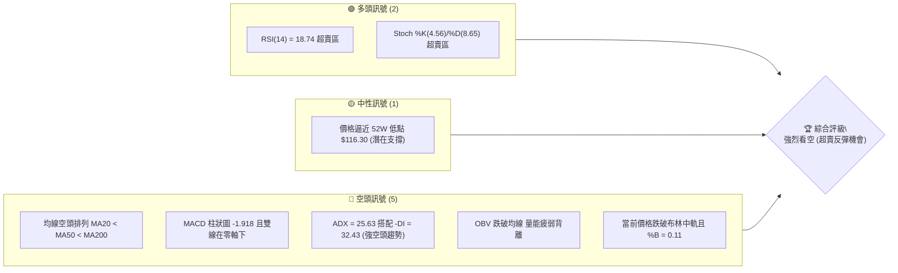
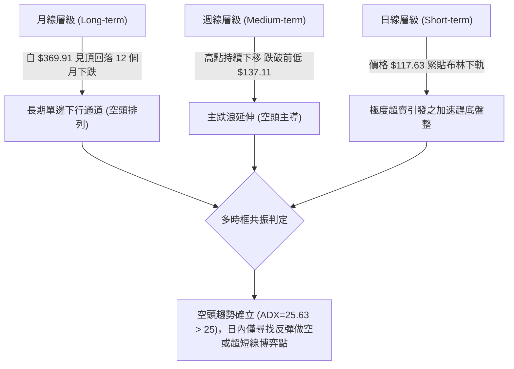
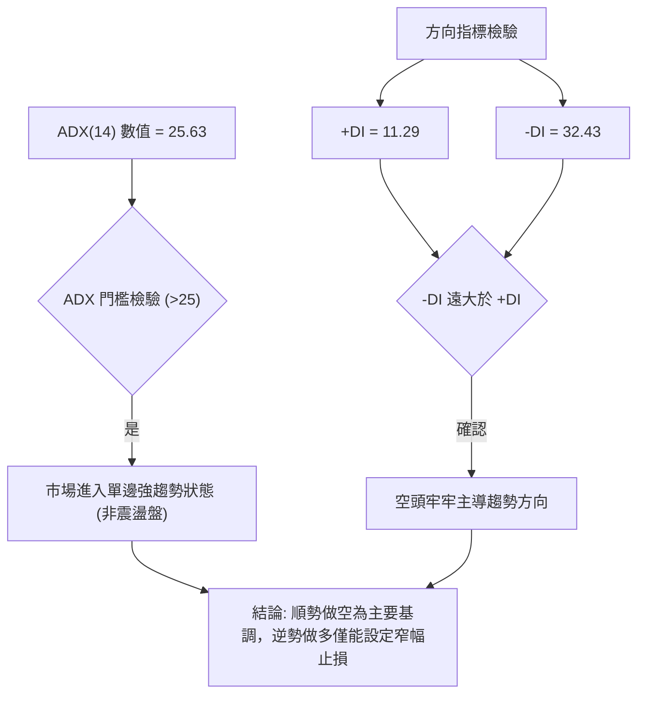
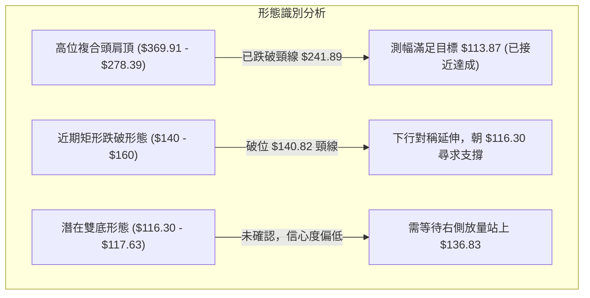
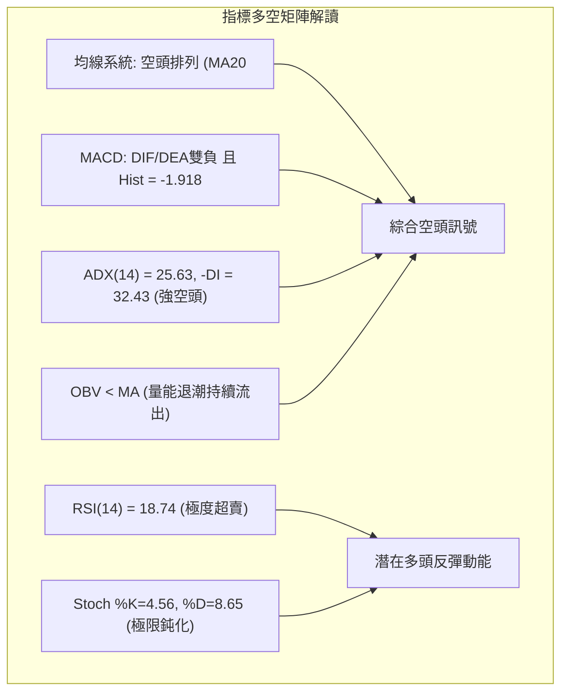
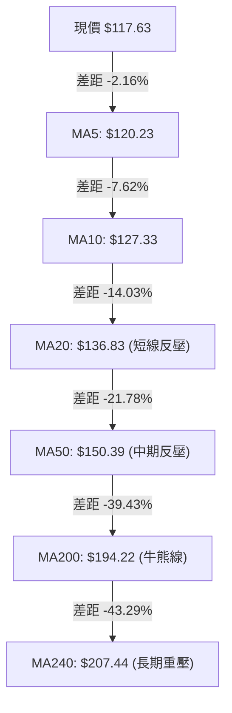
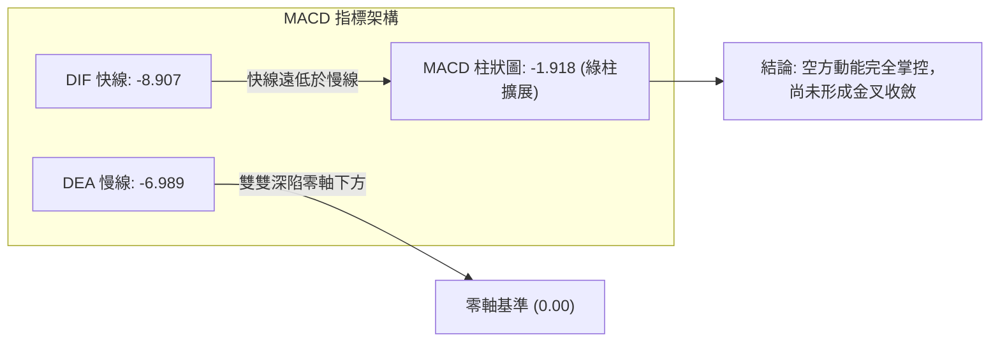
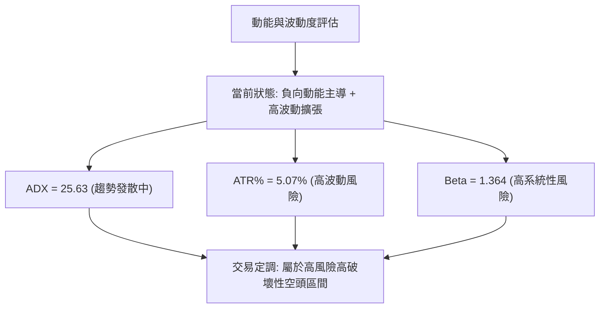
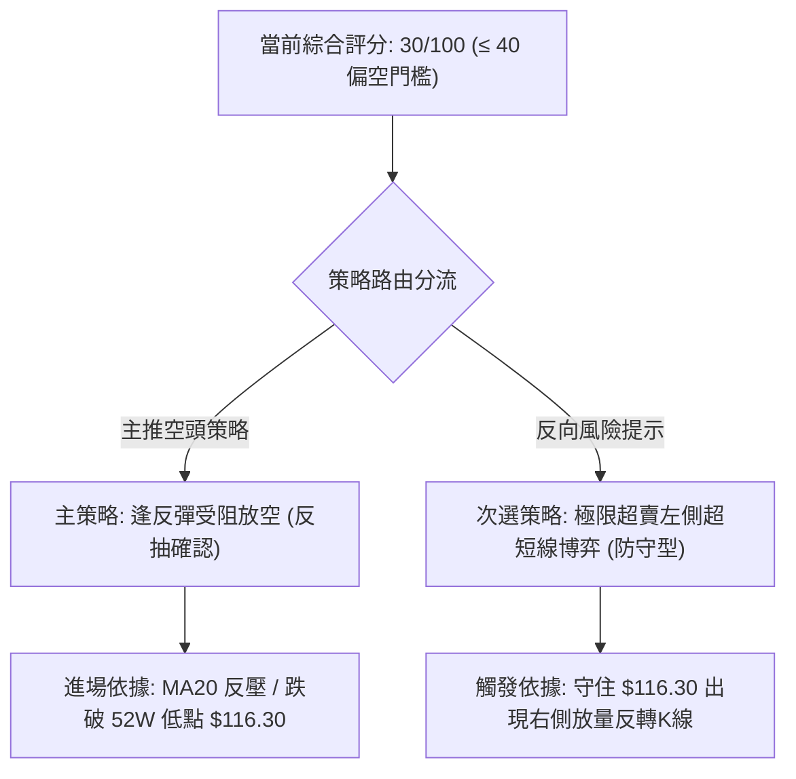
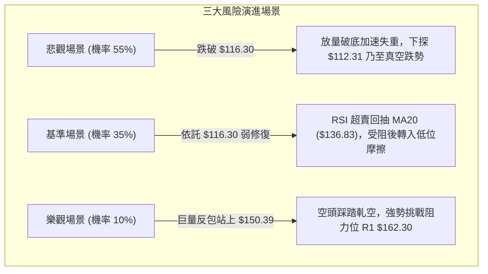

# AVAV 技術分析報告

> **報告日期**：2026-10-21 ｜ **語言**：繁體中文 ｜ **數據來源**：Yahoo Finance ｜ **當前價格**：$117.63

---

## 目錄

| 章節 | 內容 |
|------|------|
| [1. 技術面概覽](#1-技術面概覽) | 訊號儀表板、核心指標、評分卡 |
| [2. 趨勢分析](#2-趨勢分析) | 多時框趨勢、長中短期走勢 |
| [3. 圖表形態分析](#3-圖表形態分析) | 形態識別、K線組合、目標價 |
| [4. 支撐與阻力](#4-支撐與阻力) | 關鍵價位、斐波那契回調 |
| [5. 技術指標深度解讀](#5-技術指標深度解讀) | MA/RSI/MACD/布林/成交量 |
| [6. 動能與波動率](#6-動能與波動率) | 動能評估、ATR、Beta |
| [7. 多時框架總結](#7-多時框架總結) | 時框架評分矩陣 |
| [8. 交易策略建議](#8-交易策略建議) | 多空策略、風險報酬比 |
| [9. 風險提示與監控](#9-風險提示與監控) | 監控指標、風險場景 |

---

## 1. 技術面概覽

### 🎯 技術訊號儀表板



### 📊 核心指標速覽表

| 指標類別 | 指標名稱 | 當前數值 | 訊號 | 解讀 |
|----------|----------|----------|------|------|
| **價格** | 當前收盤價 | $117.63 | 🔴 | 位於 52 週價格區間 0.5% 分位，逼近歷史極限低點 |
| **均線** | MA20 | $136.83 | 🔴 | 價格低於 MA20 達 -14.03%，短線下行斜率陡峭 |
| **均線** | MA50 | $150.39 | 🔴 | 價格低於 MA50 達 -21.78%，中期完全受制空頭反壓 |
| **均線** | MA200 | $194.22 | 🔴 | 價格低於 MA200 達 -39.43%，長期趨勢處於主跌浪 |
| **動能** | RSI(14) | 18.74 | 🟢 | 極度超賣 (<20)，技術面存在隨時均值回歸反彈動能 |
| **動能** | MACD (12,26,9) | -8.907 / -6.989 | 🔴 | DIF 與 DEA 雙雙在零軸下方運行，柱狀圖 -1.918 顯示空方佔據絕對優勢 |
| **趨勢** | ADX(14) / ±DI | 25.63 / -DI: 32.43 | 🔴 | ADX > 25 且 -DI 顯著大於 +DI (11.29)，確認為單邊強空頭趨勢 |
| **通道** | 布林通道 %B | 0.11 | 🔴 | 價格緊貼下軌 ($112.31) 運行，顯示極度空頭擠壓狀態 |
| **波動** | ATR(14) | $5.97 | 🟡 | 日波動率高達 5.07%，震盪幅度大，需拉大風控止損間距 |
| **成交量** | 20日成交量比 | 0.80x | 🔴 | 換手量縮，OBV 疲軟未見主力機構左側放量吸籌特徵 |

### 🏆 技術評分卡

```
╔══════════════════════════════════════════════════════════════╗
║              技術評分卡 — AVAV (2026-10-21)                  ║
╠══════════════════════════════════════════════════════════════╣
║ 趨勢強度 (空頭)  ████████████████░░░░  80/100  🔴 強烈看空    ║
║ 動能指標 (超賣)  ████████████░░░░░░░░  60/100  🟢 醞釀反彈    ║
║ 支撐穩定度      ████░░░░░░░░░░░░░░░░  20/100  🔴 面臨破底    ║
║ 成交量配合      ██████░░░░░░░░░░░░░░  30/100  🔴 量能退潮    ║
║ 形態完整度      ████████░░░░░░░░░░░░  40/100  🔴 下行延伸    ║
║ 均線排列        ██░░░░░░░░░░░░░░░░░░  10/100  🔴 完美空頭    ║
╠══════════════════════════════════════════════════════════════╣
║ 綜合技術評分    ██████░░░░░░░░░░░░░░  30/100  🔴 極度疲弱    ║
╚══════════════════════════════════════════════════════════════╝
```

---

## 2. 趨勢分析

### 🌐 多時框趨勢分析



### 📈 長期趨勢 — 12個月走勢圖（Unicode）

以下為 AVAV 過去 12 個月（2025-11 至 2026-10）收盤價走勢示意圖：

```
AVAV 月線走勢圖（過去12個月）
價格軸 ($)
$370 ┤                                                  
$320 ┤                                                  
$280 ┤ ●(11月 279.46)       ●(01月 278.39)              
$250 ┤          ●(12月 241.89)    ●(02月 252.25)        
$210 ┤                                      ●(05月 207.24)
$180 ┤                        ●(03月 183.05)●(04月 195.02)
$150 ┤                                                  ●(06月 165.07) ●(07月 149.37) ●(08月 148.35) ●(09月 142.22)
$110 ┤                                                                                                ●←當前 $117.63
     └─────────────────────────────────────────────────────────────────────────────────────────────────────────────
        25-11     25-12     26-01     26-02     26-03     26-04     26-05     26-06     26-07     26-08     26-09     26-10
```

#### 走勢特徵分析表格

| 階段區間 | 起止價格 | 漲跌幅 | 走勢特徵與結構 |
|----------|----------|--------|----------------|
| **2025-10 高點至 2025-12** | $369.91 → $241.89 | -34.61% | 首波獲利了結與流動性退潮，均線初現死叉 |
| **2026-01 至 2026-02** | $278.39 → $252.25 | -9.39% | 次高點反彈無力，確立高位派發雙頂格局 |
| **2026-03 至 2026-05** | $183.05 → $207.24 | +13.21% | 中期弱反彈，觸及 MA60 阻力即遭空方強力壓制 |
| **2026-06 至 2026-09** | $165.07 → $142.22 | -13.84% | 陰跌築底失敗，多次衝擊 $150 頸線無功而返 |
| **2026-10 當月即時** | $142.22 → $117.63 | -17.29% | 加速放量破位趕底，逼近 52 週最低點 $116.30 |

### 📊 中期趨勢（週線分析）

```
週線級別價格壓力與支撐階梯示意圖：
$200.38 ────────────────────────────────────── 強阻力位 R3 (波段聚類高點)
                 ▲
$168.00 ─────────┼──────────────────────────── 關鍵波段回撤阻力 R2
                 │
$162.30 ─────────┼──────────────────────────── 近期反彈遇阻點 R1
                 │
$136.83 ─────────┼──────────────────────────── MA20 / 布林中軌反壓
                 │
$117.63 ═════════╪════════════════════════════ 當前價格 (逼近歷史邊界)
                 ▼
$116.30 ────────────────────────────────────── 52W 歷史極限低點 / 100% 斐波那契位
(無下方波段支撐) ---------------------------- [下方進入歷史真空區間]
```

### ⚡ 趨勢強度評估（ADX 解讀）



#### ADX 強度對照表

| 指標變數 | 當前讀數 | 門檻區間 | 市場狀態解讀 |
|----------|----------|----------|--------------|
| **ADX(14)** | **25.63** | > 25.00 | 確認脫離 140–150 盤整區，進入**單邊加速空頭趨勢** |
| **+DI (14)** | **11.29** | < 20.00 | 多方攻擊動能極度渙散，買盤意願微弱 |
| **-DI (14)** | **32.43** | > 30.00 | 賣方力量處於強勢主導地位，下行拋壓沉重 |

---

## 3. 圖表形態分析

### 🔍 形態識別系統



#### 圖表形態信心度評估表

| 形態類別 | 信心度 | 判斷依據（引用數據） | 完成度 | 目標價（附計算式） |
|----------|--------|----------------------|--------|--------------------|
| **高位下降通道延伸** | **85%** | 2026-06 至 2026-10 週線高低點持續下移，高點自 $192.81 降至 $159.95，再降至 $140.82 | 90% | 斐波那契 100% 擴展位 **$116.30** |
| **近期破位下飄旗形** | **70%** | 2026-09-20 高點 $159.95 後，連續 4 週收陰跌破區間底 $140.82 | 80% | 旗桿底推算：$140.82 - ($159.95 - $140.82) = **$121.69**（已跌破） |
| **潛在 52W 雙底結構** | **35%** | 當前價 $117.63 逼近 52W 低點 $116.30，但量能不足且未有右底抬升 | 15% | 頸線 R1 $162.30 + ($162.30 - $116.30) = **$208.30**（條件未觸發） |

*依據規則 15，由於雙底形態信心度低於 50%，本報告將其列為未確認反轉預警，交易決策主要依循「空頭通道順勢向下延伸」與「超賣極限技術性修復」之指標型解讀。*

### 🕯️ 重要K線形態分析

| 日期 / 週別 | 收盤價 | K線形態 | 解讀 | 訊號 |
|-------------|--------|---------|------|------|
| **2026-08-16** | $192.81 | 週線長上影流星線 | 多頭反撲觸及 MA200 反壓，放量滯漲後主力資金出逃 | 🔴 強烈看跌 |
| **2026-09-13** | $146.71 | 放量長十字星 (20.4M) | 巨量換手但未能收復失地，顯示低位接盤力量被空頭消耗 | 🟡 變盤警訊 |
| **2026-09-20** | $159.95 | 短線假突破大陽線 | 誘多反彈，未能封閉上方空頭缺口，隨即見頂 | 🔴 空方陷阱 |
| **2026-10-18** | $121.79 | 大陰線破位向下 | 擊穿前期所有整理平台，均線呈現加速發散下跌 | 🔴 空頭延伸 |
| **2026-10-25** | $117.63 | 低開弱勢震盪陰線 | 縮量至 2.55M，空頭持續壓制，多方毫無反攻徵兆 | 🔴 弱勢觀望 |

### 📉 ASCII 走勢形態示意圖

```
AVAV 近期日線與週線結構加速破位走勢示意圖：
$160.00 ┤        ┌───┐ (09-20 高點 $159.95)
$152.00 ┤        │   └──┐
$144.00 ┤   ┌────┘      └──┐ (頸線支撐破位點 $140.82)
$136.00 ┤───┘             └──┐
$128.00 ┤                    └──┐
$120.00 ┤                       └──┐
$116.30 ┤                          └───● 現價 $117.63 (測試 52W 低點 $116.30)
$112.00 ┤─────────────────────────────── 布林下軌支撐 $112.31
        └─────────────────────────────────────────────────────────────►
```

### 🎯 形態目標價計算

根據 2026-09-20 波段高點 $159.95 至 2026-10-04 破位平台 $140.82 之箱體形態推算：
- 形態垂直高度 $H = \$159.95 - \$140.82 = \$19.13$
- 破位滿足目標價 $Target_1 = \$140.82 - \$19.13 = \$121.69$（該目標已於 2026-10-18 週收盤 $121.79 完美到達）。
- 延伸下行滿足目標價（1.618 倍延伸） $Target_2 = \$140.82 - (1.618 \times \$19.13) = \$109.87$。
- **數據驗證結論**：由於下方無 swing-low 支撐，若 52W 低點 $116.30 失守，價格將朝布林下軌 $112.31 乃至延伸目標 $109.87 尋求支撐。

---

## 4. 支撐與阻力

### 🗺️ 關鍵價位分布圖（Unicode）

```
╔══════════════════════════════════════════════════════════════╗
║                   AVAV 價位結構分布圖                        ║
╠══════════════════════════════════════════════════════════════╣
║ $200.38 ║████████████████████████║ 強阻力 R3 (年線/波段聚類)  ║
║ $168.00 ║████████████████████    ║ 阻力 R2 (反彈高點聚類)    ║
║ $162.30 ║████████████████████████║ 關鍵阻力 R1 (布林上軌附近) ║
║ $150.39 ║██████████████          ║ 中期反壓 (MA50 均線)      ║
║ $136.83 ║██████████              ║ 短線反壓 (MA20 / 布林中軌) ║
║ $117.63 ╠════════════════════════╣ ◄ 當前市價                ║
║ $116.30 ║▓▓▓▓▓▓▓▓▓▓▓▓▓▓▓▓▓▓▓▓▓▓▓▓║ 52W 歷史極限低點 (S1)    ║
║ $112.31 ║▓▓▓▓▓▓▓▓▓▓▓▓▓▓▓▓        ║ 布林帶動態下軌支撐 (S2)   ║
║ (無低點)║░░░░░░░░░░░░░░░░░░░░░░░░║ 數據中未偵測到波段低點支撐 ║
╚══════════════════════════════════════════════════════════════╝
```

### 🚧 阻力位分析表

*(價位嚴格引用技術數據「關鍵價位」區塊)*

| 阻力級別 | 價位 | 距現價幅標 | 形成原因與籌碼特徵 | 突破難度 | 重要性 |
|----------|------|------------|--------------------|----------|--------|
| **阻力位 R1** | **$162.30** | +37.98% | 近一年波段高點聚類區，亦重合布林上軌 $161.34 與 MA120 | 偏高 | 🔴 核心空頭防線 |
| **阻力位 R2** | **$168.00** | +42.82% | 2026-06 破位反抽之密集套牢區，籌碼堆積厚重 | 極高 | 🔴 中期反轉確認點 |
| **阻力位 R3** | **$200.38** | +70.35% | 長期週線平台高點，重合 MA200 ($194.22) 與年線壓制 | 極難 | 🔴 多空牛熊分水嶺 |

### 🛡️ 支撐位分析表

*(價位嚴格引用技術數據，數據顯示當前價下方無 swing-low 波段聚類支撐)*

| 支撐級別 | 價位 | 距現價幅標 | 形成原因與特徵 | 守住機率 | 重要性 |
|----------|------|------------|----------------|----------|--------|
| **支撐位 S1** | **$116.30** | -1.13% | 52 週最低點 (52W Low)，亦為 100% 斐波那契基準底 | 40% | 🟡 最後多頭防線 |
| **支撐位 S2** | **$112.31** | -4.52% | 日線布林通道下軌極限，動態波動率支撐位 | 55% | 🟡 破位加速緩衝帶 |
| **支撐位 S3** | **數據中未偵測到** | N/A | 現價下方已無任何一年內 swing-low 波段聚類支撐 | 低 | 🔴 破底後面臨真空 |

### 📐 斐波那契回調位分析

依據 52 週波動區間 $116.30（0% 反轉點）至 $408.25（0.0% 歷史峰值）進行回調測算：

| 斐波那契回調層級 | 精確價位 | 與現價距離 | 技術意義與狀態解讀 |
|------------------|----------|------------|--------------------|
| **0.0% (52W High)** | **$408.25** | +247.06% | 歷史牛市最高頂點 |
| **23.6%** | **$339.35** | +188.49% | 首波深度拉回點（已全面失守） |
| **38.2%** | **$296.73** | +152.26% | 牛市黃金分割分界點（已全面失守） |
| **50.0%** | **$262.28** | +122.97% | 多空強弱分界中軸線（已全面失守） |
| **61.8%** | **$227.82** | +93.68% | 防禦底線（破位後引發機構拋售） |
| **78.6%** | **$178.78** | +51.99% | 投機反彈極限阻力（2026-08 曾反抽此處受阻） |
| **100.0% (52W Low)**| **$116.30** | -1.13% | **當前價格 $117.63 緊鄰此位，回撤幅度高達 99.5%** |

**斐波那契結構解讀**：
當前收盤價 $117.63 處於 78.6%（$178.78）至 100.0%（$116.30）區間的最底層邊界。全波段回撤幅度已達 99.5%，徹底抹平前期的牛市漲幅。由於價格與 100% 回調位 $116.30 僅相距 $1.33（-1.13%），此處為極其關鍵的技術心理防線。一旦失守，技術面將面臨斐波那契 123.6% 外部下行擴展（推算約 $50 附近），空頭將開啟新一輪失重行情。

---

## 5. 技術指標深度解讀

### 🎛️ 指標訊號總覽



### 📈 移動平均線排列分析



#### 均線發散狀態剖析
AVAV 當前均線呈現出**極為教科書式的發散空頭排列**（$MA5 < MA10 < MA20 < MA60 < MA120 < MA240$）。
- 短期 MA5（$120.23）與 MA10（$127.33）斜率呈現 -45 度下傾，對價格形成緊密的階梯式下壓。
- MA20（$136.83）與 MA50（$150.39）之間的間距持續放大，表明下行動能並未因價格下跌而減速。
- 負乖離率分析：目前價格落後 MA20 達 -14.03%，落後 MA200 達 -39.43%，雖然極大的負乖離為技術性修復提供了理論空間，但在均線系統全線下彎的背景下，每一次向 MA20 的靠攏均屬「賣意確認」的空頭防守點。

### 📉 RSI(14) 分析

#### RSI 讀數進度條
```
RSI(14): 18.74  [ ▓▓▓░░░░░░░░░░░░░░░░░ ] 18.74%  🟢 極度超賣區間
超賣臨界 (<30):  [ ▓▓▓▓▓░░░░░░░░░░░░░░░ ] 30.00%
中軸分界 ( 50):  [ ▓▓▓▓▓▓▓▓░░░░░░░░░░░░ ] 50.00%
```

#### 超買超賣與背離深度解讀
- **區間評估**：RSI(14) 當前讀數為 **18.74**，進入小於 20 的「極度超賣鈍化區」。自 2026-10-11 的 19.10 降至 2026-10-18 的 18.30，再微幅回升至 18.74，顯示市場拋壓已經釋放至極端，殺跌動能接近衰竭。
- **背離分析**：
  - **日線背離判定**：**無明顯背離**。雖然價格在刷新低點，但 RSI 數值同步在低位徘徊（未出現價格破底而 RSI 顯著抬高的底背離結構），屬於標準的「指標隨價格鈍化」現象。
  - **週線對比**：2026-09-06 週線 RSI 為 16.9（收盤 $144.65），當前收盤 $117.63 且週線 RSI 為 18.7，僅存在極其微弱的潛在低位孕育，但由於未獲成交量確認，**不可視為有效底背離**。

### 📊 MACD(12/26/9) 訊號解讀



- **柱狀圖動能**：MACD Hist 為 **-1.918**，負向柱狀圖持續擴展（2026-10-11 為 -1.041，2026-10-18 擴至 -2.000，當前仍達 -1.918），表明空頭下墜的加速度並未收窄，綠柱尚未出現連續縮短的拐點信號。
- **背離檢驗**：MACD 線與價格均創出階段新低，**無底背離現象**，指標驗證了當前價格下跌的真實性與有效性。

### 📦 布林通道分析

```
布林通道結構示意圖 (帶寬 49.03，波動處於極端狀態)：
$161.34 ┬────────────────────────────────────────── 布林上軌 (多頭極限)
        │
$136.83 ┼─────────────────── ══════════════════════ 布林中軌 (MA20 強反壓)
        │
$117.63 ┼─────────● 當前價格 (位於通道極下緣)
$112.31 ┴────────────────────────────────────────── 布林下軌 (極端動態支撐)
```

- **通道位置指標 (%B)**：當前 **%B = 0.11**。在布林理論中，%B 小於 0.20 代表價格正經歷強烈的「貼軌下行」空頭擠壓（Band Walking）。價格未跌破下軌 $112.31，但緊貼下緣徘徊，代表跌勢仍受下軌向外推擴所主導。
- **帶寬趨勢**：上軌 $161.34 與下軌 $112.31 差距達 $49.03，帶寬持續處於張口擴大階段，否定了任何短期盤整或窄幅築底的可能性。

### 💹 成交量分析（量價配合度）

- **量能比例分析**：
  - 最新單日成交量：**1,134,200 股**
  - 20 日成交均量：**1,420,235 股**（量比：**0.80x**）
  - 50 日成交均量：**1,718,908 股**
- **量價配合特徵**：最新日成交量萎縮至均量之 80%，而最新週成交量（2,550,700）更遠低於 2026-09-13 爆出的 20,402,600 天量。這種「陰跌縮量」走勢表明：
  1. 機構買盤並未在當前價位進場承接（無恐慌性拋售後的放量進場陽線）；
  2. 賣盤雖有所減少，但由於多頭買力更加匱乏，導致「無量自跌」；
  3. **OBV < MA**：能量潮指標持續位於均線之下，資金呈現實質淨流出狀態，**量能完全確認價格走低之趨勢**。

---

## 6. 動能與波動率

### ⚡ 動能評估

#### 動能與波動狀態對照表

| 象限分佈 | 動能維度 | 波動維度 | 當前狀態評估 | 戰術應對建議 |
|----------|----------|----------|--------------|--------------|
| **Q1 (最佳順風)** | 強勢向上 | 低波動穩定 | 否 | 順勢加碼持股 |
| **Q2 (盤整累積)** | 弱勢中性 | 低波動收斂 | 否 | 等待突破方向 |
| **Q3 (極端順勢)** | **強烈向下 (Bearish)** | **高波動擴張** | **✓ (當前狀態)** | **嚴禁左側抄底，僅可小倉位防守做空或觀望** |
| **Q4 (動能渙散)** | 弱勢背離 | 高波動劇震 | 否 | 易遭雙向打臉，避免交易 |



### 📊 ATR 波動率分析

- **當前數值**：**ATR(14) = $5.97**，佔收盤價比例高達 **5.07%**。
- **日內波動意義**：AVAV 目前每日正常技術波動區間即達到近 $6.00 美元。這意味著任何小於 1 倍 ATR（約 $6.00）的止損設置極易被隨機噪聲掃出場。
- **風控止損參數設定**：
  - **右側交易止損間距**：建議設置為 $1.5 \times ATR = 1.5 \times \$5.97 = \mathbf{\$8.96}$。
  - **超短線反彈博弈止損**：不得小於 $1.0 \times ATR = \mathbf{\$5.97}$。

### 📐 Beta 與市場相關性

- **Beta 係數**：**1.364**。
- **解讀**：AVAV 的系統性風險顯著高於大盤標竿（S&P 500）。當基準指數波動 1% 時，AVAV 平均理論波動達到 1.364%。在高 Beta 配合弱勢基本面（營業利潤率 -2.3%、淨利潤率 -10.1%）的背景下，大盤若出現回調，AVAV 極易出現乘數效應的補跌或破位下殺。

---

## 7. 多時框架總結

### 📋 時框架評分表

| 時框架 | 趨勢方向 | 動能狀態 | 均線排列 | 圖表形態 | 綜合評分 | 操作建議 |
|--------|----------|----------|----------|----------|----------|----------|
| **月線層級** | 🔴 強烈看空 | 下跌趨勢延伸 | 空頭發散 | 自高點下落之單邊浪 | **15/100** | 長線資金絕對規避 |
| **週線層級** | 🔴 強烈看空 | MACD柱維持負向 | 均線空頭排列 | 破位旗形/對稱延伸 | **25/100** | 逢反彈關鍵阻力做空 |
| **日線層級** | 🟡 超賣醞釀 | RSI 極度超賣 | 全線下行空頭排列 | 貼軌加速趕底 | **40/100** | 嚴禁追空，等待超賣修復 |

### 🔲 綜合訊號矩陣

```
╔══════════════════════════════════════════════════════════════╗
║                   多時框綜合訊號確認矩陣                     ║
╠══════════════════════════════════════════════════════════════╣
║ 維度         短期 (日線)      中期 (週線)      長期 (月線)   ║
╠══════════════════════════════════════════════════════════════╣
║ 主導趨勢     🔴 加速下行      🔴 穩定空頭      🔴 深度回撤   ║
║ 動能方向     🟢 嚴重超賣      🔴 負向擴展      🔴 空方佔優   ║
║ 均線架構     🔴 空頭壓制      🔴 空頭發散      🔴 跌破年線   ║
║ 籌碼量能     🔴 OBV流出       🔴 均量下行      🔴 主力撤離   ║
║ 訊號一致性   ⚠️ 短期動能超賣與中長期空頭趨勢產生時框衝突   ║
╚══════════════════════════════════════════════════════════════╝
```

### ⚖️ 多時框收斂結論

**依據規則 14 之優先級收斂原則**：
1. **趨勢市判定**：當前 **ADX(14) = 25.63 > 25**，且 -DI (32.43) 呈現主導擴散，明確定義當前市場為**「趨勢行情」**而非「盤整行情」。
2. **時框優先級**：必須以**中長期方向（週線 / MA50 / MA200）為主導**，日線層級之超賣（RSI=18.74）僅能視為「下行過程中的技術性張力」，只能用於尋找反彈做空時機或超短線防守博弈，絕不可推翻中長期週線級別之空頭判定。
3. **唯一方向性結論**：**【偏空主導，順勢做空（中長線）/ 觀望超賣鈍化（短線）】**。

---

## 8. 交易策略建議

### 🗺️ 策略決策流程圖



### 🧭 策略路由

**依據評分卡規則：當前綜合評分 30/100（≤ 40），主策略方向 = 【主推空頭策略】。**
任何多頭思路均不得作為主力配置，僅列為極端超賣下之短線對沖提示或輕倉博弈。

### 🎯 價格情境階梯（Price Scenarios）

*(價位嚴格引用第 4 章關鍵價位區塊)*

| 觸發條件 | 下一目標 | 後續延伸 | 情境技術含義 |
|----------|----------|----------|--------------|
| **有效跌破 52W 低點 $116.30** | 布林下軌 **$112.31** | 無支撐真空帶 (朝向下向擴展) | 空頭加速趕底，開啟破底新跌浪 |
| **維持在 $116.30 - $136.83 區間** | MA20 **$136.83** | MA50 **$150.39** | 超賣技術性修復，進行通道內震盪 |
| **強勢突破 R1 $162.30** | R2 **$168.00** | R3 **$200.38** | 短中期趨勢反轉，扭轉下行通道結構 |

### 📊 情境機率分佈

| 價格運行情境 | 評估機率 | 主要判定指標與技術依據 |
|--------------|----------|------------------------|
| **跌破 $116.30 延續跌勢** | **55%** | ADX=25.63 強趨勢確立、-DI=32.43 壓制、OBV 持續疲軟流出、均線完美空頭排列 |
| **超賣引發技術性弱反彈** | **35%** | RSI=18.74 極度超賣、Stoch %K=4.56、與 MA20 負乖離高達 -14.03% 需修復 |
| **全面反轉突破阻力 R1** | **10%** | 上方套牢籌碼沉重、量能萎縮未見主力建倉、缺乏基本面催化 |

### 🔴 主策略詳情（空頭防守與順勢做空）

#### 空頭交易策略矩陣

| 策略要素 | 策略 A（反彈阻力做空 - 推薦） | 策略 B（破位追空 - 突破交易） |
|----------|--------------------------------|--------------------------------|
| **策略邏輯** | 趁日線 RSI 極度超賣修復，觸及均線反壓做空 | 跌破 52 週最低點，順應無支撐真空下殺 |
| **進場條件** | 反彈至 MA20 附近出現上影線滯漲 | 日線有效跌破收盤低於 $116.30 |
| **進場價格** | **$136.83**（精確對齊 MA20 / 布林中軌） | **$115.50**（跌破 52W 低點 $116.30 之下） |
| **目標價 T1** | **$116.30**（測試 52W 前低） | **$112.31**（布林動態下軌） |
| **目標價 T2** | **$112.31**（布林下軌） | **$109.87**（形態延伸推算目標價） |
| **止損價格** | **$144.58**（2026-07-12 波段平台高點） | **$121.79**（2026-10-18 週收盤破位前高） |
| **風險報酬比** | **1 : 2.65** | **1 : 1.80** |
| **成功機率** | **65%** | **55%** |
| **建議倉位** | **15% - 20%** | **10%** |

### 🟢 反向風險觸發點（多頭超賣博弈與對沖提示）

若欲利用 RSI(14) = 18.74 之極端超賣進行左側交易，**必須嚴格遵循以下邊界條件**：
- **觸發進場價**：當前價 **$117.63** 至 52W 低點 **$116.30** 區間企穩，且日線收出長下影十字星。
- **嚴格止損價**：**$115.00**（跌破 52W 低點 $116.30 達 1% 即無條件離場）。
- **反彈目標 T1**：**$136.83**（MA20 反壓）。
- **反彈目標 T2**：**$150.39**（MA50 反壓）。
- **風控告警**：若收盤價失守 $116.30，任何多頭抄底倉位必須立刻市價清倉，絕不可攤平。

### ⭐ 整體訊號強度評星

```
╔══════════════════════════════════════════════════════════════╗
║ 做多訊號強度：★☆☆☆☆  (1/5星 - 極限超賣但缺乏右側結構)      ║
║ 做空訊號強度：★★★★☆  (4/5星 - 趨勢明確但需防超賣反撲)      ║
║ 整體可信度：  ★★★★☆  (4/5星 - 多指標高度共振驗證趨勢)      ║
╚══════════════════════════════════════════════════════════════╝
```

---

## 9. 風險提示與監控

### ✅ 關鍵監控指標 Checklist

```
╔══════════════════════════════════════════════════════════════╗
║                   關鍵技術監控 Checklist                     ║
╠══════════════════════════════════════════════════════════════╣
║ [ ] 價格是否跌破 52W 歷史極限支撐 $116.30 (最核心風控線)      ║
║ [ ] RSI(14) 是否由 <20 向上金叉回升突破 30 (超賣反彈啟動訊號) ║
║ [ ] 日成交量是否顯著放大突破 20 日均量 1,420,235 股 (量能驗證)║
║ [ ] MACD 柱狀圖是否由 -1.918 開始連續收窄 (空頭動能衰退)       ║
║ [ ] 價格能否重返並站穩 MA20 ($136.83) (短線空頭緩解標誌)     ║
║ [ ] ADX(14) 讀數是否回落至 25 以下 (趨勢衰竭轉入震盪盤整)     ║
╚══════════════════════════════════════════════════════════════╝
```

### ⚠️ 風險場景分析



### 🛡️ 風險管理重要提醒

1. **ATR 波動防護**：鑑於日波動 ATR 為 **$5.97**（波動率高達 5.07%），持倉隔夜存在跳空風險，任何單筆交易之風險敞口（止損金額）不得超過總交易帳戶資金的 **1.5%**。
2. **左側抄底陷阱**：在 ADX = 25.63 確立單邊趨勢且 -DI = 32.43 壓制下，指標超賣（RSI=18.74）會出現「長週期鈍化」，價格常以持續陰跌方式消耗超賣動能，切勿因「跌幅已深」而盲目重倉抄底。
3. **空頭擠壓（Short Squeeze）預警**：AVAV 目前空頭流通比例（Short % Float）高達 **12.8%**，且空頭回補天數（Short Ratio）為 **2.21**。若基本面突然出現國防訂單催化，高空頭比例易引發極度劇烈的短線技術性軋空，空頭部位必須嚴設停損（如 MA20 之 $136.83 或 $144.58），不可心存僥倖。

---

## 📋 報告總結

```
╔══════════════════════════════════════════════════════════════╗
║                   AVAV 技術分析報告總結                      ║
╠══════════════════════════════════════════════════════════════╣
║ 報告日期：2026-10-21                                         ║
║ 當前價格：$117.63                                            ║
║ 分析評級：🔴 強烈看空 / 空頭延伸（超賣防守）                  ║
║                                                              ║
║ 關鍵結論：                                                   ║
║ ├─ 長期趨勢：🔴 單邊下行通道，抹平 99.5% 斐波那契漲幅       ║
║ ├─ 中期趨勢：🔴 均線完美空頭排列，高點層層下移               ║
║ ├─ 短期趨勢：🟡 RSI(18.74) 極限超賣，緊貼布林下軌加速趕底   ║
║ ├─ 關鍵支撐：S1: $116.30 (52W低點) ｜ S2: $112.31 (布林下軌)  ║
║ ├─ 關鍵阻力：R1: $162.30 ｜ R2: $168.00 ｜ R3: $200.38       ║
║ └─ 分析師目標價：均價 $213.44 (偏多共識但與當前技術盤面嚴重背離)║
║                                                              ║
║ 最優策略組合：                                               ║
║ 1. 🥇 最佳機會：等待反彈至 MA20 ($136.83) 滯漲放空，順應空頭 ║
║ 2. 🥈 次選機會：跌破 52W 低點 $116.30 順勢追空，看 $112.31   ║
║ 3. 🥉 保守選擇：在 $116.30 未獲右側量能確認前，全面空倉觀望  ║
╚══════════════════════════════════════════════════════════════╝
```

---

> ⚠️ **免責聲明**：本報告為技術分析研究，所有數據及估算均基於歷史價格與客觀指標資訊。本報告**僅供研究與學術參考**，**不構成任何要約或投資建議**。市場具有高度不確定性，投資人應獨立評估風險並自負盈虧。

---

*報告生成時間：2026-10-21 ｜ 數據來源：Yahoo Finance ｜ 分析框架：多時框技術分析體系*