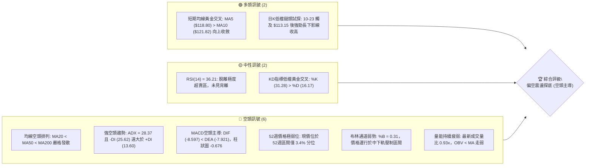
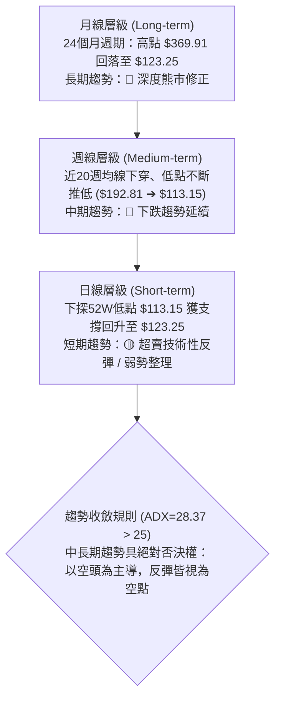
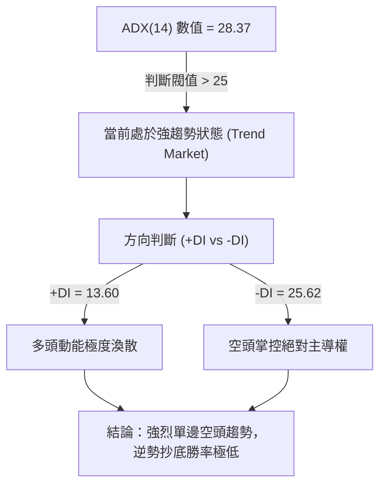
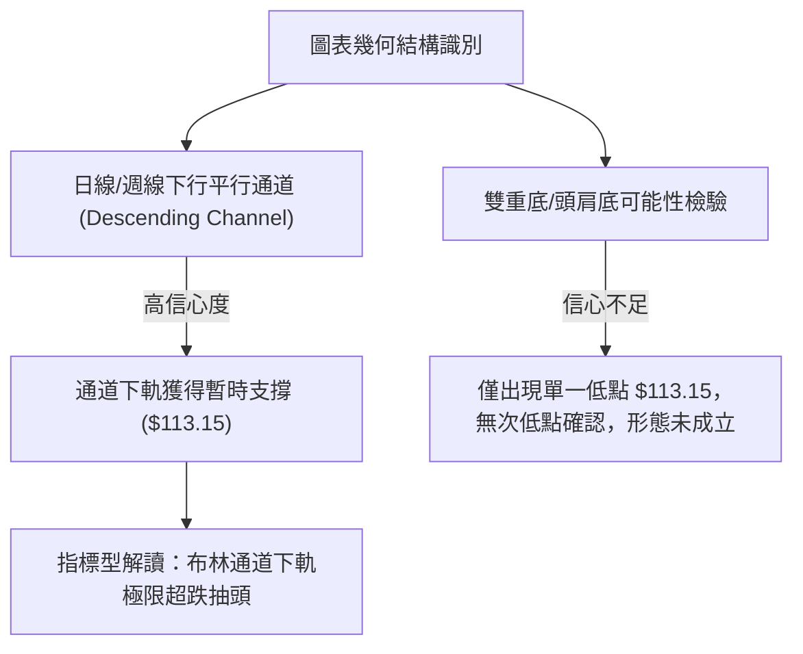
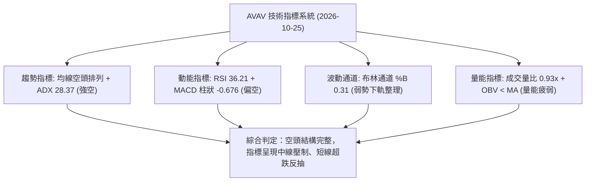
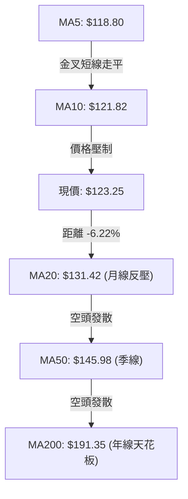
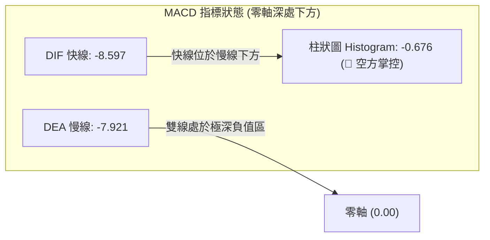
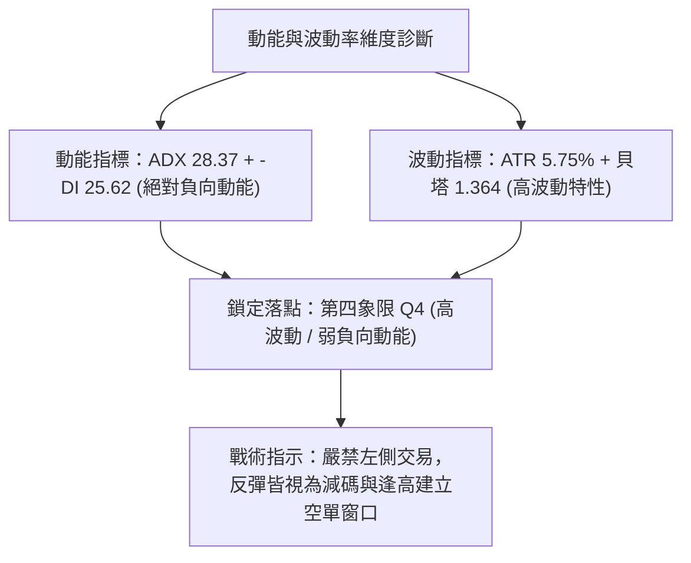
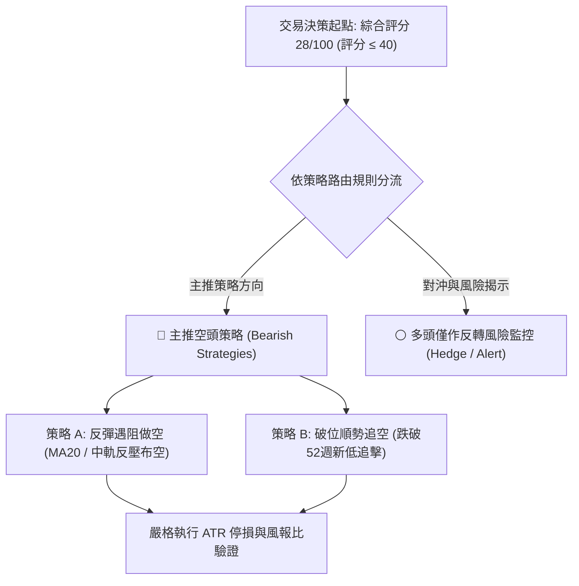
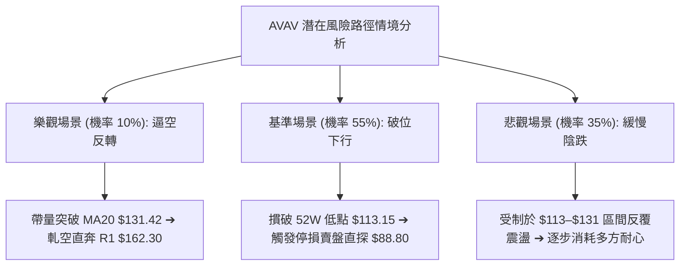

# AVAV 技術分析報告

> **報告日期**：2026-10-25 ｜ **語言**：繁體中文 ｜ **數據來源**：Yahoo Finance ｜ **當前價格**：$123.25

---

## 目錄

| 章節 | 內容 |
|------|------|
| [1. 技術面概覽](#1-技術面概覽) | 訊號儀表板、核心指標、評分卡 |
| [2. 趨勢分析](#2-趨勢分析) | 多時框趨勢、長中短期走勢、ADX解讀 |
| [3. 圖表形態分析](#3-圖表形態分析) | 形態識別、K線組合、目標價推算 |
| [4. 支撐與阻力](#4-支撐與阻力) | 關鍵價位、斐波那契回調結構 |
| [5. 技術指標深度解讀](#5-技術指標深度解讀) | 均線系統、RSI、MACD、布林通道、OBV |
| [6. 動能與波動率](#6-動能與波動率) | 動能四象限、ATR波動分析、Beta風險 |
| [7. 多時框架總結](#7-多時框架總結) | 時框架矩陣、訊號收斂分析 |
| [8. 交易策略建議](#8-交易策略建議) | 主策略路由、情境階梯、精確風報比 |
| [9. 風險提示與監控](#9-風險提示與監控) | 關鍵指標清單、情境分析、風控原則 |

---

## 1. 技術面概覽

### 🎯 技術訊號儀表板



### 📊 核心指標速覽表

| 指標類別 | 指標名稱 | 當前數值 | 訊號 | 專業解讀 |
|:---|:---|:---:|:---:|:---|
| **價格** | 當前收盤價 | $123.25 | 🔴 | 位於52週區間 3.4% 極弱勢分位，距52週低點僅 +8.93% |
| **均線** | MA20 (短月線) | $131.42 | 🔴 | 價格低於MA20達 -6.22%，空頭第一道動態壓制線 |
| **均線** | MA50 (中期線) | $145.98 | 🔴 | 中期關鍵多空分水嶺向下傾斜，價格大幅折價 -15.57% |
| **均線** | MA200 (年線) | $191.35 | 🔴 | 長期牛熊分界線下行，距離現價 -35.59%，長期趨勢偏空 |
| **動能** | RSI(14) | 36.21 | 🟡 | 位於30–70中性偏弱區，未進入極度超賣（<30），無背離 |
| **動能** | MACD (12,26,9) | -8.597 / -7.921 | 🔴 | 雙線位於零軸下方深處，柱狀圖 -0.676 負值放大，空方控盤 |
| **波動** | ATR(14) | $7.09 (5.75%) | 🔴 | 波動度高達5.75%，日內震盪劇烈，需設定寬幅停損 |
| **趨勢** | ADX(14) | 28.37 | 🔴 | ADX > 25 且 -DI (25.62) > +DI (13.60)，確認強空頭趨勢 |
| **通道** | 布林通道 (%B) | 0.31 | 🔴 | 帶寬 $110.27–$152.58，現價緊貼下軌回彈，尚未越過中軌 |
| **成交量** | 20日成交量比 | 0.93x | 🟡 | 成交量 1.357M 低於20日均量 1.463M，反彈缺乏增量確認 |

### 🏆 技術評分卡

```
╔══════════════════════════════════════════════════════════════╗
║                技術評分卡 — AVAV (2026-10-25)                 ║
╠══════════════════════════════════════════════════════════════╣
║ 趨勢強度 (Trend)     █████░░░░░░░░░░░░░░░  25/100 🔴 強空頭主導 ║
║ 動能指標 (Momentum)  ██████░░░░░░░░░░░░░░  30/100 🔴 負動能壓制 ║
║ 支撐穩定度 (Support) █████░░░░░░░░░░░░░░░  25/100 🔴 探底未確認 ║
║ 成交量配合 (Volume)  ███████░░░░░░░░░░░░░  35/100 🟡 量能疲弱   ║
║ 形態完整度 (Pattern) ██████░░░░░░░░░░░░░░  30/100 🔴 下跌通道   ║
║ 均線排列 (MAs)       ████░░░░░░░░░░░░░░░░  20/100 🔴 嚴格空頭   ║
╠══════════════════════════════════════════════════════════════╣
║ 綜合評分 (Overall)   ██████░░░░░░░░░░░░░░  28/100 🔴 強烈偏空   ║
║ 評分計算：(25 + 30 + 25 + 35 + 30 + 20) ÷ 6 = 27.5 ≈ 28分    ║
╚══════════════════════════════════════════════════════════════╝
```

---

## 2. 趨勢分析

### 🌐 多時框趨勢分析



### 📈 長期趨勢 — 12個月走勢圖（Unicode）

```
AVAV 月線走勢圖（過去12個月：2025-11 至 2026-10）
價格軸 ($)
$400 ┤
$350 ┤
$300 ┤              ● (2025-11: $279.46)
$250 ┤                    ● (2026-01: $278.39)
$200 ┤                          ● (2026-05: $207.24)
$150 ┤                                ● (2026-06: $165.07)
$100 ┤                                      ● (2026-10: $123.25 現價)
     └───────────────────────────────────────────────────────────
        11   12   01   02   03   04   05   06   07   08   09   10  (月份)
      2025                                                   2026
```

#### 走勢特徵分析表格（過去12個月歷史週期）

| 階段區間 | 起訖月份 | 價格變化 ($) | 漲跌幅 (%) | 趨勢性質與成交量特徵 |
|:---|:---:|:---:|:---:|:---|
| **頭部崩跌期** | 2025-10 ➔ 2025-12 | $369.91 ➔ $241.89 | -34.61% | 歷史天價 $408.25 後出現放量長黑，高檔套牢賣壓湧現 |
| **平台反抽期** | 2025-12 ➔ 2026-02 | $241.89 ➔ $252.25 | +4.28% | 構築 $240–$278 反彈次高平台，量能遞減，形成大型派發頸線 |
| **主跌浪釋放** | 2026-02 ➔ 2026-03 | $252.25 ➔ $183.05 | -27.43% | 摜破 $200 關卡與年線 MA200，恐慌盤殺出 |
| **弱勢弱反彈** | 2026-03 ➔ 2026-05 | $183.05 ➔ $207.24 | +13.22% | 均線反壓沉重，反彈高點止步於 $207.24，無力收復年線 |
| **加速探底期** | 2026-05 ➔ 2026-10 | $207.24 ➔ $123.25 | -40.53% | 陰跌走勢，連破多重整數關卡，最低見 $113.15（52週新低） |

### 📊 中期趨勢（週線分析）

中期走勢呈現典型「高點降低、低點破底」的下行階梯結構。

```
週線近期壓力與支撐階梯圖 ($)
$170 ┤        ┌───┐ (09-18 高: $168.00 - R2)
$160 ┤  ┌───┐│   │
$150 ┤  │   ││   │     ┌───┐
$140 ┤  │   ││   │┌───┐│   │ (09-25 高: $165.00)
$130 ┤  │   ││   ││   ││   │     ┌───┐ (10-09 收: $137.11)
$120 ┤  │   ││   ││   ││   │┌───┐│   │     ┌───┐ (現價 $123.25)
$110 ┤──┴───┴┴───┴┴───┴┴───┴┴───┴┴───┴─────┴───┴ (10-23 低: $113.15 - 52W低點)
```

- **週線反彈受限**：2026-09-18 當週曾放量急拉至最高 $168.00（成交量 11.27M），但隨後連續5週收黑，自 $159.95 快速滑落至 $121.79，完全抹殺前期漲幅。
- **低檔放量流動性換手**：2026-10-16 當週放量至 8.156M，收盤大跌至 $121.79；2026-10-23 當週探底 $113.15 後收於 $123.25（週量 6.768M），週K留下長達 $10.10 的下影線，顯示中期賣盤在 $113.15 出現減速。

### ⚡ 趨勢強度評估（ADX 解讀）



#### ADX 趨勢強度對照表

| 指標名稱 | 當前數值 | 參考區間 | 趨勢狀態判定 | 戰略意涵 |
|:---|:---:|:---:|:---:|:---|
| **ADX(14)** | **28.37** | > 25 (強趨勢) | 🟢 強趨勢確認 | 市場處於高動能單邊階段，不可使用震盪擺盪指標逆勢摸底 |
| **+DI** | **13.60** | < 20 (多方無力) | 🔴 多方完全失守 | 買盤缺乏連續性，任何日內上衝皆為空方對沖盤或軋空殘留 |
| **-DI** | **25.62** | > 25 (空方主導) | 🔴 空方力量強盛 | 空方佔據絕對優勢，趨勢阻力極小方向向下 |
| **DI差值 (差離度)** | **-12.02** | 負向擴大 | 🔴 空方加速發散 | 下跌趨勢尚未見鈍化轉向跡象 |

---

## 3. 圖表形態分析

### 🔍 形態識別系統



#### 形態識別與信心度評估表

| 形態名稱 | 信心度 (%) | 判斷依據（嚴格引用技術數據） | 形態完成度 | 目標價計算方式與數值 |
|:---|:---:|:---|:---:|:---|
| **下行通道 (Descending Channel)** | **85%** | 自9月高點 $168.00 回落，沿 MA20 下降通道運行，通道下軌切於 $110.27–$113.15 | 90% (運行中) | 若反彈受阻於通道上軌（MA20 $131.42），將再測下軌 $110.27 |
| **52週新低破位後超賣假突破** | **65%** | 2026-10-23 創52W新低 $113.15 後拉回收盤於 $123.25，留下 $10.10 下影線 | 60% (初步探底) | 由低點 $113.15 向上反抽 MA20 動態壓力位：**$131.42** |
| **雙底形態 (W-Bottom)** | **15%** | 數據中僅有 10-23 之單一低點 $113.15，未形成右底與頸線 | 0% (尚未形成) | 訊號不足，無法計算目標價，僅做指標型超跌解讀 |

### 🕯️ 重要K線形態分析（嚴格依據近10根日K與近8根週K）

| 日期（週期） | 開盤價 | 最高價 | 最低價 | 收盤價 | K線形態名稱 | 形態特徵與技術解讀 | 訊號方向 |
|:---|:---:|:---:|:---:|:---:|:---|:---|:---:|
| **2026-10-23 (日K)** | $115.55 | $124.76 | $113.15 | $123.25 | **低檔長下影陽線 (Hammer/鎚頭)** | 盤中殺破前低創 $113.15 52W新低，空頭力竭，尾盤急拉收最高點附近 | 🟢 短線反彈 |
| **2026-10-22 (日K)** | $117.26 | $122.22 | $114.26 | $117.70 | **低檔十字孕線 (Harami)** | 波動收窄，實體僅 $0.44，伴隨 1.528M 量能，為變盤前奏 | 🟡 震盪整理 |
| **2026-10-21 (日K)** | $118.33 | $119.75 | $115.66 | $117.51 | **弱勢小陰線** | 高低點持續破前日低點，受制於 MA5，空方牢固控盤 | 🔴 空方延續 |
| **2026-10-15 (日K)** | $118.40 | $123.49 | $116.43 | $123.22 | **破底翻中陽線** | 跳空低開於 $118.40 後逆勢拉升 $4.82，實體飽滿收高 | 🟢 短線抵抗 |
| **2026-10-14 (日K)** | $125.60 | $129.77 | $120.20 | $120.60 | **高開低走大陰線** | 盤中試圖挑戰 $130 未果，尾盤跳水暴跌，實體達 -$5.00 | 🔴 空方吞噬 |
| **2026-10-23 (週K)** | $122.88 | $124.76 | $113.15 | $123.25 | **長下影探底週線** | 週振幅達 10.35%，下影線長達 $10.10，顯示 $113 附近買盤抵抗強烈 | 🟡 低檔轉折 |
| **2026-10-16 (週K)** | $137.10 | $137.50 | $116.43 | $121.79 | **長黑破位貫穿週線** | 週跌幅高達 -11.17%，放量 8.156M 殺穿 $130 平台，奠定空頭加速浪 | 🔴 極度空頭 |
| **2026-09-18 (週K)** | $145.80 | $168.00 | $144.51 | $159.95 | **高檔衝高回落避雷針** | 觸碰波段阻力 R2 $168.00 留下長上影線，成交量爆出 11.27M，主力出貨確認 | 🔴 頂部確立 |

### 📉 ASCII 走勢形態示意圖

```
AVAV 日K近期下行通道與探底形態示意圖
價格 ($)
$137.50 ┬───┐ (10-12 開盤暴跌起點)
$131.50 ┤   └──┐ 
$127.13 ┤      └──┐ (10-13 階梯下跌)
$123.25 ┤         │              ┌───● (10-23 收盤: $123.25 現價)
$120.60 ┤         └──┐          ┌┘
$117.70 ┤            └──┐  ┌───┐│ (10-20 ~ 10-22 築底區: $117.5)
$113.15 ┴───────────────┴──┴───┼┘ (10-23 長下影針刺: $113.15 52W低點)
        10-12  10-14  10-16  10-20  10-23 (交易日)
```

### 🎯 形態目標價計算

依據幾何對稱理論與震盪通道高度進行精確推算：
1. **短線反彈空間推算（均線乖離修正）**：
   - 形態基礎：10-23 鎚頭破底翻。
   - 動態目標位：布林帶中軌 / MA20 所在位置：**$131.42**。
   - 反彈高度幅度：$(\$131.42 - \$123.25) \div \$123.25 = +6.63\%$。
2. **下破延續波段空頭目標推算（震盪箱體等距測幅）**：
   - 箱體頂部：2026-10-12 高點 **$137.50**。
   - 箱體底部：2026-10-23 低點 **$113.15**。
   - 箱體高度 $H = \$137.50 - \$113.15 = \$24.35$。
   - 破位等距投射目標（若跌破 $113.15）：$\$113.15 - H = \$113.15 - \$24.35 =$ **$88.80**。

---

## 4. 支撐與阻力

### 🗺️ 關鍵價位分布圖（Unicode）

```
AVAV 價位結構分布圖 (由 OHLCV 與歷史波段嚴格計算)
═══════════════════════════════════════════════════════════════════
$200.38 ║██████████████████████████████║ 強結構阻力 R3 (波段高點聚類)
$191.35 ║──────────────────────────────║ MA200 年線長期反壓
$176.30 ║▓▓▓▓▓▓▓▓▓▓▓▓▓▓▓▓▓▓▓▓▓▓▓▓▓▓    ║ 斐波那契 78.6% 回調壓制位
$168.00 ║████████████████████          ║ 重大阻力 R2 (09-18 週K爆量高點)
$162.30 ║████████████████████████      ║ 關鍵阻力 R1 (近一年波段高點聚類)
$152.58 ║──────────────────────────────║ 布林通道上軌
$145.98 ║──────────────────────────────║ MA50 中期均線反壓
$131.42 ║──────────────────────────────║ 布林中軌 / MA20 短期多空分水嶺
$123.25 ╠══════════════════════════════╣ ◄ 當前收盤價 ($123.25)
$113.15 ║██████████████████████████████║ 核心支撐 / 52W歷史低點 / Fib 100%
$110.27 ║▓▓▓▓▓▓▓▓▓▓▓▓▓▓▓▓▓▓▓▓▓▓        ║ 布林通道動態下軌支撐
 數據空缺 ║░░░░░░░░░░░░░░░░░░░░░░░░░░░░░░║ (數據中未偵測到 $113.15 下方波段低點聚類)
═══════════════════════════════════════════════════════════════════
```

### 🚧 阻力位分析表（波段高點聚類與結構壓制）

| 阻力級別 | 價位精確值 | 形成技術依據 | 突破難度 | 戰略重要性評級 |
|:---|:---:|:---|:---:|:---:|
| **阻力 R1** | **$162.30** | 近一年波段高點聚類；較現價 +31.68%，前期籌碼套牢密集區 | 🔴 極高 | ★★★★☆ 中期反轉確認點 |
| **阻力 R2** | **$168.00** | 2026-09-18 當週最高點，爆出 11.27M 週巨量之避雷針高點 | 🔴 極高 | ★★★★★ 多頭中期反攻天花板 |
| **阻力 R3** | **$200.38** | 近一年波段高點聚類；整數心理大關，接近 MA200 ($191.35) | 🔴 難以逾越 | ★★★★★ 長期牛熊分界阻力群 |

### 🛡️ 支撐位分析表

依據數據紀律，數據源中**明確標記「(no swing-low support detected below current price)」**，當前價格下方無歷史波段低點聚類，僅存在單一極限支撐與動態通道：

| 支撐級別 | 價位精確值 | 形成技術依據 | 守住機率 | 戰略重要性評級 |
|:---|:---:|:---|:---:|:---:|
| **波段低點聚類 S1** | **N/A** | **數據中未偵測到當前價格下方的波段低點聚類支撐** | N/A | — |
| **52W極值支撐** | **$113.15** | 2026-10-23 創下的52週最低價，斐波那契 100% 絕對底部 | 🟡 45% | ★★★★★ 當前多方防守底線 |
| **布林動態支撐** | **$110.27** | 日線布林通道下軌極限位置，超跌擴張帶動量極限 | 🟡 40% | ★★★☆☆ 空頭慣性下殺極限 |

### 📐 斐波那契回調位分析（基準區間：52週 $113.15 → $408.25）

斐波那契回調結構嚴格鎖定過去一年最高點 $408.25 至 52週最低點 $113.15 的完整波段：

| 斐波那契比例 | 精確價位 | 相對當前價格 ($123.25) 位置 | 技術面深度意涵解讀 |
|:---:|:---:|:---:|:---|
| **0.0% (52W High)** | **$408.25** | +231.24% | 歷史頂部，牛市終點，多頭最終長期願景 |
| **23.6%** | **$338.61** | +174.73% | 極強勢修正位，目前距離此處極為遙遠 |
| **38.2%** | **$295.52** | +139.77% | 強勢回調分水嶺，失守後宣告多頭主浪結構瓦解 |
| **50.0%** | **$260.70** | +111.52% | 籌碼中軸平衡點，2026年初反彈平台在此告終 |
| **61.8% (黃金分割)** | **$225.88** | +83.27% | 經典理論防守位，2026-03 摜破後引發恐慌拋售 |
| **78.6%** | **$176.30** | +43.04% | 深幅回調防線，現已轉換為難以逾越之重度阻力帶 |
| **100.0% (52W Low)**| **$113.15** | -8.20% | **當前行情錨固點**：空頭完整回吐全部波段漲幅 |

**位置解讀**：現價 $123.25 處於 **78.6% 回調位 ($176.30) 與 100.0% 回調位 ($113.15)** 之間的極弱勢真空區，距離底部 100.0% 僅差 $10.10（-8.20%），顯示空方已全面抹平一整年的上漲成果，空頭下行慣性隨時可能引發 100% 基準線的跌破測試。

---

## 5. 技術指標深度解讀

### 🎛️ 指標訊號總覽



### 📈 移動平均線排列分析



#### 完整均線系統數據與排列特徵

| 均線名稱 | 數值 ($) | 距現價幅差 (%) | 運行狀態與歷史走勢圖條 | 趨勢屬性解讀 |
|:---|:---:|:---:|:---|:---|
| **MA 5** | $118.80 | +3.75% | ▲ 向上反彈 ▆▆▇███████▇▇▆▆▅▅▅▅▅▅▄▄▃▂▂▁▁▁▁▁ | 短線超跌微幅修復，多方游擊隊阻擊 |
| **MA 10** | $121.82 | +1.17% | ▲ 走平回勾 ▆▆▇▇▇████████▇▇▆▆▆▅▅▄▄▄▃▃▂▂▁▁▁ | 短期扣抵低位，現價暫時站上形成微弱支撐 |
| **MA 20** | $131.42 | -6.22% | ▼ 急劇下行 █████████████████▇▇▇▇▆▅▅▄▃▃▂▁▁ | 下行斜率陡峭，為短期波段最直接天花板 |
| **MA 50** | $145.98 | -15.57%| ▼ 穩定下行 | 中期空方防線，壓制近兩月所有反彈 |
| **MA 60** | $151.18 | -18.47%| ▼ 穩定下行 ▇▇▇▇▇█████▇▇▆▆▆▆▆▆▆▅▅▅▄▄▃▃▂▁▁▁ | 季線下彎，中期無任何多頭行情基礎 |
| **MA120** | $158.10 | -22.04%| ▼ 穩定下行 ███████▇▇▇▇▇▆▆▆▆▅▅▅▄▄▄▃▃▂▂▂▁▁▁ | 半年線向下壓迫，中期派發完全 |
| **MA200** | $191.35 | -35.59%| ▼ 長期下行 | 長期牛熊線崩毀，機構長線減碼 |
| **MA240** | $204.73 | -39.80%| ▼ 長期下行 █████▇▇▇▆▆▆▆▅▅▅▄▄▄▄▃▃▃▂▂▂▂▁▁▁▁ | 兩年均線下壓，大週期處於深層熊市 |

**排列總結**：呈現最標準的**空頭排列**（$MA5 < MA10 < MA20 < MA50 < MA60 < MA120 < MA200 < MA240$ 除 MA5/10 短線微幅金叉外），各層級上方均線均向下傾斜，顯示任何反彈上方均有極沉重之解套與停損賣壓。

### 📉 RSI(14) 分析

- **當前讀數**：**36.21** (Wilder 計算法)
- **進度條展示**：`[███████░░░░░░░░░░░░░] 36.21%` 🟡 中性偏弱區間
- **超買超賣判定**：數值介於 30 至 70 之間，脫離了極度超賣危險區（< 30），但並未跨過 50 強弱分界線，維持在熊市弱勢震盪區（30–45）。
- **背離分析判斷**：
  - 根據系統近20根K棒首尾之價格與 RSI 方向比對：**無明顯背離 (No Divergence)**。
  - 2026-10-16 週K價格為 $121.79（RSI 為 28.6，落入超賣）；2026-10-23 價格探底 $113.15 後回升至 $123.25（RSI 升至 36.2）。雖然價格低點破底而週RSI未創新低，但在日線層級上，20根K棒首尾價格與動能同向衰退，尚未構成嚴格底背離形態，不可預期報復性V轉。

### 📊 MACD(12/26/9) 訊號解讀



- **柱狀圖動能狀態**：柱狀圖最新數值為 **-0.676**，較前一交易日持續處於負向區域，雖然負值較9月恐慌下跌時略微收斂，但死叉空頭發散結構未變。
- **交叉判定**：DIF 尚未向上穿過 DEA，無金叉訊號，暗示多頭動能尚未發動有效進攻，趨勢空頭主導格局依然牢固。

### 📦 布林通道分析 (Bollinger Bands, 20, 2)

```
日線布林通道結構示意圖
價格 ($)
$152.58 ────────────────────────────── 布林上軌 (Upper Band)
$140.00 ┤
$131.42 ┄┄┄┄┄┄┄┄┄┄┄┄┄┄┄┄┄┄┄┄┄┄┄┄┄┄┄┄ 布林中軌 (MA20 Baseline)
$123.25 ┤               ● 現價 ($123.25, %B = 0.31)
$110.27 ────────────────────────────── 布林下軌 (Lower Band)
```

- **通道參數狀況**：
  - **上軌**：$152.58
  - **中軌 (MA20)**：$131.42
  - **下軌**：$110.27
  - **帶寬 (Bandwidth)**：$\$152.58 - \$110.27 = \$42.31$（帶寬佔股價比例達 34.33%，處於擴張後的高波動狀態）。
- **%B 指標解讀**：%B 最新值為 **0.31**。
  - %B 介於 0.0 至 0.5 之間，代表現價運行於中軌至下軌的「弱勢區間」。
  - 10-23 盤中最低 $113.15 極度逼近下軌 $110.27，引發觸軌反彈，但受制於下彎的中軌 $131.42 壓制，空間有限。

### 💹 成交量分析（量價配合度）

- **量能規模與量比**：
  - 最新單日成交量：**1,356,900 股**
  - 20日均量：**1,462,705 股**（量比為 **0.93x**）
  - 50日均量：**1,744,538 股**
- **OBV 能量潮趨勢**：
  - **狀態**：**OBV < MA → 量能疲弱**。
  - **解讀**：OBV 線持續運行於其移動平均線下方，資金淨流出趨勢未變。10-23 之反彈量僅 1.357M，低於20日均量，呈現典型的「**量縮反抽**」特徵，缺乏機構主動性大買盤介入，量價呈現背離疲態。

---

## 6. 動能與波動率

### ⚡ 動能評估四象限

| 象限分區 | 動能狀態 (Momentum) | 波動率狀態 (Volatility) | 當前標的狀態對應 | 專業交易策略指引 |
|:---:|:---:|:---:|:---:|:---|
| **第一象限 (Q1)** | 強動能 (Bullish) | 低波動 (Low Vol) | — | 趨勢穩健推升，順勢買入的最佳環境 |
| **第二象限 (Q2)** | 弱動能 (Bearish) | 低波動 (Low Vol) | — | 底部盤整沉悶期，適合區間網格操作 |
| **第三象限 (Q3)** | 強動能 (Bullish) | 高波動 (High Vol) | — | 投機主升浪，需緊密追蹤動態停利點 |
| **第四象限 (Q4)** | **弱動能 (Bearish)** | **高波動 (High Vol)** | **✓ AVAV 當前落點** | **空頭高風險震盪期：反彈脆弱，禁忌盲目抄底** |



### 📊 ATR 波動率分析

- **ATR(14) 數值**：**$7.09**
- **ATR 佔價格比率**：**5.75%** (以 Wilder 平滑法計算)
- **波動特性評估**：每日平均振幅超過 7 美元，屬於極高波動性軍工成長股。
- **止損距離建議**：
  - **短期交易（1.5 倍 ATR）**：$1.5 \times \$7.09 =$ **$10.64**。
  - **波段交易（2.0 倍 ATR）**：$2.0 \times \$7.09 =$ **$14.18**。
  - **意涵**：任何少於 $7.00 的緊密停損極易在日內雜訊中被掃出場，交易設定必須配合寬幅停損與減小倉位規模。

### 📐 Beta 與市場相關性

- **Beta 係數**：**1.364**
  - 具備高彈性（高 Beta）特性，對整體美股市場（S&P 500）之系統性波動具有 1.36 倍之放大效應。
- **賣空數據與微觀結構**：
  - **空頭部位佔浮動盤比例 (Short % Float)**：**12.8%**（處於顯著偏高水平）。
  - **放空回補天數 (Short Ratio)**：**2.21 天**。
  - **流通股本**：38.07M 股（總股本 50.82M）。
  - **機構持股比例**：**88.5%**（極高，機構資金調倉對價格具決定性影響）。
  - **軋空潛在風險分析**：12.8% 的放空比例意味著一旦有利多事件爆發或價格突破短期關鍵阻力，可能觸發短期空頭踩踏回補（Short Squeeze），但在此之前，高空單存量對股價構成持續性的反壓。

---

## 7. 多時框架總結

### 📋 時框架評分表

| 時框架 | 趨勢方向 | 動能狀態 | 均線排列狀況 | 形態結構完整度 | 綜合評分 | 建議戰略行動 |
|:---:|:---:|:---:|:---:|:---:|:---:|:---|
| **長期 (月線)** | 🔴 深度熊市 | 🔴 負動能加速 | 空頭排列 (破年線) | 大型派發後破位下降浪 | **15/100** | 嚴禁長線無對沖買入 |
| **中期 (週線)** | 🔴 下跌延續 | 🔴 MACD週柱翻負 | 均線系統呈空頭發散 | 下行通道，低點持續下移 | **25/100** | 反彈逢均線反壓放空 |
| **短期 (日線)** | 🟡 弱勢反彈 | 🟡 脫離超賣 | MA5/10 金叉，MA20 壓制 | 52W低點鎚頭線抵抗反抽 | **45/100** | 僅供極短線嚴格停損博弈 |

### 🔲 綜合訊號矩陣

| 分析維度 | 短期 (日線, 1–5日) | 中期 (週線, 1–4週) | 長期 (月線, 1–6月) | 跨週期信號一致性解讀 |
|:---|:---:|:---:|:---:|:---|
| **趨勢方向** | 🟡 橫向/弱反彈 | 🔴 單邊下行 | 🔴 熊市回調 | 衝突：短期超跌反抽對抗中長期下行趨勢 |
| **均線系統** | 🟡 短天期金叉 | 🔴 嚴格空頭發散 | 🔴 全面空頭壓制 | 壓制：上方 MA20/MA50 構成死板天花板 |
| **動能指標** | 🟡 KD黃金交叉 | 🔴 MACD死叉下行 | 🔴 長期動能枯竭 | 衰竭：短期動能不足以扭轉中長期空方趨勢 |
| **量價結構** | 🔴 量縮無力反彈 | 🔴 下跌放量反彈量縮 | 🔴 主力資金持續流出 | 空方確認：量能無法支持持續性推升 |

### ⚖️ 多時框收斂結論

依據多時框收斂原則（規則 14）：
1. **行情性質判定**：當前 **ADX(14) = 28.37 > 25**，市場明確處於**「強趨勢行情」**，而非區間震盪行情。
2. **優先級收斂裁決**：在趨勢行情下，中長期趨勢（週線與 MA50、MA200 方向）具備最高層級指導權，日線層級的一切金叉與低檔形態，僅能被視為**「順勢操作中的反彈進場時機」**或**「空頭持倉之利潤保護點」**，絕對不可作為逆勢做多的依據。
3. **最終收斂結論**：**唯一方向性結論 = 🔴 強烈偏空（反彈高空為核心思維）**。

---

## 8. 交易策略建議

### 🗺️ 策略決策流程圖



### 🧭 策略路由（依評分卡分流）

> **當前主策略方向 = 🔴 主推空頭策略（依綜合評分 28/100 判定）**
> 
> 由於綜合評分僅 28 分（≤ 40 分標準門檻），市場處於典型的空頭控盤環境。本報告嚴格依據紀律，**主推逢高放空或破位放空之空頭策略**，絕不兩頭下注；多方操作僅於後續專門章節列為反向風險監控點。

### 🎯 價格情境階梯（Price Scenarios，嚴格引用第 4 章數據數值）

| 觸發條件 | 下一目標價位 | 後續延伸目標價位 | 市場技術含義與戰術解讀 |
|:---|:---:|:---:|:---|
| **上衝阻力 R1 $162.30** | R2 **$168.00** | R3 **$200.38** | 中期空頭形態被破壞，趨勢轉強，空單全面無條件止損 |
| **反彈受阻於 MA20 $131.42** | 現價 **$123.25** | 52W低點 **$113.15** | 空頭動態修正完成，最理想的順勢加碼做空點位 |
| **維持在現價至 MA20 震盪** | 布林下軌 **$110.27** | 52W低點 **$113.15** | 超跌弱勢整理，反彈乏力，時間換取空間等待再次下破 |
| **跌破 52W 低點 $113.15** | 布林下軌 **$110.27** | 通道測幅 **$88.80** | 核心支撐失守，引發多頭停損與恐慌賣盤，開啟主跌浪 |

### 📊 情境機率分佈

| 行情情境 | 機率估計 (%) | 核心依據（嚴格引用指標狀態數據） |
|:---|:---:|:---|
| **情境一：回落跌破再探底** | **55%** | 均線嚴格空頭排列，ADX=28.37 強空頭主導，-DI (25.62) 遠超 +DI，OBV 疲軟，現價距離52W低點極近 |
| **情境二：區間震盪整理** | **35%** | 10-23 長下影線帶來短期買盤抵抗，RSI 自超賣區回升至 36.21，布林下軌提供短暫支撐 |
| **情境三：強勢反轉上行** | **10%** | 上方阻力重重（MA20/50/200 反壓），成交量持續萎縮 (0.93x)，目前無任何頂級反轉形態確立 |

### 🔴 主策略詳情（空頭專屬策略）

本章節所有價位皆嚴格引用第 4 章數值或具備形態幾何推算依據；風險報酬比計算依規則 17 採做空公式：$(進場價 - 目標價) \div (止損價 - 進場價)$。

| 策略要素 | 策略 A（反彈受阻高空） | 策略 B（跌破52週低點順勢破位空） |
|:---|:---|:---|
| **策略類型** | 順勢逢高沽空 (Sell on Rally) | 關鍵支撐破位追空 (Breakdown Short) |
| **進場條件** | 價格反抽至布林中軌/MA20附近受阻，日K收上影線 | 價格實體跌穿52週低點 $113.15，量能放大確認 |
| **進場價格** | **$131.42** (精確錨定 MA20 / 布林中軌) | **$112.50** (確認跌破 $113.15 支撐下方約0.5%) |
| **止損價格** | **$140.82** (引用 10-02 週K收盤價阻力位) | **$117.51** (引用 10-21 日K收盤價/短底頸線) |
| **目標價 T1** | **$113.15** (52週最低點 / Fib 100%) | **$110.27** (布林通道動態下軌) |
| **目標價 T2** | **$110.27** (布林通道動態下軌) | **$88.80** (由震盪區間高度 $24.35 向下等距推算) |
| **風險報酬比** | **1 : 1.94（以 T1 計）**<br/>計算：$(131.42 - 113.15) \div (140.82 - 131.42) = 18.27 \div 9.40 = 1.94$ | **1 : 0.44（以 T1 計）** *(T1為過渡緩衝位)*<br/>**1 : 4.73（以 T2 計）**<br/>計算：$(112.50 - 88.80) \div (117.51 - 112.50) = 23.70 \div 5.01 = 4.73$ |
| **歷史勝率估計** | **65%** | **55%** |
| **建議配置倉位** | **10% 總資金倉位** | **5% 總資金倉位 (確認破位後加碼)** |

### 🔴 反向風險觸發點（對沖與空頭止損提示）

若出現以下特定市場現象，代表空頭結構遭遇毀滅性破壞，必須立即將空單全數平倉停損，並考慮啟動反向避險保護：
1. **價格有效突破並站穩 MA20 ($131.42)**：若連續兩日收盤站上 $131.42，代表短期下行通道遭到破壞，市場將向 MA50 ($145.98) 展開深幅反彈。
2. **日成交量爆發性放大至 2.5M 以上並收復 $137.50**：若伴隨高達 12.8% 的放空比例被強制逼空回補，可能引發急速軋空走勢。
3. **MACD 出現零軸下方的低位黃金交叉且柱狀圖顯著翻正**。

### ⭐ 整體訊號強度評星

```
╔══════════════════════════════════════════════════════╗
║ 做多訊號強度：★☆☆☆☆  (1.0/5星) — 僅屬極弱超跌反抽   ║
║ 做空訊號強度：★★★★☆  (4.5/5星) — 順應長中天期共振   ║
║ 整體可信度：  ★★★★☆  (4.0/5星) — 數據完整趨勢明確   ║
╚══════════════════════════════════════════════════════╝
```

---

## 9. 風險提示與監控

### ✅ 關鍵監控指標 Checklist

```
╔══════════════════════════════════════════════════════════════════╗
║               AVAV 每日盤後關鍵技術指標監控清單                  ║
╠══════════════════════════════════════════════════════════════════╣
║ [ ] 價位監控：收盤價是否跌穿 $113.15 歷史絕對防線                ║
║ [ ] 均線動態：現價挑戰 MA20 ($131.42) 時是否出現量縮受阻黑K      ║
║ [ ] 動能監控：RSI(14) 能否突破 50 中性水準（當前 36.21）          ║
║ [ ] 趨勢強度：ADX(14) 是否維持在 25 以上（當前 28.37 確認單邊）   ║
║ [ ] 籌碼量能：單日成交量是否異常突破 2,000,000 股引發軋空        ║
║ [ ] 波動變化：ATR(14) 是否持續超過 $7.09，若擴大需進一步減倉      ║
╚══════════════════════════════════════════════════════════════════╝
```

### ⚠️ 風險場景分析



### 🛡️ 風險管理重要提醒

1. **高放空比率 (Short % Float = 12.8%) 帶來的軋空風險**：
   - 儘管基本面與技術面強烈看空，但高達 12.8% 的放空部位與 2.21 天的回補天數意味著一旦有利多消息刺激（例如國防重大合約簽署或無人機採購預算超預期），極易誘發暴力逼空行情。因此**放空嚴格禁止使用過高槓桿**。
2. **高 ATR 波動下的倉位控制原則**：
   - 當前 ATR 為 $7.09（佔股價 5.75%），單日波動極其兇悍。依據專業風險管理模型，單筆交易所承擔的最大帳戶淨值風險應限制在 1% 以內：
     $$\text{建議持股股數} = \frac{\text{帳戶總資產} \times 1\%}{\text{止損距離 } (\$9.40)}$$
   - 絕不可滿倉操作，單一策略倉位建議嚴格控制在 5%–10% 範圍內。

---

## 📋 報告總結

```
╔════════════════════════════════════════════════════════════════╗
║                   AVAV 技術分析報告總結                        ║
╠════════════════════════════════════════════════════════════════╣
║ 報告日期：2026-10-25                                           ║
║ 當前價格：$123.25 USD                                          ║
║ 綜合技術評分：28 / 100                                          ║
║ 技術分析評級：🔴 強烈偏空 / 反彈順勢放空 (Strong Bearish)        ║
╠════════════════════════════════════════════════════════════════╣
║ 關鍵技術結論：                                                 ║
║ ├─ 長期趨勢：🔴 深度熊市修正，股價跌破年線 MA200 ($191.35)     ║
║ ├─ 中期趨勢：🔴 下降通道完好，ADX 28.37 確認單邊空頭掌控       ║
║ ├─ 短期趨勢：🟡 52W低點 $113.15 處獲得微弱技術性反抽抵抗       ║
║ ├─ 關鍵支撐：52W極值 $113.15 / 布林下軌 $110.27 (無聚類支撐)   ║
║ ├─ 關鍵阻力：布林中軌 $131.42 / 波段高點 R1 $162.30            ║
║ └─ 52W 區間定位：僅位於歷史區間 3.4% 之極弱勢殘留區           ║
╠════════════════════════════════════════════════════════════════╣
║ 最優策略組合建議：                                             ║
║ 1. 🥇 最佳機會（主策略）：策略 A — 反彈至 MA20 ($131.42) 遇阻   ║
║    建立空單，目標下看 $113.15，風報比 1:1.94。                 ║
║ 2. 🥈 次選機會（破位單）：策略 B — 跌破 $113.15 順勢追空，      ║
║    目標直指等距測幅位 $88.80，風報比 1:4.73（以 T2 計）。      ║
║ 3. 🥉 保守選擇（空倉觀望）：多頭資金切忌左側摸底，必須等待日線   ║
║    收盤實體站穩 MA20 且右底形成後，方可進場。                  ║
╚════════════════════════════════════════════════════════════════╝
```

---

> ⚠️ **免責聲明**：本報告為基於歷史行情數據與量化技術指標之純技術分析研究報告，所有數據、圖表及價位推算均基於所提供的 Yahoo Finance 行情數據。本報告**僅供學術研究與專業投資機構決策參考**，**絕對不構成任何要約、招攬或具體投資買賣建議**。金融市場瞬息萬變，高 Beta 及高放空標的具備極高風險，投資人應依個人財務狀況與風險承受力獨立評估，自負盈虧責任。

---
*報告生成時間：2026-10-25 ｜ 分析方法論：多時框架古典形態學與現代動量指標體系收斂分析*