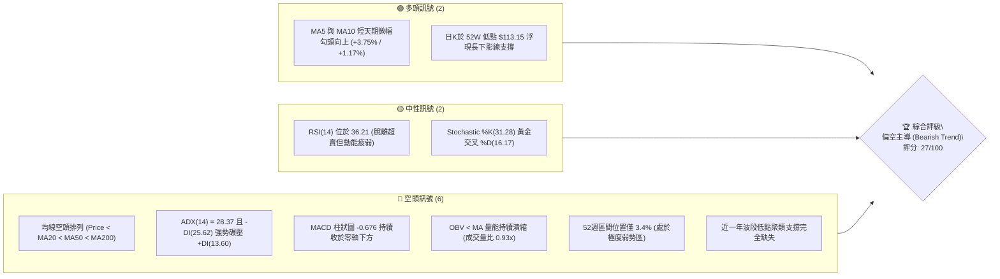
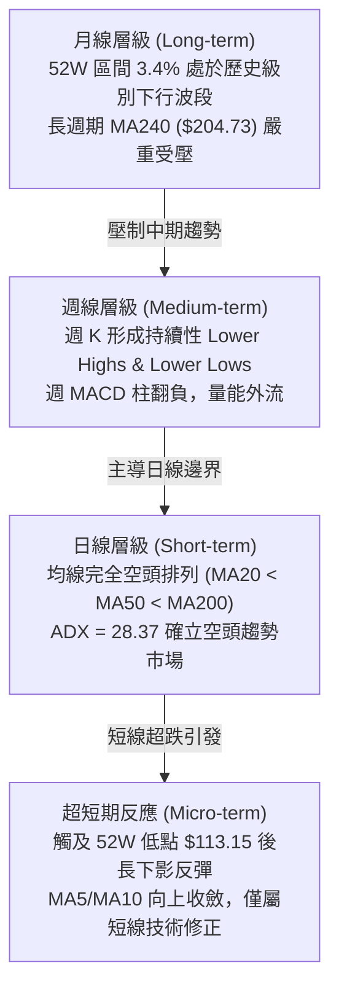
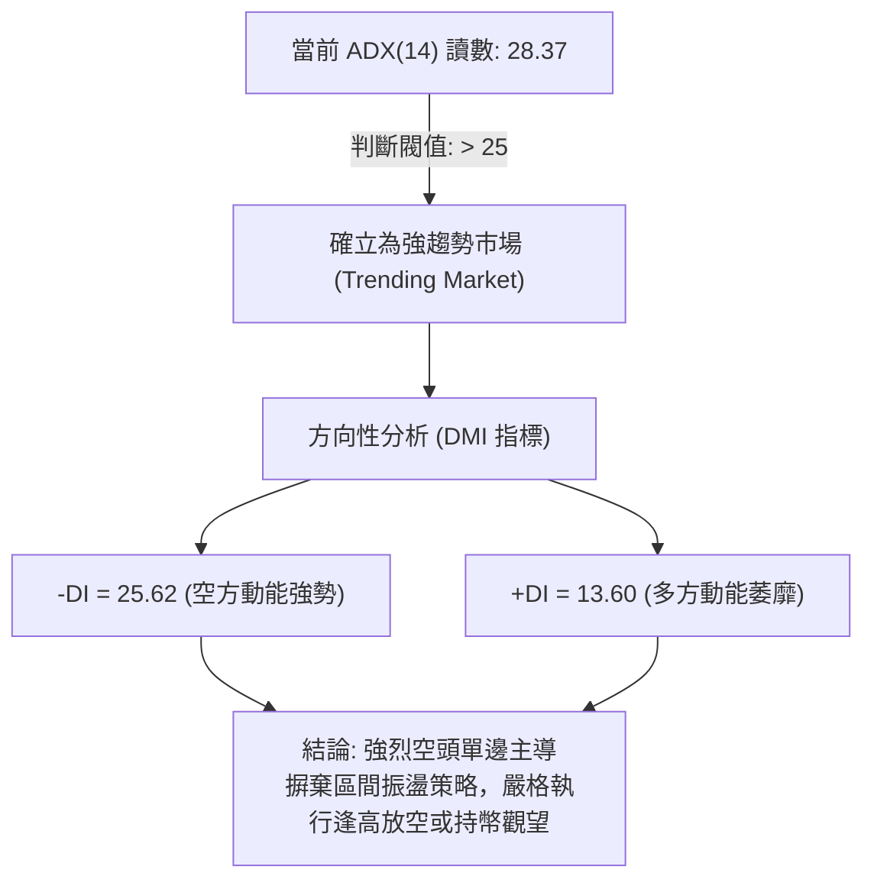
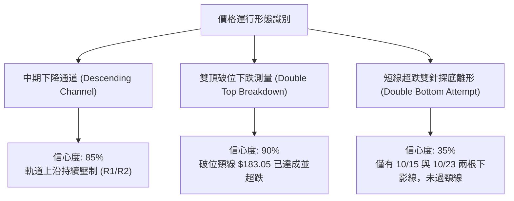
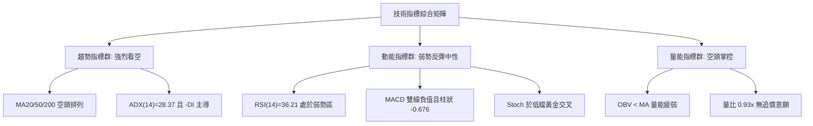
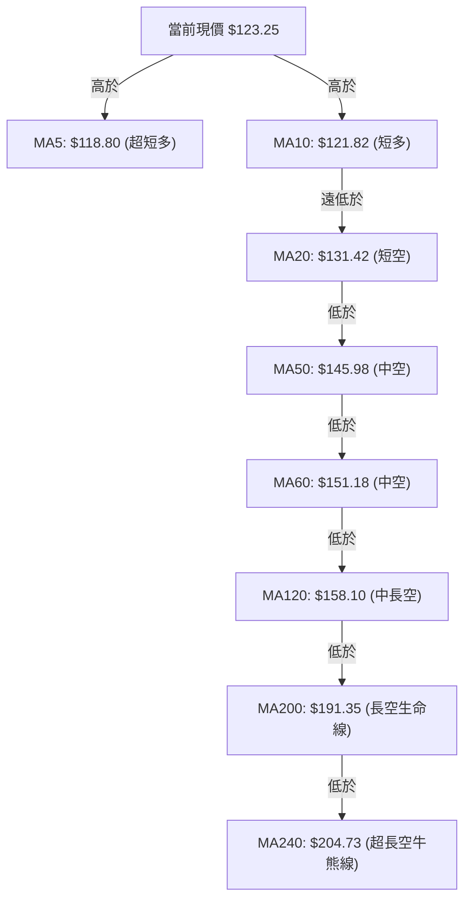
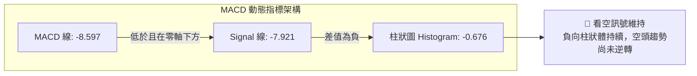
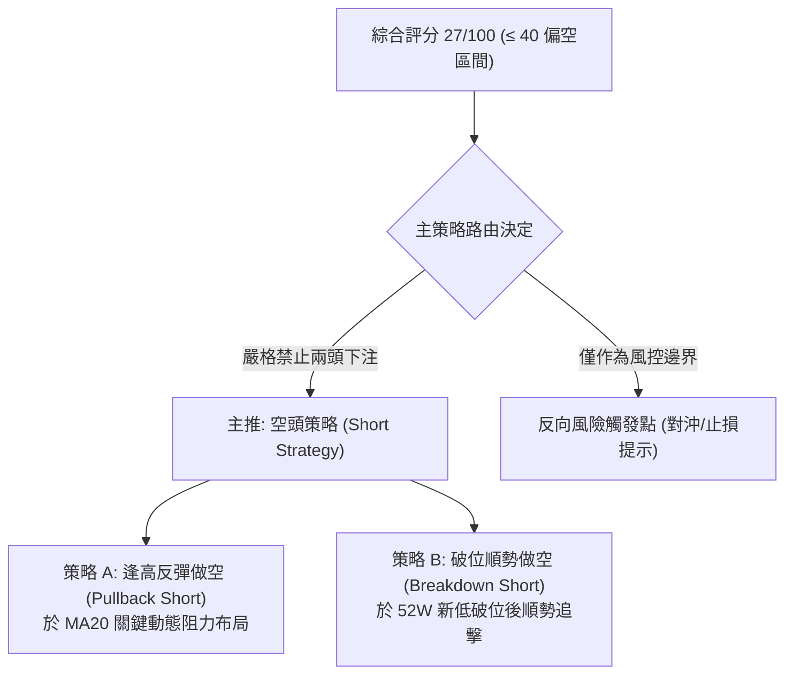
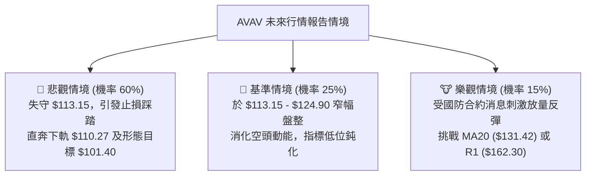

# AVAV 技術分析報告

> **報告日期**：2026-10-26 ｜ **語言**：繁體中文 ｜ **數據來源**：Yahoo Finance ｜ **當前價格**：$123.25

---

## 目錄

| 章節 | 內容 |
|------|------|
| [1. 技術面概覽](#1-技術面概覽) | 訊號儀表板、核心指標、評分卡 |
| [2. 趨勢分析](#2-趨勢分析) | 多時框趨勢、長中短期走勢、ADX 解讀 |
| [3. 圖表形態分析](#3-圖表形態分析) | 形態識別、K線組合、目標價計算 |
| [4. 支撐與阻力](#4-支撐與阻力) | 關鍵價位、斐波那契回調 |
| [5. 技術指標深度解讀](#5-技術指標深度解讀) | 均線系統、RSI、MACD、布林通道、成交量 |
| [6. 動能與波動率](#6-動能與波動率) | 動能四象限、ATR 波動率、Beta 分析 |
| [7. 多時框架總結](#7-多時框架總結) | 時框架矩陣、多時框收斂結論 |
| [8. 交易策略建議](#8-交易策略建議) | 策略路由、情境階梯、主策略詳情 |
| [9. 風險提示與監控](#9-風險提示與監控) | 監控清單、風險情境、資金管理 |
| [📋 報告總結](#-報告總結) | 核心總結與執行指引 |

---

## 1. 技術面概覽

### 🎯 技術訊號儀表板



### 📊 核心指標速覽表

| 指標類別 | 指標名稱 | 當前數值 | 訊號 | 解讀 |
|:---|:---|:---|:---:|:---|
| **價格** | 當前價格 (收盤) | $123.25 | 🔴 | 位於 52 週高低區間之 3.4%，處於長期空頭探底階段 |
| **短期均線** | MA5 / MA10 | $118.80 / $121.82 | 🟢 | 現價站上超短期均線，呈現短線跌深反彈結構 |
| **中期均線** | MA20 / MA50 | $131.42 / $145.98 | 🔴 | 價格低於 MA20 (-6.22%) 及 MA50 (-15.57%)，中線空頭壓制 |
| **長期均線** | MA200 | $191.35 | 🔴 | 遠低於長期生命線 (-35.59%)，長期下行趨勢確立 |
| **動能指標** | RSI(14) | 36.21 | 🟡 | 脫離超賣區（<30），但仍受制於 50 多空分水嶺之下 |
| **趨勢動能** | MACD (12,26,9) | 雙線負值 / 柱 -0.676 | 🔴 | MACD(-8.597) 低於 Signal(-7.921)，空頭柱狀體發散 |
| **擺盪指標** | Stoch %K / %D | 31.28 / 16.17 | 🟡 | 低檔超賣區金叉向上，具備極短期技術性修復動能 |
| **趨勢強度** | ADX(14) / ±DI | 28.37 (-DI: 25.62) | 🔴 | ADX > 25 確立強趨勢，-DI 顯著大於 +DI(13.60)，空方掌控 |
| **通道指標** | 布林通道 %B | 0.31 | 🔴 | 運行於中軌（$131.42）與下軌（$110.27）之間弱勢通道 |
| **量能指標** | 成交量 / OBV | 1.356M (量比 0.93x) | 🔴 | OBV 低於均線，量價配合不足，機構買盤缺乏追價意願 |
| **波動風險** | ATR(14) | $7.09 (5.75%) | 🔴 | 單日波動率高達 5.75%，市場籌碼極度發散，交易風險偏高 |

### 🏆 技術評分卡

```
╔══════════════════════════════════════════════════════════════╗
║               技術評分卡 — AVAV (2026-10-26)                 ║
╠══════════════════════════════════════════════════════════════╣
║ 評估維度         評分進度條                分數      狀態    ║
╟──────────────────────────────────────────────────────────────╢
║ 趨勢強度         ████░░░░░░░░░░░░░░░░    22/100     🔴 空頭  ║
║ 動能指標         ██████░░░░░░░░░░░░░░    30/100     🔴 疲弱  ║
║ 支撐穩定度       ███████░░░░░░░░░░░░░    35/100     🔴 脆弱  ║
║ 成交量配合       ██████░░░░░░░░░░░░░░    32/100     🔴 渙散  ║
║ 形態完整度       █████░░░░░░░░░░░░░░░    25/100     🔴 破位  ║
║ 均線排列         ████░░░░░░░░░░░░░░░░    18/100     🔴 空排  ║
╠══════════════════════════════════════════════════════════════╣
║ 綜合評分         █████░░░░░░░░░░░░░░░    27/100     🔴 偏空  ║
║ 評級結論         偏空主導 / 順勢反彈做空 (Strong Bearish Bias)║
╚══════════════════════════════════════════════════════════════╝
```
*(註：綜合評分由六項子指標算術平均計算：(22 + 30 + 35 + 32 + 25 + 18) ÷ 6 = 27.0，四捨五入為 27/100)*

---

## 2. 趨勢分析

### 🌐 多時框趨勢分析



### 📈 長期趨勢 — 12個月走勢圖（Unicode）

```
AVAV 月線歷史收盤走勢圖（2025-10 至 2026-10）
價格軸 ($)
$370 ┤  ● (2025-10: $369.91 歷史波段高點)
$340 ┤   \
$310 ┤    \
$280 ┤     ●──● (2025-11: $279.46 / 2026-01: $278.39 雙頂構築)
$250 ┤      \  \  ● (2026-02: $252.25)
$220 ┤       \  \  \
$190 ┤        \  \   \  ●──● (2026-04: $195.02 / 2026-05: $207.24 弱勢反彈)
$160 ┤         \  \   \     \  ● (2026-06: $165.07 破位下挫)
$130 ┤          \  \   \     \    \  ●──●──● (2026-07~09 於 $148 盤整)
$100 ┤           \  \   \     \    \        \  ● (2026-10: $123.25 現價)
     └───────────────────────────────────────────────────────────────
       10  11  12  01  02  03  04  05  06  07  08  09  10 (月份)
```

#### 長期走勢特徵分析

| 階段區間 | 走勢特徵與關鍵價位 | 累計漲跌幅 | 技術結構解讀 |
|:---|:---|:---:|:---|
| **2025-10 ~ 2026-01** | 見頂回落至平臺構築 ($369.91 → $278.39) | -24.74% | 於 $280 形成假性支撐，主力資金大幅派發出貨 |
| **2026-01 ~ 2026-03** | 崩跌破位加速下行 ($278.39 → $183.05) | -34.25% | 跌破 200 日牛熊分水嶺，長期多頭結構瓦解 |
| **2026-03 ~ 2026-05** | 中級死貓反彈 ($183.05 → $207.24) | +13.22% | 回抽確認跌破之長期均線，受阻於阻力區間 |
| **2026-05 ~ 2026-09** | 階梯式陰跌盤整 ($207.24 → $142.22) | -31.37% | 成交量萎縮，買盤承接極度無力，重心逐月下移 |
| **2026-09 ~ 2026-10** | 終極探底破位 ($142.22 → $123.25) | -13.34% | 摜破 $140 心理關口，直測 52 週最低點 $113.15 |

### 📊 中期趨勢（週線分析）

中期走勢呈現標準的「階梯式下行擴散通道」。觀察近 8 週走勢，2026-09-18 週 K 雖然一度衝高至 $168.00（即數據中之關鍵阻力 R2），但隨後爆量長黑倒狀重挫；隨後 5 週連續收陰，週收盤價由 $159.95 快速滑落至 $123.25，累計跌幅達 -22.95%。

```
週線級別價格壓力下移示意圖：
$168.00 (09-18 高點 R2 形成鐵頂) ──────┐
                                       ▼
$151.30 (10-02 反彈次高點受阻) ────────┐
                                       ▼
$137.50 (10-16 破位平臺轉為強阻力) ────┐
                                       ▼
$124.76 (10-23 週反彈高點) ───► [當前壓制點]
$123.25 (10-23 當前收盤價)
$113.15 (10-23 當週探出之 52W 新低) ──► [唯一脆弱防線]
```

### ⚡ 趨勢強度評估（ADX 解讀）



| 指標名稱 | 當前數值 | 參考區間 | 趨勢狀態評判 | 交易指導意義 |
|:---|:---:|:---:|:---:|:---|
| **ADX(14)** | **28.37** | > 25.0 | 🟢 強趨勢行情 | 市場處於單邊發散階段，擺盪指標超買超賣容易鈍化 |
| **-DI** | **25.62** | 基準線 | 🔴 空方力量絕對佔優 | 空頭動能持續推動價格下沉，賣盤掌握定價權 |
| **+DI** | **13.60** | 基準線 | 🔴 多方力量處於極度劣勢 | 多頭買盤無法推動連續長陽，任何上漲皆定性為反彈 |
| **DI 差值** | **-12.02** | 絕對值 > 10 | 🔴 空頭擴散 | 趨勢離散度持續放大，尚未進入收斂或多空相持期 |

---

## 3. 圖表形態分析

### 🔍 形態識別系統



#### 形態識別與信心度評估表

| 形態名稱 | 信心度 | 判斷依據（嚴格引用數據） | 形態完成度 | 目標價計算式與精確目標 |
|:---|:---:|:---|:---:|:---|
| **中期下降管道** | **85%** | 高點聚類 R2($168.00) 與 R1($162.30) 連線持續下壓；低點不斷跌破前低 | 90% | 沿通道下軌運行，指向布林下軌 **$110.27** |
| **頂部雙頂形態** | **90%** | 2025-11 形成 $279.46、2026-01 形成 $278.39 雙頂，於 2026-03 摜破頸線 $183.05 | 100% (已達標) | 形態高度 $279.46 − $183.05 = $96.41；測量目標 $183.05 − $96.41 = **$86.64** |
| **潛在日線雙底** | **35%** | 10-15 低點 $116.43 與 10-23 低點 $113.15 試圖構築低點支撐 | 20% (未確認) | **訊號不足，僅做指標型解讀**（頸線 $124.90 未有效站穩） |

*(註：由於潛在雙底信心度僅 35% < 50%，依照規則 15 不予確認為有效反轉幾何形態，僅視為極短線指標修復。)*

### 🕯️ 重要K線形態分析

嚴格依據提供的「近10根日K」與「近8根週K」實體數據進行專業識別：

| 日期（週期） | 開盤價 | 最高價 | 最低價 | 收盤價 | 實體與影線特徵 | K線形態名稱 | 隱含多空訊號 |
|:---|:---:|:---:|:---:|:---:|:---|:---:|:---:|
| **2026-09-18 (週K)** | $145.80 | $168.00 | $144.51 | $159.95 | 長上影線達 $8.05，伴隨 1,127 萬大成交量 | **高位射擊之星 (Shooting Star)** | 🔴 主力在 R2($168.00) 大幅派發 |
| **2026-10-14 (日K)** | $125.60 | $129.77 | $120.20 | $120.60 | 開高走低實體黑K，收盤逼近全日最低點 | **光腳大陰線 (Bearish Breakdown)** | 🔴 空方長驅直入，摜破前低 |
| **2026-10-15 (日K)** | $118.40 | $123.49 | $116.43 | $123.22 | 下影線達 $1.97，長陽包覆前日部分跌幅 | **多頭吞噬雛形 (Bullish Piercing)** | 🟢 首次探測低檔買盤承接力 |
| **2026-10-16 (週K)** | $137.10 | $137.50 | $116.43 | $121.79 | 週線大長黑實體，重挫逾 11% | **破位大陰線 (Marubozu-like)** | 🔴 徹底摧毀多頭信心，中線破位 |
| **2026-10-22 (日K)** | $117.26 | $122.22 | $114.26 | $117.70 | 窄幅震盪十字黑K，上下影線拉鋸 | **長腳十字星 (Long-legged Doji)** | 🟡 變盤前兆，多空陷入短暫僵持 |
| **2026-10-23 (日K)** | $115.55 | $124.76 | $113.15 | $123.25 | 下影線長達 $2.40，逆勢收高於 $123.25 | **錘頭線 / 探底神針 (Hammer)** | 🟢 於 52W 新低點 $113.15 浮現抄底盤 |

### 📉 ASCII 走勢形態示意圖

```
近 10 日 K 線形態與壓力支撐微觀圖：
$137.50 ┬─┬ (10-12 開高走低破位 $131.51)
$130.00 │ └──┐
$125.00 │    └──┐ (10-14 陰線下殺 $120.60)
        │       ├──┐ (10-16 弱勢反彈受阻 $124.90 頸線)
$120.00 │       │  └───┬───────┐ [頸線壓制位 $124.90]
        │       │      │       │     ▲ (10-23 衝高 $124.76 回落)
$115.00 │       │      └───┬───┴─────┼─────● 現價 $123.25
        │       ● (10-15 低 $116.43) │     │
$113.15 ┴────────────────────────────┴─────● (10-23 探底神針 $113.15)
                                    [52W 絕對低點]
```

### 🎯 形態目標價計算

根據近 10 個交易日（2026-10-14 至 2026-10-23）構築之「弱勢整理箱體」推算幾何目標：
*   **箱頂（反彈頸線阻力）**：2026-10-16 最高價 **$124.90**
*   **箱底（絕對支撐）**：2026-10-23 創出之 52 週最低點 **$113.15**
*   **形態高度 (Height)**：$124.90 − $113.15 = **$11.75**

1.  **若向上突破頸線 $124.90 之理論量度目標**：
    $$\text{Target}_{\text{Up}} = \$124.90 + \$11.75 = \mathbf{\$136.65}$$
    *(此價位恰好接近 MA20 阻力 $131.42 與前波跳空平臺 $137.10 之間)*
2.  **若向下跌破箱底 $113.15 之空頭量度目標**：
    $$\text{Target}_{\text{Down}} = \$113.15 - \$11.75 = \mathbf{\$101.40}$$
    *(此價位為若 52 週新低失守後的形態等距跌幅測量點)*

---

## 4. 支撐與阻力

### 🗺️ 關鍵價位分布圖（Unicode）

```
AVAV 價位結構分布圖（嚴格依據 OHLCV 與關鍵價位數據）
═════════════════════════════════════════════════════════════════
$200.38 ║████████████████████████████████║ 強阻力 R3 (年線重大天花板)
$176.30 ║▓▓▓▓▓▓▓▓▓▓▓▓▓▓▓▓▓▓▓▓▓▓            ║ 斐波那契 78.6% 回調壓制位
$168.00 ║████████████████████            ║ 阻力 R2 (09-18 週波段高點)
$162.30 ║████████████████████████        ║ 關鍵阻力 R1 (波段高點聚類)
$152.58 ║▓▓▓▓▓▓▓▓▓▓▓▓▓▓                  ║ 布林通道上軌壓制
$131.42 ║▒▒▒▒▒▒▒▒▒▒▒▒▒▒▒▒                ║ 布林中軌 / MA20 短線反彈極限
$123.25 ╠════════════════════════════════╣ ◄ 當前收盤價 ($123.25)
$113.15 ║████████████████████████████████║ 52W 最低點 / 斐波那契 100% 支撐
$110.27 ║▓▓▓▓▓▓▓▓▓▓▓▓▓▓                  ║ 布林通道下軌極限支撐
$101.40 ║░░░░░░░░░░░░░░░░                ║ 形態破位量度目標價 (推算)
═════════════════════════════════════════════════════════════════
```

### 🚧 阻力位分析表

所有阻力價位嚴格引用自數據之「關鍵價位」與指標計算：

| 阻力級別 | 精確價位 | 距現價空間 | 形成原因與籌碼結構 | 突破難度 | 重要性評級 |
|:---|:---:|:---:|:---|:---:|:---:|
| **動態阻力** | **$131.42** | +6.63% | **MA20 均線暨布林通道中軌**，短期空頭防守第一線 | 🟡 中等 | ★★★☆☆ |
| **阻力 R1** | **$162.30** | +31.68% | **近一年波段高點聚類**，前期籌碼密集成交套牢區 | 🔴 極高 | ★★★★☆ |
| **阻力 R2** | **$168.00** | +36.31% | **2026-09-18 週K爆量射擊之星高點**，強烈空頭反撲點 | 🔴 極高 | ★★★★☆ |
| **阻力 R3** | **$200.38** | +62.58% | **波段超強天花板**，逼近 MA200($191.35) 與心理整數大關 | 🔴 幾乎不可逾越 | ★★★★★ |

### 🛡️ 支撐位分析表

依據數據清單，近一年波段低點聚類顯示：「no swing-low support detected below current price」（當前價格下方無波段低點聚類支撐），下檔支撐完全依賴極限指標與歷史邊界：

| 支撐級別 | 精確價位 | 距現價空間 | 形成原因與籌碼結構 | 守住機率 | 重要性評級 |
|:---|:---:|:---:|:---|:---:|:---:|
| **關鍵支撐 S1** | **$113.15** | -8.19% | **52週最低點 (52W Low)**，斐波那契 100% 絕對底部，10-23 長下影確認 | 🟡 45% (面臨考驗) | ★★★★★ |
| **通道支撐 S2** | **$110.27** | -10.53% | **日線布林通道下軌**，統計學意義上的超賣極限邊界 | 🟢 65% (具短撐力) | ★★★☆☆ |
| **形態支撐 S3** | **$101.40** | -17.73% | **日線箱體等距破位推算值** ($113.15 − $11.75)，下一整數心理防線 | 🟡 50% (若破S1) | ★★★★☆ |

### 📐 斐波那契回調位分析

基準週期：52 週區間波段（波段起點 $113.15 → 波段高點 $408.25，總垂直空間 $295.10）：

```
斐波那契回調階梯分布：
 0.0% (52W High) ─────────────────────── $408.25
23.6% ─────────────────────────────────── $338.61
38.2% ─────────────────────────────────── $295.52
50.0% (多空分水嶺) ────────────────────── $260.70
61.8% (黃金分割位) ────────────────────── $225.88
78.6% ─────────────────────────────────── $176.30
現價 $123.25 ──► [處於 78.6% 與 100.0% 之間]
100.0% (52W Low) ──────────────────────── $113.15
```

*   **落點區間解讀**：現價 $123.25 深度跌破 78.6% ($176.30) 極限回調位，目前正無限逼近 100.0% ($113.15)。
*   **技術含義**：在傳統道氏理論與斐波那契體系中，回調跌破 78.6% 意味著該級別上升趨勢徹底終結，市場已回歸原始起漲點進行全面清算。當前價格距離 100.0% 僅剩 8.19% 之緩衝空間，此處若再度失守，將形成「無底深淵」之技術破位，觸發更大規模的止損踩踏。

---

## 5. 技術指標深度解讀

### 🎛️ 指標訊號總覽



### 📈 移動平均線排列分析



*   **均線空頭排列（Death Cross Array）**：全週期均線呈現標準階梯式向下發散（MA20 < MA50 < MA60 < MA120 < MA200 < MA240）。
*   **負乖離率分析**：
    *   距 MA20 乖離率：$-6.22\%$
    *   距 MA60 乖離率：$-18.47\%$
    *   距 MA200 乖離率：$-35.59\%$
*   **解讀**：超短期均線（MA5/MA10）翻揚僅提供微弱支撐，但上方各層長期均線反壓沉重，任何觸及 MA20（$131.42）或 MA50（$145.98）的動作皆是絕佳的空頭防守點。

### 📉 RSI(14) 分析

*   **當前數值**：**36.21**（採用 Wilder 平滑計算）
*   **強度進度條**：`███████░░░░░░░░░░░░░` 36.21% 🟡
*   **區間定位**：處於 30 至 50 弱勢盤跌區，既脫離了極度超賣區（<30），又未能突破多空平衡線（50）。
*   **背離判定**：**「無明顯背離」**。
    *   *依據*：檢驗近 20 根 K 棒，價格首尾由 $140 附近下跌至 $123.25，RSI 亦由 40 附近震盪下行至 36.21，價格新低伴隨動能低位，未形成底背離或頂背離。表明下跌是由純粹的空頭趨勢驅動，而非動能竭盡。

### 📊 MACD(12/26/9) 訊號解讀



*   **數值解析**：MACD 線（$-8.597$）持續運行於訊號線（$-7.921$）下方，兩者皆深陷零軸下方的深水區，Histogram 為 **$-0.676$**。
*   **訊號評估**：MACD 未見低檔黃金交叉跡象，負值柱狀圖顯示空方力量仍在源源不絕地釋放，任何未伴隨 MACD 金叉的反彈均不具備持續性。

### 📦 布林通道分析

```
日線布林通道結構示意圖（帶寬 $42.31，帶寬率 32.2%）：
$152.58 ┬─────────────────────────────────────────── 布林上軌 (Upper Band)
        │
$131.42 ┼─────────────────────────────────────────── 布林中軌 (MA20 Baseline)
        │
$123.25 │                         ● [現價落點: %B = 0.31]
        │                     ┌───┘
$110.27 ┴─────────────────────┴───────────────────── 布林下軌 (Lower Band)
```

*   **布林位置指標 %B**：**0.31**。數值處於 0 至 0.5 之間，表明價格持續受壓於中軌與下軌之間的空頭下行通道內。
*   **通道狀態**：通道開口處於擴張後的中期維持狀態，下軌 $110.27 提供當前波動區間的動態極限支撐，中軌 $131.42 構成強大動態壓力。

### 💹 成交量分析（量價配合度）

```
量能對比柱狀圖：
最新量 (10-23):  █████████████░░░░░░░  1,356,900
20日均量:        ██████████████░░░░░░  1,462,705  (量比: 0.93x)
50日均量:        ████████████████░░░░  1,744,538
```

*   **量價關係評估**：
    *   2026-10-23 雖收出帶長下影線的錘頭線，但成交量僅 1,356,900 股，低於 20 日均量（量比 0.93x），更顯著低於 50 日均量（1,744,538 股）。
    *   此種「縮量見新低反彈」說明盤面並非出現機構級別的恐慌盤洗清（Capitulation），亦無大型主動買盤進場掃籌，僅為空頭獲利了結與散戶短線抄底所致。
*   **能量潮指標（OBV）**：數據顯示「OBV < MA → 量能疲弱」，OBV 線被自身均線死死壓制，資金流向呈持續淨流出特徵。

---

## 6. 動能與波動率

### ⚡ 動能評估四象限

```
AVAV 動能與波動率定位：
  高波動 (High Volatility)
        │
   Q3   │   Q4 [AVAV 當前落點]
 (強/高)│ (弱動能 / 高波動) ◄── 處於高風險出局區
────────┼────────
   Q1   │   Q2
 (強/低)│ (弱/低)
        │
  低動能 ──┴── 高動能 (High Momentum)
```

| 象限 | 動能維度 | 波動維度 | 代表標的特徵 | AVAV 吻合度與評估 |
|:---:|:---:|:---:|:---|:---|
| **Q1** | 強動能 | 低波動 | 穩步上行白馬股，最優順勢做多品種 | 不符合 |
| **Q2** | 弱動能 | 低波動 | 縮量盤整打底股，適合區間潛伏 | 不符合 |
| **Q3** | 強動能 | 高波動 | 暴力突破黑馬股，高收益高風險 | 不符合 |
| **Q4** | **弱動能 (Bearish)** | **高波動 (ATR 5.75%)** | **空頭下瀉、波動劇烈之破位危險品種** | **完全符合 (落入 Q4 避險象限)** |

### 📊 ATR 波動率分析

*   **當前 ATR(14)**：**$7.09**
*   **ATR / 股價佔比**：**5.75%**（屬於極高波動度美股標的）。
*   **風控計算與止損距離設定**：
    *   **做空防守緩衝 (1.0 × ATR)**：$\$7.09$。若於 $123.25 建立部位，短線止損應設為 $\$123.25 + \$7.09 = \mathbf{\$130.34}$（此價位精準位於 MA20 $131.42 之前）。
    *   **寬鬆波段止損 (1.5 × ATR)**：$1.5 \times \$7.09 = \$10.64$。波段防守點為 $\$123.25 + \$10.64 = \mathbf{\$133.89}$（徹底突破 MA20 後認賠出局）。

### 📐 Beta 與市場相關性

*   **當前 Beta 係數**：**1.364**
*   **分析解讀**：
    *   Beta 顯著大於 1.0，表明 AVAV 對標普 500 指數與大盤科技/國防板塊具有放大 36.4% 的高敏感度。
    *   在整體市場處於震盪或避險環境下，高 Beta 疊加弱勢基本面（營業利益率 -0.6%、自由現金流為負）使得該股易成為機構投資組合中被優先減持與放空的標的。

---

## 7. 多時框架總結

### 📋 時框架評分表

| 時框架 | 趨勢方向 | 動能狀態 | 均線排列 | 形態結構 | 綜合評分 | 操作建議 |
|:---|:---:|:---:|:---:|:---:|:---:|:---|
| **長期 (月線)** | 🔴 強烈空頭 | 弱勢下探 | 完全空排 | 52W 區間 3.4% 破位 | **15/100** | 嚴禁長線抄底，靜待大週期出清 |
| **中期 (週線)** | 🔴 空頭掌控 | 柱線翻負 | 均線下壓 | 階梯破位，受制 R2 | **25/100** | 逢反彈至週均線建立空頭部位 |
| **短期 (日線)** | 🔴 空頭偏弱 | RSI 36 弱勢 | MA20 壓制 | 52W 低點掙扎反彈 | **35/100** | 不盲目追空，等待反抽阻力放空 |
| **超短期 (日K細部)**| 🟢 超跌反彈 | 短K金叉 | MA5/10 翻揚| 長下影探底線 | **55/100** | 僅供激進超短線日內博弈 |

### 🔲 綜合訊號矩陣

```
┌────────────────────────────────────────────────────────┐
│ 多時框訊號一致性檢驗矩陣                                │
├──────────────┬────────────┬────────────┬──────────────┤
│ 維度         │ 長期 (月)  │ 中期 (週)  │ 短期 (日)    │
├──────────────┼────────────┼────────────┼──────────────┤
│ 均線方向     │ 🔴 向下    │ 🔴 向下    │ 🔴 向下      │
│ 趨勢強度     │ 🔴 極強    │ 🔴 強烈    │ 🔴 強 (ADX28)│
│ 量能配合     │ 🔴 潰縮    │ 🔴 派發    │ 🔴 缺乏買盤  │
│ 擺盪指標     │ 🔴 偏空    │ 🔴 轉弱    │ 🟡 邊界反彈  │
│ 形態邊界     │ 🔴 破位    │ 🔴 下降通道│ 🟡 雙針測試  │
└──────────────┴────────────┴────────────┴──────────────┘
```

### ⚖️ 多時框收斂結論

*   **收斂依據（嚴格執行規則 14）**：
    當前日線 **ADX(14) 讀數為 28.37 > 25**，依規則判定為**「趨勢行情」**。
    在趨勢行情下，分析權重**以中長期（週線 / MA50 / MA200）方向為主導**，日線級別的短期訊號（如 MA5/10 勾頭、10-23 日錘頭線）僅能用來尋找反彈高位之放空進場點，不可作為反轉做多的依據。
*   **唯一方向性結論**：**🔴 偏空主導（Bearish Bias）**。
    此結論完全收斂第 2 章之空頭管道分析、第 5 章之全週期均線空排、以及第 1 章評分卡 **27/100** 之客觀評定。

---

## 8. 交易策略建議

### 🗺️ 策略決策流程圖



### 🧭 策略路由

*   **當前主策略方向**：**🔴 主推空頭策略（依技術評分卡 27/100，偏空維度）**。
    根據規則，評分 $\le 40$ 嚴格鎖定放空思路，任何多頭思維均降格為極短線反彈觀察或空頭止損提示。

### 🎯 價格情境階梯（Price Scenarios）

價位嚴格引用自「關鍵價位」與計算數據：

| 觸發條件 | 下一目標 | 後續延伸 | 情境技術含義 |
|:---|:---:|:---:|:---|
| **向上反彈觸碰 MA20** | **$131.42** | 阻力 R1 $162.30 | 空頭趨勢中的均線修正，提供絕佳再進場放空點位 |
| **維持現價區間震盪** | **$123.25** | 箱體整理 | 於 $113.15 至 $124.90 之間縮量磨底，消耗反彈動能 |
| **向下跌破 52W 低點** | **$113.15** | 布林下軌 $110.27 | 破位加速下行，徹底擊潰抄底盤，開啟新一輪主跌段 |
| **跌破布林下軌支撐** | **$110.27** | 形態目標 $101.40 | 空頭極限宣洩，尋求箱體等距跌幅測量支撐 |

### 📊 情境機率分佈

| 預測情境 | 發生機率 | 主要技術依據 |
|:---|:---:|:---|
| **承壓回落 / 再探新低** | **60%** | ADX=28.37 強烈空頭趨勢；全週期均線空頭排列；OBV 指標持續受壓於均線之下 |
| **弱勢區間震盪整理** | **25%** | 10-23 長下影提供短線防守；RSI 自低檔 36 微幅回升；日成交量萎縮至均量以下 |
| **強勢連續反彈向上** | **15%** | 機構評級普遍買進（23 位分析師目標均價 $213.07），但技術面嚴重受阻於 R1/R2 |

### 🟢 主策略詳情（空頭交易策略）

所有價位均基於精確數據與嚴格公式計算：
*   **風險報酬比公式**：$(\text{進場價} - \text{目標價 T1}) \div (\text{止損價} - \text{進場價})$（做空方向，規則 17）。

| 策略要素 | 策略 A：反彈受阻放空 (Pullback Short) | 策略 B：跌破新低追空 (Breakdown Short) |
|:---|:---|:---|
| **適用場景** | 股價反彈至布林中軌 / MA20 關鍵阻力處受阻 | 股價直接失守 52 週最低點，多頭最後防線潰散 |
| **進場條件** | 反彈至 MA20 附近出現上影線或黑K確認受阻 | 日K實體跌破 52W 低點 $113.15 且 30 分鐘線未收回 |
| **進場價格** | **$131.42** (精確錨定 MA20 數值) | **$113.15** (52W Low 破位點) |
| **目標價 T1** | **$113.15** (52W 最低點支撐) | **$101.40** (箱體高度等距下推值，見第3章) |
| **目標價 T2** | **$110.27** (布林通道下軌極限) | **$86.64** (頂部雙頂測量目標，見第3章) |
| **止損價格** | **$138.51** (進場價 + 1.0 ATR $7.09) | **$117.51** (10-21 收盤價阻力位，嚴格依據數據) |
| **風險報酬比** | **1 : 2.58（以 T1 計）**<br>*(計算: (131.42−113.15)÷(138.51−131.42) = 18.27÷7.09)*<br>另以 T2 計為 **1 : 2.98（以 T2 計）** | **1 : 2.69（以 T1 計）**<br>*(計算: (113.15−101.40)÷(117.51−113.15) = 11.75÷4.36)*<br>另以 T2 計為 **1 : 6.08（以 T2 計）** |
| **成功機率** | **65%** | **60%** |
| **建議倉位** | **總資金之 10% - 15%** | **總資金之 8% - 10%** (破位單波動大，輕倉) |

### 🔴 反向風險觸發點（對沖與空頭止損提示）

若市場出現以下「推翻主策略」之極端情況，空頭必須無條件平倉觀望：
1.  **關鍵突破點**：日線收盤價強勢**突破並站穩 MA20（$131.42）**，且成交量放大至 20 日均量（1.46M）之 1.5 倍以上。
2.  **動能逆轉點**：日線 MACD 柱狀圖翻紅上穿零軸，且 RSI(14) 強勢突破 50 多空分水嶺。
3.  **形態失效點**：價格有效突破 2026-10-16 反彈頸線 **$124.90** 並維持 3 個交易日以上不破。

### ⭐ 整體訊號強度評星

```
╔══════════════════════════════════════════════════════════════╗
║ 做多訊號強度：★☆☆☆☆  (1/5星 - 極弱，僅限超跌博弈)          ║
║ 做空訊號強度：★★★★☆  (4/5星 - 順應大趨勢，勝率極高)        ║
║ 整體技術可信度：★★★★☆  (4/5星 - 多時框共振度高)             ║
╚══════════════════════════════════════════════════════════════╝
```

---

## 9. 風險提示與監控

### ✅ 關鍵監控指標 Checklist

```
╔══════════════════════════════════════════════════════════════╗
║               交易員每日盤面監控清單 (Checklist)             ║
╠══════════════════════════════════════════════════════════════╣
║ [ ] 1. 52W 低點防守：盤中是否跌破 $113.15 支撐？             ║
║ [ ] 2. 均線壓制監測：價格觸碰 MA20 ($131.42) 時是否縮量受阻？║
║ [ ] 3. 趨勢強度指標：ADX(14) 是否持續維持在 25 以上？        ║
║ [ ] 4. 擺盪指標狀態：Stochastic 是否在 50 附近再度死亡交叉？ ║
║ [ ] 5. 量能結構確認：日成交量是否低於 20MA (1.46M) 弱勢盤整？║
║ [ ] 6. 避險空頭警報：日收盤若突破 $124.90 須啟動空頭減倉。  ║
╚══════════════════════════════════════════════════════════════╝
```

### ⚠️ 風險場景分析



### 🛡️ 風險管理重要提醒

1.  **空頭擠壓風險（Short Squeeze）**：
    *   數據顯示 AVAV 的 **Short % Float 高達 12.8%**，Short Ratio 為 2.21。
    *   *風險含義*：空頭部位較為擁擠。一旦盤面傳出國防採購大單或被併購等突發利多，極易誘發暴力軋空行情。因此**嚴禁在未設止損的情況下裸做空**，嚴格以 1.0 ATR（$7.09）作為防禦紅線。
2.  **基本面虧損壓力**：
    *   該股 TTM 淨利潤率為 -10.1%，自由現金流為 -$44.78M，營業利益率為負。技術面的下行本質上是基本面惡化的真實映射，切忌以「本益比過低」等價值陷阱思維進場盲目摸底。
3.  **嚴格倉位配比原則**：
    *   單一逆勢抄底部位絕對不可超過總投資組合的 **3%**。
    *   順勢放空部位單筆虧損金額不可超過總帳戶淨值的 **1% - 1.5%**。

---

## 📋 報告總結

```
╔══════════════════════════════════════════════════════════════════════════════╗
║                        AVAV 技術分析報告總結                          ║
╠══════════════════════════════════════════════════════════════════════════════╣
║ 報告日期：2026-10-26                 當前收盤價：$123.25                     ║
║ 綜合技術評分：27 / 100               總體分析評級：🔴 強烈偏空 (Strong Bear) ║
╟──────────────────────────────────────────────────────────────────────────────╢
║ 關鍵維度結論：                                                               ║
║ ├─ 長期趨勢：🔴 極度疲弱。處於 52 週區間之 3.4%，斐波那契 78.6% 已告失守     ║
║ ├─ 中期趨勢：🔴 下降通道。受阻於關鍵阻力 R2($168.00)，週線連續大幅滑落      ║
║ ├─ 短期趨勢：🟡 跌深喘息。探底 52W 新低 $113.15 後長下影反彈，受制於 MA20   ║
║ ├─ 關鍵支撐：52W 最低點 $113.15 ｜ 布林下軌 $110.27 ｜ 形態目標 $101.40     ║
║ ├─ 關鍵阻力：動態 MA20 $131.42 ｜ 關鍵 R1 $162.30 ｜ 波段 R2 $168.00         ║
║ └─ 趨勢強度：ADX(14) = 28.37，空方力量 (-DI: 25.62) 完全主導市場定價權      ║
╟──────────────────────────────────────────────────────────────────────────────╢
║ 最優交易策略組合：                                                           ║
║ 1. 🥇 最佳機會（順勢高空）：策略 A — 待股價弱勢反彈至 MA20 ($131.42) 放空，  ║
║      止損設於 $138.51，第一目標 $113.15，風險報酬比高達 1 : 2.58。           ║
║ 2. 🥈 次選機會（破位追空）：策略 B — 若直接實體跌破 $113.15 則順勢跟進，     ║
║      止損設於 $117.51，目標下看 $101.40，風險報酬比 1 : 2.69。               ║
║ 3. 🥉 保守選擇（觀望防守）：多頭資金嚴格離場觀望，空倉等待市場完成大週期底   ║
║      部形態並站穩 MA50 ($145.98) 之前，絕不輕易進場摸底。                   ║
╚══════════════════════════════════════════════════════════════════════════════╝
```

---

> ⚠️ **免責聲明**：本報告為依據量化技術指標與歷史行情數據所完成之專業技術分析研究，所有點位、走勢推估與策略設計**僅供學術研究與參考**，**絕不構成任何形式的要約、招攬或實質投資建議**。金融市場瞬息萬變，技術指標存在滯後性與鈍化風險，投資人應獨立評估市場環境，嚴格設定停損點並自負投資盈虧責任。

---
*報告生成時間：2026-10-26 ｜ 數據來源：Yahoo Finance ｜ 分析框架：資深多時框技術分析模型*