# AVAV 技術分析報告

> **報告日期**：2026-10-27 ｜ **語言**：繁體中文 ｜ **數據來源**：Yahoo Finance ｜ **當前價格**：$125.45

---

## 目錄

| 章節 | 內容 |
|------|------|
| [1. 技術面概覽](#1-技術面概覽) | 訊號儀表板、核心指標、評分卡 |
| [2. 趨勢分析](#2-趨勢分析) | 多時框趨勢、長中短期走勢 |
| [3. 圖表形態分析](#3-圖表形態分析) | 形態識別、K線組合、目標價 |
| [4. 支撐與阻力](#4-支撐與阻力) | 關鍵價位、斐波那契回調 |
| [5. 技術指標深度解讀](#5-技術指標深度解讀) | MA/RSI/MACD/布林/成交量 |
| [6. 動能與波動率](#6-動能與波動率) | 動能評估、ATR、Beta |
| [7. 多時框架總結](#7-多時框架總結) | 時框架評分矩陣 |
| [8. 交易策略建議](#8-交易策略建議) | 多空策略、風險報酬比 |
| [9. 風險提示與監控](#9-風險提示與監控) | 監控指標、風險場景 |

---

## 1. 技術面概覽

### 🎯 技術訊號儀表板

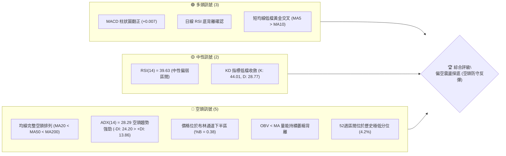

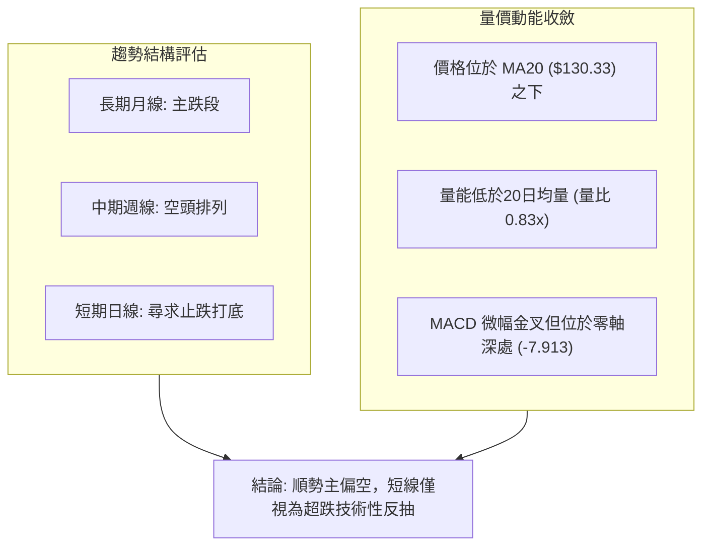

### 📊 核心指標速覽表

| 指標類別 | 指標名稱 | 當前數值 | 訊號 | 解讀 |
|----------|----------|----------|------|------|
| **價格** | 當前收盤價 | $125.45 | 🔴 | 位於52週區間 4.2% 分位，距離低點 $113.15 僅一步之遙 |
| **均線** | MA20 | $130.33 | 🔴 | 現價低於 MA20 (-3.75%)，短線承壓 |
| **均線** | MA50 | $144.63 | 🔴 | 現價大幅低於 MA50 (-13.26%)，中期空頭掌控 |
| **均線** | MA200 | $190.25 | 🔴 | 現價遠低於年線 MA200 (-34.06%)，長線處於嚴峻熊市走勢 |
| **動能** | RSI(14) | 39.63 | 🟡 | 脫離超賣區，呈低檔修復但尚未突破 50 中軸線 |
| **動能** | MACD(12,26,9) | -7.913 / 柱狀 +0.007 | 🟢 | 快慢線深處零軸下方，柱狀微幅翻正，存在弱勢金叉 |
| **趨勢** | ADX(14) | 28.29 (-DI: 24.20) | 🔴 | ADX > 25 且 -DI 顯著大於 +DI，確立空頭趨勢行情 |
| **通道** | 布林通道 | 下軌 $110.40 / 上軌 $150.27 | 🟡 | 現價位於中軌下方，%B 為 0.38，未跌破下軌 |
| **成交量** | 20日均量比 | 0.83x (1,216,300) | 🔴 | 量能低於均量，OBV 疲軟，反彈缺乏主力買盤量增支撐 |
| **波動** | ATR(14) | $6.97 (5.55%) | 🔴 | 日內波動幅度大，操作風險較高 |

### 🏆 技術評分卡

```
╔══════════════════════════════════════════════════════════════╗
║                技術評分卡 — AVAV (2026-10-27)                ║
╠══════════════════════════════════════════════════════════════╣
║ 趨勢強度 (Trend)       ██████░░░░░░░░░░░░░░  30/100  🔴 空頭強烈 ║
║ 動能指標 (Momentum)    ████████░░░░░░░░░░░░  40/100  🟡 底背微升 ║
║ 支撐穩定度 (Support)   ████░░░░░░░░░░░░░░░░  20/100  🔴 無近支撐 ║
║ 成交量配合 (Volume)    ██████░░░░░░░░░░░░░░  30/100  🔴 量能萎縮 ║
║ 形態完整度 (Pattern)   ████████░░░░░░░░░░░░  40/100  🟡 弱勢築底 ║
║ 均線排列 (Moving Avg)  ████░░░░░░░░░░░░░░░░  20/100  🔴 完美空排 ║
╠══════════════════════════════════════════════════════════════╣
║ 綜合評分 (Overall)     ██████░░░░░░░░░░░░░░  30/100  🔴 強烈偏空 ║
╚══════════════════════════════════════════════════════════════╝
*註：綜合評分 = (30 + 40 + 20 + 30 + 40 + 20) ÷ 6 = 30.0，依規則 18 四捨五入為 30/100。
```

---

## 2. 趨勢分析

### 🌐 多時框趨勢分析

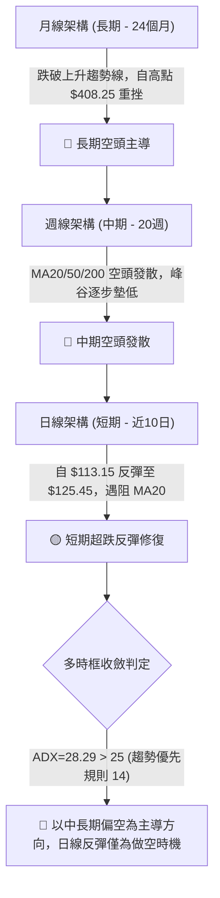

### 📈 長期趨勢 — 12個月走勢圖（Unicode）

```
AVAV 月線走勢圖（過去12個月：2025-11 至 2026-10）
價格軸 ($)
$380 ┤
$340 ┤
$300 ┤
$280 ┤● (2025-11: 279.46)
$260 ┤      ● (2026-01: 278.39)
$240 ┤  ● (2025-12: 241.89)  ● (2026-02: 252.25)
$200 ┤                                ● (2026-05: 207.24)
$180 ┤                    ● (2026-03: 183.05)  ● (2026-04: 195.02)
$160 ┤                                            ● (2026-06: 165.07)
$140 ┤                                                ● (2026-07: 149.37)
$140 ┤                                                ● (2026-08: 148.35)  ● (2026-09: 142.22)
$120 ┤                                                                        ● (2026-10: 125.45) ◄ 現價
     └──────────────────────────────────────────────────────────────────────────
       M11  M12  M01  M02  M03  M04  M05  M06  M07  M08  M09  M10
```

#### 走勢特徵分析表格

| 階段區間 | 起訖月份 | 起訖價格 ($) | 漲跌幅 (%) | 價量與趨勢結構特徵 |
|----------|----------|--------------|------------|--------------------|
| **高檔震盪期** | 2025-11 至 2026-02 | $279.46 → $252.25 | -9.74% | 形成雙頂雛形，價格多次衝擊 $280 未果，主力籌碼開始鬆動出逃 |
| **加速崩跌期** | 2026-02 至 2026-03 | $252.25 → $183.05 | -27.43% | 出現斷崖式下跌，跌破關鍵整數關卡，均線系統全面形成死亡交叉 |
| **弱勢弱反彈** | 2026-03 至 2026-05 | $183.05 → $207.24 | +13.21% | 縮量反抽回測年線附近阻力，無法突破 $210，形成空頭「死貓跳」形態 |
| **陰跌破底期** | 2026-05 至 2026-10 | $207.24 → $125.45 | -39.47% | 走出一波長達五個月的階梯式下挫，連續跌破關鍵低點，目前逼近52週低點 |

### 📊 中期趨勢（週線分析）

```
中期週線阻力與支撐示意圖
════════════════════════════════════════════════════════════════
$200.38 ────────────────────────────────────── 阻力 R3 (強阻力)
                     ▲
$168.00 ─────────────┼──────────────────────── 阻力 R2 (波段高點)
                     │
$162.30 ─────────────┼──────────────────────── 阻力 R1 (頸線突破阻力)
                     │
$130.33 ─────────────┼──────────────────────── MA20 / BB中軌 (短壓)
                     │
$125.45 ═════════════╪═══════════════════════ ◄ 當前收盤價
                     │
$113.15 ─────────────┴──────────────────────── 52週最低點 (唯一硬支撐)
════════════════════════════════════════════════════════════════
```

### ⚡ 趨勢強度評估（ADX 解讀）

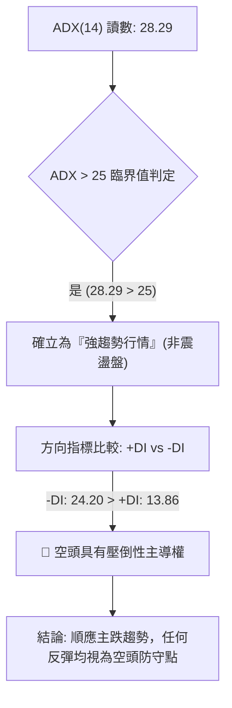

| 指標變數 | 當前數值 | 門檻區間 | 強度評估 | 實質交易意義 |
|----------|----------|----------|----------|--------------|
| **ADX(14)** | 28.29 | > 25.00 | ▓▓▓▓▓▓▓░░░ 70% | 市場處於明確的單邊趨勢，盤整指標（如震盪低吸）失效，趨勢策略優先 |
| **-DI (空方)** | 24.20 | 高於 +DI 10.34 | ▓▓▓▓▓▓▓▓░░ 80% | 空方動能控制盤面節奏，賣盤主導市場定價權 |
| **+DI (多方)** | 13.86 | 極弱 (< 20.00) | ▓▓▓░░░░░░░ 30% | 多頭追價意願極度低迷，僅能發動零星被動防禦 |

---

## 3. 圖表形態分析

### 🔍 形態識別系統

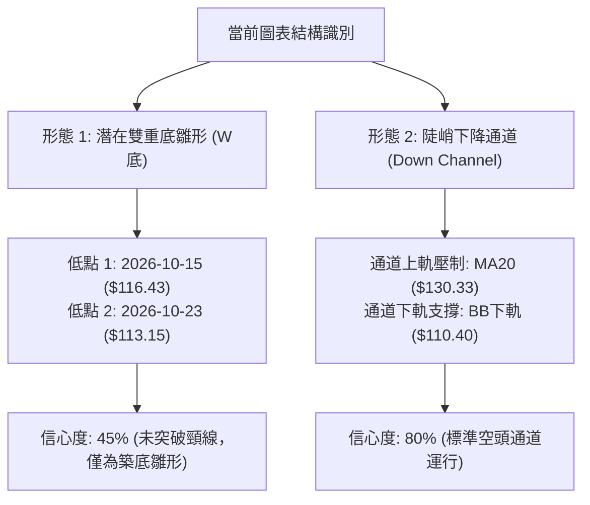

#### 形態識別與信心度評估表

| 形態名稱 | 信心度 | 判斷依據（引用數據） | 完成度 | 目標價（附計算式） |
|----------|--------|----------------------|--------|--------------------|
| **潛在雙重底 (W-Bottom)** | 45% (訊號不足，僅做指標型解讀) | 第一次探底低點 $116.43 (10-15)，第二次探底低點 $113.15 (10-23)，兩者差距 $3.28；但現價尚未站穩日線 MA20 ($130.33) | 35% | 由形態高度推算：頸線取日線反彈高點 $130.33，底為 $113.15，高度 $17.18。理論目標價 = 頸線 $130.33 + 高度 $17.18 = **$147.51**（註：未突破前不成立） |
| **下降通道 (Descending Channel)** | 80% | 價格持續沿著 MA20 ($130.33) 下方運行，受限於日線布林通道下軌 $110.40 與上軌 $150.27 之間，高低點持續同步下移 | 85% | 跌破通道下軌目標：由通道寬度推算，當前中軌 $130.33 跌破後，測試布林下軌支撐 **$110.40** |

### 🕯️ 重要K線形態分析

嚴格依據「近10根日K」與「近8根週K」之真實 OHLCV 數據進行識別：

| 日期（週期） | 開盤價 | 最高價 | 最低價 | 收盤價 | K線形態名稱 | 解讀與技術含義 | 訊號 |
|--------------|--------|--------|--------|--------|-------------|----------------|------|
| **2026-10-15 (日K)** | 118.40 | 123.49 | 116.43 | 123.22 | **下影長陽實體** | 低檔出現強勁承接盤，開低走高收復跌幅，初現止跌意願 | 🟢 |
| **2026-10-21 (日K)** | 118.33 | 119.75 | 115.66 | 117.51 | **弱勢小黑K** | 實體極窄，成交量 1,332,400，顯示低檔震盪觀望氣氛濃烈 | 🟡 |
| **2026-10-22 (日K)** | 117.26 | 122.22 | 114.26 | 117.70 | **長下影紡錘線** | 盤中下探 $114.26 獲資金拉抬，但多頭後繼乏力收在開盤附近 | 🟡 |
| **2026-10-23 (日K)** | 115.55 | 124.76 | 113.15 | 123.25 | **破底翻長陽吞噬** | 創下52週新低 $113.15 後爆發多頭拉抬，收盤近乎最高點，包覆前日實體 | 🟢 |
| **2026-10-26 (日K)** | 122.39 | 125.75 | 120.35 | 125.45 | **溫和陽線突破** | 開高走高延續反彈，突破 5日均線 ($120.31) 與 10日均線 ($121.22) | 🟢 |
| **2026-10-16 (週K)** | 137.10 | 137.50 | 116.43 | 121.79 | **大陰破位長黑** | 當週暴跌 -11.17%，成交量 8,156,300，直接砸穿 $130 支撐，形成重壓 | 🔴 |
| **2026-10-23 (週K)** | 122.88 | 124.76 | 113.15 | 123.25 | **低檔長下影錘頭** | 當週回測 $113.15 獲得防禦支撐，週K留長達 $10.10 下影線，顯現強支撐 | 🟢 |
| **2026-10-26 (週K)** | 122.39 | 125.75 | 120.35 | 125.45 | **反彈初始小陽** | 本週開局延續修復走勢，唯成交量僅 1,216,300 仍顯不足 | 🟡 |

### 📉 ASCII 走勢形態示意圖

```
近10日日K價格結構示意圖（破底翻與反彈受阻格局）
價格 ($)
$130.33 ┤- - - - - - - - - - - - - - - - - - - - - - - - - - - MA20 阻力線
$127.13 ┤  [10-13]
$125.45 ┤                                            [10-26] ◄ 現價
$123.25 ┤                  [10-15]             [10-23]
$121.79 ┤                          [10-16]
$120.60 ┤          [10-14]
$117.70 ┤                                  [10-22]
$117.51 ┤                                  [10-21]
$116.43 ┤                  (底1: 116.43)
$113.15 ┤                                      (底2: 113.15 破底翻)
        └───────────────────────────────────────────────────
           10-13    10-14    10-15  10-16  10-19..21 10-23   10-26
```

### 🎯 形態目標價計算

根據日線近兩週低點構成的潛在雙底（信心度 45%，尚未確認）：
1. **第一支撐低點**：$116.43 (2026-10-15)
2. **第二確認低點**：$113.15 (2026-10-23，52週低點)
3. **頸線位置**：暫以 MA20 與近期高點重合處 **$130.33** 認定
4. **形態高度推算**：$130.33 - $113.15 = **$17.18**
5. **理論等幅目標價**：
   $$\text{雙底突破目標價} = \text{頸線 } \$130.33 + \text{形態高度 } \$17.18 = \mathbf{\$147.51}$$
   *(註：此目標價極度接近 60日均線 $150.78 與布林上軌 $150.27，若短線無法放量突破 $130.33，此形態將面臨失敗風險)*

---

## 4. 支撐與阻力

### 🗺️ 關鍵價位分布圖（Unicode）

```
AVAV 價位結構分布圖
═════════════════════════════════════════════════════════════════════════
$408.25 ║████████████████████████████████████████║ 52W 最高點 (0.0% 斐波回調)
$200.38 ║████████████████████████                ║ 強阻力 R3 (近一年波段高點)
$168.00 ║████████████████                        ║ 阻力 R2 (近一年波段高點)
$162.30 ║████████████                            ║ 關鍵阻力 R1 (近一年波段高點)
$130.33 ║▓▓▓▓▓▓▓▓                                ║ 短線動態阻力 (MA20 / 布林中軌)
$125.45 ╠════════════════════════════════════════╣ ◄ 當前收盤價 ($125.45)
$113.15 ║████████████████████████████████████████║ 唯一絕對支撐 (52W最低點 / 100.0% 斐波)
═════════════════════════════════════════════════════════════════════════
```

### 🚧 阻力位分析表

依據數據庫中由 OHLCV 精確計算之波段高點聚類數值：

| 阻力級別 | 價位 ($) | 距現價空間 (%) | 形成原因與籌碼解讀 | 突破難度 | 重要性等級 |
|----------|----------|----------------|--------------------|----------|------------|
| **動態短壓** | $130.33 | +3.89% | 日線 MA20 暨布林通道中軌，為下行趨勢之短線反壓 | 🟡 中等 | ★★★☆☆ |
| **阻力 R1** | $162.30 | +29.37% | 近一年密集震盪波段高點聚類，大量套牢籌碼沉澱區 | 🔴 極高 | ★★★★☆ |
| **阻力 R2** | $168.00 | +33.92% | 近一年反彈頭部高點（2026-09-18 週高點），空頭強防守區 | 🔴 極高 | ★★★★☆ |
| **阻力 R3** | $200.38 | +59.73% | 歷史重磅套牢區，整數心理大關，年線 MA200 ($190.25) 上方壓力帶 | 🔴 堅不可摧 | ★★★★★ |

### 🛡️ 支撐位分析表

依據數據庫紀錄，**現價下方無任何近一年波段低點聚類支撐（no swing-low support detected below current price）**，僅存在 52 週絕對低點：

| 支撐級別 | 價位 ($) | 距現價空間 (%) | 形成原因與籌碼解讀 | 守住機率 | 重要性等級 |
|----------|----------|----------------|--------------------|----------|------------|
| **動態支撐** | $110.40 | -12.00% | 日線布林通道下軌動態包絡線支撐 | 🟡 50% | ★★☆☆☆ |
| **支撐 S1 (52W低)** | $113.15 | -9.80% | 2026-10-23 創下的52週最低價，多頭最後心理防線 | 🟡 55% | ★★★★★ |
| **支撐 S2/S3** | N/A（數據未提供） | N/A | 數據庫未偵測到現價與歷史低點間之其他波段聚類 | N/A | N/A |

### 📐 斐波那契回調位分析

依據基準區間：52週最高點 **$408.25** → 52週最低點 **$113.15**（垂直落差 $295.10）：

```
斐波那契回調階梯
┌────────────────────────────────────────────────────────┐
│ 0.0%   (52W High)        $408.25                       │
│ 23.6%                    $338.61                       │
│ 38.2%                    $295.52                       │
│ 50.0%                    $260.70                       │
│ 61.8%                    $225.88                       │
│ 78.6%                    $176.30                       │
│ [現價 $125.45 位於 78.6% 與 100.0% 之間，回調深度達 95.8%]│
│ 100.0% (52W Low)         $113.15                       │
└────────────────────────────────────────────────────────┘
```

#### 斐波那契位置解讀
- **現價定位**：現價 $125.45 落於 78.6% 回調位 ($176.30) 與 100.0% 回調位 ($113.15) 之間的深水極限超跌區。
- **技術意義**：價格回撤幅度達到了驚人的 95.8%，表明上一輪多頭行情已被徹底瓦解抹平。當前價格直接受制於 78.6% 回調位 ($176.30) 的強大重力引力，下方完全由 100.0% 基準點 $113.15 提供唯一的價格定錨。一旦失守 $113.15，技術面將進入無底部的未知價格發現區（Price Discovery）。

---

## 5. 技術指標深度解讀

### 🎛️ 指標訊號總覽

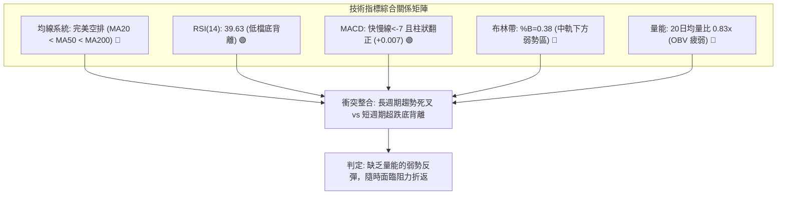

### 📈 移動平均線排列分析

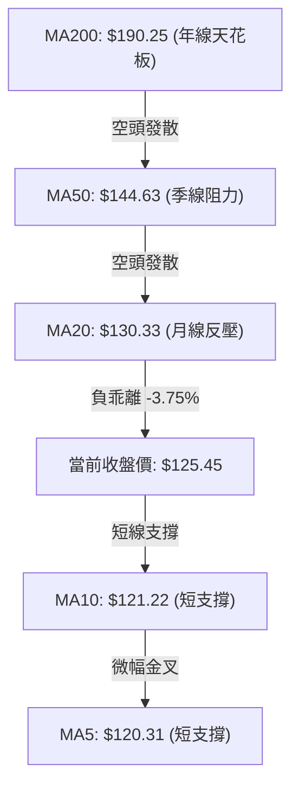

#### 移動平均線數據對照表

| 均線名稱 | 當前價格 | 與現價乖離率 | 長期趨勢方向 | 狀態解讀 |
|----------|----------|--------------|--------------|----------|
| **MA 5** | $120.31 | +4.27% | ▲ 短線反彈 | 短天期金叉，帶動現價脫離 $113.15 |
| **MA 10** | $121.22 | +3.49% | ▲ 短線反彈 | 提供日內下檔極短線支撐 |
| **MA 20** | $130.33 | -3.75% | ▼ 中期下行 | 第一道關鍵動態空頭防線 |
| **MA 50** | $144.63 | -13.26% | ▼ 中期下行 | 季線下彎斜率陡峭，中期空方主力陣地 |
| **MA 60** | $150.78 | -16.80% | ▼ 中期下行 | 與布林上軌共振壓制 |
| **MA 120**| $157.76 | -20.48% | ▼ 長期下行 | 半年線持續壓制 |
| **MA 200**| $190.25 | -34.06% | ▼ 長期下行 | 多空分水嶺，宣告進入深度熊市 |
| **MA 240**| $203.86 | -38.46% | ▼ 長期下行 | 兩年線下行，長期重壓沉重 |

### 📉 RSI(14) 分析

- **當前讀數**：`39.63`（Wilder 計算法）
```
RSI(14) 強度儀表: [░░░░░░░░░░░░░░░░███████████████░░░░░░░░░░░░░░░] 39.63%
區間定位: 0 [── 超賣 (0-30) ──] 30 [── 當前 (39.63) 偏弱 ──] 50 [── 強勢 (50-70) ──] 70 [── 超買 ──] 100
```
- **底背離現象（Bullish Divergence）**：
  - **價格走勢**：2026-10-15 日K低點 $116.43，隨後於 2026-10-23 創出更低的低點 **$113.15**（價格破底，Lower Low）。
  - **RSI 走勢**：2026-10-16 週K RSI 觸及低點 **28.6**，然而 2026-10-23 創價格新低時，RSI 卻收在 **36.2**，當前進一步回升至 **39.63**（指標墊高，Higher Low）。
  - **結論**：指標在極低區間形成標準的**日線層級底背離**。此背離解釋了自 $113.15 以來的急速反彈，但由於未站上中軸 50，僅定義為「跌勢過速後的動能衰竭修復」，尚不足以確認整體趨勢反轉。

### 📊 MACD(12/26/9) 訊號解讀

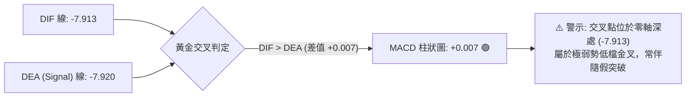

- **MACD 快線**：-7.913
- **MACD 慢線**：-7.920
- **柱狀圖 (Histogram)**：+0.007（微幅翻紅）
- **背離分析**：週線級別 MACD 柱狀圖由 2026-10-16 的 `-2.000` 收斂至 2026-10-23 的 `-0.676`，最新讀數達到 `+0.007`，出現零軸下方的低檔金叉收斂訊號。但請注意，零軸下方的金叉僅代表「下跌速率減緩」，非主升段做多訊號。

### 📦 布林通道分析

```
日線布林通道 (20, 2) 結構示意圖
價格 ($)
$150.27 ─────────────────────────────── 布林上軌 (壓力)
                 │
$130.33 ─────────┼───────────────────── 布林中軌 (MA20 動態反壓)
                 │  ◄ 現價 $125.45 (%B = 0.38)
$110.40 ─────────┴───────────────────── 布林下軌 (支撐)
```
- **通道指標數值**：
  - 上軌：**$150.27**
  - 中軌 (MA20)：**$130.33**
  - 下軌：**$110.40**
  - 帶寬 (Bandwidth)：$$\frac{150.27 - 110.40}{130.33} = 30.59\%$$（通道開口維持擴張狀態）
  - **%B 指標**：`0.38`。價格位於中軌至下軌的弱勢區域運行，當前正向上回測中軌 $130.33 阻力。

### 💹 成交量分析（量價配合度）

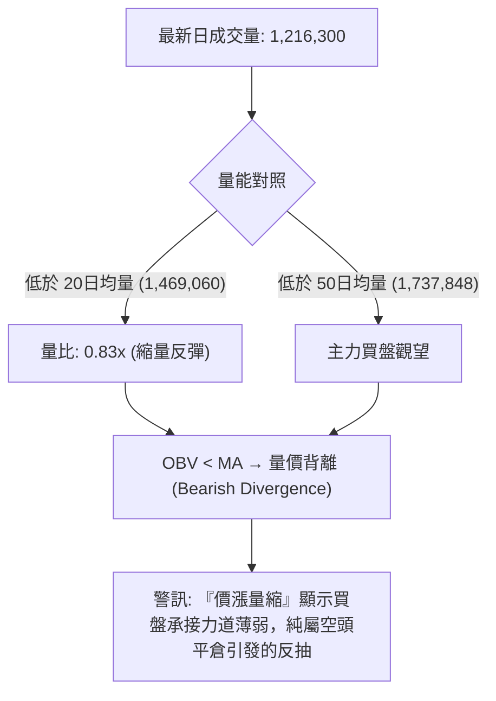

- **OBV 量能解讀**：數據明確顯示「OBV < MA → 量能疲弱」。在價格自 $113.15 反彈至 $125.45 的過程中，日成交量反而由 10-22 的 1,528,200 萎縮至 10-26 的 1,216,300，典型的量價背離，隨時有再度隨機跳水風險。

---

## 6. 動能與波動率

### ⚡ 動能評估四象限

| 象限 | 動能強度 (Momentum) | 波動率水準 (Volatility) | AVAV 當前狀態 | 技術策略含義 |
|------|---------------------|--------------------------|---------------|--------------|
| **Q1** | 強 (Bullish) | 低 (Low) | ❌ | 穩步上揚強勢股，適合趨勢抱波段 |
| **Q2** | 弱 (Bearish) | 低 (Low) | ❌ | 窄幅盤整，方向未明 |
| **Q3** | 強 (Bullish) | 高 (High) | ❌ | 爆發突破，高風險高預期收益 |
| **Q4** | **弱 (Bearish)** | **高 (High)** | **✓ (當前處於此象限)** | **主跌趨勢延續中伴隨高波動，極易誘多洗盤，嚴禁逆勢重倉盲目猜底** |

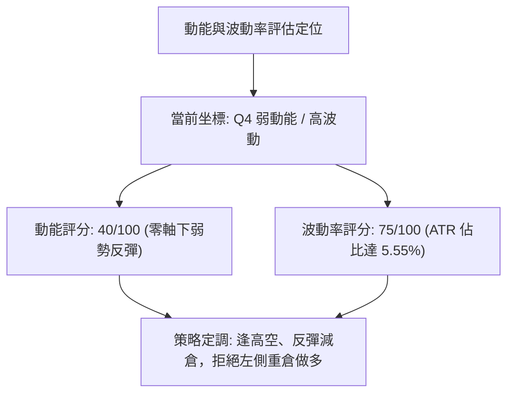

### 📊 ATR 波動率分析

- **ATR(14) 絕對數值**：**$6.97**（Wilder 計算）
- **ATR 相對現價佔比**：**5.55%**（處於美股市場高度活躍與高風險區間）
- **止損距離建議**：
  - **日內超短線風控**：$$0.5 \times \text{ATR} = 0.5 \times \$6.97 = \mathbf{\$3.49}$$
  - **波段保護止損**：$$1.5 \times \text{ATR} = 1.5 \times \$6.97 = \mathbf{\$10.46}$$
  - **趨勢防守容忍**：$$2.0 \times \text{ATR} = 2.0 \times \$6.97 = \mathbf{\$13.94}$$

### 📐 Beta 與市場相關性

- **Beta 係數**：**1.364**
  - **市場敏感度評估**：高於美股大盤（S&P 500 = 1.0）達 36.4%，屬於高彈性防務科技標的。在大盤下挫時，其跌幅將被顯著放大；在技術面呈現空頭排列的背景下，高 Beta 特性意味著下行風險更加劇烈。
- **做空籌碼環境**：
  - **做空比率 (Short % Float)**：**12.8%**（處於較高水位）
  - **軋空天數 (Short Ratio)**：**2.21 天**
  - **評估**：若出現超預期國防訂單消息，較高空單比例可能引發短暫的空頭踩踏回補（Short Squeeze），但難以逆轉空頭實質結構。

---

## 7. 多時框架總結

### 📋 時框架評分表

| 時框架 | 趨勢方向 | 動能表現 | 均線排列 | 形態結構 | 綜合評分 | 交易建議方向 |
|--------|----------|----------|----------|----------|----------|--------------|
| **長期 (月線)** | 🔴 強烈空頭 | 極弱 (陰跌破底) | 完璧空排 (MA20<50<200) | 自頂部 $408.25 崩潰 | 15/100 | 嚴格禁止長線存股 |
| **中期 (週線)** | 🔴 空頭發散 | 弱勢反彈 (MACD收斂) | 順向空排下壓 | 下降通道運行 | 30/100 | 逢反彈關鍵位做空 |
| **短期 (日線)** | 🟡 超跌反彈 | 底背離金叉 (+0.007) | MA5/10反彈，MA20下壓 | 潛在雙底測試頸線 | 45/100 | 僅供極窄幅區間高拋低吸 |

### 🔲 綜合訊號矩陣

```
╔══════════════════════════════════════════════════════════════════╗
║                     AVAV 綜合時框訊號矩陣                        ║
╠══════════════════════════════════════════════════════════════════╣
║ 分析維度       短期 (日線)          中期 (週線)        長期 (月線) ║
╠══════════════════════════════════════════════════════════════════╣
║ 趨勢訊號       🟡 區間反彈 (Neutral)  🔴 空頭主導 (Bear) 🔴 熊市崩跌 (Bear) ║
║ 均線軌跡       🟡 突破短均 MA5/10     🔴 壓制於 MA20/50  🔴 崩潰於年線下   ║
║ 動能指標       🟢 RSI 底背離確認      🟡 柱狀收斂負值區  🔴 全面鈍化下行   ║
║ 成交量能       🔴 縮量反抽 (背離)     🔴 持續量縮陰跌    🔴 主力籌碼派發   ║
║ 波動狀態       🔴 高度脆弱 (ATR 5.5%) 🔴 結構性崩塌      🔴 單邊深陷回撤   ║
╚══════════════════════════════════════════════════════════════════╝
```

### ⚖️ 多時框收斂結論

依據【嚴格要求 14：多時框收斂優先級規則】：
1. **行情定性**：當前日線 ADX(14) 讀數為 **28.29 > 25.00**，技術面**嚴格確立為「趨勢行情」**而非無方向之低波盤整行情。
2. **時框優先級收斂**：在強趨勢環境下，**必須以中長期（週線/MA50、MA200）方向為絕對主導**，日線級別的指標反彈（RSI 底背離、MACD 柱狀翻正）僅能定義為「次級折返走勢（Secondary Reaction）」，不得用於扭轉趨勢偏向。
3. **收斂最終結論**：**整體格局強烈偏空（整體評分 30/100）**。日線的反彈僅提供空頭極具優勢的高位做空時機，或提供套牢多頭最後的停損減倉窗口，絕不可在跌勢中盲目左側抄底。

---

## 8. 交易策略建議

### 🗺️ 策略決策流程圖

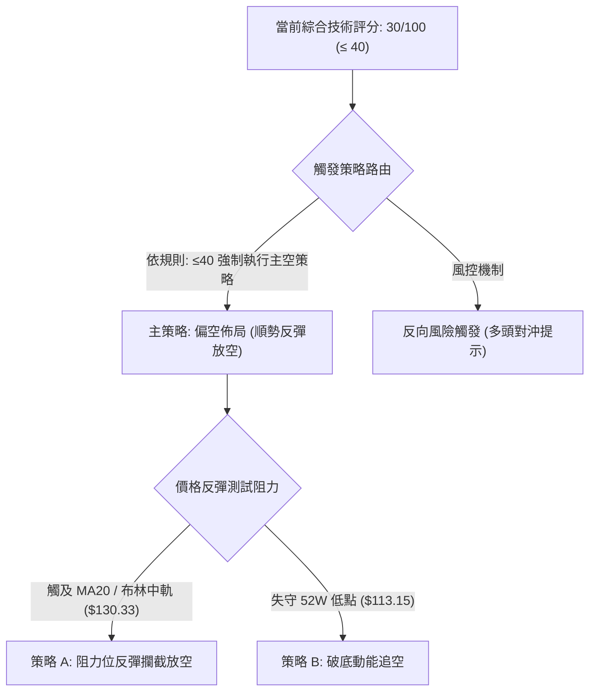

### 🧭 策略路由（依評分卡分流）

> **當前主策略方向 = 強烈偏空（依綜合評分 30/100）**
> 
> *依規則要求，綜合評分 ≤ 40 必須主推空頭策略，多頭僅列為反轉風險觸發對沖提示。*

### 🎯 價格情境階梯（Price Scenarios）

以當前價格 **$125.45** 為基準，嚴格引用第 4 章真實計算數據：

| 觸發條件 | 下一目標 | 後續延伸 | 情境含義與操作指引 |
|----------|----------|----------|--------------------|
| **向上反彈承壓** | 測試 MA20 **$130.33** | 遇阻回落重測 **$120.31** | 反彈受制於布林中軌，短線動能竭盡，做空勝率最高點 |
| **向上突破 R1** | 站上 R1 **$162.30** | 挑戰 R2 **$168.00** | 結構性反轉（機率極低），需全面平空停損觀望 |
| **向下跌破 S1** | 擊穿 52W 低 **$113.15** | 測試布林下軌 **$110.40** | 空頭破底加速段開啟，下探未知深淵 |

### 📊 情境機率分佈

| 情境類型 | 預估機率 | 主要技術數據支撐依據 |
|----------|----------|----------------------|
| **衝高受阻回落 (做空獲利)** | **60%** | ADX(14)=28.29 確立空頭趨勢；成交量縮量 (0.83x) 顯示反彈乏力；均線完美空排下壓 |
| **弱勢破底再探新低** | **25%** | 現價距離 52W 低點 $113.15 僅 9.8% 空間；現價下方無任何波段低點聚類支撐護盤 |
| **超跌全面反轉 (向上攻)** | **15%** | 僅依賴日線 RSI 底背離與 MACD 柱狀翻正 (+0.007)，在無量配合下極易演變為誘多陷阱 |

### 🔴 主策略詳情（空頭操作）

嚴格依據【嚴格要求 17：風險報酬比計算標準】呈現：
$$\text{做空風險報酬比} = \frac{\text{進場價} - \text{目標價 T1}}{\text{止損價} - \text{進場價}}$$

| 策略要素 | 策略 A：反彈阻力位放空（推薦） | 策略 B：跌破新低順勢追空（激進） |
|----------|--------------------------------|----------------------------------|
| **進場條件** | 反彈至 MA20 附近出現上影線受阻確認 | 實體日K跌破 52W 最低點 $113.15 |
| **進場價格** | **$130.33**（日線 MA20 關鍵阻力） | **$113.15**（52週低點破位進場） |
| **目標價 T1** | **$113.15**（52週最低點支撐） | **$110.40**（日線布林通道下軌） |
| **目標價 T2** | **$110.40**（日線布林通道下軌） | **N/A（數據未提供更低支撐）** |
| **止損價格** | **$137.30**（以進場價 + 1.0×ATR $6.97 計） | **$120.12**（以進場價 + 1.0×ATR $6.97 計） |
| **風險報酬比** | **1 : 2.46（以 T1 計）**<br>*(計算: (130.33-113.15)÷(137.30-130.33) = 17.18÷6.97)* | **1 : 0.39（以 T1 計）**<br>*(計算: (113.15-110.40)÷(120.12-113.15) = 2.75÷6.97)* |
| **成功機率** | **65%** | **55%** |
| **建議倉位** | **15% - 20%**（主要底倉） | **5% - 10%**（輕倉試探） |

*備註：策略 A 風險報酬比達 1:2.46，極具交易性價值；策略 B 由於下方僅有布林下軌 $110.40 數據，空間狹小導致以 T1 計算之風報比偏低，故以策略 A 為唯一主力推薦。*

### 🟡 反向風險觸發點（多頭對沖提示）

若市場出現意外突發利多導致空頭邏輯被推翻，須嚴格執行以下風控避險：
1. **多頭反轉翻轉點**：日線收盤價強勢**放量突破 MA20 ($130.33)** 且成交量放大至 20日均量 1.5倍（約 2,200,000 股以上）。
2. **對沖止損操作**：全數平倉空頭頭寸，嚴禁逆勢扛單。若突破 $130.33，短期理論目標將上移至雙底計算位 **$147.51** 與阻力 R1 **$162.30**。

### ⭐ 整體訊號強度評星

```
╔══════════════════════════════════════════════════════════════╗
║                     技術訊號信心評星                         ║
╠══════════════════════════════════════════════════════════════╣
║ 做多訊號強度：★★☆☆☆  (2/5星) 僅短線極限超跌修復，量能嚴重匱乏   ║
║ 做空訊號強度：★★★★☆  (4/5星) 順應中長空頭大勢，各級阻力清晰明確 ║
║ 整體可信度：  ★★★★☆  (4/5星) ADX 趨勢強度 28.29 指標共振確認   ║
╚══════════════════════════════════════════════════════════════╝
```

---

## 9. 風險提示與監控

### ✅ 關鍵監控指標 Checklist

```
╔══════════════════════════════════════════════════════════════════╗
║                  每日交易關鍵監控 CHECKLIST                      ║
╠══════════════════════════════════════════════════════════════════╣
║ [ ] 價格是否成功衝擊並突破日線 MA20 ($130.33)？                  ║
║ [ ] 日成交量是否顯著超越 20日均量 1,469,060 股？                 ║
║ [ ] 日線 RSI(14) 能否突破中軸 50 分界線維持多頭強勢？           ║
║ [ ] 52週新低點 $113.15 是否再度受到盤中空頭賣壓考驗？           ║
║ [ ] MACD 柱狀圖是否能持續正向放大（高於 +0.007）？               ║
║ [ ] -DI (24.20) 與 +DI (13.86) 差距是否縮小至 5.0 以內？        ║
╚══════════════════════════════════════════════════════════════════╝
```

### ⚠️ 風險場景分析

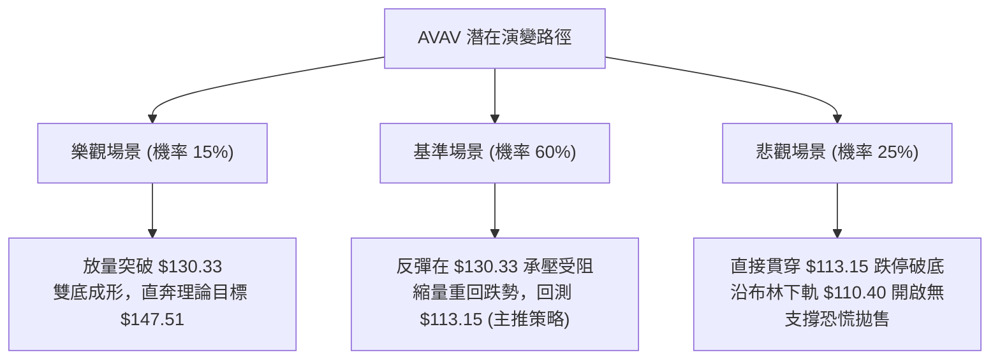

### 🛡️ 風險管理重要提醒

1. **防禦性部位控制**：
   - 鑑於 ATR(14) 高達 $6.97（波動率 5.55%），單筆交易的總虧損金額嚴格限制在**總投資本金的 1.0%** 以內。
   - 倉位計算公式：
     $$\text{最大允許開倉股數} = \frac{\text{總帳戶淨值} \times 1.0\%}{\text{止損距離 } (\$6.97)}$$
2. **財報與基本面毒藥提示**：
   - AVAV 基本面當前淨利潤率為 **-10.1%**，TTM 自由現金流為 **-$44.78M**，營運利潤率維持在負值區間（-0.6%）。基本面的結構性虧損是引發長達一年空頭陰跌的根本原因，絕不可將短期技術反彈誤判為企業反轉。
3. **拒絕加碼凹單**：
   - 在空頭發散行情中，嚴禁任何形式的「越跌越買」或「攤平虧損」操作。跌破 52週低點 $113.15 即觸發全面停損警報。

---

## 📋 報告總結

```
╔══════════════════════════════════════════════════════════════════════╗
║                    AVAV 技術分析報告總結                             ║
╠══════════════════════════════════════════════════════════════════════╣
║ 報告日期：2026-10-27                                                 ║
║ 當前價格：$125.45                                                    ║
║ 分析評級：🔴 強烈偏空（綜合技術評分: 30/100）                         ║
╠══════════════════════════════════════════════════════════════════════╣
║ 關鍵結論：                                                           ║
║ ├─ 長期趨勢：🔴 月線主跌浪，高點 $408.25 崩潰抹平 95.8% 漲幅         ║
║ ├─ 中期趨勢：🔴 週線空頭排列發散，下降通道結構完好                  ║
║ ├─ 短期趨勢：🟡 日線超跌底背離反彈，面臨 MA20 重壓                   ║
║ ├─ 關鍵支撐：$113.15 (52W最低價) / $110.40 (布林下軌)                ║
║ ├─ 關鍵阻力：$130.33 (MA20) / $162.30 (波段阻力 R1)                  ║
║ └─ 機構共識：買入評級 / 目標均價 $213.07 (大幅脫離現價，僅供參考)    ║
╠══════════════════════════════════════════════════════════════════════╣
║ 最優策略組合：                                                       ║
║ 1. 🥇 最佳機會：等待反彈至 $130.33 阻力放空，目標 $113.15 (風報比 1:2.46) ║
║ 2. 🥈 次選機會：破位 $113.15 順勢追空，極短線下看 $110.40 (嚴格風控)  ║
║ 3. 🥉 保守選擇：完全空倉觀望，待日線實體站穩 $130.33 上方再行評估    ║
╚══════════════════════════════════════════════════════════════════════╝
```

---

> ⚠️ **免責聲明**：本報告為技術分析專用模型自動生成，所有數據、圖表及估算均基於所提供的歷史 OHLCV 價格資訊。本報告**僅供研究與學術參考**，**不構成任何要約、招攬或投資買賣建議**。投資具有極高之市場風險，交易人應獨立判斷並自負盈虧。

---

*報告生成時間：2026-10-27 ｜ 數據來源：Yahoo Finance ｜ 分析框架：多時框技術分析體系*