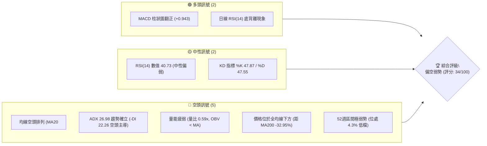
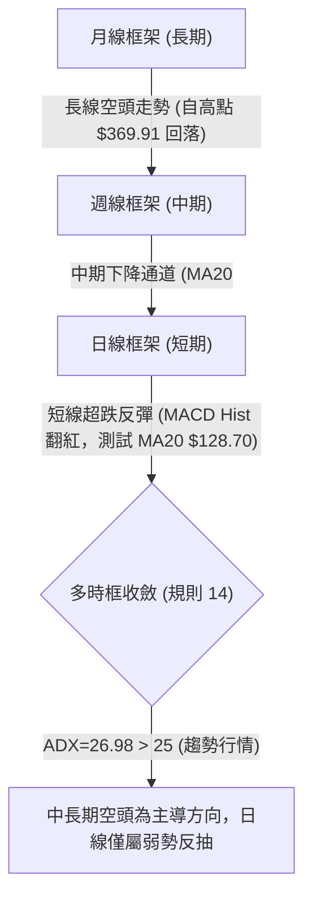
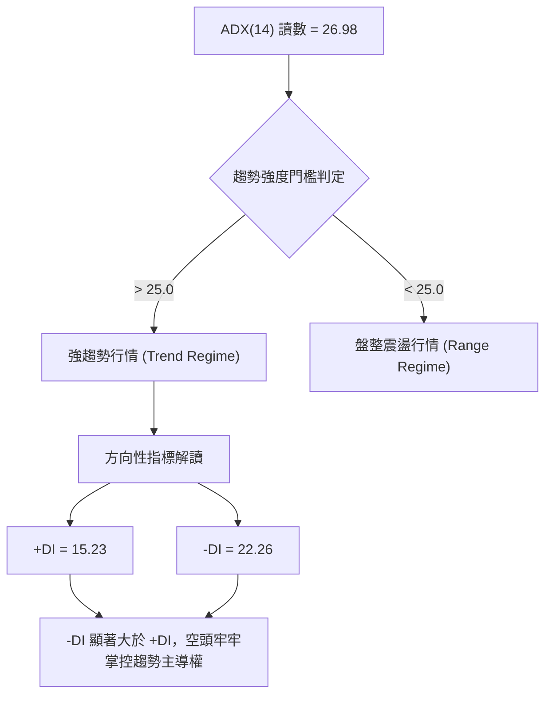
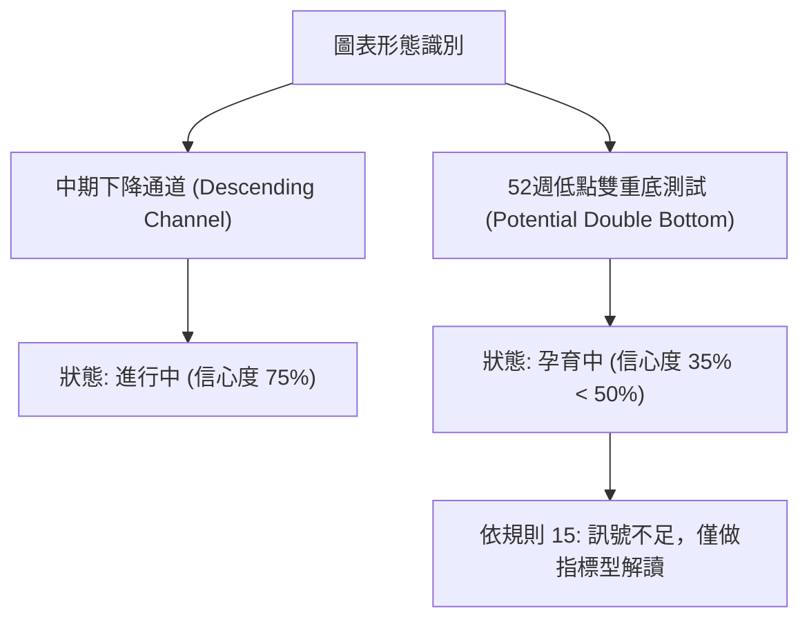
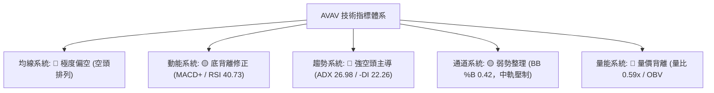
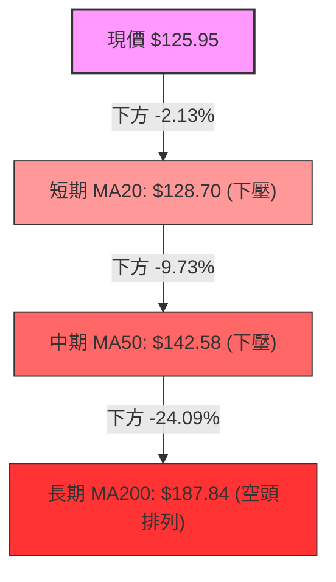
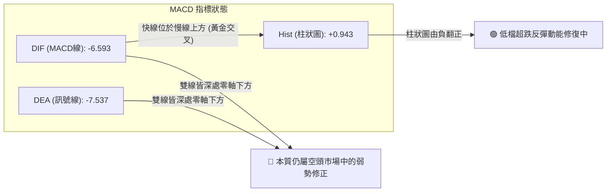
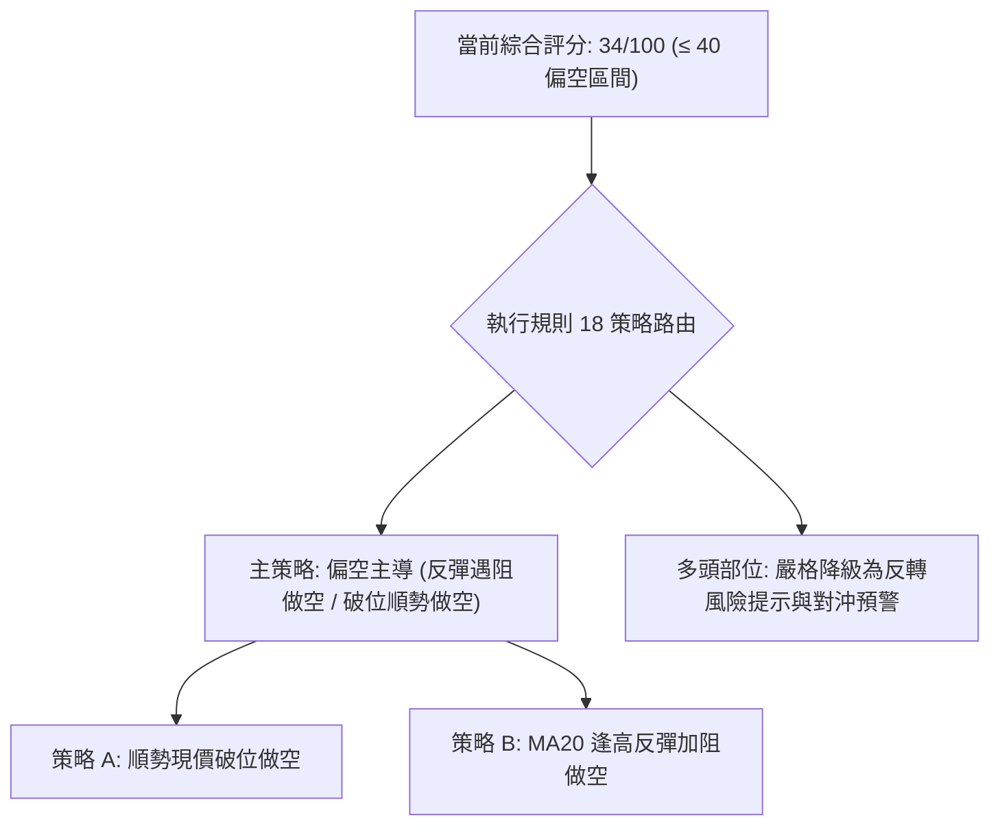
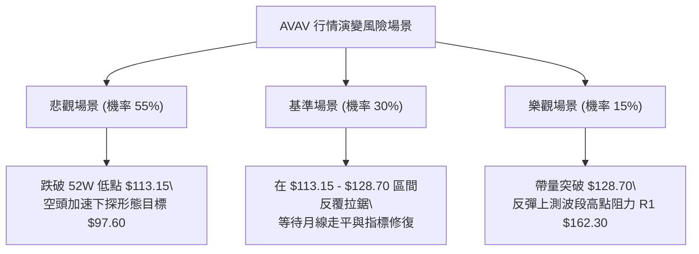

# AVAV 技術分析報告

> **報告日期**：2026-10-29 ｜ **語言**：繁體中文 ｜ **數據來源**：Yahoo Finance ｜ **當前價格**：$125.95

---

## 目錄

| 章節 | 內容 |
|------|------|
| [1. 技術面概覽](#1-技術面概覽) | 訊號儀表板、核心指標、評分卡 |
| [2. 趨勢分析](#2-趨勢分析) | 多時框趨勢、長中短期走勢 |
| [3. 圖表形態分析](#3-圖表形態分析) | 形態識別、K線組合、目標價 |
| [4. 支撐與阻力](#4-支撐與阻力) | 關鍵價位、斐波那契回調 |
| [5. 技術指標深度解讀](#5-技術指標深度解讀) | MA/RSI/MACD/布林/成交量 |
| [6. 動能與波動率](#6-動能與波動率) | 動能評估、ATR、Beta |
| [7. 多時框架總結](#7-多時框架總結) | 時框架評分矩陣 |
| [8. 交易策略建議](#8-交易策略建議) | 多空策略、風險報酬比 |
| [9. 風險提示與監控](#9-風險提示與監控) | 監控指標、風險場景 |

---

## 1. 技術面概覽

### 🎯 技術訊號儀表板



### 📊 核心指標速覽表

| 指標類別 | 指標名稱 | 當前數值 | 訊號 | 解讀 |
|----------|----------|----------|:----:|------|
| **價格** | 當前收盤價 | $125.95 | 🔴 | 位於 52 週區間 4.3% 極低檔，逼近年度低點 $113.15 |
| **均線** | MA20 (月線) | $128.70 | 🔴 | 現價低於 MA20 (-2.13%)，短線面臨動態下壓阻力 |
| **均線** | MA50 (季線) | $142.58 | 🔴 | 現價低於 MA50 (-11.66%)，中期格局全面受壓 |
| **均線** | MA200 (年線)| $187.84 | 🔴 | 現價遠低於 MA200 (-32.95%)，長期空頭格局未變 |
| **動能** | RSI(14) | 40.73 | 🟡 | 脫離超賣區但未突破中軸 50，伴隨日線底背離訊號 |
| **動能** | MACD(12,26,9) | -6.593 | 🟢 | 快慢線處零軸下，但 Hist(+0.943) 翻紅呈低檔金叉修正 |
| **趨勢** | ADX(14) | 26.98 | 🔴 | ADX>25 進入強趨勢，-DI(22.26) 顯著高於 +DI(15.23) 空頭主導 |
| **通道** | 布林通道 %B | 0.42 | 🟡 | 位於布林中軌 ($128.70) 與下軌 ($110.58) 之間弱勢整理 |
| **量能** | 20日成交量比 | 0.59x | 🔴 | 成交量 833,000 遠低於 20MA(1,408,830)，OBV < MA 買盤疲弱 |
| **波動** | ATR(14) | $6.53 | 🔴 | 每日震幅佔比達 5.18%，市場波動度顯著偏高 |

### 🏆 技術評分卡

```
╔══════════════════════════════════════════════════════════════╗
║                技術評分卡 — AVAV (2026-10-29)               ║
╠══════════════════════════════════════════════════════════════╣
║ 趨勢強度 (Trend Strength)   █████░░░░░░░░░░░   28/100   🔴   ║
║ 動能指標 (Momentum)         ██████████░░░░░░   48/100   🟡   ║
║ 支撐穩定度 (Support)        ██████░░░░░░░░░░   32/100   🔴   ║
║ 成交量配合 (Volume Flow)    ███████░░░░░░░░░   34/100   🔴   ║
║ 形態完整度 (Pattern Health) ███████░░░░░░░░░   36/100   🔴   ║
║ 均線排列 (Moving Averages)  █████░░░░░░░░░░░   26/100   🔴   ║
╠══════════════════════════════════════════════════════════════╣
║ 綜合評分 (Overall Score)    ███████░░░░░░░░░   34/100   🔴   ║
║ 評級結論：偏空弱勢（依規則 18，六項算術平均四捨五入）         ║
╚══════════════════════════════════════════════════════════════╝
```

---

## 2. 趨勢分析

### 🌐 多時框趨勢分析



### 📈 長期趨勢 — 12個月走勢圖（Unicode）

```
AVAV 月線走勢圖（2025-11 至 2026-10）
價格軸 ($)
$300 ┤ ● ($279.46)
$270 ┤      ● ($278.39)
$240 ┤   ● ($241.89)  ● ($252.25)
$210 ┤                           ● ($207.24)
$180 ┤                    ● ($183.05)  ● ($195.02)
$150 ┤                                        ● ($165.07)  ● ($149.37)  ● ($148.35)  ● ($142.22)
$120 ┤                                                                                     ●←現價 ($125.95)
     └──────────────────────────────────────────────────────────────────────────────────────────
       11   12   01   02   03   04   05   06   07   08   09   10  (月份)
```

#### 長期月線走勢特徵分析表

| 階段區間 | 起訖月份 | 起點收盤 | 終點收盤 | 區間漲跌幅 | 主要走勢特徵 |
|----------|----------|:--------:|:--------:|:----------:|--------------|
| 高檔破位 | 2025-11 ~ 2025-12 | $279.46 | $241.89 | -13.44% | 頂部快速下殺，長黑摜破短中期均線 |
| 弱勢抽腳 | 2025-12 ~ 2026-02 | $241.89 | $252.25 | +4.28% | 於 $250-$278 區間構築次級反彈高點 |
| 主跌加速 | 2026-02 ~ 2026-03 | $252.25 | $183.05 | -27.43% | 空方集中發力，直接貫穿年線 $187.84 |
| 弱勢震盪 | 2026-03 ~ 2026-05 | $183.05 | $207.24 | +13.22% | 跌深反抽遭遇長天期均線反壓受阻 |
| 陰跌尋底 | 2026-05 ~ 2026-10 | $207.24 | $125.95 | -39.22% | 連續 5 個月陰跌，直逼 52 週最低點 $113.15 |

### 📊 中期趨勢（週線分析）

中期走勢呈現典型的一浪低於一浪（Lower Highs & Lower Lows）階梯式下行形態。自 2026-08-14 週高點 $192.81 以來，週線級別空頭動能持續釋放，即便在 2026-09-18 出現量能放大至 11,272,600 股並摸高至 $168.00 的反彈，隨後仍遭空方快速壓制並跌破前低。

```
AVAV 近期週線壓力與支撐結構示意圖
價格 ($)
$170.00 ┼─────────────────── 週波段反彈高點 R2 ($168.00)
$160.00 ┼─────────────────── 密集阻力區間 R1 ($162.30)
$150.00 ┼
$140.00 ┼───────── 前期平台跌破轉壓力位 ($140.82)
$130.00 ┼
$125.95 ┼─────────────────── 當前收盤價 ($125.95)
$120.00 ┼
$113.15 ┼─────────────────── 52 週最低點支撐 / 斐波那契 100% ($113.15)
```

### ⚡ 趨勢強度評估（ADX 解讀）



#### ADX 趨勢強度指標對照表

| 指標名稱 | 當前讀數 | 基準閾值 | 狀態評估 | 戰術含義 |
|----------|:--------:|:--------:|:--------:|----------|
| **ADX(14)** | 26.98 | 25.00 | 強趨勢確立 🟢 | 市場處於定向推進狀態，非隨機漫步盤整 |
| **+DI (多方動能)** | 15.23 | 20.00 | 處於受壓低檔 🔴 | 多方進攻意願匱乏，缺乏推升動能 |
| **-DI (空方動能)** | 22.26 | 20.00 | 高於基準線 🔴 | 空方持續施壓，為當前行情的主要驅動力量 |
| **趨勢定性** | 空頭定向推進 | 差值 -7.03 | 空頭主導 🔴 | 順勢交易應以做空為主，做多僅限於短線超跌反抽 |

---

## 3. 圖表形態分析

### 🔍 形態識別系統



#### 形態評估與信心度矩陣（依規則 15）

| 形態名稱 | 信心度 | 判斷依據（引用數據） | 完成度 | 目標價（附計算式） |
|----------|:------:|----------------------|:------:|--------------------|
| **中期下降通道** | 75% | 自 2026-09-18 高點 $168.00 下行，受限於 MA20 下降軌，空頭排列完備 | 85% | 由通道高度推算：下軌支撐目標價 = $113.15（52W Low） |
| **潛在雙重底型態** | 35% | 2026-10-23 觸及低點 $113.15 後反彈，與 52W 低點 $113.15 形成共振，但無量能突破 | 30% | 訊號不足（信心度<50%），僅做指標型解讀，不預設突破目標價 |

### 🕯️ 重要K線形態分析（依規則 19）

嚴格依據數據中「近 10 根日 K」與「近 8 根週 K」之開、高、低、收數據解讀：

#### 近 10 根日 K 線特徵分析

| 日期 (日K) | 開盤價 | 最高價 | 最低價 | 收盤價 | 成交量 | K線形態 | 解讀與技術含義 | 訊號 |
|:----------:|:------:|:------:|:------:|:------:|:------:|:-------:|----------------|:----:|
| 2026-10-15 | 118.40 | 123.49 | 116.43 | 123.22 | 1,528,800 | 實體中長陽線 | 低檔長陽吞噬前黑，初步顯現超跌買盤 | 🟢 |
| 2026-10-16 | 123.78 | 124.90 | 120.46 | 121.79 | 1,237,500 | 帶上影小黑線 | 反彈遇壓回落，多頭追價動能不足 | 🔴 |
| 2026-10-19 | 122.88 | 123.00 | 117.05 | 117.90 | 1,416,500 | 中黑棒下挫 | 開平走低，實體跌破五日均線支撐 | 🔴 |
| 2026-10-20 | 117.50 | 121.00 | 116.30 | 117.63 | 1,134,200 | 紡錘十字星 | 低檔量縮多空僵持，呈現短暫平衡 | 🟡 |
| 2026-10-21 | 118.33 | 119.75 | 115.66 | 117.51 | 1,332,400 | 窄幅小陰線 | 連續受制於 $118 關卡，買盤持續觀望 | 🔴 |
| 2026-10-22 | 117.26 | 122.22 | 114.26 | 117.70 | 1,528,200 | 長上下影紡錘線 | 盤中多空劇烈拉鋸，下探 $114.26 獲支撐 | 🟡 |
| 2026-10-23 | 115.55 | 124.76 | 113.15 | 123.25 | 1,356,900 | 低檔長下影陽線 | 探底 52W 新低 $113.15 後強勁抽腳收高 | 🟢 |
| 2026-10-26 | 122.39 | 125.75 | 120.35 | 125.45 | 1,216,300 | 溫和走升陽線 | 連續兩日收紅，確認低點 $113.15 之防守性 | 🟢 |
| 2026-10-27 | 125.23 | 128.19 | 123.60 | 126.73 | 1,102,700 | 帶上影陽線 | 向上衝擊 MA20 ($128.70) 遇阻，留下影線 | 🟡 |
| 2026-10-28 | 126.72 | 126.91 | 123.85 | 125.95 | 833,000 | 縮量小黑線 | 成交量驟降至 83.3 萬，衝高乏力拉回整理 | 🔴 |

#### 近 8 根週 K 線特徵分析

| 週末交易日 | 開盤價 | 最高價 | 最低價 | 收盤價 | 週成交量 | K線形態 | 解讀與技術含義 | 訊號 |
|:----------:|:------:|:------:|:------:|:------:|:--------:|:-------:|----------------|:----:|
| 2026-09-11 | 146.37 | 159.24 | 138.31 | 146.71 | 20,402,600 | 爆量長十字線 | 巨量震盪多空激戰，低檔買盤大舉換手 | 🟡 |
| 2026-09-18 | 145.80 | 168.00 | 144.51 | 159.95 | 11,272,600 | 帶上影中長陽線 | 衝高觸及波段高點 R2 ($168.00) 後遭壓制 | 🟢 |
| 2026-09-25 | 161.28 | 165.00 | 151.50 | 152.05 | 5,778,000 | 量縮回跌黑棒 | 衝高未果量能急縮，假突破確認轉弱 | 🔴 |
| 2026-10-02 | 149.77 | 151.30 | 138.31 | 140.82 | 6,770,400 | 中陰線下破 | 摜破整數關卡，週線 MACD 柱狀轉負 | 🔴 |
| 2026-10-09 | 142.28 | 145.44 | 134.25 | 137.11 | 7,559,200 | 連續下跌黑棒 | 空方慣性延續，高低點持續下移 | 🔴 |
| 2026-10-16 | 137.10 | 137.50 | 116.43 | 121.79 | 8,156,300 | 實體長黑破位 | 恐慌性殺盤摜破 $130，週 RSI 跌入 28.6 | 🔴 |
| 2026-10-23 | 122.88 | 124.76 | 113.15 | 123.25 | 6,768,200 | 長下影錘頭紅棒 | 探底 $113.15 出現止跌抽腳訊號 | 🟢 |
| 2026-10-28 | 122.39 | 128.19 | 120.35 | 125.95 | 3,152,000 | 弱勢反彈孕線 | 孕育於前週高低範圍內，等待方向選擇 | 🟡 |

### 📉 ASCII 走勢形態示意圖

```
AVAV 近期日線測試 52W 低點反彈結構
價格 ($)
$130.00 ┤                                   [MA20 阻力 $128.70]
$128.00 ┤                                        ╭─ 10/27 高點 $128.19
$126.00 ┤                                        │  ╭─ 10/28 收盤 $125.95 (現價)
$124.00 ┤        ╭─ 10/15 高 $123.49            │  │
$122.00 ┤        │        ╭─ 10/16 $121.79      │  │
$120.00 ┤        │        │                     │  │
$118.00 ┤        │        ╰─ 10/19-21 破位     │  │
$116.00 ┤        │                               ╰──╯
$114.00 ┤        │                ╭─ 10/23 探底 $113.15 (52W Low)
$112.00 ┴────────┴────────────────┴─────────────────────────────────
         10/15   10/16            10/23          10/28
```

### 🎯 形態目標價計算

根據日線自 2026-10-23 探底 $113.15 至 2026-10-27 遇阻高點 $128.19 所形成之短線震盪箱體，進行目標價位量化推算：

*   **底部支撐線**：$113.15（2026-10-23 探底低點）
*   **箱體壓力頂部**：$128.70（精確對齊 MA20 與布林中軌）
*   **震盪形態高度**：$128.70 - $113.15 = $15.55
*   **向下破位延伸目標價**：
    $$\text{破位目標價} = \text{底部支撐} - \text{形態高度} = 113.15 - 15.55 = \$97.60$$
*   **向上突破反彈目標價**：
    $$\text{突破延伸目標價} = \text{箱體頂部} + \text{形態高度} = 128.70 + 15.55 = \$144.25$$
    *(註：若反彈突破，上方第一強阻力即為數據記載之波段高點 R1: $162.30)*

---

## 4. 支撐與阻力

### 🗺️ 關鍵價位分布圖（Unicode）

```
AVAV 價位結構分布圖
═══════════════════════════════════════════════════
$200.38 ║████████████████████████║ 強阻力 R3 (+59.09%)
$176.30 ║▓▓▓▓▓▓▓▓▓▓▓▓▓▓▓▓▓▓      ║ 斐波那契 78.6% 回調位
$168.00 ║████████████████████    ║ 阻力 R2 (+33.39%)
$162.30 ║████████████████████████║ 關鍵阻力 R1 (+28.86%)
$146.81 ║▒▒▒▒▒▒▒▒▒▒▒▒▒▒          ║ 布林通道上軌
$128.70 ║░░░░░░░░░░░░░░░░        ║ 布林中軌 / MA20 動態反壓
$125.95 ╠════════════════════════╣ ◄ 現價 (當前收盤價)
$113.15 ║████████████████████████║ 52週低點 / 斐波那契 100% 支撐 S1 (-10.16%)
$110.58 ║▒▒▒▒▒▒▒▒▒▒              ║ 布林通道下軌動態支撐
═══════════════════════════════════════════════════
```

### 🚧 阻力位分析表

依規則 13，精確引用數據中波段高點聚類數值：

| 阻力級別 | 價位 | 與現價距離 | 形成原因與技術依據 | 突破難度 | 重要性 |
|:--------:|:----:|:----------:|--------------------|:--------:|:------:|
| **動態反壓** | $128.70 | +2.18% | 20 日均線 (MA20) 與布林中軌完全重合處，10/27 衝高 $128.19 遇阻 | 中等 | 🟡 關鍵 |
| **R1** | $162.30 | +28.86% | 近一年波段高點聚類區，前期多頭重裝平台套牢區 | 極高 | 🔴 核心 |
| **R2** | $168.00 | +33.39% | 2026-09-18 週 K 線爆量上衝之最高點聚類處 | 極高 | 🔴 核心 |
| **R3** | $200.38 | +59.09% | 2026 年初反彈波段頂部，長期空頭防線與心理大關 | 罕見 | 🔴 極強 |

### 🛡️ 支撐位分析表

依規則 13，數據明確顯示「數據中未偵測到近一年波段低點聚類支撐（no swing-low support detected below current price）」，現價下方唯一具備歷史圖表依據之硬支撐為 52 週最低點：

| 支撐級別 | 價位 | 與現價距離 | 形成原因與技術依據 | 守住機率 | 重要性 |
|:--------:|:----:|:----------:|--------------------|:--------:|:------:|
| **S1 (52W Low)**| $113.15 | -10.16% | 52 週最低點、2026-10-23 長下影低點、斐波那契 100% 終極支撐 | 45% | 🔴 關鍵樞紐 |
| **動態下軌** | $110.58 | -12.20% | 當前布林通道下軌極限，通道外擴時之波動邊界 | 55% | 🟡 波動參考 |
| **S2 (推算)** | $97.60 | -22.51% | 由短線震盪箱體跌破推算：$113.15 - ($128.70 - $113.15) | 待確認 | 🟡 投射目標 |

### 📐 斐波那契回調位分析

依數據提供之 52 週全區間（$113.15 → $408.25）回調位精確列出：

| 回調比例 | 價位 | 技術含義解讀與目前相對位置 |
|:--------:|:----:|----------------------------|
| **0.0% (52W High)** | $408.25 | 本輪大週期歷史頂部，牛市終點 |
| **23.6%** | $338.61 | 多頭強勢回檔位（早於 2025 年底失守） |
| **38.2%** | $295.52 | 多空分水嶺（2025 年底反抽受阻點） |
| **50.0%** | $260.70 | 半數回撤位（2026-02 次級高點 $252 附近平台） |
| **61.8%** | $225.88 | 黃金分割防守位（2026-03 摜破引發主跌段） |
| **78.6%** | $176.30 | 空頭深幅回撤防線，現已轉換為中長期天花板 |
| **現價位置** | **$125.95** | **深陷 78.6% ($176.30) 與 100.0% ($113.15) 之間，極度弱勢區** |
| **100.0% (52W Low)**| $113.15 | 本輪回調之絕對底部，若失守將開啟全新下行空間 |

---

## 5. 技術指標深度解讀

### 🎛️ 指標訊號總覽



### 📈 移動平均線排列分析



#### 各週期均線數據比對

| 均線名稱 | 價位 | 與現價乖離率 | 排列狀態 | 技術含義 |
|:--------:|:----:|:------------:|:--------:|----------|
| **MA5** | $123.82 | +1.72% | 向上翻揚 🟢 | 短線超跌反抽，現價暫時站上 5 日線 |
| **MA10** | $121.71 | +3.48% | 向上翻揚 🟢 | 短期助漲支撐，短均線金叉 |
| **MA20** | $128.70 | -2.13% | 持續向下 🔴 | 月線反壓，多頭反彈第一道天花板 |
| **MA50** | $142.58 | -11.66% | 持續向下 🔴 | 季線下彎，中期空頭防禦陣線 |
| **MA60** | $149.52 | -15.77% | 持續向下 🔴 | 跌破中期平台，阻力沉重 |
| **MA120** | $157.01 | -19.78% | 持續向下 🔴 | 半年線壓制，中長期空頭牢固 |
| **MA200** | $187.84 | -32.95% | 持續向下 🔴 | 長期牛熊分界線，標準空頭排列 |
| **MA240** | $202.20 | -37.71% | 持續向下 🔴 | 年線級重壓，長期多頭結構瓦解 |

### 📉 RSI(14) 分析

*   **當前數值**：40.73
*   **指標進度條**：
    $$\text{RSI(14)}: \quad \text{████████░░░░░░░░░░░░} \quad 40.73\% \quad \text{(中性偏弱區間)}$$
*   **區間特徵**：處於 30 至 70 之中性區間，脫離了先前 10/16 觸及之嚴重超賣區（週 RSI 曾達 28.6），目前反彈接近 50 多空中軸。
*   **背離分析**：**日線底背離確立（Bullish Divergence）**。
    *   **判定依據**：比對近 20 根 K 棒，價格在 2026-10-23 創下波段新低 $113.15（低於 10-15 之低點 $116.43），但 RSI(14) 並未同步跌破前低，反而自低位抬升至 40.73，首尾走勢呈現底背離。
    *   **結論**：底背離僅提供「短線超跌反抽」動能，在 ADX>25 且大均線全面向下的背景下，無法單獨逆轉長期空頭趨勢。

### 📊 MACD(12,26,9) 訊號解讀



*   **數值解讀**：DIF (-6.593) 高於 DEA (-7.537)，柱狀圖數值為 +0.943，呈現多頭修復訊號。
*   **深層含義**：雙線深處零軸下方（小於 -6.0），代表此金叉純屬大跌後的乖離率收斂修正，一旦反彈至零軸附近遇阻，極易演變為「零軸下二次死叉」之加速下跌點。

### 📦 布林通道分析

```
AVAV 日線布林通道 (20, 2) 結構圖
價格 ($)
$146.81 ┼──────────────────────────────── 上軌 (Upper Band)
        │
$138.00 ┼
        │
$128.70 ┼───────────────────====───────── 中軌 (MA20) [強烈阻力]
        │                   ▲
$125.95 ┼───────────────────● 現價 (BB %B = 0.42)
        │
$118.00 ┼
        │
$110.58 ┼──────────────────────────────── 下軌 (Lower Band) [動態支撐]
```

*   **通道寬度**：上軌 $146.81，下軌 $110.58，帶寬為 $36.23（帶寬百分比 28.1%）。
*   **當前位置**：%B = 0.42，位於中軌之下、下軌之上。
*   **通道狀態**：通道呈現開口向下的傾斜通道，中軌 $128.70 是短期走勢的生命線，在未能有效實體突破並站穩中軌前，走勢將沿下半通道持續尋底。

### 💹 成交量分析（量價配合度）

*   **成交量現況**：最新日成交量為 833,000 股，僅為 20 日均量（1,408,830）的 0.59 倍，遠低於 50 日均量（1,739,474）。
*   **量價背離分析**：現價自 10/23 低點 $113.15 反彈至 10/28 $125.95 期間，成交量逐日遞減（1,356,900 → 1,216,300 → 1,102,700 → 833,000），呈現典型的「價漲量縮」無量反抽格局。
*   **OBV 能量潮解讀**：數據記載「OBV < MA → 量能疲弱」。資金並未實質進場建倉，當前價格上漲僅為空方平倉引發的流動性回補，缺乏推動實質反轉的主力買盤支持。

---

## 6. 動能與波動率

### ⚡ 動能評估四象限

```
動能與波動率四象限矩陣
                高動能 (High Momentum)
                        │
         Q3 (高風險高回報) │  Q1 (最佳順勢進攻)
                        │
  ─── 高波動 ───────────┼─────────── 低波動 ───
  (High Volatility)     │     (Low Volatility)
      ★ AVAV 當前位置   │
         Q4 (極度危險防禦) │  Q2 (無方向觀望)
                        │
                低動能 (Low Momentum)
```

| 象限分類 | 動能強度 | 波動水平 | AVAV 匹配度 | 戰術建議 |
|:--------:|:--------:|:--------:|:-----------:|----------|
| **Q1** | 強 | 低 | 不符合 | 最佳多頭進場點（非當前環境） |
| **Q2** | 弱 | 低 | 不符合 | 盤整蓄勢階段（非當前環境） |
| **Q3** | 強 | 高 | 不符合 | 主升浪爆發階段（非當前環境） |
| **Q4** | **弱 (負向)** | **高 (ATR 5.18%)** | **完全符合 ★** | **高波動陰跌弱勢區，嚴格控制倉位，嚴禁盲目抄底** |

### 📊 ATR 波動率分析

*   **ATR(14) 數值**：$6.53
*   **波動比率**：佔收盤價比例為 **5.18%**（Wilder 計算法）。
*   **風控意涵**：股價單日正常隨機波動區間即達正負 $6.53，屬於高波動防禦型軍工標的。
*   **止損與風控設置**：
    *   **短線止損緩衝（1.0 × ATR）**：$6.53
    *   **波段防守空間（1.5 × ATR）**：$9.80
    *   **趨勢防守邊界（2.0 × ATR）**：$13.06
    *   **交易意義**：任何交易策略之止損幅度若小於 $6.53，極易被隨機市場噪聲震盪出場。

### 📐 Beta 與市場相關性

*   **Beta 係數**：1.364
*   **解讀**：AVAV 展現出顯著高於標普 500 指數的波動敏銳度（高出 36.4%）。當大盤面臨系統性回調壓力時，AVAV 的跌幅將被顯著放大；而在市場反彈時，其貝塔屬性將轉化為高彈性的多空雙向投機波動。

---

## 7. 多時框架總結

### 📋 時框架評分表

| 時框架 | 趨勢方向 | 動能狀態 | 均線排列 | 圖表形態 | 綜合評分 | 建議方針 |
|:------:|:--------:|:--------:|:--------:|:--------:|:--------:|:--------:|
| **月線 (長期)** | 🔴 極度偏空 | 弱勢下探 | 空頭排列 (破年線) | 高檔雙頂下破跌勢 | 20/100 | 長線資金離場觀望 |
| **週線 (中期)** | 🔴 偏空格局 | 負值收斂 | MA20<MA50<MA200 | 下降通道運行中 | 30/100 | 反彈逢高佈局空單 |
| **日線 (短期)** | 🟡 弱勢反彈 | 底背離修復 | 短均翻揚/面臨月線壓制 | 測試 52W 低點抽腳 | 45/100 | 超跌反抽，忌追多 |

### 🔲 綜合訊號矩陣

```
時框架訊號交叉驗證矩陣
╔════════════╦════════════╦════════════╦════════════╦════════════╗
║ 評估維度   ║ 月線 (長)  ║ 週線 (中)  ║ 日線 (短)  ║ 矩陣收斂   ║
╠════════════╬════════════╬════════════╬════════════╬════════════╣
║ 趨勢方向   ║   🔴 空頭  ║   🔴 空頭  ║   🟡 反抽  ║  🔴 偏空   ║
║ 均線結構   ║   🔴 空頭  ║   🔴 空頭  ║   🔴 空頭  ║  🔴 空頭   ║
║ 動能擺動   ║   🔴 疲弱  ║   🔴 轉弱  ║   🟢 修復  ║  🟡 衝突   ║
║ 量價配合   ║   🔴 背離  ║   🔴 量縮  ║   🔴 價漲量縮║ 🔴 弱勢   ║
╚════════════╩════════════╩════════════╩════════════╩════════════╝
```

### ⚖️ 多時框收斂結論（依規則 14）

1.  **市場環境界定**：當前 ADX(14) 讀數為 **26.98 > 25.0**，明確界定當前處於**「趨勢行情（Trend Regime）」**而非無方向盤整。
2.  **時框收斂權重**：依據規則 14，在趨勢行情中必須以**中長期（週線 / MA50 / MA200）方向為主導**，日線級別的訊號僅能用於輔助捕捉進場時機與反抽節奏。
3.  **唯一方向性結論**：**【偏空主導，順勢做空】**。日線級別的 RSI 底背離與 MACD 柱狀翻紅，僅屬長期空頭主趨勢下的次級修正反彈（Counter-trend Rebound），在遭遇 MA20（$128.70）或上方阻力區時，仍是順應大週期進行空頭佈局的優選窗口。

---

## 8. 交易策略建議

### 🗺️ 策略決策流程圖



### 🧭 策略路由（依評分卡分流，規則 18）

**當前主策略方向 = 【主推空頭策略】（依據綜合評分 34/100 ≤ 40 之偏空判定）**

由於市場受制於強大均線反壓與 ADX 空頭主導，多頭策略風險極高，本報告主推兩套高勝率空頭策略，多頭僅以關鍵點位突破作為風控停損與反轉預警。

### 🎯 價格情境階梯（Price Scenarios）

價位嚴格引用數據中計算之波段高低點與阻力支撐位：

| 觸發條件 | 下一目標 | 後續延伸 | 情境含義解讀 |
|----------|:--------:|:--------:|--------------|
| **跌破 S1 $113.15** | $97.60 | $90.00 | 創 52 週新低，箱體向下翻倍，加速探底尋支撐 |
| **受阻於 MA20 $128.70**| $113.15 | $110.58 | 反抽宣告終結，空頭重掌主導權，測試低檔平台 |
| **向上突破 R1 $162.30**| $168.00 | $200.38 | （小機率）多頭實質反轉，短空部位必須無條件停損 |

### 📊 情境機率分佈

| 情境劃分 | 機率預估 | 主要技術依據 |
|----------|:--------:|--------------|
| **情境一：反彈遇阻回落再探底** | **55%** | 均線全面空頭排列，量能萎縮（0.59x），ADX(26.98) 空頭主導 |
| **情境二：箱體下限反覆震盪整理** | **30%** | 日線 MACD 柱狀翻紅修復，52W 低點 $113.15 具一定支撐韌性 |
| **情境三：向上突破反轉上攻** | **15%** | 短線價漲量縮嚴重背離，上方受限於密集套牢盤，機率極低 |

### 🟢 主策略詳情（空頭主導策略）

依規則 17，所有風險報酬比計算嚴格採用公式：
$$\text{做空風險報酬比} = \frac{\text{進場價} - \text{目標價 T1}}{\text{止損價} - \text{進場價}}$$

| 策略要素 | 策略 A（現價順勢空 / 破位空） | 策略 B（反彈遇阻高空） |
|----------|-------------------------------|------------------------|
| **策略類型** | 順勢做空（跌勢延續） | 逢高放空（左側反抽阻力空） |
| **進場條件** | 現價進場，或跌破前日低點確立時進場 | 向上反抽觸及 MA20 且留下影線遇阻時 |
| **進場價格** | **$125.95**（當前最新收盤價） | **$128.70**（精確對齊 MA20 阻力位） |
| **止損價格** | **$128.70**（突破站穩 MA20 停損） | **$135.23**（以 ATR $6.53 計算 1x 止損） |
| **目標價 T1** | **$113.15**（52 週最低點支撐位） | **$113.15**（52 週最低點支撐位） |
| **目標價 T2** | **$97.60**（由形態高度推算目標價） | **$97.60**（由形態高度推算目標價） |
| **風險空間** | $\$128.70 - \$125.95 = \$2.75$ | $\$135.23 - \$128.70 = \$6.53$ |
| **報酬空間 (T1)**| $\$125.95 - \$113.15 = \$12.80$ | $\$128.70 - \$113.15 = \$15.55$ |
| **風險報酬比** | **1 : 4.65（以 T1 計）** | **1 : 2.38（以 T1 計）** |
| *(T2 延伸備註)* | *1 : 10.31（以 T2 計）* | *1 : 4.76（以 T2 計）* |
| **成功機率** | 60% | 65% |
| **建議倉位** | 10% - 15%（維持輕倉） | 15% - 20%（核心試倉） |

*   *策略 A 風險報酬比檢算：$(125.95 - 113.15) \div (128.70 - 125.95) = 12.80 \div 2.75 = 4.6545 \rightarrow 1 : 4.65$。*
*   *策略 B 風險報酬比檢算：$(128.70 - 113.15) \div (135.23 - 128.70) = 15.55 \div 6.53 = 2.3813 \rightarrow 1 : 2.38$。*

### 🔴 反向風險觸發點（對沖提示）

若出現以下訊號，代表多頭反轉動能超預期，空頭主策略應即刻終止或啟動對沖：
1.  **關鍵價位收復**：日 K 線帶量實體長陽突破並收盤於 **$128.70 (MA20)** 之上，且隔日確認不破。
2.  **量能暴增**：單日成交量擴大至 20 日均量的 2 倍以上（突破 2,800,000 股），確認主力大單回流。
3.  **指標逆轉**：ADX 數值下破 20 進入盤整，或 +DI 金叉超越 -DI，空頭強勢格局瓦解。

### ⭐ 整體訊號強度評星

```
做多訊號強度：★★☆☆☆  (2/5星 — 僅存日線技術性反抽)
做空訊號強度：★★★★☆  (4/5星 — 順應長中天期趨勢與均線共振)
整體可信度：  ★★★★☆  (4/5星 — 指標數據高度收斂於空頭)
```

---

## 9. 風險提示與監控

### ✅ 關鍵監控指標 Checklist

```
╔══════════════════════════════════════════════════════════════╗
║                每日交易關鍵監控清單 (Checklist)              ║
╠══════════════════════════════════════════════════════════════╣
║ [ ] 價格能否有效跨越 MA20 動態反壓 ($128.70)                 ║
║ [ ] 日成交量能否回升至 20 日均量 (1,408,830 股) 以上         ║
║ [ ] 52 週最低點 $113.15 支撐之防守有效性                     ║
║ [ ] MACD 柱狀圖 (+0.943) 是否擴大，抑或再度鈍化下彎          ║
║ [ ] ADX (26.98) 是否維持 >25 強空頭軌道運行                  ║
║ [ ] 布林通道下軌 ($110.58) 是否被強行推開擴口                ║
╚══════════════════════════════════════════════════════════════╝
```

### ⚠️ 風險場景分析



### 🛡️ 風險管理重要提醒

1.  **高波動度風險管控**：AVAV 之 ATR 達 **$6.53（5.18%）**，且 Beta 達 **1.364**，屬於劇烈波動個股。單筆交易部位之止損金額應嚴格限制於總交易帳戶淨值的 1%–2% 以內，避免單一標的過度侵蝕本金。
2.  **左側逆勢抄底陷阱**：在均線完全呈現空頭排列且 ADX>25 空頭定向推進之際，任何僅憑「跌幅已深」或「RSI 底背離」進行的盲目多頭抄底，都面臨極大的波段續跌風險。
3.  **流動性與量能衰退**：當前成交量比僅 0.59x，量能衰退代表市場承接意願低下，容易因少數大額賣單直接導致價格滑價下挫，做空部位在獲利達到目標價 T1 ($113.15) 時應主動分批獲利了結。

---

## 📋 報告總結

```
╔════════════════════════════════════════════════════════════════╗
║                   AVAV 技術分析報告總結                        ║
╠════════════════════════════════════════════════════════════════╣
║ 報告日期：2026-10-29                                           ║
║ 當前價格：$125.95                                              ║
║ 分析評級：🔴 偏空弱勢 (技術綜合評分: 34/100)                   ║
╠════════════════════════════════════════════════════════════════╣
║ 關鍵結論：                                                     ║
║ ├─ 長期趨勢：🔴 空頭主導 (股價位於 MA200 -32.95% 處)            ║
║ ├─ 中期趨勢：🔴 下降通道 (均線呈 MA20<MA50<MA200 完美空排)     ║
║ ├─ 短期趨勢：🟡 弱勢反彈 (日線 MACD 翻紅修復，但面臨 MA20 壓制)║
║ ├─ 關鍵支撐：$113.15 (52週最低點聚類)                          ║
║ ├─ 關鍵阻力：$128.70 (MA20月線) / $162.30 (波段密集阻力 R1)   ║
║ └─ 華爾街分析師目標價：均價 $213.07 (最低 $148.57 / 最高 $315.00)║
╠════════════════════════════════════════════════════════════════╣
║ 最優策略組合：                                                 ║
║ 1. 🥇 最佳機會：策略 A (現價 $125.95 順勢做空，止損 $128.70，   ║
║                目標 $113.15，風報比 1 : 4.65)                  ║
║ 2. 🥈 次選機會：策略 B (反抽觸及 MA20 $128.70 遇阻放空，        ║
║                止損 $135.23，目標 $113.15，風報比 1 : 2.38)    ║
║ 3. 🥉 保守選擇：完全空倉觀望，靜待股價回測 $113.15 支撐之打底  ║
║                結構確認，或強勢突破 $128.70 後再行評估。        ║
╚════════════════════════════════════════════════════════════════╝
```

---

> ⚠️ **免責聲明**：本報告為 AI 自動生成之技術分析研究，所有數據計算均基於歷史價格與客觀技術指標。本報告**僅供學術研究與策略參考**，**不構成任何要約、招攬或投資操作建議**。金融市場具有高度風險，投資人應獨立評估自身財務狀況與風險承受能力。

---
*報告生成時間：2026-10-29 ｜ 數據來源：Yahoo Finance ｜ 分析框架：多時框收斂技術分析*