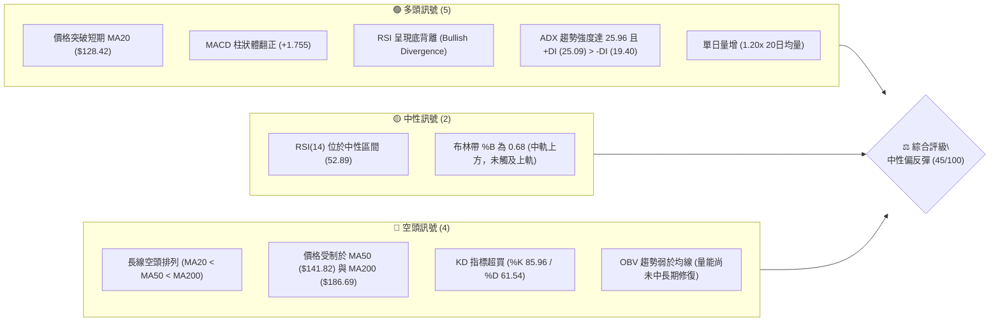
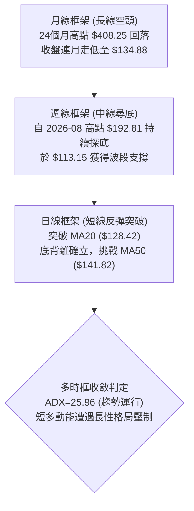
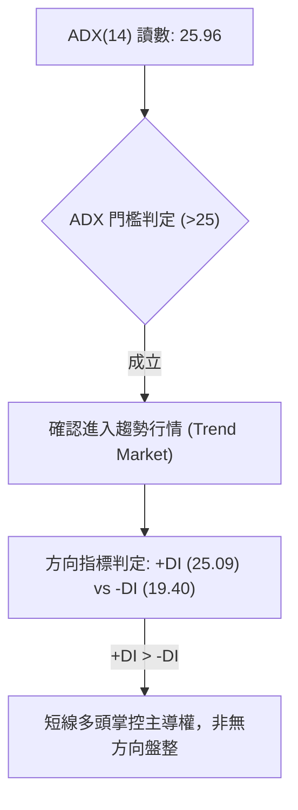
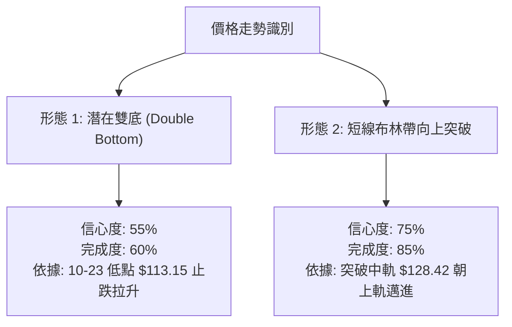
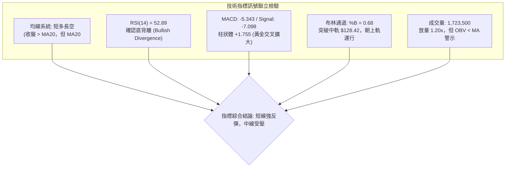
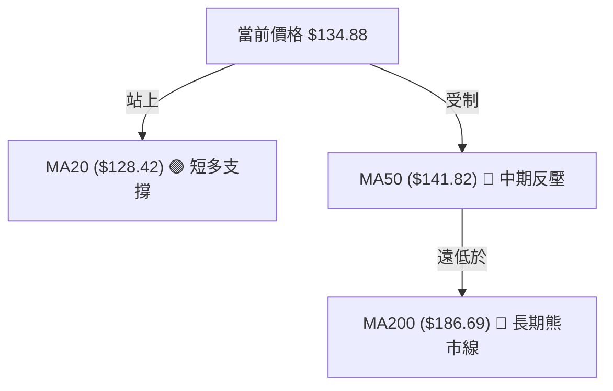
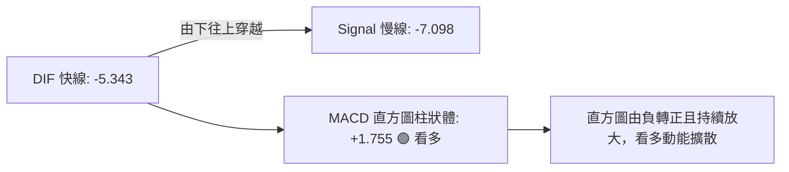
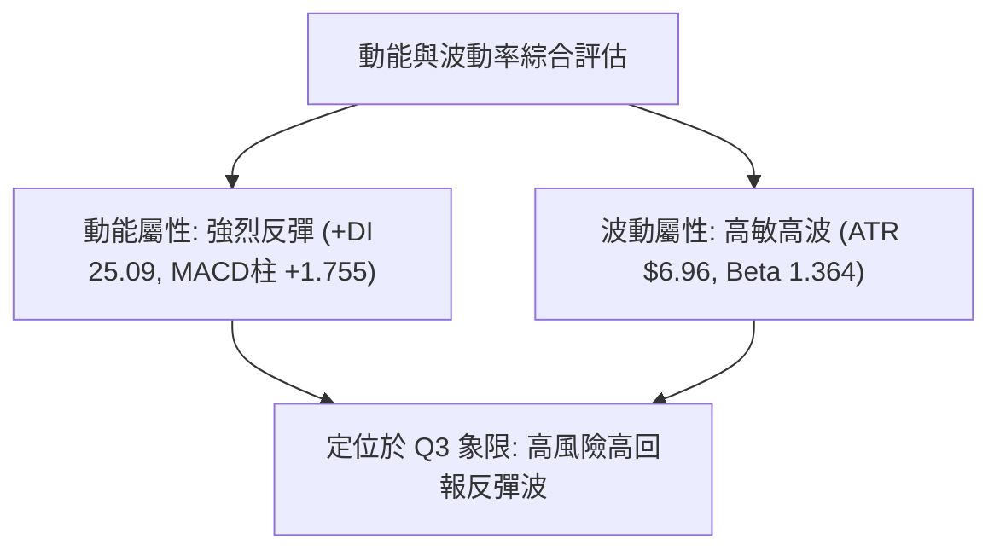
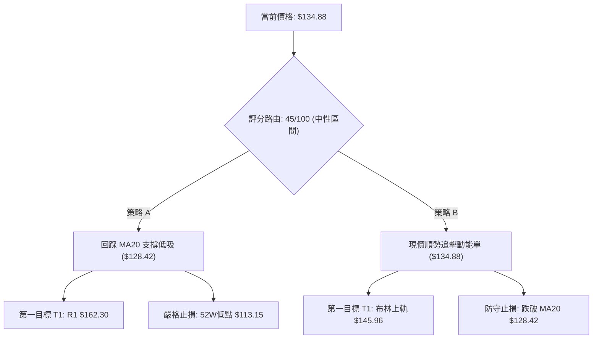
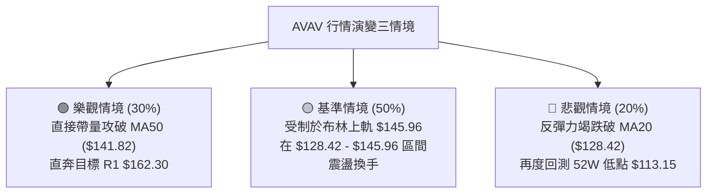

# AVAV 技術分析報告

> **報告日期**：2026-10-30 ｜ **語言**：繁體中文 ｜ **數據來源**：Yahoo Finance ｜ **當前價格**：$134.88

---

## 目錄

| 章節 | 內容 |
|------|------|
| [1. 技術面概覽](#1-技術面概覽) | 訊號儀表板、核心指標、評分卡 |
| [2. 趨勢分析](#2-趨勢分析) | 多時框趨勢、長中短期走勢 |
| [3. 圖表形態分析](#3-圖表形態分析) | 形態識別、K線組合、目標價 |
| [4. 支撐與阻力](#4-支撐與阻力) | 關鍵價位、斐波那契回調 |
| [5. 技術指標深度解讀](#5-技術指標深度解讀) | MA/RSI/MACD/布林/成交量 |
| [6. 動能與波動率](#6-動能與波動率) | 動能評估、ATR、Beta |
| [7. 多時框架總結](#7-多時框架總結) | 時框架評分矩陣 |
| [8. 交易策略建議](#8-交易策略建議) | 多空策略、風險報酬比 |
| [9. 風險提示與監控](#9-風險提示與監控) | 監控指標、風險場景 |

---

## 1. 技術面概覽

### 🎯 技術訊號儀表板



---

### 📊 核心指標速覽表

| 指標類別 | 指標名稱 | 當前數值 | 訊號 | 解讀 |
|----------|----------|----------|:----:|------|
| **價格** | 當前收盤價 | $134.88 | 🟢 | 近期自 52 週低點 $113.15 強勁反彈，站上 MA20 |
| **均線** | MA20 | $128.42 | 🟢 | 價格位於 MA20 上方 (+5.03%)，短線扭轉為支撐 |
| **均線** | MA50 | $141.82 | 🔴 | 價格位於 MA50 下方 (-4.89%)，中線反彈第一道反壓 |
| **均線** | MA200 | $186.69 | 🔴 | 價格遠低於 MA200 (-27.75%)，長期結構仍處於空頭 |
| **動能** | RSI(14) | 52.89 | 🟢 | 擺脫弱勢區進入中性偏多，確認近 20 根 K 棒底背離 |
| **動能** | MACD(12,26,9)| -5.343 / 柱 +1.755 | 🟢 | 快線穿過慢線 (-7.098)，直方圖持續擴大看多 |
| **動能** | Stochastic (%K/%D) | 85.96 / 61.54 | 🟡 | 短線進入超買區，需提防短線獲利回吐震盪 |
| **趨勢** | ADX(14) / DI | 25.96 (+DI 25.09) | 🟢 | ADX > 25 且 +DI 主導，顯示當前短線反彈趨勢強勁 |
| **通道** | 布林通道 (BB) | 110.89 / 128.42 / 145.96 | 🟡 | %B = 0.68，突破中軌後朝上軌 $145.96 運行 |
| **量能** | 當日量 / 量比 | 1,723,500 / 1.20x | 🟢 | 突破日放量，成交量高於 20 日均量 (1,431,695) |
| **波動** | ATR(14) | $6.96 | 🟡 | 佔股價 5.16%，顯示個股波動度較高，操作需設安全止損 |

---

### 🏆 技術評分卡

```
╔══════════════════════════════════════════════════════════════╗
║                技術評分卡 — AVAV (2026-10-30)                ║
╠══════════════════════════════════════════════════════════════╣
║ 趨勢強度      █████████░░░░░░░░░░░  45/100  🟡 中性 (短多長空)║
║ 動能指標      ████████████░░░░░░░░  62/100  🟢 偏多 (MACD/背離)║
║ 支撐穩定度    ███████░░░░░░░░░░░░░  35/100  🔴 偏弱 (缺乏密集層)║
║ 成交量配合    ██████████░░░░░░░░░░  48/100  🟡 中性 (OBV背離) ║
║ 形態完整度    ██████████░░░░░░░░░░  50/100  🟡 中性 (反彈築底)║
║ 均線排列      ██████░░░░░░░░░░░░░░  30/100  🔴 偏空 (空頭排列)║
╠══════════════════════════════════════════════════════════════╣
║ 綜合評分      █████████░░░░░░░░░░░  45/100  ⚖️ 區間震盪偏反彈 ║
╚══════════════════════════════════════════════════════════════╝
*註：綜合評分 = (45 + 62 + 35 + 48 + 50 + 30) ÷ 6 = 45.0，四捨五入為 45/100（依規則 18）
```

---

## 2. 趨勢分析

### 🌐 多時框趨勢分析



---

### 📈 長期趨勢 — 12個月走勢圖（Unicode）

```
AVAV 月線走勢圖（過去12個月：2025-11 至 2026-10）
價格軸 ($)
$380 ┤               
$330 ┤               
$280 ┤ ●(11月:279.46)    ●(01月:278.39)
$250 ┤       ●(12月:241.89)   ●(02月:252.25)
$210 ┤                                ●(05月:207.24)
$190 ┤                            ●(04月:195.02)
$170 ┤                                    ●(06月:165.07)
$150 ┤                   ●(03月:183.05)       ●(07月:149.37) ●(08月:148.35)
$130 ┤                                                ●(09月:142.22)  ●←當前(10月:134.88)
$110 ┤                                                                ●(52W低點:113.15)
     └─────────────────────────────────────────────────────────────────────────────
       11   12   01   02   03   04   05   06   07   08   09   10  (月份)
```

#### 長期月線走勢特徵分析表

| 階段區間 | 月份起訖 | 起始價 → 結束價 | 漲跌幅 | 走勢結構與形態特徵 |
|:--------:|:--------:|:---------------:|:------:|-------------------|
| 第一階段 | 2025-11 → 2026-02 | $279.46 → $252.25 | -9.74% | 高檔震盪派發，數次反抽 $278 附近受阻 |
| 第二階段 | 2026-02 → 2026-03 | $252.25 → $183.05 | -27.43%| 破位暴跌，跌破多條長期均線支撐 |
| 第三階段 | 2026-03 → 2026-05 | $183.05 → $207.24 | +13.22%| 弱勢技術性反抽，受阻於 $200 整數大關與 MA200 |
| 第四階段 | 2026-05 → 2026-10 | $207.24 → $134.88 | -34.92%| 連續陰跌探底，創下 52 週新低 $113.15 後收於 $134.88 |

---

### 📊 中期趨勢（週線分析）

週線格局自 2026 年 8 月高點 $192.81 展開主跌段，歷經連續數週量縮陰跌，於 2026-10-16 當週破位下殺至 $121.79（週 RSI 跌至 28.6 極度超賣），隨後在 2026-10-23 當週下探 52 週最低點 $113.15。

```
週線級別價格壓力與支撐結構示意圖
$192.81 ══════════════════════════════════════ [8月中期波段高點阻力]
   │
$168.00 ────────────────────────────────────── [阻力 R2 / 9月中旬反彈高點]
$162.30 ────────────────────────────────────── [阻力 R1 / 近一年波段高點聚類]
   │
$145.96 ┄┄┄┄┄┄┄┄┄┄┄┄┄┄┄┄┄┄┄┄┄┄┄┄┄┄┄┄┄┄┄┄┄┄┄┄ [日線布林上軌 / 短線目標]
$141.82 ┄┄┄┄┄┄┄┄┄┄┄┄┄┄┄┄┄┄┄┄┄┄┄┄┄┄┄┄┄┄┄┄┄┄┄┄ [MA50 中期生命線]
$134.88 ◄───────────────────────────────────── 現價（突破週線下降通道上緣）
   │
$128.42 ┄┄┄┄┄┄┄┄┄┄┄┄┄┄┄┄┄┄┄┄┄┄┄┄┄┄┄┄┄┄┄┄┄┄┄┄ [MA20 / 布林中軌]
$113.15 ══════════════════════════════════════ [52W 低點強支撐 / 近期波谷]
```

---

### ⚡ 趨勢強度評估（ADX 解讀）



#### ADX 趨勢強度對照表

| 指標變數 | 當前讀數 | 門檻區間 | 趨勢判定 | 策略意涵 |
|:--------:|:--------:|:--------:|:--------:|---------|
| **ADX(14)** | **25.96** | 25 – 50 | 🟢 明確趨勢 | 行情具有方向性動能，順勢反彈交易勝率高於純網格震盪 |
| **+DI** | **25.09** | 升勢中 | 🟢 多頭走強 | 買方動能自低檔集結，帶動價格自 $113.15 強力拉升 |
| **-DI** | **19.40** | 降勢中 | 🟢 空頭減弱 | 空方動能自高點急速萎縮，賣壓出現空窗 |

---

## 3. 圖表形態分析

### 🔍 形態識別系統



#### 形態識別與信心度評估表（依規則 15）

| 形態名稱 | 信心度 | 判斷依據（嚴格引用數據） | 完成度 | 目標價（附嚴格計算式） |
|:--------:|:------:|--------------------------|:------:|------------------------|
| **短期雙底 (W底)** | **55%** | 2026-10-23 探 52W 低點 $113.15 後強拉，與 10-20/10-21 低點 ($116.30 / $115.66) 形成波段打底；頸線取 2026-10-27 高點 $128.19。 | 60% | 頸線 $128.19 + 形態高度 ($128.19 − $113.15 = $15.04) = **$143.23**（接近 MA50 $141.82） |
| **布林中軌突破反彈** | **75%** | 10-29 大陽線收於 $134.88，強勢站穩布林中軌 $128.42，%B 躍升至 0.68。 | 85% | 依通道寬度推算目標為布林上軌：**$145.96** |
| **頭肩底形態** | **<50%** | **訊號不足，僅做指標型解讀**（右肩尚未形成，數據無法確認幾何完整度）。 | 0% | N/A（數據未提供） |

---

### 🕯️ 重要K線形態分析

嚴格依據技術數據中「近 10 根日K」與「近 8 根週K」之實際開高低收進行判讀（依規則 19）：

#### 近 10 根日 K 棒解讀表

| 日期 | 開盤價 | 最高價 | 最低價 | 收盤價 | K線形態名稱 | 技術解讀 | 訊號 |
|:----:|:------:|:------:|:------:|:------:|:-----------:|---------|:----:|
| 2026-10-16 | 123.78 | 124.90 | 120.46 | 121.79 | 破位中黑棒 | 空頭下殺，跌破 $123 關卡 | 🔴 |
| 2026-10-19 | 122.88 | 123.00 | 117.05 | 117.90 | 跳空長黑棒 | 空方加速貫破 $120，恐慌盤湧現 | 🔴 |
| 2026-10-20 | 117.50 | 121.00 | 116.30 | 117.63 | 紡錘十字星 | 低檔震盪縮量，多空於 $117 附近僵持 | 🟡 |
| 2026-10-21 | 118.33 | 119.75 | 115.66 | 117.51 | 低檔窄幅陰線 | 賣壓趨緩，低點 $115.66 測試支撐 | 🟡 |
| 2026-10-22 | 117.26 | 122.22 | 114.26 | 117.70 | 長下影長上影十字 | 盤中洗盤劇烈，低點下探至 $114.26 | 🟡 |
| 2026-10-23 | 115.55 | 124.76 | 113.15 | 123.25 | **破底翻帶長下影大陽棒** | 探 52W 低點 $113.15 後大幅拉升收高，止跌關鍵K | 🟢 |
| 2026-10-26 | 122.39 | 125.75 | 120.35 | 125.45 | 連續上攻陽棒 | 站穩 $125，確認低點 $113.15 支撐有效 | 🟢 |
| 2026-10-27 | 125.23 | 128.19 | 123.60 | 126.73 | 上影小陽線 | 挑戰 MA20 遭遇獲利了結壓制 | 🟡 |
| 2026-10-28 | 126.72 | 126.91 | 123.85 | 125.95 | 量縮小陰星 | 83.3 萬極致縮量洗盤，浮額清洗 | 🟡 |
| 2026-10-29 | 125.89 | 138.43 | 125.88 | 134.88 | **放量長紅實體爆發K** | 172.3 萬大量突破 MA20，最高觸及 $138.43 | 🟢 |

#### 近 8 根週 K 棒解讀表

| 週末交易日 | 開盤價 | 最高價 | 最低價 | 收盤價 | 週K形態名稱 | 技術解讀 | 訊號 |
|:----------:|:------:|:------:|:------:|:------:|:-----------:|---------|:----:|
| 2026-09-11 | 146.37 | 159.24 | 138.31 | 146.71 | 長下影爆量十字 | 2040 萬爆大量低檔承接換手 | 🟢 |
| 2026-09-18 | 145.80 | 168.00 | 144.51 | 159.95 | 中長紅實體棒 | 向上測試波段阻力 R2 ($168.00) 未果 | 🟡 |
| 2026-09-25 | 161.28 | 165.00 | 151.50 | 152.05 | 高檔倒轉陰棒 | 受制於 $165 上方壓力，動能轉弱 | 🔴 |
| 2026-10-02 | 149.77 | 151.30 | 138.31 | 140.82 | 光頭中黑棒 | 連續跌破均線支撐，空方重掌盤面 | 🔴 |
| 2026-10-09 | 142.28 | 145.44 | 134.25 | 137.11 | 下探陰線 | 破位陰跌，週成交量溫和萎縮 | 🔴 |
| 2026-10-16 | 137.10 | 137.50 | 116.43 | 121.79 | 長黑破位棒 | 週線 RSI 跌入 28.6 超賣區 | 🔴 |
| 2026-10-23 | 122.88 | 124.76 | 113.15 | 123.25 | 探底長下影錘頭 | 觸及 52W 新低 $113.15 後強力抽腳 | 🟢 |
| 2026-10-29 | 122.39 | 138.43 | 120.35 | 134.88 | 放量實體大週陽 | 一舉吞噬前兩週實體，週反彈確認 | 🟢 |

---

### 📉 ASCII 走勢形態示意圖

```
AVAV 近 10 日 K 線形態與底部突破示意圖
價格軸 ($)
$138.43 ┤                                      ╭●─╮ (10-29 高點)
$136.00 ┤                                      │  │
$134.88 ┤──────────────────────────────────────┼──┼─── ◄ 當前收盤價 ($134.88)
$132.00 ┤                                      │  │
$128.42 ┤┄┄┄┄┄┄┄┄┄┄┄┄┄┄┄┄┄┄┄┄┄┄┄┄┄┄┄┄┄┄┄┄┄┄│  │┄┄┄ [MA20 頸線位置突破]
$125.00 ┤              ╭●─╮              ╭●─╮  │  │
$123.25 ┤              │  │        ╭●─╮  │  │  │  │
$120.00 ┤ ╭●─╮        │  │  ╭●─╮  │  │  │  │  │  │
$117.00 ┤ │  │  ╭●─╮  │  │  │  │  ╰──╯  ╰──╯  ╰──╯
$113.15 ┤ ╰──╯  ╰──╯  ╰──╯  ╰──╯  
         ────────────────────────────────────────
         10-16  10-19  10-23 10-26  10-27 10-28 10-29 (日期)
                 [第一底]       [波谷]        [強勢突破]
```

---

## 4. 支撐與阻力

### 🗺️ 關鍵價位分布圖（Unicode）

```
AVAV 價位結構分布圖
═════════════════════════════════════════════════════════════════
$200.38 ║██████████████████████████████████████║ 強阻力 R3 (+48.56%)
$176.30 ║▓▓▓▓▓▓▓▓▓▓▓▓▓▓▓▓▓▓▓▓▓▓▓▓▓▓▓▓▓▓▓▓▓▓  ║ 斐波那契 78.6% 回調位
$168.00 ║████████████████████████████          ║ 阻力 R2 (9月中波段高點)
$162.30 ║████████████████████████              ║ 關鍵阻力 R1 (近一年波段高點聚類)
$145.96 ║▓▓▓▓▓▓▓▓▓▓▓▓▓▓                        ║ 布林通道上軌
$141.82 ║▓▓▓▓▓▓▓▓                              ║ MA50 生命線反壓
$134.88 ╠══════════════════════════════════════╣ ◄ 現價 ($134.88)
$128.42 ║▓▓▓▓▓▓▓▓▓▓▓▓▓▓                        ║ 近期支撐 S1 / 布林中軌 (MA20)
$113.15 ║██████████████████████████████████████║ 核心強支撐 S2 / 52週最低點
$110.89 ║▓▓▓▓▓▓▓▓▓▓▓▓▓▓▓▓                      ║ 布林通道下軌極限支撐
═════════════════════════════════════════════════════════════════
```

---

### 🚧 阻力位分析表

所有價位均嚴格引用技術數據中「關鍵價位」區塊之客觀計算結果（波段高點聚類）：

| 阻力級別 | 精確價位 | 距現價幅動 | 形成原因與技術意義 | 突破難度 | 重要性評級 |
|:--------:|:--------:|:----------:|-------------------|:--------:|:----------:|
| **R1** | **$162.30** | +20.33% | 近一年波段高點密集聚類區，密集套牢籌碼峰下緣 | 🟡 中等 | ★★★★☆ |
| **R2** | **$168.00** | +24.56% | 2026-09-18 當週最高點，前波反彈之強烈阻力頂部 | 🔴 偏高 | ★★★★☆ |
| **R3** | **$200.38** | +48.56% | 整數大關與長期下行阻力重疊區，長線空頭總防線 | 🔴 極高 | ★★★★★ |

---

### 🛡️ 支撐位分析表

數據中明確標示「no swing-low support detected below current price」，因此現價下方不存在近一年波段低點聚類，所有下檔支撐嚴格採用技術數據提供之客觀基準位：

| 支撐級別 | 精確價位 | 距現價幅動 | 形成原因與技術意義 | 守住機率 | 重要性評級 |
|:--------:|:--------:|:----------:|-------------------|:--------:|:----------:|
| **S1 (動態)** | **$128.42** | -4.79% | 布林中軌與 MA20 重疊處，短線多頭防守第一線 | 🟢 65% | ★★★★☆ |
| **S2 (絕對)** | **$113.15** | -16.11% | **52 週歷史最低點**（2026-10-23 砸出的極限波谷） | 🟢 80% | ★★★★★ |
| **S3 (極限)** | **$110.89** | -17.79% | 日線布林通道下軌，極端波動下的統計下限支撐 | 🟢 90% | ★★★☆☆ |

---

### 📐 斐波那契回調位分析

依據數據給定之 52 週完整波段（高點 **$408.25** → 低點 **$113.15**，波幅高達 $295.10）回調計算：

| 斐波那契比例 | 精確價位 | 相對現價位置 | 技術解讀與行情角色 |
|:------------:|:--------:|:------------:|-------------------|
| **0.0%** | $408.25 | +202.68% | 52 週歷史頂部（2025 年牛市終點） |
| **23.6%** | $338.61 | +151.05% | 長期極深回調的第一道強阻力 |
| **38.2%** | $295.52 | +119.10% | 中長期空頭結構防線 |
| **50.0%** | $260.70 | +93.28% | 多空長期力量平衡中樞 |
| **61.8%** | $225.88 | +67.47% | 黃金分割強壓力位 |
| **78.6%** | $176.30 | +30.71% | 次級反彈高階壓力（位於 R2 與 R3 之間） |
| **100.0%** | $113.15 | -16.11% | **52 週低點**，此波超跌行情的基石支撐 |

> **現價位置定位**：當前價格 **$134.88** 處於 **100.0% ($113.15)** 與 **78.6% ($176.30)** 之間的築底深超跌區間（位於整個 52 週區間的 7.4% 位置）。技術上，這屬於長線熊市末端嘗試發動技術性修復反彈的初期階段。

---

## 5. 技術指標深度解讀

### 🎛️ 指標訊號總覽



---

### 📈 移動平均線排列分析



#### 移動平均線完整數據比對表

| 均線類別 | 數值 | 距現價價差 | 乖離率 (%) | 均線趨向 | 形態解讀 |
|:--------:|:----:|:----------:|:----------:|:--------:|---------|
| **MA 5** | $127.25 | +$7.63 | +5.99% | ▲ 向上扣高 | 超短期強勢均線，提供即時推升力 |
| **MA 10** | $122.88 | +$12.00 | +9.77% | ▲ 向上反折 | 短期反彈確立，已自谷底翻揚 |
| **MA 20** | $128.42 | +$6.46 | +5.03% | ▲ 向上穿越 | 突破月線壓力，轉為下檔回踩防守點 |
| **MA 50** | $141.82 | -$6.94 | -4.89% | ▼ 下行扣抵 | 中期關鍵反壓，此處預期有解套賣壓 |
| **MA 60** | $148.97 | -$14.09 | -9.46% | ▼ 下行扣抵 | 季線下彎，壓制中線波段反彈空間 |
| **MA 120** | $156.73 | -$21.85 | -13.94% | ▼ 下行扣抵 | 半年線持續走低，反映半年套牢成本 |
| **MA 200** | $186.69 | -$51.81 | -27.75% | ▼ 堅決向下 | 典型空頭排列主軸（MA20 < MA50 < MA200） |
| **MA 240** | $201.53 | -$66.65 | -33.07% | ▼ 堅決向下 | 年線重壓，整體架構未扭轉大熊市 |

---

### 📉 RSI(14) 分析

#### RSI 數值強度展示
```
RSI(14): 52.89  [中性偏多]
0 ░░░░░░░░░░░░░░░░░░░░ 30 ▓▓▓▓▓▓▓▓▓▓▓▓▓░░░░ 70 ░░░░░░░░░░ 100
[超賣區間 <30]       ▲現值 52.89      [超買區間 >70]
```

#### 背離判斷與解讀
- **底背離確立 (Bullish Divergence)**：技術數據明確確認「近 20 根 K 棒首尾之價格與 RSI 方向產生底背離」。
- **細部驗證**：價格於 2026-10-16 收 $121.79（週 RSI 為 28.6），隨後在 10-23 破底探至 $113.15，然而日線 RSI 指標不再破底，反而快速回升至 52.89。此現象證明空方摜壓力竭，買盤於超跌區全力介入，為強烈技術性反彈訊號。

---

### 📊 MACD(12/26/9) 訊號解讀



- **絕對位置**：雙線仍位於零軸下方（快線 -5.343 / 慢線 -7.098），屬於「空頭市場中的低位黃金交叉反彈」。
- **柱狀體動能**：直方圖擴展至 **+1.755**，自前週的負值快速翻正，顯示短期買盤具有高度爆發力，支持價格向 MA50 挺進。

---

### 📦 布林通道分析

```
AVAV 日線布林通道 (20, 2) 結構圖
$145.96 ┤══════════════════════════════════════════ 上軌 (通道頂部壓力)
        │
$134.88 ┤─────────────────────── ● [現價 $134.88, %B=0.68]
        │
$128.42 ┤┄┄┄┄┄┄┄┄┄┄┄┄┄┄┄┄┄┄┄┄┄┄┄┄┄┄┄┄┄┄┄┄┄┄┄┄┄┄ 中軌 (MA20 回踩支撐)
        │
$110.89 ┤══════════════════════════════════════════ 下軌 (通道極限下限)
```
- **帶寬與位置**：通道寬度為 $35.07，當前 %B 為 **0.68**，表明價格已順利脫離下軌的超賣低迷區，並成功穿越中軌 $128.42。
- **目標演進**：在多頭不失守中軌的前提下，上行軌道目標指向布林上軌 **$145.96**。

---

### 💹 成交量分析（量價配合度）

- **量能增長**：2026-10-29 放量至 **1,723,500 股**，相對於 20 日均量 (1,431,695 股) 之量比達 **1.20x**，為帶量長紅實體棒，短線突破具備量能背書。
- **潛在隱憂 (OBV)**：數據提示「OBV < MA → 量能疲弱」。這說明雖然單日有主力資金點火，但累計能量潮（OBV）長期均線尚未修復，顯示長線套牢資金仍在場內等待解套，尚未形成全面性的長期增量資金狂潮。

---

## 6. 動能與波動率

### ⚡ 動能評估四象限

| 象限 | 動能強度 | 波動率水準 | 當前狀態標註 | 戰略特徵與應對方針 |
|:----:|:--------:|:----------:|:------------:|-------------------|
| **Q1 (最佳擴張)** | 強 (Bullish) | 低 (Low Vol) | — | 趨勢穩健推升，最適合加碼持股 |
| **Q2 (震盪沉澱)** | 弱 (Bearish) | 低 (Low Vol) | — | 沉悶築底，浮額清洗階段 |
| **Q3 (強烈爆發)** | **強 (ADX>25, +DI勝)** | **高 (ATR 5.16%, Beta 1.36)** | **✓ [當前位置]** | **高動能高波動短線反彈，嚴格執行防守點位** |
| **Q4 (恐慌殺跌)** | 弱 (Bearish) | 高 (High Vol) | — | 崩跌破位，必須全面離場避險 |



---

### 📊 ATR 波動率分析

- **ATR(14) 讀數**：**$6.96**（Wilder 算法計算，佔目前股價的 **5.16%**）。
- **止損距離建議**：
  - *極短線激進止損*：1.0 × ATR = **$6.96**（距現價 $134.88 之緩衝為 $127.92，與 MA20 $128.42 極度吻合）。
  - *波段常規防守止損*：2.0 × ATR = **$13.92**（防守位設於 $120.96，覆蓋近期多根 K 棒下影線）。

---

### 📐 Beta 與市場相關性

- **Beta 係數**：**1.364**。
- **市場意涵**：AVAV 屬於典型的高 Beta 中小型軍工防務科技股。當大盤（S&P 500）上漲 1% 時，該股預期上漲 1.36%；反之亦然。這解釋了該股在 10-23 至 10-29 期間展現的超跌彈性，同時也警示若大盤出現系統性回檔，該股回撤幅度將被放大。

---

## 7. 多時框架總結

### 📋 時框架評分表

| 時框架 | 趨勢方向 | 動能表現 | 均線排列狀態 | 形態特徵 | 綜合評分 | 操作建議 |
|:------:|:--------:|:--------:|:------------:|:--------:|:--------:|---------|
| **短期 (日線)** | 🟢 向上反彈 | 🟢 強烈 (MACD黃金交叉) | 🟡 突破 MA20 | 雙底嘗試築底突破 | 65/100 | 順勢偏多，目標布林上軌 |
| **中期 (週線)** | 🟡 止跌打底 | 🟡 中性 (RSI 52.9) | 🔴 下行扣抵 | 探底長下影錘頭確認 | 45/100 | 區間操作，密切關注阻力 R1 |
| **長期 (月線)** | 🔴 主跌空頭 | 🔴 疲弱 (連月陰跌) | 🔴 典型空頭排列 | 距 52W 高點折價 -67% | 25/100 | 逢高減磅，不可盲目長線做多 |

---

### 🔲 綜合訊號矩陣

```
訊號維度對照矩陣
┌──────────────┬──────────────┬──────────────┬──────────────┐
│  分析維度    │ 短期 (日線)  │ 中期 (週線)  │ 長期 (月線)  │
├──────────────┼──────────────┼──────────────┼──────────────┤
│ 均線系統     │  🟢 突破MA20 │  🔴 壓在MA50 │  🔴 空頭排列 │
│ 動能指標     │  🟢 MACD金叉 │  🟡 RSI回升  │  🔴 歷史低迷 │
│ 量價結構     │  🟢 突破放量 │  🟡 換手承接 │  🔴 OBV背離  │
│ 形態定位     │  🟢 突破頸線 │  🟡 雙底構築 │  🔴 熊市回撤 │
└──────────────┴──────────────┴──────────────┴──────────────┘
```

---

### ⚖️ 多時框收斂結論（依規則 14）

1. **行情性質判定**：當前 ADX(14) 讀數為 **25.96 (>25)**，嚴格判定為**趨勢行情**。
2. **多時框衝突收斂**：
   - 依「趨勢行情以中長期方向為主，日線尋找進場時機」之收斂優先級規則：中長期（MA50 $141.82、MA200 $186.69）仍為明確下行趨勢，長期空頭環境尚未解除。
   - 然而，短期日線呈現明確的底背離與突破放量，且 +DI (25.09) 主導行情。
3. **唯一方向性結論**：**中性偏反彈（區間反彈操作，以中短期目標位為主，嚴防中線反壓）**。第 1 章技術評分卡算術平均為 **45/100**，落在 40–60 的中性區間，因此本報告的主策略嚴格定錨為：**區間操作／反彈波段交易，以布林通道與既有阻力位為主要邊界，等待突破確認。**

---

## 8. 交易策略建議

### 🗺️ 策略決策流程圖



---

### 🧭 策略路由（依規則 18 判定）

> **當前主策略方向 = 區間震盪偏反彈操作（等待關鍵位突破確認）｜ 依據評分：45/100**

因綜合評分落在 40–60 之中性區間，策略不進行激進單邊單向死多，而是以**依託關鍵技術位（MA20 / 布林中下軌）進行結構性波段反彈**為主。

---

### 🎯 價格情境階梯（Price Scenarios）

價位嚴格引用第 4 章及技術數據中由 OHLCV 計算之真實數值：

| 觸發條件 | 下一目標 | 後續延伸 | 情境含義 |
|:--------:|:--------:|:--------:|---------|
| **強勢突破 MA50 ($141.82)** | 布林上軌 **$145.96** | 阻力 R1 **$162.30** | 短線反彈動能全面爆發，挑戰波段高點聚類 |
| **站穩 MA20 ($128.42)** | 現價區間 **$134.88** | MA50 **$141.82** | 區間震盪築底，在通道中上軌間反覆換手 |
| **失守 MA20 ($128.42)** | 52W 低點 **$113.15** | 布林下軌 **$110.89** | 反彈宣告失敗，空頭重啟跌勢下探歷史波谷 |

---

### 📊 情境機率分佈

| 預測情境 | 發生機率 | 主要技術依據（引用數據指標） |
|:--------:|:--------:|------------------------------|
| **延續反彈挑戰 R1** | **50%** | MACD 柱狀體翻正擴大 (+1.755)、日線 RSI 底背離確立、ADX +DI 主導 |
| **箱型區間震盪** | **35%** | 上方遭遇下行 MA50 ($141.82) 壓制，KD 指標已進入超買 (%K 85.96) |
| **破底重回跌勢** | **15%** | 長期均線空頭排列未變，若大盤重挫可能回測 52W 低點 $113.15 |

---

### 🟢 主策略詳情

嚴格遵守規則 17，風險報酬比公式為 `(目標價 T1 − 進場價) ÷ (進場價 − 止損價)`：

| 策略要素 | 策略 A（穩健型：回踩 MA20 支撐佈局） | 策略 B（動能型：現價直接介入順勢追擊） |
|----------|---------------------------------------|---------------------------------------|
| **策略定位** | 逢低回踩佈局波段反彈 | 順應突破動能獲取通道空間 |
| **進場條件** | 價格拉回測試 MA20 獲得支撐確認不破 | 突破前日高點確認，以當前收盤價市價進場 |
| **進場價格** | **$128.42**（以 MA20 數值為準） | **$134.88**（以當前收盤價為準） |
| **目標價 T1**| **$162.30**（關鍵阻力位 R1） | **$145.96**（布林通道上軌） |
| **目標價 T2**| **$168.00**（阻力位 R2） | **$162.30**（關鍵阻力位 R1） |
| **止損價格** | **$113.15**（52 週最低點） | **$128.42**（失守布林中軌 MA20） |
| **風險報酬比** | **1 : 2.22（以 T1 計）**<br>*算式：(162.30−128.42)÷(128.42−113.15) = 33.88÷15.27*<br>另：1 : 2.59（以 T2 計，算式：39.58÷15.27） | **1 : 1.72（以 T1 計）**<br>*算式：(145.96−134.88)÷(134.88−128.42) = 11.08÷6.46*<br>另：1 : 4.24（以 T2 計，算式：27.42÷6.46） |
| **成功機率** | 60% | 55% |
| **建議倉位** | 10% – 15% | 5% – 10% |

---

### 🔴 反向風險觸發點（對沖與風控提示）

若出現以下任何一個訊號，即代表主策略反彈邏輯遭推翻，應立即止損離場或採取空頭避險：
1. **價格收盤跌破 MA20 ($128.42)**：表明短線假突破，反彈夭折。
2. **MACD 柱狀體快速萎縮並翻負**：多頭動能耗盡，空方再度集結。
3. **帶量跌破 52 週低點 $113.15**：極端空頭主跌段重啟，下方無任何密集低點聚類支撐。

---

### ⭐ 整體訊號強度評星

```
做多訊號強度：★★★☆☆  (3/5星 — 短線動能足，受限長期空頭結構)
做空訊號強度：★★☆☆☆  (2/5星 — 低檔底背離，殺跌動能暫竭)
整體可信度：  ★★★★☆  (4/5星 — 價量指標共振，底背離訊號清晰)
```

---

## 9. 風險提示與監控

### ✅ 關鍵監控指標 Checklist

```
╔══════════════════════════════════════════════════════════════╗
║                   AVAV 技術面關鍵監控清單                    ║
╠══════════════════════════════════════════════════════════════╣
║ [ ] 監控 MA20 支撐效力：回踩不得連續兩日收於 $128.42 之下    ║
║ [ ] 監控 MA50 阻力突破：觀察向上叩關 $141.82 時的成交量變化   ║
║ [ ] 監控 KD 超買鈍化：Stoch %K (85.96) 是否出現高檔死叉      ║
║ [ ] 監控量能持續性：日成交量是否維持在 20 日均量 (143萬) 之上 ║
║ [ ] 監控布林帶擴張：通道是否開口擴大支持價格向 $145.96 邁進   ║
║ [ ] 監控極限停損位：絕對不允許跌破 52W 低點 $113.15         ║
╚══════════════════════════════════════════════════════════════╝
```

---

### ⚠️ 風險場景分析



---

### 🛡️ 風險管理重要提醒

1. **基本面虧損壓力**：AVAV 目前 TTM EPS 為 **$-4.05**，自由現金流為 **$-44.78M**，營業利益率為負 (-0.6%)，純技術面反彈容易受到財報基本面不佳的干擾，因此切忌以長線定存思維持股，必須恪守技術停損。
2. **高 Beta 波動防禦**：個股 Beta 達 **1.364**，ATR 高達 **$6.96**。單日震幅常超過 5%，嚴禁在突破當天追高於上影線頂端（例如 10-29 高點 $138.43），應保持分批佈局原則。
3. **融券回補變數**：目前融券佔浮動股比例（Short % Float）達 **13.0%**，Short Ratio 為 **3.25** 天。一旦突破 MA50，可能引發短線空頭軋空擠壓（Short Squeeze），此點為多頭反彈提供額外動力。

---

## 📋 報告總結

```
╔══════════════════════════════════════════════════════════════════════╗
║                     AVAV 技術分析報告總結                            ║
╠══════════════════════════════════════════════════════════════════════╣
║ 報告日期：2026-10-30                                                 ║
║ 當前價格：$134.88                                                    ║
║ 分析評級：⚖️ 綜合評分 45/100（區間震盪偏反彈操作）                   ║
║                                                                      ║
║ 關鍵結論：                                                           ║
║ ├─ 長期趨勢：🔴 弱勢空頭（MA20 < MA50 < MA200，距高點折價深）       ║
║ ├─ 中期趨勢：🟡 尋求落底（探 52W 低點 $113.15 後收復跌幅）          ║
║ ├─ 短期趨勢：🟢 強烈反彈（突破 MA20，日線 MACD/RSI 出現強底背離）   ║
║ ├─ 關鍵支撐：S1: $128.42 (MA20) ｜ S2: $113.15 (52W最低價)          ║
║ ├─ 關鍵阻力：R1: $162.30 ｜ R2: $168.00 ｜ R3: $200.38              ║
║ └─ 分析師目標：均價 $213.07（最高 $315.00 / 最低 $148.57）           ║
║                                                                      ║
║ 最優策略組合：                                                       ║
║ 1. 🥇 最佳機會：回踩 MA20 ($128.42) 低吸，目標 R1 ($162.30)，        ║
║                 止損 $113.15，風險報酬比 1 : 2.22（以 T1 計）        ║
║ 2. 🥈 次選機會：以現價 $134.88 順勢進場，目標布林上軌 ($145.96)，    ║
║                 止損 $128.42，風險報酬比 1 : 1.72（以 T1 計）        ║
║ 3. 🥉 保守選擇：等待股價確認帶量突破 MA50 ($141.82) 後再行順勢加碼   ║
╚══════════════════════════════════════════════════════════════════════╝
```

---

> ⚠️ **免責聲明**：本報告為技術分析研究，所有數據與估算均基於歷史價格與客觀指標運算。本報告**僅供研究與學術參考**，**不構成任何形式的投資建議**。金融市場投資具有高度風險，投資人應獨立評估自身風險承受能力並自負盈虧。

---

*報告生成時間：2026-10-30 ｜ 數據來源：Yahoo Finance ｜ 分析框架：多時框技術分析模型*