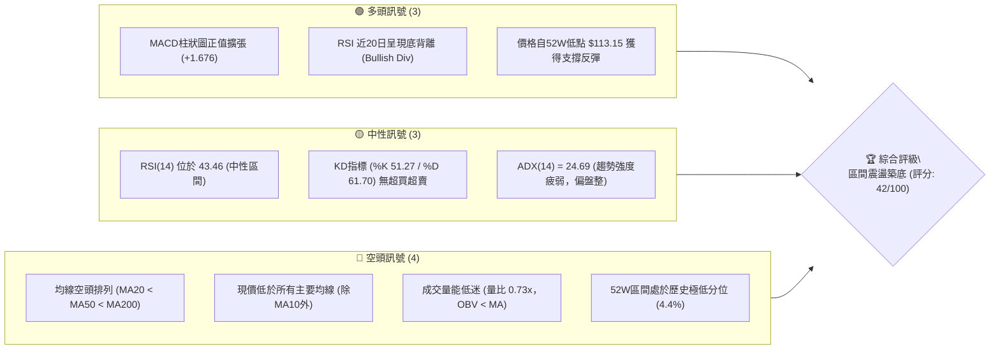
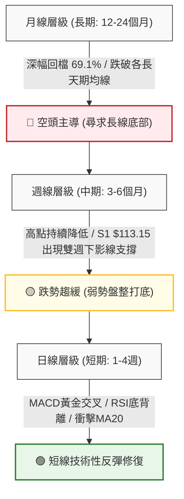
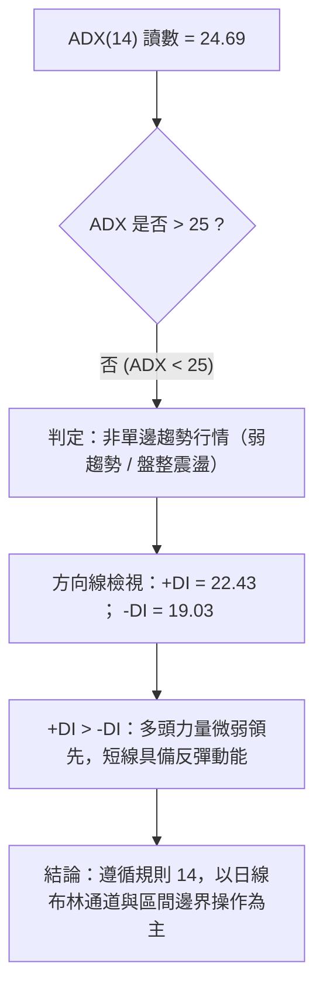
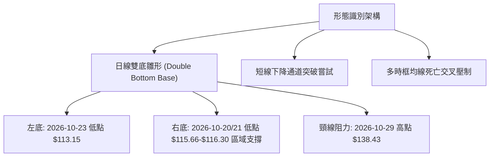
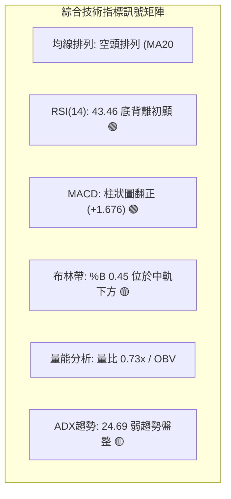
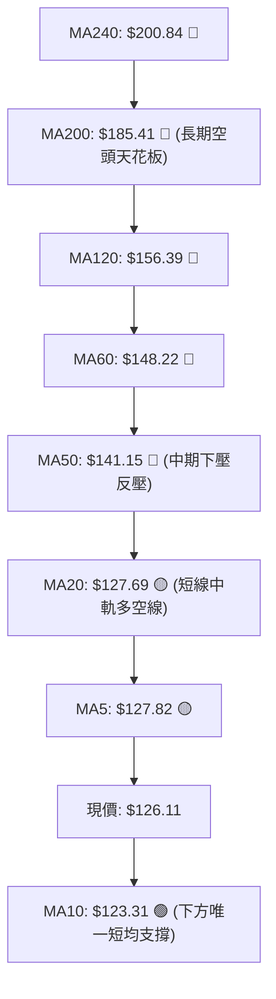
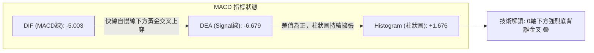
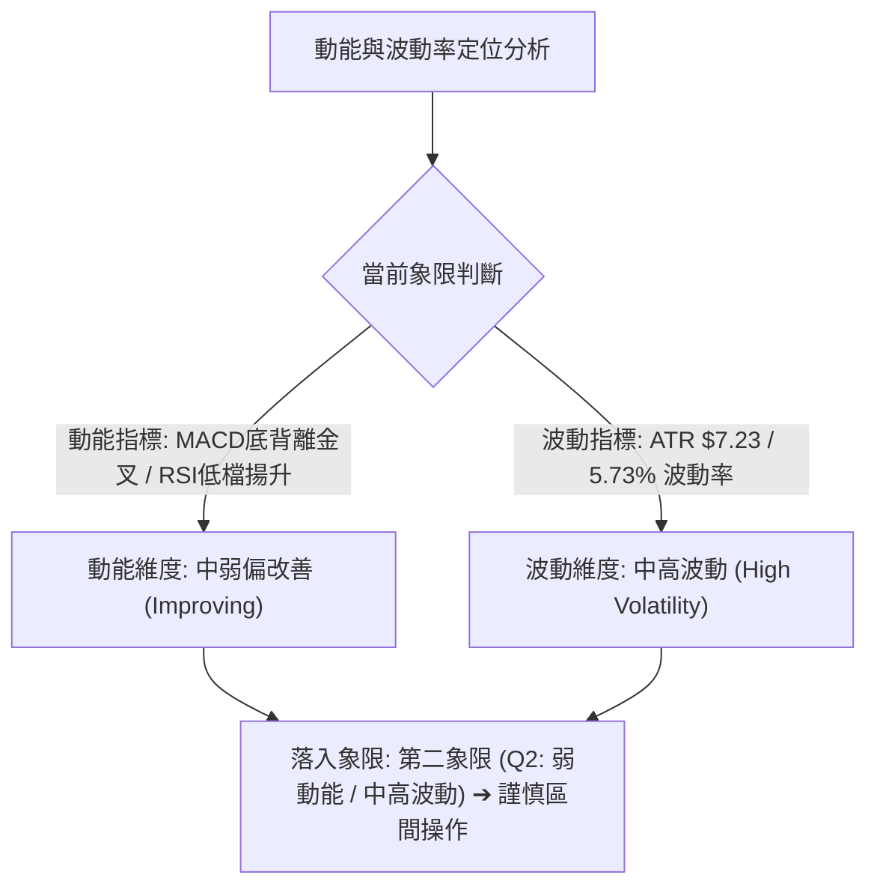
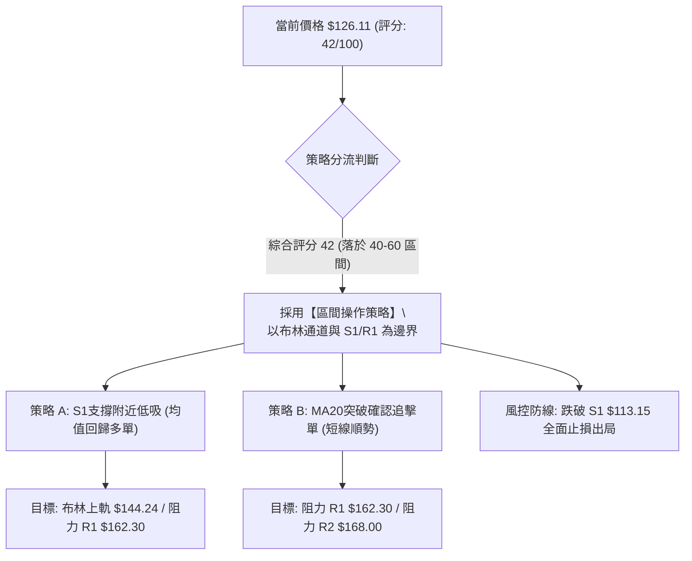
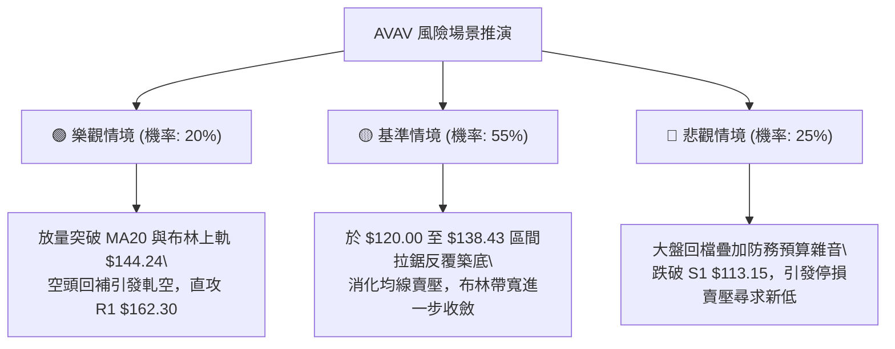

# AVAV 技術分析報告

> **報告日期**：2026-10-31 ｜ **語言**：繁體中文 ｜ **數據來源**：Yahoo Finance ｜ **當前價格**：$126.11

---

## 目錄

| 章節 | 內容 |
|------|------|
| [1. 技術面概覽](#1-技術面概覽) | 訊號儀表板、核心指標、評分卡 |
| [2. 趨勢分析](#2-趨勢分析) | 多時框趨勢、長中短期走勢、ADX解讀 |
| [3. 圖表形態分析](#3-圖表形態分析) | 形態識別、K線組合、目標價計算 |
| [4. 支撐與阻力](#4-支撐與阻力) | 關鍵價位分布、阻力支撐表、斐波那契 |
| [5. 技術指標深度解讀](#5-技術指標深度解讀) | 均線系統、RSI、MACD、布林通道、成交量 |
| [6. 動能與波動率](#6-動能與波動率) | 動能四象限、ATR波動分析、Beta敏感度 |
| [7. 多時框架總結](#7-多時框架總結) | 時框架評分、綜合訊號矩陣、收斂結論 |
| [8. 交易策略建議](#8-交易策略建議) | 策略路由、情境階梯、主策略詳情、評星 |
| [9. 風險提示與監控](#9-風險提示與監控) | 監控清單、情境模擬、風險管理原則 |

---

## 1. 技術面概覽

### 🎯 技術訊號儀表板



---

### 📊 核心指標速覽表

| 指標類別 | 指標名稱 | 當前數值 | 訊號 | 解讀 |
|----------|----------|----------|:----:|------|
| **價格** | 當前價格 | $126.11 | 🔴 | 位於 52 週低檔區（分位 4.4%），整體處於深幅修正後築底階段 |
| **均線** | MA20 | $127.69 | 🟡 | 現價緊貼 MA20 下方（距離 -1.24%），短期面臨中軌微幅壓制 |
| **均線** | MA50 | $141.15 | 🔴 | 現價大幅低於 MA50（-10.66%），中期空頭下壓結構未改 |
| **均線** | MA200 | $185.41 | 🔴 | 現價遠低於 MA200（-31.98%），長期趨勢為明確空頭市場 |
| **動能** | RSI(14) | 43.46 | 🟡 | 脫離超賣區進入中性區間，且近 20 根 K 棒出現標準底背離 |
| **動能** | MACD | -5.003 / -6.679 | 🟢 | 快線位於慢線上方，柱狀圖為 +1.676，發出短線反彈動能訊號 |
| **動能** | KD(9,3,3) | %K 51.27 / %D 61.70 | 🟡 | 處於中性常態分布，死叉後趨於走平，無明確方向性指引 |
| **趨勢** | ADX(14) | 24.69 | 🟡 | ADX < 25 代表單邊趨勢衰竭，市場轉為無趨勢之箱體震盪 |
| **趨勢** | 方向線 | +DI 22.43 / -DI 19.03 | 🟢 | 多頭方向線微幅超越空頭方向線，短線買盤略佔優勢 |
| **波動** | ATR(14) | $7.23 (5.73%) | 🟡 | 每日波動幅度偏大，需設定寬幅止損以避免噪訊觸發 |
| **通道** | 布林通道 | 上軌 $144.24 / 下軌 $111.14 | 🟡 | %B 為 0.45，價格運行於中軌下方，布林帶寬呈現收斂 |
| **量能** | 成交量比 | 0.73x (20日均量) | 🔴 | 最新量能 1,037,800 低於均量，OBV 疲軟，反彈缺乏量能背書 |

---

### 🏆 技術評分卡

```
╔══════════════════════════════════════════════════════════════════╗
║                 技術評分卡 — AVAV (2026-10-31)                   ║
╠══════════════════════════════════════════════════════════════════╣
║ 趨勢強度      ██████░░░░░░░░░░░░░░  32/100  🔴 空頭壓制          ║
║ 動能指標      ███████████░░░░░░░░░  58/100  🟡 底背離初現        ║
║ 支撐穩定度    ████████████░░░░░░░░  60/100  🟡 S1 守穩反彈       ║
║ 成交量配合    ███████░░░░░░░░░░░░░  35/100  🔴 量能萎縮缺乏買盤  ║
║ 形態完整度    █████████░░░░░░░░░░░  45/100  🟡 潛在雙底構築中    ║
║ 均線排列      ████░░░░░░░░░░░░░░░░  22/100  🔴 空頭排列下壓      ║
╠══════════════════════════════════════════════════════════════════╣
║ 綜合評分      ████████░░░░░░░░░░░░  42/100  中性觀望（區間操作） ║
╚══════════════════════════════════════════════════════════════════╝
```
*註：綜合評分由六項子指標依算術平均計算：(32 + 58 + 60 + 35 + 45 + 22) ÷ 6 = 42.0 分（四捨五入至整數 42/100）。*

---

## 2. 趨勢分析

### 🌐 多時框趨勢分析



---

### 📈 長期趨勢 — 12個月走勢圖（Unicode）

以下為 AVAV 過去 12 個月（2025-11 至 2026-10）收盤價走勢圖，標注歷史高點 $369.91（2025-10）、52 週高點 $408.25 以及近期 52 週低點 $113.15：

```
AVAV 月線走勢圖（過去12個月）
價格軸 ($)
$408 ┤      (52W High $408.25)
$370 ┤● (2025-10: $369.91)
$280 ┤  ● (2025-11: $279.46)
$278 ┤        ● (2026-01: $278.39)
$252 ┤    ● (2025-12: $241.89)  ● (2026-02: $252.25)
$207 ┤                                  ● (2026-05: $207.24)
$195 ┤                            ● (2026-04: $195.02)
$183 ┤                      ● (2026-03: $183.05)
$165 ┤                                        ● (2026-06: $165.07)
$148 ┤                                              ● (07: $149.37) ● (08: $148.35)
$142 ┤                                                    ● (2026-09: $142.22)
$126 ┤━━━━━━━━━━━━━━━━━━━━━━━━━━━━━━━━━━━━━━━━━━━━━━━━━━━━━━━━━● (現在: $126.11)
$113 ┤                                                          ▲ (52W Low: $113.15)
     └─────────────────────────────────────────────────────────────────────────────
       25-11 25-12 26-01 26-02 26-03 26-04 26-05 26-06 26-07 26-08 26-09 26-10
```

#### 走勢特徵分析表格

| 階段 | 期間 | 起訖價位 | 漲跌幅 | 走勢特徵與驅動因素 |
|------|------|----------|:------:|--------------------|
| **第一階段：高檔崩落** | 2025-11 ~ 2026-01 | $369.91 → $278.39 | -24.74% | 自歷史頂峰大幅獲利了結，跳空跌破高檔均線支撐 |
| **第二階段：震盪下挫** | 2026-02 ~ 2026-05 | $278.39 → $207.24 | -25.56% | 反彈波段無力，高點逐步壓低，形成典型的下降通道 |
| **第三階段：加速探底** | 2026-06 ~ 2026-08 | $207.24 → $148.35 | -28.42% | 跌破 $150 關卡，波動率放大，機構持股出現再平衡賣壓 |
| **第四階段：築底震盪** | 2026-09 ~ 2026-10 | $148.35 → $126.11 | -15.00% | 觸及 52 週最低點 $113.15 後止跌，進入日線等級箱體打底 |

---

### 📊 中期趨勢（週線分析）

中期走勢呈現「階梯式下跌後的收斂震盪」。週線自 2026-08-14 高點 $192.81 展開新一輪跌浪，連續跌破 $160 與 $140 關卡，並於 2026-10-23 週創下全年度最低點 $113.15。隨後一週（2026-10-30 週）收盤回升至 $126.11，週線收出帶有長下影線的十字星與陽線組合，顯示 $113.15 具備顯著的多頭承接力道。

```
近期週線壓力與支撐示意圖
═════════════════════════════════════════════════════════════════
$168.00 ─── 週線重大反彈壓力 (2026-09-18 週高點 / R2)
  │
$162.30 ─── 近一年波段聚類阻力 (R1)
  │
$144.24 ─── 日線布林通道上軌 / 週線中樞壓力
  │
$127.69 ─── MA20 / 布林通道中軌 (短線爭奪點)
  │
$126.11 ─── [ 當前收盤價 ]
  │
$113.15 ─── 52週絕對低點 / 近一年波段聚類強支撐 (S1)
═════════════════════════════════════════════════════════════════
```

---

### ⚡ 趨勢強度評估（ADX 解讀）



#### ADX 強度對照與解讀

| 指標項 | 數值 | 參考閾值 | 當前狀態評估 |
|--------|:----:|:--------:|--------------|
| **ADX(14)** | 24.69 | 25.00 | **弱趨勢 / 箱體震盪**。表明前期的強烈下跌趨勢已告一段落，目前市場動能消退，呈現沉澱盤整格局。 |
| **+DI** | 22.43 | - | **短線多頭指標**。自低檔回升，反映多方自 $113.15 展開護盤。 |
| **-DI** | 19.03 | - | **短線空頭指標**。自高點回落，顯示急跌賣壓已顯著鈍化。 |
| **動能淨差 (+DI - -DI)** | +3.40 | 0.00 | 差值微幅為正，多方稍微主導盤面，但不足以發動強勢單邊單向多頭浪潮。 |

---

## 3. 圖表形態分析

### 🔍 形態識別系統



#### 形態信心度評估表（依規則 15）

| 形態名稱 | 信心度 | 判斷依據（引用數據） | 完成度 | 目標價（附精確計算式） |
|----------|:------:|----------------------|:------:|------------------------|
| **日線潛在雙底 (Double Bottom)** | 55% | 2026-10-23 出現低點 $113.15（為 52W 低點 S1），此前 2026-10-22 低點 $114.26 及 10-21 低點 $115.66 構成密集成交底部；隨後 10-29 衝高至 $138.43。 | 60% | **頸線突破目標價 = $163.71**<br>計算式：頸線 $138.43 + 形態高度 ($138.43 - $113.15 = $25.28) = $163.71（高度接近 R1 $162.30） |
| **布林中軌爭奪形態** | 70% | 現價 $126.11 緊貼布林中軌 MA20 $127.69，10-29 突破後 10-30 回踩確認中軌有效性。 | 85% | **通道上軌目標價 = $144.24**<br>計算式：直接引用布林上軌數值 $144.24 |
| **頭肩底形態** | <30% | 數據中左肩與右肩結構缺乏對稱性，僅有一處深幅刺穿點 $113.15。 | 0% | *訊號不足，僅做指標型解讀，不預設目標價* |

---

### 🕯️ 重要 K 線形態分析

依規則 19，以下嚴格採用提供的「近 10 根日 K」與「近 8 根週 K」之精準 OHLCV 進行 K 線組合分析：

#### 近 10 根日 K 棒形態解讀

| 日期 | 開 | 高 | 低 | 收 | 成交量 | K線形態名稱 | 技術解讀與多空意涵 | 訊號 |
|:----:|:----:|:----:|:----:|:----:|:------:|:-----------:|-------------------|:----:|
| **10-19** | 122.88 | 123.00 | 117.05 | 117.90 | 1,416,500 | 中黑棒跌破 | 開高走低，實體下殺，顯示短線賣壓沉重 | 🔴 |
| **10-20** | 117.50 | 121.00 | 116.30 | 117.63 | 1,134,200 | 低檔窄幅十字星 | 多空拉鋸，實體僅 0.13 元，空方下殺動能初顯疲態 | 🟡 |
| **10-21** | 118.33 | 119.75 | 115.66 | 117.51 | 1,332,400 | 弱勢小陰線 | 連續三天收於 $117 附近，低檔買盤開始進行掛單承接 | 🟡 |
| **10-22** | 117.26 | 122.22 | 114.26 | 117.70 | 1,528,200 | 長下影紡錘線 | 盤中下探 $114.26 破底後拉回，爆出近五日大量，買盤進駐 | 🟢 |
| **10-23** | 115.55 | 124.76 | 113.15 | 123.25 | 1,356,900 | **長下影強勢大陽線** | 測試全年度低點 $113.15 後報復性反彈，收盤大漲，形成破底翻基石 | 🟢 |
| **10-26** | 122.39 | 125.75 | 120.35 | 125.45 | 1,216,300 | 溫和上升陽線 | 延續反彈節奏，高低點均同步墊高，確認 $113.15 短期底部 | 🟢 |
| **10-27** | 125.23 | 128.19 | 123.60 | 126.73 | 1,102,700 | 緩步推升小陽線 | 盤中越過 MA20，但量能略微萎縮，追價意願稍嫌保守 | 🟡 |
| **10-28** | 126.72 | 126.91 | 123.85 | 125.95 | 833,000 | 縮量高檔十字星 | 全日量能僅 83.3 萬股，呈現上攻乏力但下檔有守之蓄勢整理 | 🟡 |
| **10-29** | 125.89 | 138.43 | 125.88 | 134.88 | 1,733,600 | **放量長紅衝刺棒** | 放量大漲 7.09%，單日最高觸及 $138.43，強勢突破 MA20 | 🟢 |
| **10-30** | 131.12 | 133.10 | 124.17 | 126.11 | 1,037,800 | **長上影流星陰線** | 開高走低吐回昨日漲幅大半，留長上影線，顯示布林中軌上方存在解套賣壓 | 🔴 |

#### 近 8 根週 K 棒形態解讀

| 週末日期 | 開 | 高 | 低 | 收 | 週成交量 | 週K線形態 | 技術解讀與多空意涵 | 訊號 |
|:--------:|:----:|:----:|:----:|:----:|:--------:|:---------:|-------------------|:----:|
| **09-11** | 146.37 | 159.24 | 138.31 | 146.71 | 20,402,600 | 巨量長下影十字 | 單週湧現 2,040 萬股巨量，多空於 $140 關卡劇烈交火 | 🟡 |
| **09-18** | 145.80 | 168.00 | 144.51 | 159.95 | 11,272,600 | 中長陽線 | 衝刺至 R2 $168.00 受阻，形成近兩個月中期反彈波頂點 | 🟢 |
| **09-25** | 161.28 | 165.00 | 151.50 | 152.05 | 5,778,000 | 縮量陰包陽組合 | 高檔承接無力，跌破前週實體高位，宣告波段反彈結束 | 🔴 |
| **10-02** | 149.77 | 151.30 | 138.31 | 140.82 | 6,770,400 | 連續下挫中陰線 | 重新跌穿 $145 平台，週線指標轉弱 | 🔴 |
| **10-09** | 142.28 | 145.44 | 134.25 | 137.11 | 7,559,200 | 下跌延伸陰棒 | 空方持續控盤，低點持續刷新 | 🔴 |
| **10-16** | 137.10 | 137.50 | 116.43 | 121.79 | 8,156,300 | 破位長陰黑棒 | 恐慌性殺跌，跌破 $120 整數關卡，RSI 逼近極度超賣 | 🔴 |
| **10-23** | 122.88 | 124.76 | 113.15 | 123.25 | 6,768,200 | **探底回升長腳十字** | 觸及全年度低點 $113.15 後大幅收腳，單週下影線長達 10.10 元 | 🟢 |
| **10-30** | 122.39 | 138.43 | 120.35 | 126.11 | 5,923,400 | 上影小陽線 | 試圖挑戰上方均線反壓，雖遇阻回落，但週底點持續墊高 | 🟡 |

---

### 📉 ASCII 走勢形態示意圖

```
AVAV 近十個交易日價格走勢與雙底築底圖
價格 ($)
$139 ┤                             ● (10-29 高點: $138.43 - 頸線測試)
$135 ┤                            ╭╯
$131 ┤                           ╭╯ ● (10-30 開盤: $131.12)
$127 ┤                     ●───●╯   │ 
$126 ┤                 ●──╯         ╰● (10-30 收盤: $126.11 現價)
$123 ┤             ●──╯               
$118 ┤ ●──●──●──●╯                     
$114 ┤          ╰● (10-22 低: $114.26)  
$113 ┤           ▼ (10-23 絕對低點: $113.15 - S1 築底)
     └──────────────────────────────────────────────────────────
       10-19 10-20 10-21 10-22 10-23 10-26 10-27 10-28 10-29 10-30
```

---

### 🎯 形態目標價計算

根據日線雙底雛形結構，其形態測量計算如下：
1. **底部支撐點**：取 2026-10-23 觸及的波段絕對低點 $113.15。
2. **頸線確認位**：取反彈波段高點（2026-10-29 高點）$138.43。
3. **垂直形態高度**：
   $$\text{形態高度} = \$138.43 - \$113.15 = \$25.28$$
4. **最小量度漲幅目標價**：
   $$\text{理論目標價} = \text{頸線位} + \text{形態高度} = \$138.43 + \$25.28 = \$163.71$$
   *分析師註解：此形態理論目標價 $163.71 與關鍵聚類阻力位 R1（$162.30）高度吻合，若日後成功帶量突破 $138.43 頸線，R1 區間將是首要利潤兌現位。*

---

## 4. 支撐與阻力

### 🗺️ 關鍵價位分布圖（Unicode）

```
AVAV 價位結構分布圖
═══════════════════════════════════════════════════════════════════
$200.38 ║████████████████████████████████║ 強烈長期結構阻力 R3
$185.41 ║────────────────────────────────║ MA200 牛熊分水嶺
$176.30 ║░░░░░░░░░░░░░░░░░░░░░░░░░░░░░░░░║ 斐波那契 78.6% 回調位
$168.00 ║██████████████████████          ║ 波段聚類阻力 R2 (09-18週高)
$162.30 ║████████████████████████        ║ 關鍵聚類阻力 R1 (雙底量度目標)
$144.24 ║────────────────────────────────║ 布林通道上軌
$141.15 ║────────────────────────────────║ 中期生命線 MA50 反壓
$127.69 ║┄┄┄┄┄┄┄┄┄┄┄┄┄┄┄┄┄┄┄┄┄┄┄┄┄┄┄┄┄┄┄┄║ 布林中軌 / MA20
$126.11 ╠════════════════════════════════╣ ◄ 當前收盤價 ($126.11)
$113.15 ║████████████████████████████████║ 核心波段強支撐 S1 (52W Low)
$111.14 ║────────────────────────────────║ 布林通道下軌極限
═══════════════════════════════════════════════════════════════════
```

---

### 🚧 阻力位分析表

*嚴格引用「關鍵價位」區塊之波段高點聚類數值：*

| 阻力級別 | 精確價位 | 距現價幅標 | 形成原因與籌碼特徵 | 突破難度 | 重要性權重 |
|:--------:|:--------:|:----------:|--------------------|:--------:|:----------:|
| **R1** | **$162.30** | +28.70% | 近一年波段高點聚類位，且與日線雙底高度量度目標（$163.71）產生共振。 | 🔴 極高 | ★★★★★ |
| **R2** | **$168.00** | +33.22% | 2026-09-18 當週創下的反彈高點聚類，該處堆積大量套牢籌碼。 | 🔴 極高 | ★★★★☆ |
| **R3** | **$200.38** | +58.89% | 近一年重要整數大關及波段高點聚類，接近 MA240（$200.84），為多頭翻轉極限防線。 | 🔴 堅不可摧 | ★★★★★ |

---

### 🛡️ 支撐位分析表

*嚴格引用「關鍵價位」區塊之波段低點聚類數值：*

| 支撐級別 | 精確價位 | 距現價幅標 | 形成原因與籌碼特徵 | 守住機率 | 重要性權重 |
|:--------:|:--------:|:----------:|--------------------|:--------:|:----------:|
| **S1** | **$113.15** | -10.28% | 近一年波段低點聚類，亦為 52 週最低點，具備極強之價值投資與機構護盤買盤。 | 🟢 75% | ★★★★★ |
| **S2** | N/A | N/A | *數據中未偵測到*（數據庫未提供更低之波段低點聚類） | N/A | N/A |
| **S3** | N/A | N/A | *數據中未偵測到*（數據庫未提供更低之波段低點聚類） | N/A | N/A |

---

### 📐 斐波那契回調位分析

依據 52 週區間自最低點 **$113.15** 至最高點 **$408.25** 進行黃金分割回調測算（直接引用數據庫計算結果）：

| 回調比例 | 精確價位 | 距現價差距 | 技術面結構意義與防守定位 |
|:--------:|:--------:|:----------:|--------------------------|
| **0.0% (52W High)** | $408.25 | +223.72% | 歷史頂部壓力極限 |
| **23.6%** | $338.61 | +168.50% | 超強勢回檔位（已完全跌破） |
| **38.2%** | $295.52 | +134.34% | 傳統多頭回檔防守線（已完全跌破） |
| **50.0%** | $260.70 | +106.72% | 多空平衡中軸（已完全跌破） |
| **61.8%** | $225.88 | +79.11% | 黃金分割強防守位（失守轉為深幅空頭） |
| **78.6%** | $176.30 | +39.80% | 極限修正防禦位，現成為中長線上攻重大天花板 |
| **100.0% (52W Low)**| $113.15 | -10.28% | **全年度波段低點聚類支撐（S1）** |

**位置解讀**：現價 $126.11 正處於 78.6%（$176.30）與 100.0%（$113.15）之間的極深回調區間。從長期斐波那契週期而言，股價跌幅高達 69.1%，已充分釋放高估值風險。目前股價在 100.0% 回調位上方僅 11.45% 處震盪，若能守穩 $113.15，該處將是構築長線大底的核心基石。

---

## 5. 技術指標深度解讀

### 🎛️ 指標訊號總覽



---

### 📈 移動平均線排列分析



#### 各期移動平均線詳細數據表

| 均線名稱 | 當前價格 | 與現價偏離度 | 近期走勢趨向 | 技術含義 |
|:--------:|:--------:|:------------:|:------------:|----------|
| **MA5** | $127.82 | -1.34% | ▼ 下彎 (-1.71) | 極短線衝高後拉回，壓制日線走勢 |
| **MA10** | $123.31 | +2.27% | ▲ 上揚 (+2.80) | 短線下檔支撐線，提供第一道緩衝 |
| **MA20** | $127.69 | -1.24% | ▼ 下彎 (-1.58) | 布林中軌，短線多空分水嶺，面臨直接爭奪 |
| **MA50** | $141.15 | -10.66% | ▼ 下彎 | 中期生命線，空頭強力反壓 |
| **MA60** | $148.22 | -14.92% | ▼ 下彎 (-22.11)| 季線反壓，反彈主要獲利了結區間 |
| **MA120** | $156.39 | -19.36% | ▼ 下彎 (-30.28)| 半年線空頭排列結構 |
| **MA200** | $185.41 | -31.98% | ▼ 下彎 | 年線，確立整體大週期屬於空頭熊市 |
| **MA240** | $200.84 | -37.21% | ▼ 下彎 (-74.73)| 長期週年線，空頭排列終極天花板 |

**排列總評**：呈現標準的「大週期空頭排列」（MA20 < MA50 < MA60 < MA120 < MA200 < MA240），唯獨 MA10（$123.31）由下往上穿越形成微型低檔金叉，為現價提供下檔依託。

---

### 📉 RSI(14) 分析

*   **當前數值**：**43.46**（Wilder 計算法）
*   **區間屬性**：處於 30 至 70 之常態中性區間，已自 10 月中旬極度超賣區（週線 RSI 曾低見 28.6）有效脫離。

```
RSI (14) 指標強度
[超賣 0-30]         [中性常態 30-70]         [超買 70-100]
0───────────30───────────────────70───────────100
░░░░░░░░░░░░████████░░░░░░░░░░░░░░░░░░░░░░░░░░░░
            ▲ (當前讀數: 43.46)
```

#### 背離深度判斷
數據明載：**⚠️ 底背離 (Bullish Divergence) 成立**。
*   **背離形態**：比較近 20 根 K 棒走勢，價格在 10 月 23 日創下年度新低 $113.15，但 RSI 指標並未刷新 10 月 16 日創下的低點（當時週 RSI 跌至 28.6），反而走平並逆勢揚升至 43.46。
*   **分析結論**：底背離表明下殺拋售的動能竭盡，空方力量無法持續推動價格下沉，為典型的動能衰竭與反彈先兆訊號。

---

### 📊 MACD(12,26,9) 訊號解讀



*   **指標數據**：MACD 線為 **-5.003**，訊號線為 **-6.679**，柱狀圖為 **+1.676**。
*   **解讀**：雖然兩線均處於 0 軸下方（表總體仍處於弱勢環境），但 MACD 快線已明確向上穿越訊號線形成低檔黃金交叉，柱狀圖連續翻正並放大至 +1.676，反映出強烈的空頭回補動能與短線多頭修復行情。

---

### 📦 布林通道分析

```
布林通道當前狀態 (日線)
═════════════════════════════════════════════════════════════════
$144.24 ────────────────────────────────────────── 布林上軌 (+14.38%)
          │
$127.69 ──┼─────────────────────────────────────── 布林中軌 (MA20: +1.25%)
$126.11 ──●◄ 現價位置 (%B = 0.45)
          │
$111.14 ────────────────────────────────────────── 布林下軌 (-11.87%)
═════════════════════════════════════════════════════════════════
```

*   **帶寬特徵**：布林上軌為 $144.24，下軌為 $111.14，通道寬度約 $33.10（帶寬約 25.9%），相較於先前大跌時的劇烈發散，目前通道口已顯著收斂。
*   **位置解讀**：%B 讀數為 **0.45**，價格位於中軌（$127.69）下方不遠處，介於中軌與下軌之間。10 月 29 日長紅棒曾短暫刺穿中軌，10 月 30 日受阻回落，目前正於中軌下方凝聚再次突破動能。

---

### 💹 成交量分析（量價配合度）

*   **最新成交量**：1,037,800 股
*   **均量對比**：相較於 20 日均量（1,420,355 股），最新量比僅為 **0.73x**；相較於 50 日均量（1,742,242 股），成交量顯著萎縮。
*   **OBV 能量潮趨勢**：數據顯示「OBV < MA → 量能疲弱」。
*   **量價關係評估**：
    1.  **無量反彈隱憂**：10 月 29 日放量至 1,733,600 股推升股價，但 10 月 30 日回落時成交量迅速降至 1,037,800 股，反映市場追高信心不足。
    2.  **惜售心理形成**：下殺時成交量能並未持續放大，反彈亦無連續巨量，顯示籌碼在低檔沉澱，空方無力追殺，但多方大資金尚未大舉進駐拉抬。

---

## 6. 動能與波動率

### ⚡ 動能評估四象限



#### 動能與波動四象限矩陣

| 象限 | 動能強度 | 波動率 | 當前狀態 | 策略意涵與評估 |
|:----:|:--------:|:------:|:--------:|----------------|
| **Q1** | 強動能 | 低波動 | — | 最佳順勢突破行情 |
| **Q2** | **弱動能 (修復中)** | **中高波動 (ATR 5.73%)** | **✓ (當前 AVAV 定位)** | **謹慎觀望 / 區間高拋低吸。需嚴格防範震盪洗盤，以關鍵價位為進出依據。** |
| **Q3** | 強動能 | 高波動 | — | 單邊趨勢狂飆，追價風險高 |
| **Q4** | 弱動能 | 低波動 | — | 市場沉寂無流動性 |

---

### 📊 ATR 波動率分析

*   **ATR(14) 絕對值**：**$7.23**
*   **ATR 佔股價百分比**：**5.73%**（基於收盤價 $126.11 計算）
*   **歷史波動評價**：作為高科技國防軍工股，AVAV 每日波動達到 5.7% 屬於較高波動範疇。
*   **止損與倉位設定建議**：
    *   **短線日內噪訊緩衝**：至少需預留 1.0 倍 ATR（約 $7.23）。
    *   **波段防守安全墊**：建議設定 1.5 至 2.0 倍 ATR 作為保護性止損間距，即 **$10.85 ~ $14.46** 的防守緩衝，以防止被日常毛刺震盪掃出場。

---

### 📐 Beta 與市場相關性

*   **Beta 係數**：**1.364**
*   **市場敏感度解讀**：
    *   Beta 為 1.364 代表 AVAV 的系統性波動度高於標普 500 指數 36.4%。當大盤反彈 1% 時，理論上該股具有上漲 1.36% 的彈性；反之，大盤回檔時其下殺壓力亦被放大。
    *   **放空與空頭回補特徵**：目前空頭部位佔流通股比例（Short % Float）高達 **13.0%**，空頭回補天數（Short Ratio）為 **3.25 天**。配合其 1.364 的高 Beta 屬性，一旦股價帶量突破關鍵反壓，極易引發短線空頭踩踏之軋空行情（Short Squeeze）。

---

## 7. 多時框架總結

### 📋 時框架評分表

| 時框架 | 趨勢方向 | 動能狀態 | 均線排列 | 形態結構 | 綜合評分 | 戰術建議 |
|:------:|:--------:|:--------:|:--------:|:--------:|:--------:|:--------:|
| **長期 (月線)** | 🔴 強烈空頭 | 🔴 疲弱探底 | 🔴 崩裂空頭 | 🔴 破位下挫 | 25/100 | 長期投資者僅宜小量分批底倉配置 |
| **中期 (週線)** | 🟡 跌勢趨緩 | 🟡 尋求支撐 | 🔴 下行發散 | 🟡 S1探底長下影 | 40/100 | 等待週線級別站穩 MA20 方可確認反轉 |
| **短期 (日線)** | 🟢 震盪反彈 | 🟢 底背離金叉 | 🟡 MA10金叉上揚 | 🟢 雙底打底中 | 60/100 | 依布林通道與支撐阻力進行波段區間操作 |

---

### 🔲 綜合訊號矩陣

| 技術維度 | 短期（日線） | 中期（週線） | 長期（月線） | 訊號收斂性評價 |
|----------|:------------:|:------------:|:------------:|----------------|
| **均線方向** | 🟡 橫向糾結 (MA10上/MA20平) | 🔴 明確下彎 | 🔴 陡峭下行 | 長期均線重度壓制，短期試圖修正乖離 |
| **動能指標** | 🟢 MACD金叉 / RSI背離 | 🟡 超賣區弱勢回升 | 🔴 位於零軸下方弱勢區 | 短期動能率先翻多，屬於領先指標反彈 |
| **量價配合** | 🔴 縮量反彈 (量比0.73x) | 🔴 量能退潮 (週量萎縮) | 🔴 OBV疲軟 | 全週期均顯現資金跟進意願不足 |
| **支撐阻力** | 🟢 S1 $113.15 支撐強固 | 🟡 面臨 R1 $162.30 反壓 | 🔴 距歷史高位甚遠 | 底部支撐明確，上方天花板重疊 |

---

### ⚖️ 多時框收斂結論（依規則 14）

1.  **趨勢性質判斷**：ADX(14) 讀數為 **24.69**（< 25），根據嚴格要求規則 14，當前行情定義為**「無單邊強烈趨勢之盤整/箱體行情」**。
2.  **主導時框與框架收斂**：在盤整行情下，交易策略不宜採用順勢突破追高模式，而應以**日線布林通道（下軌 $111.14 至上軌 $144.24）**與**關鍵聚類價位（S1 $113.15 至 R1 $162.30）**作為核心波動區間。
3.  **唯一方向性結論**：**【中性偏多，區間震盪反彈修復】**。中長期空頭架構雖未瓦解，但短期日線等級底背離成立、S1 支撐獲得確認、MACD 柱狀圖翻正，具備向布林上軌與 R1 發動均值回歸反彈之條件。

---

## 8. 交易策略建議

### 🗺️ 策略決策流程圖



---

### 🧭 策略路由（依評分卡分流，規則 18 & 嚴格要求）

> **當前主策略方向 = 【中性觀望，區間震盪高拋低吸】（依綜合評分 42/100 定位）**

因綜合評分落在 40–60 分之中性區間，不具備發動長線單邊大行情的條件，主策略嚴格鎖定於「區間邊界操作」。策略主要以佈局低估值反彈為主，空頭策略僅列為破位對沖與反轉防守監控。

---

### 🎯 價格情境階梯（Price Scenarios）

*價位嚴格引用第 4 章及數據庫核心數值：*

| 觸發條件 | 下一目標 | 後續延伸 | 情境含義與技術研判 |
|----------|:--------:|:--------:|--------------------|
| **強勢突破 R1 ($162.30)** | R2 $168.00 | R3 $200.38 | 短線轉強，雙底量度幅度達成，直面季線與長線重壓 |
| **突破布林上軌 ($144.24)** | R1 $162.30 | R2 $168.00 | 突破日線布林帶壓制，展開中期修復行情 |
| **站穩 MA20 現價區間 ($126-$128)** | 布林上軌 $144.24 | R1 $162.30 | 區間震盪築底，多方穩步推進 |
| **跌破 S1 ($113.15)** | N/A *(數據中未偵測到)* | N/A | 中期轉弱，創 52 週新低，宣告打底失敗全面探底 |

---

### 📊 情境機率分佈

| 情境劇本 | 機率估計 | 主要技術依據 |
|----------|:--------:|--------------|
| **情境一：延續箱體震盪反彈** | **50%** | MACD 柱狀圖翻正 (+1.676)、RSI 出現標準底背離、+DI(22.43) > -DI(19.03)。 |
| **情境二：收斂窄幅整理** | **30%** | ADX 讀數僅 24.69（盤整特性）、成交量比僅 0.73x、布林通道帶寬收斂。 |
| **情境三：跌破 S1 破位探底** | **20%** | 長期均線空頭排列（MA20 < MA50 < MA200）、OBV 疲軟未見主力大單回補。 |

---

### 🟢 主策略詳情（區間高拋低吸）

*嚴格遵循規則 17 計算風險報酬比：(目標價 T1 − 進場價) ÷ (進場價 − 止損價)*

| 策略要素 | 策略 A（下軌支撐低吸單） | 策略 B（突破 MA20 確認單） |
|----------|--------------------------|----------------------------|
| **策略定位** | 貼近底部左側/回踩確認佈局 | 突破布林中軌之右側追擊 |
| **進場條件** | 回踩 MA10 獲得支撐或現價分批進場 | 日線收盤明確站穩 MA20（$127.69）上方 |
| **進場價格** | **$124.00**（回踩 MA10 $123.31 附近區間中點） | **$128.00**（突破 MA20 之確認買點） |
| **止損價格** | **$112.00**（微幅跌破 S1 $113.15 之保護點） | **$120.00**（跌破 10-26 震盪低點 $120.35） |
| **每股風險** | $124.00 − $112.00 = **$12.00** | $128.00 − $120.00 = **$8.00** |
| **目標價 T1** | **$144.24**（布林通道上軌） | **$144.24**（布林通道上軌） |
| **目標價 T2** | **$162.30**（關鍵聚類阻力 R1） | **$162.30**（關鍵聚類阻力 R1） |
| **風險報酬比** | **1 : 1.69（以 T1 計）**<br>*計算式：($144.24 - $124) ÷ $12 = 1.686*<br>*(以 T2 計則為 1 : 3.19)* | **1 : 2.03（以 T1 計）**<br>*計算式：($144.24 - $128) ÷ $8 = 2.030*<br>*(以 T2 計則為 1 : 4.29)* |
| **成功機率** | 55% | 60% |
| **建議倉位** | 10% ~ 15% 總資金（低檔分批） | 15% ~ 20% 總資金（動量確認） |

---

### 🔴 反向風險觸發點（對沖與風控提示）

*   **觸發點一（止損保護）**：日線收盤價跌破 **$113.15（S1 / 52W Low）**。若此價位告破，代表築底完全失敗，應立即無條件平倉多頭頭寸，嚴禁攤平。
*   **觸發點二（空頭對沖）**：若股價無量跌破 **$120.00**，短線多頭反彈力竭，持股偏高者應考慮買入等量 Put 選擇權或暫時減倉 50% 進行避險。

---

### ⭐ 整體訊號強度評星

```
做多訊號強度：★★★☆☆  (3/5 星 - 具備底背離與 S1 支撐，但受阻於量能)
做空訊號強度：★★☆☆☆  (2/5 星 - 空頭下殺動能鈍化，低檔殺跌風險大)
整體可信度：  ★★★☆☆  (3/5 星 - 盤整區間震盪，需嚴格依訊號操作)
```

---

## 9. 風險提示與監控

### ✅ 關鍵監控指標 Checklist

```
╔══════════════════════════════════════════════════════════════════╗
║                   每日交易風控監控清單 (Checklist)               ║
╠══════════════════════════════════════════════════════════════════╣
║ [ ] 價格防線：收盤價是否嚴格守穩 S1 ($113.15) 之上？            ║
║ [ ] 均線爭奪：是否放量收復並站穩 MA20 ($127.69)？              ║
║ [ ] 動能維護：MACD 柱狀圖是否維持正值擴張 (目前: +1.676)？      ║
║ [ ] 量能檢驗：單日成交量是否回升至 20日均量 (142萬股) 之上？    ║
║ [ ] 波動警訊：日內振幅是否超過 1.5 倍 ATR (約 $10.85)？          ║
║ [ ] 空頭指標：空頭部位 (Short Float 13.0%) 是否出現異常軋空異動？║
╚══════════════════════════════════════════════════════════════════╝
```

---

### ⚠️ 風險場景分析



---

### 🛡️ 風險管理重要提醒

1.  **高波動度倉位控管**：AVAV 的 ATR 高達 5.73%，單日波動劇烈。建議單一策略的風險承擔金額（進場價與止損價差額 × 股數）不應超過總投資組合淨值的 **1.0% ~ 1.5%**。
2.  **拒絕左側重倉攤平**：均線系統目前仍為全面空頭排列，目前所有反彈本質上皆屬於超跌修復與箱體震盪。在未見帶量突破中期均線（MA50 $141.15）之前，切忌進行大額長期買入持有配置。
3.  **防範流星線引發的套牢賣壓**：10 月 30 日收出的長上影陰線（高點 $133.10，收盤 $126.11）已在短線上形成心理浮額，短線操作需密切注意 $131.00 - $133.00 處之解套賣壓強度。

---

## 📋 報告總結

```
╔══════════════════════════════════════════════════════════════════╗
║                   AVAV 技術分析報告總結                          ║
╠══════════════════════════════════════════════════════════════════╣
║ 報告日期：2026-10-31                                             ║
║ 當前價格：$126.11                                                ║
║ 分析評級：⚖️ 區間震盪築底（技術評分：42/100）                    ║
║                                                                  ║
║ 關鍵結論：                                                       ║
║ ├─ 長期趨勢：🔴 強烈空頭（距52W高點跌幅近70%，空頭排列）         ║
║ ├─ 中期趨勢：🟡 跌勢趨緩（於 52W 低點 S1 附近形成雙週下影支撐）   ║
║ ├─ 短期趨勢：🟢 震盪反彈（MACD 柱狀圖翻正，RSI 呈現日線底背離）   ║
║ ├─ 關鍵支撐：$113.15 (S1 / 52W Low / 波段聚類支撐)               ║
║ ├─ 關鍵阻力：$144.24 (布林上軌) / $162.30 (R1 波段聚類阻力)       ║
║ └─ 分析師目標：均價 $213.07 (最低 $148.57，最高 $315.00)          ║
║                                                                  ║
║ 最優策略組合：                                                   ║
║ 1. 🥇 最佳機會：策略 B（站穩 MA20 $128 後追擊，目標 $144.24，    ║
║                  風報比 1:2.03）                                 ║
║ 2. 🥈 次選機會：策略 A（回踩 $124 附近低吸，防守 $112，          ║
║                  目標 $144.24 / $162.30，風報比 1:1.69）        ║
║ 3. 🥉 保守選擇：空手觀望，靜待日線帶量突破布林上軌 $144.24 確立  ║
║                  中級底，或跌破 $113.15 執行嚴格風險規避。        ║
╚══════════════════════════════════════════════════════════════════╝
```

---

> ⚠️ **免責聲明**：本報告為依據客觀技術分析模型與歷史交易數據生成之研究報告，所有引述之價位與統計均基於現有資訊。本報告**僅供研究與學術參考**，**不構成任何買賣要約或投資建議**。市場具有高度不確定性，金融商品價格可能劇烈波動，投資人應依個人風險承受度獨立判斷，並自行承擔交易損益。

---

*報告生成時間：2026-10-31 ｜ 數據來源：Yahoo Finance ｜ 分析框架：多時框技術分析模型*