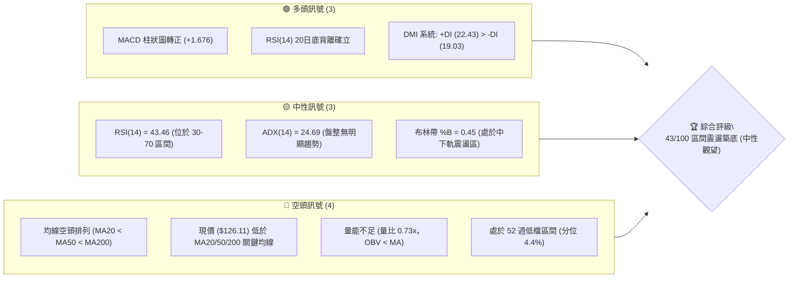
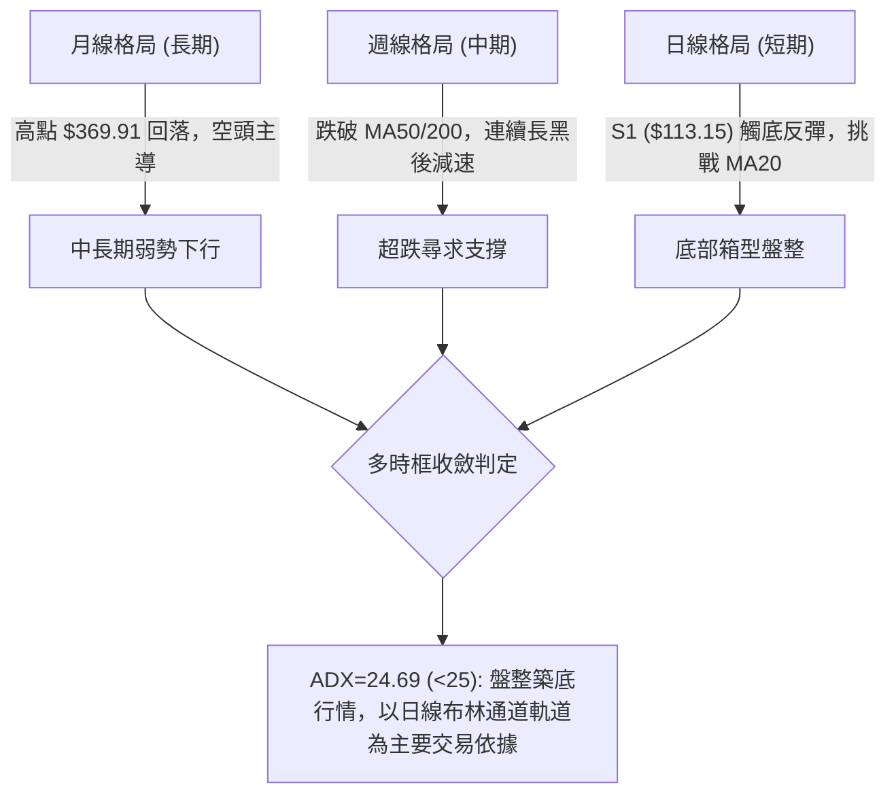
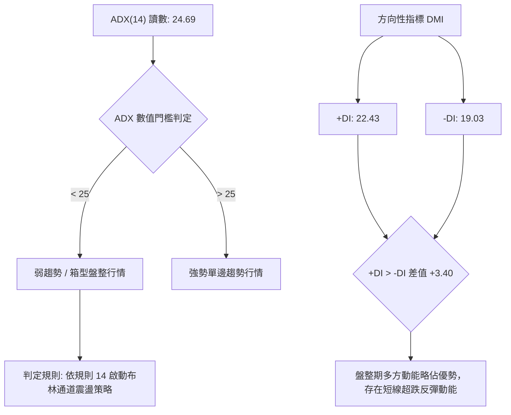
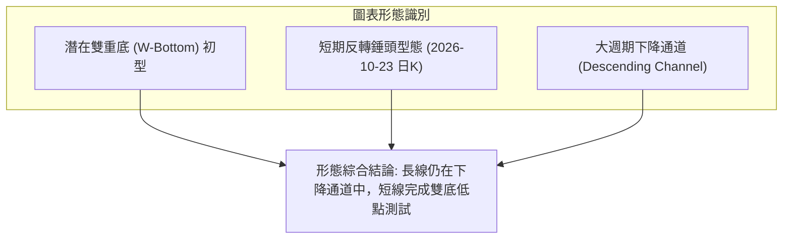
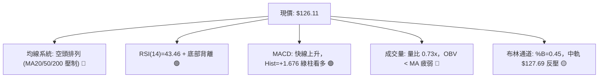
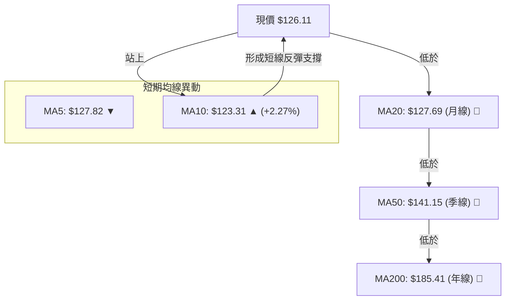
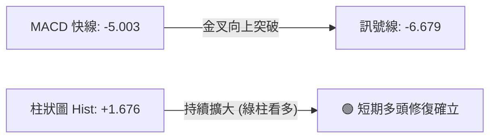
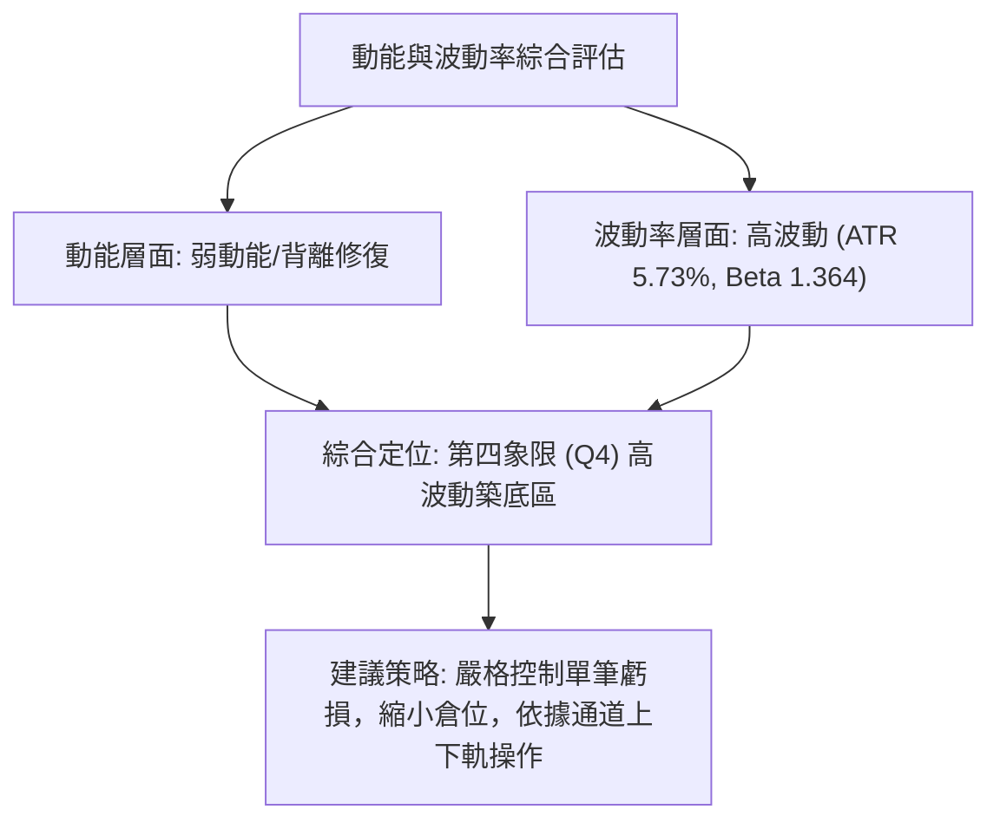
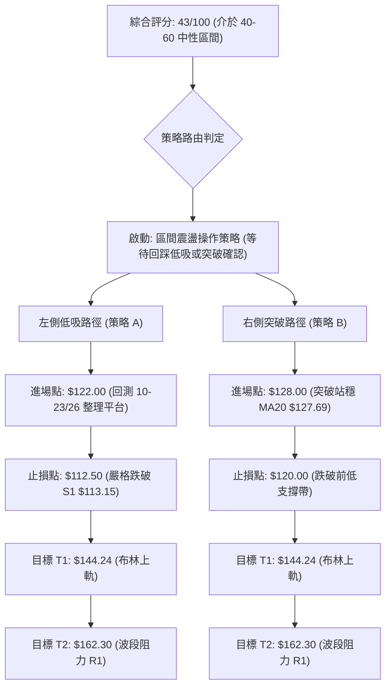
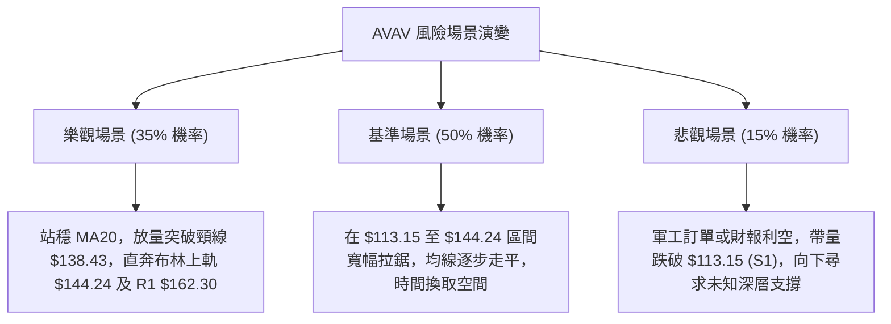

# AVAV 技術分析報告

> **報告日期**：2026-11-01 ｜ **語言**：繁體中文 ｜ **數據來源**：Yahoo Finance ｜ **當前價格**：$126.11

---

## 目錄

| 章節 | 內容 |
|------|------|
| [1. 技術面概覽](#1-技術面概覽) | 訊號儀表板、核心指標、評分卡 |
| [2. 趨勢分析](#2-趨勢分析) | 多時框趨勢、長中短期走勢、ADX 解讀 |
| [3. 圖表形態分析](#3-圖表形態分析) | 形態識別、K線組合、目標價推算 |
| [4. 支撐與阻力](#4-支撐與阻力) | 關鍵價位結構、斐波那契回調位深度解析 |
| [5. 技術指標深度解讀](#5-技術指標深度解讀) | 均線系統、RSI、MACD、布林通道、量價配合 |
| [6. 動能與波動率](#6-動能與波動率) | 動能四象限、ATR 波動度、Beta 系統風險 |
| [7. 多時框架總結](#7-多時框架總結) | 時框矩陣、多時框收斂與方向定調 |
| [8. 交易策略建議](#8-交易策略建議) | 策略路由、價格情境、主策略詳解、風控參數 |
| [9. 風險提示與監控](#9-風險提示與監控) | 關鍵監控清單、風險場景樹、倉位管理 |
| [📋 報告總結](#-報告總結) | 核心結論與最優操作路徑 |

---

## 1. 技術面概覽

### 🎯 技術訊號儀表板



### 📊 核心指標速覽表

| 指標類別 | 指標名稱 | 當前數值 | 訊號 | 解讀 |
|:---|:---|:---|:---:|:---|
| **價格** | 當前收盤價 | $126.11 | 🔴 | 位於 52 週低點上方僅 4.4% 處，整體空頭防守位 |
| **均線** | MA20 (月線) | $127.69 | 🔴 | 現價位於 MA20 下方 (-1.24%)，短期反彈承壓 |
| **均線** | MA50 (季線) | $141.15 | 🔴 | 中期趨勢線下行，現價落後 -10.66%，形成強阻力 |
| **均線** | MA200 (年線) | $185.41 | 🔴 | 長期空頭格局，現價大幅折價 -31.98% |
| **動能** | RSI(14) | 43.46 | 🟡 | 中性水準，但近 20 根 K 線首尾呈現明確底背離 🟢 |
| **動能** | MACD (12,26,9) | -5.003 / -6.679 | 🟢 | 快慢線負值收斂，柱狀圖為 +1.676，發出低檔黃金交叉訊號 |
| **動能** | 隨機指標 Stoch %K/%D | 51.27 / 61.70 | 🟡 | 位於中軸區間，短線動能暫時平衡 |
| **趨勢強度**| ADX(14) | 24.69 | 🟡 | 數值小於 25，屬於弱趨勢或箱型盤整行情 |
| **通道** | 布林通道 (%B) | 0.45 | 🟡 | 位於中軌 ($127.69) 與下軌 ($111.14) 間偏中軌震盪 |
| **波動** | ATR(14) | $7.23 (5.73%) | 🔴 | 每日波動幅度相對股價偏高，風險敞口需嚴格控制 |
| **成交量** | 20日成交量比 | 0.73x (1,037,800) | 🔴 | 成交量低於 20 日均量 (1.42M)，OBV < MA，量價背離 |

### 🏆 技術評分卡

```
╔════════════════════════════════════════════════════════════════╗
║                技術評分卡 — AVAV (2026-11-01)                   ║
╠════════════════════════════════════════════════════════════════╣
║ 趨勢強度 (ADX/方向)   ███████░░░░░░░░░░░░░  35/100  🔴 空頭主導 ║
║ 動能指標 (RSI/MACD)   ████████████░░░░░░░░  58/100  🟡 築底背離 ║
║ 支撐穩定度 (S1測試)   ██████████░░░░░░░░░░  52/100  🟡 探底回升 ║
║ 成交量配合 (量比/OBV) ███████░░░░░░░░░░░░░  38/100  🔴 量能疲弱 ║
║ 形態完整度 (K線/幾何) ██████████░░░░░░░░░░  50/100  🟡 雙底初型 ║
║ 均線排列 (空頭排列)   █████░░░░░░░░░░░░░░░  25/100  🔴 嚴重壓制 ║
╠════════════════════════════════════════════════════════════════╣
║ 綜合評分 (六項算術平均)████████░░░░░░░░░░░░  43/100  🟡 區間震盪 ║
╚════════════════════════════════════════════════════════════════╝
```

---

## 2. 趨勢分析

### 🌐 多時框趨勢分析



### 📈 長期趨勢 — 12個月走勢圖（Unicode）

以下為 AVAV 過去 12 個月（2025-11 至 2026-10）月線收盤價走勢圖與關鍵高低點標記：

```
AVAV 月線收盤走勢圖（過去12個月：2025-11 至 2026-10）
價格軸 ($)
$300 ┤ ● (2025-11: $279.46)
$270 ┤   ● (2026-01: $278.39)
$240 ┤     ● (2025-12: $241.89)  ● (2026-02: $252.25)
$210 ┤                               ● (2026-05: $207.24)
$180 ┤                         ● (2026-04: $195.02)
$180 ┤                   ● (2026-03: $183.05)
$150 ┤                                     ● (2026-06: $165.07)
$150 ┤                                       ● (07: $149.37)  ● (08: $148.35)
$140 ┤                                                 ● (09: $142.22)
$120 ┤                                                           ● (10: $126.11) ◄ 現價
     └─────────────────────────────────────────────────────────────────────────────
       11    12    01    02    03    04    05    06    07    08    09    10 (月份)
```

**走勢特徵分析表格**：

| 時間階段 | 起訖收盤價 | 區間漲跌幅 | 主要技術特徵與驅動因素 |
|:---|:---|:---:|:---|
| **2025-11 ~ 2026-01** | $279.46 → $278.39 | -0.38% | 歷史高點回落後的雙頂築頂階段，高檔換手劇烈 |
| **2026-02 ~ 2026-03** | $252.25 → $183.05 | -27.43% | 放量跌破 MA50，形成跳水破位下行走勢 |
| **2026-04 ~ 2026-05** | $195.02 → $207.24 | +6.27% | 弱勢反彈受制於下降通道上軌，未能回補跌幅 |
| **2026-06 ~ 2026-08** | $165.07 → $148.35 | -10.13% | 跌破 $150 整數關卡，各期均線呈發散空頭排列 |
| **2026-09 ~ 2026-10** | $142.22 → $126.11 | -11.33% | 下探 52 週最低點 $113.15 後收長下影線，出現減速跡象 |

### 📊 中期趨勢（週線分析）

中期走勢正處於持續下跌波段的末端。自 2026-09-18 創下波段反彈高點 $168.00（即阻力位 R2）後，週線展開連續 4 週的下挫行情，直至 2026-10-23 當週探底 $113.15（52 週低點兼支撐位 S1）後觸發技術性反彈。

```
週線關鍵支撐阻力結構示意：
$168.00 ───────────────────────── [中期重要阻力 R2 / 09-18 當週高點]
          \
$162.30 ───\───────────────────── [近一年波段阻力 R1]
            \
$144.24 ─────\─────────────────── [日線布林上軌 / 近期週K整理密集區]
              \
$126.11 ───────●───────────────── [當前收盤價]
                \
$113.15 ─────────┴─────────────── [52週低點強支撐 S1 / 10-23 週K長下影探底點]
```

### ⚡ 趨勢強度評估（ADX 解讀）



| 指標名稱 | 當前數值 | 參考門檻 | 當前技術意涵 |
|:---|:---:|:---:|:---|
| **ADX (14)** | 24.69 | 25.00 | 低於 25 臨界點，確立目前並非單邊強烈下殺趨勢，進入盤整震盪期 |
| **+DI (14)** | 22.43 | — | 多方力量自超跌區回升，形成短線反撲主力 |
| **-DI (14)** | 19.03 | — | 空方擴展動能減弱，賣壓暫時鈍化 |
| **趨勢綜合判斷** | **盤整築底** | — | **不宜追空，適宜在區間下軌尋找低吸反彈機會** |

---

## 3. 圖表形態分析

### 🔍 形態識別系統



**圖表形態信心度評估表**（依規則 15 嚴格評估）：

| 形態名稱 | 信心度 | 判斷依據（引用數據） | 完成度 | 目標價（附嚴謹計算式） |
|:---|:---:|:---|:---:|:---|
| **雙重底 (W-Bottom)** | **55%** | 兩次低點分別落於 2026-10-16 低點 $116.43 與 2026-10-23 低點 $113.15 (S1 支撐)；頸線位於 2026-10-29 高點 $138.43。 | 60% (尚未帶量突破頸線) | 頸線 $138.43 + 形態高度 ($138.43 - $113.15 = $25.28) = **$163.71**（接近波段阻力 R1 $162.30） |
| **短期反彈旗形** | 40% | 2026-10-29 大陽線衝高至 $138.43 後，10-30 縮量回踩 $126.11。 | 35% | 訊號不足，僅作布林帶通道震盪解讀，不預設延伸目標 |
| **長期下降通道** | **85%** | 2025-10 高點 $369.91 與 2026-05 反彈高點 $207.24 連線成阻力線；歷史低點連續下移。 | 90% | 通道下軌目前約在布林下軌 $111.14 至 S1 $113.15 區間 |

### 🕯️ 重要 K 線形態分析

依規則 19，以下嚴格限定依據數據中提供的近 10 根日 K 與近 8 根週 K 實際 OHLC 數據進行逐根辨識：

#### 近 10 根日 K 形態分析表

| 日期 (日K) | 開盤價 | 最高價 | 最低價 | 收盤價 | 成交量 | K線形態 | 專業解讀 | 訊號 |
|:---|:---:|:---:|:---:|:---:|:---:|:---|:---|:---:|
| **2026-10-19** | $122.88 | $123.00 | $117.05 | $117.90 | 1,416,500 | 實體黑K | 低開低走，空方持續宣洩賣壓 | 🔴 |
| **2026-10-20** | $117.50 | $121.00 | $116.30 | $117.63 | 1,134,200 | 窄幅十字星 | 實體僅 $0.13，多空陷入短暫平衡 | 🟡 |
| **2026-10-21** | $118.33 | $119.75 | $115.66 | $117.51 | 1,332,400 | 小陰線 | 弱勢抵抗，低點逐步下探 | 🔴 |
| **2026-10-22** | $117.26 | $122.22 | $114.26 | $117.70 | 1,528,200 | 長上下影紡錘線 | 盤中波動放大，多空激烈爭奪 | 🟡 |
| **2026-10-23** | $115.55 | $124.76 | $113.15 | $123.25 | 1,356,900 | **長下影錘頭反轉線** | 下探 52 週新低 $113.15 後強勁拉升，收最高點附近，奠定底背離基礎 | 🟢 |
| **2026-10-26** | $122.39 | $125.75 | $120.35 | $125.45 | 1,216,300 | 陽線推進 | 高開走高，確認 10-23 止跌訊號 | 🟢 |
| **2026-10-27** | $125.23 | $128.19 | $123.60 | $126.73 | 1,102,700 | 衝高回落小陽 | 觸及 MA20 均線壓力，多頭受阻 | 🟡 |
| **2026-10-28** | $126.72 | $126.91 | $123.85 | $125.95 | 833,000 | 縮量小陰紡錘線 | 成交量創近期新低，高檔蓄勢洗盤 | 🟡 |
| **2026-10-29** | $125.89 | $138.43 | $125.88 | $134.88 | 1,733,600 | **放量長紅突破K** | 實體達 $8.99，放量上衝突破布林中軌，短線強勢表態 | 🟢 |
| **2026-10-30** | $131.12 | $133.10 | $124.17 | $126.11 | 1,037,800 | 帶長上影中黑K | 高開低走回踩 MA20 ($127.69) 與 MA10 ($123.31) 區間，多頭獲利了結回吐 | 🔴 |

#### 近 8 根週 K 形態分析表

| 日期 (週K最後日) | 開盤價 | 最高價 | 最低價 | 收盤價 | 週成交量 | K線形態 | 專業解讀 | 訊號 |
|:---|:---:|:---:|:---:|:---:|:---:|:---|:---|:---:|
| **2026-09-11** | $146.37 | $159.24 | $138.31 | $146.71 | 20,402,600 | 爆量長下影十字線 | 巨量換手，確認底部具備逢低買盤 | 🟢 |
| **2026-09-18** | $145.80 | $168.00 | $144.51 | $159.95 | 11,272,600 | 長紅反彈線 | 創近期反彈高點 $168.00 (阻力 R2) | 🟢 |
| **2026-09-25** | $161.28 | $165.00 | $151.50 | $152.05 | 5,778,000 | 頂部吞噬陰線 | 受阻於 R2 回落，轉向弱勢調整 | 🔴 |
| **2026-10-02** | $149.77 | $151.30 | $138.31 | $140.82 | 6,770,400 | 中長黑K | 實體跌破 $145 支撐，空方再度主導 | 🔴 |
| **2026-10-09** | $142.28 | $145.44 | $134.25 | $137.11 | 7,559,200 | 連續陰跌K | 重心逐步下移，量能持續平淡 | 🔴 |
| **2026-10-16** | $137.10 | $137.50 | $116.43 | $121.79 | 8,156,300 | 恐慌跳水大長黑 | 殺出恐慌籌碼，RSI 觸及超賣區間 (28.6) | 🔴 |
| **2026-10-23** | $122.88 | $124.76 | $113.15 | $123.25 | 6,768,200 | **長下影錘頭週線** | 測試 52 週低點 $113.15 後強收十字紅K，止跌確認 | 🟢 |
| **2026-10-30** | $122.39 | $138.43 | $120.35 | $126.11 | 5,923,400 | 倒狀長上影小紅K | 衝高 $138.43 遇阻回落，週收盤站穩 10-23 低點之上 | 🟡 |

### 📉 ASCII 走勢形態示意圖

```
AVAV 日線「雙重底（W底）」初型示意圖：
價格
$140 ┤                   頸線壓力: $138.43 (10-29 高點)
     │                     ┌─●─┐
$130 ┤            ┌─●─────┘   │  ● (10-30 收盤: $126.11)
     │            │           │  
$120 ┤    ●───────┘           │
     │   / \                  │
$110 ┤──●───●────────────────┴────────────────
       第一底               第二底
    (10-16: $116.43)     (10-23: $113.15 = S1)
```

### 🎯 形態目標價計算

依據標準雙重底測量法則，若價格能有效收復頸線 $138.43，則量度漲幅計算如下：
1. **形態深度** = 頸線價格 ($138.43) − 第二底最低點 ($113.15) = **$25.28**
2. **第一量度目標價 (T1)** = 頸線價格 ($138.43) + 形態深度 ($25.28) = **$163.71**
   - *比對驗證*：該計算值極為接近由歷史波段高點計算出之阻力位 **R1 ($162.30)**（誤差僅 0.8%），為極高共振目標位。
3. **第二目標價 (T2)** = 引用波段阻力 **R2 ($168.00)**。

---

## 4. 支撐與阻力

### 🗺️ 關鍵價位分布圖（Unicode）

```
AVAV 關鍵價位結構分布圖
══════════════════════════════════════════════════════════════
$200.38 ║██████████████████████████████║ 強結構阻力 R3 (波段密集套牢區)
$176.30 ║████████████████████          ║ 斐波那契 78.6% 回調關鍵分水嶺
$168.00 ║████████████████              ║ 中期波段反彈高點 R2 (09-18 週K高點)
$162.30 ║██████████████████████        ║ 關鍵結構阻力 R1 (雙底形態量度目標)
$144.24 ║▓▓▓▓▓▓▓▓▓▓▓▓                  ║ 布林通道上軌阻力
$127.69 ║▒▒▒▒▒▒▒▒                      ║ 布林中軌 / MA20 短線爭奪位
$126.11 ╠══════════════════════════════╣ ◄ 當前收盤價 ($126.11)
$113.15 ║██████████████████████████████║ 核心支撐 S1 / 52週最低點
$111.14 ║▓▓▓▓▓▓▓▓                      ║ 布林通道下軌動態支撐
══════════════════════════════════════════════════════════════
```

### 🚧 阻力位分析表

所有價位嚴格引用自數據之「關鍵價位」聚類與布林數值：

| 阻力級別 | 價位 | 形成原因（依據數據） | 突破難度 | 重要性 |
|:---|:---:|:---|:---:|:---:|
| **動態阻力** | **$144.24** | 日線布林通道上軌，亦為 10-29 衝高 $138.43 後的上檔軌道限制 | 中等 🟡 | ★★★☆☆ |
| **強阻力 R1** | **$162.30** | 近一年波段高點聚類位 (+28.70%)，雙底形態量度目標區 | 困難 🔴 | ★★★★☆ |
| **關鍵阻力 R2**| **$168.00** | 近一年波段高點聚類位 (+33.22%)，2026-09-18 週K最高點 | 極高 🔴 | ★★★★★ |
| **天花板 R3** | **$200.38** | 近一年波段高點聚類位 (+58.89%)，MA240 ($200.84) 匯合處 | 極高 🔴 | ★★★★★ |

### 🛡️ 支撐位分析表

| 支撐級別 | 價位 | 形成原因（依據數據） | 守住機率 | 重要性 |
|:---|:---:|:---|:---:|:---:|
| **核心支撐 S1**| **$113.15** | 52 週最低點，近一年波段低點聚類唯一支撐位 (-10.28%) | 65% 🟢 | ★★★★★ |
| **動態支撐** | **$111.14** | 日線布林通道下軌極限支撐，超賣區緩衝墊 | 70% 🟢 | ★★★☆☆ |
| **次級支撐 S2**| *數據未偵測到* | 數據未提供波段低點聚類 S2，僅能依據布林下軌 $111.14 參考 | N/A | — |
| **深層支撐 S3**| *數據未偵測到* | 數據未提供波段低點聚類 S3，下方無聚類歷史數據 | N/A | — |

### 📐 斐波那契回調位分析

依據 52 週完整波動區間（高點 **$408.25** → 低點 **$113.15**，垂直落差 $295.10）之斐波那契回調水準：

| 回調比例 | 價位 | 距離現價幅度 | 技術意義解讀 |
|:---|:---:|:---:|:---|
| **0.0% (52W High)** | $408.25 | +223.72% | 歷史牛市高點 |
| **23.6%** | $338.61 | +168.50% | 第一強回調壓力區 |
| **38.2%** | $295.52 | +134.33% | 多空長期牛熊中樞 |
| **50.0%** | $260.70 | +106.72% | 50% 心理平衡位 |
| **61.8%** | $225.88 | +79.11% | 黃金分割強壓力 |
| **78.6%** | **$176.30** | **+39.80%** | **大週期深幅回調關鍵分水嶺** |
| **100.0% (52W Low)**| **$113.15** | **-10.28%** | **全週期築底底線 (即支撐 S1)** |

> **位置判定與技術含義**：
> 當前收盤價 **$126.11** 處於 **78.6% 回調位 ($176.30)** 與 **100.0% 低點 ($113.15)** 之間的極深回撤區間。這表明長線空頭已將先前牛市漲幅吞噬殆盡。現價距離 100% 低點僅有 10.28% 的緩衝空間，此處若跌破將引發空頭無量破位；反之，若在 100% 水平確立雙底，將具備向上回抽 78.6% ($176.30) 或 R1 ($162.30) 的超額風險報酬比。

---

## 5. 技術指標深度解讀

### 🎛️ 指標訊號總覽



### 📈 移動平均線排列分析



- **均線排列狀態**：當前 MA20 ($127.69) < MA50 ($141.15) < MA200 ($185.41)，長期至中期呈現標準**空頭排列**。
- **短期均線特徵**：值得注意的是 MA10 ($123.31) 呈現微幅上翹（+2.27%），現價 $126.11 成功站於 MA10 之上，且盤中一度挑戰 MA5 ($127.82) 與 MA20 ($127.69)，暗示短期內殺跌動能暫竭，進入均線扣抵修復期。

### 📉 RSI(14) 分析

進度條展示：
```
RSI(14) 讀數: 43.46
[0] ░░░░░░░░░░░░░░░░░░░░██████████████████░░░░░░░░░░░░░░░░░░░░░░░░ [100]
                    30 (超賣)           70 (超買)
                    當前點位: 43.46 (弱勢中性區)
```

- **背離判斷（重要）**：**確認存在底背離 (Bullish Divergence) 🟢**。
  - **價格走勢**：在近 20 根 K 線週期內，價格由 10 月中旬低點跌至 10-23 的最低價 $113.15，創下 52 週新低。
  - **指標走勢**：RSI(14) 在 10-16 週線錄得極端超賣低點 28.6，隨後在價格於 10-23 二度探底 $113.15 時，RSI 抬升至 36.2，日線 RSI 則回升至 43.46。指標低點未隨價格破底而創新低，首尾形成標準動能底背離，是技術面最強烈的短期反轉訊號。

### 📊 MACD(12/26/9) 訊號解讀



- **數值分析**：MACD 快線 (-5.003) 明顯向上穿越訊號線 (-6.679)，差離值擴展使得柱狀圖 Histogram 達到 **+1.676**。
- **訊號解讀**：儘管快慢線整體仍在零軸下方（反映大週期弱勢），但負值區的底部黃金交叉通常伴隨均線修復反彈，支撐短期價格挑戰布林中軌與上軌。

### 📦 布林通道分析

```
布林通道結構與現價相對位置：
$144.24 ────────────────────────────────── 上軌 (Upper Band)
            │
$127.69 ────┼───────────────────────────── 中軌 (20 MA) ◄ 關鍵反壓
$126.11 ────●───────────────────────────── 現價 (收盤價, %B = 0.45)
            │
$111.14 ────────────────────────────────── 下軌 (Lower Band) ◄ 動態支撐
```

- **帶寬與位置**：通道寬度為 $33.10 ($144.24 − $111.14)，%B 讀數為 **0.45**，價格緊貼中軌下方運行。
- **操作意涵**：在 ADX < 25 的盤整格局下，布林通道上下軌具備極高震盪參考價值。目前現價位於通道中軸偏下，提供下行防守緩衝，若能有效突破中軌 $127.69，將打開向上軌 $144.24 運行的通道空間。

### 💹 成交量分析（量價配合度）

- **量比檢驗**：最新成交量為 1,037,800 股，顯著低於 20 日均量 (1,420,355 股)，量比僅為 **0.73x**。
- **OBV 趨勢**：OBV 指標持續位於其均線下方（OBV < MA），反映機構性被動買盤居多，主動攻擊型追高意願薄弱。
- **量價背離特徵**：10-29 帶量上衝至 $138.43 後，10-30 回調時成交量萎縮至 1.03M，呈現典型的「漲放量、跌縮量」短線健康特徵；但整體成交量水準仍未越過 50 日均量 (1.74M)，表明反彈暫時以存量博弈與空頭回補為主。

---

## 6. 動能與波動率

### ⚡ 動能評估四象限

| 象限 | 動能狀態 | 波動率狀態 | 當前對應特徵 | 戰術意涵 |
|:---:|:---:|:---:|:---:|:---|
| **第一象限 (Q1)** | 強動能 | 低波動 | — | 趨勢穩健推進（非當前狀態） |
| **第二象限 (Q2)** | 弱動能 | 低波動 | — | 沉悶窄幅盤整（非當前狀態） |
| **第三象限 (Q3)** | 強動能 | 高波動 | — | 單邊突破行進中（非當前狀態） |
| **第四象限 (Q4)** | **弱動能 (中性)** | **高波動** | **✓ AVAV 處於此區** | **超跌震盪築底，ATR 達 5.73%，適合嚴設止損之區間逆向操作** |



### 📊 ATR 波動率分析

- **當前數值**：ATR(14) 讀數為 **$7.23**，佔現價之百分比高達 **5.73%**。
- **止損距離量化建議**：
  - *超短線噪聲防守 (1.0 × ATR)*：$7.23 距離 ➔ 對應現價止損位 $118.88。
  - *波段交易基準防守 (1.5 × ATR)*：$10.85 距離 ➔ 對應現價止損位 $115.26。
  - *結構性寬鬆防守 (2.0 × ATR)*：$14.46 距離 ➔ 對應現價止損位 $111.65（此處與布林下軌 $111.14 極度吻合）。

### 📐 Beta 與市場相關性

- **Beta 數值**：**1.364**。
- **系統性風險特徵**：該股具備高彈性（高 Beta）軍工無人機科技股屬性。在市場大盤波動時，AVAV 的放大效應為 1.36 倍。若大盤出現系統性回調，該股回撤深度將遠超防禦性板塊；相對地，一旦大盤企穩反彈，其短線彈性與獲利爆發力亦居前列。

---

## 7. 多時框架總結

### 📋 時框架評分表

| 時框架 | 趨勢方向 | 動能狀態 | 均線排列 | 圖表形態 | 綜合評分 | 操作建議 |
|:---|:---:|:---:|:---:|:---|:---:|:---|
| **長期 (月線)** | 下降 🔴 | 疲弱 🔴 | 空頭排列 (壓制) | 下降通道 | 30/100 | 嚴控長線多頭曝險 |
| **中期 (週線)** | 震盪偏空 🟡 | 觸底回溫 🟡 | 偏離均線過遠 | 雙底探底長下影 | 45/100 | 等待週線級底分型確認 |
| **短期 (日線)** | 區間震盪 🟡 | 底背離轉強 🟢 | 突破 MA10，受制 MA20 | 雙底雛形 + 錘頭線 | 54/100 | 區間低吸高拋，嚴守止損 |

### 🔲 綜合訊號矩陣

| 週期 / 維度 | 趨勢訊號 | 動能訊號 (RSI/MACD) | 均線排列 | 通道結構 | 最終權重方向 |
|:---|:---:|:---:|:---:|:---:|:---:|
| **月線層級** | 🔴 空頭 | 🔴 空頭 | 🔴 均線反壓 | 🔴 通道下軌 | 長期空頭承壓 |
| **週線層級** | 🔴 偏空 | 🟡 中性減速 | 🔴 空頭擴散 | 🟡 測試 S1 支撐 | 中期空頭衰竭 |
| **日線層級** | 🟡 盤整 | 🟢 多頭背離金叉 | 🟡 短天期回穩 | 🟢 通道下半區反彈 | 短期震盪偏多 |

### ⚖️ 多時框收斂結論

> **明確收斂判定（嚴格遵循規則 14）**：
> 1. **行情屬性判定**：當前 ADX(14) 讀數為 **24.69 (<25)**，嚴格滿足「**盤整行情**」定義，而非單邊趨勢行情。
> 2. **主導維度取捨**：依規則 14，在盤整行情中，中長期的均線空頭排列退居防守參考，交易視角全面切換至以**日線布林通道上下軌 ($111.14 – $144.24)** 與關鍵支撐阻力結構為主導之震盪交易區間。
> 3. **唯一方向性定調**：**區間震盪築底（中性偏多反彈觀望）**。
>    日線層級之 RSI 底背離、MACD 金叉綠柱與 10-23 長下影 Hammer 提供了較高勝率的左側及右側短多防禦點；但上檔面臨 MA50 ($141.15) 與布林上軌 ($144.24) 的沉重壓制。因此，拒絕盲目追高，主策略定調為**區間低吸反彈策略**。

---

## 8. 交易策略建議

### 🗺️ 策略決策流程圖



### 🧭 策略路由（依評分卡分流）

**當前主策略方向 = 區間震盪築底反彈（依評分 43/100 定調）**
> 評分落在 40–60 分之中性區間，且 ADX < 25。策略嚴禁單邊激進追高或過度看空，主要依據布林通道上下軌與波段高低點 S1/R1 進行逢低博弈反彈操作，耐心等待向上突破的確認訊號。

### 🎯 價格情境階梯（Price Scenarios）

價位嚴格引用自「關鍵價位」與計算數值：

| 觸發條件 | 下一目標 | 後續延伸 | 情境含義 |
|:---|:---:|:---:|:---|
| **有效跌破 S1 $113.15** | $111.14 (布林下軌) | 數據中未偵測到下方支撐 | 空頭全面破位，引發停損賣壓，轉為深淵探底 |
| **維持在 $120.00 – $130.00**| $127.69 (布林中軌) | $138.43 (10-29 高點) | 底部箱型消化浮額，指標修復中 |
| **帶量突破 R1 $162.30** | R2 $168.00 | R3 $200.38 (年線聚類) | 確立中期底部反轉，展開大級別回補行情 |

### 📊 情境機率分佈

| 情境劃分 | 機率 | 主要技術依據 |
|:---|:---:|:---|
| **情境一：區間震盪蓄勢** | **50%** | ADX 僅 24.69 (<25)，量比 0.73x 顯示主力暫未發動單邊行情；布林通道帶寬收窄，預期在 $113.15 – $144.24 區間反覆整固。 |
| **情境二：築底成功向上反彈**| **35%** | 日線 RSI 底背離確立，MACD 柱狀圖 (+1.676) 強勢翻紅，+DI > -DI 佔據短線優勢，具備回抽 R1 ($162.30) 潛力。 |
| **情境三：跌破 S1 破位下殺** | **15%** | 均線長期空頭排列，基本面虧損持續；若大盤劇烈回調，Beta (1.364) 效應可能導致 $113.15 失守。 |

### 🟢 主策略詳情（方向依上方路由）

所有目標價與止損點均精確計算，風險報酬比嚴格依規則 17 定義公式計算：
$$\text{風險報酬比} = \frac{\text{目標價 T1} - \text{進場價}}{\text{進場價} - \text{止損價}}$$

| 策略要素 | 策略 A：左側區間回踩低吸策略 | 策略 B：右側突破 MA20 跟進策略 |
|:---|:---|:---|
| **進場條件** | 價格回調測試 10-26 低點支撐獲企穩 | 盤中實體收盤突破並站穩 MA20 ($127.69) |
| **進場價格** | **$122.00** | **$128.00** |
| **止損價格** | **$112.50** (位於 S1 $113.15 下方，防範假跌破) | **$120.00** (失守 10-26 突破平台低點) |
| **目標價 T1** | **$144.24** (日線布林通道上軌) | **$144.24** (日線布林通道上軌) |
| **目標價 T2** | **$162.30** (關鍵阻力位 R1) | **$162.30** (關鍵阻力位 R1) |
| **風險報酬比** | **1 : 2.34（以 T1 計）**<br>*(計算式: (144.24 − 122.00) ÷ (122.00 − 112.50) = 22.24 ÷ 9.50 = 2.34)*<br>附：1 : 4.24（以 T2 計） | **1 : 2.03（以 T1 計）**<br>*(計算式: (144.24 − 128.00) ÷ (128.00 − 120.00) = 16.24 ÷ 8.00 = 2.03)*<br>附：1 : 4.29（以 T2 計） |
| **預估勝率** | 55% | 50% |
| **建議倉位** | 10% – 15% (輕倉試單) | 15% – 20% (順勢建倉) |

### 🔴 反向風險觸發點（對沖提示）

若出現以下情境，宣告區間築底多頭策略失效，應無條件執行風控或反手對沖：
1. **關鍵支撐破位**：日 K 線實體**收盤價跌破 S1 ($113.15)**，代表雙底支撐徹底瓦解，52 週大底被擊穿。
2. **量能異動破位**：跌破 $120.00 時伴隨單日成交量突破 200 萬股（量比 > 1.5x），確認機構籌碼不計代價拋售。
3. **動能再翻空**：MACD 柱狀圖在零軸下方再度由正轉負（紅柱縮短翻黑）。

### ⭐ 整體訊號強度評星

```
做多訊號強度：★★★☆☆  (3.0/5星) ── RSI底背離與MACD金叉支持短多，但受制大週期空頭
做空訊號強度：★★☆☆☆  (2.0/5星) ── ADX<25賣壓衰竭，S1支撐強勁，此處追空盈虧比極差
整體可信度：  ★★★☆☆  (3.5/5星) ── 箱型邊界清晰，具備嚴格量化止損空間
```

---

## 9. 風險提示與監控

### ✅ 關鍵監控指標 Checklist

```
╔════════════════════════════════════════════════════════════════╗
║                每日交易風控監控清單 (Checklist)                 ║
╠════════════════════════════════════════════════════════════════╣
║ [ ] 價格防線: 每日檢視收盤是否力守 S1 ($113.15) 之上           ║
║ [ ] 均線爭奪: 觀察盤中能否持續突破 MA20 ($127.69)               ║
║ [ ] 動能狀態: 監控 MACD 柱狀圖是否維持在正值區 (+1.676 以上)   ║
║ [ ] 波動警戒: 單日振幅若超過 ATR ($7.23)，即時檢視止損觸發     ║
║ [ ] 量能指標: 突破 $138.43 頸線時，日成交量需放大至 1.74M 以上║
║ [ ] 系統聯動: 留意 Nasdaq/國防軍工板塊走勢，防範 Beta=1.36 衝擊║
╚════════════════════════════════════════════════════════════════╝
```

### ⚠️ 風險場景分析



### 🛡️ 風險管理重要提醒

1. **ATR 風險控制與倉位管理**：
   - 當前 ATR 為 **$7.23 (5.73%)**，屬於顯著高波動股。依據單筆交易本金最大虧損 1% 風控模型計算：若賬戶規模為 $100,000，單筆可承擔風險為 $1,000。
   - 採用策略 A（風險距離 = $122.00 − $112.50 = $9.50），可建立股數為：
     $$\text{倉位股數} = \frac{\$1,000}{\$9.50} \approx 105 \text{ 股}$$
   - 對應持倉市值約為 $12,810（約佔總資金 12.8%），符合前述建議之輕倉試單比例。
2. **空頭排列警示**：
   - 切記長期趨勢（月線/MA200 $185.41）仍由空頭完全掌控。任何做多操作在本質上皆屬於**逆中長期趨勢之短線超跌反彈交易**，切忌貪婪，達到 T1 目標位必須嚴格分批平倉或拉高止損鎖定獲利。

---

## 📋 報告總結

```
AVAV 技術分析報告總結
════════════════════════════════════════════════════════
報告日期：2026-11-01
當前價格：$126.11
分析評級：⚖️ 43/100 區間震盪築底（中性觀望偏短多博弈）

關鍵結論：
├─ 長期趨勢：🔴 空頭主導（月線下降通道運行，MA200 反壓在 $185.41）
├─ 中期趨勢：🟡 跌勢減速（週線低檔出現長下影線 Hammer，殺跌動能鈍化）
├─ 短期趨勢：🟢 超跌反彈（RSI 呈現 20 日底背離，MACD 柱狀圖 +1.676 看多）
├─ 關鍵支撐：$113.15 (S1 核心支撐 / 52週低點)
├─ 關鍵阻力：$144.24 (布林上軌) / $162.30 (波段阻力 R1)
└─ 分析師目標：$213.07 (共識均價) / $148.57 (最低目標價)

最優策略組合：
1. 🥇 最佳機會：策略 A ── 回踩 $122.00 附近輕倉低吸，防守 $112.50，
               博弈反彈布林上軌 $144.24 (風報比 1 : 2.34)。
2. 🥈 次選機會：策略 B ── 突破站穩 MA20 ($127.69) 後於 $128.00 右側跟進，
               停損設於 $120.00，目標 $144.24 (風報比 1 : 2.03)。
3. 🥉 保守選擇：場外空倉觀望，直至價格帶量突破日線頸線 $138.43
               或週線級別均線扭轉後再行介入。
════════════════════════════════════════════════════════
```

---

> ⚠️ **免責聲明**：本報告為技術分析研究成果，所有數據、圖表及估算均嚴格基於所提供之歷史價格與指標資訊（OHLCV）。本報告**僅供學術研究與投資策略交流參考**，**不構成任何形式的個別投資邀約或買賣建議**。金融市場瞬息萬變，高 Beta 與高 ATR 標的具備較高回撤風險，投資人應獨立審慎評估，嚴格執行風控紀律，自負盈虧。

---

*報告生成時間：2026-11-01 ｜ 數據來源：Yahoo Finance ｜ 分析框架：多時框技術分析模型*