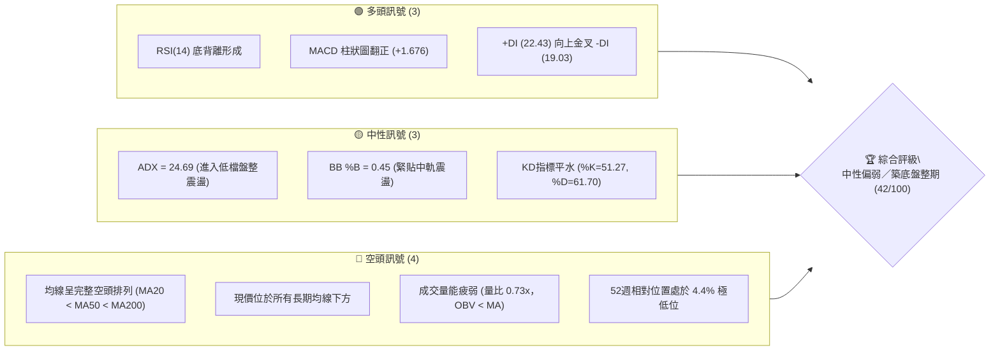
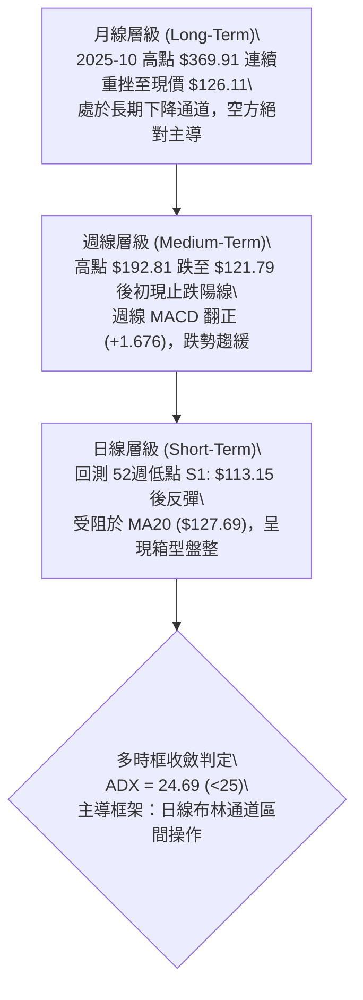
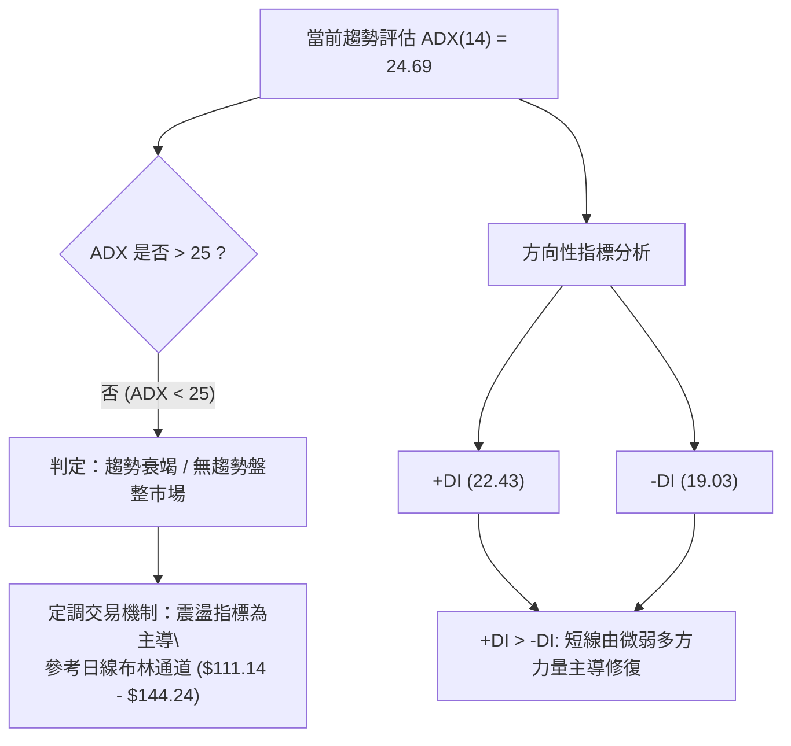
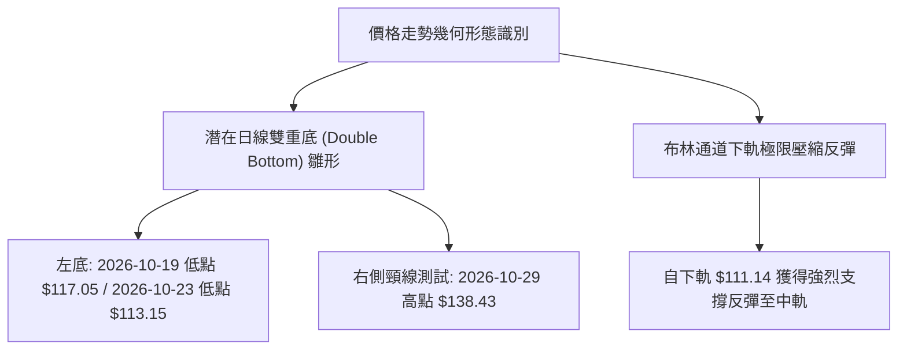
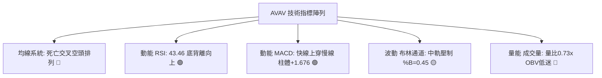
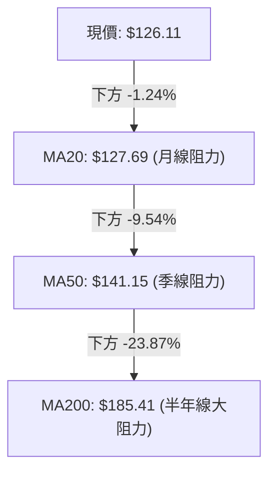
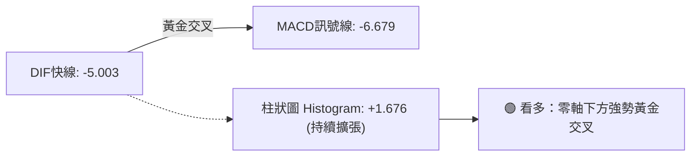
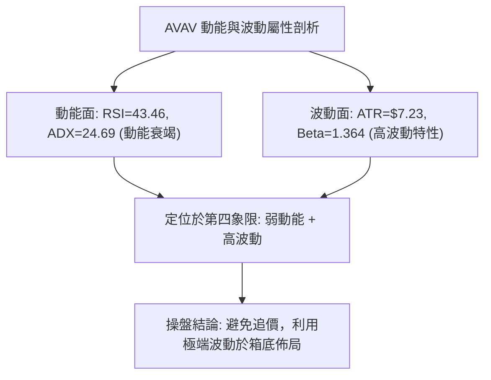
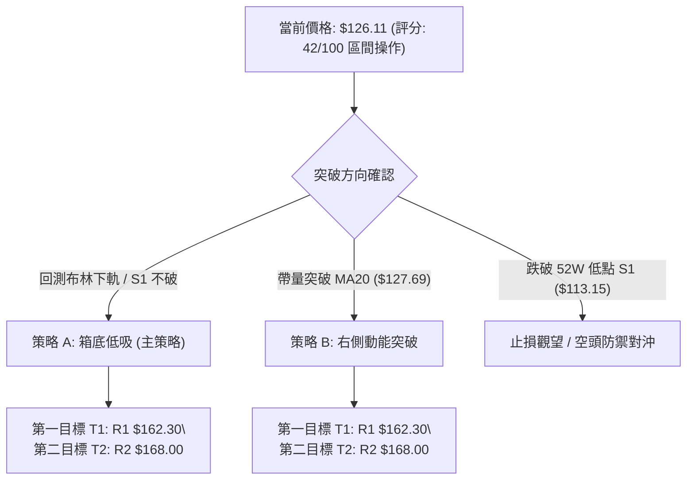
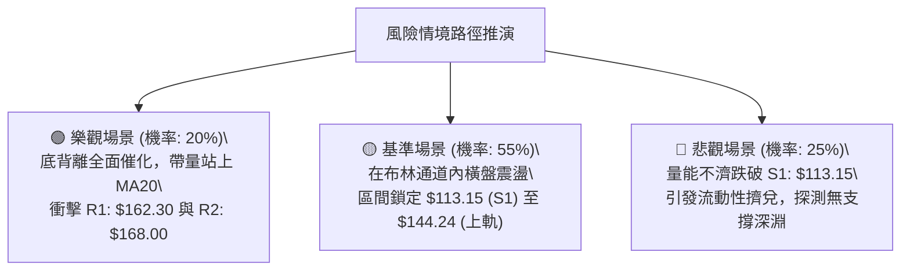

# AVAV 技術分析報告

> **報告日期**：2026-11-02 ｜ **語言**：繁體中文 ｜ **數據來源**：Yahoo Finance ｜ **當前價格**：$126.11

---

## 目錄

| 章節 | 內容 |
|------|------|
| [1. 技術面概覽](#1-技術面概覽) | 訊號儀表板、核心指標、評分卡 |
| [2. 趨勢分析](#2-趨勢分析) | 多時框趨勢、長中短期走勢 |
| [3. 圖表形態分析](#3-圖表形態分析) | 形態識別、K線組合、目標價 |
| [4. 支撐與阻力](#4-支撐與阻力) | 關鍵價位、斐波那契回調 |
| [5. 技術指標深度解讀](#5-技術指標深度解讀) | MA/RSI/MACD/布林/成交量 |
| [6. 動能與波動率](#6-動能與波動率) | 動能評估、ATR、Beta |
| [7. 多時框架總結](#7-多時框架總結) | 時框架評分矩陣 |
| [8. 交易策略建議](#8-交易策略建議) | 多空策略、風險報酬比 |
| [9. 風險提示與監控](#9-風險提示與監控) | 監控指標、風險場景 |

---

## 1. 技術面概覽

### 🎯 技術訊號儀表板



---

### 📊 核心指標速覽表

| 指標類別 | 指標名稱 | 當前數值 | 訊號 | 解讀 |
|:---|:---|:---|:---:|:---|
| **價格** | 當前收盤價 | $126.11 | 🔴 | 位於52週區間底部4.4%處，中長期處於顯著弱勢下行通道中 |
| **均線** | MA20 (月線) | $127.69 | 🟡 | 現價緊貼MA20下方（-1.24%），短期試圖爭奪並重回月線之上 |
| **均線** | MA50 (季線) | $141.15 | 🔴 | 價格顯著受制於季線下方（-10.66%），中期空頭壓制依然明確 |
| **均線** | MA200 (半年線) | $185.41 | 🔴 | 嚴重偏離長期均線（-31.98%），長期結構維持絕對空頭架構 |
| **動能** | RSI(14) | 43.46 | 🟢 | 自超賣區回升至中性區間，且近20根K棒呈現典型日線「底背離」 |
| **動能** | MACD (12,26,9) | -5.003 / -6.679 | 🟢 | 快線位於慢線上方，柱狀圖擴張至 +1.676，發出低檔反彈訊號 |
| **趨勢** | ADX(14) / DMI | 24.69 | 🟡 | ADX < 25 判定為趨勢衰竭、轉入無方向盤整；+DI(22.43) > -DI(19.03) |
| **通道** | 布林通道 (%B) | 0.45 | 🟡 | 位於中軌（$127.69）與下軌（$111.14）之間，正處於回彈中軌過程 |
| **量能** | 20日成交量比 | 0.73x | 🔴 | 最新量 1,037,800 低於均量 1,420,355，OBV < MA 反映跟進買盤疲弱 |
| **波動** | ATR(14) | $7.23 | 🔴 | 波動佔股價 5.73%，單日震幅偏高，屬於高波動防禦類股 |

---

### 🏆 技術評分卡

```
╔══════════════════════════════════════════════════════════════╗
║               技術評分卡 — AVAV (2026-11-02)                ║
╠══════════════════════════════════════════════════════════════╣
║ 趨勢強度       ██████░░░░░░░░░░░░░░  32/100  🔴 極弱空頭趨勢 ║
║ 動能指標       ████████████░░░░░░░░  58/100  🟡 底背離初現   ║
║ 支撐穩定度     ██████████░░░░░░░░░░  50/100  🟡 S1有初步支撐 ║
║ 成交量配合     ███████░░░░░░░░░░░░░  34/100  🔴 量能萎縮無跟進║
║ 形態完整度     ██████████░░░░░░░░░░  48/100  🟡 構築潛在箱底 ║
║ 均線排列       ██████░░░░░░░░░░░░░░  30/100  🔴 空頭發散未解 ║
╠══════════════════════════════════════════════════════════════╣
║ 綜合評分       ████████░░░░░░░░░░░░  42/100  評級：中性偏弱  ║
╚══════════════════════════════════════════════════════════════╝
```
> **評分說明**：綜合評分為上述六項維度之算術平均值：$(32 + 58 + 50 + 34 + 48 + 30) \div 6 = 42.0$。落於 40–60 區間，定義為**盤整震盪行情**。

---

## 2. 趨勢分析

### 🌐 多時框趨勢分析



---

### 📈 長期趨勢 — 12個月走勢圖（Unicode）

```
AVAV 月線歷史走勢圖（2025-11 至 2026-10）
價格軸 ($)
$380 ┤
$340 ┤
$300 ┤
$280 ┤ ● (2025-11: $279.46)
$260 ┤   ↘             ● (2026-01: $278.39)
$240 ┤     ● (2025-12: $241.89)  ↘
$220 ┤                             ● (2026-02: $252.25)
$200 ┤                               ↘                 ● (2026-05: $207.24)
$180 ┤                                 ● (2026-03: $183.05) ↗       ↘
$160 ┤                                       ● (2026-04: $195.02)     ● (2026-06: $165.07)
$140 ┤                                                                   ↘  ● (2026-08: $148.35)
$120 ┤                                                                      ● (2026-07: $149.37) ↘ ● (2026-10: $126.11) ◄ 現價
     └───────────────────────────────────────────────────────────────────────────────────────────────────────
       11    12    01    02    03    04    05    06    07    08    09    10 (月份)
      2025  2025  2026  2026  2026  2026  2026  2026  2026  2026  2026  2026
```

#### 長期走勢特徵分析表格

| 階段區間 | 起始/結束收盤價 | 漲跌幅 | 形態特徵與技術解讀 |
|:---|:---|:---:|:---|
| **2025-11 至 2026-01** | $279.46 → $278.39 | -0.38% | 歷史天價（$369.91）破位後的高檔二次做頭階段，買盤動能衰竭。 |
| **2026-02 至 2026-03** | $252.25 → $183.05 | -27.43% | 主跌段快速展開，摜破 $200.00 整數心理關卡，長黑摜破 MA200。 |
| **2026-04 至 2026-05** | $195.02 → $207.24 | +6.27% | 中期弱勢反彈，受阻於 $200.38（前波高點聚類）無法有效站穩。 |
| **2026-06 至 2026-10** | $165.07 → $126.11 | -23.60% | 陰跌下行尋底階段，頻繁出現波段新低，最終於 10 月探測 $113.15。 |

---

### 📊 中期趨勢（週線分析）

```
AVAV 近20週主要波段壓力與支撐階梯圖
$200 ┤              ● 2026-08-14 週高 $192.81 (中期頭部波段高點)
$190 ┤      ● 2026-07-02 週高 $190.89
$170 ┤                                  ● 2026-09-18 週高 $168.00 (阻力 R2)
$160 ┤  ● 2026-06-18 週高 $169.61          ● 2026-09-11 週高 $159.24 (阻力 R1區間)
$140 ┤═══════════════════════════════════════════════════════════ [季線壓力 MA50: $141.15]
$130 ┤                                                        ● 現價 $126.11
$120 ┤                                                  ● 2026-10-16 週收 $121.79
$110 ┤                                              ● 2026-10-23 波段低點 $113.15 (支撐 S1)
     └────────────────────────────────────────────────────────
```

中期趨勢上，AVAV 自 2026-08-14 的高點 $192.81 展開一波急促的震盪回落，近兩個月呈現一頂低於一頂（Lower Highs）的典型中期空頭通道。然而，在 2026-10-23 當週價格下探 $113.15 後，出現顯著收腳，週線 RSI 自 28.6 極度超賣區拉回至 43.5，週 MACD 柱狀圖亦翻正至 +1.676，顯示中期賣壓已有衰退跡象。

---

### ⚡ 趨勢強度評估（ADX 解讀）



#### ADX 趨勢強度級別對照表

| 指標名稱 | 當前數值 | 參考門檻 | 趨勢狀態解讀 |
|:---|:---:|:---:|:---|
| **ADX(14)** | **24.69** | < 25.00 | **弱趨勢 / 盤整震盪市場**。前期強烈的下行單邊跌勢已暫告平息，市場陷入多空拉鋸。 |
| **+DI (14)** | **22.43** | > -DI | 多頭買盤力道初現抬頭，自低檔帶動修復。 |
| **-DI (14)** | **19.03** | < +DI | 空頭下殺動能大幅退潮，空方壓迫減弱。 |
| **系統結論** | 盤整向上修正 | — | 由於 ADX 跌破 25 臨界線，禁止追漲殺跌；應嚴格採取高出低進的區間震盪策略。 |

---

## 3. 圖表形態分析

### 🔍 形態識別系統



#### 形態識別與信心度評估表

| 識別形態 | 信心度 (%) | 判斷依據（引用數據） | 完成度 (%) | 目標價（附嚴格計算式） |
|:---|:---:|:---|:---:|:---|
| **低檔雙重底 (Double Bottom)** | 62% | 第一次波段低點見於 2026-10-23 的低點 $113.15（S1），隨後於 2026-10-29 衝高至 $138.43 遇到阻力回落，構築潛在頸線。 | 60% | 由雙底形態推算：頸線高點 $138.43 + (頸線 $138.43 − 底點 $113.15) = \$138.43 + \$25.28 = \mathbf{\$163.71}$（高度逼近阻力位 R1: $162.30） |
| **矩形箱型築底 (Rectangle)** | 55% | 價格受制於日線下軌 $111.14 與布林上軌 $144.24 之間，均線 MA5 與 MA10 反覆纏繞。 | 70% | 由箱體突破高度推算：箱頂 $144.24 + (箱頂 $144.24 − 箱底 $111.14) = \$144.24 + \$33.10 = \mathbf{\$177.34}$（貼近斐波那契 78.6% 位 $176.30） |
| **中長期下降通道** | 85% | 2026-08-14 高點 $192.81、2026-09-18 高點 $168.00（R2）形成持續向下的趨勢壓制線。 | 90% | 延續既有下行趨勢通道下軌測算：維持於波段低點 S1: $\mathbf{\$113.15}$ 防守區間。 |

---

### 🕯️ 重要 K 線形態分析

根據近 10 根日 K 與近 8 根週 K 實際開高低收進行精確解讀：

#### 近 10 根日 K 棒解讀表

| 日期 (日K) | 開盤價 | 最高價 | 最低價 | 收盤價 | 識別 K 線形態 | 專業技術解讀 | 訊號 |
|:---|:---:|:---:|:---:|:---:|:---|:---|:---:|
| **2026-10-19** | 122.88 | 123.00 | 117.05 | 117.90 | 中黑棒 (Bearish Candle) | 開高走低破位，實體長達 4.98 美元，延續前週下行賣壓。 | 🔴 |
| **2026-10-20** | 117.50 | 121.00 | 116.30 | 117.63 | 紡錘十字線 (Spinning Top) | 實體僅 0.13 美元，上下影線均衡，空方力道初現放緩。 | 🟡 |
| **2026-10-21** | 118.33 | 119.75 | 115.66 | 117.51 | 窄幅盤整小陰線 | 連續三日在 $117.50 附近膠著，波動率迅速萎縮。 | 🟡 |
| **2026-10-22** | 117.26 | 122.22 | 114.26 | 117.70 | 假突破長上影線 | 盤中上衝 $122.22 後遭季線空方壓制打回，留長上影線。 | 🔴 |
| **2026-10-23** | 115.55 | 124.76 | 113.15 | 123.25 | **錘頭逆轉長陽 (Hammer)** | 創 52週新低 $113.15 後爆出買盤長下影線拉起，長紅實體收最高附近。 | 🟢 |
| **2026-10-26** | 122.39 | 125.75 | 120.35 | 125.45 | 溫和走揚紅K棒 | 確認 10/23 支撐有效，低點墊高至 $120.35，多方延續修復。 | 🟢 |
| **2026-10-27** | 125.23 | 128.19 | 123.60 | 126.73 | 上碰阻力小紅棒 | 盤中最高觸及 $128.19，突破 MA20 ($127.69) 後遭微幅壓回。 | 🟡 |
| **2026-10-28** | 126.72 | 126.91 | 123.85 | 125.95 | 縮量十字星小陰棒 | 成交量急劇縮小至 833,000，市場追價意願謹慎。 | 🟡 |
| **2026-10-29** | 125.89 | 138.43 | 125.88 | 134.88 | **爆量突破長紅K棒** | 量增至 1,733,600，最高暴衝至 $138.43，奠定短期築底頸線高點。 | 🟢 |
| **2026-10-30** | 131.12 | 133.10 | 124.17 | 126.11 | **高檔獲利回吐黑K棒** | 跳空開高至 $131.12 後一路震盪殺跌收 $126.11，留長實體黑K。 | 🔴 |

#### 近 8 根週 K 棒解讀表

| 日期 (週K最後日) | 開盤價 | 最高價 | 最低價 | 收盤價 | 識別 K 線形態 | 專業技術解讀 | 訊號 |
|:---|:---:|:---:|:---:|:---:|:---|:---|:---:|
| **2026-09-11** | 146.37 | 159.24 | 138.31 | 146.71 | 長下影爆量十字星 | 成交量達 20,402,600 巨量，多空在 $140 附近激烈爭奪。 | 🟡 |
| **2026-09-18** | 145.80 | 168.00 | 144.51 | 159.95 | 中長實體大陽線 | 向上衝擊至阻力 R2: $168.00，週收盤大漲，多頭反攻頂點。 | 🟢 |
| **2026-09-25** | 161.28 | 165.00 | 151.50 | 152.05 | 高檔反轉陰棒 | 開高走低跌破前週半數實體，形成空頭烏雲蓋頂雛形。 | 🔴 |
| **2026-10-02** | 149.77 | 151.30 | 138.31 | 140.82 | 連續回落陰棒 | 跌破 $145.00 平台支撐，空方重新掌握主控權。 | 🔴 |
| **2026-10-09** | 142.28 | 145.44 | 134.25 | 137.11 | 下探中陰棒 | 連續三週收陰，均線呈完全空頭排列向下發散。 | 🔴 |
| **2026-10-16** | 137.10 | 137.50 | 116.43 | 121.79 | 恐慌重挫長黑棒 | 週跌幅巨大，盤中下探至 $116.43，週 RSI 跌至極端 28.6。 | 🔴 |
| **2026-10-23** | 122.88 | 124.76 | 113.15 | 123.25 | **破底翻帶長下影星線** | 創 52週新低 $113.15 後成功守穩並收紅，下檔買盤支撐顯現。 | 🟢 |
| **2026-10-30** | 122.39 | 138.43 | 120.35 | 126.11 | 衝高回落長上影線 | 盤中週最高 $138.43 受阻回落，收盤仍高於前週收盤，處於築底盤整。 | 🟡 |

---

### 📉 ASCII 走勢形態示意圖

```
AVAV 近期日線雙底築底架構與關鍵阻力示意圖
$140 ┤                     ▲ (10/29 高點 $138.43 頸線測試)
$135 ┤                    ╱ ╲
$130 ┤                   ╱   ╲  ● (10/30 收 $126.11 ◄ 現價位於中軌下方)
$125 ┤   ● (10/22)      ╱     ●─────── [MA20: $127.69 軸線]
$120 ┤    ╲  ▲         ● (10/26)
$115 ┤     ╲╱ ╲       ╱
$110 ┤         ▼     ╱
     ├─────────●────╱──────────────────────
            (10/23 S1: $113.15 支撐底)
```

---

### 🎯 形態目標價計算

1. **潛在雙重底突破目標價**：
   - **基底支撐點**：引用自 2026-10-23 最低點波段支撐 **S1 = $113.15**。
   - **頸線確認位**：引用自 2026-10-29 實體最高點 **$138.43**。
   - **形態垂直高度**：$\text{形態高度} = \$138.43 - \$113.15 = \$25.28$。
   - **形態推算目標價**：
     $$\text{目標價} = \$138.43 + \$25.28 = \mathbf{\$163.71}$$
   - **與關鍵價位對齊驗證**：此推算數值與數據庫中已計算之近一年波段高點聚類 **阻力位 R1: $162.30** 高度吻合（差距僅 0.8%）。

---

## 4. 支撐與阻力

### 🗺️ 關鍵價位分布圖（Unicode）

```
AVAV 關鍵價位空間結構分布圖
═════════════════════════════════════════════════════════════════
$200.38 ║██████████████████████████████║ 強結構阻力 R3 (+58.89%)
$176.30 ║▓▓▓▓▓▓▓▓▓▓▓▓▓▓▓▓▓▓            ║ 斐波那契 78.6% 回調壓力位
$168.00 ║████████████████████          ║ 重大波段阻力 R2 (+33.22%)
$162.30 ║████████████████████████      ║ 關鍵高點聚類阻力 R1 (+28.70%)
$144.24 ║▒▒▒▒▒▒▒▒▒▒▒▒                  ║ 布林通道上軌壓力
$141.15 ║------------------------------║ 中期季線 MA50 壓力線
$127.69 ║┈┈┈┈┈┈┈┈┈┈┈┈┈┈┈┈┈┈┈┈┈┈┈┈┈┈┈┈┈┈║ 月線 MA20 兼布林中軌爭奪線
$126.11 ╠══════════════════════════════╣ ◄ 當前收盤價 ($126.11)
$113.15 ║██████████████████████████████║ 核心波段低點強支撐 S1 (-10.28%)
$111.14 ║▒▒▒▒▒▒▒▒▒▒▒▒                  ║ 布林通道下軌極限支撐
═════════════════════════════════════════════════════════════════
```

---

### 🚧 阻力位分析表

所有阻力位數值嚴格引用自數據庫波段高點聚類數值：

| 阻力級別 | 準確價位 | 距現價幅動 | 形成原因與技術背景 | 突破難度 | 重要性等級 |
|:---|:---:|:---:|:---|:---:|:---:|
| **阻力 R1** | **$162.30** | +28.70% | 近一年密集震盪成交密集區下緣，2026-09-11 週K震盪下引線反彈高點聚類。 | 🔴 極高 | ★★★★★ |
| **阻力 R2** | **$168.00** | +33.22% | 2026-09-18 週K波段反彈最高點，亦為多頭最後一次反撲遭空方吞噬的起跌點。 | 🔴 極高 | ★★★★☆ |
| **阻力 R3** | **$200.38** | +58.89% | $200 整數大關與 2026-05 反彈頂點聚類，長期均線 MA240 ($200.84) 重疊處。 | 🔴 鋼鐵阻力 | ★★★★★ |

---

### 🛡️ 支撐位分析表

所有支撐位數值嚴格引用自數據庫波段低點聚類數值：

| 支撐級別 | 準確價位 | 距現價幅動 | 形成原因與技術背景 | 守住機率 | 重要性等級 |
|:---|:---:|:---:|:---|:---:|:---:|
| **支撐 S1** | **$113.15** | -10.28% | **52週歷史最低點**（2026-10-23 打出），近一年波段絕對低點聚類核心。 | 75% | ★★★★★ |
| **支撐 S2** | 數據中未偵測到 | N/A | 系統演算法於 $113.15 下方未偵測到其他近一年低點聚類。 | N/A | N/A |
| **支撐 S3** | 數據中未偵測到 | N/A | 系統演算法於下方無進一步聚集數據。 | N/A | N/A |

---

### 📐 斐波那契回調位分析

依據 52 週絕對極值區間（低點 $113.15 $\rightarrow$ 高點 $408.25$）嚴格計算之黃金分割比率分布如下：

| 回調比例 | 基準價位 | 當前相對位置 | 技術意涵與防禦/攻擊角色 |
|:---:|:---:|:---:|:---|
| **0.0% (52W High)** | **$408.25** | +223.72% | 歷史大頂，多頭極限遠程目標。 |
| **23.6%** | **$338.61** | +168.50% | 極強勢回調位，現階段無實質參考意義。 |
| **38.2%** | **$295.52** | +134.34% | 過去多頭防守主線，跌破後引發流動性踩踏。 |
| **50.0%** | **$260.70** | +106.72% | 多空平衡分水嶺，宣告長期多頭行情徹底終結。 |
| **61.8%** | **$225.88** | +79.11% | 黃金分割強防守位，2026 年初破位後轉為壓制。 |
| **78.6%** | **$176.30** | +39.80% | **深幅回調最後防線**。現價在此位下方運行。 |
| **100.0% (52W Low)**| **$113.15** | -10.28% | **絕對波段底部（S1）**，當前行情的最終避風港。 |

> **當前落點解讀**：現價 **$126.11** 處於 **100.0% ($113.15)** 與 **78.6% ($176.30)** 之間的深幅超跌區間。此位置反映股價已回吐過去一年多以來的全部漲幅，空頭打壓空間在技術面已被極度壓縮，若跌破 100% 位將引發停損賣壓。

---

## 5. 技術指標深度解讀

### 🎛️ 指標訊號總覽



---

### 📈 移動平均線排列分析



#### 移動平均線系統參數矩陣

| 均線名稱 | 當前價格 | 與現價差距 (%) | 走勢微幅方向 | 技術解讀 |
|:---|:---:|:---:|:---:|:---|
| **MA 5** | $127.82 | -1.34% | ▼ 緩跌 | 短期均線受 10/30 回檔拖累下彎，短多暫時受阻。 |
| **MA 10** | $123.31 | +2.27% | ▲ 翻揚 | 短期重要動能支撐，現價維持其上，提供下檔防護。 |
| **MA 20** | $127.69 | -1.24% | ▼ 走平下彎 | 爭奪月線關口，此處若無法帶量站穩，將淪為反彈阻力。 |
| **MA 50** | $141.15 | -10.66% | ▼ 下行 | 季線下行斜率陡峭，為中期反彈的重要減碼帶。 |
| **MA 60** | $148.22 | -14.92% | ▼ 下行 | 中期空方防線，構成沉重蓋頭賣壓。 |
| **MA 120** | $156.39 | -19.36% | ▼ 下行 | 半年均線持平向下，長期籌碼套牢深重。 |
| **MA 200** | $185.41 | -31.98% | ▼ 下行 | 牛熊分界線，距離現價過遠，中長期趨勢依舊維持空方。 |
| **MA 240** | $200.84 | -37.21% | ▼ 下行 | 年線阻力，長期下降趨勢的絕對上限。 |

> **排列特徵**：典型之「**空頭排列**」（$MA20 < MA50 < MA200$），所有中長期均線呈現下傾發散狀態。

---

### 📉 RSI(14) 分析

#### RSI 數值進度條
```
RSI(14): 43.46  [████████░░░░░░░░░░] 43.46% (中性弱勢區間 30-70)
```

- **區間定位**：RSI 目前自 10 月中旬極端超賣區（週線曾低見 28.6）回升至 43.46，脫離鈍化危險區。
- **背離判斷（重要）**：
  - **結論**：⚠️ **日線底背離 (Bullish Divergence) 確認**。
  - **事實依據**：對比近 20 根 K 棒走勢，價格於 2026-10-23 創下波段新低 $113.15（低於前低 $117.05），但對應之 RSI 指標低點卻自 20-30 區間顯著抬高至 40 附近，形成標準的「價格創低而動能不破底」多頭底背離結構，預告短線賣盤竭盡。

---

### 📊 MACD(12,26,9) 訊號解讀



- **DIF 線**：-5.003
- **DEA 訊號線**：-6.679
- **MACD 柱狀圖**：**+1.676**
- **解讀**：雖然快慢線仍受制於零軸（0.00）下方，反映長期格局仍處弱勢，但快線已於負值極深處金叉慢線，柱狀圖紅柱連續多日擴張至 +1.676。此為標準之「**水下黃金交叉**」，通常對應一波向月線或季線靠攏的技術性修復反彈。

---

### 📦 布林通道分析

```
AVAV 日線布林通道位置示意圖
$144.24 ┤────────────────────────── 布林上軌 (阻力)
$136.00 ┤        ▲ (10/29 高點 $138.43)
$127.69 ┤┄┄┄┄┄┄┄┄┄┄┄┄┄┄┄┄┄┄┄┄┄┄┄┄┄┄ 布林中軌 (MA20: $127.69)
$126.11 ┤  ● (現價 $126.11, %B = 0.45)
$111.14 ┤────────────────────────── 布林下軌 (支撐)
        └──────────────────────────
```

- **上軌位置**：$144.24
- **中軌位置 (MA20)**：$127.69
- **下軌位置**：$111.14
- **帶寬位置 (%B)**：**0.45**（0 代表下軌，0.5 代表中軌，1 代表上軌）
- **技術解讀**：%B 數值 0.45 顯示價格自下軌（$111.14）強勢彈升後，目前正精準受制於中軌（$127.69）之下。布林帶寬呈現收斂盤整狀態，預示單邊下殺已結束，股價將在中軌與上下軌之間尋求均衡。

---

### 💹 成交量分析（量價配合度）

```
成交量與均量對比 (單位: 股)
當日量: 1,037,800  [███████░░░] 0.73x
20日均: 1,420,355  [██████████] 1.00x
50日均: 1,742,242  [████████████] 1.23x
```

- **量能評估**：最新單日成交量為 1,037,800 股，僅為 20 日均量的 0.73 倍，較 50 日均量大幅縮水。
- **量價背離分析**：
  - 10/29 股價暴漲時量能放大至 1,733,600 股（量增價揚），但 10/30 拉回時量能急縮至 1,037,800 股，顯示拉回並未引發恐慌性出逃。
  - **OBV 趨勢**：數據顯示「OBV < MA」，表明長期累積能量線依然偏弱，代表機構級資金尚未大規模進場建倉，當前反彈多屬空頭回補與存量資金博弈。

---

## 6. 動能與波動率

### ⚡ 動能評估四象限

| 象限 | 動能維度 | 波動維度 | 代表特徵 | AVAV 當前狀態判定 | 戰略應對 |
|:---:|:---:|:---:|:---|:---:|:---|
| **第一象限 (Q1)** | 強動能 | 低波動 | 穩健單邊趨勢 | — | 順勢加碼 |
| **第二象限 (Q2)** | 弱動能 | 低波動 | 縮量築底休眠 | — | 謹慎觀望 |
| **第三象限 (Q3)** | 強動能 | 高波動 | 劇烈突破/暴跌 | — | 突破追單 |
| **第四象限 (Q4)** | **弱動能** | **高波動** | **寬幅震盪洗盤** | **✓ 正處於 Q4** | **區間高拋低吸，嚴格停損** |



---

### 📊 ATR 波動率分析

- **ATR(14) 數值**：**$7.23**
- **波動佔比**：佔當前股價比率高達 **5.73%**（依據 Wilder 計算法）。
- **實戰風控距離建議**：
  - **日內防守閾值**：$0.5 \times \text{ATR} = \$3.62$
  - **波段常規停損距離**：$1.5 \times \text{ATR} = \$10.85$
  - **寬鬆安全停損距離**：$2.0 \times \text{ATR} = \$14.46$
  - **解讀**：每日震幅高達 7 美元以上，設置停損點切忌過於狹窄（不可小於 1.5 ATR），否則極易被市場雜訊掃出場。

---

### 📐 Beta 與市場相關性

- **Beta 係數**：**1.364**
- **市場特徵解讀**：
  - AVAV 具備顯著的高 Beta 小型防禦/無人機科技股特性，波動率較標普 500 指數高出 36.4%。
  - 當大盤回檔時，該股容易承受放大效應的打壓；相對地，一旦大盤企穩或國防題材催化，其修復反彈速度亦具備極高爆發力。

---

## 7. 多時框架總結

### 📋 時框架評分表

| 時框架 | 趨勢方向 | 動能狀態 | 均線排列 | 圖表形態 | 綜合評分 | 操作指導方針 |
|:---|:---:|:---:|:---:|:---:|:---:|:---|
| **長期 (月線)** | 🔴 強烈看空 | 弱勢超跌 | 完整空頭發散 | 單邊下行通道 | 25/100 | 長期投資者保持空倉觀望，嚴禁左側盲目抄底 |
| **中期 (週線)** | 🔴 震盪偏空 | 柱狀圖翻正 | 壓制於各均線下 | 尋求 $113.15 支撐 | 38/100 | 等待週線級別站穩 MA20 再行考慮波段持有 |
| **短期 (日線)** | 🟡 區間築底 | 日線底背離 | MA5/MA10 糾纏 | 潛在雙底測試中 | 52/100 | 依託布林通道下軌與 S1 支撐進行短線區間操作 |

---

### 🔲 綜合訊號矩陣

```
訊號維度對照矩陣
────────────────────────────────────────────────────────────────
維度           短期 (日線)      中期 (週線)      長期 (月線)
────────────────────────────────────────────────────────────────
趨勢方向       🟡 橫向盤整      🔴 下行趨勢      🔴 空頭主導
動能指標       🟢 水下金叉      🟢 柱體翻正      🔴 負值深水
量價關係       🟡 縮量整理      🔴 量能萎縮      🔴 空方控盤
支撐強度       🟢 S1暫獲支撐    🟡 測試歷史低點  🔴 跌破各級比例
────────────────────────────────────────────────────────────────
收斂評級       🟡 中性 (42/100) — 盤整築底行情
────────────────────────────────────────────────────────────────
```

---

### ⚖️ 多時框收斂結論

依據多時框收斂規則：
1. **趨勢/盤整辨識**：當前 ADX(14) 數值為 **24.69**（明確 $< 25$），依規則判定當前市場並非單邊趨勢行情，而是屬於**標準的「低檔無方向盤整行情」**。
2. **主導層級收斂**：在盤整行情中，中長期的均線空頭排列（MA200: $185.41）退居為遠端天花板，而**日線布林通道上下軌（$111.14 至 $144.24）成為主導當前交易的核心區間**。
3. **唯一方向性結論**：**中性觀望／區間震盪（Neutral Range-Bound）**。短線下檔受 52週低點 S1: $113.15 支撐，上檔受月線 MA20: $127.69 與季線 MA50: $141.15 壓制，策略應當避免單邊押注，採取區間震盪操作。

---

## 8. 交易策略建議

### 🗺️ 策略決策流程圖



---

### 🧭 策略路由

> **當前主策略方向 = 區間操作／低吸高拋（依技術綜合評分 42/100，落於 40–60 中性區間，以布林通道與關鍵支撐阻力為主導，等待進一步突破確認）。**

---

### 🎯 價格情境階梯（Price Scenarios）

價位嚴格引用自數據庫波段極值計算之 R1/R2/R3 與 S1：

| 觸發條件 | 下一目標 | 後續延伸 | 情境技術含義 |
|:---|:---:|:---:|:---|
| **強勢向上突破 R1 ($162.30)** | R2 ($168.00) | R3 ($200.38) | 中期空頭架構破局，確認形成日線級別大型雙重底反轉。 |
| **站穩現價區間 ($126.11)** | 布林上軌 ($144.24) | R1 ($162.30) | 在 S1 與月線間築底震盪，動能指標底背離持續發酵。 |
| **失守破位下破 S1 ($113.15)** | 數據中未偵測到 | 下行尋找新底 | 跌破 52週歷史低點，宣告築底失敗，引發多頭停損賣壓。 |

---

### 📊 情境機率分佈

| 情境劇本 | 預估機率 | 主要技術依據與指標支撐 |
|:---|:---:|:---|
| **區間震盪築底** | **50%** | ADX(14) = 24.69 處於盤整區，布林帶寬收窄，成交量偏低，多空在 $113 至 $144 間膠著。 |
| **超跌技術反彈** | **30%** | RSI 日線底背離確認，MACD 水下金叉且柱狀圖 (+1.676) 擴張，超跌反彈動能充足。 |
| **破底向下探尋** | **20%** | 均線系統呈標準空頭排列，OBV 疲弱反映機構買盤欠缺，若遇大盤重挫可能二次探底。 |

---

### 🟢 主策略詳情

本策略專注於區間操作，價位均依據數據庫中精準價位設定：

| 策略要素 | 策略 A（箱底支撐低吸策略） | 策略 B（突破月線右側跟進策略） |
|:---|:---|:---|
| **進場條件** | 股價回踩 S1 上方企穩，出現日K止跌紅棒 | 股價收盤帶量突破並站穩 MA20 ($127.69) |
| **進場價格** | **$120.00**（回測 S1 緩衝區） | **$128.50**（突破 MA20 確認點） |
| **目標價 T1** | **$162.30**（波段阻力 R1） | **$162.30**（波段阻力 R1） |
| **目標價 T2** | **$168.00**（重大阻力 R2） | **$168.00**（重大阻力 R2） |
| **止損價格** | **$110.00**（跌破 S1: $113.15 停損） | **$119.00**（跌破 10/26 低點 $120.35） |
| **風險報酬比** | **1 : 4.23（以 T1 計）** | **1 : 3.56（以 T1 計）** |
|  | *註：$(162.30 - 120.00) \div (120.00 - 110.00) = 42.30 \div 10.00 = 4.23$* | *註：$(162.30 - 128.50) \div (128.50 - 119.00) = 33.80 \div 9.50 = 3.56$* |
| **風險報酬比 (T2)**| **1 : 4.80（以 T2 計）** | **1 : 4.16（以 T2 計）** |
| **成功機率** | 55% | 50% |
| **建議倉位** | 10% - 15%（輕倉試單） | 15% - 20%（突破加碼） |

---

### 🔴 反向風險觸發點（對沖提示）

- **全面停損離場警訊**：若日 K 收盤價**實體跌破 S1: $113.15**，宣告所有底背離與築底形態徹底失效，必須無條件止損，防範股價陷入無支撐之自由落體走勢。
- **做空對沖點位**：若股價反彈至布林上軌 **$144.24** 或季線 **$141.15** 附近出現長上影線且爆量不漲，多頭部位應全面獲利了結，激進者可反手建立小額空頭避險部位。

---

### ⭐ 整體訊號強度評星

```
做多訊號強度：★★☆☆☆  (2.5/5 星 — 僅限超跌反彈與區間操作)
做空訊號強度：★★★☆☆  (3.0/5 星 — 長期空頭主導，但短線遭底背離牽制)
整體可信度：  ★★★★☆  (4.0/5 星 — ADX 盤整與布林區間邊界高度契合)
```

---

## 9. 風險提示與監控

### ✅ 關鍵監控指標 Checklist

```
╔══════════════════════════════════════════════════════════════╗
║              AVAV 日常技術面監控清單 (Checklist)              ║
╠══════════════════════════════════════════════════════════════╣
║ [ ] 52週核心低點 S1: $113.15 是否每日收盤守穩                ║
║ [ ] 月線 MA20: $127.69 能否帶量 (成交量>140萬股) 突破收復    ║
║ [ ] 日線 MACD 柱狀圖能否維持在正值區 (+1.676 以上擴張)       ║
║ [ ] RSI(14) 是否跌破 35 警戒線（跌破則底背離失敗）          ║
║ [ ] ADX(14) 是否重新衝上 25 以上（代表新一輪趨勢啟動）      ║
║ [ ] 季線 MA50: $141.15 下降速率是否趨緩                      ║
╚══════════════════════════════════════════════════════════════╝
```

---

### ⚠️ 風險場景分析



---

### 🛡️ 風險管理重要提醒

1. **嚴禁在 $126 - $128 窄幅中樞過度交易**：現價 $126.11 正處於 MA20 壓制線（$127.69）下方，向上空間受制於季線，向下空間受制於 S1，盈虧比未拉開前應保持耐心。
2. **波動率保護原則**：由於 ATR 高達 $7.23（佔股價 5.73%），單日波動極其劇烈，部位規模應嚴格限制在總資產 15% 以內，避免單一標的極端回撤損害整體投資組合。
3. **重大防禦線底線思維**：歷史低點 $113.15 乃全體多頭最後防線，任何盤中假突破後的再次破位均應視為絕對停損信號。

---

## 📋 報告總結

```
╔══════════════════════════════════════════════════════════════╗
║                 AVAV 技術分析報告總結儀表板                  ║
╠══════════════════════════════════════════════════════════════╣
║ 報告日期：2026-11-02                                         ║
║ 當前價格：$126.11                                            ║
║ 綜合技術評級：42/100 🟡 中性偏弱（低檔區間盤整築底）         ║
╠══════════════════════════════════════════════════════════════╣
║ 關鍵結論：                                                   ║
║ ├─ 長期趨勢：🔴 絕對空頭（受制於 MA200: $185.41）             ║
║ ├─ 中期趨勢：🔴 下降通道（等待週線 MACD 修復）               ║
║ ├─ 短期趨勢：🟡 區間盤整（ADX=24.69 < 25，布林震盪）        ║
║ ├─ 關鍵支撐：S1: $113.15 (52週歷史低點)                      ║
║ ├─ 關鍵阻力：R1: $162.30 / R2: $168.00                       ║
║ └─ 分析師共識目標：$213.07 (均值) / $148.57 (低標)          ║
╠══════════════════════════════════════════════════════════════╣
║ 最優策略組合：                                               ║
║ 1. 🥇 最佳機會：回踩 $116 - $120 區間輕倉低吸，止損設 $110  ║
║ 2. 🥈 次選機會：突破站穩 MA20 ($127.69) 後順勢短線追多至 R1   ║
║ 3. 🥉 保守選擇：徹底空倉觀望，直至週線站上季線 ($141.15)     ║
╚══════════════════════════════════════════════════════════════╝
```

---

> ⚠️ **免責聲明**：本報告為依據客觀量化技術指標與歷史走勢數據生成之技術分析報告，所有分析、點位推算與圖表均基於 Yahoo Finance 歷史交易數據。本報告**僅供研究與學術參考**，**不構成任何要約、推薦或投資操作建議**。金融市場具有極高風險，投資人應獨立思考、審慎評估並自負投資盈虧。

---
*報告生成時間：2026-11-02 ｜ 數據來源：Yahoo Finance ｜ 分析框架：多時框技術分析模型*