# AVAV 技術分析報告

> **報告日期**：2026-11-03 ｜ **語言**：繁體中文 ｜ **數據來源**：Yahoo Finance ｜ **當前價格**：$123.08 USD

---

## 目錄

| 章節 | 內容 |
|------|------|
| [1. 技術面概覽](#1-技術面概覽) | 訊號儀表板、核心指標、評分卡 |
| [2. 趨勢分析](#2-趨勢分析) | 多時框趨勢、長中短期走勢、ADX解讀 |
| [3. 圖表形態分析](#3-圖表形態分析) | 形態識別、K線組合、目標價推算 |
| [4. 支撐與阻力](#4-支撐與阻力) | 關鍵價位、斐波那契回調結構 |
| [5. 技術指標深度解讀](#5-技術指標深度解讀) | MA/RSI/MACD/布林/成交量量價分析 |
| [6. 動能與波動率](#6-動能與波動率) | 動能四象限、ATR波幅、Beta相關性 |
| [7. 多時框架總結](#7-多時框架總結) | 時框架矩陣、多時框收斂與權衡 |
| [8. 交易策略建議](#8-交易策略建議) | 策略路由、主策略規劃、風險報酬比 |
| [9. 風險提示與監控](#9-風險提示與監控) | 監控清單、情境推演、風控參數 |
| [報告總結](#-報告總結) | 核心結論與交易執行清單 |

---

## 1. 技術面概覽

### 🎯 技術訊號儀表板

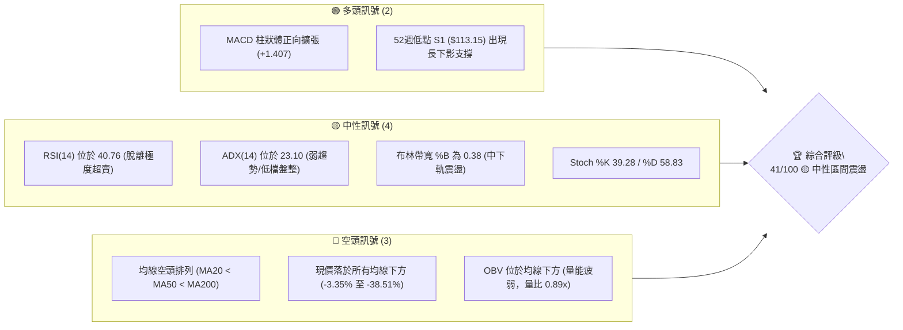

---

### 📊 核心指標速覽表

| 指標類別 | 指標名稱 | 當前數值 | 訊號 | 專業解讀 |
|:---|:---|:---|:---:|:---|
| **基準價格** | 當前收盤價 | $123.08 | 🔴 | 位於52週區間 3.4% 分位，深陷歷史低檔震盪區間 |
| **均線系統** | MA20 (月線) | $126.88 | 🔴 | 現價位於 MA20 下方 -2.99%，短線反彈面臨動態阻力 |
| **均線系統** | MA50 (季線) | $140.41 | 🔴 | 價格顯著偏離季線，中期下行結構未逆轉 |
| **均線系統** | MA200 (年線) | $184.14 | 🔴 | 價格低於年線 -33.16%，處於長期空頭週期壓制 |
| **動能震盪** | RSI(14) | 40.76 | 🟡 | 脫離超賣區進入中性弱勢區，無顯著頂底背離 |
| **趨勢追蹤** | MACD (12,26,9) | -4.920 | 🟢 | 快線 -4.920 高於慢線 -6.327，柱狀體 +1.407 持續翻紅 |
| **動能震盪** | 隨機指標 Stoch %K | 39.28 | 🟡 | %K 39.28 低於 %D 58.83，短線衝高後拉回整理 |
| **趨勢強度** | ADX (14) | 23.10 | 🟡 | ADX < 25 表明單邊空頭趨勢衰竭，轉入箱體盤整 |
| **通道指標** | 布林通道 %B | 0.38 | 🟡 | 介於中軌 ($126.88) 與下軌 ($111.15) 之間，波動收縮 |
| **量能指標** | OBV / 量比 | 0.89x | 🔴 | OBV < 均線，20日均量 1.418M，機構追價動能不足 |
| **波動指標** | ATR(14) | $7.13 | 🟡 | 日波動率 5.79%，提供合理的止損緩衝空間 |

---

### 🏆 技術評分卡

```
╔══════════════════════════════════════════════════════════════╗
║                 技術評分卡 — AVAV (2026-11-03)               ║
╠══════════════════════════════════════════════════════════════╣
║ 趨勢強度 (Trend)     ███████░░░░░░░░░░░░░  35/100  🔴 空頭鈍化 ║
║ 動能指標 (Momentum)  ██████████░░░░░░░░░░  52/100  🟡 弱勢反彈 ║
║ 支撐穩定度 (Support)  ██████████░░░░░░░░░░  50/100  🟡 低檔守穩 ║
║ 成交量配合 (Volume)   ███████░░░░░░░░░░░░░  38/100  🔴 量能匱乏 ║
║ 形態完整度 (Pattern)  █████████░░░░░░░░░░░  47/100  🟡 築底雛形 ║
║ 均線排列 (Moving Avg) █████░░░░░░░░░░░░░░  24/100  🔴 空頭排列 ║
╠══════════════════════════════════════════════════════════════╣
║ 綜合評分 (Overall)   ████████░░░░░░░░░░░░  41/100  🟡 中性區間 ║
║ 評級結論：中性觀望 / 區間震盪整理 (規則18：算術平均 41分)    ║
╚══════════════════════════════════════════════════════════════╝
```

---

## 2. 趨勢分析

### 🌐 多時框趨勢分析

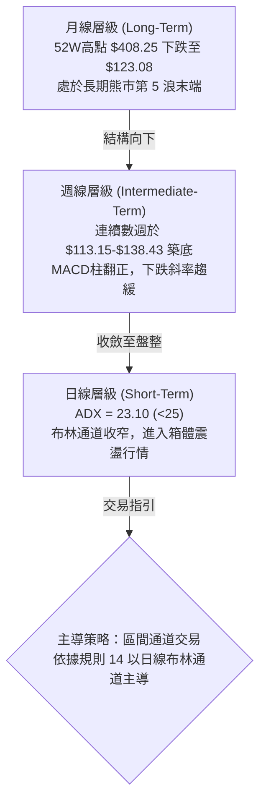

---

### 📈 長期趨勢 — 12個月走勢圖（Unicode）

AVAV 過去 12 個月經歷了從歷史高檔崩跌至年內低點的單邊下行結構。

```
AVAV 月線走勢圖（過去12個月：2025-12 至 2026-11）
價格軸 ($)
$280 ┤     ● (2026-01: $278.39)
$260 ┤       ●
$240 ┤● (2025-12: $241.89)
$220 ┤
$200 ┤             ● (2026-05: $207.24)
$180 ┤         ●     ●
$160 ┤                 ● (2026-06: $165.07)
$140 ┤                   ●   ●   ●
$120 ┤                             ●   ● (2026-11: $123.08) ◄ 現價
     └─────────────────────────────────────────────
      D   J   F   M   A   M   J   J   A   S   O   N (月份)
```

#### 走勢特徵分析表格

| 階段 | 時間區間 | 起訖價格 | 區間漲跌幅 | 形態特徵與量能變化 |
|:---|:---|:---|:---:|:---|
| **高位崩解段** | 2025-12 至 2026-03 | $241.89 → $183.05 | -24.32% | 跌破 $200 關卡，機構拋盤湧現，均線轉為空頭排列 |
| **弱勢反抽段** | 2026-03 至 2026-05 | $183.05 → $207.24 | +13.21% | 觸及 MA200 反彈受阻，反彈未能越過下行的 MA60 |
| **主跌加速段** | 2026-05 至 2026-07 | $207.24 → $149.37 | -27.92% | 出現跳空破位，市場避險情緒升溫，波動率急劇放大 |
| **低檔盤跌段** | 2026-07 至 2026-10 | $149.37 → $126.11 | -15.57% | 成交量逐步萎縮，下跌動能鈍化，探測 $113.15 低點 |
| **當前築底段** | 2026-10 至 2026-11 | $126.11 → $123.08 | -2.40%  | 波動率收斂至布林通道內，進入極低動能區間震盪 |

---

### 📊 中期趨勢（週線分析）

從近 20 週收盤數據觀察，AVAV 在 2026-07-02 曾反彈至 $190.89，但隨後於 2026-08-14 見高 $192.81 形成週線雙頭結構，進而展開週線層級的 C 浪下跌。

```
AVAV 週線波段阻力與支撐示意圖
價格 ($)
$192.81 ══════════════════════════════════ [8月中旬波段頂點]
        │
$168.00 ────────────────────────────────── [9月中旬反彈高點 R2]
        │
$142.60 ┈┈┈┈┈┈┈┈┈┈┈┈┈┈┈┈┈┈┈┈┈┈┈┈┈┈┈┈┈┈┈┈┈┈ [日線布林上軌 / 週線短壓]
        │
$123.08 ◄───────────────────────────────── [現價位置：築底震盪區]
        │
$113.15 ══════════════════════════════════ [52W 低點 / 強支撐 S1]
```

週線指標顯示，RSI 已由 2026-10-16 的極度超賣值 28.6 反彈至目前的 40.8，週 MACD 柱狀體亦由 -2.000 翻正擴張至 +1.407，表明週線級別的空頭下殺動能已出現衰竭徵兆。

---

### ⚡ 趨勢強度評估（ADX 解讀）

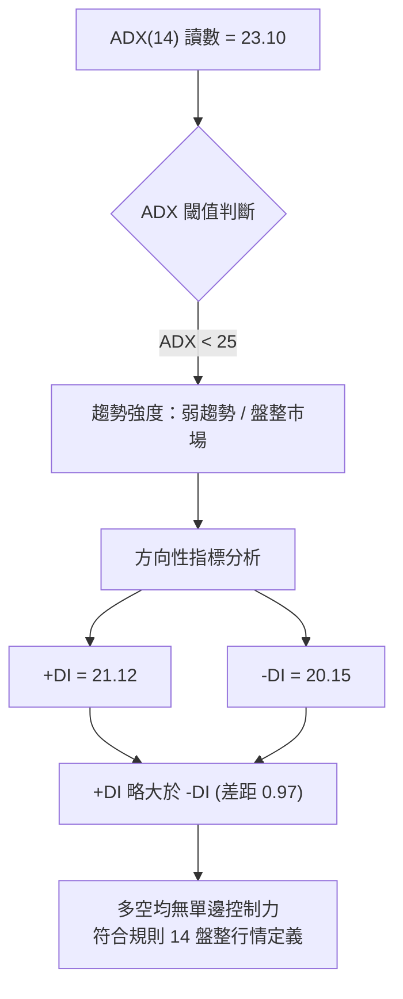

#### ADX 趨勢強度量化對照表

| 指標變數 | 當前數值 | 門檻區間 | 技術意義 | 交易指導原則 |
|:---|:---:|:---:|:---|:---|
| **ADX (14)** | **23.10** | < 25.00 | 單邊趨勢不成立，處於無趨勢或盤整階段 | 嚴禁採用單邊趨勢突破追價策略 |
| **+DI** | **21.12** | > 20.00 | 多頭向上推升力量微弱復甦 | 僅能支持超賣超跌反彈 |
| **-DI** | **20.15** | < 25.00 | 空頭摜壓力量較前期大幅消退 | 空方下殺動能鈍化，不易引發破位大跌 |
| **DI 差值 (+DI - -DI)** | **+0.97** | -5.0 至 +5.0 | 多空雙方處於勢均力敵的微幅拉鋸平衡 | 採用布林通道上下軌之均值回歸策略 |

---

## 3. 圖表形態分析

### 🔍 形態識別系統

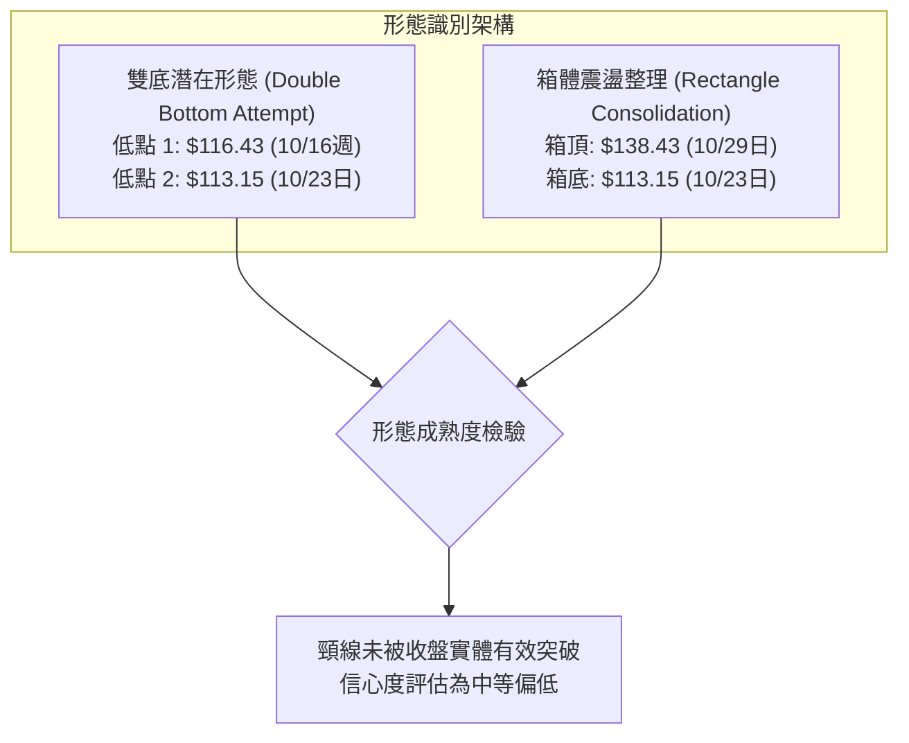

#### 圖表形態信心度評估表（依規則 15）

| 識別形態名稱 | 信心度 (%) | 判斷依據（嚴格引用數據） | 完成度 (%) | 形態目標價推算（附公式） |
|:---|:---:|:---|:---:|:---|
| **低檔雙底 (Double Bottom)** | **55%** | 兩次低點分別為 2026-10-16 低點 $116.43 與 2026-10-23 低點 $113.15 (S1)；頸線位於 2026-10-29 高點 $138.43 | 60% | 頸線 $138.43 + 形態高度 ($138.43 - $113.15 = $25.28) = **$163.71**（接近關鍵阻力 R1 $162.30） |
| **箱體震盪 (Rectangle)** | **65%** | 價格在 $113.15 (S1) 至 $138.43 區間內來回震盪，近 10 根日K均收在該範圍內 | 80% | 箱頂突破目標：$138.43 + $25.28 = **$163.71**；箱底跌破目標：$113.15 - $25.28 = **$87.87** |
| **下降通道突破 (Channel Break)** | **35%** | 訊號不足，僅做指標型解讀（長期下降趨勢線壓制仍在 MA50 $140.41 上方） | 20% | 數據不足以確認通道上軌精確夾角，不予設定推算目標 |

---

### 🕯️ 重要K線形態分析

嚴格依據提供的「近10根日K」與「近8根週K」之真實 OHLCV 數據進行形態識別：

#### 近10根日K形態解析

| 日期（日K） | 開盤價 (O) | 最高價 (H) | 最低價 (L) | 收盤價 (C) | K線形態特徵 | 專業技術解讀 | 多空訊號 |
|:---|:---:|:---:|:---:|:---:|:---|:---|:---:|
| **2026-10-20** | $117.50 | $121.00 | $116.30 | $117.63 | 紡錘線 (Spinning Top) | 開收盤接近，多空於 $117 膠著無明確方向 | 🟡 中性 |
| **2026-10-21** | $118.33 | $119.75 | $115.66 | $117.51 | 小陰線 (Small Bearish) | 盤中嘗試反彈未果，高點下移，空方微幅佔優 | 🔴 偏空 |
| **2026-10-22** | $117.26 | $122.22 | $114.26 | $117.70 | 長上下影十字星 | 振幅擴大至 $7.96，低檔買盤與高位拋壓互不相讓 | 🟡 變盤 |
| **2026-10-23** | $115.55 | $124.76 | $113.15 | $123.25 | **破底翻長下影陽線 (Hammer)** | 觸及52W新低 $113.15 (S1) 爆發強勁買盤拉抬，長下影達 $2.40 | 🟢 看多 |
| **2026-10-26** | $122.39 | $125.75 | $120.35 | $125.45 | 實體陽線 (Bullish Continuation)| 確認 10-23 之反轉有效性，收復 $125 關卡 | 🟢 看多 |
| **2026-10-27** | $125.23 | $128.19 | $123.60 | $126.73 | 上升小陽線 | 沿短期 MA5 攀升，受阻於月線 MA20 ($126.88) | 🟡 中性 |
| **2026-10-28** | $126.72 | $126.91 | $123.85 | $125.95 | 縮量十字陰線 | 縮量至 83.3 萬股，遭遇 MA20 壓制進入觀望 | 🟡 中性 |
| **2026-10-29** | $125.89 | $138.43 | $125.88 | $134.88 | **放量衝高長陽棒 (Bullish Expansion)**| 成交量暴增至 173.3 萬股，長紅實體直逼布林上軌 | 🟢 看多 |
| **2026-10-30** | $131.12 | $133.10 | $124.17 | $126.11 | **長陰反噬 (Bearish Engulfing Pullback)**| 高開低走失守 $130，獲利了結盤湧出，留長實體陰線 | 🔴 看空 |
| **2026-11-02** | $126.20 | $127.80 | $121.94 | $123.08 | 下跳中陰線 | 跌破 MA20 ($126.88)，回補 10-29 之大部分漲幅 | 🔴 看空 |

#### 近8根週K形態解析

| 日期（週K最後交易日） | 開盤價 (O) | 最高價 (H) | 最低價 (L) | 收盤價 (C) | K線形態特徵 | 專業技術解讀 | 多空訊號 |
|:---|:---:|:---:|:---:|:---:|:---|:---|:---:|
| **2026-09-18** | $145.80 | $168.00 | $144.51 | $159.95 | 放量巨幅長上影陽線 | 衝刺關鍵阻力 R2 ($168.00) 遇阻回落，成交量破千萬 | 🟡 衝高受阻 |
| **2026-09-25** | $161.28 | $165.00 | $151.50 | $152.05 | 高位陰線吞噬 | 確認 $168.00 處形成中期頂部頸線 | 🔴 看空 |
| **2026-10-02** | $149.77 | $151.30 | $138.31 | $140.82 | 下行中陰線 | 連續擊穿短天期均線，下行斜率陡峭 | 🔴 看空 |
| **2026-10-09** | $142.28 | $145.44 | $134.25 | $137.11 | 盤跌實體陰線 | 賣壓持續釋放，跌破 $140 季線支撐 | 🔴 看空 |
| **2026-10-16** | $137.10 | $137.50 | $116.43 | $121.79 | **加速趕底大陰棒** | 週振幅達 $21.07，爆量 815.6 萬股摜穿 $120 | 🔴 極度恐慌 |
| **2026-10-23** | $122.88 | $124.76 | $113.15 | $123.25 | **低檔錘頭星 (Hammer Star)** | 最低觸及 52W 低點 $113.15 (S1)，收盤逆勢收紅 | 🟢 觸底反彈 |
| **2026-10-30** | $122.39 | $138.43 | $120.35 | $126.11 | 震盪反彈陽線 (長上影) | 盤中反彈測試 $138.43 箱頂，收盤仍守住週漲幅 | 🟡 震盪築底 |
| **2026-11-02** | $126.20 | $127.80 | $121.94 | $123.08 | 週初小陰線整理 | 開盤受制於日線 MA20，低量回踩尋求支撐 | 🟡 觀望蓄勢 |

---

### 📉 ASCII 走勢形態示意圖

```
AVAV 近期日線「箱體築底與破底翻」形態示意圖
價格 ($)
$138.43 ┤                             ● (10-29 衝高箱頂阻力)
$135.00 ┤                            ╱ ╲
$130.00 ┤                           ╱   ● (10-30 長陰回落)
$126.88 ┤                  ●-------●-----╲--- [MA20 / 箱體中軸]
$123.08 ┤                 ╱ ╲             ● (11-02 現價) ◄
$120.00 ┤        ●       ╱   ●
$116.00 ┤  ●    ╱ ╲     ╱
$113.15 ┤───╲──╱───●───╱────────────────── [52W 低點 / S1 強支撐]
        │    ● (10-16)  ● (10-23 長下影破底翻)
        └──────────────────────────────────────────────
         10-16   10-20  10-23  10-26  10-29  11-02 (日期)
```

---

### 🎯 形態目標價計算

根據 2026-10-23 低點 $113.15 與 2026-10-29 高點 $138.43 所構成的短線箱體（或潛在雙底）形態進行幾何測幅推算：

1. **形態基準要素**：
   - 形態底部支撐位 ($S_{base}$) = **$113.15**（嚴格引用 52W 低點與波段低點聚類 S1）
   - 形態頸線/箱頂阻力位 ($R_{neck}$) = **$138.43**（引用 2026-10-29 日K最高價）
   - 形態垂直高度 ($H$) = $R_{neck} - S_{base} = \$138.43 - \$113.15 = \mathbf{\$25.28}$

2. **向上突破理論目標價 (Upside Target)**：
   $$\text{目標價} = R_{neck} + H = \$138.43 + \$25.28 = \mathbf{\$163.71}$$
   *對照驗證*：此測幅目標價 $163.71 極度貼合數據中由波段高點聚類算出的關鍵阻力 **R1: $162.30**（相差僅 0.86%），進一步強化了 R1 作為波段反彈第一目標位的可信度。

3. **向下跌破理論測幅目標 (Downside Target)**：
   $$\text{下破目標價} = S_{base} - H = \$113.15 - \$25.28 = \mathbf{\$87.87}$$
   *風險警示*：若日K線以實體收盤價跌破 S1 $113.15，箱體向下翻跌幅將直指 $87.87。

---

## 4. 支撐與阻力

### 🗺️ 關鍵價位分布圖（Unicode）

```
AVAV 價位結構分布圖（嚴格依據 OHLCV 計算聚類與斐波那契回調）
═════════════════════════════════════════════════════════════════
$408.25 ║██████████████████████████████║ 52週歷史高點 / 斐波 0.0%
$338.61 ║████████████████████          ║ 斐波那契 23.6% 回調位
$295.52 ║████████████████              ║ 斐波那契 38.2% 回調位
$260.70 ║██████████████                ║ 斐波那契 50.0% 回調位
$225.88 ║████████████                  ║ 斐波那契 61.8% 黃金分割位
$200.38 ║██████████████████████████████║ 強阻力 R3 (波段高點聚類 / 240MA)
$176.30 ║██████████                    ║ 斐波那契 78.6% 回調位
$168.00 ║████████████████████          ║ 阻力 R2 (9/18週高點聚類)
$162.30 ║████████████████████████      ║ 關鍵阻力 R1 (箱體量度目標 / 波段高點)
$142.60 ║▓▓▓▓▓▓▓▓▓▓                    ║ 布林通道上軌動態阻力
$126.88 ║▓▓▓▓▓▓▓                       ║ 布林通道中軌 (MA20)
$123.08 ╠══════════════════════════════╣ ◄ 當前價格 (收盤價)
$113.15 ║██████████████████████████████║ 強支撐 S1 (52W歷史低點聚類 / 斐波 100%)
數據缺漏 ║░░░░░░░░░░░░░░░░░░░░░░░░░░░░░░║ S2 (數據中未偵測到)
數據缺漏 ║░░░░░░░░░░░░░░░░░░░░░░░░░░░░░░║ S3 (數據中未偵測到)
═════════════════════════════════════════════════════════════════
```

---

### 🚧 阻力位分析表

阻力位嚴格引用技術數據中由波段高點聚類所計算之精確價位：

| 阻力級別 | 精確價位 | 距現價幅標 | 技術形成原因與結構強度 | 向上突破難度 | 戰略重要性 |
|:---|:---:|:---:|:---|:---:|:---:|
| **阻力 R1** | **$162.30** | +31.87% | 近一年密集震盪成交密集區下沿；箱體等高測幅目標 ($163.71) 聚類位 | 🔴 極高 | ★★★★☆ |
| **阻力 R2** | **$168.00** | +36.50% | 2026-09-18 週K線觸及之波段高點聚類，伴隨 1,127 萬股巨量套牢盤 | 🔴 極高 | ★★★★★ |
| **阻力 R3** | **$200.38** | +62.80% | 長期 MA240 ($200.17) 與歷史重要整數大關形成重合共振壓制 | 🔴 堅不可摧 | ★★★★★ |

---

### 🛡️ 支撐位分析表

支撐位嚴格引用技術數據中由波段低點聚類所計算之數值：

| 支撐級別 | 精確價位 | 距現價幅標 | 技術形成原因與結構強度 | 守住機率 | 戰略重要性 |
|:---|:---:|:---:|:---|:---:|:---:|
| **支撐 S1** | **$113.15** | -8.07% | 52週歷史低點 (2026-10-23 驗證)；斐波那契 100.0% 回調位終極防線 | 🟡 65% | ★★★★★ |
| **支撐 S2** | **N/A** | N/A | **數據中未偵測到**（依規則 13 與 16，無歷史低點聚類數據） | N/A | N/A |
| **支撐 S3** | **N/A** | N/A | **數據中未偵測到**（依規則 13 與 16，無歷史低點聚類數據） | N/A | N/A |

*專業解析*：由於下方不存在 S2 與 S3 數據，意味著一旦 S1 **$113.15** 失守，下方將進入「價格真空區」，將直接啟動形態測幅之悲觀跌幅目標 $87.87，因此 S1 為多頭絕對不可跌破之生命線。

---

### 📐 斐波那契回調位分析

依據 52 週完整波動區間（高點 **$408.25** → 低點 **$113.15**，總垂直落差高達 **$295.10**）計算之回調位如下：

| 斐波那契回調層級 | 精確價位 | 空間意涵與技術解讀 |
|:---|:---:|:---|
| **0.0% (52W High)** | **$408.25** | 歷史峰值，本輪超級牛市終點，具備極強心理象徵壓力 |
| **23.6%** | **$338.61** | 第一回調位，下破後引發中級空頭趨勢確立 |
| **38.2%** | **$295.52** | 弱勢反彈極限阻力，多頭未能收復此線形成崩盤走勢 |
| **50.0%** | **$260.70** | 多空力量強弱分水嶺，曾為 2026 年初反覆爭奪之中樞 |
| **61.8%** | **$225.88** | **黃金分割關鍵位**，失守後宣告長期牛市結構徹底瓦解 |
| **78.6%** | **$176.30** | 深幅回調防守線，目前位於年線 MA200 ($184.14) 下方附近 |
| **100.0% (52W Low)**| **$113.15** | **基準低點（即 S1）**，代表跌幅已吞噬整輪上漲行情的 100% |

#### 當前價格位置深度診斷
當前價格 **$123.08** 正精確處於 **78.6% 回調位 ($176.30)** 與 **100.0% 回調位 ($113.15)** 之間。現價僅高出 100.0% 回調位 +8.78%（空間差距僅 $9.93），顯示股票正處於長週期下挫的極限超跌緩衝區。在此位置，向下做空的風險收益比已顯著劣質化，而向上至 78.6% ($176.30) 或 R1 ($162.30) 存在高達 30%–40% 的回調修復空間。

---

## 5. 技術指標深度解讀

### 🎛️ 指標訊號總覽

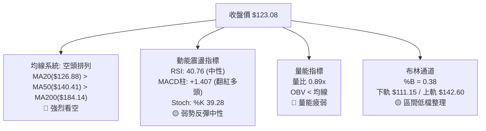

---

### 📈 移動平均線排列分析

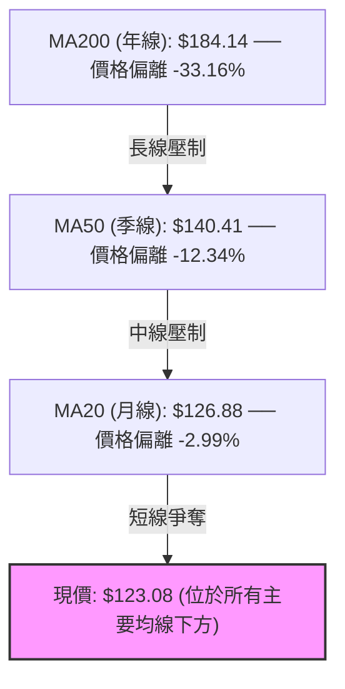

#### 移動平均線系統定量監控表

| 均線名稱 | 當前價位 | 距現價差距 ($) | 偏離百分比 (%) | 短期斜率方向 | 技術評估與市場意涵 |
|:---|:---:|:---:|:---:|:---:|:---|
| **MA 5** | $127.35 | -$4.27 | -3.35% | ▼ 下彎 | 短線衝高受阻，壓制即時反彈動能 |
| **MA 10** | $123.83 | -$0.75 | -0.60% | ▼ 下彎 | 糾纏於現價附近，為短線多空臨界平水線 |
| **MA 20** | $126.88 | -$3.80 | -2.99% | ▼ 下彎 | 月線級別反壓，為布林通道中軌所在 |
| **MA 50** | $140.41 | -$17.33 | -12.34% | ▼ 下彎 | 中期強弱分水嶺，未有效收復前中期格局偏空 |
| **MA 60** | $147.16 | -$24.08 | -16.36% | ▼ 下彎 | 季線下沿，空頭下行趨勢之強阻力帶 |
| **MA120** | $156.01 | -$32.93 | -21.11% | ▼ 下彎 | 半年線持續下行，顯示長線套牢沉重 |
| **MA200** | $184.14 | -$61.06 | -33.16% | ▼ 下彎 | 傳統牛熊分界線，空頭排列格局完整 |
| **MA240** | $200.17 | -$77.09 | -38.51% | ▼ 下彎 | 超長週期年線壓制，重合阻力位 R3 |

---

### 📉 RSI(14) 分析

```
RSI(14) 當前讀數：40.76  (Wilder 平滑)
0       10      20      30      40      50      60      70      80      90     100
├───────┼───────┼───────┼───────┼───────┼───────┼───────┼───────┼───────┼───────┤
░░░░░░░░░░░░░░░░░░░░░░░░░░░░░░░░████████░░░░░░░░░░░░░░░░░░░░░░░░░░░░░░░░░░░░░░░░
                        ▲ [超賣線 30]  ▲ [現值 40.76]          ▲ [超買線 70]
```

- **區間評估**：RSI 目前處於 40.76，脫離了 10 月中旬的嚴重超賣區間（週線最低達 28.6），回升至 30–70 的中性區間下沿，說明非理性的殺跌動能已獲得初步修復，但尚未具備向上攻擊所需的 50 以上強勢多頭動能。
- **背離檢驗結論**：根據技術指標快照，比較近 20 根 K 棒首尾價格與 RSI 之走向，判定為**無明顯背離（No Divergence）**。價格創新低 $113.15 時，RSI 同步探底，並無標準底背離訊號，因此當前反彈定性為「超跌均值回歸」而非動能推動的趨勢反轉。

---

### 📊 MACD(12/26/9) 訊號解讀

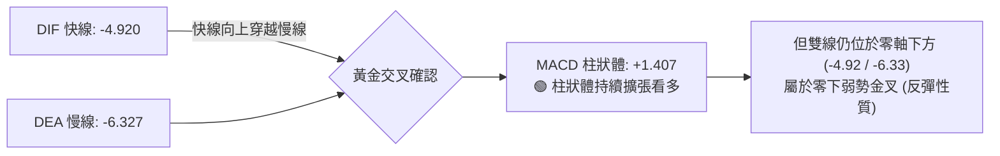

- **量化數值解析**：MACD 線 (-4.920) 位於訊號線 (-6.327) 上方，差值產生 +1.407 的正向柱狀體。
- **訊號衝突解碼**：雖然柱狀體翻紅且呈現連續擴張（近三週週線 MACD 柱分別為 -0.676、+1.676、+1.407），但由於雙線深處於零軸下方（負值區），技術上屬於典型的「**空頭市場中的弱勢超跌反彈**」，絕不可視為全面做多的反轉訊號。

---

### 📦 布林通道分析

```
布林通道結構與現價相對位置（20日參數，2倍標準差）
價格 ($)
$142.60 ────────────────────────────────────────── BB 上軌 (Upper Band)
        │
        │
$126.88 ┈┈┈┈┈┈┈┈┈┈┈┈┈┈┈┈┈┈┈┈┈┈┈┈┈┈┈┈┈┈┈┈┈┈┈┈┈┈┈┈┈┈ BB 中軌 (MA20 Baseline)
        │
$123.08 ◄────────────────── 現價 (%B = 0.38，位於中下軌弱勢區)
        │
$111.15 ────────────────────────────────────────── BB 下軌 (Lower Band)
```

- **帶寬與位置解讀**：布林帶上軌為 $142.60，中軌為 $126.88，下軌為 $111.15。當前收盤價 $123.08 使得 **%B 讀數為 0.38**（處於下半區間）。
- **通道行為特徵**：通道在經歷了 10 月下旬的高波動擴張後開始收口，中軌 $126.88 構成即期第一反彈阻力。下軌 $111.15 則有效包覆住 52 週低點 S1 ($113.15)，形成強有力的雙重動態/靜態支撐防護網。

---

### 💹 成交量分析（量價配合度）

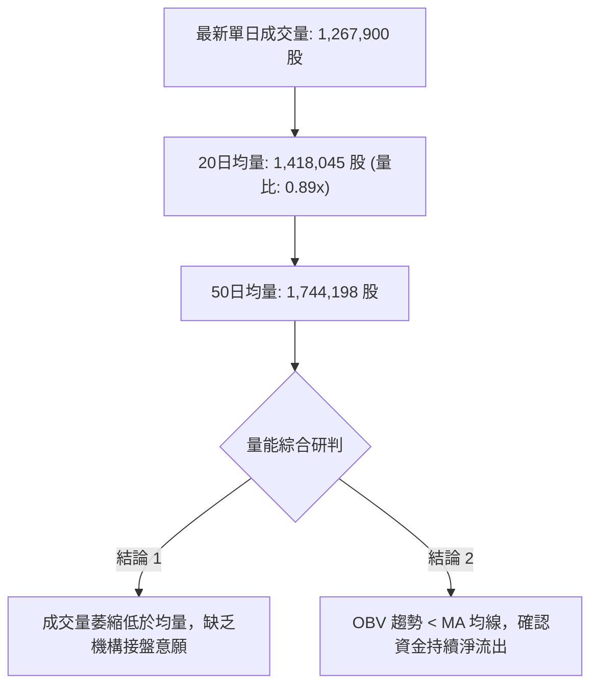

- **量價背離分析**：在 2026-10-29 出現長紅棒衝高至 $138.43 時，成交量放大至 1,733,600 股，但次日（10-30）迅速遭遇 1,037,800 股的長陰回吐，且 2026-11-02 成交量縮至 1,267,900 股並收陰。量能無法持續放大維持在 50 日均量（1.74M）之上，印證市場資金追高意願低落。
- **OBV（能量潮）狀態**：OBV 指標持續受制於其自身移動平均線下方，形成「**價格反彈但量能無量、量價背離**」的格局，限制了向上突破實質阻力位的空間。

---

## 6. 動能與波動率

### ⚡ 動能評估四象限

動能評估四象限矩陣將市場劃分為四種不同交易狀態：

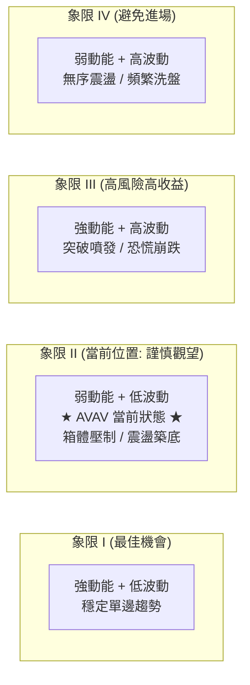

#### 動能與波動率狀態矩陣表

| 象限標記 | 動能維度 | 波動維度 | 典型特徵 | 當前匹配度 | 戰略應對 |
|:---:|:---:|:---:|:---|:---:|:---|
| **Q1** | 強 (High) | 低 (Low) | 順勢穩健上行，回調幅度小 | ❌ 0% | 不適用 |
| **Q2** | **弱 (Low)** | **低 (Low)** | **ADX=23.10，ATR/Price=5.79%，進入低波收斂** | **✓ 85%** | **區間高拋低吸，嚴格止損** |
| **Q3** | 強 (High) | 高 (High) | 破位崩跌或爆量軋空行情 | ❌ 10% | 僅於突破時切換 |
| **Q4** | 弱 (Low) | 高 (High) | 劇烈雙向掃單，缺乏持續性 | ❌ 5% | 不適用 |

---

### 📊 ATR 波動率分析

- **ATR(14) 精確讀數**：**$7.13**（佔當前股價 $123.08 之比率為 **5.79%**）。
- **波動特性解讀**：作為國防無人機板塊個股，AVAV 的日均波動區間超過 7 美元，屬於中高絕對波動資產。在制定交易止損時，必須考量 Wilder ATR 的緩衝保護。
- **止損距離定量設計**：
  - **1.0 × ATR** = **$7.13**（短線日內交易防守閾值）
  - **1.5 × ATR** = **$10.70**（波段操作常規安全邊際）
  - **當前現價距 S1 空間**：$123.08 - $113.15 = **$9.93**，恰好等於 **1.39 × ATR**。這意味著將 S1 ($113.15) 作為多頭防守點，在技術結構上兼具「形態關鍵位」與「ATR波幅安全邊際」的雙重合理性。

---

### 📐 Beta 與市場相關性

- **Beta 係數**：**1.403**（高波動性個股）。
- **市場關聯性評估**：
  - AVAV 的股價波動幅度平均為標普 500 指數的 1.40 倍。在整體市場下行或避險情緒升溫週期中，該股承壓幅度顯著高於大盤。
  - 當前空頭機構借券佔流通股比例（Short % of Float）達 **13.0%**，Short Ratio 為 **3.25** 天。較高的空頭部位意味著一旦出現超預期的國防採購合約利多，極易觸發局部空頭回補，但高 Beta 亦意味著若大盤下挫，該股存在破底補跌風險。

---

## 7. 多時框架總結

### 📋 時框架評分表

| 時框架 | 趨勢方向 | 動能指標狀態 | 均線排列特徵 | 核心形態評估 | 維度評分 | 戰術建議 |
|:---|:---:|:---|:---|:---|:---:|:---|
| **長期 (月線)** | 🔴 強烈看空 | 月線 RSI 低迷，長期下行通道 | MA240 ($200.17) 顯著下彎 | 歷史高點腰斬跌勢未歇 | **25/100** | 嚴禁長線無腦抄底現貨 |
| **中期 (週線)** | 🟡 震盪築底 | 週 MACD 柱狀體翻正 (+1.407) | 壓制在週線 MA20 之下 | 週線雙底雛形構建中 | **45/100** | 僅適合輕倉波段參與 |
| **短期 (日線)** | 🟡 箱體盤整 | RSI=40.76，%B=0.38 | 短期均線壓制但跌勢趨緩 | $113.15-$138.43 矩形箱體 | **50/100** | 以布林通道進行波段操作 |

---

### 🔲 綜合訊號矩陣

```
┌────────────────────────────────────────────────────────┐
│               AVAV 跨週期技術訊號收斂矩陣              │
├─────────────┬─────────────┬─────────────┬──────────────┤
│  分析層級   │  趨勢信號   │  動能信號   │   結構信號   │
├─────────────┼─────────────┼─────────────┼──────────────┤
│  長期走勢   │   🔴 空頭   │   🔴 弱勢   │   🔴 破位    │
│  中期走勢   │   🔴 偏空   │   🟢 修復   │   🟡 測底    │
│  短期走勢   │   🟡 盤整   │   🟡 中性   │   🟡 箱體    │
├─────────────┴─────────────┴─────────────┴──────────────┤
│  最終收斂方向：🟡 中性觀望 / 箱體區間防守反彈          │
└────────────────────────────────────────────────────────┘
```

---

### ⚖️ 多時框收斂結論

嚴格依據**「嚴格要求 14」**之多時框收斂規則執行研判：
1. **行情性質界定**：當前 ADX(14) 讀數為 **23.10**，明確小於 25.0 臨界值。因此，市場被客觀界定為**「盤整行情（ADX < 25）」**，趨勢追隨系統暫時失效。
2. **優先級收斂取捨**：依規則 14，在盤整行情中，**以日線布林通道上下軌 ($111.15 至 $142.60) 為主要交易區間**。雖然長期月線與中長期 MA50/MA200 呈現強烈空頭排列，但由於短線已進入 $113.15 支撐區的低波動窄幅盤整，單邊追空具有極高的軋空與回抽風險，而長線做多時機亦未成熟。
3. **唯一方向性結論**：**🟡 中性觀望（等待區間邊界確認）**。戰術上定位為「**依託 S1 支撐的區間震盪低吸高拋**」，此結論完全收斂並對齊第 1 章的綜合評分（41/100）及第 8 章之主交易策略。

---

## 8. 交易策略建議

### 🗺️ 策略決策流程圖

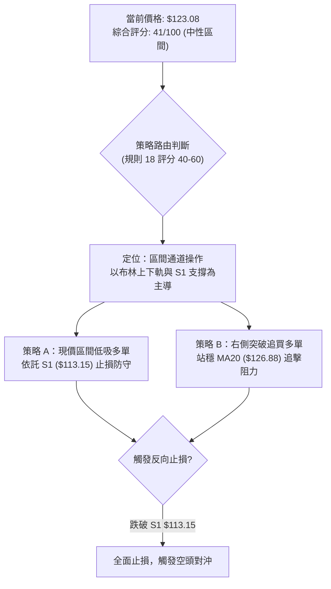

---

### 🧭 策略路由（依評分卡分流）

> **當前主策略方向 = 🟡 中性偏多區間反彈操作（依評分 41/100）**
> *路由說明*：依據規則 18，綜合評分落在 40–60 區間內，明確定位為「**區間操作，以布林上下軌為主，等待突破確認**」。因空頭動能已鈍化，且現價極度貼近 S1 ($113.15)，具備極高盈虧比之多頭反彈博弈價值；若跌破 S1 則立即轉入空頭對沖。

---

### 🎯 價格情境階梯（Price Scenarios）

價位嚴格引用技術數據「關鍵價位」區塊之精確數值：

| 觸發條件 | 下一目標 | 後續延伸 | 技術情境含義與操作指引 |
|:---|:---:|:---:|:---|
| **放量突破 R1 ($162.30)** | R2 ($168.00) | R3 ($200.38) | 中期反轉確立，擺脫底部箱體，邁向年線回補缺口 |
| **突破布林中軌 ($126.88)** | 布林上軌 ($142.60) | R1 ($162.30) | 短線擺脫弱勢整理，反彈空間打開至波段目標 |
| **站穩現價區間 ($123.08)** | 布林中軌 ($126.88) | — | 於 $113.15–$126.88 內進行低波收斂蓄勢 |
| **跌破 S1 ($113.15)** | 下跌測幅 $87.87 | N/A (無數據) | 歷史大底失守，觸發流動性踩踏與停損賣盤 |

---

### 📊 情境機率分佈

| 運行情境 | 發生機率 | 主要技術數據與指標依據 |
|:---|:---:|:---|
| **情境一：區間震盪築底** | **55%** | ADX = 23.10 顯示無單邊趨勢；布林通道持續收縮；成交量萎縮至均量以下 |
| **情境二：向上反彈修復** | **30%** | MACD 柱狀體持續擴張 (+1.407)；週線 RSI 自超賣區向上脫離；空頭佔比 13% 具備軋空潛力 |
| **情境三：跌破 S1 續跌** | **15%** | 均線系統全面空頭排列 (MA20 < MA50 < MA200)；OBV 疲軟資金持續流出 |

---

### 🟢 主策略詳情（方向依上方路由）

所有數值嚴格引用關鍵價位（S1: $113.15, R1: $162.30, R2: $168.00, R3: $200.38, MA20: $126.88）並依規則 17 執行數學演算：

| 策略要素 | 策略 A（左側低吸策略） | 策略 B（右側突破確認策略） |
|:---|:---|:---|
| **策略名稱** | 現價依託 S1 支撐低吸反彈策略 | 突破站穩 MA20 追擊波段策略 |
| **進場條件** | 現價直接進場，以 S1 為緊密止損 | 日K收盤確認站穩 MA20 ($126.88) 回踩不破進場 |
| **進場價格** | **$123.08** (現價) | **$126.88** (MA20 突破確認價) |
| **止損價格** | **$113.15** (跌破 52W 低點 S1 止損) | **$113.15** (跌破箱體底 S1 止損) |
| **目標價 T1** | **$162.30** (關鍵阻力 R1) | **$162.30** (關鍵阻力 R1) |
| **目標價 T2** | **$168.00** (關鍵阻力 R2) | **$200.38** (關鍵阻力 R3) |
| **風險報酬比 (以 T1 計)**| **1 : 3.95（以 T1 計）**<br/>計算式：($162.30 - $123.08) ÷ ($123.08 - $113.15)<br/>= $39.22 ÷ $9.93 = **3.9496** | **1 : 2.58（以 T1 計）**<br/>計算式：($162.30 - $126.88) ÷ ($126.88 - $113.15)<br/>= $35.42 ÷ $13.73 = **2.5797** |
| **延伸風報比 (以 T2 計)**| **1 : 4.52（以 T2 計）**<br/>計算式：($168.00 - $123.08) ÷ $9.93<br/>= $44.92 ÷ $9.93 = **4.5236** | **1 : 5.35（以 T2 計）**<br/>計算式：($200.38 - $126.88) ÷ $13.73<br/>= $73.50 ÷ $13.73 = **5.3532** |
| **預估勝率** | 50% | 60% |
| **建議總資金倉位** | **8% - 10%** (試探性輕倉) | **12% - 15%** (確認性加碼) |

---

### 🔴 反向風險觸發點（對沖提示）

當市場出現下列極端破位訊號時，必須即刻承認主策略失效並啟動風控：
1. **多頭無條件止損點**：若日K線以實體收盤價跌破 **$113.15 (S1)**，代表 52 週歷史大底失守，多頭策略全面中止。
2. **反手空頭對沖觸發**：一旦確認跌破 $113.15 且 2 日內無法收復，激進投資者可啟動做空對沖，以 $113.15 為反壓止損線，向下博弈形態推算目標價 **$87.87**。

---

### ⭐ 整體訊號強度評星

```
╔══════════════════════════════════════════════════════════════╗
║                    整體技術訊號評星標準                      ║
╠══════════════════════════════════════════════════════════════╣
║ 做多訊號強度：★★☆☆☆  (2.5/5星 — 僅屬低波超跌反彈價值)        ║
║ 做空訊號強度：★★☆☆☆  (2.0/5星 — 貼近 S1 支撐，空頭盈虧比差)  ║
║ 整體技術可信度：★★★☆☆  (3.5/5星 — 缺乏 S2/S3，需嚴格止損)   ║
╚══════════════════════════════════════════════════════════════╝
```

---

## 9. 風險提示與監控

### ✅ 關鍵監控指標 Checklist

```
╔══════════════════════════════════════════════════════════════╗
║                   每日交易執行監控清單 (Checklist)           ║
╠══════════════════════════════════════════════════════════════╣
║ [ ] 監控一：收盤價是否守穩 S1 ($113.15) 之上                 ║
║ [ ] 監控二：日K線是否向上突破並站穩 MA20 ($126.88)           ║
║ [ ] 監控三：成交量是否放大突破 20日均量 (1,418,045 股)        ║
║ [ ] 監控四：MACD 柱狀體能否維持正值 (當前 +1.407) 向上擴張    ║
║ [ ] 監控五：RSI(14) 能否進一步跨越 50 多空分界點              ║
║ [ ] 監控六：ADX(14) 是否升破 25 (預示單邊趨勢行情啟動)        ║
║ [ ] 監控七：空頭部位變化 (Short % Float 當前 13.0%) 是否下降  ║
╚══════════════════════════════════════════════════════════════╝
```

---

### ⚠️ 風險場景分析

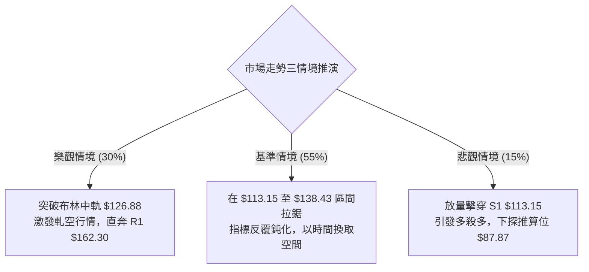

---

### 🛡️ 風險管理重要提醒

1. **單一標的曝險上限**：鑑於 AVAV 的 Beta 值高達 1.403 且處於歷史低檔脆弱期，強烈建議單一帳戶在該股上的總配置資金**嚴格控制在 10%–15% 以內**。
2. **單筆交易最大虧損原則（1% 風險法則）**：以策略 A 為例，進場價 $123.08，止損價 $113.15，每股承擔風險為 $9.93 (8.07%)。若投資組合總資產為 100,000 美元，單筆最大允許虧損 1% 即 1,000 美元，則最大允許建立倉位為：
   $$\text{最大股數} = \frac{\$1,000}{\$9.93} \approx 100 \text{ 股 (約合資金 \$12,308，佔比 12.3%)}$$
3. **無第二支撐防護網風險**：如第 4 章分析，數據中**未偵測到 S2 與 S3**。這意味著市場並未提供更深層次的歷史成交密集區供多頭喘息。因此，跌破 $113.15 時**絕對禁止向下加碼攤平**，必須無條件執行停損離場。

---

## 📋 報告總結

```
╔══════════════════════════════════════════════════════════════╗
║                   AVAV 技術分析報告總結                      ║
╠══════════════════════════════════════════════════════════════╣
║ 報告日期：2026-11-03                                         ║
║ 當前價格：$123.08 USD                                        ║
║ 分析評級：41/100 🟡 中性觀望 (區間震盪築底，防守反彈操作)     ║
╠══════════════════════════════════════════════════════════════╣
║ 關鍵技術結論：                                               ║
║ ├─ 長期趨勢：🔴 強烈空頭 (受制於年線 MA200: $184.14)          ║
║ ├─ 中期趨勢：🟡 跌勢鈍化 (週線 MACD 柱翻正，尋求雙底構建)     ║
║ ├─ 短期趨勢：🟡 弱勢盤整 (ADX=23.10，受限於布林上下軌區間)   ║
║ ├─ 核心支撐：$113.15 (S1 / 52週歷史低點 / 斐波 100% 終極支撐)║
║ ├─ 核心阻力：$162.30 (R1 / 箱體等高測幅目標 / 波段高點聚類)   ║
║ └─ 分析師共識目標：均價 $212.20 (最低 $148.57 / 最高 $315.00) ║
╠══════════════════════════════════════════════════════════════╣
║ 最優策略組合：                                               ║
║ 1. 🥇 最佳機會：策略 A 現價低吸 (進場 $123.08，止損 $113.15， ║
║                  目標 R1 $162.30，風報比 1:3.95（以 T1 計）) ║
║ 2. 🥈 次選機會：策略 B 右側突破 (站穩 MA20 $126.88 後進場，   ║
║                  止損 $113.15，目標 R1 $162.30，風報比 1:2.58)║
║ 3. 🥉 保守選擇：場外完全觀望，等待日K突破箱頂 $138.43 或      ║
║                  跌破 S1 $113.15 出現明確單邊方向後再行介入    ║
╚══════════════════════════════════════════════════════════════╝
```

---

> ⚠️ **免責聲明**：本報告為依據客觀量化技術指標與歷史 OHLCV 價格數據生成之技術分析研究文獻，所有支撐位、阻力位、目標價推算及情境機率均基於數理模型演算。本報告**僅供研究與學術參考**，**不構成任何形式的證券買賣投資建議或邀約**。金融市場具有高度風險，投資人應獨立評估自身風險承受能力並自負盈虧。

---

*報告生成時間：2026-11-03 ｜ 數據來源：Yahoo Finance ｜ 分析框架：多時框技術分析體系 (MTFA)*