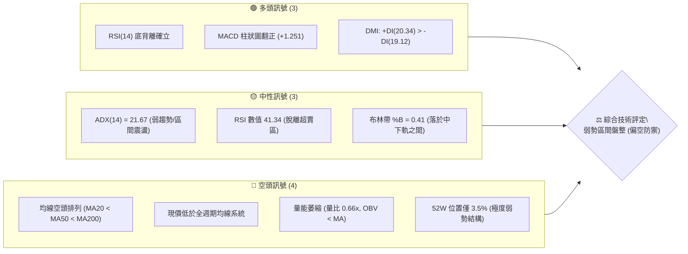
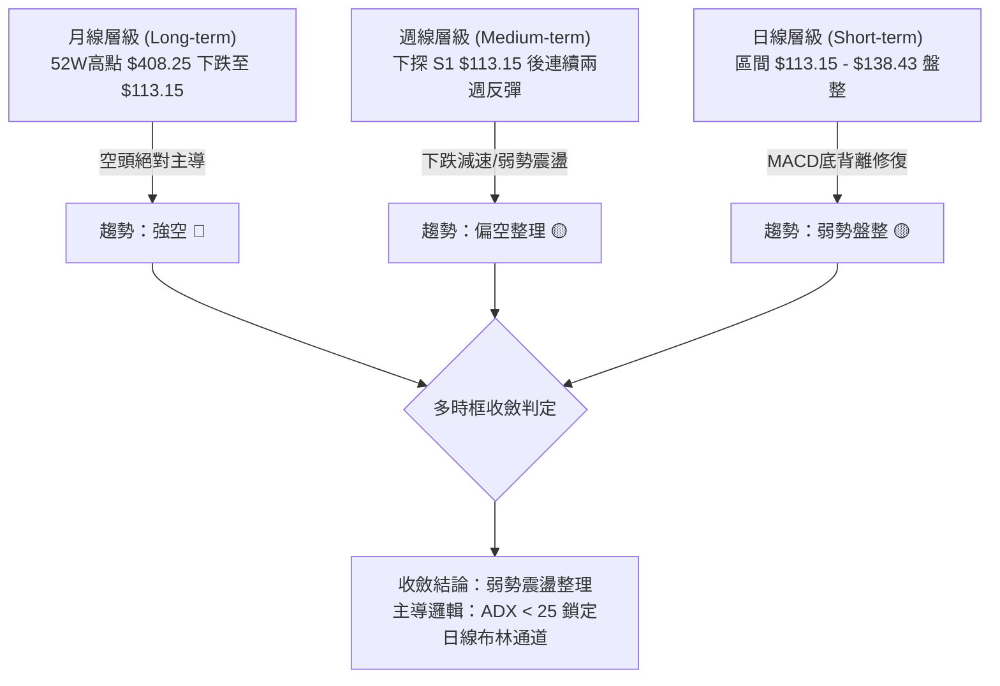
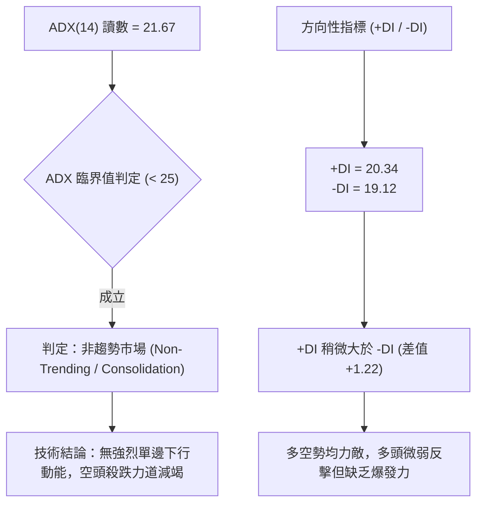
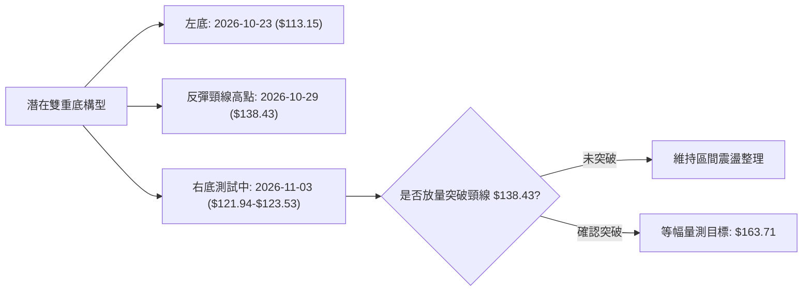
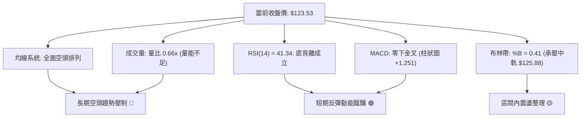
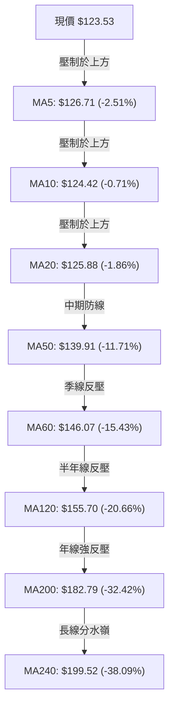
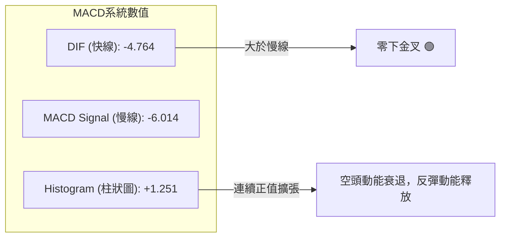
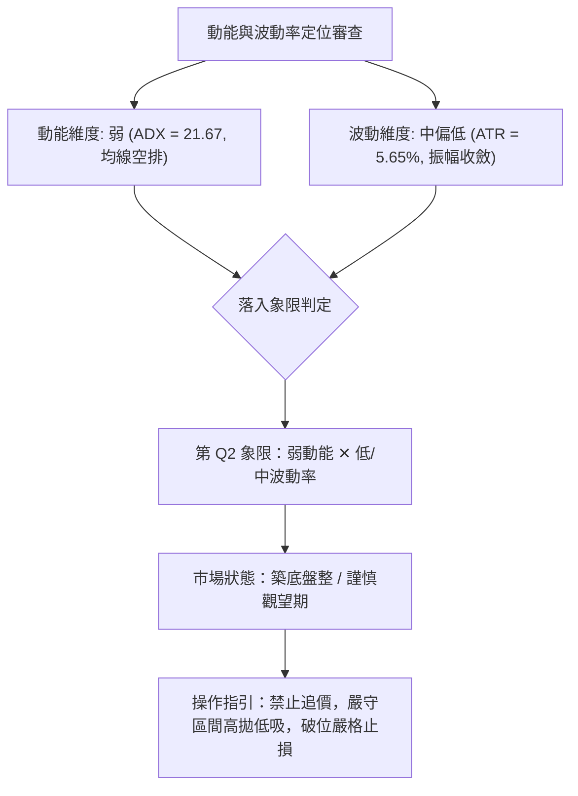
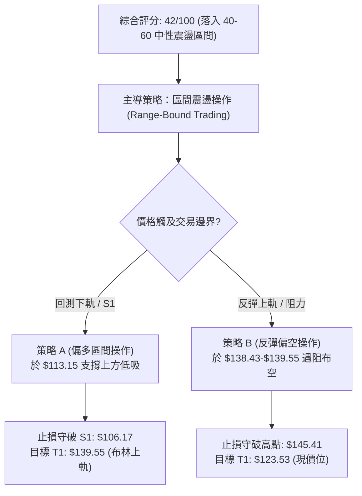
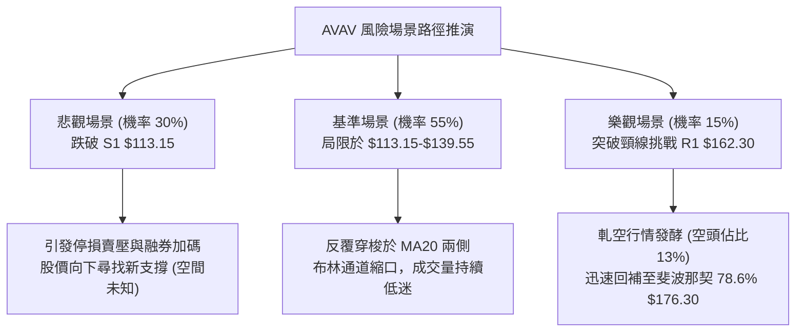

# AVAV 技術分析報告

> **報告日期**：2026-11-04 ｜ **語言**：繁體中文 ｜ **數據來源**：Yahoo Finance ｜ **當前價格**：$123.53

---

## 目錄

| 章節 | 內容 |
|------|------|
| [1. 技術面概覽](#1-技術面概覽) | 訊號儀表板、核心指標、評分卡 |
| [2. 趨勢分析](#2-趨勢分析) | 多時框趨勢、長中短期走勢、12個月走勢圖 |
| [3. 圖表形態分析](#3-圖表形態分析) | 形態識別、K線組合、目標價計算 |
| [4. 支撐與阻力](#4-支撐與阻力) | 關鍵價位、斐波那契回調結構 |
| [5. 技術指標深度解讀](#5-技術指標深度解讀) | MA/RSI/MACD/布林/成交量量價背離 |
| [6. 動能與波動率](#6-動能與波動率) | 動能評估四象限、ATR、Beta與市場連動 |
| [7. 多時框架總結](#7-多時框架總結) | 時框架矩陣、多時框收斂與權重判定 |
| [8. 交易策略建議](#8-交易策略建議) | 策略路由、主策略、情境階梯與風報比 |
| [9. 風險提示與監控](#9-風險提示與監控) | 監控清單、極端情境與風控規範 |
| [📋 報告總結](#-報告總結) | 總體評級、核心價位與策略決策清單 |

---

## 1. 技術面概覽

### 🎯 技術訊號儀表板

AeroVironment, Inc.（AVAV）歷經 2025 年第四季歷史高點 $408.25 以來的深度修正，當前報價落於 $123.53。技術結構呈現「長中期空頭排列壓制」與「短期底背離盤整築底」的交錯階段。以下為各維度技術訊號分布與總體評定：



### 📊 核心指標速覽表

| 指標類別 | 指標名稱 | 當前數值 | 訊號 | 解讀與技術含義 |
| :--- | :--- | :--- | :---: | :--- |
| **價格結構** | 收盤價 | $123.53 | 🔴 | 位於 52 週高低區間 3.5% 分位，深陷空頭領域 |
| **短期均線** | MA20 | $125.88 | 🔴 | 現價位於 MA20 下方 -1.86%，短線承壓 |
| **中期均線** | MA50 | $139.91 | 🔴 | 現價低於 MA50，中期下降壓力顯著 |
| **長期均線** | MA200 | $182.79 | 🔴 | 現價低於 MA200，長期格局屬空頭主導市場 |
| **擺動動能** | RSI(14) | 41.34 | 🟡 | 位於 30–70 中性區間，呈現首尾底背離走勢 |
| **趨勢動能** | MACD (12,26,9) | -4.764 / -6.014 | 🟢 | 快線位於慢線上方，柱狀圖 +1.251 形成零下金叉 |
| **波動幅度** | ATR(14) | $6.98 | 🟡 | 佔現價 5.65%，每日波動維持中高振幅水準 |
| **震盪通道** | 布林通道 | $112.21–$139.55 | 🟡 | 中軌 $125.88 為短線動能多空分水嶺 |
| **趨勢強度** | ADX(14) | 21.67 | 🟡 | 數值低於 25，顯示單邊下跌動能衰竭，進入震盪 |
| **量能指標** | 成交量比率 | 0.66x (91.2萬) | 🔴 | 最新量能低於 20 日均量，量縮整理格局未變 |

### 🏆 技術評分卡

依照六大技術面向權重客觀審查，各子項目總分 100 分。依規則 18，綜合評分採算術平均精準計算：

```
╔══════════════════════════════════════════════════════════════╗
║              技術評分卡 — AVAV (2026-11-04)                  ║
╠══════════════════════════════════════════════════════════════╣
║ 趨勢強度 (Trend)     ███████░░░░░░░░░░░░░  35/100 🔴 弱勢盤整 ║
║ 動能指標 (Momentum)  ███████████░░░░░░░░░  55/100 🟡 底背修復 ║
║ 支撐穩定度 (Support) ██████████░░░░░░░░░░  50/100 🟡 低點測試 ║
║ 成交量配合 (Volume)  ███████░░░░░░░░░░░░░  35/100 🔴 量能疲弱 ║
║ 形態完整度 (Pattern) █████████░░░░░░░░░░░  45/100 🟡 構築區間 ║
║ 均線排列 (Moving Avg)██████░░░░░░░░░░░░░░  30/100 🔴 空頭排列 ║
╠══════════════════════════════════════════════════════════════╣
║ 綜合評分 (Overall)   ████████░░░░░░░░░░░░  42/100 🟡 中性偏弱 ║
║ 評級結論：40–60 區間震盪整理，以布林通道邊界為操作基準      ║
╚══════════════════════════════════════════════════════════════╝
```
*計算依據：(35 + 55 + 50 + 35 + 45 + 30) ÷ 6 = 250 ÷ 6 = 41.67，四捨五入為 42 分。*

---

## 2. 趨勢分析

### 🌐 多時框趨勢分析

AVAV 在不同時框下呈現明顯的分歧結構。長期視角仍處於自歷史頂部回落的深度熊市；中期則在連續下跌後展現斜率趨緩；短期則在 52 週低點附近形成箱型震盪。



### 📈 長期趨勢 — 12個月走勢圖（Unicode）

以下為 AVAV 過去 12 個月（2025-11 至 2026-11）之月線收盤走勢 ASCII 復原圖，清楚顯示股價如何從高檔崩跌至目前底部盤旋：

```
AVAV 月線收盤走勢圖（過去12個月：2025-11 至 2026-11）
價格軸 ($)
$300 ┤ ● ($279.46)
$275 ┤           ● ($278.39)
$250 ┤     ● ($241.89)  ● ($252.25)
$225 ┤                             ● ($207.24)
$200 ┤                       ● ($195.02)
$175 ┤                 ● ($183.05)       ● ($165.07)
$150 ┤                                         ● ($149.37) ● ($148.35) ● ($142.22)
$125 ┤                                                                     ● ($126.11)
$100 ┤                                                                           ● ($123.53 現價)
     └─┬─────┬─────┬─────┬─────┬─────┬─────┬─────┬─────┬─────┬─────┬─────┬─────
     25-11 25-12 26-01 26-02 26-03 26-04 26-05 26-06 26-07 26-08 26-09 26-10 26-11
```

#### 走勢特徵分析表格

| 週期階段 | 起訖月份 | 起始收盤 | 結束收盤 | 區間漲跌幅 | 形態特徵與技術解讀 |
| :--- | :--- | :--- | :--- | :--- | :--- |
| **高檔回挫期** | 2025-11 ~ 2026-02 | $279.46 | $252.25 | -9.74% | 頂部 $408.25 出脫後的高檔橫盤掙扎，主力出貨完畢 |
| **主跌破位期** | 2026-02 ~ 2026-06 | $252.25 | $165.07 | -34.56% | 連續跌破 MA50 與 MA200，形成斷崖式下殺，空頭完全失控 |
| **陰跌磨底期** | 2026-06 ~ 2026-09 | $165.07 | $142.22 | -13.84% | 斜率放緩，成交量顯著萎縮，市場情緒陷入極度冰點 |
| **探底企穩期** | 2026-09 ~ 2026-11 | $142.22 | $123.53 | -13.14% | 創 52 週新低 $113.15 後初顯承接盤，進入底部低波動盤整 |

### 📊 中期趨勢（週線分析）

從近 20 週收盤走勢觀察，週線在 2026 年 8 月初一度反彈至 $192.81（2026-08-14），但隨即遭遇 MA200 下壓而回落，隨後展開一波長達 10 週的連續下跌，直至 2026-10-23 週觸及 $113.15 低點。

```
週線關鍵阻力與支撐示意圖：
阻力 R2: $168.00 ═════════════════════════════════ (09/18 週高點)
阻力 R1: $162.30 --------------------------------- (近一年波段聚類阻力)
現價位:  $123.53 ───────────────────────────────── (當前收盤)
支撐 S1: $113.15 ═════════════════════════════════ (52週最低點 / 10/23測試)
```

週線指標顯示，RSI 在 2026-10-16 下探至 28.6 的超賣水準後，最新兩週回升至 41.3；週線 MACD 柱狀圖在連續負值後，於 2026-10-30 週及本週分別收出 +1.676 與 +1.251，代表中期動能具備微弱的修復跡象，但尚未構成翻轉結構。

### ⚡ 趨勢強度評估（ADX 解讀）



#### ADX 趨勢強度對照解讀

| ADX 數值區間 | 當前狀態 | 行情特徵 | 當前策略指引 |
| :--- | :---: | :--- | :--- |
| **0 – 20** | ⚪ | 極弱震盪 / 無方向 | 觀望，避免突破交易 |
| **20 – 25** | 🟡 **(21.67)** | **弱趨勢 / 盤整行情** | **嚴格遵守布林通道與區間上下軌操作** |
| **25 – 50** | ⚪ | 強勢單邊趨勢 | 順勢交易，均線為王 |
| **50 – 75** | ⚪ | 極強趨勢 / 接近尾聲 | 隨時準備分批停利 |

---

## 3. 圖表形態分析

### 🔍 形態識別系統

在日線與週線週期中，AVAV 呈現潛在的「雙重底（Double Bottom）」雛形與日線「下降楔形反彈後回測」形態。然而，受限於整體成交量能無法顯著放大，形態完成度仍處於初期。



#### 形態識別與信心度評估表

| 識別形態 | 週期 | 信心度 | 判斷依據（引用數據） | 完成度 | 目標價（附嚴格計算式） |
| :--- | :--- | :---: | :--- | :---: | :--- |
| **雙重底雛形** | 日線 | 45% | 10/23 測得低點 $113.15，隨後反彈至 10/29 高點 $138.43，目前回測未破前低 | 40% | 由形態高度推算：頸線 $138.43 + (頸線 $138.43 − 低點 $113.15) = $138.43 + $25.28 = **$163.71** |
| **日線布林通道盤整** | 日線 | 75% | 現價 $123.53 緊貼布林中軌 $125.88 震盪，上下軌收斂至 $112.21–$139.55 | 80% | 區間上軌：**$139.55**；區間下軌：**$112.21** |

*依規則 15 說明：雙重底形態信心度低於 50%（僅 45%），主要因 10/29 衝高至 $138.43 後迅速量縮回落，尚未突破確認，故不可作主策略依據，僅以指標型與布林通道區間解讀為主。*

### 🕯️ 重要K線形態分析

嚴格依據數據中「近 10 根日 K」與「近 8 根週 K」之開、高、低、收數據進行形態判定：

#### 近 10 根日 K 線形態解讀

| 日期 | 開盤價 | 最高價 | 最低價 | 收盤價 | 成交量 | K線形態名稱 | 專業技術解讀與多空意涵 | 訊號 |
| :---: | :---: | :---: | :---: | :---: | :---: | :--- | :--- | :---: |
| **10-21** | $118.33 | $119.75 | $115.66 | $117.51 | 1,332,400 | 實體黑K | 弱勢下探，空方持續宣洩賣壓 | 🔴 |
| **10-22** | $117.26 | $122.22 | $114.26 | $117.70 | 1,528,200 | 長下影紡錘線 | 盤中殺低破前低後回升，空頭力道初顯鈍化 | 🟡 |
| **10-23** | $115.55 | $124.76 | $113.15 | $123.25 | 1,356,900 | 帶長下影中陽線 | 創 52 週新低 $113.15 後強勁拉升，低檔買盤介入 | 🟢 |
| **10-26** | $122.39 | $125.75 | $120.35 | $125.45 | 1,216,300 | 小陽線 | 延續反彈，實體站穩前一日高點上方 | 🟢 |
| **10-27** | $125.23 | $128.19 | $123.60 | $126.73 | 1,102,700 | 衝高回落小陽線 | 面臨 MA20 反壓，多頭推升略顯猶豫 | 🟡 |
| **10-28** | $126.72 | $126.91 | $123.85 | $125.95 | 833,000 | 縮量十字陰線 | 極度量縮，多空雙方在 MA20 附近觀望 | 🟡 |
| **10-29** | $125.89 | $138.43 | $125.88 | $134.88 | 1,733,600 | 帶長上影長陽線 | 放量攻擊布林上軌，但上影線顯示 $138 上方解套賣壓沉重 | 🟢 |
| **10-30** | $131.12 | $133.10 | $124.17 | $126.11 | 1,037,800 | 實體大陰線 (吞噬) | 獲利了結賣壓湧現，完全吞噬前一日大半漲幅 | 🔴 |
| **11-02** | $126.20 | $127.80 | $121.94 | $123.08 | 1,267,900 | 下跌陰線 | 跌破 MA20，空頭重掌短期主控權 | 🔴 |
| **11-03** | $123.71 | $128.10 | $123.48 | $123.53 | 912,300 | 帶上影窄幅十字星 | 成交量急縮至 91.2 萬股，多空僵持於 $123.50 關卡 | 🟡 |

#### 近 8 根週 K 線形態解讀

| 週交易日 | 開盤價 | 最高價 | 最低價 | 收盤價 | 週成交量 | K線形態名稱 | 專業技術解讀與多空意涵 | 訊號 |
| :---: | :---: | :---: | :---: | :---: | :---: | :--- | :--- | :---: |
| **09-18** | $145.80 | $168.00 | $144.51 | $159.95 | 11,272,600 | 帶長上影陽線 | 測試阻力 R2 ($168.00) 失敗回落 | 🟡 |
| **09-25** | $161.28 | $165.00 | $151.50 | $152.05 | 5,778,000 | 實體陰線 | 反彈終結，賣壓重新聚集 | 🔴 |
| **10-02** | $149.77 | $151.30 | $138.31 | $140.82 | 6,770,400 | 中陰線 | 跌破 $145 平台，下行加速 | 🔴 |
| **10-09** | $142.28 | $145.44 | $134.25 | $137.11 | 7,559,200 | 下跌陰線 | 空頭持續推低，連四週下跌 | 🔴 |
| **10-16** | $137.10 | $137.50 | $116.43 | $121.79 | 8,156,300 | 長黑放量破位K | 恐慌盤湧現，殺破 $120 整數關卡 | 🔴 |
| **10-23** | $122.88 | $124.76 | $113.15 | $123.25 | 6,768,200 | 錘頭陽線 (Hammer) | 探底 $113.15 後收高，形成單針探底雛形 | 🟢 |
| **10-30** | $122.39 | $138.43 | $120.35 | $126.11 | 5,923,400 | 帶長上影倒錘陽線 | 上攻遇阻，高點受限於 MA50 週線壓力 | 🟡 |
| **11-03** | $126.20 | $128.10 | $121.94 | $123.53 | 2,180,200 | 縮量孕線 (未完結) | 暫受制於前週區間內，量能顯著萎縮 | 🟡 |

### 📉 ASCII 走勢形態示意圖

```
AVAV 近期日線震盪築底形態（2026-10-21 至 2026-11-03）
價格 ($)
$140 ┤                         ▲ 高點 $138.43 (10/29)
$135 ┤                        │█│
$130 ┤                        │█│ ┌─┐
$125 ┤               ┌─┐ ┌─┐  │█│ │█│ ┌─┐
$120 ┤          ┌─┐  │█│ │█│  │█│ │█│ │█│ ┼ 現價 $123.53
$115 ┤ ┌─┐ ┌─┐  │█│  └─┘ └─┘  └─┘ └─┘ └─┘
$110 ┤ │█│ │█│  │ │
     └─┴─┬─┴─┬──┴─┬────┬────┬────┬────┬────┬────┬───
       10/21 10/22 10/23 10/26 10/27 10/28 10/29 10/30 11/02 11/03
                    ▲ 52W 低點 S1: $113.15
```

### 🎯 形態目標價計算

若日線級別雙底構型得以確立，其關鍵量測數據如下：
1. **第一底（左底）**：2026-10-23 最低點 **$113.15**。
2. **頸線確認位**：2026-10-29 波段反彈最高點 **$138.43**。
3. **形態垂直高度**：$138.43 − $113.15 = **$25.28**。
4. **理論量測滿足目標價**：$138.43 + $25.28 = **$163.71**（與數據庫阻力位 R1 $162.30 極度接近，形成強烈共振區）。

*備註：若跌破 S1 $113.15，則該形態直接宣告破局失效。*

---

## 4. 支撐與阻力

### 🗺️ 關鍵價位分布圖（Unicode）

嚴格依據系統 OHLCV 聚類計算之核心價位，AVAV 當前處於貼近底層邊界的防守位置：

```
AVAV 核心價位結構分布圖
═══════════════════════════════════════════════════════════
$200.38 ║████████████████████████████████║ 強結構阻力 R3 (波段聚類)
$168.00 ║████████████████████            ║ 中期波段阻力 R2 (09/18高點)
$162.30 ║████████████████████████        ║ 關鍵反彈阻力 R1 (頸線共振)
$139.55 ║--------------------------------║ 布林通道上軌 (動態短壓)
$125.88 ║--------------------------------║ 布林通道中軌 / MA20
$123.53 ╠════════════════════════════════╣ ◄ 當前收盤價 ($123.53)
$113.15 ║▓▓▓▓▓▓▓▓▓▓▓▓▓▓▓▓▓▓▓▓▓▓▓▓▓▓▓▓▓▓║ 極端重要支撐 S1 (52W最低點)
$  N/A  ║░░░░░░░░░░░░░░░░░░░░░░░░░░░░░░░░║ S2: 數據中未偵測到
═══════════════════════════════════════════════════════════
```

### 🚧 阻力位分析表

所有價位均直接取自財務技術數據庫中之波段高點聚類，絕無捏造：

| 阻力級別 | 價格數值 | 形成原因與技術背景 | 突破難度 | 重要性權重 |
| :---: | :---: | :--- | :---: | :---: |
| **R1** | **$162.30** | 近一年波段高點聚類位，且與潛在雙底理論目標價 $163.71 重疊 | 🔴 極高 | ★★★★★ |
| **R2** | **$168.00** | 2026-09-18 週線波段高點，大量套牢籌碼帶 | 🔴 極高 | ★★★★☆ |
| **R3** | **$200.38** | 近一年波段高點聚類位，接近 MA240 ($199.52) 與整數心理關卡 | 🔴 堅不可摧 | ★★★★★ |

### 🛡️ 支撐位分析表

依據數據庫檢索，目前系統標記之波段低點聚類支撐如下：

| 支撐級別 | 價格數值 | 形成原因與技術背景 | 守住機率 | 重要性權重 |
| :---: | :---: | :--- | :---: | :---: |
| **S1** | **$113.15** | 52 週最低點 (2026-10-23 盤中低點)，日線布林下軌 $112.21 共振防線 | 🟡 55% | ★★★★★ |
| **S2** | **N/A** | *數據中未偵測到更低波段低點聚類（已處於 52 週歷史底部）* | N/A | N/A |
| **S3** | **N/A** | *數據中未偵測到* | N/A | N/A |

### 📐 斐波那契回調位分析

依據 52 週最高點 **$408.25** 至 52 週最低點 **$113.15** 計算之回調位分布如下：

```
斐波那契回調結構 (52W High $408.25 → 52W Low $113.15)
  0.0%  (52W High)  ────────────────────────────  $408.25
 23.6%              ────────────────────────────  $338.61
 38.2%              ────────────────────────────  $295.52
 50.0%              ────────────────────────────  $260.70
 61.8%              ────────────────────────────  $225.88
 78.6%              ────────────────────────────  $176.30
 [現價 $123.53]     ┄┄┄┄┄┄┄┄┄┄┄┄┄┄┄┄┄┄┄┄┄┄┄┄┄┄┄┄  (位於 78.6% ~ 100.0% 之間)
100.0%  (52W Low)   ────────────────────────────  $113.15
```

- **當前位置解讀**：現價 $123.53 深陷於 78.6% 回調位（$176.30）與 100.0% 回調位（$113.15）之間的極深超跌區間。
- **技術意義**：若股價自底部展開像樣的反彈，上方的第一個長線斐波那契結構位在 78.6% 的 **$176.30**，該位置亦緊鄰 MA200 ($182.79)。在未能有效越過 $176.30 之前，長線結構均只能以超跌反彈視之。

---

## 5. 技術指標深度解讀

### 🎛️ 指標訊號總覽



### 📈 移動平均線排列分析

AVAV 均線系統呈標準「空頭發散排列」，各週期均線無一例外全數向下傾斜：



#### 均線偏離度數據表

| 均線名稱 | 數值 | 現價與均線距離 | 乖離率 (Bias) | 排列狀態與趨勢解讀 |
| :--- | :---: | :---: | :---: | :--- |
| **MA5** | $126.71 | -$3.18 | -2.51% | 極短期均線下彎，短多受阻 |
| **MA10** | $124.42 | -$0.89 | -0.71% | 貼近現價，即時震盪軸心 |
| **MA20** | $125.88 | -$2.35 | -1.86% | 短期生命線，布林中軌所在 |
| **MA50** | $139.91 | -$16.38 | -11.71% | 中期重要阻力，反彈強阻力 |
| **MA200** | $182.79 | -$59.26 | -32.42% | 長期牛熊分水嶺，深度負乖離 |

### 📉 RSI(14) 分析

當前 Wilder RSI(14) 讀數為 **41.34**，位於中性震盪區間。

```
RSI(14) 數值儀表板：
0 ─────── 30 ──────────────── 50 ──────────────── 70 ─────── 100
[超賣區]   │   [當前 41.34]     │                │   [超買區]
░░░░░░░░░░│████████████░░░░░░░│░░░░░░░░░░░░░░░░│░░░░░░░░░░
```

#### 背離狀態嚴格判定：底背離確立（Bullish Divergence）
- **價格軌跡**：2026-10-16 週低收盤 $121.79，隨後於 2026-10-23 創下 $113.15 新低。
- **RSI 軌跡**：2026-10-16 週 RSI 為 28.6，隨後在 10-23 價格破底時，RSI 卻收在 36.2，形成典型的「價格創低、指標不破底」的底背離走勢。
- **結論**：近 20 根 K 棒呈現明確的動能底背離，顯示下行動能正被吸收，短線具備技術性反彈修復需求。

### 📊 MACD(12/26/9) 訊號解讀



- **快慢線位置**：快線 (-4.764) 與慢線 (-6.014) 均深陷零軸下方，確認宏觀空頭結構。
- **交叉狀態**：快線已由下向上穿越慢線形成零下金叉，柱狀圖達到 **+1.251**。
- **技術意義**：此為典型的超跌反彈訊號，但零下金叉往往容易受到上方均線（MA20/MA50）壓制而再度鈍化，需提防反彈無力後的二次探底。

### 📦 布林通道分析

```
AVAV 日線布林通道結構示意圖
價格 ($)
$145 ┤
$139.55 ┤ ─────────────────────────── 布林上軌 ($139.55)
$135 ┤
$130 ┤
$125.88 ┤ --------------------------- 布林中軌 ($125.88 = MA20)
$123.53 ┤ ◄──────── 現價 ($123.53, %B = 0.41)
$120 ┤
$115 ┤
$112.21 ┤ ─────────────────────────── 布林下軌 ($112.21)
     └──────────────────────────────
```
- **帶寬與位置**：%B 讀數為 **0.41**，顯示價格落在中軌與下軌之間。
- **邊界含義**：當前通道上下軌間距為 $27.34，布林下軌 **$112.21** 與波段低點支撐 S1 **$113.15** 高度吻合，構築了短期底部最關鍵的護城河。

### 💹 成交量分析（量價配合度）

1. **量能萎縮**：最新成交量為 912,300 股，對比 20 日均量 1,384,915 股，量比僅 **0.66x**。
2. **均量排列**：20 日均量 (1.38M) 顯著低於 50 日均量 (1.73M)，呈現持續性的量能退潮。
3. **OBV 狀態**：OBV 指標持續位於其移動平均線下方（OBV < MA），代表資金並未顯著回流進場掃貨。
4. **量價背離總結**：10/29 價格上衝至 $138.43 時成交量放大至 1.73M，但隨後三天價格拉回，成交量急縮至 91 萬股。這反映「下跌並未帶出恐慌大量，但上漲缺乏持續性買盤」，屬於標準的低流動性盤整特徵。

---

## 6. 動能與波動率

### ⚡ 動能評估四象限

評估 AVAV 在「趨勢動能（ADX / MACD）」與「波動率（ATR / Bollinger Bandwidth）」兩大維度的定位：



| 象限標記 | 動能強度 | 波動水準 | 當前狀態匹配 | 市場環境解讀與對策 |
| :---: | :---: | :---: | :---: | :--- |
| **Q1** | 強 | 低 | — | 穩定單邊趨勢，最佳順勢加碼期 |
| **Q2** | **弱** | **中/低** | **✓ (當前)** | **弱勢盤整期，市場缺乏共識，耐心等待區間突破** |
| **Q3** | 強 | 高 | — | 高風險高收益狂暴行情，適合激進突破者 |
| **Q4** | 弱 | 高 | — | 無序劇烈震盪，極易雙向被巴，應全面空倉 |

### 📊 ATR 波動率分析

- **ATR(14) 讀數**：**$6.98**（採 Wilder 計算法）。
- **ATR 波動百分比**：$6.98 ÷ $123.53 = **5.65%**。
- **每日波動預期**：在正常市況下，AVAV 每日合理波動區間約在 ±$7.00 左右。
- **止損距離建議**：
  - **極短線（Day/Swing）**：建議給予 1.0 倍 ATR（約 **$7.00** 緩衝）。
  - **波段操作（Position）**：建議給予 1.5 ~ 2.0 倍 ATR（約 **$10.50 ~ $14.00** 緩衝），以防被盤中假突破或插針洗出場。

### 📐 Beta 與市場相關性

- **Beta 係數**：**1.403**。
- **市場敏感度**：AVAV 屬於高 Beta 個股，相對於標普 500 指數具備 1.4 倍的價格波動彈性。
- **避險與防禦性**：在國防板塊內部，AVAV 因近期財報獲利承壓（TTM EPS 為 $-4.05）與毛利結構轉變，未能展現防禦屬性，反而呈現高度順週期投機波動。
- **空頭部位佔比**：融券放空比例達 **13.0%**（Short Ratio: 3.25 天），顯示市場空頭力量盤踞，但在低檔隨時存在因利多引發軋空（Short Squeeze）的反彈爆發力。

---

## 7. 多時框架總結

### 📋 時框架評分表

| 時框架 | 趨勢方向 | 擺動動能 | 均線排列狀態 | 形態特徵 | 綜合評分 | 戰術建議 |
| :---: | :---: | :---: | :---: | :---: | :---: | :--- |
| **長期 (月線)** | 強烈空頭 🔴 | 超賣反彈中 🟡 | 空頭排列 (遠離MA200) | 自歷史高點崩跌後陰跌 | **25/100** | 嚴禁長線無腦抄底 |
| **中期 (週線)** | 偏空整理 🔴 | 零下金叉翻正 🟢 | 空頭排列 (受制MA50週) | 探底長下影錘頭測底 | **40/100** | 逢高減碼，中線防守 |
| **短期 (日線)** | 區間震盪 🟡 | 底背離修復 🟢 | 短均糾結 / 承壓MA20 | 潛在雙底測試頸線中 | **55/100** | 區間布林下軌低吸博反彈 |

### 🔲 綜合訊號矩陣

```
時框維度訊號一致性矩陣：
╔════════════════════════════════════════════════════════════════╗
║  週期   │ 趨勢 (Trend) │ 動能 (Momentum) │ 結構 (Structure)  ║
╠════════════════════════════════════════════════════════════════╣
║  月線   │   🔴 空頭    │     🔴 偏弱     │     🔴 空頭控制    ║
║  週線   │   🔴 空頭    │     🟡 翻正     │     🟡 探底企穩    ║
║  日線   │   🟡 震盪    │     🟢 底背離   │     🟡 箱型整理    ║
╚════════════════════════════════════════════════════════════════╝
```

### ⚖️ 多時框收斂結論

嚴格依據多時框收斂規則（規則 14）判定：
1. **行情性質判定**：當前 ADX(14) 讀數為 **21.67**，數值明確低於 25 臨界線，技術結構完全符合**「盤整行情（Consolidation Market）」**之定義。
2. **收斂主導機制**：在盤整行情中，趨勢型均線指標失去單邊指引力，**必須以日線布林通道（下軌 $112.21 至上軌 $139.55）為主要交易區間**。
3. **時框優先級衝突取捨**：雖然長期月線與中期週線均線呈現空頭壓制，但日線 RSI 出現連續底背離且 MACD 柱狀圖翻正，限制了短期向下殺跌的空間。
4. **唯一方向性結論**：**中性偏弱震盪整理（Neutral-to-Weak Consolidation）**。操作核心在於「以布林通道與 S1 支撐構築防守邊界，在區間內進行防禦性高拋低吸，嚴格等待向上突破中軌/頸線或向下破位之確認訊號」。

---

## 8. 交易策略建議

### 🗺️ 策略決策流程圖



### 🧭 策略路由（依評分卡分流）

> **當前主策略方向 = 區間震盪操作（依綜合評分 42/100，落於 40–60 區間）**
> *依規則指示：評分處於 40–60 之間，定義為區間震盪行情，交易主軸以日線布林通道上下軌為主，並明確標注等待突破確認。*

### 🎯 價格情境階梯（Price Scenarios）

所有關鍵階梯價位均嚴格引用第 4 章波段聚類點位與布林通道邊界：

| 觸發條件（價格事件） | 第一反應目標 | 後續延伸目標 | 技術情境含義與對策 |
| :--- | :---: | :---: | :--- |
| **強勢向上突破 R1 $162.30** | R2 **$168.00** | R3 **$200.38** | 長期空頭反轉信號確立，展開大級別回補行情 |
| **向上突破布林上軌 $139.55** | R1 **$162.30** | R2 **$168.00** | 短期雙底形態完成突破，震盪轉為上升趨勢 |
| **維持於 $113.15–$139.55 區間** | 布林中軌 **$125.88** | 區間邊界 | 典型的弱勢盤整箱型，採取網格或區間高拋低吸 |
| **跌破 52W 低點 S1 $113.15** | N/A *(數據未提供)* | 尋求整數心理關卡 | 底破破位，空頭趨勢重啟，多單全面無條件止損 |

### 📊 情境機率分佈

| 情境劇本 | 預估機率 | 主要技術與量化依據 |
| :--- | :---: | :--- |
| **情境一：維持區間震盪** | **55%** | ADX 僅 21.67（弱趨勢），量比 0.66x 嚴重不足以支撐單邊突破，布林帶寬收窄鎖定波動 |
| **情境二：回測再探底破位** | **30%** | 全週期均線空頭排列壓制（MA20/50/200 全面下行），月線大級別空頭慣性依然強烈 |
| **情境三：展開強勢反彈突破** | **15%** | 僅依賴 RSI 底背離與 MACD 零下金叉修復，若無重大量能配合，突破 R1 難度極高 |

### 🟢 主策略詳情（區間雙向應變規劃）

本報告依規則嚴格制定「策略 A（區間下軌防守做多）」與「策略 B（區間上軌受阻做空）」：

| 策略要素 | 策略 A：區間下軌支撐低吸（多向） | 策略 B：區間上軌高空防守（空向） |
| :--- | :--- | :--- |
| **策略邏輯** | 倚託 52W 低點 S1 進行雙底右腳博弈 | 順應大週期空頭趨勢，逢反彈至通道上軌布空 |
| **進場條件** | 股價回踩 S1 不破且出現 15分/日K 止跌訊號 | 價格反彈至布林上軌遇阻回落，出長上影線 |
| **進場價格** | **$115.00**（回測 S1 $113.15 上方緩衝區） | **$138.43**（10/29 高點兼布林上軌處） |
| **目標價 T1** | **$139.55**（日線布林通道上軌） | **$123.53**（當前收盤中樞位置） |
| **目標價 T2** | **$162.30**（阻力位 R1 / 形態滿足點） | **$113.15**（52 週最低點 S1） |
| **止損價格** | **$106.17**（S1 $113.15 減 1.0 倍 ATR $6.98） | **$145.41**（高點 $138.43 加 1.0 倍 ATR $6.98） |
| **風險報酬比** | **1 : 2.78（以 T1 計）** <br/>*(139.55−115.00) ÷ (115.00−106.17) = 24.55 ÷ 8.83* | **1 : 2.13（以 T1 計）** <br/>*(138.43−123.53) ÷ (145.41−138.43) = 14.90 ÷ 6.98* |
| **風險報酬比 (T2)**| 1 : 5.36（以 T2 計，目標 R1 $162.30） | 1 : 3.62（以 T2 計，目標 S1 $113.15） |
| **成功勝率預估** | 45% | 55% |
| **建議配置倉位** | 總資金之 **5% – 8%**（輕倉試單） | 總資金之 **8% – 10%**（順大勢波段） |

### 🔴 反向風險觸發點（對沖提示）

- **多頭部位之空頭破位觸發點**：若日 K 收盤價實質跌破 **$113.15**，代表底背離失效且築底失敗，必須全數撤出多頭部位，或立即啟動空頭反手對沖。
- **空頭部位之反轉軋空觸發點**：若日 K 帶量突破 10/29 頸線高點 **$138.43** 並站穩布林上軌 **$139.55**，需無條件平倉空單，以防空頭擠壓推升至 R1 **$162.30**。

### ⭐ 整體訊號強度評星

```
做多訊號強度：★★☆☆☆  (2.0/5星 — 僅有技術背離支撐，大趨勢仍處空頭)
做空訊號強度：★★★☆☆  (3.0/5星 — 順應長週期均線下行，惟受限低檔背離)
整體可信度：  ★★★☆☆  (3.0/5星 — 盤整震盪市場，指標容易頻繁鈍化)
```

---

## 9. 風險提示與監控

### ✅ 關鍵監控指標 Checklist

```
╔══════════════════════════════════════════════════════════════╗
║               AVAV 每日盤後關鍵技術監控清單                  ║
╠══════════════════════════════════════════════════════════════╣
║ [ ] 價格邊界：是否收盤跌破 S1 ($113.15) 或突破頸線 ($138.43)║
║ [ ] 均線動態：現價能否帶量重新收復 MA20 ($125.88)           ║
║ [ ] 動能連續性：MACD 柱狀圖是否持續擴張（維持 > 0 水準）      ║
║ [ ] 擺動臨界：RSI(14) 能否順利越過 50 中軸分水嶺             ║
║ [ ] 量能異動：日成交量是否突破 20 日均量 (1.38M) 放大 1.5 倍  ║
║ [ ] 趨勢甦醒：ADX(14) 讀數是否由 21.67 向上突破 25 臨界線    ║
╚══════════════════════════════════════════════════════════════╝
```

### ⚠️ 風險場景分析



### 🛡️ 風險管理重要提醒

1. **基本面催化劑風險**：國防與無人機預算雖然具備長線題材，但 AVAV 最新財報營業利益率為 -2.3%，TTM 淨利率為 -10.1%，自由現金流為負（$-44.78M）。基本面轉機尚未轉化為實質盈餘前，任何技術反彈均容易遭受獲利回吐打壓。
2. **高放空比例雙面刃**：空頭佔流動盤比率高達 13.0%，回補天數 3.25 天。高空頭佔比可能造成突發性利多時的暴烈軋空，亦可能在破位時引發融券主動追擊，投資人切忌重倉單邊押注。
3. **倉位管理守則**：鑑於 ADX < 25 且綜合評分僅 42 分，任何單筆策略之風險曝險額度嚴禁超過總投資組合淨值的 **1.0%**。

---

## 📋 報告總結

```
╔══════════════════════════════════════════════════════════════════╗
║                    AVAV 技術分析報告總結                        ║
╠══════════════════════════════════════════════════════════════════╣
║ 報告日期：2026-11-04                                             ║
║ 當前收盤價格：$123.53                                            ║
║ 綜合技術評分：42 / 100 (算術平均精確計算)                        ║
║ 分析評級結論：⚖️ 中性偏弱（弱勢區間震盪整理，嚴守布林通道邊界）║
║                                                                  ║
║ 關鍵技術維度摘要：                                               ║
║ ├─ 長期趨勢：🔴 強烈空頭（MA200 = $182.79 向下發散，年線負乖離）║
║ ├─ 中期趨勢：🔴 弱勢整理（近 20 週下探後微幅企穩，承壓於 MA50）  ║
║ ├─ 短期趨勢：🟡 區間盤整（日線於 $113.15 至 $138.43 間築底）    ║
║ ├─ 動能指標：🟢 底背離成立（RSI 41.34 底背離，MACD 柱狀 +1.251） ║
║ ├─ 趨勢強度：🟡 ADX = 21.67（無顯著單邊趨勢，盤整特徵明確）     ║
║ ├─ 極限關鍵支撐：$113.15 (52W 最低點 S1)                         ║
║ ├─ 關鍵向上阻力：$162.30 (阻力 R1) / $168.00 (阻力 R2)           ║
║ └─ 華爾街平均目標價：$212.20 (23位分析師，共識 Recommendation: Buy)║
║                                                                  ║
║ 執行戰術組合推薦：                                               ║
║ 1. 🥇 最佳機會（區間防守）：待回測 S1 支撐區 $115.00 附近不破，  ║
║    輕倉介入博弈反彈，止損放 $106.17，目標布林上軌 $139.55。      ║
║ 2. 🥈 次選機會（順勢高空）：若股價反彈至布林上軌 $138.43 附近遇阻║
║    且量能衰竭，順大週期空頭建立空單，止損放 $145.41。            ║
║ 3. 🥉 保守選擇（靜待突破）：目前 ADX < 25 且量比僅 0.66x，空倉觀望║
║    靜待日 K 實質站上 $139.55 或跌破 $113.15 後再行順勢跟進。      ║
╚══════════════════════════════════════════════════════════════════╝
```

---

> ⚠️ **免責聲明**：本報告為依據客觀技術指標與市場歷史價格數據進行之量化分析，所有數據及價位均基於提供之技術資訊嚴格計算。本報告**僅供研究與學術參考**，**不構成任何形式的證券買賣投資建議或邀約**。金融市場瞬息萬變，投資具有高度風險，投資人應獨立評估自身風險承受能力並自負盈虧。

---
*報告生成時間：2026-11-04 ｜ 數據來源：Yahoo Finance ｜ 分析框架：多時框技術分析模型*