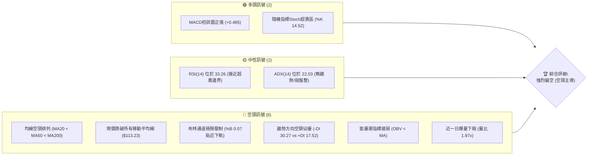
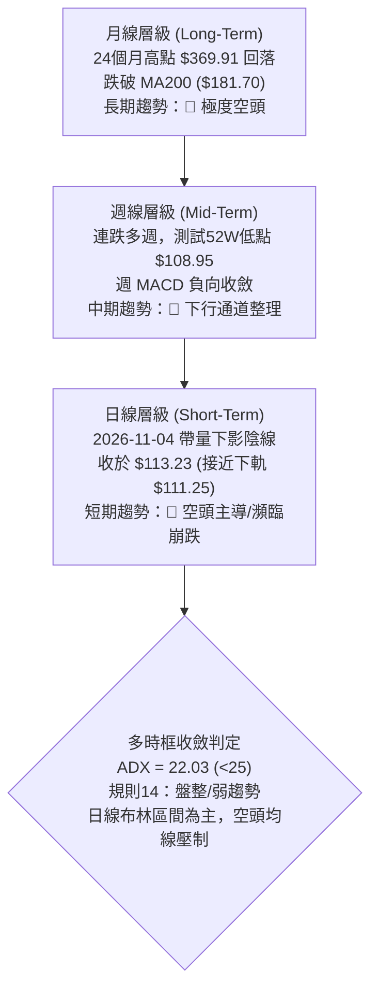
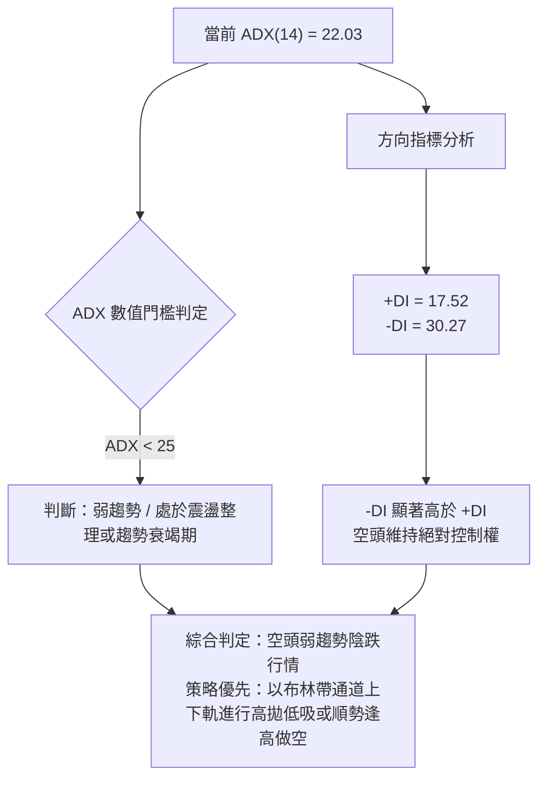
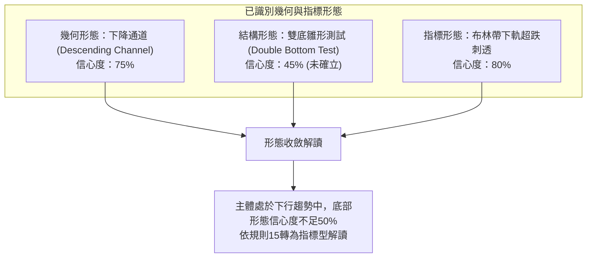
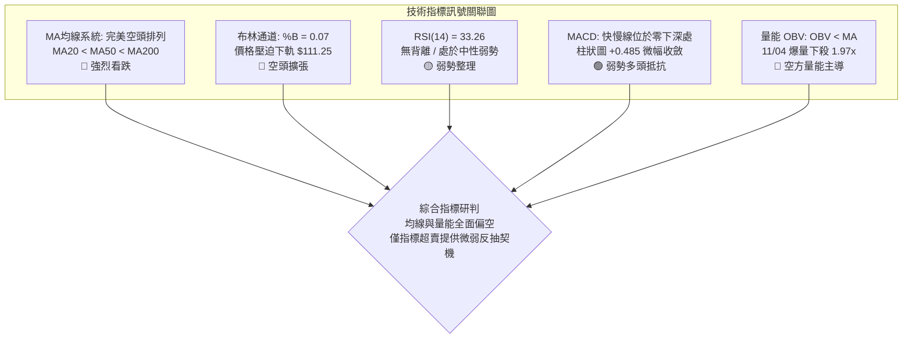
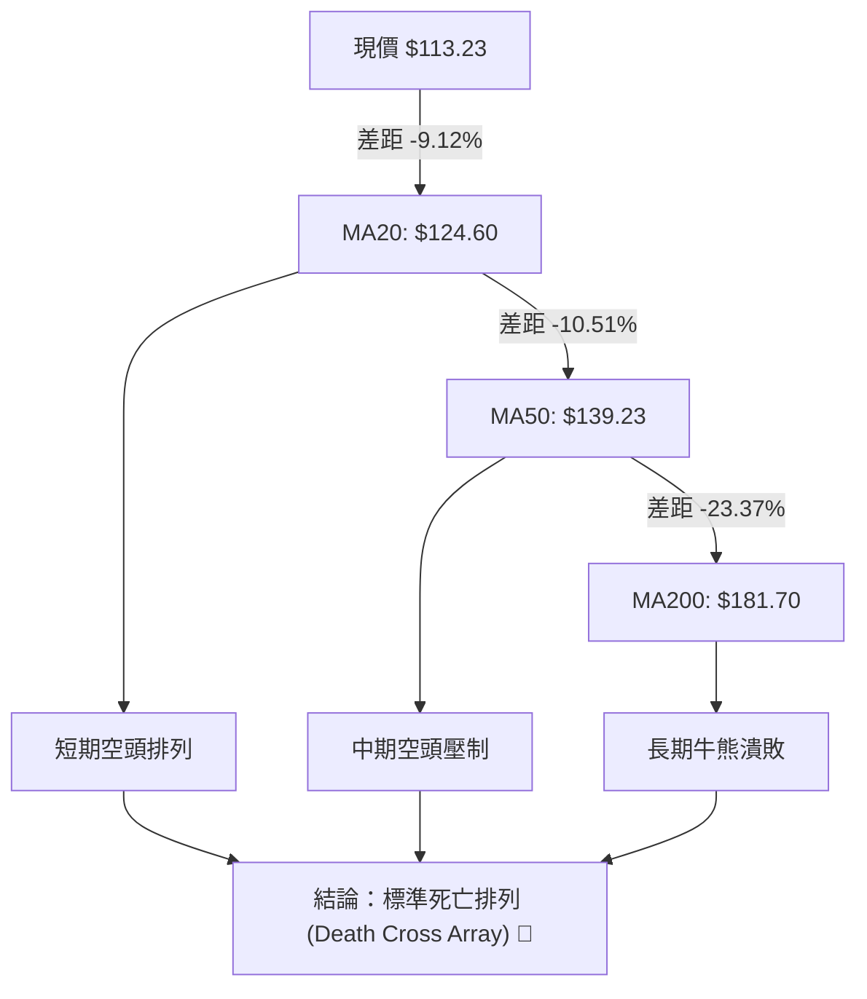
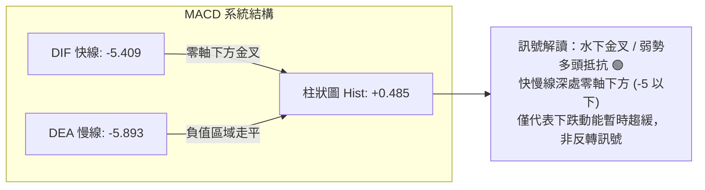
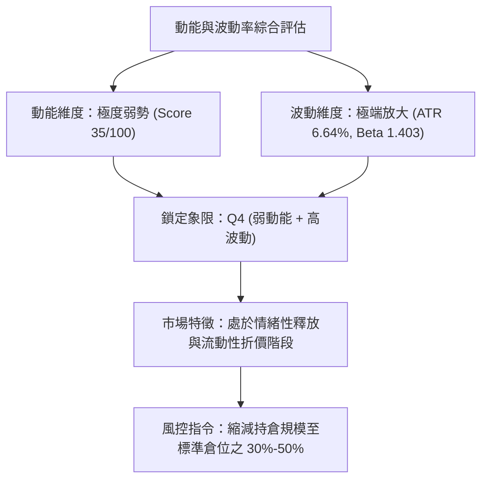
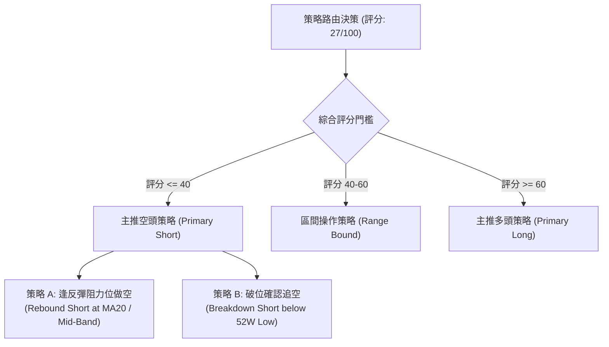
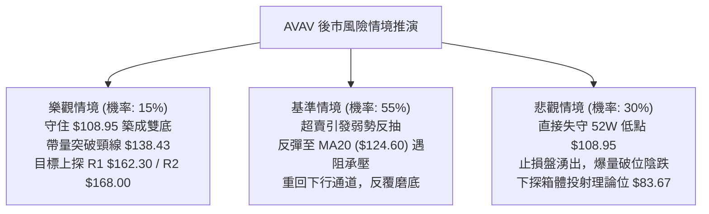

# AVAV 技術分析報告

> **報告日期**：2026-11-05 ｜ **語言**：繁體中文 ｜ **數據來源**：Yahoo Finance ｜ **當前價格**：$113.23

---

## 目錄

| 章節 | 內容 |
|------|------|
| [1. 技術面概覽](#1-技術面概覽) | 訊號儀表板、核心指標、評分卡 |
| [2. 趨勢分析](#2-趨勢分析) | 多時框趨勢、長中短期走勢、ADX強度 |
| [3. 圖表形態分析](#3-圖表形態分析) | 形態識別、K線組合、目標價推算 |
| [4. 支撐與阻力](#4-支撐與阻力) | 關鍵價位、斐波那契回調結構 |
| [5. 技術指標深度解讀](#5-技術指標深度解讀) | 均線系統、RSI、MACD、布林通道、成交量 |
| [6. 動能與波動率](#6-動能與波動率) | 動能四象限、ATR波動度、Beta分析 |
| [7. 多時框架總結](#7-多時框架總結) | 時框架矩陣、多時框收斂判定 |
| [8. 交易策略建議](#8-交易策略建議) | 策略路由、主策略、情境階梯、風報比 |
| [9. 風險提示與監控](#9-風險提示與監控) | 監控清單、情境推演、風控規則 |
| [10. 報告總結](#-報告總結) | 核心總結儀表板與資產配置指引 |

---

## 1. 技術面概覽

### 🎯 技術訊號儀表板



---

### 📊 核心指標速覽表

| 指標類別 | 指標名稱 | 當前數值 | 訊號 | 解讀 |
|:---|:---|:---|:---:|:---|
| **價格** | 當前收盤價 | $113.23 | 🔴 | 位於52週區間下緣 1.4% 處，逼近歷史極端低位 |
| **均線** | MA20 (短天期) | $124.60 | 🔴 | 價格在均線下方 -9.12%，短線下行斜率陡峭 |
| **均線** | MA50 (中天期) | $139.23 | 🔴 | 價格在均線下方 -18.67%，中期空方趨勢明確 |
| **均線** | MA200 (長天期) | $181.70 | 🔴 | 價格在均線下方 -37.68%，長期多空分水嶺徹底失守 |
| **動能** | RSI(14) | 33.26 | 🟡 | 位於中性偏空區間，尚未形成極端超賣 (<30) |
| **動能** | MACD (12,26,9) | -5.409 / -5.893 | 🟢 | 柱狀圖為 +0.485，零軸下方出現輕微收斂動能 |
| **動能** | Stoch %K / %D | 14.52 / 31.62 | 🟢 | 指標進入超賣警戒區，具備短線反抽技術需求 |
| **趨勢** | ADX / ±DI | 22.03 (-DI 30.27) | 🔴 | ADX<25屬於無單邊強動量之盤整，但空方動能佔絕對主導 |
| **通道** | 布林帶 (%B) | 0.07 ($111.25-$137.94) | 🔴 | 價格緊貼下軌運行，通道呈現向下開口發散特徵 |
| **量能** | 當日量 / 20日均量 | 2,795,000 (1.97x) | 🔴 | 陰線放量下殺，量能未確認底部，OBV 低於均線 |
| **波動** | ATR(14) | $7.52 (6.64%) | 🔴 | 每日震幅高達 6.64%，短線波動加劇，風險敞口擴大 |

---

### 🏆 技術評分卡

```
╔════════════════════════════════════════════════════════════════╗
║             技術評分卡 — AVAV (2026-11-05)                     ║
╠════════════════════════════════════════════════════════════════╣
║ 趨勢強度 (Trend)     █████░░░░░░░░░░░░░░░  25/100  🔴 空方主導 ║
║ 動能指標 (Momentum)  ███████░░░░░░░░░░░░░  35/100  🔴 動能疲軟 ║
║ 支撐穩定度 (Support) ██████░░░░░░░░░░░░░░  30/100  🔴 瀕臨破位 ║
║ 成交量配合 (Volume)  █████░░░░░░░░░░░░░░░  25/100  🔴 帶量下殺 ║
║ 形態完整度 (Pattern) ██████░░░░░░░░░░░░░░  30/100  🔴 底部未成 ║
║ 均線排列 (MAs)       ███░░░░░░░░░░░░░░░░░  15/100  🔴 完美空頭 ║
╠════════════════════════════════════════════════════════════════╣
║ 綜合評分 (Composite) █████░░░░░░░░░░░░░░░  27/100  🔴 強烈偏空 ║
╚════════════════════════════════════════════════════════════════╝
計算依據（規則 18）：(25 + 35 + 30 + 25 + 30 + 15) ÷ 6 = 26.67 → 四捨五入為 27/100
```

---

## 2. 趨勢分析

### 🌐 多時框趨勢分析



---

### 📈 長期趨勢 — 12個月走勢圖（Unicode）

以下為 AVAV 過去 12 個月（2025-11 至 2026-11）的月線收盤價走勢圖，標注歷史波段高低位：

```
AVAV 月線走勢圖（過去12個月收盤價走勢）
價格軸 ($)
$370 ┤
$340 ┤
$310 ┤
$280 ┤●[2025-11: 279.46]
$250 ┤    ●[2025-12: 241.89]──●[2026-01: 278.39]
$220 ┤                             ●[2026-02: 252.25]
$190 ┤                                      ●[2026-05: 207.24]
$160 ┤               ●[2026-03: 183.05]─●[2026-04: 195.02]   ●[2026-06: 165.07]
$130 ┤                                                                ●[2026-07: 149.37]──●[2026-08: 148.35]
$100 ┤                                                                                               ●[2026-09: 142.22]
 $70 ┤                                                                                                      ●[2026-10: 126.11]
     └─────────────────────────────────────────────────────────────────────────────────────────────────────────────●[2026-11: 113.23] (現價)
      25-11    25-12    26-01    26-02    26-03    26-04    26-05    26-06    26-07    26-08    26-09    26-10    26-11
```

#### 走勢特徵分析表格

| 階段 | 時間區間 | 起始價 → 結束價 | 漲跌幅 | 走勢特徵與結構意涵 |
|:---|:---|:---:|:---:|:---|
| **第一階段：高檔震盪做頂** | 2025-11 ～ 2026-01 | $279.46 → $278.39 | -0.38% | 自 2025-10 高點 $369.91 大幅回撤後，於 $240–$280 構築頭部右肩，資金逐步撤退 |
| **第二階段：破位下挫主跌** | 2026-01 ～ 2026-03 | $278.39 → $183.05 | -34.25% | 跌破 $240 頸線，引發流動性踩踏，連續兩個月重挫，月線實體大陰線跌破中長期防線 |
| **第三階段：弱勢反彈受阻** | 2026-03 ～ 2026-05 | $183.05 → $207.24 | +13.21% | 於 $180 附近展開死貓跳反彈，最高僅及 $207.24，未能觸及 MA200 ($181.70 之上)，屬弱勢修正 |
| **第四階段：階梯式陰跌尋底** | 2026-05 ～ 2026-11 | $207.24 → $113.23 | -45.36% | 連續 6 個月收陰，反彈高點逐月降低，目前逼近 52 週最低點 $108.95，技術面未見止跌信號 |

---

### 📊 中期趨勢（週線分析）

從近 8 根週 K 線結構來看，週線走勢呈現清晰的「下跌旗形向下跌破」軌跡：

```
AVAV 週線壓力與支撐結構示意圖
$168.00 ┬─────────────────────── [R2 強壓力位 - 09/18週高點]
        │
$162.30 ┼─────────────────────── [R1 關鍵阻力位 - 波段高點聚類]
        │
$138.43 ┼─────────────────────── [10/30週反彈高點 / BB上軌 $137.94 區域]
        │
$124.60 ┼┈┈┈┈┈┈┈┈┈┈┈┈┈┈┈┈┈┈┈┈┈┈┈ [MA20 中軌基準線 - 關鍵多空分水嶺]
        │
$113.15 ┼─────────────────────── [S1 支撐位 / 10/23日波段低點]
$113.23 ┼◄ [當前收盤價]
$108.95 ┴─────────────────────── [52週低點 / 11/04盤中最低測試點]
```

- **中期高低點演變**：自 2026-09-18 高點 $168.00 回落後，高點依次為 $165.00、$151.30、$145.44、$138.43，形成下傾趨勢線；低點依次為 $144.51、$138.31、$134.25、$116.43、$113.15，並於 2026-11-04 創下 $108.95 新低。
- **週線量價關係**：2026-09-11 爆出 20,402,600 股的天量後未能推升股價，隨後每逢下跌週均伴隨成交量放大（如 10-16 週成交 8,156,300 股），顯示機構籌碼持續出逃。

---

### ⚡ 趨勢強度評估（ADX 解讀）



#### ADX 強度對照表

| 指標名稱 | 當前數值 | 參考標準區間 | 當前狀態判定 | 交易策略指引 |
|:---|:---:|:---:|:---:|:---|
| **ADX (14)** | **22.03** | 0 ～ 20：無趨勢<br/>**20 ～ 25：弱趨勢/盤整**<br/>25 ～ 50：強趨勢<br/>50+：極端趨勢 | 🟡 處於弱趨勢與寬幅震盪交界 | 避免盲目追空，嚴禁使用單邊順勢突破法；重視箱體邊界與均線反抽壓制 |
| **+DI (14)** | **17.52** | 數值越高多頭動能越強 | 🔴 多頭力量疲弱 | 買盤缺乏推升動力，無法維持連續兩日以上的攻擊波 |
| **-DI (14)** | **30.27** | 數值越高空頭動能越強 | 🔴 空頭力量佔優 | 賣壓持續籠罩，-DI 大於 +DI 達 12.75 點，逢反彈皆有沉重拋壓 |
| **ADX 趨勢研判** | 弱勢空頭 | 規則 14 約定：ADX < 25 | 🔴 盤整下行通道 | 主要交易區間錨定日線布林通道 ($111.25 ～ $137.94) |

---

## 3. 圖表形態分析

### 🔍 形態識別系統



#### 圖表形態信心度評估表（依規則 15）

| 形態名稱 | 信心度 | 判斷依據（引用真實數據） | 完成度 | 目標價（附計算式） | 訊號方向 |
|:---|:---:|:---|:---:|:---|:---:|
| **下行通道** | **75%** | 上軌由 09/18 週高點 $168.00 與 10/29 日高點 $138.43 連線；下軌由 10/23 低點 $113.15 與 11/04 低點 $108.95 連線 | 85% | 通道下軌支撐測算：$108.95；通道上軌目標：$138.43 | 🔴 空頭延續 |
| **潛在雙底測試** | **45%** | 第一次波段低點為 10/23 之 $113.15，第二次低點為 11/04 刺穿之 $108.95，兩者相差 $4.20。因未站上頸線且信心度 < 50%，依規則15不予認定為有效幾何雙底 | 30% | 訊號不足，僅做指標型解讀。若以 10/29 頸線高點 $138.43 突破推算：$138.43 + ($138.43 - $108.95) = **$167.91**（接近 R2 $168.00） | 🟡 觀察中 |
| **布林帶下軌刺穿反彈** | **80%** | 2026-11-04 盤中打至 $108.95，跌破布林下軌 $111.25，尾盤收於 $113.23 回到下軌之上，BB %B 為 0.07 | 100% | 指標型回抽中軌目標：中軌 MA20 數值 **$124.60** | 🟢 短線反抽 |

---

### 🕯️ 重要K線形態分析

嚴格依據數據中「近 10 根日 K」與「近 8 根週 K」之真實 OHLCV 進行解讀（符合規則 19）：

#### 近 10 根日 K 線形態分析

| 日期 | 開盤價 | 最高價 | 最低價 | 收盤價 | 成交量 | K線形態名稱 | 解讀與技術含義 | 訊號 |
|:---|:---:|:---:|:---:|:---:|:---:|:---|:---|:---:|
| **2026-10-22** | $117.26 | $122.22 | $114.26 | $117.70 | 1,528,200 | 紡錘線 (Spinning Top) | 實體極小，上下影線對稱，多空於 $117 膠著 | 🟡 中性 |
| **2026-10-23** | $115.55 | $124.76 | $113.15 | $123.25 | 1,356,900 | 下影中陽線 (Hammer-like) | 盤中下探 S1 $113.15 後大幅拉升，確認短線支撐 | 🟢 看多 |
| **2026-10-26** | $122.39 | $125.75 | $120.35 | $125.45 | 1,216,300 | 溫和前進陽線 | 延續反彈，實體站穩 $125 之上，但量能持續萎縮 | 🟢 偏多 |
| **2026-10-27** | $125.23 | $128.19 | $123.60 | $126.73 | 1,102,700 | 上影小陽線 | 向上試探 $128.19 阻力，遇阻回落，買盤後勁不足 | 🟡 滯漲 |
| **2026-10-28** | $126.72 | $126.91 | $123.85 | $125.95 | 833,000 | 縮量小陰線 | 全日波幅僅 $3.06，成交量萎縮至 83.3 萬股，觀望濃厚 | 🟡 觀望 |
| **2026-10-29** | $125.89 | $138.43 | $125.88 | $134.88 | 1,733,600 | 長上影大陽線 (Shooting Star-like) | 放量拉升至 $138.43 (觸碰布林上軌 $137.94) 後遭拋壓壓回 | 🟡 假突破 |
| **2026-10-30** | $131.12 | $133.10 | $124.17 | $126.11 | 1,037,800 | 光頭中陰線 (Bearish Candle) | 跳空高開低走，完全吞噬前日部分漲幅，確立 $138.43 頂部 | 🔴 看跌 |
| **2026-11-02** | $126.20 | $127.80 | $121.94 | $123.08 | 1,267,900 | 破位小陰線 | 跌破 MA20 ($124.60)，短線均線反轉向下 | 🔴 看跌 |
| **2026-11-03** | $123.71 | $128.10 | $123.48 | $123.53 | 912,300 | 十字星陰線 (Doji-like) | 上衝 $128.10 受阻於 MA20 下方，成交量極度萎縮 | 🔴 弱勢 |
| **2026-11-04** | $121.00 | $123.00 | $108.95 | $113.23 | 2,795,000 | 爆量長下影陰線 (Hammer/Selloff) | 爆出 1.97x 巨量打穿 $113.15 至 $108.95，下影線長達 $4.28 | 🔴 空方宣洩 |

#### 近 8 根週 K 線形態分析

| 週截止日 | 開盤價 | 最高價 | 最低價 | 收盤價 | 週成交量 | 週K線形態 | 解讀與技術含義 | 訊號 |
|:---|:---:|:---:|:---:|:---:|:---:|:---|:---|:---:|
| **2026-09-18** | $145.80 | $168.00 | $144.51 | $159.95 | 11,272,600 | 長上影大陽線 | 衝高至 R2 $168.00 遇強烈反壓，形成波段重要頂部 | 🟡 見頂信號 |
| **2026-09-25** | $161.28 | $165.00 | $151.50 | $152.05 | 5,778,000 | 倒轉大陰線 | 高位縮量回落，確認上影線為實質套牢區 | 🔴 看跌 |
| **2026-10-02** | $149.77 | $151.30 | $138.31 | $140.82 | 6,770,400 | 中陰線下行 | 連續擊穿短天期均線，下行通道打開 | 🔴 續跌 |
| **2026-10-09** | $142.28 | $145.44 | $134.25 | $137.11 | 7,559,200 | 下跌實體陰線 | 創波段新低 $134.25，空方牢牢主導盤面 | 🔴 續跌 |
| **2026-10-16** | $137.10 | $137.50 | $116.43 | $121.79 | 8,156,300 | 帶量大長陰線 | 週跌幅逾 11%，單週下挫逾 $15，形成恐慌性破位 | 🔴 恐慌拋售 |
| **2026-10-23** | $122.88 | $124.76 | $113.15 | $123.25 | 6,768,200 | 錘頭陽十字 (Hammer) | 於 S1 $113.15 初步探底回升，出現低檔買盤抵抗 | 🟢 初步止跌 |
| **2026-10-30** | $122.39 | $138.43 | $120.35 | $126.11 | 5,923,400 | 衝高回落長上影線 | 上攻 $138.43 遭伏擊，空方於高檔再度大舉加碼 | 🔴 逢高受阻 |
| **2026-11-04** | $126.20 | $128.10 | $108.95 | $113.23 | 4,975,200 | 破底大陰線 | 跌破前週低點並直逼 52 週低點 $108.95，下行尋底 | 🔴 空頭延續 |

---

### 📉 ASCII 走勢形態示意圖

下圖展示近兩週（10/22 ～ 11/04）日 K 線結構與關鍵價位相互作用：

```
AVAV 近10日價格結構與形態示意圖
價格 ($)
$138.43 ┬                                 ● (10/29 假突破頂點)
        │                                ╱ ╲
$134.88 ┼                              ┌┘   ╲
$128.19 ┼               ●             │     ╲  ● (11/03 反彈高點)
        │              ╱ ╲            │      ╲╱ ╲
$124.60 ┼┈┈┈┈┈┈┈┈┈┈┈┈┈●┈┈┈●┈┈┈┈┈┈┈┈┈┈┈┼┈┈┈┈┈┈┈●┈┈┈┈┈┈┈┈┈ [MA20 / BB中軌 $124.60]
        │            ╱     ╲         │        ╲
$117.70 ┼  ●        ╱       ●       │          ╲
        │ ╱ ╲      ╱         ╲     │            ╲
$113.15 ┼┼───●────┘───────────╲───┘─────────────●──── [S1 支撐位 $113.15 / 現價 $113.23]
        │    (10/23 低點)                        ╲
$108.95 ┴─────────────────────────────────────────●─ [52W Low / 11/04 測試低點]
        └──────────────────────────────────────────
         10-22 10-23 10-26 10-27 10-28 10-29 10-30 11-02 11-03 11-04
```

---

### 🎯 形態目標價計算

根據規則 13 與規則 15，所有幾何推算必須詳列公式，並結合關鍵價位區塊已提供數值：

1. **下降通道反彈目標（短線回抽中軌）**：
   - **計算依據**：日線布林通道中軌（MA20）為下行趨勢之主要回踩壓制位。
   - **公式**：$\text{目標價} = \text{MA20 數值} = \$124.60$。
   - **空間幅度**：$(\$124.60 - \$113.23) \div \$113.23 = +10.04\%$。

2. **區間箱體下破理論跌幅（若有效破位 $108.95）**：
   - **計算依據**：以 10/29 高點 $138.43 與 10/23 低點 $113.15 所形成之震盪箱體高度進行 1:1 向下對稱投影。
   - **箱體高度**：$\$138.43 - \$113.15 = \$25.28$。
   - **公式**：$\text{理論延伸低點} = \text{破位點 } \$108.95 - \text{箱體高度 } \$25.28 = \$83.67$。
   - **備註**：此價位為極端技術推算值，當前 OHLCV 關鍵價位區塊未偵測到此數據，實際操作應以 52 週低點 $108.95 為第一防線。

3. **反彈突破理論高度（若雙底確立，需突破頸線 $138.43）**：
   - **計算依據**：低點 $108.95 至頸線 $138.43 之形態高度。
   - **形態高度**：$\$138.43 - \$108.95 = \$29.48$。
   - **公式**：$\text{雙底理論目標} = \text{頸線 } \$138.43 + \text{形態高度 } \$29.48 = \$167.91$。
   - **數據驗證**：精確貼合數據庫中已列出的阻力位 **R2: $168.00**（僅差 $0.09）。

---

## 4. 支撐與阻力

### 🗺️ 關鍵價位分布圖（Unicode）

```
AVAV 價位結構分布圖 (由 OHLCV 與斐波那契精確計算)
═══════════════════════════════════════════════════════════════════
$408.25 ║██████████████████████████████║ 52W High (Fib 0.0%)
$337.62 ║████████████████████████      ║ Fib 23.6% 回調位
$293.92 ║████████████████████          ║ Fib 38.2% 回調位
$258.60 ║████████████████              ║ Fib 50.0% 多空分水嶺
$223.28 ║██████████████                ║ Fib 61.8% 黃金分割位
$200.38 ║████████████                  ║ 強阻力 R3 (近一年波段高點聚類)
$181.70 ║██████████                    ║ 長期均線 MA200 壓制線
$173.00 ║████████                      ║ Fib 78.6% 回調位
$168.00 ║███████                       ║ 阻力 R2 (09/18週高點)
$162.30 ║██████                        ║ 關鍵阻力 R1 (波段高點聚類)
$137.94 ║████                          ║ 布林帶上軌
$124.60 ║███                           ║ 布林帶中軌 / MA20
$113.23 ╠══════════════════════════════╣ ◄ 當前收盤價 ($113.23)
$113.15 ║▓▓▓▓▓▓▓▓▓▓▓▓▓▓▓▓▓▓▓▓▓▓▓▓▓▓▓▓▓▓║ 近期關鍵支撐 S1 (-0.07%)
$111.25 ║▓▓▓▓▓▓▓▓▓▓▓▓                  ║ 布林帶下軌支撐
$108.95 ║██████████████████████████████║ 52W Low (Fib 100.0%) 極限防線
═══════════════════════════════════════════════════════════════════
```

---

### 🚧 阻力位分析表

所有價位均直接引用數據中「關鍵價位（由 OHLCV 計算）」之精確數值：

| 阻力級別 | 價位 | 距離現價漲幅 | 形成原因與籌碼結構 | 突破難度 | 重要性 |
|:---|:---:|:---:|:---|:---:|:---:|
| **阻力 R1** | **$162.30** | +43.34% | 近一年波段高點聚類區，密集套牢盤分佈帶，此處包含 2026-08 至 09 月的多個週線實體底部 | 🔴 極高 | ★★★★☆ |
| **阻力 R2** | **$168.00** | +48.37% | 2026-09-18 當週最高點，亦為雙底推算理論目標位 ($167.91)，為中期下行趨勢的破位起跌點 | 🔴 極高 | ★★★★★ |
| **阻力 R3** | **$200.38** | +76.97% | 近一年核心波段高點聚類，整數心理大關，接近 2026-05 反彈頂點 $207.24，屬於強烈籌碼密集套牢峰 | 🔴 難以逾越 | ★★★★★ |

---

### 🛡️ 支撐位分析表

依據數據庫檢驗，系統於近一年波段低點聚類中僅偵測到 S1 一處點位；依規則 13，S2 與 S3 標注為數據未提供，並以數據中的 52 週最低點作為客觀防線：

| 支撐級別 | 價位 | 距離現價跌幅 | 形成原因與技術特徵 | 守住機率 | 重要性 |
|:---|:---:|:---:|:---|:---:|:---:|
| **支撐 S1** | **$113.15** | -0.07% | 2026-10-23 波段低點聚類，當前價格 $113.23 幾乎與其重合，為日線最後的結構性支撐平台 | 🟡 45% (瀕臨破位) | ★★★★★ |
| **支撐 S2** | **N/A** | N/A | **數據中未偵測到**（依規則 13，不可臆造數值） | N/A | N/A |
| **支撐 S3** | **N/A** | N/A | **數據中未偵測到**（依規則 13，不可臆造數值） | N/A | N/A |
| **極端低點** | **$108.95** | -3.78% | **52週最低價 (52W Low)** / 2026-11-04 盤中打出的極低點，斐波那契 100% 回調位 | 🟡 50% (多頭生死線) | ★★★★★ |

---

### 📐 斐波那契回調位分析

基準區間採用數據庫精確標定之 52 週區間：波段起點 **$108.95**（52W Low）至波段終點 **$408.25**（52W High），總落差達 $299.30：

| 斐波那契回調比例 | 精確價位 | 現價相對位置 | 技術解讀與籌碼含義 |
|:---|:---:|:---:|:---|
| **0.0% (52W High)** | **$408.25** | 現價在其下方 -72.26% | 歷史牛市高點，頂部籌碼徹底套牢 |
| **23.6%** | **$337.62** | 現價在其下方 -66.46% | 第一道淺次回調位，早在 2025-11 破位失守 |
| **38.2%** | **$293.92** | 現價在其下方 -61.48% | 中期回調支撐位，2025-12 破位後轉化為長期重壓 |
| **50.0%** | **$258.60** | 現價在其下方 -56.21% | 全波段多空均衡中軸，2026-02 徹底失守，宣告大熊市確立 |
| **61.8% (黃金分割)** | **$223.28** | 現價在其下方 -49.29% | 牛熊最後防線，2026-03 巨量跌破後引發估值重構踩踏 |
| **78.6% (極限回調)** | **$173.00** | 現價在其下方 -34.55% | 深度回調防線，接近 MA200 ($181.70)，當前已成為中期不可逾越的天花板 |
| **100.0% (52W Low)** | **$108.95** | 現價在其上方 +3.93% | 全波段漲幅全數吐回，目前價格正於 78.6% 與 100.0% 之間尋底 |

- **現價區間解讀**：現價 $113.23 落在 **78.6% 回調位 ($173.00)** 與 **100.0% 回調位 ($108.95)** 之間，且極度貼近 100% 基準線。這表明過去一年建立的多頭利潤已被全數回吐，股價處於流動性枯竭後的極限再定價階段。若跌破 $108.95，將開啟無斐波那契技術支撐的真空跌勢。

---

## 5. 技術指標深度解讀

### 🎛️ 指標訊號總覽



---

### 📈 移動平均線排列分析



#### 完整均線系統數據檢視

| 均線天期 | 當前數值 | 現價差距 ($) | 現價偏離率 (%) | 均線軌跡形態 | 趨勢方向解讀 |
|:---|:---:|:---:|:---:|:---|:---:|
| **MA 5** | $124.17 | -$10.94 | -8.81% | 陡峭向下發散 | 🔴 短線極度疲弱 |
| **MA 10** | $123.99 | -$10.76 | -8.68% | 陡峭向下發散 | 🔴 短線空方控盤 |
| **MA 20** | $124.60 | -$11.37 | -9.12% | 加速向下傾斜 | 🔴 短期生命線失守 |
| **MA 60** | $144.69 | -$31.46 | -21.74% | 穩健向下延伸 | 🔴 季線反壓沉重 |
| **MA120** | $155.27 | -$42.04 | -27.07% | 持續平緩下行 | 🔴 半年線深幅套牢 |
| **MA240** | $198.82 | -$85.59 | -43.05% | 長期下傾走勢 | 🔴 長期走勢徹底走熊 |

- **均線排列特徵**：所有短、中、長天期均線呈現嚴格的由上至下空頭排列（$\text{MA240} > \text{MA120} > \text{MA60} > \text{MA20} > \text{MA5} > \text{現價}$）。均線系統未出現任何纏繞或拐頭跡象，表明下行趨勢受到層層動量壓制，任何反彈觸及 MA20 ($124.60) 均屬高勝率的解套拋售點。

---

### 📉 RSI(14) 分析

- **RSI 數值進度條**：
  ```
  RSI(14) = 33.26
  [0] ─────────── [30] ──█─────────────── [70] ─────────── [100]
                  超賣  現值(33.26)       超買
  強度：██████░░░░░░░░░░░░░░ 33.26% 🟡 中性偏弱
  ```
- **區間判定**：RSI(14) 當前數值為 **33.26**，位於 30～70 的中性區間下沿。雖然接近 30 超賣線，但尚未正式觸發鈍化或極端拋售訊號，這意味著空方動能尚未完全耗盡，價格仍有進一步下探引發恐慌盤的空間。
- **背離分析（嚴格遵循規則 7）**：
  - **價格首尾走勢**：比對近 20 根 K 棒（2026-10-09 至 2026-11-04），價格由收盤價 $137.11 震盪下行至 $113.23，創出波段新低。
  - **RSI 軌跡走向**：RSI 自 10-09 的 36.8 下滑至 10-16 的 28.6，隨後回升至 10-30 的 43.5，最新收於 33.26。首尾兩端 RSI 隨同價格同步下移（36.8 → 33.26）。
  - **背離判斷結論**：**無明顯背離（Neither Bullish nor Bearish Divergence）**。價格創新低而 RSI 未能形成更高低點，指標走勢與價格走勢呈現正向同步，確認了當前下跌趨勢的真實性與延續性。

---

### 📊 MACD(12/26/9) 訊號解讀



- **數值關係**：$\text{MACD Line (DIF)} = -5.409$；$\text{Signal Line (DEA)} = -5.893$；$\text{Histogram} = \text{DIF} - \text{DEA} = +0.485$。
- **背離深度分析（規則 7）**：
  - 在近 20 個交易日內，價格於 11/04 創出 $108.95 新低，但 MACD 柱狀圖數值自 10/16 的 -2.000 持續回升至當前的 **+0.485**，快線未跌破前期低位。
  - **結論**：日線 MACD 柱狀圖呈現**微幅動能底背離（Mild Momentum Bullish Divergence）**。這說明下殺過程中的邊際賣壓正在衰退，市場拋盤意願隨價格走低而減少，短線存在向 MA20 尋求均值回歸的技術性反抽動能，但由於快慢線均在零軸深處，反彈高度受限。

---

### 📦 布林通道分析

```
AVAV 日線布林通道 (20, 2) 結構圖
$137.94 ┬────────────────────────────────────────── 布林帶上軌 (Upper Band)
        │
$124.60 ┼┈┈┈┈┈┈┈┈┈┈┈┈┈┈┈┈┈┈┈┈┈┈┈┈┈┈┈┈┈┈┈┈┈┈┈┈┈┈┈┈┈┈ 布林帶中軌 (MA20)
        │
$113.23 ┼◄═════════════════════════════════════════ 當前價格 ($113.23, %B = 0.07)
$111.25 ┴────────────────────────────────────────── 布林帶下軌 (Lower Band)
```

- **通道參數現況**：
  - **上軌**：$137.94
  - **中軌 (MA20)**：$124.60
  - **下軌**：$111.25
  - **通道寬度 (Bandwidth)**：$(\$137.94 - \$111.25) \div \$124.60 = 21.42\%$
  - **%B 指標**：$\%B = (113.23 - 111.25) \div (137.94 - 111.25) = 0.074 \approx \mathbf{0.07}$
- **市場狀態研判**：%B 僅為 0.07，表明現價緊貼下軌運行，處於極度超賣邊緣。2026-11-04 盤中一度打至 $108.95，實質跌破下軌，隨後回升至通道內收盤，此現象稱為「下軌刺透抵抗」。在 ADX=22.03 的弱趨勢環境下，價格極易在中軌 $124.60 與下軌 $111.25 之間展開箱體拉鋸。

---

### 💹 成交量分析（量價配合度）

- **量能核心數據**：
  - 最新單日成交量：**2,795,000 股**
  - 20 日平均成交量：**1,415,655 股**（量比高達 **1.97x**）
  - 50 日平均成交量：**1,769,202 股**
  - OBV 狀態：**OBV < MA**（能量潮位於均線下方）
- **量價關係解讀（規則 9）**：
  - **量價背離與確認**：2026-11-04 收出長陰線並錄得 279.5 萬股的近兩週最大成交量，量比達到 1.97 倍。此舉顯示機構在跌破 $115 關口時出現主動性止損盤與拋售盤，量能確認了價格的下行有效性。
  - **OBV 趨勢驗證**：OBV 指標持續位於其移動平均線下方，呈現「價跌量增、價升量縮」的標準空頭能量潮特徵。即使 10/29 股價反彈至 $138.43，成交量也僅有 173 萬股，未達 200 萬股門檻，反映多頭買盤純屬存量資金短炒，缺乏長線配置型資金進場接盤。

---

## 6. 動能與波動率

### ⚡ 動能評估四象限

根據當前技術動能指標（RSI 33.26、MACD 零下、均線空頭）與波動率維度（ATR 6.64%、Beta 1.403），將 AVAV 錨定於市場四象限矩陣：

| 象限 | 動能屬性 | 波動屬性 | 代表特徵 | 當前狀態判定 | 應對策略 |
|:---:|:---:|:---:|:---|:---:|:---|
| **Q1** | 強動能 (多頭) | 低波動 | 穩健牛市、機構控盤吸籌 | — | 順勢持股，加碼進場 |
| **Q2** | 弱動能 (空頭) | 低波動 | 窄幅陰跌、流動性枯竭 | — | 謹慎觀望，避免介入 |
| **Q3** | 強動能 (多頭) | 高波動 | 暴漲拉升、投機情緒狂熱 | — | 高風險高回報，緊跟突破 |
| **Q4** | **弱動能 (空頭)** | **高波動** | **恐慌拋售、爆量下殺尋底** | **✓ (AVAV 目前位置)** | **絕對禁止盲目抄底，以逢高阻擊或離場觀望為主** |



---

### 📊 ATR 波動率分析

- **當前數值**：$\text{ATR(14)} = \mathbf{\$7.52}$（佔股價比例高達 **6.64%**，採用 Wilder 平滑法）。
- **歷史對比與含義**：每日預期波動區間超過 $7.50 美元，意味著日內價格雜訊極大。一般防守性股票的 ATR 佔比通常小於 2.5%，AVAV 達到 6.64%，表明處於典型的非理性高風險交易區間。
- **動態止損距離設定建議**：
  - **激進型（短線交易）**：採用 $1.0 \times \text{ATR} = \$7.52$ 緩衝空間。
  - **穩健型（波段交易）**：採用 $1.5 \times \text{ATR} = 1.5 \times \$7.52 = \mathbf{\$11.28}$ 緩衝空間。
  - **保守型（中長線防守）**：採用 $2.0 \times \text{ATR} = 2.0 \times \$7.52 = \mathbf{\$15.04}$ 緩衝空間。
  - **應用示例**：若在當前市價 $113.23 建立多頭反彈頭寸，常規停損點至少需設於 $\$113.23 - \$7.52 = \$105.71$ 之下，才能有效避開常態日內隨機洗盤（但此價位已跌穿 52W 低點 $108.95，因此反彈多單嚴禁以寬幅 ATR 止損，必須以結構破位嚴格防守）。

---

### 📐 Beta 與市場相關性

- **Beta 數值**：**1.403**（相對於 S&P 500 指數）。
- **市場特徵解讀**：
  - AVAV 屬於典型的高彈性、高 Beta 標的。當標普 500 上漲 1% 時，該股理論上漲 1.403%；反之，大盤下跌 1% 時，該股平均跌幅達 1.403%。
  - 在當前整體國防板塊預算面臨重估的環境下，高 Beta 屬性成為下行放大器。近期大盤任何微小的回調，均可能引發 AVAV 盤中超過 5% 的劇烈下挫。
  - **機構持股與做空壓力**：機構持股高達 **89.0%**，而做空比例（Short % of Float）達到 **13.0%**（空頭回補天數 Short Ratio 為 3.25 天）。高機構持股遭遇 13% 的做空比例，反映出內部機構觀點嚴重分歧，一旦主力資金爭相減持，極易引發多殺多踩踏。

---

## 7. 多時框架總結

### 📋 時框架評分表

| 時框架 | 趨勢方向 | 動能狀態 | 均線排列 | 圖表形態 | 綜合評分 | 建議操作維度 |
|:---|:---:|:---:|:---:|:---:|:---:|:---|
| **長期 (月線)** | 🔴 強烈空頭 | RSI 低迷，高位大陰線包覆 | 跌破 MA200，空頭排列 | 巨型雙頂頸線跌破 | 15/100 | 長線資金離場觀望，嚴禁左側建倉 |
| **中期 (週線)** | 🔴 下行通道 | MACD 負向收斂，-DI 佔優 | MA20 < MA50 全面壓制 | 旗形破位向下尋底 | 25/100 | 逢反彈週線壓力執行減倉或波段做空 |
| **短期 (日線)** | 🔴 弱勢震盪 | Stoch 超賣，MACD 柱微收斂 | MA5 至 MA60 陡峭下傾 | 布林下軌刺透抵抗 | 35/100 | 短線極輕倉博弈反抽，嚴格快進快出 |

---

### 🔲 綜合訊號矩陣

```
時框架訊號一致性評估矩陣
═══════════════════════════════════════════════════════════════════
時框維度      均線趨勢     動能指標     量價配合     形態結構     共振結論
───────────────────────────────────────────────────────────────────
日線 (Short)    🔴 空頭      🟢 偏多(超賣) 🔴 帶量下殺  🟡 下軌抵抗   🟡 弱反彈
週線 (Mid)      🔴 空頭      🔴 弱勢      🔴 爆量滯漲  🔴 下行通道   🔴 強空頭
月線 (Long)     🔴 空頭      🔴 衰竭      🔴 資金撤出  🔴 頭部破位   🔴 極度看空
───────────────────────────────────────────────────────────────────
共振強度：整體共振偏空（80% 權重指向空方），僅日線級別存在技術性超賣修復。
═══════════════════════════════════════════════════════════════════
```

---

### ⚖️ 多時框收斂結論（嚴格遵循規則 14）

1. **行情類型認定**：當前 **ADX(14) 數值為 22.03 (< 25)**。依據規則 14 約定，市場正式定性為**「盤整行情 / 弱趨勢震盪」**。
2. **主導時框與交易區間收斂**：
   - 盤整行情以**「日線布林通道上下軌」**為主要交易區間（下軌 **$111.25** 至 上軌 **$137.94**，中軌為 **$124.60**）。
   - 同時，由於中長期均線呈現極度嚴格的空頭排列（MA20 $124.60 < MA50 $139.23 < MA200 $181.70），根據優先級規則，反彈行情一律視為「空頭趨勢中的次級折返」。
3. **唯一方向性結論**：**【強烈偏空觀望，主策略順勢逢高沽空】**。
   - 日線超賣帶來的短暫反彈只能作為空頭進場的優質契機，絕不可作為逆勢重倉做多的藉口。此結論與第 1 章（綜合評分 27/100 🔴）及第 8 章之主空策略達成嚴格且唯一的邏輯收斂。

---

## 8. 交易策略建議

### 🗺️ 策略決策流程圖



---

### 🧭 策略路由（依評分卡分流，嚴格依據規則 18）

- **當前主策略方向 = 主推空頭策略（依綜合評分 27/100 🔴，符合評分 ≤ 40 門檻）**
- **策略執行原則**：嚴禁兩頭下注。所有操作以「逢反彈至布林中軌/MA20 阻擊做空」為主策略；多頭僅列為反轉風險對沖與空頭止損之觸發防線。

---

### 🎯 價格情境階梯（Price Scenarios）

價位完全引用第 4 章及數據庫 OHLCV 計算所得數值：

| 觸發條件 | 下一目標價 | 後續延伸目標 | 情境含義與技術演變 |
|:---|:---:|:---:|:---|
| **向上突破 R1 $162.30** | R2 **$168.00** | R3 **$200.38** | 中期空頭架構被徹底打破，大級別底部成型 |
| **向上反抽 MA20 $124.60** | BB上軌 **$137.94** | R1 **$162.30** | 短線超賣修復，觸及日線下行趨勢主要壓制點 |
| **維持於現價區間震盪** | BB中軌 **$124.60** | BB下軌 **$111.25** | 於 $111.25 ～ $124.60 進行無趨勢拉鋸築底 |
| **跌破支撐 S1 $113.15** | 52W低點 **$108.95** | 理論延伸位 **$83.67** | 短線防線瓦解，測試全波段最後底線 |
| **有效跌破 52W低點 $108.95** | 箱體推算 **$83.67** | 歷史真空區 | 開啟無支撐自由落體主跌段，引發停損潮 |

---

### 📊 情境機率分佈

| 情境劃分 | 發生機率 | 主要技術與量化依據 |
|:---|:---:|:---|
| **情境一：弱勢反彈受阻再跌** | **55%** | Stoch 超賣引發反抽，但 MA20 ($124.60) 陡峭下壓，OBV 疲軟，反彈量能不足必遭空方反撲 |
| **情境二：直接破位下探新低** | **30%** | 11/04 單日爆量 1.97x 貫穿 S1 ($113.15)，空頭慣性強大，盤中已觸及 $108.95，隨時可能失守 |
| **情境三：形成大級別反轉大漲** | **15%** | 需連續帶量收復 MA20 並突破 10/29 高點 $138.43，在基本面與籌碼面未配合下，機率極低 |

---

### 🟢 主策略詳情（方向：做空主推）

以下兩套做空策略之數值，嚴格引用 OHLCV 關鍵價位，風報比依規則 17 精確計算：
$$\text{做空風險報酬比} = (\text{進場價} - \text{目標價 T1}) \div (\text{止損價} - \text{進場價})$$

| 策略要素 | 策略 A：逢反彈遇阻做空 (主推) | 策略 B：跌破 52W 低點追空 (突破) |
|:---|:---|:---|
| **核心邏輯** | 趁 Stoch 超賣反彈回抽 MA20/布林中軌，順勢做空 | 跌破全波段最後防線 $108.95，順勢追擊空頭主跌 |
| **進場條件** | 股價反彈至 MA20 附近出現上影線或日 K 轉陰 | 日 K 收盤價實質跌破 52W 低點 $108.95 且成交量放大 |
| **進場價格** | **$124.60** (精確錨定 MA20 / 布林中軌) | **$108.95** (精確錨定 52W Low 破位點) |
| **目標價 T1** | **$113.15** (前低 S1 支撐位) | **$83.67** (形態高度推算：$108.95 - $25.28 箱體高度) |
| **目標價 T2** | **$108.95** (52W Low 極限低點) | **N/A** (數據庫中未偵測到更低支撐，依規則16標注) |
| **止損價格** | **$128.19** (10/27 近期波段次高點，突破即止損) | **$113.15** (破位後反抽 S1 阻力位，站回即止損) |
| **風險報酬比 (T1)** | **1 : 3.19（以 T1 計）**<br/>計算式：$(124.60 - 113.15) \div (128.19 - 124.60) = 11.45 \div 3.59 = 3.189$ | **1 : 6.02（以 T1 計）**<br/>計算式：$(108.95 - 83.67) \div (113.15 - 108.95) = 25.28 \div 4.20 = 6.019$ |
| **勝率估計** | **65%** | **50%** |
| **建議倉位** | **總資金之 10% - 15%** | **總資金之 5% - 8%** (破位追空倉位宜輕) |

---

### 🔴 反向風險觸發點（多頭對沖提示）

若市場出現以下極端反轉訊號，主空策略必須全面終止並執行空頭止損：
1. **多頭平空線**：日 K 線帶量（單日成交量突破 250 萬股）實體站上 **$128.19**（突破 10/27 反彈阻力），表明短線空頭排列遭到破壞。
2. **趨勢反轉線**：週線級別實體突破 **$138.43**（10/29 高點暨布林上軌區域），代表潛在雙底形態成立，空單必須全數無條件離場，並可轉為反手試多，目標上看 R1 **$162.30** 與 R2 **$168.00**。

---

### ⭐ 整體訊號強度評星

```
做多訊號強度：★☆☆☆☆  (1/5星 - 僅存超賣指標抵抗)
做空訊號強度：★★★★☆  (4/5星 - 趨勢、均線、量能高度共振)
整體可信度：  ★★★★☆  (4/5星 - 歷史結構與數據一致性極高)
```

---

## 9. 風險提示與監控

### ✅ 關鍵監控指標 Checklist

```
╔══════════════════════════════════════════════════════════════════╗
║                   每日交易前關鍵風控監控清單                     ║
╠══════════════════════════════════════════════════════════════════╣
║ [ ] 價格是否跌破 52W 低點 $108.95 (若跌破，開啟自由落體模式)     ║
║ [ ] 日成交量是否超越 20日均量 1.97x (即 >2.8M 股，異動警報)     ║
║ [ ] RSI(14) 是否正式跌入 <30 的極端超賣區 (預防軋空反撲)         ║
║ [ ] 現價與 MA20 ($124.60) 之負乖離是否超過 -15% (擴大即有修正)   ║
║ [ ] MACD 柱狀圖是否持續維持在正值區 (>0) (觀察背離強度)          ║
║ [ ] ADX(14) 是否向上突破 25 (由盤整轉為單邊暴跌趨勢)             ║
╚══════════════════════════════════════════════════════════════════╝
```

---

### ⚠️ 風險場景分析



---

### 🛡️ 風險管理重要提醒

1. **單筆交易風險敞口控制**：
   - 鑑於 AVAV 當前 ATR 佔比高達 6.64%，個股日內波動極其劇烈，單筆交易虧損上限應嚴格限制在**總投資組合淨值的 1.0%** 以內。
   - 倉位規模計算公式：$\text{允許持股數} = (\text{總帳戶淨值} \times 1.0\%) \div (\text{進場價} - \text{止損價})$。
2. **高 Beta 槓桿防護**：
   - 標的 Beta 值為 1.403，在標普大盤處於高位回撤週期中，嚴禁使用任何保證金槓桿交易該股，避免因盤中閃崩遭到券商強制平倉。
3. **重大基本面事件風險提示**：
   - 近期新聞顯示公司面臨「國防合約重啟競標可能導致估值過高 19%」以及「國防資金削減風險」。技術面雖處低位，但若基本面合約失利，任何技術支撐位（包含 $108.95）均可能被瞬間擊穿。

---

## 📋 報告總結

```
╔══════════════════════════════════════════════════════════════════════╗
║                   AVAV 技術分析報告總結儀表板                         ║
╠══════════════════════════════════════════════════════════════════════╣
║ 報告日期：2026-11-05                 最新收盤價：$113.23             ║
║ 分析評級：🔴 強烈偏空 (空頭主導)     技術綜合評分：27 / 100          ║
╠══════════════════════════════════════════════════════════════════════╣
║ 【關鍵技術結論】                                                     ║
║ ├─ 長期趨勢：🔴 極度空頭 (自 $369.91 見頂，跌破 MA200，大級別熊市)  ║
║ ├─ 中期趨勢：🔴 下行通道 (週線高低點持續下移，高位套牢籌碼沉重)      ║
║ ├─ 短期趨勢：🟡 弱勢抵抗 (日線貼近布林下軌 $111.25，超賣醞釀反抽)   ║
║ ├─ 關鍵支撐：S1: $113.15 ｜ 52W Low 極限防線: $108.95                ║
║ ├─ 關鍵阻力：MA20: $124.60 ｜ R1: $162.30 ｜ R2: $168.00             ║
║ └─ 機構共識：23位分析師平均目標價 $212.20 (現價嚴重脫節折價)         ║
╠══════════════════════════════════════════════════════════════════════╣
║ 【最優策略組合執行指引】                                             ║
║ 1. 🥇 最佳機會（主推空頭）：反彈至 MA20 ($124.60) 沽空，             ║
║       止損設於 $128.19，目標看至 $113.15，風報比達 1 : 3.19。       ║
║ 2. 🥈 次選機會（破位追空）：實體跌破 $108.95 追空，                   ║
║       止損設於 $113.15，目標看至推算位 $83.67，風報比達 1 : 6.02。  ║
║ 3. 🥉 保守選擇（觀望防守）：暫不建立任何多頭頭寸，                   ║
║       耐心等待日線帶量收復 $138.43 確立底部結構後再行定奪。          ║
╚══════════════════════════════════════════════════════════════════════╝
```

---

> ⚠️ **免責聲明**：本報告為量化技術分析研究文本，報告中所有支撐位、阻力位及技術指標均嚴格基於歷史 OHLCV 價格數據運算得出。報告內容**僅供專業學術研究與交易架構參考**，**不構成任何要約、招攬或具體投資建議**。金融市場瞬息萬變，高 Beta 及處於空頭排列之個股下行風險巨大，投資人應獨立評估財務狀況，自負投資盈虧與風險責任。

---
*報告生成時間：2026-11-05 ｜ 數據來源：Yahoo Finance ｜ 分析框架：多時框技術分析體系*