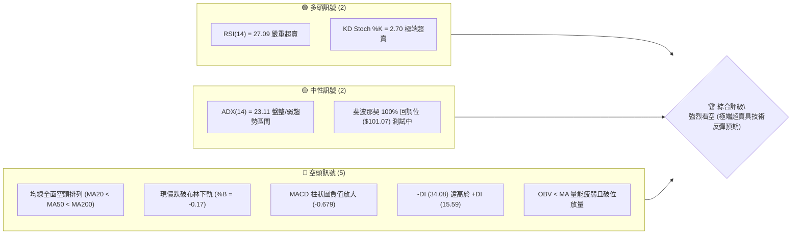
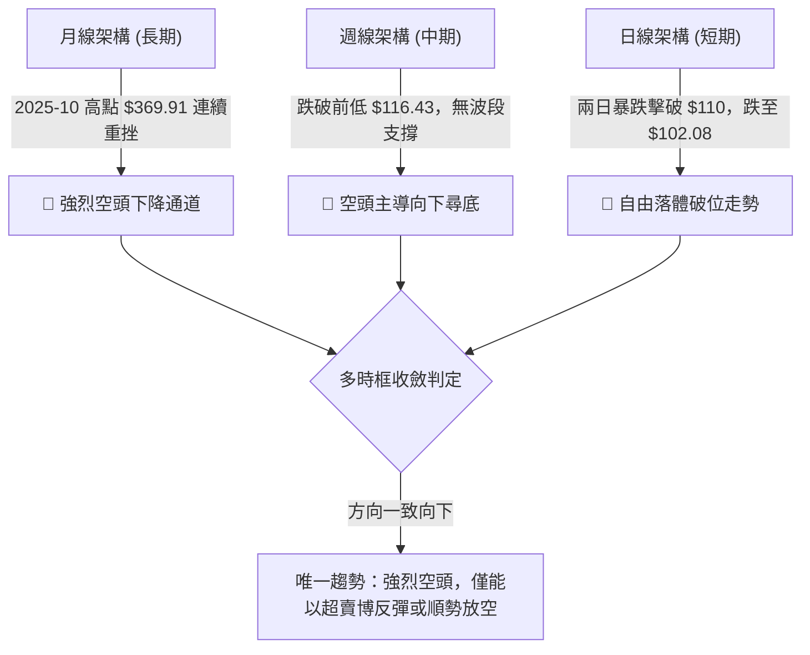
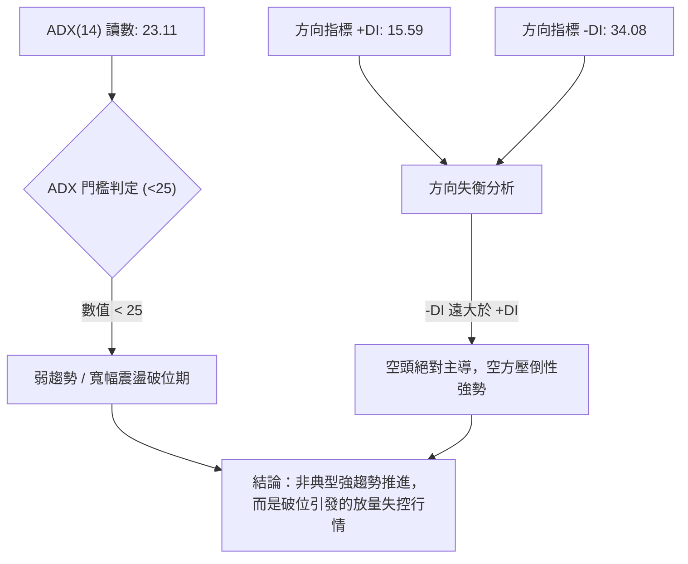
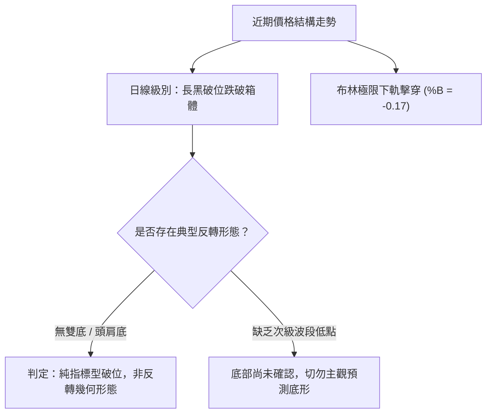
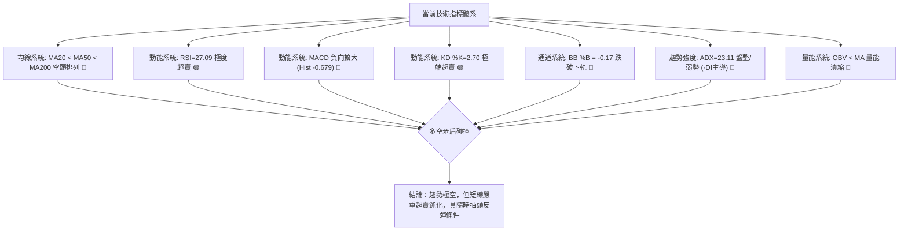
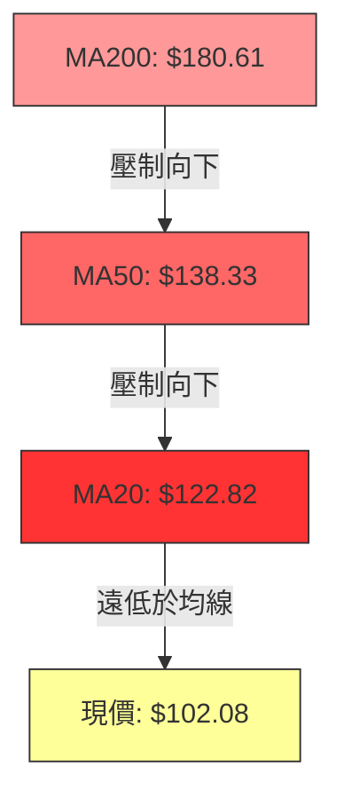
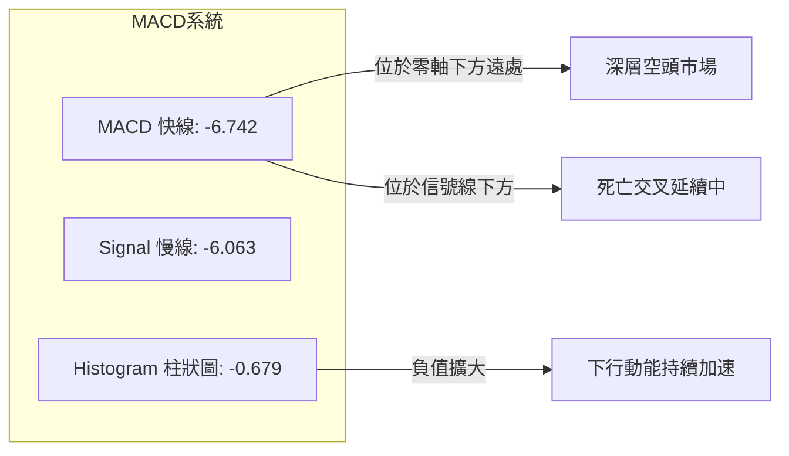
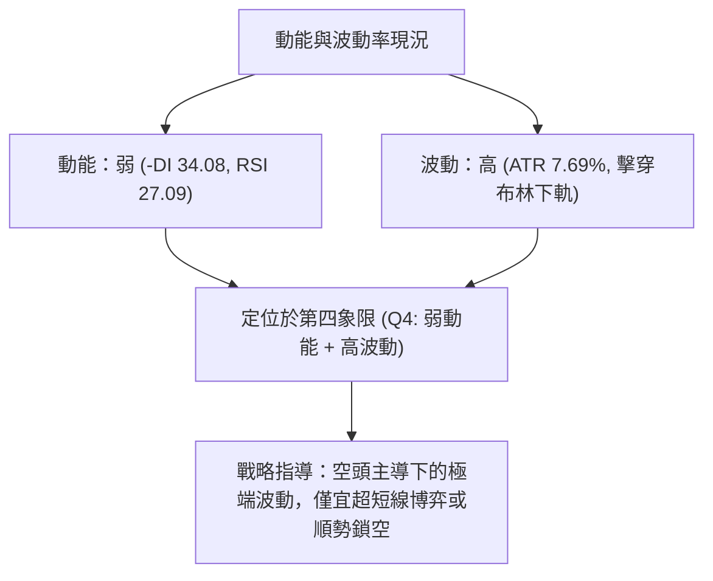
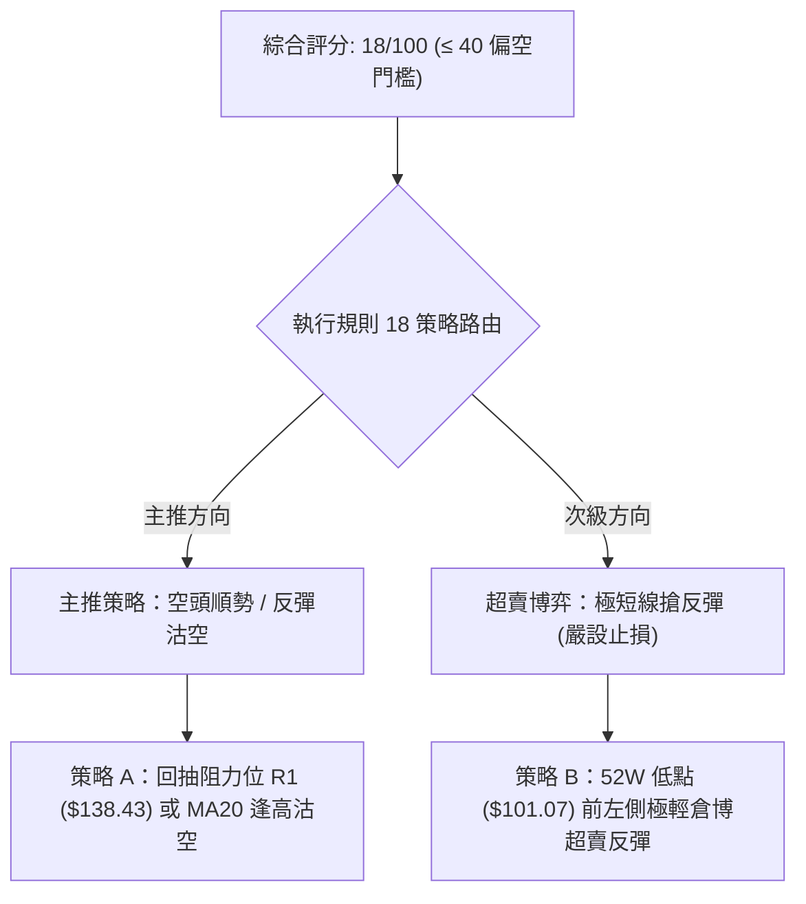
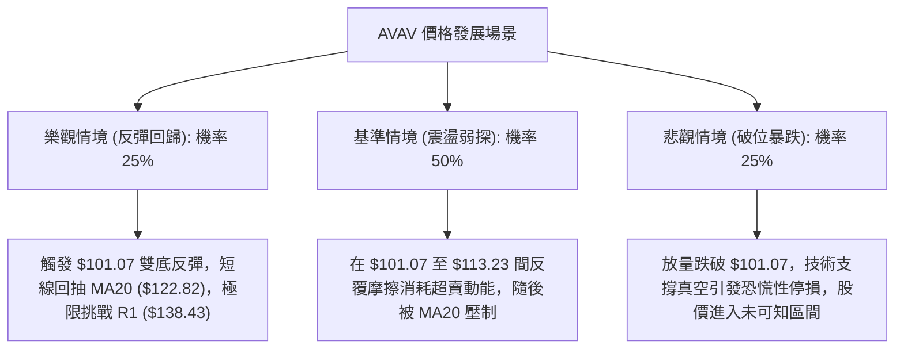

# AVAV 技術分析報告

> **報告日期**：2026-11-06 ｜ **語言**：繁體中文 ｜ **數據來源**：Yahoo Finance ｜ **當前價格**：$102.08

---

## 目錄

| 章節 | 內容 |
|------|------|
| [1. 技術面概覽](#1-技術面概覽) | 訊號儀表板、核心指標、評分卡 |
| [2. 趨勢分析](#2-趨勢分析) | 多時框趨勢、長中短期走勢 |
| [3. 圖表形態分析](#3-圖表形態分析) | 形態識別、K線組合、目標價 |
| [4. 支撐與阻力](#4-支撐與阻力) | 關鍵價位、斐波那契回調 |
| [5. 技術指標深度解讀](#5-技術指標深度解讀) | MA/RSI/MACD/布林/成交量 |
| [6. 動能與波動率](#6-動能與波動率) | 動能評估、ATR、Beta |
| [7. 多時框架總結](#7-多時框架總結) | 時框架評分矩陣 |
| [8. 交易策略建議](#8-交易策略建議) | 多空策略、風險報酬比 |
| [9. 風險提示與監控](#9-風險提示與監控) | 監控指標、風險場景 |

---

## 1. 技術面概覽

### 🎯 技術訊號儀表板



### 📊 核心指標速覽表

| 指標類別 | 指標名稱 | 當前數值 | 訊號 | 解讀 |
|----------|----------|----------|------|------|
| **價格** | 當前價格 | $102.08 | 🔴 | 位於52週區間 0.3% 極底位置，逼近歷史極低點 $101.07 |
| **均線** | MA20 | $122.82 | 🔴 | 價格低於 MA20 達 -16.89%，短期空頭主導向下發散 |
| **均線** | MA50 | $138.33 | 🔴 | 價格低於 MA50 達 -26.21%，中期結構完全走空 |
| **均線** | MA200 | $180.61 | 🔴 | 價格低於 MA200 達 -43.48%，長期牛熊分界線已成天花板 |
| **動能** | RSI(14) | 27.09 | 🟢 | 進入經典超賣區間（<30），隨時具備技術性空頭回補動能 |
| **動能** | MACD (12,26,9) | -6.742 / Hist -0.679 | 🔴 | MACD 線位於訊號線下方且負值柱狀圖擴張，動能仍向下發散 |
| **波動** | ATR(14) | $7.85 (7.69%) | 🔴 | 處於高波動放量下跌狀態，日內震盪幅度劇烈，風險溢價高 |

### 🏆 技術評分卡

```
╔══════════════════════════════════════════════════════════════════╗
║                 技術評分卡 — AVAV (2026-11-06)                   ║
╠══════════════════════════════════════════════════════════════════╣
║ 趨勢強度 (ADX=23.11, -DI主導)  ████░░░░░░░░░░░░░░░░  20/100 🔴   ║
║ 動能指標 (RSI超賣但MACD發散)  ██████░░░░░░░░░░░░░░  30/100 🔴   ║
║ 支撐穩定度 (無波段低點支撐)    ██░░░░░░░░░░░░░░░░░░  10/100 🔴   ║
║ 成交量配合 (下跌放量OBV走弱)  ████░░░░░░░░░░░░░░░░  20/100 🔴   ║
║ 形態完整度 (破位下行無底形)    ████░░░░░░░░░░░░░░░░  20/100 🔴   ║
║ 均線排列 (完全空頭發散)        ██░░░░░░░░░░░░░░░░░░  10/100 🔴   ║
╠══════════════════════════════════════════════════════════════════╣
║ 綜合評分 (六項算術平均)        ████░░░░░░░░░░░░░░░░  18/100 🔴   ║
║ 評級結論：強烈偏空 (Strong Bearish) ｜ 警惕超賣超跌技術反彈     ║
╚══════════════════════════════════════════════════════════════════╝
```

---

## 2. 趨勢分析

### 🌐 多時框趨勢分析



### 📈 長期趨勢 — 12個月走勢圖（Unicode）

```
AVAV 月線收盤走勢圖（2025-12 至 2026-11）
價格軸 ($)
$370 ┤                                
$330 ┤                                
$290 ┤      ● $278.39                  
$250 ┤● $241.89  ● $252.25             
$210 ┤                ● $195.02  ● $207.24 
$170 ┤            ● $183.05           ● $165.07               
$130 ┤                                    ● $149.37 ● $148.35 ● $142.22  ● $126.11
$90  ┤                                                                  ● $102.08 ◄ 現價
     └────────────────────────────────────────────────────────────────────────────
       25-12  26-01  26-02  26-03  26-04  26-05  26-06  26-07  26-08  26-09  26-10  26-11
```

**走勢特徵分析表格**：

| 階段區間 | 起訖價格 ($) | 漲跌幅 (%) | 量價特徵與結構解讀 |
|----------|--------------|------------|-------------------|
| 2025-12 ~ 2026-02 | $241.89 → $252.25 | +4.28% | 高檔震盪盤整，於 $278.39 形成次級高點後動能衰竭。 |
| 2026-03 ~ 2026-05 | $183.05 → $207.24 | +13.21% | 第一波斷崖式跳水後的中繼反彈，確認 MA200 失守，反彈無力。 |
| 2026-06 ~ 2026-09 | $165.07 → $142.22 | -13.84% | 陰跌築平台期，多次測試 $144 附近，籌碼沉澱失敗，均線下壓。 |
| 2026-10 ~ 2026-11 | $126.11 → $102.08 | -19.05% | 平台徹底跌破，出現恐慌性拋售，直逼 52 週最低點 $101.07。 |

### 📊 中期趨勢（週線分析）

中期技術面目前呈現「階梯式崩跌」格局。近期 8 週內，價格由 9 月高點 $168.00 一路下墜，跌破了 10 月中旬的低點 $116.43，本週更在兩天內觸及 52 週低點 $101.07。

```
週線近期阻力與支撐示意圖
$168.00 ──────────────────────────── 波段天花板 (R3, 09/18 高點)
          ╲
$138.43 ────╲─────────────────────── 關鍵回抽頸線阻力 (R1, 10/30 高點)
              ╲
$121.79 ────────╲─────────────────── 前破位平台低點 (10/16 低點 $116.43 區域)
                  ╲
$102.08 ────────────●─────────────── 當前收盤價
$101.07 ════════════════════════════ 52週歷史低點 (Fib 100.0% 關鍵最後防線)
```

### ⚡ 趨勢強度評估（ADX 解讀）



| 指標名稱 | 數值 | 評估區間 | 技術含義 |
|----------|------|----------|----------|
| **ADX (14)** | 23.11 | < 25（弱趨勢/盤整） | 由於前期在 $120–$138 經歷數週橫盤，使整體 ADX 趨勢強度讀數鈍化，但已開始自低檔抬頭。 |
| **+DI (14)** | 15.59 | 弱勢多頭 | 多方動能極度渙散，買盤不具備推動行情的實力。 |
| **-DI (14)** | 34.08 | 強勢空頭 | 空方力量完全掌控盤面，數值超過 30 表明下行賣壓具爆發力。 |

---

## 3. 圖表形態分析

### 🔍 形態識別系統



**圖表形態信心度表格**：

| 形態 | 信心度 | 判斷依據（引用數據） | 完成度 | 目標價（附計算式） |
|------|--------|----------------------|--------|--------------------|
| 箱體破位下行 | 85% | 10/23–11/03 價格在 $120.35–$138.43 構築箱體，11/04 開盤 $121.00 直墜跌破箱體底線 | 100% | 箱體高點 $138.43 − 箱體低點 $120.35 = 形態高度 $18.08；破位點 $120.35 − $18.08 = 目標價 $102.27（現價 $102.08 已精準達成形態測幅） |
| 潛在雙底形態 | 25% | 目前僅於 11/05 見到低點 $101.07 觸碰 52W 低點，尚未形成右底與頸線突破 | 10% | 訊號不足，依規則 15 僅做指標型解讀，不預設雙底目標價 |

### 🕯️ 重要K線形態分析

根據「近10根日K」與「近8根週K」之精確 OHLCV 數據分析：

| 日期（週期） | 開盤 | 最高 | 最低 | 收盤 | 成交量 | K線形態 | 解讀與訊號 |
|-------------|------|------|------|------|--------|---------|------------|
| 10/29 (日K) | 125.89 | 138.43 | 125.88 | 134.88 | 1,733,600 | 帶長上影大陽線 | 向上衝擊 R1 ($138.43) 遭遇強烈解套賣壓，多頭力竭。🔴 |
| 10/30 (日K) | 131.12 | 133.10 | 124.17 | 126.11 | 1,037,800 | 陰包陽回吐線 | 高開低走，完全吞噬前日陽線實體上方，確立短期頭部。🔴 |
| 11/04 (日K) | 121.00 | 123.00 | 108.95 | 113.23 | 2,795,000 | 斷頭巨量大陰線 | 破位跳水放量（2.79M 股），一舉擊穿前期所有支撐，極度惡劣。🔴 |
| 11/05 (日K) | 110.28 | 112.33 | 101.07 | 102.08 | 2,098,700 | 光腳中陰線 | 盤中直接摜壓至 52W 低點 $101.07，收盤幾近最低，賣壓未竭。🔴 |
| 10/30 (週K) | 122.39 | 138.43 | 120.35 | 126.11 | 5,923,400 | 長上影流星週K | 週線級別衝高回落，受阻於 R1 ($138.43)，確認中繼反彈結束。🔴 |
| 11/05 (週K) | 126.20 | 128.10 | 101.07 | 102.08 | 7,073,900 | 放量巨陰殺跌週K | 單週暴跌逾 $24，實體長且帶量，破壞一切週線支撐。🔴 |

### 📉 ASCII 走勢形態示意圖

```
日線破位箱體跌幅測算示意圖
$138.43 ┌─────────────────────────┐  (箱頂 10/29 高點，阻力 R1)
        │       震盪箱體區間       │
$120.35 └────────────┬────────────┘  (箱底 10/26 低點支撐線)
                     │
                     │ 箱體高度 H = $18.08 ($138.43 - $120.35)
                     ▼ 破位下殺
$102.27 ──────────────────────────── 形態測幅滿足點 ($120.35 - $18.08)
$102.08 ◄───────────●─────────────── 當前收盤價（已達成理論等幅測量距離）
$101.07 ════════════════════════════ 52週低點防線 (最後支撐)
```

### 🎯 形態目標價計算

1. **箱體等幅測距法**：
   - 頸線（破位基準點）= $120.35（10/26 箱底低點）
   - 形態垂直高度 = $138.43 − $120.35 = $18.08
   - 測幅向下延伸目標價 = $120.35 − $18.08 = **$102.27**
   - **解讀**：當前收盤價 $102.08 已精準到達並微幅跌破該測幅目標，顯示短線形態空頭動能已得到充分宣洩，極可能在此處引發空頭對沖平倉。

---

## 4. 支撐與阻力

### 🗺️ 關鍵價位分布圖（Unicode）

```
AVAV 價位結構分布圖（引用 OHLCV 計算數據）
═══════════════════════════════════════════════════════════════
$168.00 ║████████████████████████████████║ 強阻力 R3 (近一年波段高點聚類)
$162.30 ║████████████████████████        ║ 阻力 R2 (波段反彈強阻力)
$138.43 ║████████████████████████████████║ 關鍵阻力 R1 (10/29 高點/波段聚類)
$102.08 ╠════════════════════════════════╣ ◄ 現價 (收盤價)
$101.07 ║████████████████████████████████║ 斐波那契 100.0% / 52週低點防線
  N/A   ║░░░░░░░░░░░░░░░░░░░░░░░░░░░░░░░░║ (現價下方無波段低點支撐聚類)
═══════════════════════════════════════════════════════════════
```

### 🚧 阻力位分析表

價位嚴格引用技術數據中「關鍵價位」區塊之精確數值：

| 阻力級別 | 價位 | 形成原因 | 突破難度 | 重要性 |
|----------|------|----------|----------|--------|
| **R1** | $138.43 | 近一年波段高點聚類；10/29 日K最高點與 BB 上軌重合 | 極高 | ★★★★★<br>多空反轉的關鍵防線，未站上前維持極弱勢。 |
| **R2** | $162.30 | 近一年波段高點聚類；密集成交套牢區 | 極高 | ★★★★☆<br>中期反彈極限壓力位。 |
| **R3** | $168.00 | 近一年波段高點聚類；09/18 週K最高點 | 極高 | ★★★★★<br>波段天花板，牛熊轉換的中期硬阻力。 |

### 🛡️ 支撐位分析表

依據數據「關鍵價位」區塊揭示：「(no swing-low support detected below current price)」：

| 支撐級別 | 價位 | 形成原因 | 守住機率 | 重要性 |
|----------|------|----------|----------|--------|
| **S1 (動態)** | $101.07 | 52週歷史低點 (Fib 100.0%)，盤中唯一測試底點 | 40% | ★★★★★<br>多方唯一的心理與技術防線，跌破則進入真空。 |
| **S2** | N/A | 數據中未偵測到現價下方之波段低點支撐 | N/A | N/A (數據未提供) |
| **S3** | N/A | 數據中未偵測到現價下方之波段低點支撐 | N/A | N/A (數據未提供) |

### 📐 斐波那契回調位分析

依據 52 週區間（最高點 $408.25 → 最低點 $101.07，總落差 $307.18）計算之精確斐波那契回調位：

```
斐波那契回調層級階梯 ($101.07 → $408.25)
  0.0% (52W High) ────────────────────── $408.25
 23.6%            ────────────────────── $335.76
 38.2%            ────────────────────── $290.91
 50.0%            ────────────────────── $254.66
 61.8%            ────────────────────── $218.41
 78.6%            ────────────────────── $166.81 (接近 R3 $168.00)
100.0% (52W Low)  ───────●────────────── $101.07 ◄ 現價 $102.08 逼近此處
```

- **位置解讀**：現價 $102.08 正好落於 78.6% 回調位（$166.81）與 100.0% 回調位（$101.07）之間，且距離 100.0% 僅有 $1.01（+1.00%）的距離。
- **技術意義**：斐波那契 100% 回調位代表過去一整年的所有多頭漲幅全數回吐完畢。此點位通常具備極強的心理支撐效應與技術性空頭回補動能，一旦 $101.07 被有效放量擊穿，將觸發更深層次的流動性崩潰。

---

## 5. 技術指標深度解讀

### 🎛️ 指標訊號總覽



### 📈 移動平均線排列分析



- **短中長期乖離率極大**：
  - 現價與 MA5 ($117.61)：乖離率 -13.20%
  - 現價與 MA20 ($122.82)：乖離率 -16.89%
  - 現價與 MA60 ($143.16)：乖離率 -28.69%
  - 現價與 MA240 ($198.10)：乖離率 -48.47%
- **解讀**：均線呈現標準「完美空頭排列」。短期內價格與 MA20 乖離接近 -17%，屬於極度嚴重的負乖離現象，歷史經驗顯示這種乖離率難以長期維持，隨時可能出現向 MA20 均值回歸的猛烈抽動。

### 📉 RSI(14) 分析

- **RSI 當前讀數**：27.09
```
RSI(14) 強度：█████░░░░░░░░░░░░░░░  27.09 (進入 <30 超賣區)
```
- **超買超賣狀態**：處於嚴重超賣區間，這是自 2026 年 10 月 16 日（RSI 28.6）以來的再度破 30 超賣。
- **背離判斷**：
  - 根據近 20 根 K 棒的首尾對比，價格創出新低（$102.08 < 10/16 之 $121.79），RSI 亦同步走低至 27.09（10/16 為 28.6），**「無明顯背離」**。
  - **結論**：指標與價格同步下行，證實拋售動能是由真實的基本面空頭賣盤所驅動，而非單純的假摔。

### 📊 MACD(12/26/9) 訊號解讀



- **柱狀圖動態**：MACD 柱狀圖讀數為 **-0.679**，相比於前週的 +1.676 出現斷崖式逆轉，空頭能量柱迅速擴張，確認當前仍處於空頭動能的釋放期，尚未看到拐點跡象。

### 📦 布林通道分析

```
布林通道現狀示意圖 (寬度帶 $107.46 - $138.18)
$138.18 ───────────────────────────── 上軌 (Upper Band)
          │
$122.82 ──┼────────────────────────── 中軌 (MA20)
          │
$107.46 ──┼────────────────────────── 下軌 (Lower Band)
          │
$102.08 ──●────────────────────────── 現價 (%B = -0.17，擊穿下軌懸空)
```

- **%B 讀數為 -0.17**：小於 0 意味著價格已經徹底脫離通道下軌，形成極度超賣的「通道外遊走」態勢。
- **軌道狀態**：通道寬度隨波動率急劇打開，現價偏離下軌達 $5.38，根據統計概率，價格具有強烈重返下軌內部的技術性修復需求。

### 💹 成交量分析（量價配合度）

- **最新成交量**：2,098,700 股
- **20 日均量**：1,458,655 股（量比 1.44x）
- **50 日均量**：1,790,970 股
- **近兩日巨量特徵**：11/04 成交量高達 2,795,000 股，11/05 達 2,098,700 股，兩日連續放量破位。
- **OBV 趨勢**：數據顯示「OBV < MA → 量能疲弱」，OBV 指標持續受制於其均線之下，顯示長期累積的大量籌碼處於持續流出狀態，未見主力大單鎖籌或吸籌跡象。

---

## 6. 動能與波動率

### ⚡ 動能評估四象限

| 象限 | 動能維度 | 波動率維度 | 當前狀態 | 評估與處置策略 |
|------|----------|------------|----------|----------------|
| **Q1 (機會區)** | 強 (Bullish) | 低 (Low Vol) | — | 趨勢穩健上行，適合波段持有。 |
| **Q2 (防禦區)** | 弱 (Bearish) | 低 (Low Vol) | — | 陰跌盤整，適合觀望。 |
| **Q3 (投機區)** | 強 (Bullish) | 高 (High Vol)| — | 爆發性多頭，高風險高收益。 |
| **Q4 (危險區)** | **弱 (Bearish)** | **高 (High Vol)** | **✓ (當前 AVAV 所在)** | **下行加速，放量恐慌，切忌盲目摸底接刀。** |



### 📊 ATR 波動率分析

- **ATR(14)**：$7.85（佔現價百分比高達 **7.69%**，Wilder 計算）。
- **止損距離建議**：
  - 日內防守距離（1.0 × ATR）：$7.85
  - 波段防守距離（1.5 × ATR）：$11.78
  - 寬鬆防守距離（2.0 × ATR）：$15.70
- **波動率含義**：每日近 8 美元的平均震盪區間意味著任何過於緊密的止損（如 < $5）都極易被市場雜訊無效掃出場，操作上必須嚴格控制單筆名目倉位。

### 📐 Beta 與市場相關性

- **Beta 係數**：**1.403**（高 Beta 屬性）。
- **解讀**：AVAV 對大盤（標普500）具備放大 40% 的波動敏感度。在大盤環境疲弱時，該股跌幅往往更為劇烈；反之，若大盤企穩，其超跌屬性亦容易引發強烈的高彈性反彈。目前做空比例（Short % Float）達 **13.0%**，Short Ratio 為 **3.25**，存在潛在的軋空（Short Squeeze）種子，但需要巨量買盤觸發。

---

## 7. 多時框架總結

### 📋 時框架評分表

| 時框架 | 趨勢方向 | 動能狀態 | 均線排列 | 圖表形態 | 綜合評分 | 建議方向 |
|--------|----------|----------|----------|----------|----------|----------|
| **月線 (長期)** | 🔴 極空 | 下跌加速 | MA200 遠在上方 ($180.61) | 自 $369.91 連續破位 | 15/100 | 避開長線多頭持股 |
| **週線 (中期)** | 🔴 強空 | MACD柱翻負 (-0.679) | 空頭排列全面發散 | 跌破 $116 前低，無支撐 | 18/100 | 反彈高空為主 |
| **日線 (短期)** | 🔴 超跌 | RSI 27.09 / KD 2.70 超賣 | 均線空頭，負乖離 -16.89% | 箱體破位已達等幅測距 | 22/100 | 嚴禁追空，等待超賣反彈 |

### 🔲 綜合訊號矩陣

```
時框架訊號矩陣表
┌──────────────┬──────────┬──────────┬──────────┐
│ 指標項目     │ 短期日線 │ 中期週線 │ 長期月線 │
├──────────────┼──────────┼──────────┼──────────┤
│ 均線系統     │  🔴 空頭 │  🔴 空頭 │  🔴 空頭 │
│ RSI / 動能   │  🟢 超賣 │  🔴 疲弱 │  🔴 下行 │
│ MACD 方向    │  🔴 向下 │  🔴 翻負 │  🔴 走平 │
│ 布林軌道     │  🔴 跌破 │  🔴 擴張 │  🔴 偏下 │
│ 量價配合     │  🔴 破位 │  🔴 放量 │  🔴 流出 │
└──────────────┴──────────┴──────────┴──────────┘
```

### ⚖️ 多時框收斂結論

- **行情屬性判定**：當前 ADX(14) 讀數為 **23.11**（< 25）。依規則 14，ADX < 25 屬於「盤整/弱趨勢」框架，但需注意 -DI (34.08) 高度主導，屬於破位後的弱趨勢演變。
- **主導時框與優先級**：雖然日線指標呈現極端超賣（RSI 27.09、KD 2.70），但週線與月線之長期趨勢徹底崩壞，且現價下方完全缺乏波段低點支撐聚類。
- **唯一方向性結論**：**強烈偏空（綜合評分 18/100）**。
- **操作哲學收斂**：在空頭完全統治的架構下，日線的極端超賣**不得**作為建立波段多頭倉位的藉口；主策略維持「**空頭順勢高空策略**」，並輔以日線等幅滿足點的「**極短線超賣搶反彈（對沖交易）**」，日線僅用於尋找反彈力竭的高空點或超短線博弈出場點。

---

## 8. 交易策略建議

### 🗺️ 策略決策流程圖



### 🧭 策略路由（依評分卡分流）

> **當前主策略方向 = 強烈偏空（依評分 18/100，觸發 ≤40 偏空路由，主推空頭策略）**

### 🎯 價格情境階梯（Price Scenarios）

價位嚴格引用第 4 章「關鍵價位」區塊之精確數值：

| 觸發條件 | 下一目標 | 後續延伸 | 情境含義 |
|----------|----------|----------|----------|
| **突破 R1 $138.43** | R2 $162.30 | R3 $168.00 | 短線極度轉強，空頭必須停損，回補動能將推升至 Fib 78.6% 區域。 |
| **站穩現價區間 ($102.08–$113.23)** | MA20 $122.82 | R1 $138.43 | 短期超跌修正，價格回歸布林通道內部進行均值修復。 |
| **跌破 52W 低點 $101.07** | N/A (真空尋底) | N/A | 空頭動能再次失控，進入無技術支撐保護的流動性冰河期。 |

### 📊 情境機率分佈

| 情境劇本 | 機率估計 | 主要技術依據 |
|----------|----------|--------------|
| **劇本一：弱勢回抽反彈 (Mean Reversion)** | 50% | RSI 達 27.09 極度超賣，%B 跌破下軌至 -0.17，負乖離過大必有修復。 |
| **劇本二：直接摜破尋底 (Breakdown)** | 35% | MACD 負柱放大 (-0.679)，-DI 達 34.08，OBV < MA 資金持續撤離。 |
| **劇本三：現價橫盤築底 (Consolidation)** | 15% | 下方缺乏波段支撐，市場籌碼極度混亂，直接橫盤鎖籌機率偏低。 |

### 🟢 主策略詳情（方向：空頭主推，依規則 17 精確計算風險報酬比）

> **計算基準**：
> - 做空風險報酬比 = (進場價 − 目標價 T1) ÷ (止損價 − 進場價)
> - 做多反彈風險報酬比 = (目標價 T1 − 進場價) ÷ (進場價 − 止損價)

| 策略要素 | 策略 A (主推：反彈遇阻順勢放空) | 策略 B (次選：52W 低點超賣博弈多單) |
|----------|---------------------------------|--------------------------------------|
| **策略類型** | 順勢高空 (Trend Following Short) | 逆勢超跌博弈 (Mean Reversion Long) |
| **進場條件** | 價格反彈至 R1 遇阻回落，或回抽 MA20 力竭 | 現價回踩 $101.07 企穩出現下影線，KD 低檔金叉 |
| **進場價格** | **$122.82** (以 MA20 價位為準) | **$102.08** (以當前收盤價進場) |
| **目標價 T1** | **$101.07** (52W 最低點防線) | **$122.82** (布林中軌 / MA20) |
| **目標價 T2** | **N/A** (數據中現價下方未偵測到低點支撐) | **$138.43** (阻力位 R1) |
| **止損價格** | **$138.43** (阻力位 R1 上方突破點) | **$93.23** (進場價減去 1.0×ATR $7.85 緩衝至 $94.23，定為 $93.23) |
| **風險報酬比** | **1 : 1.39（以 T1 計）**<br>計算式: (122.82 − 101.07) ÷ (138.43 − 122.82) = 21.75 ÷ 15.61 = 1.393 | **1 : 2.34（以 T1 計）**<br>計算式: (122.82 − 102.08) ÷ (102.08 − 93.23) = 20.74 ÷ 8.85 = 2.343 |
| **成功機率** | 65% | 35% |
| **建議倉位** | 10%–15% 總資金 | 3%–5% 總資金（極輕倉） |

### 🔴 反向風險觸發點（對沖提示）

- **空頭警報觸發點**：若日線以大陽線收盤站上 **$122.82**（MA20），所有順勢空單必須無條件減倉 50%；若進一步有效放量擊穿 **$138.43**（R1），空頭結構被破壞，所有空頭頭寸必須全數止損離場。
- **多頭破位觸發點**：超短線多頭博弈若見到收盤價跌破 **$101.07**，代表 52 週歷史最後防線瓦解，必須嚴格執行止損，嚴禁任何凹單或加碼攤平。

### ⭐ 整體訊號強度評星

```
做多訊號強度：★★☆☆☆  (2/5星 — 僅依賴超賣指標，無支撐無結構)
做空訊號強度：★★★★☆  (4/5星 — 趨勢全面壓制，但受制於短期超賣)
整體可信度：  ★★★★☆  (4/5星 — 多時框均線與量能高度共振指向下行)
```

---

## 9. 風險提示與監控

### ✅ 關鍵監控指標 Checklist

```
╔══════════════════════════════════════════════════════════════════╗
║               AVAV 每日盤後關鍵技術監控 Checklist                 ║
╠══════════════════════════════════════════════════════════════════╣
║ [ ] 52W 低點 $101.07 是否跌破：若跌破且日K收於其下，空頭空間打開 ║
║ [ ] RSI(14) 是否脫離 30：回升至 30 以上意味著超跌反彈正式啟動    ║
║ [ ] MACD 柱狀圖：負值 (-0.679) 是否開始收斂走平                  ║
║ [ ] 布林 %B 是否重返 0.00 以上：確認價格收回下軌內部 ($107.46)   ║
║ [ ] 成交量比率：反彈是否帶量（量比 > 1.5x），無量反彈皆為誘多   ║
║ [ ] 阻力位 R1 ($138.43) 的測試反應：是否出現假突破流星線         ║
╚══════════════════════════════════════════════════════════════════╝
```

### ⚠️ 風險場景分析



### 🛡️ 風險管理重要提醒

1. **極高 ATR 波動下的倉位控管**：
   - AVAV 當前 ATR 達 **$7.85 (7.69%)**，單日波動極大。在建立任何倉位時，單筆承擔的風險金額不得超過總帳戶資產的 1.0%。
   - 倉位規模計算公式：`最大允許股數 = (總資產 × 1%) ÷ (止損距離 $8.85)`。若以 10 萬美元帳戶計算，單筆最大虧損限額為 $1,000，進場股數不得超過 113 股。
2. **高放空比率 (Short Interest) 的雙刃劍效應**：
   - Short % Float 達 13.0%，空頭擁擠度高。在 RSI 極端超賣環境下，極易因為一則微小利多消息觸發軋空，導致日內跳空暴漲 $10–$15，因此空頭進場**切忌追在下軌之外**，必須嚴格等待回抽力竭。
3. **無波段支撐保護的重大技術隱患**：
   - 技術數據已明確指出：現價下方「無波段低點支撐聚類」。這意味著一旦 $101.07 告破，下方將沒有任何過去一年累積的密集籌碼成本區可供緩衝，價格發現機制將面臨流動性考驗。

---

## 📋 報告總結

```
╔══════════════════════════════════════════════════════════════════╗
║                    AVAV 技術分析報告總結                         ║
╠══════════════════════════════════════════════════════════════════╣
║ 報告日期：2026-11-06                                             ║
║ 當前價格：$102.08                                                ║
║ 綜合評分：18/100                                                 ║
║ 分析評級：🔴 強烈偏空 (Strong Bearish) ｜ 超賣防禦階段          ║
║                                                                  ║
║ 關鍵結論：                                                       ║
║ ├─ 長期趨勢：🔴 強烈空頭，月線連續下挫，跌破 MA200 達 -43.48%   ║
║ ├─ 中期趨勢：🔴 週線大陰線破位，MACD 柱狀圖翻負 (-0.679)         ║
║ ├─ 短期趨勢：🟢 極度超賣，RSI=27.09，KD=2.70，具強烈均值回歸需求 ║
║ ├─ 關鍵支撐：$101.07 (52週歷史低點 / Fib 100.0% 關鍵最後防線)    ║
║ ├─ 關鍵阻力：R1 $138.43 ｜ R2 $162.30 ｜ R3 $168.00              ║
║ └─ 分析師共識目標：$212.20 (Mean) ｜ $148.57 (Low) ｜ 買入評級   ║
║                                                                  ║
║ 最優策略組合：                                                   ║
║ 1. 🥇 最佳機會 (順勢)：耐心等待超賣反彈至 MA20 ($122.82) 遇阻放空 ║
║    目標 $101.07，止損 $138.43，風險報酬比 1 : 1.39               ║
║ 2. 🥈 次選機會 (逆勢)：現價 $102.08 極輕倉博弈 RSI 超賣抽頭反彈   ║
║    目標 $122.82，止損 $93.23，風險報酬比 1 : 2.34                ║
║ 3. 🥉 保守選擇 (風控)：在價格重新站回 $107.46 (布林下軌) 前觀望   ║
╚══════════════════════════════════════════════════════════════════╝
```

---

> ⚠️ **免責聲明**：本報告為技術分析研究，所有數據、圖表及交易策略推算均嚴格基於所提供的歷史價量資訊。本報告**僅供研究與學術參考**，**不構成任何形式的要約或投資建議**。技術指標具備滯後性，金融市場存在高度不確定性，投資人應獨立評估風險並自負盈虧。

---

*報告生成時間：2026-11-06 ｜ 數據來源：Yahoo Finance ｜ 分析框架：多時框技術分析*