# AVAV 技術分析報告

> **報告日期**：2026-11-07 ｜ **語言**：繁體中文 ｜ **數據來源**：Yahoo Finance ｜ **當前價格**：$112.76

---

## 目錄

| 章節 | 內容 |
|------|------|
| [1. 技術面概覽](#1-技術面概覽) | 訊號儀表板、核心指標、評分卡 |
| [2. 趨勢分析](#2-趨勢分析) | 多時框趨勢、長中短期走勢 |
| [3. 圖表形態分析](#3-圖表形態分析) | 形態識別、K線組合、目標價 |
| [4. 支撐與阻力](#4-支撐與阻力) | 關鍵價位、斐波那契回調 |
| [5. 技術指標深度解讀](#5-技術指標深度解讀) | MA/RSI/MACD/布林/成交量 |
| [6. 動能與波動率](#6-動能與波動率) | 動能評估、ATR、Beta |
| [7. 多時框架總結](#7-多時框架總結) | 時框架評分矩陣 |
| [8. 交易策略建議](#8-交易策略建議) | 多空策略、風險報酬比 |
| [9. 風險提示與監控](#9-風險提示與監控) | 監控指標、風險場景 |

---

## 1. 技術面概覽

### 🎯 技術訊號儀表板

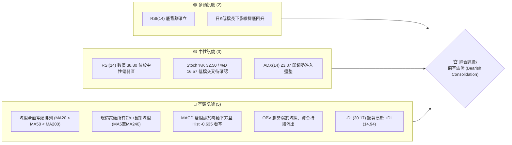

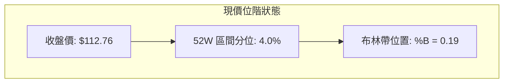

### 📊 核心指標速覽表

| 指標類別 | 指標名稱 | 當前數值 | 訊號 | 解讀 |
|----------|----------|----------|------|------|
| **價格** | 當前收盤價 | $112.76 | 🔴 | 位於 52 週區間之 4.0% 極低位，逼近 52 週低點 $100.40 |
| **均線** | MA20 | $121.60 | 🔴 | 價格低於 MA20 (-7.27%)，短期空頭主導 |
| **均線** | MA50 | $137.54 | 🔴 | 價格顯著低於 MA50，中期下行壓力沉重 |
| **均線** | MA200 | $179.62 | 🔴 | 價格大幅低於長期生命線 (-37.22%)，長期處於空頭市場 |
| **動能** | RSI(14) | 38.80 | 🟡 | 位於中性偏弱區間，伴隨 20 根 K 棒底背離警訊 |
| **動能** | MACD (12,26,9) | -6.857 / -6.222 | 🔴 | 雙線在零軸下方運行，柱狀圖 -0.635，動能偏空 |
| **波動** | ATR(14) | $8.24 | 🔴 | ATR 佔股價 7.31%，日價格波動劇烈，風險敞口較高 |
| **趨勢** | ADX(14) | 23.87 | 🟡 | ADX < 25 進入盤整行情，-DI (30.17) 壓制 +DI (14.94) |
| **通道** | 布林通道 (BB) | 上 $136.03 / 下 $107.18 | 🟡 | %B 為 0.19，價格脫離下軌微幅反彈，進入下半通道 |
| **量能** | OBV 趨勢 | OBV < MA | 🔴 | 成交量未見實質放大，量能疲弱不支持實質性反轉 |

### 🏆 技術評分卡

六項評分細項基準：
1. 趨勢強度：ADX=23.87 低於 25，-DI 顯著大於 +DI，給予 30 分。
2. 動能指標：MACD 空頭但日線 RSI 出現底背離，給予 45 分。
3. 支撐穩定度：下方無近期波段低點聚類，僅剩 52W 低點 $100.40 防守，給予 25 分。
4. 成交量配合：OBV 低於均線，量能疲弱，給予 35 分。
5. 形態完整度：日線長下影線初探支撐，缺乏完整反轉底型，給予 40 分。
6. 均線排列：MA5 至 MA240 全面空頭發散，給予 15 分。

綜合評分計算：
$$(30 + 45 + 25 + 35 + 40 + 15) \div 6 = 31.67 \approx 32$$

```
╔══════════════════════════════════════════════════════════════╗
║              技術評分卡 — AVAV (2026-11-07)                  ║
╠══════════════════════════════════════════════════════════════╣
║ 趨勢強度      ██████░░░░░░░░░░░░░░  30/100  🔴 弱勢空頭      ║
║ 動能指標      █████████░░░░░░░░░░░  45/100  🟡 背離反彈      ║
║ 支撐穩定度    █████░░░░░░░░░░░░░░░  25/100  🔴 缺乏支撐      ║
║ 成交量配合    ███████░░░░░░░░░░░░░  35/100  🔴 買盤偏弱      ║
║ 形態完整度    ████████░░░░░░░░░░░░  40/100  🟡 探底初生      ║
║ 均線排列      ███░░░░░░░░░░░░░░░░░  15/100  🔴 空頭排列      ║
╠══════════════════════════════════════════════════════════════╣
║ 綜合評分      ██████░░░░░░░░░░░░░░  32/100  🔴 偏空主導      ║
╚══════════════════════════════════════════════════════════════╝
```

---

## 2. 趨勢分析

### 🌐 多時框趨勢分析

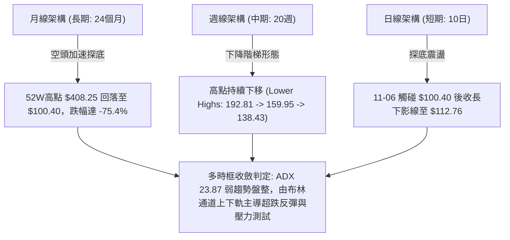

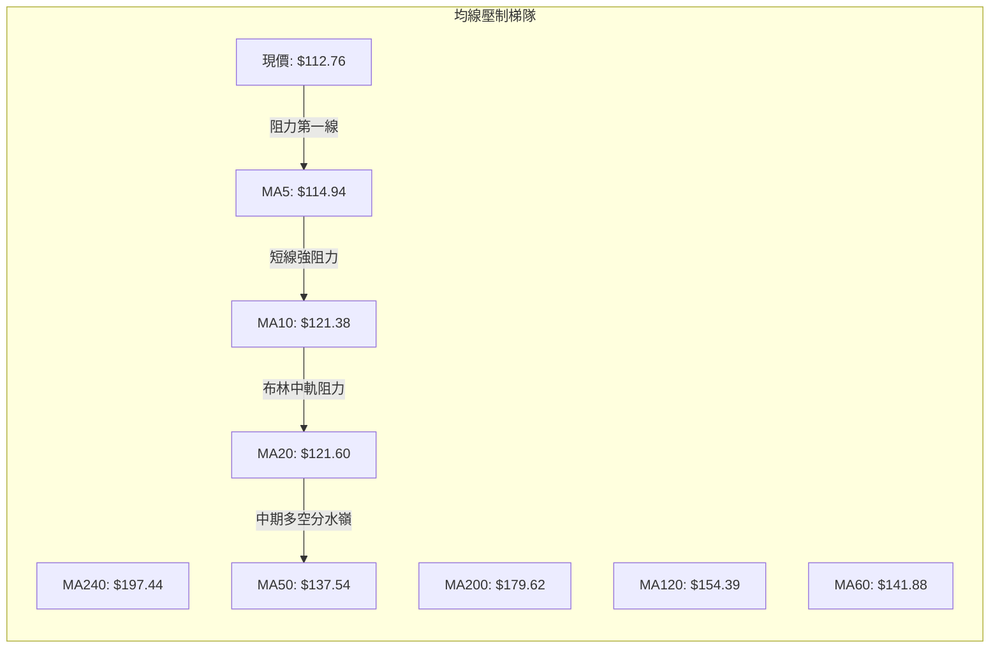

### 📈 長期趨勢 — 12個月走勢圖（Unicode）

過去 12 個月（2025-11 至 2026-11）收盤價歷史走勢圖：

```
AVAV 月線收盤走勢圖（過去12個月: 2025-11 至 2026-11）
價格 ($)
$300 ┤ ●(279.46)    ●(278.39)
     │   \          / \
$250 ┤    ●(241.89)    ●(252.25)
     │                   \
$200 ┤                    \     ●(195.02) ●(207.24)
     │                     \   /           \
$150 ┤                      ●(183.05)       ●(165.07) ●(149.37) ●(148.35) ●(142.22)
     │                                                                     \
$100 ┤                                                                      ●(126.11)
     │                                                                               ●(112.76)←現在
     └─┬─────┬─────┬─────┬─────┬─────┬─────┬─────┬─────┬─────┬─────┬─────┬─────
     25-11 25-12 26-01 26-02 26-03 26-04 26-05 26-06 26-07 26-08 26-09 26-10 26-11
```

**12個月走勢特徵分析表格**：

| 時間區間 | 起始收盤價 | 結束收盤價 | 期間漲跌幅 | 結構形態特徵 |
|----------|------------|------------|------------|--------------|
| 2025-11 至 2026-02 | $279.46 | $252.25 | -9.74% | 高檔雙頭頸線拉鋸震盪，成交量漸顯鈍化 |
| 2026-02 至 2026-03 | $252.25 | $183.05 | -27.43% | 出現崩跌缺口，正式失守 $200.00 整數支撐關卡 |
| 2026-03 至 2026-05 | $183.05 | $207.24 | +13.22% | 超跌後弱勢反彈，受阻於 $218.00（61.8% 斐波那契回調位） |
| 2026-05 至 2026-08 | $207.24 | $148.35 | -28.42% | 中期下行趨勢成形，均線轉為空頭排列 |
| 2026-08 至 2026-11 | $148.35 | $112.76 | -23.99% | 空頭加速探底，下探 52 週最低點 $100.40 |

### 📊 中期趨勢（週線分析）

中期走勢呈現典型「下降階梯」（Descending Staircase），週線高點持續下移。近期反彈高點依序為：2026-08-14 週高點 $192.81、2026-09-18 週高點 $168.00、2026-10-30 週高點 $138.43。每次反彈均無法越過前一波段高點。

```
週線下降階梯示意圖
價格
$170 ┤  ● $168.00 (09-18)
     │   \
$150 ┤    \          
     │     \    ● $138.43 (10-30)
$130 ┤      \  / \
     │       \/   \   ● $128.10 (11-06 週高)
$110 ┤             \ / \
     │              ●   ● $112.76 (現價收盤)
$100 ┤                   \
     │                    ● $100.40 (11-06 週低 / 52W Low)
     └────────────────────────────────────────
```

### ⚡ 趨勢強度評估（ADX 解讀）

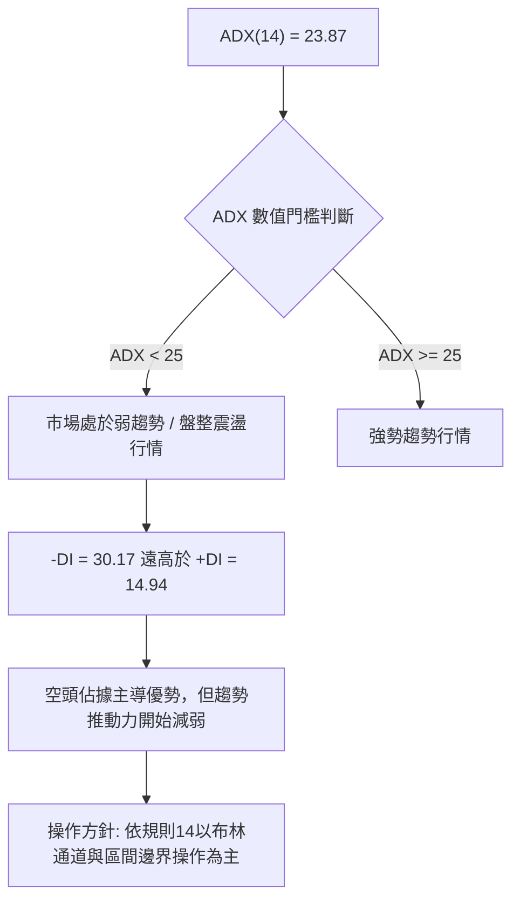

| 指標變數 | 當前讀數 | 狀態門檻 | 技術涵義 |
|----------|----------|----------|----------|
| ADX(14) | 23.87 | < 25 (弱趨勢/盤整) | 單邊趨勢動能趨緩，價格進入超跌鈍化或收斂整理階段 |
| +DI (14) | 14.94 | 多方力量 | 多頭動能極度微弱，買盤未展現連續攻擊力道 |
| -DI (14) | 30.17 | 空方力量 | 空方力量顯著佔優，但數值較高亦代表空頭波段已深 |

---

## 3. 圖表形態分析

### 🔍 形態識別系統

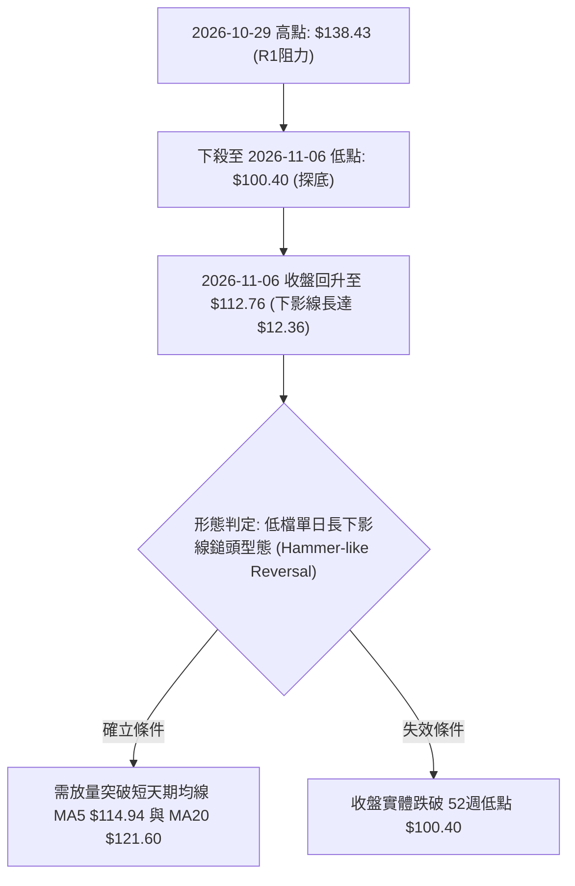

**形態識別與信心度評估表**（依規則 15）：

| 形態名稱 | 信心度 | 判斷依據（引用數據） | 完成度 | 目標價（附計算式） |
|----------|--------|----------------------|--------|--------------------|
| 單日鎚頭探底 (Hammer-like Day) | 60% | 2026-11-06 探 52W 低點 $100.40 後大幅拉回至 $112.76，下影線達 $12.36 | 70% | 突破 MA20 後挑戰 R1 $138.43 |
| 下降通道收斂 (Falling Wedge/Channel) | 45% | 近 20 週高點與低點均下移，但未形成收斂三角形 | 40% | 訊號不足，僅做指標型解讀（以布林下軌 $107.18 為邊界） |
| 潛在雙底 (Double Bottom) | 20% | 僅有單一低點 $100.40，未出現第二次打底確認 | 10% | 訊號不足，僅做指標型解讀 |

### 🕯️ 重要K線形態分析

根據「近10根日K」與「近8根週K」之精確數值進行解讀（依規則 19）：

| 日期（日K/週K） | 開 | 高 | 低 | 收 | 成交量 | K線形態 | 解讀與訊號 |
|-----------------|---|---|---|---|-------|---------|------------|
| 日K 10-29 | 125.89 | 138.43 | 125.88 | 134.88 | 1,733,600 | 帶量長陽線 | 向上衝刺創波段高點 $138.43，量能放大 🟢 |
| 日K 10-30 | 131.12 | 133.10 | 124.17 | 126.11 | 1,037,800 | 衝高回落黑K | 留上影線，多頭獲利了結賣壓湧現 🔴 |
| 日K 11-02 | 126.20 | 127.80 | 121.94 | 123.08 | 1,267,900 | 下跌小陰線 | 跌破 MA20 支撐，弱勢格局延續 🔴 |
| 日K 11-03 | 123.71 | 128.10 | 123.48 | 123.53 | 912,300 | 窄幅十字變盤線 | 縮量拉鋸，多空觀望氣氛濃厚 🟡 |
| 日K 11-04 | 121.00 | 123.00 | 108.95 | 113.23 | 2,795,000 | 爆量長黑K破位 | 放量下殺跌破 $120 關卡，恐慌賣盤湧現 🔴 |
| 日K 11-05 | 110.28 | 112.33 | 101.07 | 102.08 | 2,098,700 | 光腳大陰線 | 逼近百元大關，空頭全力宣洩 🔴 |
| 日K 11-06 | 104.36 | 113.65 | 100.40 | 112.76 | 1,599,000 | 低檔長下影陽十字 | 探 52W 低點 $100.40 引發強勁抄底買盤，短線反轉契機 🟢 |
| 週K 10-23 | 122.88 | 124.76 | 113.15 | 123.25 | 6,768,200 | 下影線小陽K | 於 $113.15 獲得短期承接 🟡 |
| 週K 10-30 | 122.39 | 138.43 | 120.35 | 126.11 | 5,923,400 | 長上影線倒鎚頭 | 衝高至 $138.43 遭空頭無情壓制 🔴 |
| 週K 11-06 | 126.20 | 128.10 | 100.40 | 112.76 | 8,672,900 | 巨量深幅探底K | 單週振幅達 $27.70，守住 $100.40 反彈收復失土 🟡 |

### 📉 ASCII 走勢形態示意圖

近 10 個交易日日線走勢與長下影線探底結構：

```
AVAV 近10個交易日形態示意圖
價格
$140 ┤        ┌───┐ (10-29 高點: $138.43)
$135 ┤        │   │
$130 ┤    ┌─┐ │   │ ┌─┐
$125 ┤  ┌─┘ └─┘   └─┘ └─┐ ┌─┐
$120 ┤──┴─────────────────┴─┴─┐
$115 ┤                          │ ┌──┐ (11-06 收盤: $112.76)
$110 ┤                          └─┘  │
$105 ┤                               │
$100 ┤                               ┴ $100.40 (11-06 長下影線低點 / 52W Low)
     └──────────────────────────────────────────────────────────
      10-26 27  28  29  30  11-02 03  04   05   06
```

### 🎯 形態目標價計算

若以 2026-11-06 之低檔反轉型態推算：
- 形態頸線／第一道反彈壓力位：以布林中軌 MA20 為初步觀察點（$121.60）。
- 形態高度推算：波段高點 R1 $138.43 至波段低點 $100.40，垂直落差幅度為：
  $$\text{形態震盪高度} = \$138.43 - \$100.40 = \$38.03$$
- 反彈測幅目標價（以回調此段波段跌幅 50% 計算）：
  $$\text{反彈測幅目標} = \$100.40 + (\$38.03 \times 0.5) = \$100.40 + \$19.015 = \$119.42$$
  此價位高度貼近 MA20 ($121.60) 壓力區。

---

## 4. 支撐與阻力

### 🗺️ 關鍵價位分布圖（Unicode）

```
AVAV 價位結構分布圖（嚴格依據 OHLCV 計算）
═══════════════════════════════════════════════════════════════
$168.00 ║████████████████████████████████║ 強波段阻力 R3 (+48.99%)
$162.30 ║████████████████████████        ║ 中期波段阻力 R2 (+43.93%)
$138.43 ║████████████████████████████████║ 關鍵阻力 R1 / 近期高點 (+22.77%)
$121.60 ║▓▓▓▓▓▓▓▓▓▓▓▓▓▓▓▓                ║ 動態阻力 BB中軌 / MA20 (+7.84%)
$112.76 ╠════════════════════════════════╣ ◄ 現價 (Last Close)
$107.18 ║▒▒▒▒▒▒▒▒▒▒▒▒                    ║ 短期下軌支撐 BB下軌 (-4.95%)
$100.40 ║████████████████████████████████║ 52週絕對低點支撐 / 斐波那契 100% (-10.96%)
═══════════════════════════════════════════════════════════════
```

### 🚧 阻力位分析表

阻力價位嚴格引用技術數據中之近一年波段高點聚類：

| 阻力級別 | 價位 | 形成原因 | 突破難度 | 重要性 |
|----------|------|----------|----------|--------|
| **R1** | $138.43 | 2026-10-29 日K波段高點聚類，且貼近 MA50 ($137.54) | 極高 | ★★★★★<br>短期空頭防守防線 |
| **R2** | $162.30 | 近一年波段高點聚類，貼近斐波那契 78.6% 回調位 ($166.28) | 高 | ★★★★☆<br>中期波段多空轉換點 |
| **R3** | $168.00 | 2026-09-18 週K波段高點聚類 | 極高 | ★★★★☆<br>多頭反轉之強阻力壁壘 |

### 🛡️ 支撐位分析表

支撐價位嚴格引用技術數據之波段低點聚類與 OHLCV 計算值：

| 支撐級別 | 價位 | 形成原因 | 守住機率 | 重要性 |
|----------|------|----------|----------|--------|
| **S1** | N/A | 數據中未偵測到現價下方之近一年波段低點聚類 | N/A | N/A（數據未提供） |
| **S2** | N/A | 數據中未偵測到現價下方之近一年波段低點聚類 | N/A | N/A（數據未提供） |
| **S3** | N/A | 數據中未偵測到現價下方之近一年波段低點聚類 | N/A | N/A（數據未提供） |
| **參考支撐** | $107.18 | 布林通道下軌動態支撐 (BB Lower Band) | 60% | ★★★☆☆<br>短線超賣波動邊界 |
| **關鍵支撐** | $100.40 | 52 週最低點 (2026-11-06 最低點 / 斐波那契 100%) | 55% | ★★★★★<br>多頭最後生死防線 |

*註：依據數據揭示，現價 $112.76 下方「no swing-low support detected below current price」，波段低點聚類無數值；下檔唯一的實體價格防線為 52 週低點 $100.40 與布林下軌 $107.18。*

### 📐 斐波那契回調位分析

依據 52 週區間（高點 $408.25 至低點 $100.40）之斐波那契回調位精確分析：

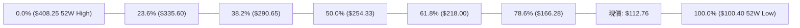

- **回調位階解讀**：現價 $112.76 運行於 **78.6% 回調位 ($166.28)** 與 **100.0% 回調位 ($100.40)** 之間。
- **技術含義**：股價回吐了過去 52 週上升循環的全部漲幅，處於斐波那契極限回撤帶。若 $100.40 (100.0%) 被有效實體收盤跌破，下方將陷入無錨定價位的技術真空狀態；若能在 $100.40 上方築底，向上回抽 78.6% 回調位 ($166.28) 將是中長期反彈的最大阻力區間。

---

## 5. 技術指標深度解讀

### 🎛️ 指標訊號總覽

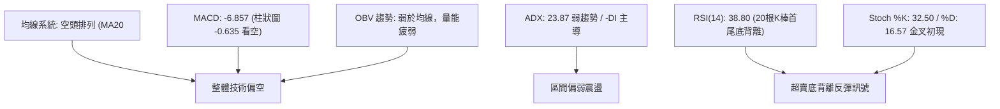

### 📈 移動平均線排列分析

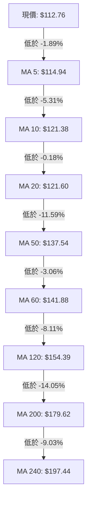

當前移動平均線呈現「絕對空頭排列」（Perfect Bearish Alignment）。各均線向下傾斜發散：
- 短期 MA5 ($114.94) 壓在現價頭頂，構成第一道短線反彈屏障。
- MA10 ($121.38) 與 MA20 ($121.60) 高度黏合，形成強大的短期下行重力帶。
- MA50 ($137.54) 與 R1 ($138.43) 共振，為中期反彈的強阻力關卡。

### 📉 RSI(14) 分析

RSI(14) 讀數為 **38.80**：
```
RSI(14) 強度：[████████░░░░░░░░░░░░] 38.80/100 (中性偏弱)
超賣臨界: 30 ───────── 現值: 38.80 ───────── 超買臨界: 70
```

- **區間判定**：RSI 位於 30–70 中性區間的下半部，反映空方主控但未達極度超賣（未低於 30）。
- **底背離診斷**：數據明確標示 **⚠️ 底背離 (Bullish Divergence)**（比較近 20 根 K 棒首尾之價格與 RSI 方向）。價格自高點一路挫低破底，但 RSI 數值在低檔呈現抗跌抬升跡象，顯示下殺動能已出現衰竭信號，隨時存在技術性反抽動能。

### 📊 MACD(12/26/9) 訊號解讀

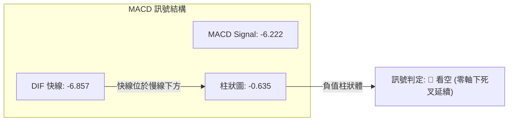

- **絕對數值解讀**：DIF (-6.857) 與 Signal (-6.222) 雙雙深陷於零軸下方，說明大週期背景為空頭掌控。
- **柱狀體狀態**：Histogram 為 -0.635，呈現負向綠柱，說明短期空頭動能尚未完全收斂為金叉，多頭抄底仍需等待 MACD 柱狀圖翻紅確認。

### 📦 布林通道分析

```
AVAV 日線布林通道結構 (20日, 2倍標準差)
$136.03 ┬──────────────────────────────── 上軌 (Upper Band)
        │
$121.60 ┼ - - - - - - - - - - - - - - - - 中軌 (MA20)
        │
$112.76 │◄─── 現價 (%B = 0.19)
        │
$107.18 ┴──────────────────────────────── 下軌 (Lower Band)
```

- **%B 指標分析**：當前 %B 數值為 **0.19**，代表現價緊貼布林下軌（0.00 為下軌，0.50 為中軌）。
- **通道軌道狀態**：2026-11-06 日K低點 $100.40 曾一度刺穿布林下軌 $107.18，收盤拉回 $112.76 重新站上下軌，構成「破軌回抽」形態。若無法站穩 $107.18，通道開口將重新向下張開。

### 💹 成交量分析（量價配合度）

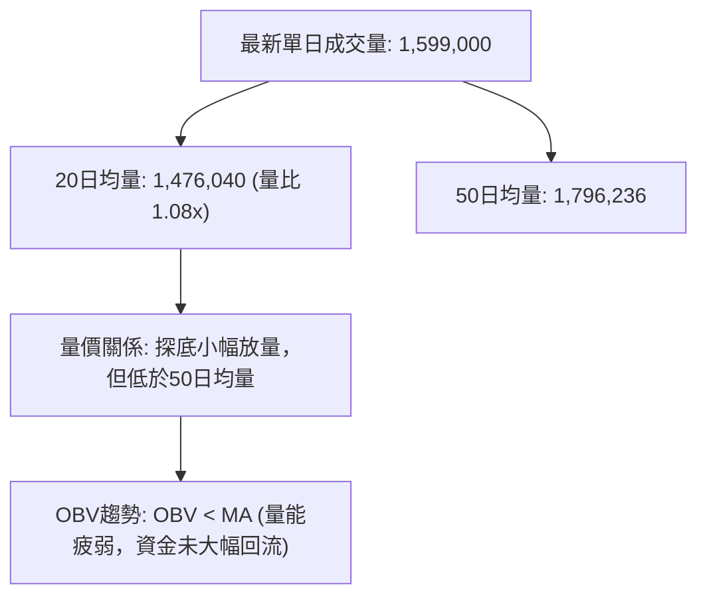

- **量比評估**：最新成交量 1,599,000 股，相較 20 日均量 1,476,040 股之量比為 **1.08x**，探底回升過程中並未出現爆量（如 11-04 暴跌時之 2,795,000 股），量價呈現弱反彈特徵。
- **OBV 訊號**：OBV 位於其均線下方運行，確認主力機構並未在此區間進行大規模實質建倉，反彈暫以技術性空頭回補為主。

---

## 6. 動能與波動率

### ⚡ 動能評估四象限

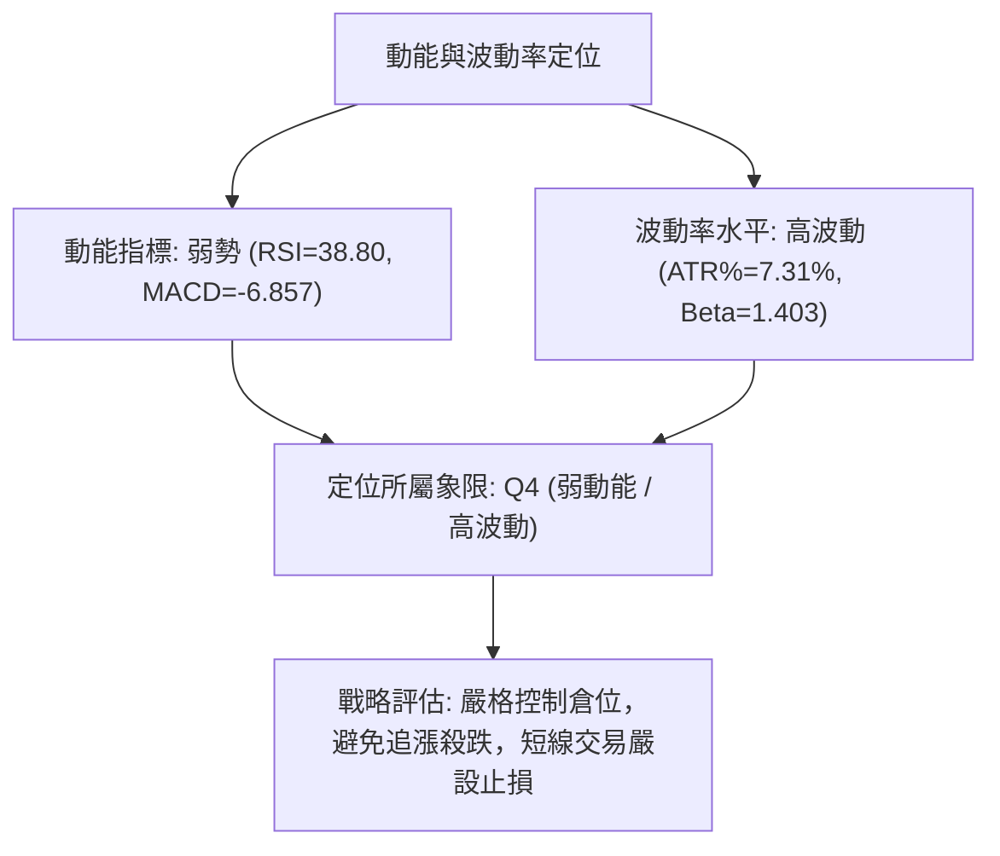

| 象限 | 動能維度 | 波動維度 | 標的所屬狀態 | 策略應對方針 |
|------|----------|----------|--------------|--------------|
| Q1 | 強動能 (Bullish) | 低波動 (Low Vol) | ─ | 趨勢持股續抱，適度加碼 |
| Q2 | 弱動能 (Bearish) | 低波動 (Low Vol) | ─ | 區間沉悶盤整，謹慎觀望 |
| Q3 | 強動能 (Bullish) | 高波動 (High Vol) | ─ | 突破行情，積極追蹤 |
| **Q4** | **弱動能 (Bearish)** | **高波動 (High Vol)** | **✓ (AVAV 當前狀態)** | **避免左側重倉，僅宜微量做技術性反抽** |

### 📊 ATR 波動率分析

- **ATR(14) 數值**：**$8.24**。
- **波動率比重**：ATR 佔股價比率高達 **7.31%**，屬於高波動性標的。
- **交易止損距離建議**：
  - *極短線（Day Trade）止損距離*：$0.5 \times \text{ATR} \approx \$4.12$。
  - *波段交易（Swing Trade）保護性止損距離*：$1.5 \times \text{ATR} \approx \$12.36$。
  - *趨勢防守距離*：$2.0 \times \text{ATR} \approx \$16.48$。

### 📐 Beta 與市場相關性

- **Beta 係數**：**1.403**。
- **市場特徵分析**：AVAV 具備顯著的高 Beta 特性，相較於 S&P 500 指數，其波動幅度高出約 40.3%。在市場下行或國防預算政策消息擾動時，該股呈現放大下挫的特徵；若大盤回暖，其技術性超跌反彈爆發力亦相對較強。
- **做空與避險考量**：目前 Short % Float 為 **13.0%**，Short Ratio 為 **3.25**，存在一定程度的軋空（Short Squeeze）潛能，但空頭目前仍牢牢掌握盤面優勢。

---

## 7. 多時框架總結

### 📋 時框架評分表

| 時框架 | 趨勢方向 | 動能狀態 | 均線排列 | 形態結構 | 綜合評分 | 建議方針 |
|--------|----------|----------|----------|----------|----------|----------|
| **月線 (長期)** | 🔴 極度偏空 | 弱勢下探零軸 | 空頭排列 (低於MA240) | 歷史高點下挫破底 | 20/100 | 嚴格防守，不宜長線配置 |
| **週線 (中期)** | 🔴 空頭下行 | MACD綠柱延續 | MA20 < MA50 全面壓制 | 下降階梯持續下移 | 25/100 | 逢反彈至壓力位偏空操作 |
| **日線 (短期)** | 🟡 探底盤整 | RSI底背離 / Stoch金叉 | 跌破所有短均線 | 長下影線守 $100.40 | 45/100 | 區間震盪，博取微量反抽 |

### 🔲 綜合訊號矩陣

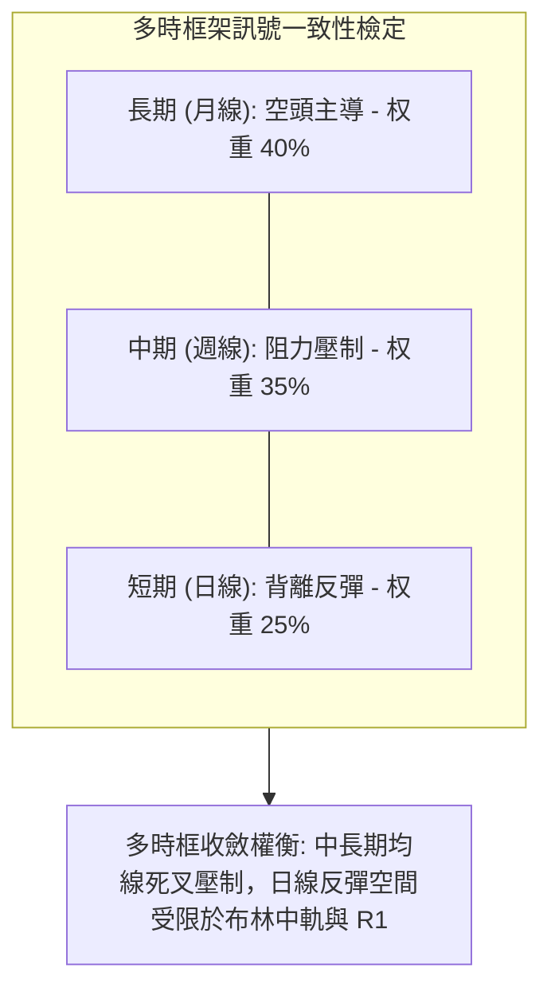

### ⚖️ 多時框收斂結論

依據多時框收斂規則（規則 14）：
1. **行情性質判定**：當前 ADX(14) 數值為 **23.87**，明確小於 25，判定當前市場處於**弱趨勢／盤整行情**。
2. **交易區間界定**：在盤整架構下，日線布林通道上下軌（下軌 **$107.18** 至上軌 **$136.03**）構成主要震盪交易區間。
3. **主導時框與優先級收斂**：雖然中長期均線（週線、月線）全面朝下發散，顯示大格局偏空，但日線 RSI(14) 底背離且 11-06 於 52 週低點 $100.40 爆出長下影線，短期下殺動能鈍化。
4. **唯一方向性結論**：**偏空震盪（中性偏空觀望）**。綜合評分為 32/100（≤ 40），中長期大趨勢偏空無庸置疑；短線存在針對布林中軌 MA20 ($121.60) 的修復反彈，但此反彈應視為空頭防守位測試，而非趨勢反轉。

---

## 8. 交易策略建議

### 🗺️ 策略決策流程圖

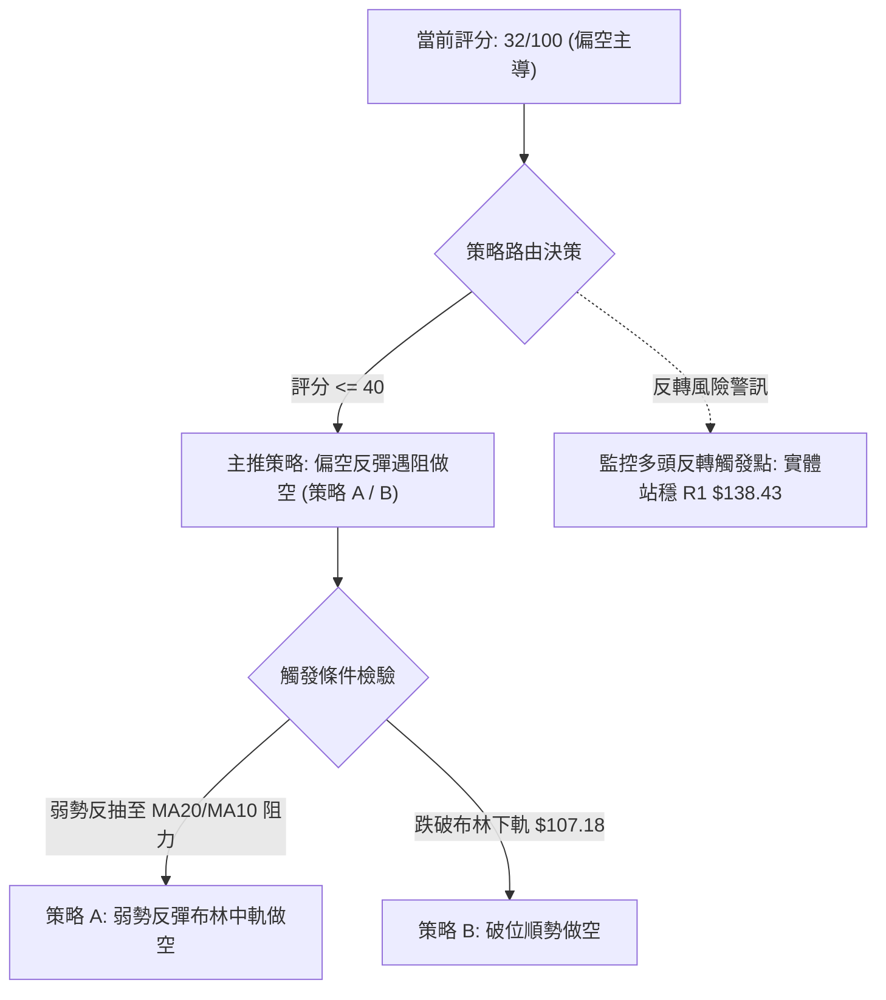

### 🧭 策略路由（依評分卡分流）

> **當前主策略方向 = 主推空頭策略（依技術評分卡綜合評分 32/100，處於 ≤40 偏空區間）**

多頭策略僅作為短線極輕倉之超跌反彈提示，不得作為主推策略；主推策略鎖定於「反彈遇阻做空」與「跌破關鍵支撐順勢放空」。

### 🎯 價格情境階梯（Price Scenarios）

價位嚴格引用「關鍵價位」區塊與斐波那契回調位之實際數值：

| 觸發條件 | 下一目標 | 後續延伸 | 情境含義 |
|----------|----------|----------|----------|
| 強勢反彈突破 R1 $138.43 | R2 $162.30 | R3 $168.00 | 短線極度轉強，多頭展開中期修復行情 |
| 站穩現價 $112.76 震盪 | MA20 $121.60 | R1 $138.43 | 低檔修復盤整，測試短期均線反壓 |
| 跌破布林下軌 $107.18 | 52W低點 $100.40 | 下方無支撐聚類 (N/A) | 中期跌勢重啟，空頭加速探底尋找無錨低點 |

### 📊 情境機率分佈

| 情境劇本 | 機率 | 主要技術依據 |
|----------|------|--------------|
| **反彈遇阻再回落** | **55%** | 均線空頭排列、MACD 柱狀圖看空 (-0.635)、OBV 疲弱 |
| **區間弱勢震盪** | **30%** | ADX 23.87 < 25 弱趨勢、RSI 底背離、布林通道收斂 |
| **強勢反轉上行** | **15%** | 機構評等買入共識，但當前技術面買盤動能極度微弱 (+DI=14.94) |

### 🔴 主策略詳情（空頭主推策略）

策略之進場點、止損點、目標價嚴格基於數據中之 MA20、R1、52W 低點 $100.40 與布林下軌 $107.18：

| 策略要素 | 策略 A（反彈遇阻逢高沽空） | 策略 B（破位下軌順勢追空） |
|----------|---------------------------|---------------------------|
| **策略概念** | 觸及 MA20 阻力位無力突破時放空 | 跌破布林下軌確認下行波段延續 |
| **進場條件** | 反彈至 MA20 附近出現滯漲黑K | 日K收盤實體跌破布林下軌 $107.18 |
| **進場價格** | **$121.60**（以 MA20 精確值） | **$107.18**（以 BB下軌精確值） |
| **目標價 T1** | **$107.18**（布林下軌） | **$100.40**（52週最低點） |
| **目標價 T2** | **$100.40**（52週最低點） | **N/A（數據未提供更低波段低點）** |
| **止損價格** | **$128.10**（11-03/11-06 日週波段高點） | **$112.76**（最新收盤價/現價） |
| **風險報酬比** | **1 : 2.22（以 T1 計）**<br>*(121.60 - 107.18) / (128.10 - 121.60) = 14.42 / 6.50* | **1 : 1.22（以 T1 計）**<br>*(107.18 - 100.40) / (112.76 - 107.18) = 6.78 / 5.58* |
| **成功機率** | 60% | 50% |
| **建議倉位** | 10% – 15% | 5% – 10% |

*註：策略 A 之 T2 風險報酬比計算：$(121.60 - 100.40) \div (128.10 - 121.60) = 21.20 \div 6.50 = \mathbf{1 : 3.26（以\ T2\ 計）}$。*

### 🟢 反向風險觸發點（多頭對沖提示）

- **觸發價位**：日K收盤價放量突破並站穩 **R1 $138.43**（且突破 MA50 $137.54）。
- **觸發訊號**：MACD 柱狀圖翻正、DIF 形成金叉，且單日成交量放大至 50 日均量（1,796,236 股）之上。
- **風控處置**：若此情境發生，所有空頭頭寸必須無條件全數止損離場，空頭形態宣告瓦解。

### ⭐ 整體訊號強度評星

```
做多訊號強度：★★☆☆☆  (2/5星 - 僅有低檔底背離支撐)
做空訊號強度：★★★★☆  (4/5星 - 均線與趨勢全面壓制)
整體可信度：  ★★★☆☆  (3/5星 - 處於盤整區間邊界)
```

---

## 9. 風險提示與監控

### ✅ 關鍵監控指標 Checklist

```
╔══════════════════════════════════════════════════════════════╗
║              關鍵監控指標風控 CHECKLIST                       ║
╠══════════════════════════════════════════════════════════════╣
║ [ ] 價格防守線：收盤價是否跌破 52週低點 $100.40              ║
║ [ ] 動態反壓線：現價能否帶量越過 MA20 $121.60                ║
║ [ ] 關鍵阻力線：反彈是否於 R1 $138.43 遭強烈壓制            ║
║ [ ] 指標鈍化驗證：RSI(14) 底背離是否隨價格破底而失效 (<30)    ║
║ [ ] 趨勢重啟確認：ADX(14) 是否由 23.87 向上穿越 25.00        ║
║ [ ] 量能異動：單日成交量是否異常超越 2,795,000 (11-04黑K量)   ║
╚══════════════════════════════════════════════════════════════╝
```

### ⚠️ 風險場景分析

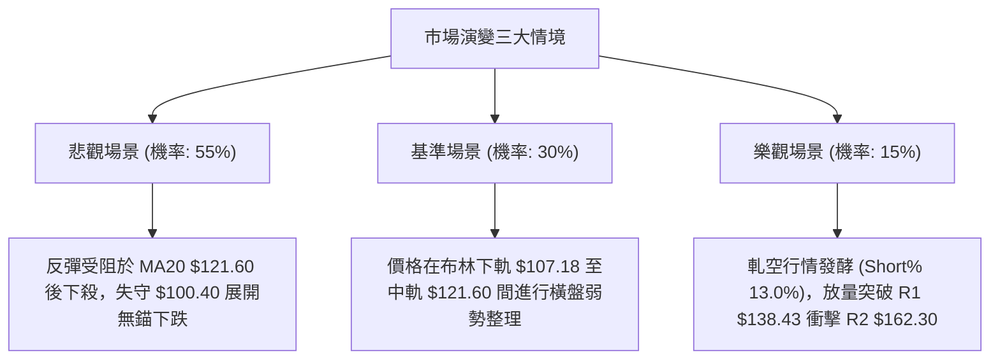

### 🛡️ 風險管理重要提醒

1. **極度波動風險（High Volatility Hazard）**：
   AVAV 當前日線 ATR 高達 **$8.24**（佔比 7.31%），意味著每日正常價格波動幅度即可輕易吞噬常規短線止損。持倉部位絕不可超過總資產的 15%，單筆交易虧損額度必須嚴格限制在總資本之 1%–2% 以內。
2. **左側摸底風險（Falling Knife Risk）**：
   數據明確揭示當前價格下方「no swing-low support detected below current price」，除了 11-06 當日探出的 52 週低點 **$100.40** 之外，下方無任何實體交易聚類支撐。嚴禁在未見雙底構築或帶量實體紅K突破前進行左側盲目抄底。
3. **空頭回補軋空風險（Short Squeeze Alert）**：
   空頭部位比率（Short % Float）達 **13.0%**，Short Ratio 為 **3.25**。若有突發防務合約催化劑消息，高做空比例可能誘發短線極端軋空暴拉，故做空者必須於進場時嚴格預埋止損單（如 $128.10），切忌心存僥倖。

---

## 📋 報告總結

```
╔══════════════════════════════════════════════════════════════════╗
║                   AVAV 技術分析報告總結                          ║
╠══════════════════════════════════════════════════════════════════╣
║ 報告日期：2026-11-07                                            ║
║ 當前價格：$112.76                                                ║
║ 分析評級：🔴 偏空主導 / 區間震盪 (綜合評分: 32/100)               ║
╠══════════════════════════════════════════════════════════════════╣
║ 關鍵結論：                                                       ║
║ ├─ 長期趨勢：🔴 極度偏空，價格大幅低於 MA200 ($179.62)           ║
║ ├─ 中期趨勢：🔴 空頭主導，週線維持下降階梯排列                  ║
║ ├─ 短期趨勢：🟡 探底盤整，日線出現 RSI 底背離與長下影線         ║
║ ├─ 關鍵支撐：$107.18 (布林下軌) / $100.40 (52W最低點)           ║
║ ├─ 關鍵阻力：$121.60 (MA20) / $138.43 (波段高點聚類 R1)         ║
║ └─ 分析師目標：平均 $212.20 (技術面嚴重脫節，僅供基本面參考)    ║
╠══════════════════════════════════════════════════════════════════╣
║ 最優策略組合：                                                   ║
║ 1. 🥇 最佳機會：策略 A — 反彈至 MA20 ($121.60) 遇阻放空，        ║
║                  止損設 $128.10，T1 看 $107.18 (風報比 1:2.22)   ║
║ 2. 🥈 次選機會：策略 B — 實體收盤跌破 $107.18 順勢追空，         ║
║                  止損設 $112.76，T1 看 $100.40 (風報比 1:1.22)   ║
║ 3. 🥉 保守選擇：完全空倉觀望，等待日線有效突破 R1 $138.43 或      ║
║                  在 $100.40 構築二次打底形態後再行介入           ║
╚══════════════════════════════════════════════════════════════════╝
```

---

> ⚠️ **免責聲明**：本報告為技術分析研究，所有數據、圖表及價位估算均基於歷史量價資訊（Yahoo Finance）。本報告**僅供研究與學術參考**，**不構成任何要約、招攬或投資建議**。市場具有高風險，投資人應獨立評估財務狀況並自行承擔交易風險。

---

*報告生成時間：2026-11-07 ｜ 數據來源：Yahoo Finance ｜ 分析框架：多時框技術分析體系*