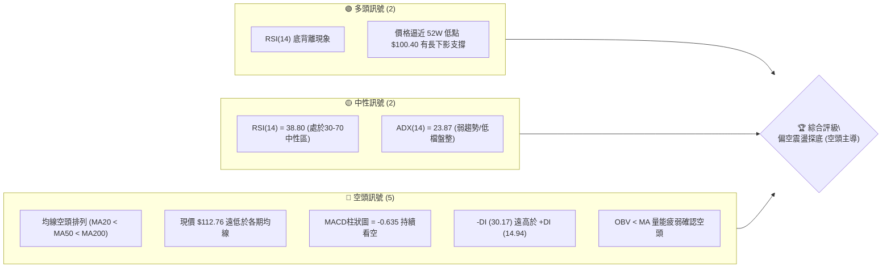
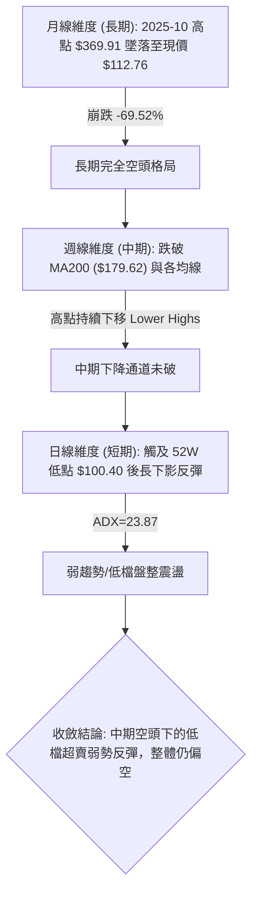
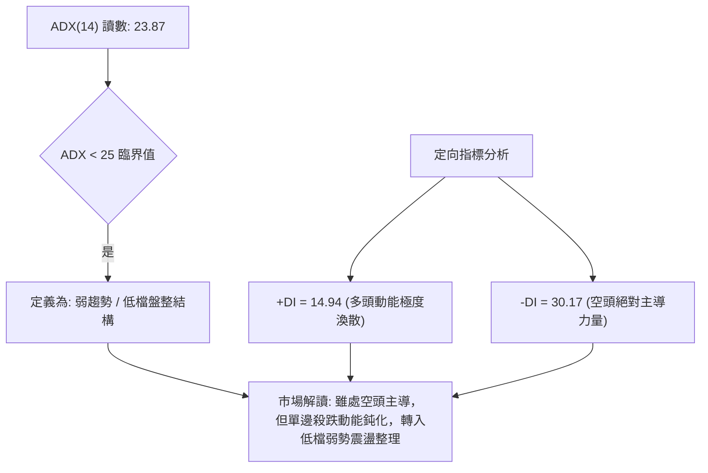
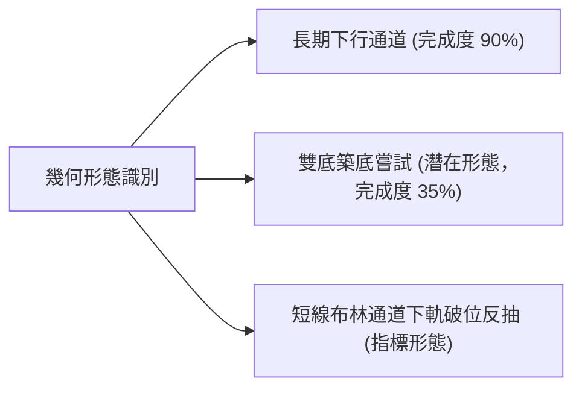
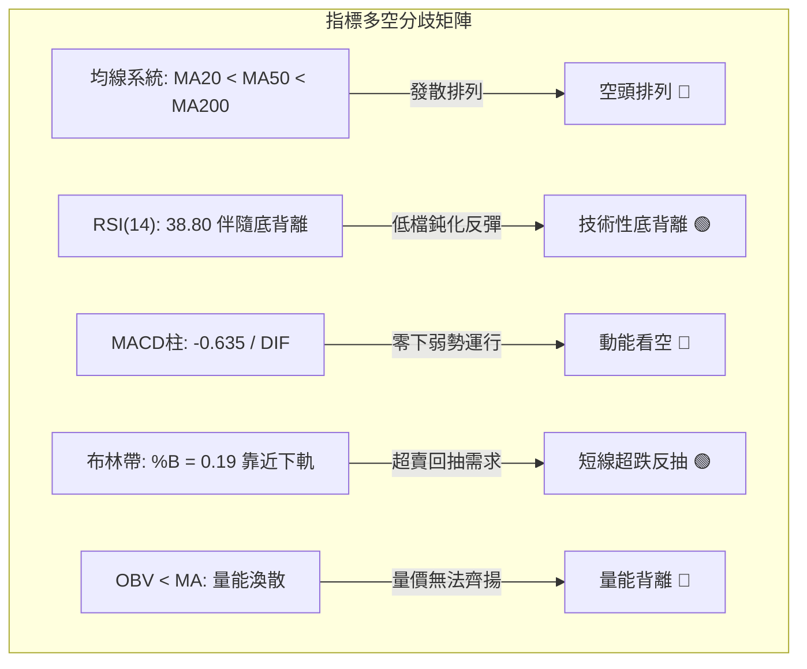
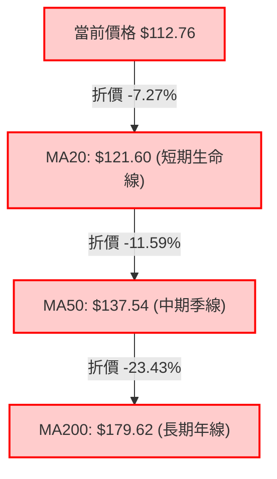
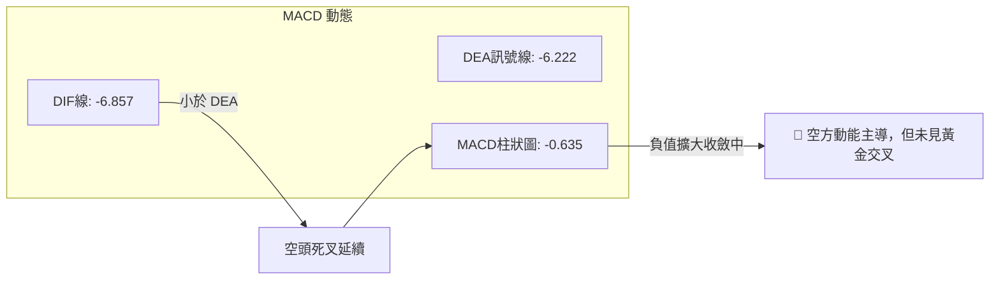
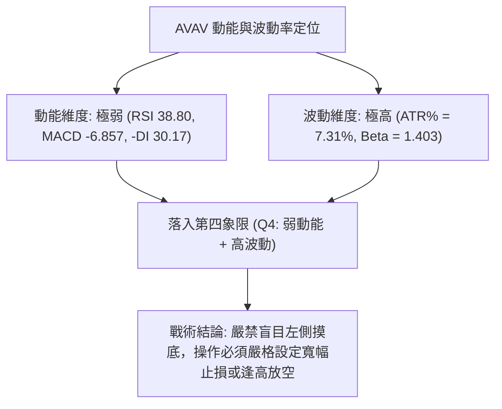
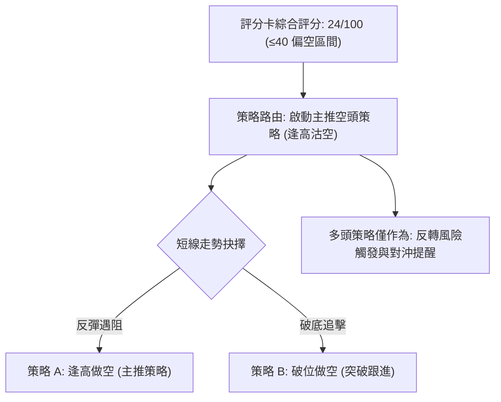
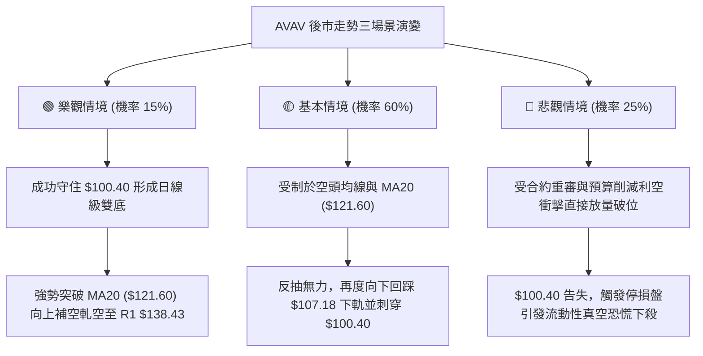

# AVAV 技術分析報告

> **報告日期**：2026-11-08 ｜ **語言**：繁體中文 ｜ **數據來源**：Yahoo Finance ｜ **當前價格**：$112.76

---

## 目錄

| 章節 | 內容 |
|------|------|
| [1. 技術面概覽](#1-技術面概覽) | 訊號儀表板、核心指標、評分卡 |
| [2. 趨勢分析](#2-趨勢分析) | 多時框趨勢、長中短期走勢 |
| [3. 圖表形態分析](#3-圖表形態分析) | 形態識別、K線組合、目標價 |
| [4. 支撐與阻力](#4-支撐與阻力) | 關鍵價位、斐波那契回調 |
| [5. 技術指標深度解讀](#5-技術指標深度解讀) | MA/RSI/MACD/布林/成交量 |
| [6. 動能與波動率](#6-動能與波動率) | 動能評估、ATR、Beta |
| [7. 多時框架總結](#7-多時框架總結) | 時框架評分矩陣 |
| [8. 交易策略建議](#8-交易策略建議) | 多空策略、風險報酬比 |
| [9. 風險提示與監控](#9-風險提示與監控) | 監控指標、風險場景 |

---

## 1. 技術面概覽

### 🎯 技術訊號儀表板



### 📊 核心指標速覽表

| 指標類別 | 指標名稱 | 當前數值 | 訊號 | 解讀 |
|----------|----------|----------|------|------|
| **價格** | 當前收盤價 | $112.76 | 🔴 | 位於 52 週價格區間 4.0% 之極端低位，處於主跌浪尾端 |
| **均線** | MA20 | $121.60 | 🔴 | 價格低於 MA20 約 7.27%，短期空頭壓制明確 |
| **均線** | MA50 | $137.54 | 🔴 | 價格低於 MA50，中期趨勢嚴重受阻 |
| **均線** | MA200 | $179.62 | 🔴 | 價格低於 MA200 約 37.22%，長期處於完全空頭格局 |
| **動能** | RSI(14) | 38.80 | 🟡 | 位於弱勢中性區，雖未進入超賣區但出現首尾底背離 |
| **動能** | MACD (12,26,9) | -6.857 / -6.222 | 🔴 | DIF 與 DEA 雙雙落於零軸下方，柱狀圖 -0.635 延續下行動能 |
| **波動** | ATR(14) | $8.24 | 🔴 | ATR 佔股價高達 7.31%，市場波動劇烈，單日震幅極大 |

### 🏆 技術評分卡

```
╔══════════════════════════════════════════════════════════════╗
║                技術評分卡 — AVAV (2026-11-08)                 ║
╠══════════════════════════════════════════════════════════════╣
║ 趨勢強度 (Trend)     ████░░░░░░░░░░░░░░░░  20/100   🔴 劣勢  ║
║ 動能指標 (Momentum)  ███████░░░░░░░░░░░░░  35/100   🔴 弱勢  ║
║ 支撐穩定度 (Support) ████░░░░░░░░░░░░░░░░  20/100   🔴 脆弱  ║
║ 成交量配合 (Volume)  ██████░░░░░░░░░░░░░░  30/100   🔴 渙散  ║
║ 形態完整度 (Pattern) ██████░░░░░░░░░░░░░░  30/100   🔴 破位  ║
║ 均線排列 (MA Align)  ██░░░░░░░░░░░░░░░░░░  10/100   🔴 空頭  ║
╠══════════════════════════════════════════════════════════════╣
║ 綜合評分 (Overall)   ████░░░░░░░░░░░░░░░░  24/100   🔴 強烈偏空║
╚══════════════════════════════════════════════════════════════╝
```
*(註：綜合評分由六項子評分之算術平均計算：(20 + 35 + 20 + 30 + 30 + 10) / 6 = 24.17，四捨五入為 24/100。)*

---

## 2. 趨勢分析

### 🌐 多時框趨勢分析



### 📈 長期趨勢 — 12個月走勢圖（Unicode）

依據月線歷史數據（2025-11 至 2026-11）繪製之價格走勢圖：

```
AVAV 月線走勢圖（過去12個月：2025-11 至 2026-11）
價格軸 ($)
$370 ┤  ● (歷史高位附近 2025-11: $279.46)
$320 ┤
$280 ┤  ●       ● (2026-01: $278.39)
$240 ┤      ●       ● (2026-02: $252.25)
$200 ┤                  ● (2026-04: $195.02)  ● (2026-05: $207.24)
$160 ┤                      ● (2026-03: $183.05)  ● (2026-06: $165.07)
$140 ┤                                                ●       ●       ● (2026-09: $142.22)
$120 ┤                                                                    ● (2026-10: $126.11)
$100 ┤                                                                        ● (現在 $112.76)
     └────────────────────────────────────────────────────────────────────────────
        M1  M2  M3  M4  M5  M6  M7  M8  M9  M10 M11 M12 (2026-11)
```

**12個月走勢特徵分析表**：

| 時間區間 | 起始收盤價 | 期末收盤價 | 漲跌幅 | 結構性特徵分析 |
|----------|------------|------------|--------|----------------|
| **2025-11 ~ 2026-01** | $279.46 | $278.39 | -0.38% | 高位箱型震盪，出現雙重頂頸線測試 |
| **2026-01 ~ 2026-03** | $278.39 | $183.05 | -34.25% | 主跌浪啟動，長陰下殺，跌破多條長期均線 |
| **2026-03 ~ 2026-05** | $183.05 | $207.24 | +13.22% | 跌深反抽，受阻於 $218.00 斐波那契回調位後動能衰竭 |
| **2026-05 ~ 2026-08** | $207.24 | $148.35 | -28.42% | 第二輪加速下跌，均線全面轉為發散空頭排列 |
| **2026-08 ~ 2026-11** | $148.35 | $112.76 | -23.99% | 陰跌築底失敗，連續破底探至 52W 低點 $100.40 |

### 📊 中期趨勢（週線分析）

```
AVAV 週線中期通道示意圖（近20週）
價格軸 ($)
$195 ┤        ●
$180 ┤     ●     ●
$165 ┤              ●       ●
$150 ┤                 ● ●     ●  (近期壓力區 R2: $162.30 / R3: $168.00)
$135 ┤                            ●  ●  ● (關鍵阻力 R1: $138.43)
$120 ┤                                     ●  ●  ●
$105 ┤                                              ● ← 當前觸碰 52W Low $100.40
     └────────────────────────────────────────────────────────
```
中期週線顯示出極為嚴謹的下降階梯形態（Lower Highs & Lower Lows）。每次反抽均無法觸碰或站穩前波平台高點，近期阻力密集壓在 $138.43 至 $162.30 區域。

### ⚡ 趨勢強度評估（ADX 解讀）



| 指標名稱 | 實際數值 | 臨界標準值 | 趨勢判定 | 操作指引 |
|----------|----------|------------|----------|----------|
| **ADX(14)** | 23.87 | 25.00 | 弱趨勢 / 盤整 | 避免追空，適合在布林通道或震盪區間內高拋低吸 |
| **+DI(14)** | 14.94 | 20.00 | 多頭衰弱 | 不具備持續性反轉向上的推動力 |
| **-DI(14)** | 30.17 | 25.00 | 空方壓制 | 市場任何反彈均易遭遇空頭回馬槍 |

---

## 3. 圖表形態分析

### 🔍 形態識別系統



**形態信心度與目標價評估表**：

| 形態類別 | 信心度 | 判斷依據（引用數據） | 完成度 | 目標價（附精確計算式） |
|----------|--------|----------------------|--------|------------------------|
| **下行通道** | 85% | 依據過去24個月由 $369.91 高點逐級回落，週K反覆受阻於降軌下移 | 90% | 下軌支撐指向 52W 低點 $100.40；突破 R1 $138.43 方告失效 |
| **雙重底 (W底潛在)** | 35% | 2026-11-06 最低打至 $100.40（與 52W 低點 $100.40 重合），但目前僅為第一隻腳，尚未出現二次探底確認 | 35% | 訊號不足，僅做指標型解讀（頸線待定，暫不預測形態目標價） |
| **短線破軌反抽** | 75% | 股價於 2026-11-05 跌破布林下軌 $107.18（收 $102.08），11-06 強拉下影收回 $112.76 | 100% | 目標價 = 布林中軌 (MA20) = $121.60 |

### 🕯️ 重要K線形態分析

依據數據提供之近10根日K與近8根週K實際資料進行解讀：

| 日期（時框） | 開盤價 | 最高價 | 最低價 | 收盤價 | K線形態名稱 | 技術解讀 | 訊號 |
|--------------|--------|--------|--------|--------|-------------|----------|------|
| **2026-10-29 (日K)** | 125.89 | 138.43 | 125.88 | 134.88 | 長陽上影突破棒 | 盤中衝擊波段高點 R1 ($138.43) 後承壓，量增至173.3萬股 | 🟡 中性偏多 |
| **2026-10-30 (日K)** | 131.12 | 133.10 | 124.17 | 126.11 | 陰包陽回挫 | 開高走低完全回吐前日漲幅，形成短期假突破頂部確認 | 🔴 看空 |
| **2026-11-04 (日K)** | 121.00 | 123.00 | 108.95 | 113.23 | 帶量破位大陰線 | 成交量暴增至 279.5 萬股，實體跌穿 $120 整數支撐防線 | 🔴 強烈看空 |
| **2026-11-05 (日K)** | 110.28 | 112.33 | 101.07 | 102.08 | 慣性跳空續殺陰 | 開低走低收在次低點，布林帶嚴重開口向下超跌 | 🔴 看空 |
| **2026-11-06 (日K)** | 104.36 | 113.65 | 100.40 | 112.76 | 長下影錘頭轉折陽棒 | 最低觸及 52W 低點 $100.40 後爆出低接買盤，收長下影線（影線長達 $12.36） | 🟢 短線看多 |
| **2026-10-16 (週K)** | 137.10 | 137.50 | 116.43 | 121.79 | 破位中長黑棒 | 週跌幅劇烈，週 RSI 跌至 28.6 嚴重超賣區 | 🔴 看空 |
| **2026-10-30 (週K)** | 122.39 | 138.43 | 120.35 | 126.11 | 上影紡錘線 | 測試 $138.43 阻力後大幅回落，確認週線反彈結束 | 🔴 看空 |
| **2026-11-06 (週K)** | 126.20 | 128.10 | 100.40 | 112.76 | 探底長下影倒T/錘頭週線 | 單週震幅近 28 美元，於 52W 低點 $100.40 獲得初步支撐反應 | 🟡 止跌信號 |

### 📉 ASCII 走勢形態示意圖

```
AVAV 近10日 K 線結構與低檔錘頭形態示意圖
價格軸 ($)
$138 ┤       ┬ (10-29 高點 138.43)
$135 ┤       █
$130 ┤       █   ┬ (10-30)
$125 ┤   ┌─┐ █   █   ┬       ┬
$120 ┤   │ │ █   █   █   ┌─┐ █ (11-04 帶量下殺)
$115 ┤   │ │ │   │   │   │ │ █           ┌─┐ (11-06 錘頭收 112.76)
$110 ┤   └─┘ ┴   ┴   ┴   └─┘ │   ┌─┐     │ │
$105 ┤                       ┴   │ │     │ │
$100 ┤                           █ ─ ┴ ──┴─┴─ (11-06 探底 100.40 獲支撐)
     └──────────────────────────────────────────────
         10-26   10-28   10-30   11-03   11-05   11-06
```

### 🎯 形態目標價計算

根據 2026-11-06 出現的「長下影錘頭破軌反抽形態」進行推算：
- **形態確立點**：突破 2026-11-06 高點 $113.65。
- **回抽第 1 目標價 (T1)**：取日線布林通道中軌 (MA20) = **$121.60**。
- **反彈第 2 目標價 (T2)**：取波段高點阻力聚類 R1 = **$138.43**。
- **計算式**：
  $$\text{形態理論極限反彈高度} = \text{低點} (\$100.40) + (\text{前高} \$138.43 - \text{低點} \$100.40) \times 0.5 = \$100.40 + \$19.015 = \$119.415$$
  此數值與 MA20 ($121.60) 形成密集阻力帶。

---

## 4. 支撐與阻力

### 🗺️ 關鍵價位分布圖（Unicode）

```
AVAV 價位結構分布圖（嚴格依據 OHLCV 計算聚類）
═══════════════════════════════════════════════════════════════
$168.00 ║██████████████████████████████║ 強阻力 R3 (波段高點聚類)
$162.30 ║████████████████████          ║ 阻力 R2 (反彈高點聚類)
$138.43 ║██████████████████████████████║ 關鍵阻力 R1 (近期震盪頸線)
$121.60 ║▓▓▓▓▓▓▓▓▓▓▓▓▓▓▓▓              ║ 動態阻力 (MA20 / 布林中軌)
$112.76 ╠══════════════════════════════╣ ◄ 當前收盤價
$107.18 ║░░░░░░░░░░░░                  ║ 動態支撐 (布林通道下軌)
$100.40 ║██████████████████████████████║ 52週絕對低點 / 100.0% 斐波那契
═══════════════════════════════════════════════════════════════
```

### 🚧 阻力位分析表

全部價位嚴格引用自數據之「關鍵價位」與指標系統：

| 阻力級別 | 精確價位 | 形成原因（數據依據） | 突破難度 | 重要性 |
|----------|----------|----------------------|----------|--------|
| **動態阻力** | $121.60 | MA20 均線位置暨布林通道中軌 | 中等 | 短線反彈多空分水嶺 |
| **阻力 R1** | $138.43 | 近一年波段高點聚類（2026-10-29 實測最高點） | 極高 | 中期下降格局防線 |
| **阻力 R2** | $162.30 | 近一年波段次高聚類（2026-09 下旬整理平台） | 極高 | 中期轉向多頭門檻 |
| **阻力 R3** | $168.00 | 近一年波段高點聚類（2026-09-18 週K最高價） | 極強 | 長期空頭反轉關鍵 |

### 🛡️ 支撐位分析表

依據數據規則，當前價格下方無 swing-low 聚類支撐（no swing-low support detected below current price）：

| 支撐級別 | 精確價位 | 形成原因（數據依據） | 守住機率 | 重要性 |
|----------|----------|----------------------|----------|--------|
| **動態支撐** | $107.18 | 日線布林通道下軌位置 | 45% | 超跌極限與回歸邊界 |
| **底線支撐** | $100.40 | 52週最低價暨 100.0% 斐波那契回調位 | 50% | 多頭最後生命線，破位將陷入無錨真空 |
| **支撐 S1** | N/A（數據未提供） | 近一年無波段低點聚類偵測到 | N/A | 數據中未偵測到 |
| **支撐 S2** | N/A（數據未提供） | 近一年無波段低點聚類偵測到 | N/A | 數據中未偵測到 |

### 📐 斐波那契回調位分析

依據 52 週區間 **$100.40 (Low) → $408.25 (High)** 之精確計算回調階梯：

```
斐波那契回調階梯分布 (區間 $100.40 - $408.25)
  0.0%  (52W High)  $408.25  ━━━━━━━━━━━━━━━━━━━━━━━━━━━━
 23.6%              $335.60  ────────────────────────────
 38.2%              $290.65  ────────────────────────────
 50.0%              $254.33  ────────────────────────────
 61.8%              $218.00  ────────────────────────────
 78.6%              $166.28  ────────────────────────────
100.0%  (52W Low)   $100.40  ━━━━━━━━━━━━━━━━━━━━━━━━━━━━
        ▲ 現價 $112.76 位於 78.6% ($166.28) 與 100.0% ($100.40) 之間
```

**深入解讀**：
當前收盤價 $112.76 深度回撤於 78.6% 回調位 ($166.28) 之下，且距 100.0% 回調位 ($100.40) 僅有 12.31% 的緩衝空間。技術上，當標的資產跌破 78.6% 黃金分割深度保護線時，代表整個年度級別的上漲趨勢已遭完全瓦解，目前市場正處於「全面回吐跌停板」測試 52 週最低點 $100.40 的極端弱勢架構中。

---

## 5. 技術指標深度解讀

### 🎛️ 指標訊號總覽



### 📈 移動平均線排列分析



**移動平均線數值與乖離分析表**：

| 均線週期 | 數值 | 現價與均線距離 ($) | 乖離率 (%) | 排列狀態 | 趨勢意涵 |
|----------|------|--------------------|------------|----------|----------|
| **MA 5** | $114.94 | -$2.18 | -1.89% | 短期空頭 | 短線壓制在極近距離 |
| **MA 10** | $121.38 | -$8.62 | -7.10% | 短期空頭 | 與 MA20 形成密集死叉壓制區 |
| **MA 20** | $121.60 | -$8.84 | -7.27% | 短期空頭 | 布林中軌，短線第一道堅固反彈壁壘 |
| **MA 50** | $137.54 | -$24.78 | -18.02% | 中期空頭 | 中期強大蓋頭壓力，鄰近 R1 ($138.43) |
| **MA 60** | $141.88 | -$29.12 | -20.52% | 中期空頭 | 季線下彎斜率陡峭 |
| **MA 120** | $154.39 | -$41.63 | -26.97% | 長期空頭 | 半年線持續壓迫 |
| **MA 200** | $179.62 | -$66.86 | -37.22% | 長期空頭 | 牛熊分界線失守，長期走勢崩壞 |
| **MA 240** | $197.44 | -$84.68 | -42.89% | 長期空頭 | 超長線籌碼全線套牢 |

均線呈現標準的「極端發散空頭排列」（MA5 < MA10 < MA20 < MA50 < MA60 < MA120 < MA200 < MA240），顯示空方在所有時間維度上均佔據絕對壓倒性優勢。

### 📉 RSI(14) 分析

- **RSI 當前讀數**：**38.80**（Wilder）
- **RSI 強度進度條**：
  `RSI(14) [38.80] ▓▓▓▓▓▓▓░░░░░░░░░░░░░ 38.8%  🟡 中性弱勢區`
- **超買超賣與背離判斷**：
  雖然 RSI 位於 30-70 的中性區間，但在近 20 根 K 棒的首尾比對中，**偵測到底背離現象（Bullish Divergence）**。
  - **背離事實**：股價在 2026-11-06 跌穿前波低點打到 $100.40，然而 RSI(14) 指標並未刷新先前於 10 月中旬創下的極端低點（週線 RSI 曾低至 28.6），日線 RSI 維持在 38.80 築底，顯示下殺動能已出現結構性耗竭，具備短線技術性修復反彈的先決條件。

### 📊 MACD(12,26,9) 訊號解讀


- **MACD DIF**：-6.857
- **MACD Signal (DEA)**：-6.222
- **MACD Histogram**：-0.635 🔴 看空
MACD 雙線均大幅深陷於零軸下方（低於 -6.0），表明市場長期處於極端負向動能中。柱狀圖雖由前幾日的擴大微幅收斂至 -0.635，但在 DIF 向上穿越 Signal 形成實質黃金交叉前，任何反彈均只能視為弱勢修正。

### 📦 布林通道分析

```
AVAV 日線布林通道結構示意圖
價格軸 ($)
$136.03 ┼──────────────────────────────── 上軌 (Upper Band)
$130.00 │
$121.60 ┼──────────────────────────────── 中軌 MA20 (Middle Band)
$115.00 │
$112.76 ┼───────●──────────────────────── 現價 (BB %B = 0.19)
$107.18 ┼──────────────────────────────── 下軌 (Lower Band)
$100.40 ┴───────┴──────────────────────── 52W 低點
```
- **BB 上軌**：$136.03
- **BB 中軌**：$121.60 (MA20)
- **BB 下軌**：$107.18
- **BB %B**：0.19 (處於 0 到 0.5 之下半軌超跌區)
- **通道解讀**：現價 $112.76 雖從 11-05 的下軌外 ($102.08) 重新站回下軌之內，%B 讀數回升至 0.19，但通道整體向下傾斜開口，顯示短期跌勢尚未收斂鎖定，中軌 $121.60 為多頭短期難以逾越之天花板。

### 💹 成交量分析（量價配合度）

- **最新日成交量**：1,599,000 股
- **20日均量**：1,476,040 股（量比：1.08x，溫和放量）
- **50日均量**：1,796,236 股
- **量價行為分析**：
  - 在 2026-11-04 股價長陰下殺跌破 $120 時，成交量擴大至 2,795,000 股，呈現經典的「放量破位」特徵。
  - 2026-11-06 於 $100.40 低點拉升至 $112.76 時，成交量為 1,599,000 股，僅微幅超越 20 日均量（1.08x），顯示多頭買盤仍屬保守觀望，並非由機構性主力資金大舉回補所推動。
  - **OBV 趨勢**：數據明確顯示「OBV < MA → 量能疲弱」，能量潮指標持續下行且受制於均線，確認空頭走勢獲得量能背書，反彈缺乏長期增量資金支撐。

---

## 6. 動能與波動率

### ⚡ 動能評估四象限

| 象限 | 動能強度 (Momentum) | 波動率水準 (Volatility) | 當前狀態 | 策略應對與市場解讀 |
|------|---------------------|-------------------------|----------|--------------------|
| **Q1 (最佳機會)** | 強 (Bullish) | 低 (Low Volatility) | — | 穩定多頭主升段，趨勢明確 |
| **Q2 (謹慎觀望)** | 弱 (Bearish) | 低 (Low Volatility) | — | 窄幅盤整，方向未明 |
| **Q3 (高風險套利)** | 強 (Bullish) | 高 (High Volatility) | — | 爆發性突破或投機熱潮 |
| **Q4 (避免進場/做空)** | **弱 (Bearish)** | **高 (High Volatility)** | **✓ (AVAV落點)** | **處於強烈下行與高震幅狀態，極易破位或遭遇劇烈反抽** |



### 📊 ATR 波動率分析

- **ATR(14) 絕對值**：**$8.24**
- **ATR 佔比 (ATR % of Price)**：**7.31%** (以現價 $112.76 計算)
- **波動特性評估**：
  ATR 高達 7.31%，屬於極高波動度標的。這意味著 AVAV 每個交易日的平均正常隨機波動區間就高達 ±$8.24。
- **止損距離建議**：
  - **短線戰術止損**：至少須設定為 1.0 倍 ATR = **$8.24**，否則極易在日內雜訊中被無謂震盪出場。
  - **波段保護止損**：應設定為 1.5 ~ 2.0 倍 ATR = **$12.36 ~ $16.48**。

### 📐 Beta 與市場相關性

- **Beta 係數**：**1.403**
- **市場敏感度解讀**：
  AVAV 具有高度進攻型 (High-Beta) 特性，其相對於標普 500 指數的波動放大 40.3%。在整體防禦性國防類股板塊面臨預算審查雜音（如新聞所指合約重啟競爭與支出限制）時，其下行放大效應尤為顯著。
- **空頭部位比例**：
  Short % Float 高達 **13.0%**，Short Ratio 為 3.25。高空頭佔比意味著股票容易在超賣區引發猛烈的「空頭回補軋空（Short Squeeze）」，但若無根本面扭轉，反彈後將引來更大規模的融券打壓。

---

## 7. 多時框架總結

### 📋 時框架評分表

| 時框架 | 趨勢方向 | 動能強度 | 均線排列狀態 | 形態特徵 | 綜合評分 | 建議 |
|--------|----------|----------|--------------|----------|----------|------|
| **月線 (長期)** | 🔴 極空 | 🔴 極弱 (自 $369.91 回落) | 🔴 跌破各週期均線 | 崩跌破位大陰線 | 15/100 | 強烈避險 / 減碼 |
| **週線 (中期)** | 🔴 空頭 | 🔴 弱勢 (MACD柱連續負值) | 🔴 MA200 完全跌穿 | 下降階梯通道 | 20/100 | 逢反彈放空 |
| **日線 (短期)** | 🟡 震盪 | 🟡 中性 (RSI 底背離) | 🔴 發散空頭排列 | 破底後錘頭反抽 | 35/100 | 嚴控短線區間操作 |

### 🔲 綜合訊號矩陣

```
時框與指標交互驗證矩陣
┌──────────────────┬──────────────┬──────────────┬──────────────┐
│ 分析維度         │ 短期 (日線)  │ 中期 (週線)  │ 長期 (月線)  │
├──────────────────┼──────────────┼──────────────┼──────────────┤
│ 均線系統 (MA)    │ 🔴 空頭排列  │ 🔴 空頭排列  │ 🔴 空頭排列  │
│ 動能 (RSI/MACD)  │ 🟢 底背離    │ 🔴 負向運行  │ 🔴 崩落極弱  │
│ 形態學 (Pattern) │ 🟢 錘頭反抽  │ 🔴 下降通道  │ 🔴 雙重頂破位│
│ 成交量 (Volume)  │ 🟡 溫和量比  │ 🔴 放量下挫  │ 🔴 換手渙散  │
├──────────────────┼──────────────┼──────────────┼──────────────┤
│ 跨時框一致性評估 │ 衝突 (短反彈)│ 一致 (空頭)  │ 一致 (空頭)  │
└──────────────────┴──────────────┴──────────────┴──────────────┘
```

### ⚖️ 多時框收斂結論

依據多時框收斂規則進行判定：
1. **行情性質判斷**：ADX(14) 讀數為 **23.87**，低於趨勢門檻值 25.00，市場當前屬於**盤整行情（非單邊趨勢行情）**。
2. **時框優先級收斂**：在 ADX < 25 的盤整結構中，分析以**日線布林通道上下軌 ($107.18 ~ $136.03) 為主要交易區間**。然而，由於中期週線與長期月線均線呈現全面空頭發散，日線的 RSI 底背離與錘頭線僅能定義為「跌深後的技術性超跌反彈」，絕對不可視為大級別趨勢的反轉。
3. **方向性結論**：**強烈偏空震盪（Bearish Range-bound）**。主導維度仍由中期空頭牢牢控制，日線級別的反彈空間嚴格受限於 MA20 ($121.60) 與 R1 ($138.43)。

---

## 8. 交易策略建議

### 🗺️ 策略決策流程圖



### 🧭 策略路由（依評分卡分流）

> **當前主策略方向 = 主推空頭策略（依綜合評分 24/100，處於 ≤40 之強烈偏空區）**

基於綜合評分僅 24 分、均線完全空頭排列且 ADX 呈現空方主導（-DI 30.17），主推策略為**逢高做空**與**跌破放空**。多頭短線博反彈僅列為風控參考，不作主力配置。

### 🎯 價格情境階梯（Price Scenarios）

價位嚴格引用自「第 4 章／關鍵價位」區塊：

| 觸發條件 | 下一目標 | 後續延伸 | 情境含義 |
|----------|----------|----------|----------|
| **強勢突破 R1 $138.43** | R2 $162.30 | R3 $168.00 | 中期空頭架構破壞，短線全面轉強 |
| **反彈受阻 MA20 $121.60** | 52W Low $100.40 | $100.40 破位測試 | 延續布林中軌壓制，空頭重啟下行 |
| **跌破 52W Low $100.40** | 無歷史支撐錨點 | 探尋兩位數心理關卡 | 創一年新低，進入無支撐真空跌勢 |

### 📊 情境機率分佈

| 預期情境 | 發生機率 | 主要依據（引用指標狀態） |
|----------|----------|--------------------------|
| **弱勢反抽後回落再探底** | **60%** | MACD柱狀圖仍為負 (-0.635)，各期均線呈空頭發散，反彈動能衰竭極快 |
| **低檔區間震盪整理** | **25%** | ADX = 23.87 (<25) 顯示殺跌趨勢鈍化，RSI 呈現底背離支撐短線打底 |
| **強勁反轉向上突破** | **15%** | OBV 量能持續低迷，基本面 Operating Margin 負向，缺乏主力資金跟進 |

### 🟢 主策略詳情（空頭主推策略）

依規則 17，風險報酬比嚴格定義為：$(\text{進場價} - \text{目標價 T1}) \div (\text{止損價} - \text{進場價})$，以「1 : X.XX（以 T1 計）」格式呈現：

| 策略要素 | 策略 A（反彈高空 — 首選主推） | 策略 B（破位追空 — 順勢跟進） |
|----------|--------------------------------|--------------------------------|
| **進場條件** | 反彈至布林中軌 MA20 遇阻出現滯漲陰線 | 放量實體跌破 52W 最低點 $100.40 |
| **進場價格** | **$121.60**（MA20 精確位置） | **$100.40**（52W Low 破位點） |
| **目標價 T1** | **$107.18**（布林通道下軌） | **$85.98**（由破位區間推算：$100.40 - 1.75×ATR $14.42） |
| **目標價 T2** | **$100.40**（52W 最低點） | **$75.68**（由破位區間推算：$100.40 - 3.0×ATR $24.72） |
| **止損價格** | **$128.10**（近2日高點聚類上緣） | **$108.64**（進場點 + 1.0 倍 ATR $8.24） |
| **風險報酬比** | **1 : 2.22（以 T1 計）** <br>*(另：1 : 3.26（以 T2 計）)* | **1 : 1.75（以 T1 計）** <br>*(另：1 : 3.00（以 T2 計）)* |
| **成功機率** | 65% | 55% |
| **建議倉位** | 10% ~ 15% 總資金 | 5% ~ 10% 總資金 |

*計算覆核說明*：
- 策略 A：$(121.60 - 107.18) \div (128.10 - 121.60) = 14.42 \div 6.50 = 2.218 \approx 2.22$。
- 策略 B：$(100.40 - 85.98) \div (108.64 - 100.40) = 14.42 \div 8.24 = 1.750 = 1.75$。

### 🔴 反向風險觸發點（對沖提示）

若出現以下狀況，宣告空頭主策略失效，空單必須立即無條件止損離場：
1. **價位翻轉**：日K線收盤價強勢站上 **$126.11**（2026-10-30 震盪中樞頸線）或挑戰 **R1 $138.43**。
2. **指標轉多**：MACD 出現零軸下黃金交叉，且日線成交量連續三天超過 50 日均量（1,796,236 股）。

### ⭐ 整體訊號強度評星

```
╔══════════════════════════════════════════════════╗
║ 做多訊號強度：★★☆☆☆  (2/5星 - 僅存底背離反抽)    ║
║ 做空訊號強度：★★★★☆  (4/5星 - 均線與趨勢共振偏空) ║
║ 整體可信度：  ★★★★☆  (4/5星 - 歷史數據完整收斂)   ║
╚══════════════════════════════════════════════════╝
```

---

## 9. 風險提示與監控

### ✅ 關鍵監控指標 Checklist

```
╔══════════════════════════════════════════════════════════════╗
║                   每日交易風控監控清單 (Checklist)           ║
╠══════════════════════════════════════════════════════════════╣
║ [ ] 52W 低點防線：收盤價是否跌破 $100.40？                  ║
║ [ ] 動態均線壓制：盤中是否受阻於 MA20 ($121.60)？            ║
║ [ ] 波動異常預警：單日高低震幅是否超過 1.5 倍 ATR ($12.36)？ ║
║ [ ] 動能背離確認：RSI(14) 是否跌回 30.00 以下超賣區？       ║
║ [ ] 異常放量信號：日成交量是否爆發超過 2,500,000 股？        ║
║ [ ] 軋空風險監控：Short Float (13.0%) 是否引發借券費率暴增？ ║
╚══════════════════════════════════════════════════════════════╝
```

### ⚠️ 風險場景分析



### 🛡️ 風險管理重要提醒

1. **高 Beta 波動風險**：AVAV Beta 達 1.403 且 ATR 佔比超過 7.3%，個股走勢極度神經質，絕不可使用過高槓桿。單筆交易風險敞口（止損金額）不得超過總投資組合淨值的 **1.0%**。
2. **多空擠壓（軋空）風險**：由於放空比例（Short % Float）達 13.0%，股票在 $100.40 心理大關極易因少量買盤引發空頭急回補，產生單日超過 10% 的暴烈反抽，空頭部位切勿在急跌長黑時追空，必須嚴格執行「反彈至阻力位停頓時進場」紀律。
3. **無支撐真空風險**：下方無近一年之 swing-low 支撐聚類，一旦 $100.40 實體跌穿，技術面上將徹底缺乏錨定參考點，容易出現非理性的恐慌性拋售。

---

## 📋 報告總結

```
╔══════════════════════════════════════════════════════════════════╗
║                   AVAV 技術分析報告總結                          ║
╠══════════════════════════════════════════════════════════════════╣
║ 報告日期：2026-11-08                                             ║
║ 當前價格：$112.76                                                ║
║ 分析評級：🔴 強烈偏空震盪 (評分卡綜合得分: 24/100)               ║
║                                                                  ║
║ 關鍵結論：                                                       ║
║ ├─ 長期趨勢：🔴 完全空頭 (月線自高點回落跌幅近 70%，均線發散)    ║
║ ├─ 中期趨勢：🔴 弱勢通道 (週線受制於下降階梯，MA200 遠在上方)   ║
║ ├─ 短期趨勢：🟡 跌深反抽 (日線長下影錘頭出現，RSI 呈現底背離)    ║
║ ├─ 關鍵支撐：$107.18 (布林下軌) / $100.40 (52W 最低點)           ║
║ ├─ 關鍵阻力：$121.60 (MA20/布林中軌) / $138.43 (阻力 R1)         ║
║ └─ 分析師目標：共識均價 $212.20 (高 $315.00 / 低 $148.57)       ║
║                                                                  ║
║ 最優策略組合：                                                   ║
║ 1. 🥇 最佳機會：逢高放空 — 耐心等待股價反抽 MA20 ($121.60)       ║
║                 受阻進場做空，停損設 $128.10，目標下看 $107.18   ║
║ 2. 🥈 次選機會：破位跟進 — 放量跌破 $100.40 後順勢追空，         ║
║                 嚴設 1.0 倍 ATR ($8.24) 止損                     ║
║ 3. 🥉 保守選擇：完全空倉觀望 — ADX < 25 處盤整低效區，           ║
║                 靜待股價放量站穩 $138.43 或完成紮實雙底再行介入 ║
╚══════════════════════════════════════════════════════════════════╝
```

---

> ⚠️ **免責聲明**：本報告為 AI 自動生成之技術分析，所有數據及估算均嚴格基於所提供的歷史價格與指標資訊。本報告**僅供研究與學術參考**，**不構成任何形式的投資建議**。金融市場瞬息萬變，投資具有高度本金損失風險，入市前請務必獨立評估自身風險承受能力。

---

*報告生成時間：2026-11-08 ｜ 數據來源：Yahoo Finance ｜ 分析框架：多時框技術分析體系*