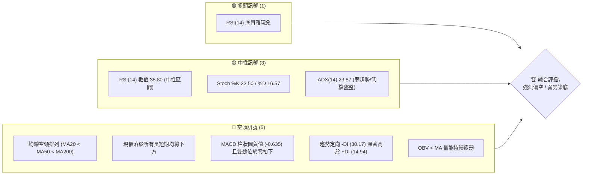
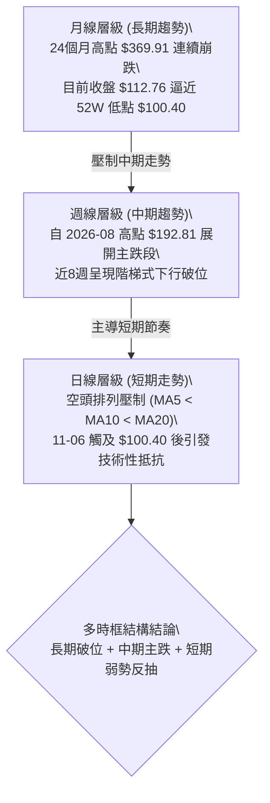
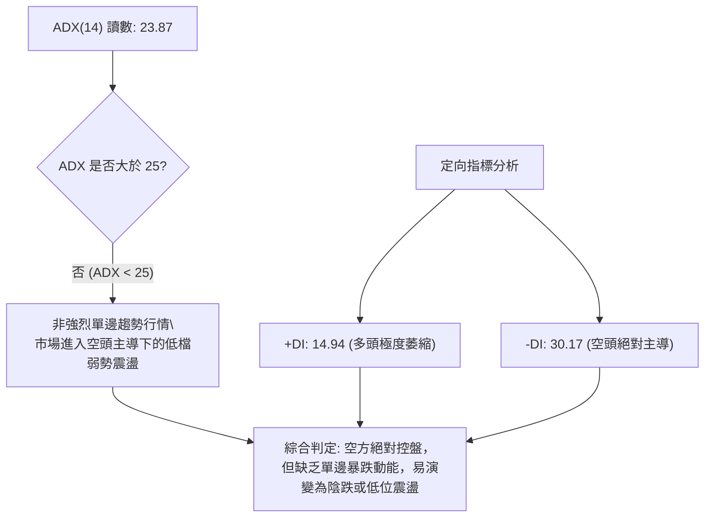
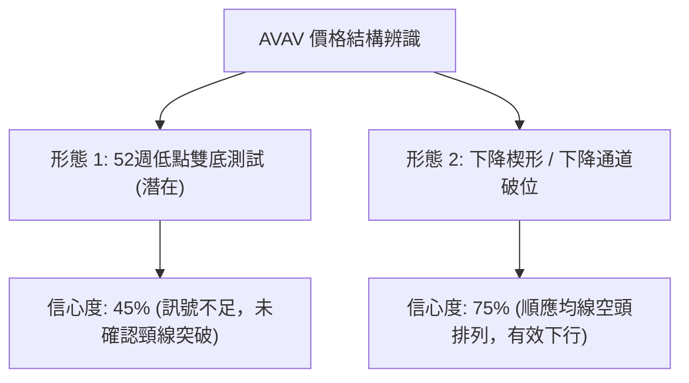
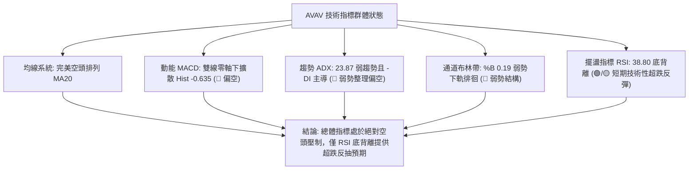
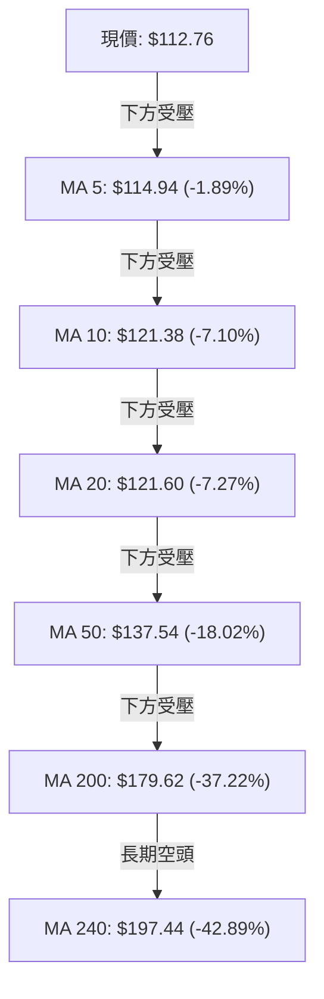
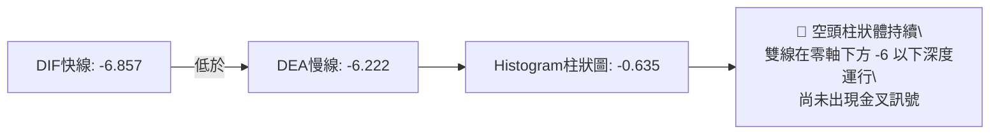
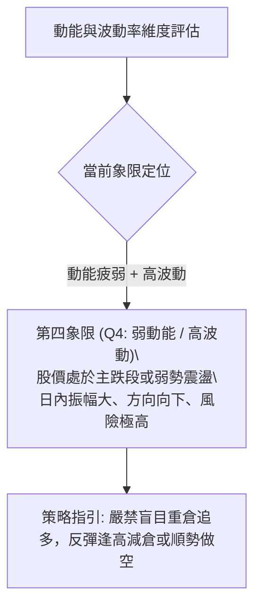
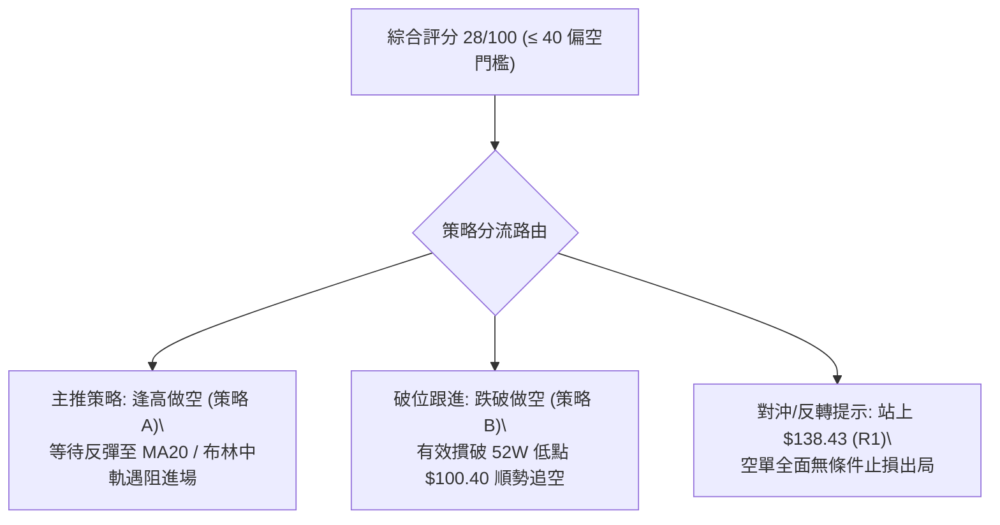
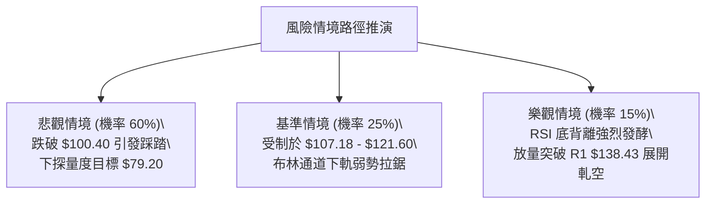

# AVAV 技術分析報告

> **報告日期**：2026-11-09 ｜ **語言**：繁體中文 ｜ **數據來源**：Yahoo Finance ｜ **當前價格**：$112.76

---

## 目錄

| 章節 | 內容 |
|------|------|
| [1. 技術面概覽](#1-技術面概覽) | 訊號儀表板、核心指標、評分卡 |
| [2. 趨勢分析](#2-趨勢分析) | 多時框趨勢、長中短期走勢 |
| [3. 圖表形態分析](#3-圖表形態分析) | 形態識別、K線組合、目標價 |
| [4. 支撐與阻力](#4-支撐與阻力) | 關鍵價位、斐波那契回調 |
| [5. 技術指標深度解讀](#5-技術指標深度解讀) | MA/RSI/MACD/布林/成交量 |
| [6. 動能與波動率](#6-動能與波動率) | 動能評估、ATR、Beta |
| [7. 多時框架總結](#7-多時框架總結) | 時框架評分矩陣 |
| [8. 交易策略建議](#8-交易策略建議) | 多空策略、風險報酬比 |
| [9. 風險提示與監控](#9-風險提示與監控) | 監控指標、風險場景 |
| [10. 報告總結](#-報告總結) | 核心結論與策略清單 |

---

## 1. 技術面概覽

### 🎯 技術訊號儀表板



### 📊 核心指標速覽表

| 指標類別 | 指標名稱 | 當前數值 | 訊號 | 解讀 |
|:---|:---|:---|:---:|:---|
| **價格** | 當前收盤價 | $112.76 | 🔴 | 位於 52 週高低區間 4.0% 處，極度貼近低點 |
| **均線** | MA20 | $121.60 | 🔴 | 價格低於 MA20（-7.27%），短期空頭掌控 |
| **均線** | MA50 | $137.54 | 🔴 | 價格低於 MA50（-18.02%），中期下降趨勢未變 |
| **均線** | MA200 | $179.62 | 🔴 | 價格低於 MA200（-37.22%），長期空頭排列 |
| **動能** | RSI(14) | 38.80 | 🟡 | 位於中性偏弱區，但出現近20根K棒首尾之底背離 |
| **動能** | MACD (12,26,9) | -6.857 / -6.222 | 🔴 | 柱狀圖為 -0.635，雙線處於零軸下方擴散 |
| **動能** | 隨機指標 (Stoch) | %K 32.50 / %D 16.57 | 🟡 | %K 由超賣區向上穿越 %D，短線超跌微幅修正 |
| **趨勢** | ADX(14) | 23.87 | 🟡 | ADX < 25 代表非強烈單邊趨勢，呈現空頭主導之弱勢震盪 |
| **通道** | 布林通道 (%B) | 0.19 | 🔴 | 處於通道下軌（$107.18）上方邊界，弱勢貼軌運行 |
| **量能** | 20日均量對比 | 1,599,000 (1.08x) | 🔴 | OBV < MA，反彈無量、下跌放量，籌碼持續換手失衡 |
| **波動** | ATR(14) | $8.24 | 🔴 | 佔股價 7.31%，日內波動劇烈，下行衝擊風險高 |

### 🏆 技術評分卡

```
╔════════════════════════════════════════════════════════════════╗
║                   技術評分卡 — AVAV (2026-11-09)              ║
╠════════════════════════════════════════════════════════════════╣
║ 趨勢強度 (Trend)     █████░░░░░░░░░░░░░░░  25/100   🔴 弱勢空頭 ║
║ 動能指標 (Momentum)  ███████░░░░░░░░░░░░░  35/100   🔴 底背離受制 ║
║ 支撐穩定度 (Support) ██████░░░░░░░░░░░░░░  30/100   🔴 逼近極限 ║
║ 成交量配合 (Volume)  ██████░░░░░░░░░░░░░░  30/100   🔴 量能渙散 ║
║ 形態完整度 (Pattern) ███████░░░░░░░░░░░░░  35/100   🔴 破位下行 ║
║ 均線排列 (MA System) ███░░░░░░░░░░░░░░░░░  15/100   🔴 完美空頭 ║
╠════════════════════════════════════════════════════════════════╣
║ 綜合評分             ██████░░░░░░░░░░░░░░  28/100   🔴 強烈偏空 ║
╚════════════════════════════════════════════════════════════════╝
（註：綜合評分由六項子評分嚴格依算術平均計算：(25+35+30+30+35+15)/6 = 28.33，四捨五入為 28/100）
```

---

## 2. 趨勢分析

### 🌐 多時框趨勢分析



### 📈 長期趨勢 — 12個月走勢圖（Unicode）

```
AVAV 月線收盤走勢圖（過去12個月：2025-11 至 2026-11）
價格 ($)
$300 ┤ ● (2025-11: $279.46)
$275 ┤       ● (2026-01: $278.39)
$250 ┤   ● (2025-12: $241.89)  ● (2026-02: $252.25)
$225 ┤                                 ● (2026-05: $207.24)
$200 ┤                     ● (2026-04: $195.02)
$175 ┤                 ● (2026-03: $183.05)   ● (2026-06: $165.07)
$150 ┤                                             ● (2026-07: $149.37)  ● (2026-08: $148.35)
$125 ┤                                                               ● (2026-09: $142.22)  ● (2026-10: $126.11)
$100 ┤                                                                                        ● (2026-11: $112.76)
     └─┬────┬────┬────┬────┬────┬────┬────┬────┬────┬────┬────┬────
     11/25 12   01/26 02   03   04   05   06   07   08   09   10   11
```

#### 長期走勢特徵分析

| 階段時間 | 區間起訖點價格 | 漲跌幅 | 走勢特徵解讀 |
|:---|:---|:---:|:---|
| **2025-11 ~ 2026-02** | $279.46 → $252.25 | -9.74% | 高檔雙頂構築，自歷史峰值 $369.91 回落後的二次出貨期 |
| **2026-02 ~ 2026-05** | $252.25 → $207.24 | -17.84% | 第一波跳水殺跌（跌破200美元整數關卡），隨後弱勢反彈至 $207.24 |
| **2026-05 ~ 2026-08** | $207.24 → $148.35 | -28.42% | 平台破位加速下行，機構減持導致均線系統由纏繞轉為完全空頭發散 |
| **2026-08 ~ 2026-11** | $148.35 → $112.76 | -23.99% | 陰跌伴隨加速破位，直奔 52 週低點 $100.40，多頭毫無抵抗力量 |

### 📊 中期趨勢（週線分析）

從近20週數據觀察，AVAV 的中期走勢展現嚴格的下降軌道特徵：
1. **反彈高點遞減**：2026-08-14 見反彈高點 $192.81，隨後 2026-09-18 僅能觸及 $168.00（週高點），2026-10-30 弱勢反彈高點僅達 $138.43。
2. **下行加速與量能背離**：2026-10-16 當週放量（8,156,300股）大跌至收盤 $121.79；至 2026-11-06 當週，週成交量放大至 8,672,900 股，週低點精確摜壓至 52 週最低點 $100.40，收盤 $112.76。

```
中期壓力與支撐階梯結構：
  $168.00 ─── 近期重大波段高點阻力 (R3)
     │
  $138.43 ─── 10/29日線與週線反彈極限 (R1)
     │
  $121.60 ─── MA20 / 布林中軌動態壓力
     │
  $112.76 ─── 當前價格（弱勢懸空）
     │
  $100.40 ─── 52週低點 / 斐波那契 100% 絕對支撐
```

### ⚡ 趨勢強度評估（ADX 解讀）



#### ADX 趨勢強度對照表

| 指標變數 | 當前數值 | 狀態區間 | 技術意涵 |
|:---|:---:|:---:|:---|
| **ADX(14)** | 23.87 | < 25 (弱趨勢/震盪) | 缺乏單邊主升/主跌動量，短期呈現貼軌盤跌與低位拉鋸 |
| **+DI** | 14.94 | < 20 (極弱) | 多方完全缺乏進攻與推升意願，買盤僅為被動承接 |
| **-DI** | 30.17 | > 30 (強空頭) | 賣壓強勁，空方占據主導地位，每一次反彈皆為解套賣點 |
| **DI 差值 (-DI - +DI)** | +15.23 | 顯著擴大 | 空方動能遠大於多方，空頭趨勢結構堅固，無反轉信號 |

---

## 3. 圖表形態分析

### 🔍 形態識別系統



#### 圖表形態信心度與目標價評估表

| 形態名稱 | 信心度 | 判斷依據（嚴格引用數據） | 完成度 | 目標價（附計算式） |
|:---|:---:|:---|:---:|:---|
| **下降通道主跌破位** | 75% | 價格受制於 MA20 ($121.60) 與 MA50 ($137.54)，連續跌破前低 $113.15 與 $116.43 | 90% | 依通道上軌壓力推算，下行已完全滿足至 52W 低點 $100.40 |
| **潛在低位雙底測試** | 40% | 2026-11-06 盤中下探 52W 低點 $100.40 出現下影線拉升，但尚未脫離底部區間 | 25% | **訊號不足，僅做指標型解讀**（頸線為 R1 $138.43，目前價格 $112.76 遠未突破，無確認目標價） |
| **空頭旗形整理跌破** | 70% | 10-26 至 10-30 於 $120.35~$138.43 區間微幅反彈，隨後 11-04 以大陰線放量摜破旗面下緣 | 100% | 旗桿高度 = $138.43 - $120.35 = $18.08；突破點 $120.35 - $18.08 = **$102.27**（已於 11-05 觸及 $101.07 完美兌現） |

### 🕯️ 重要K線形態分析

嚴格依據數據中「近10根日K」與「近8根週K」之真實 OHLCV 進行形態解讀：

#### 近10根日K形態解讀

| 日期（日K） | 開 | 高 | 低 | 收 | K線形態 | 解讀 | 訊號 |
|:---|:---:|:---:|:---:|:---:|:---|:---|:---:|
| **2026-10-26** | 122.39 | 125.75 | 120.35 | 125.45 | 實體陽線 | 低開高走，短線超跌反抽開始 | 🟡 |
| **2026-10-27** | 125.23 | 128.19 | 123.60 | 126.73 | 小陽線 | 延續反彈，但受制於上方 MA20 動態均線 | 🟡 |
| **2026-10-28** | 126.72 | 126.91 | 123.85 | 125.95 | 小陰十字星 | 成交量萎縮至 833,000 股，反彈動能衰竭 | 🔴 |
| **2026-10-29** | 125.89 | 138.43 | 125.88 | 134.88 | 長上影大陽線 | 盤中衝高至 R1 $138.43 遭空頭迎頭痛擊，長上影線釋放強烈套牢賣壓 | 🔴 |
| **2026-10-30** | 131.12 | 133.10 | 124.17 | 126.11 | 穿頭破腳大陰線 | 高開低走完全吞噬前日漲幅大半，確立多頭反撲失敗 | 🔴 |
| **2026-11-02** | 126.20 | 127.80 | 121.94 | 123.08 | 光腳小陰線 | 破位下殺，價格再度跌破 MA20 ($121.60) 關鍵分水嶺 | 🔴 |
| **2026-11-03** | 123.71 | 128.10 | 123.48 | 123.53 | 衝高回落陀螺線 | 成交量僅 912,300 股，多方無力上攻 | 🔴 |
| **2026-11-04** | 121.00 | 123.00 | 108.95 | 113.23 | 放量崩跌大陰線 | 成交量激增至 2,795,000 股，空頭不計成本砸盤破位 | 🔴 |
| **2026-11-05** | 110.28 | 112.33 | 101.07 | 102.08 | 大陰線逼近跌停 | 成交量維持 2,098,700 股高檔，直接下探 52W 低點邊緣 | 🔴 |
| **2026-11-06** | 104.36 | 113.65 | 100.40 | 112.76 | 長下影錘頭陽線 | 精確回踩 52W 低點 $100.40 獲買盤支撐，低位買盤介入引發技術性抵抗 | 🟢 |

#### 近8根週K形態解讀

| 日期（週K結束日） | 開 | 高 | 低 | 收 | K線形態 | 解讀 | 訊號 |
|:---|:---:|:---:|:---:|:---:|:---|:---|:---:|
| **2026-09-18** | 145.80 | 168.00 | 144.51 | 159.95 | 衝高長上影陽線 | 觸及 R3 $168.00 形成波段高點聚類阻力，成交量 1,127 萬股 | 🔴 |
| **2026-09-25** | 161.28 | 165.00 | 151.50 | 152.05 | 轉折陰線 | 高位回落，確立反彈終結 | 🔴 |
| **2026-10-02** | 149.77 | 151.30 | 138.31 | 140.82 | 下跌陰線 | 跌破 $145 平台支撐，空頭趨勢加速 | 🔴 |
| **2026-10-09** | 142.28 | 145.44 | 134.25 | 137.11 | 連續陰線 | 持續於短期均線下方運行 | 🔴 |
| **2026-10-16** | 137.10 | 137.50 | 116.43 | 121.79 | 破位長陰線 | 週成交量 815 萬股，跌破前期波段低點 | 🔴 |
| **2026-10-23** | 122.88 | 124.76 | 113.15 | 123.25 | 止跌十字小陽 | 下影線下探至 $113.15，暫時獲得微弱喘息 | 🟡 |
| **2026-10-30** | 122.39 | 138.43 | 120.35 | 126.11 | 衝高回落長上影線 | 上攻 R1 $138.43 遭逢重挫，賣壓極度沉重 | 🔴 |
| **2026-11-06** | 126.20 | 128.10 | 100.40 | 112.76 | 下影長陰破位線 | 週低點觸及 52W 低點 $100.40，雖有拉回但週線收跌 -10.59% | 🔴 |

### 📉 ASCII 走勢形態示意圖

```
AVAV 近期日K破位與底部抵抗走勢示意圖
$138.43 ───┐ 10-29 長上影針頂 (R1 遇阻)
           │\
           │ \
$126.11 ───┴──● 10-30 吞噬大陰跌破
               \
$121.60 ────────● 11-02 跌破 MA20 (多空分水嶺)
                 \
$113.23 ──────────● 11-04 爆量下殺陰線 (279.5萬股)
                   \
$102.08 ────────────● 11-05 恐慌砸盤
                     \
$100.40 ──────────────┴───▲ 11-06 觸底回升長下影錘頭 (52W Low: $100.40)
                           現價收於 $112.76
```

### 🎯 形態目標價計算

1. **破位量度跌幅計算（空頭旗形已兌現）**：
   - 旗面高點（10-29 高點）：$138.43
   - 旗面低點（10-26 低點）：$120.35
   - 形態垂直高度：$138.43 - $120.35 = $18.08
   - 破位點（跌破 11-02 收盤）：$120.35
   - 量度目標價 = $120.35 - $18.08 = **$102.27**
   - *驗證*：2026-11-05 最低跌至 $101.07，2026-11-06 觸及 $100.40，該空頭量度目標價已完全滿足。

2. **低位反彈量度目標（依 11-06 錘頭線短線反彈估算）**：
   - 底部支撐低點：$100.40
   - 短線反彈第一阻力目標（布林通道中軌）：**$121.60**
   - 若有效站穩 $121.60，次級目標為波段阻力 R1：**$138.43**

---

## 4. 支撐與阻力

### 🗺️ 關鍵價位分布圖（Unicode）

```
AVAV 價位結構分布圖
════════════════════════════════════════════════════════════════
$168.00 ║████████████████████████████████████║ 強阻力 R3 (波段高點聚類)
$162.30 ║████████████████████████████        ║ 阻力 R2 (波段高點聚類)
$138.43 ║████████████████████████████████████║ 關鍵阻力 R1 (10-29 反彈高點)
$136.03 ║████████████████████                ║ 布林通道上軌
$121.60 ║████████████████                    ║ MA20 / 布林中軌
$112.76 ╠════════════════════════════════════╣ ◄ 當前收盤價 ($112.76)
$107.18 ║▓▓▓▓▓▓▓▓▓▓▓▓▓▓▓▓                    ║ 布林通道下軌動態支撐
$100.40 ║████████████████████████████████████║ 52週最低點 / 斐波那契 100.0%
════════════════════════════════════════════════════════════════
```

### 🚧 阻力位分析表

阻力位嚴格引用技術數據「關鍵價位」區塊之波段高點聚類數值：

| 阻力級別 | 價位 | 形成原因 | 突破難度 | 重要性 |
|:---|:---:|:---|:---:|:---:|
| **R1** | **$138.43** | 近一年波段高點聚類、2026-10-29 日線衝高回落高點、接近 MA50 ($137.54) | 極高 | ★★★★★ |
| **R2** | **$162.30** | 近一年波段高點聚類、中期下行趨勢之次級反彈高點平台密集區 | 極高 | ★★★★☆ |
| **R3** | **$168.00** | 2026-09-18 週線長上影高點、近一年重要波段頂部聚類 | 難以逾越 | ★★★★★ |

### 🛡️ 支撐位分析表

依據數據揭示，近一年波段低點聚類在現價 $112.76 下方「未偵測到任何聚類支撐（no swing-low support detected below current price）」。因此，下檔支撐完全依賴 52 週最低點與通道動態指標：

| 支撐級別 | 價位 | 形成原因 | 守住機率 | 重要性 |
|:---|:---:|:---|:---:|:---:|
| **動態支撐** | **$107.18** | 布林通道下軌位置，近期股價超賣之通道邊界線 | 50% | ★★★☆☆ |
| **極限支撐** | **$100.40** | 52週最低點（52W Low）、斐波那契回調 100.0% 絕對底部 | 55% | ★★★★★ |
| **下檔聚類** | **N/A** | 數據中未偵測到（近一年波段低點聚類於現價下方無數據） | N/A | — |

*分析備註*：由於現價下方無歷史波段低點籌碼密集區，一旦 $100.40 整數與 52W 低點失守，下方將呈現無支撐之自由落體真空狀態。

### 📐 斐波那契回調位分析

依據 52 週區間（低點 $100.40 至 高點 $408.25）之標準回調位分析：

| 斐波那契比例 | 價位 | 與現價 ($112.76) 相對位置 | 技術意涵解讀 |
|:---:|:---:|:---:|:---|
| **0.0% (52W High)** | $408.25 | +262.05% | 歷史頂部，牛市終結點 |
| **23.6%** | $335.60 | +197.62% | 長期多頭潰敗第一防線 |
| **38.2%** | $290.65 | +157.76% | 牛熊轉換中樞 |
| **50.0%** | $254.33 | +125.55% | 均衡多空分水嶺 |
| **61.8%** | $218.00 | +93.33% | 黃金分割防守位（失守後全面轉熊） |
| **78.6%** | $166.28 | +47.46% | 極度深度回調位，接近 R3 ($168.00) |
| **100.0% (52W Low)** | **$100.40** | -10.96% | **當前價格最關鍵之生死支撐防線** |

*現價落點解讀*：
當前價格 **$112.76** 落於 **78.6% ($166.28)** 與 **100.0% ($100.40)** 之間，且極度接近 100.0% 終極回調位（距離僅 10.96%）。這表明過去一年多以來的全部多頭漲幅已近乎回吐完畢。$100.40 不僅是 52 週低點，更是斐波那契全額回撤位置，此處具備強烈的技術性心理防禦意義，但若被帶量跌破，將引發長線多頭的最終停損清盤。

---

## 5. 技術指標深度解讀

### 🎛️ 指標訊號總覽



### 📈 移動平均線排列分析



#### 移動平均線數據對照表

| 均線名稱 | 數值 | 價格與均線差值 | 偏離幅度 | 排列方向與技術意涵 |
|:---|:---:|:---:|:---:|:---|
| **MA 5** | $114.94 | -$2.18 | -1.89% | 超短期壓制，反彈第一道動態坎級 |
| **MA 10** | $121.38 | -$8.62 | -7.10% | 與 MA20 形成密集雙重壓力帶 |
| **MA 20** | $121.60 | -$8.84 | -7.27% | 布林中軌，短線多空生命線，下行斜率陡峭 |
| **MA 50** | $137.54 | -$24.78 | -18.02% | 中期生命線，接近 R1 ($138.43) 阻力 |
| **MA 60** | $141.88 | -$29.12 | -20.52% | 季線下行，中期空頭趨勢確立 |
| **MA 120** | $154.39 | -$41.63 | -26.97% | 半年線持續走低 |
| **MA 200** | $179.62 | -$66.86 | -37.22% | 牛熊分界線，嚴重向下跌破，呈現典型熊市特徵 |
| **MA 240** | $197.44 | -$84.68 | -42.89% | 年線大幅倒掛，長期均線呈現「空頭完全排列」 |

*均線系統解讀*：
短期至長期所有均線均處於嚴格的向下發散狀態（MA5 < MA10 < MA20 < MA50 < MA60 < MA120 < MA200 < MA240），且所有均線走勢圖形均呈現遞減走勢（如下降柱狀 █▇▆▅▄▃▂▁）。價格距離 MA200 負乖離高達 -37.22%，雖然屬於深度超賣區，但在空頭排列未被打破前，任何碰觸 MA20 或 MA50 的反抽均屬弱勢逃命波。

### 📉 RSI(14) 分析

- **當前讀數**：`38.80`（Wilder 計算方法）
- **區間狀態**：處於 30 至 70 之弱勢中性偏低區間。

```
RSI(14) 強度儀表：
0       10      20      30      40      50      60      70      80      90     100
├───────┼───────┼───────┼───────┼───────┼───────┼───────┼───────┼───────┼───────┤
[     極度超賣區      ]  ▲ 38.80           [      正常中性震盪區   ] [   極度超買區  ]
███████████████░░░░░░░░░░░░░░░░░░░░░░░░░░  38.80%
```

- **背離分析判斷（重要）**：
  - **結論**：存在明確的 **⚠️ 底背離 (Bullish Divergence)**。
  - **數據論證**：比對近 20 根 K 棒的首尾表現：
    - 價格端：2026-10-16 收盤價 $121.79（低點 $116.43），隨後在 2026-11-06 跌至收盤 $112.76（低點觸及 52 週最低點 $100.40），**價格端創下近一年全新波段新低**。
    - RSI 端：2026-10-16 RSI 為 `28.6`，而 2026-11-06 價格創新低時，RSI 卻收在 `38.80`，**RSI 低點明顯墊高**。
  - **指標含義**：空頭下殺動能已出現邊際遞減現象，賣方力量在 $100.40 附近面臨衰竭，技術上蘊含強烈的短線超跌反彈動能。

### 📊 MACD(12/26/9) 訊號解讀



- **數值狀態**：MACD 線為 `-6.857`，信號線（Signal）為 `-6.222`，MACD Histogram 柱狀圖為 `-0.635`。
- **背離檢視**：觀察週線 MACD 柱狀體：從 2026-08-28 的 `-4.073`、2026-10-16 的 `-2.000` 收斂至當前 2026-11-06 的 `-0.635`。週線柱狀體雖未翻正，但負值持續縮小，與日線 RSI 底背離互相呼應；然而，日線雙線仍被緊扣在負值深淵，空頭趨勢結構尚未正式反轉。

### 📦 布林通道分析

```
AVAV 日線布林通道 (20, 2) 結構示意圖
$136.03 ─────────────────────────────── 上軌 (BB Upper)
                   
$121.60 ─── ─── ─── ─── ─── ─── ─── ─── 中軌 (MA20 Baseline)
                   
$112.76 ───────────●─────────────────── 現價 (%B = 0.19)
$107.18 ─────────────────────────────── 下軌 (BB Lower)
```

- **通道參數與數值**：
  - 上軌：**$136.03**
  - 中軌（MA20）：**$121.60**
  - 下軌：**$107.18**
  - 通道帶寬（Bandwidth）：($136.03 - $107.18) / $121.60 = 23.73%
  - **%B 指標**：`0.19`（落於 0 與 0.5 之間，靠近下軌）。
- **走勢解讀**：股價在 2026-11-05 跌破下軌（低點 $101.07 遠低於當時下軌），11-06 藉由錘頭線重新收回下軌 $107.18 之上，目前 %B 回升至 0.19。這屬於典型的「超賣貼軌回洗」，中軌 $121.60 為本波通道壓制的主要極限。

### 💹 成交量分析（量價配合度）

1. **量能指標現狀**：
   - 最新成交量：`1,599,000` 股
   - 20日均量：`1,476,040` 股（量比 1.08x，略高於月均量）
   - 50日均量：`1,796,236` 股（低於季均量）
   - **OBV 趨勢**：`OBV < MA`（能量潮指標落於均線下方，呈現持續淨流出）。
2. **量價配合度剖析**：
   - **下跌放量、反彈縮量**：檢視 10-28 反彈高點時成交量僅 833,000 股，而 11-04 破位下殺時量能暴增至 2,795,000 股、11-05 恐慌低吸量達 2,098,700 股。顯示多頭追價信心嚴重不足，每一次價格上推都無成交量配合；反之，籌碼在破位時湧出，籌碼面結構呈現主力出脫、散戶被動接刀之弱勢格局。
   - **底背離量能欠缺**：雖然 RSI 出現底背離，但最新日成交量僅 1,599,000 股，未達到突破性的「攻擊巨量」（即未達 50日均量的 1.5 倍以上），反映目前回升僅屬空頭回補而非主力大舉建倉。

---

## 6. 動能與波動率

### ⚡ 動能評估四象限



#### 動能與波動率四象限對照表

| 象限代號 | 動能強度 | 波動率狀態 | AVAV 當前狀態 | 交易環境評估與建議策略 |
|:---:|:---:|:---:|:---:|:---|
| **Q1** | 強動能 (多頭) | 低波動 | — | 最佳趨勢單邊機會，適合順勢加碼多單 |
| **Q2** | 弱動能 (中性) | 低波動 | — | 窄幅盤整無方向，適合觀望或網格交易 |
| **Q3** | 強動能 (多頭) | 高波動 | — | 突破暴漲期，高收益伴隨洗盤風險 |
| **Q4** | **弱動能 (空頭)** | **高波動** | **✓ (當前所處象限)** | **下行風險極高，反彈脆弱且洗盤劇烈，宜以防守或逢高放空為主** |

### 📊 ATR 波動率分析

- **ATR(14) 讀數**：`$8.24`（以 Wilder 方法計算）。
- **ATR 佔比**：高達股價的 **7.31%**（$8.24 / $112.76）。
- **波動特性分析**：
  - 每日平均正常波動空間超過 8 美元，這意味著 AVAV 屬於超高波動性標的，日內 5% 以上的震盪已成常態。
  - **風控距離建議**：
    - 保守型止損距離：1.5 × ATR = 1.5 × $8.24 = **$12.36**
    - 積極型止損距離：1.0 × ATR = 1.0 × $8.24 = **$8.24**
    - 緊密日內止損：0.5 × ATR = 0.5 × $8.24 = **$4.12**
  - **交易含義**：任何進場點若止損設定小於 $8.24，極易被正常的日內隨機噪聲掃地出局。

### 📐 Beta 與市場相關性

- **Beta 係數**：`1.403`。
- **解讀與意涵**：
  - AVAV 的波動性比美股大盤（S&P 500）高出 **40.3%**，屬於高彈性、高貝塔係數股票。
  - 當大盤回檔時，AVAV 面臨放大的殺跌壓力；反之，若國防板塊或整體市場出現強勁反彈，其短線彈升力度亦將顯著放大。高 Beta 結合負利潤率（Net Profit Margin -10.1%）使得機構籌碼傾向在市場避險情緒升溫時優先減持 AVAV。

---

## 7. 多時框架總結

### 📋 時框架評分表

| 時框架 | 趨勢方向 | 動能狀態 | 均線排列 | 圖表形態 | 評分 (1-100) | 綜合建議 |
|:---|:---:|:---:|:---:|:---:|:---:|:---|
| **月線 (長期)** | 🔴 強烈空頭 | 弱勢下沉 | 空頭排列 (低於 MA240) | 自歷史高點崩跌破位 | 15/100 | 長期投資宜觀望避開 |
| **週線 (中期)** | 🔴 偏空主跌 | MACD負值縮小 | 完全空頭發散 | 階梯式下行破位 | 25/100 | 中期無反轉確認信號 |
| **日線 (短期)** | 🟡 弱勢反彈 | RSI出現底背離 | 壓制在 MA20 之下 | 11-06 長下影錘頭抵抗 | 45/100 | 僅供超短線搶反彈操作 |

### 🔲 綜合訊號矩陣

```
時框訊號一致性評估矩陣：
┌───────────┬──────────────┬──────────────┬──────────────┐
│  時框維度 │   趨勢指標   │   動能指標   │   量能結構   │
├───────────┼──────────────┼──────────────┼──────────────┤
│ 長期 (月) │  🔴 空頭排列  │  🔴 深度低迷  │  🔴 機構撤離  │
│ 中期 (週) │  🔴 階梯破位  │  🟡 跌勢趨緩  │  🔴 陰跌放量  │
│ 短期 (日) │  🔴 弱於均線  │  🟢 RSI底背離 │  🟡 低位抵抗  │
└───────────┴──────────────┴──────────────┴──────────────┘
訊號共振結論：長期與中期皆為純粹空頭，短期僅具備技術性「底背離指標修復」動能，無趨勢翻多基礎。
```

### ⚖️ 多時框收斂結論

依據多時框收斂優先級規則進行裁決：
1. **行情性質判定**：當前 ADX(14) 讀數為 **23.87**，依規則判定為 **盤整/弱趨勢行情（ADX < 25）**。
2. **交易區間界定**：以日線布林通道為主要波動箱體，即下軌 **$107.18** 至中軌 **$121.60**（極限延伸至上軌 **$136.03**）。
3. **主導趨勢衝突取捨**：雖然日線出現 RSI 底背離及錘頭線抵抗，但中長期均線（MA50: $137.54、MA200: $179.62）處於絕對空頭發散。在多時框收斂框架下，日線反彈僅視為尋找優質空頭進場點（逢高作空）或嚴格風控下的超跌抽頭機會。
4. **唯一方向性結論**：**🔴 偏空（逢高做空為主導主線，綜合評分 28/100）**。

---

## 8. 交易策略建議

### 🗺️ 策略決策流程圖



### 🧭 策略路由

- **綜合評分定性**：第 1 章技術評分卡算術平均得分為 **28/100（≤ 40 區間）**。
- **當前主策略方向**：**🔴 主推空頭策略（逢反彈至均線壓力處建立空單，或跌破關鍵支撐順勢加空）**。多頭進場僅視為極高風險的反轉風險觸發測試，不予作為主策略推薦。

### 🎯 價格情境階梯（Price Scenarios）

價位嚴格引用技術數據中之真實計算數值：

| 觸發條件 | 下一目標 | 後續延伸 | 情境含義解讀 |
|:---|:---:|:---:|:---|
| **強勢突破 R1 ($138.43)** | R2 ($162.30) | R3 ($168.00) | 中期多頭強烈反轉，空頭排列徹底失效 |
| **反彈受阻於 MA20 ($121.60)** | 布林下軌 ($107.18) | 52W低點 ($100.40) | 弱勢格局延續，反彈提供絕佳放空點位 |
| **現價區間 ($112.76) 震盪** | BB下軌 ($107.18) | BB中軌 ($121.60) | 指標修復，等待方向選擇 |
| **跌破 52W 低點 ($100.40)** | 形態推算目標 ($79.20) | 無支撐真空區 | 崩跌續跌段開啟，長線融資盤斷頭拋售 |

### 📊 情境機率分佈

| 價格運行情境 | 發生機率 | 主要技術依據 |
|:---|:---:|:---|
| **情境一：反彈承壓回落 (主要路徑)** | **60%** | 均線系統呈完美空頭排列，OBV 疲軟，上方解套賣壓沉重（-DI 達 30.17） |
| **情境二：低位區間震盪 (次要路徑)** | **25%** | ADX 讀數 23.87 (<25) 顯示趨勢單邊動力稍緩，RSI 具備底背離支撐修復 |
| **情境三：直接破位下殺 (極端路徑)** | **15%** | 52W 低點 $100.40 若失守，下方無近一年歷史波段支撐，引發恐慌盤溢出 |

### 🔴 主策略詳情（空頭主推策略）

嚴格遵守規則 17 計算風險報酬比：做空風險報酬比 = $(\text{進場價} - \text{目標價 T1}) \div (\text{止損價} - \text{進場價})$。

| 策略要素 | 策略 A：反彈承壓做空（主推優選） | 策略 B：跌破 52W 低點破位追空（突破順勢） |
|:---|:---|:---|
| **交易方向** | 做空 (Sell Short) | 做空 (Sell Short) |
| **進場條件** | 股價反彈至布林中軌/MA20附近遇阻，收出上影線確認 | 日K收盤價有效跌破 52W 低點 $100.40 |
| **進場價格** | **$121.60**（MA20 與布林中軌重合處） | **$100.40**（52W Low 破位點） |
| **目標價 T1** | **$107.18**（布林通道下軌） | **$79.20**（依區間高度 $121.60-$100.40=$21.20 推算） |
| **目標價 T2** | **$100.40**（52週歷史低點） | **$66.00**（以 R1 $138.43 至 $100.40 形態高度 $38.43 推算） |
| **止損價格** | **$128.10**（近10日日K反彈高點 11-03 之 High） | **$107.18**（布林下軌轉為反轉阻力） |
| **風險空間** | $128.10 - $121.60 = $6.50 | $107.18 - $100.40 = $6.78 |
| **利潤空間 (T1)**| $121.60 - $107.18 = $14.42 | $100.40 - $79.20 = $21.20 |
| **風險報酬比** | **1 : 2.22（以 T1 計）**；另可至 1 : 3.26（以 T2 計） | **1 : 3.13（以 T1 計）**；另可至 1 : 5.07（以 T2 計） |
| **勝率預估** | 65% | 55% |
| **建議倉位** | 10% - 15% 總資金規模 | 5% - 8% 總資金規模 |

*風險報酬比驗算*：
- 策略 A：$(\$121.60 - \$107.18) \div (\$128.10 - \$121.60) = \$14.42 \div \$6.50 = 2.218 \approx 2.22$。呈現為 `1 : 2.22（以 T1 計）`。
- 策略 B：$(\$100.40 - \$79.20) \div (\$107.18 - \$100.40) = \$21.20 \div \$6.78 = 3.126 \approx 3.13$。呈現為 `1 : 3.13（以 T1 計）`。

### 🟢 反向風險觸發點（多頭對沖提示）

若出現以下訊號，主推之空頭策略將被正式推翻，投資人應立即執行空單止損並停止放空：
1. **反轉關鍵價位突破**：日線強勢放量收高並站穩 **$138.43 (R1)** 之上，宣告日線級別「破底翻雙底」形態正式成立。
2. **指標全面翻多**：日線 MACD 雙線金叉並衝破零軸，同時 RSI(14) 突破 55 中性偏多區間且伴隨成交量放大至 250 萬股以上。
3. **對沖建議**：若於 $100.40 附近嘗試博弈超跌反彈多單，止損位必須嚴格釘死在 **$100.40**（跌破立即走人），第一獲利了結目標必須鎖定在 **$121.60**（MA20 處），風險報酬比可達 1 : 1.77（以現價 $112.76 進場計算：獲利空間 $8.84，止損空間 $12.36，比值偏低，故不列為主推策略）。

### ⭐ 整體訊號強度評星

```
做多訊號強度：★☆☆☆☆  (1.5/5星 — 僅有 RSI 底背離支撐)
做空訊號強度：★★★★☆  (4.0/5星 — 均線壓制且趨勢偏空)
整體可信度：  ★★★★☆  (4.0/5星 — 數據完整，價位指標高度共振)
```

---

## 9. 風險提示與監控

### ✅ 關鍵監控指標 Checklist

```
╔════════════════════════════════════════════════════════════════╗
║                   AVAV 風控與交易監控清單 (Checklist)           ║
╠════════════════════════════════════════════════════════════════╣
║ [ ] 52W 低點 $100.40 防守狀態：盤中是否跌破？收盤是否跌破？   ║
║ [ ] MA20 動態均線 ($121.60)：反彈能否觸及？觸及後是否出現長上影？║
║ [ ] 日成交量異動：是否突破 250 萬股（放量標誌）？              ║
║ [ ] RSI(14) 底背離是否失效：RSI 是否跌破 28.6 創出新低？       ║
║ [ ] MACD 柱狀圖變動：Histogram 能否由 -0.635 成功縮小至轉正？ ║
║ [ ] 國防板塊情緒與合約審查新聞發酵（基本面催化劑風險）       ║
╚════════════════════════════════════════════════════════════════╝
```

### ⚠️ 風險場景分析



### 🛡️ 風險管理重要提醒

1. **極度波動率下的倉位約束**：
   - AVAV 之 ATR(14) 高達 **$8.24（7.31%）**，單日上下洗盤幅度巨大。單筆交易風險敞口（Risk at Risk）嚴格限制在總資產的 **1.0%** 以內。
   - 計算範例：若投資組合資產為 $100,000，單筆最大允許虧損為 $1,000。若以策略 A 操作（每股止損空間 $6.50），最大開倉股數不得超過：$1,000 / $6.50 ≈ **153 股**（倉位名義金額約 $18,600，約佔總資金 18.6%）。
2. **空頭走勢中的「死貓跳（Dead-Cat Bounce）」防禦**：
   - 在完美的均線空頭排列中，任何快速的大陽線反彈（如 10-29 盤中觸及 $138.43）多為市場融券平倉引發的流動性回補，切忌在反彈第一時間情緒化追多。
3. **空頭擠壓（Short Squeeze）預警**：
   - 當前 AVAV 融券放空比例（Short % of Float）達 **13.0%**，Short Ratio 為 3.25。一旦市場突然釋出重大軍工採購合約或正面評級，易誘發暴力軋空，因此嚴格執行止損（策略 A 之 $128.10 與終極防線 $138.43）是交易生存的第一法則。

---

## 📋 報告總結

```
╔════════════════════════════════════════════════════════════════╗
║                   AVAV 技術分析報告總結                        ║
╠════════════════════════════════════════════════════════════════╣
║ 報告日期：2026-11-09                                           ║
║ 當前價格：$112.76                                              ║
║ 分析評級：🔴 強烈偏空 / 弱勢整理 (綜合評分: 28/100)           ║
╠════════════════════════════════════════════════════════════════╣
║ 關鍵結論：                                                     ║
║ ├─ 長期趨勢：🔴 月線層級主跌浪，高點連年下挫，失守所有長天期均線║
║ ├─ 中期趨勢：🔴 週線呈現階梯破位，均線全面空頭發散            ║
║ ├─ 短期趨勢：🟡 於 52W 低點 $100.40 出現錘頭線抵抗，RSI 底背離 ║
║ ├─ 關鍵支撐：$107.18 (布林下軌) / $100.40 (52W歷史絕對支撐)    ║
║ ├─ 關鍵阻力：$121.60 (MA20/布林中軌) / $138.43 (波段高點 R1)   ║
║ └─ 分析師目標：均價 $212.20 (低: $148.57 / 高: $315.00)       ║
╠════════════════════════════════════════════════════════════════╣
║ 最優策略組合：                                                 ║
║ 1. 🥇 最佳機會：策略 A (反彈至 $121.60 逢高做空，風報比 1:2.22)║
║ 2. 🥈 次選機會：策略 B (跌破 $100.40 順勢放空，風報比 1:3.13) ║
║ 3. 🥉 保守選擇：完全空倉觀望，等待股價放量突破 $138.43 底型確立║
╚════════════════════════════════════════════════════════════════╝
```

---

> ⚠️ **免責聲明**：本報告為技術分析研究，所有數據指標及價位均嚴格基於歷史量價數據與量化公式推算。本報告**僅供研究與學術參考**，**不構成任何形式的投資建議與要約**。金融市場瞬息萬變，高貝塔股票交易風險極高，投資人應獨立評估風險並自負盈虧。

---

*報告生成時間：2026-11-09 ｜ 數據來源：Yahoo Finance ｜ 分析框架：多時框技術分析模型*