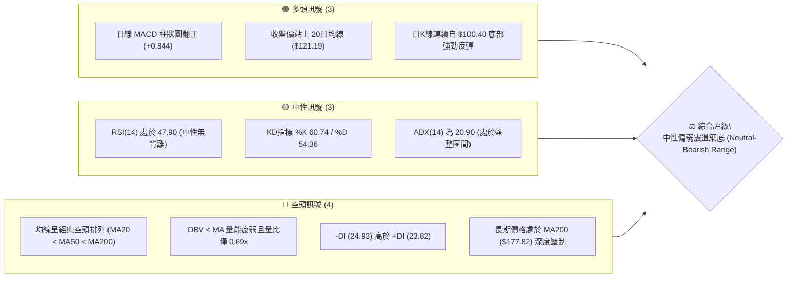
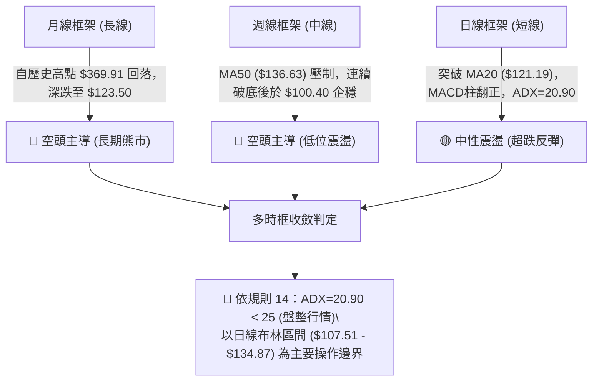
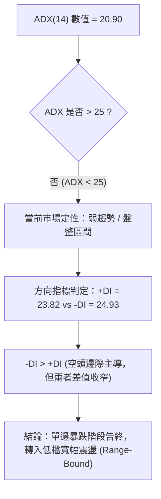
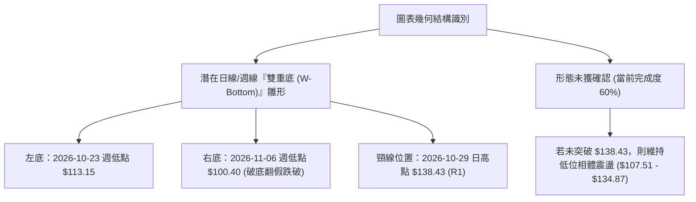
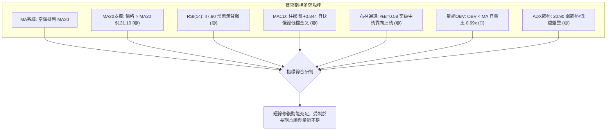
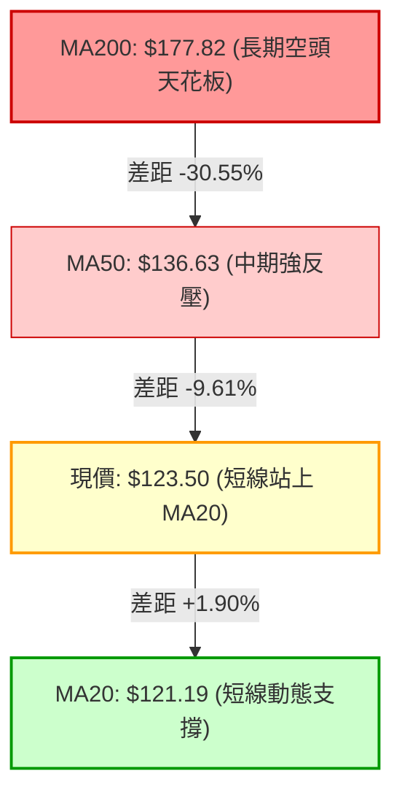
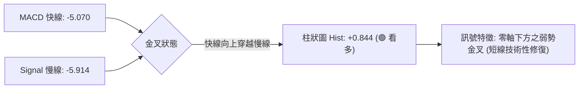
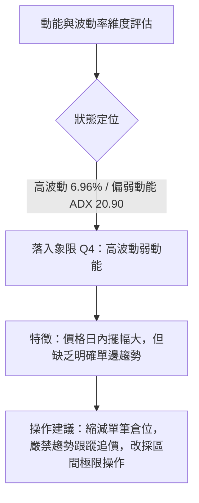
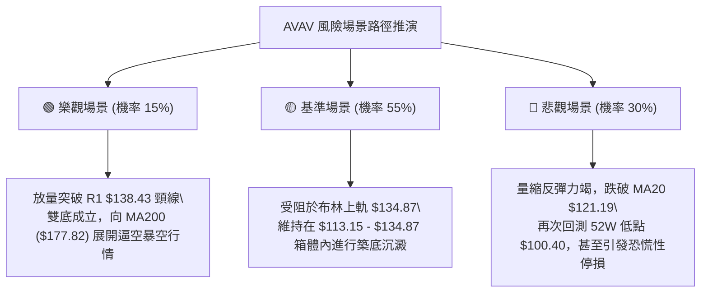

# AVAV 技術分析報告

> **報告日期**：2026-11-11 ｜ **語言**：繁體中文 ｜ **數據來源**：Yahoo Finance ｜ **當前價格**：$123.50

---

## 目錄

| 章節 | 內容 |
|------|------|
| [1. 技術面概覽](#1-技術面概覽) | 訊號儀表板、核心指標、評分卡 |
| [2. 趨勢分析](#2-趨勢分析) | 多時框趨勢、長中短期走勢 |
| [3. 圖表形態分析](#3-圖表形態分析) | 形態識別、K線組合、目標價 |
| [4. 支撐與阻力](#4-支撐與阻力) | 關鍵價位、斐波那契回調 |
| [5. 技術指標深度解讀](#5-技術指標深度解讀) | MA/RSI/MACD/布林/成交量 |
| [6. 動能與波動率](#6-動能與波動率) | 動能評估、ATR、Beta |
| [7. 多時框架總結](#7-多時框架總結) | 時框架評分矩陣 |
| [8. 交易策略建議](#8-交易策略建議) | 多空策略、風險報酬比 |
| [9. 風險提示與監控](#9-風險提示與監控) | 監控指標、風險場景 |

---

## 1. 技術面概覽

### 🎯 技術訊號儀表板



### 📊 核心指標速覽表

| 指標類別 | 指標名稱 | 當前數值 | 訊號 | 解讀 |
|----------|----------|----------|------|------|
| **價格** | 當前收盤價 | $123.50 | 🟡 | 位於52週區間 7.5% 極低位，短線自低點 $100.40 顯著回彈 |
| **均線** | MA20 | $121.19 | 🟢 | 現價位於 MA20 上方 (+1.90%)，短線扭轉極度劣勢 |
| **均線** | MA50 | $136.63 | 🔴 | 現價低於 MA50 (-9.61%)，中期空方下行趨勢壓制沉重 |
| **均線** | MA200 | $177.82 | 🔴 | 現價深度低於 MA200 (-30.55%)，長期空頭格局確立 |
| **動能** | RSI(14) | 47.90 | 🟡 | 處於 30–70 中性常態區間，無超買或超賣，短線動能溫和修復 |
| **動能** | MACD (12,26,9) | -5.070 / -5.914 (柱狀圖 +0.844) | 🟢 | 快慢線位於零軸下但已金叉，柱狀圖正值放大，短線修復買盤增強 |
| **波動** | ATR(14) | $8.60 (6.96%) | 🔴 | 波動度高達近 7%，日內震盪幅度劇烈，交易需放寬止損間距 |
| **趨勢** | ADX(14) | 20.90 (+DI 23.82 / -DI 24.93) | 🟡 | ADX < 25 指示趨勢衰退進入盤整，-DI 微幅領先，空頭仍佔邊際優勢 |
| **通道** | 布林通道 (%B) | %B = 0.58 (中軌 $121.19 / 上軌 $134.87) | 🟢 | 突破中軌向上軌靠攏，短線處於均線通道上半部強勢區 |
| **量能** | 當日量 / 20日均量 | 981,600 / 1,428,865 (量比 0.69x) | 🔴 | 反彈過程成交量明顯萎縮，OBV 疲軟，呈現「量縮價漲」弱勢反彈特徵 |

### 🏆 技術評分卡

```
╔══════════════════════════════════════════════════════════════╗
║                技術評分卡 — AVAV (2026-11-11)                ║
╠══════════════════════════════════════════════════════════════╣
║ 趨勢強度 (Trend)     ██████░░░░░░░░░░░░░░  30/100  🔴 空頭主導  ║
║ 動能指標 (Momentum)  ███████████░░░░░░░░░  55/100  🟡 中性反彈  ║
║ 支撐穩定度 (Support) ██████████░░░░░░░░░░  50/100  🟡 探底初成  ║
║ 成交量配合 (Volume)  ██████░░░░░░░░░░░░░░  30/100  🔴 量能萎縮  ║
║ 形態完整度 (Pattern) ██████████░░░░░░░░░░  50/100  🟡 雙底初型  ║
║ 均線排列 (Moving Avg)████░░░░░░░░░░░░░░░░  20/100  🔴 典型空排  ║
╠══════════════════════════════════════════════════════════════╣
║ 綜合評分 (Overall)   ████████░░░░░░░░░░░░  39/100  🔴 偏空震盪  ║
║ 【計算式】：(30 + 55 + 50 + 30 + 50 + 20) ÷ 6 = 39.17 ≈ 39/100║
╚══════════════════════════════════════════════════════════════╝
```

---

## 2. 趨勢分析

### 🌐 多時框趨勢分析



### 📈 長期趨勢 — 12個月走勢圖（Unicode）

```
AVAV 月線走勢圖（2025-12 至 2026-11）
價格軸 ($)
$300 ┤
$278 ┤            ●(01月:278.39)
$252 ┤            │     ●(02月:252.25)
$241 ┤●(12月:241.89)   │
$207 ┤                 │           ●(05月:207.24)
$195 ┤                 │     ●(04月:195.02)
$183 ┤                 ●(03月:183.05)
$165 ┤                             ●(06月:165.07)
$149 ┤                                   ●(07月:149.37)
$148 ┤                                         ●(08月:148.35)
$142 ┤                                               ●(09月:142.22)
$126 ┤                                                     ●(10月:126.11)
$123 ┤━━━━━━━━━━━━━━━━━━━━━━━━━━━━━━━━━━━━━━━━━━━━━━━━━━━━━━━━━━━●←現價 $123.50 (11月)
     └─────────────────────────────────────────────────────────────────
      12   01    02    03    04    05    06    07    08    09    10    11 (月份)
```

#### 長期月線走勢特徵分析

| 階段區間 | 起止價格 | 漲跌幅 (%) | 趨勢性質 | 價量與動能特徵 |
|----------|----------|------------|----------|----------------|
| **2025-12 ~ 2026-02** | $241.89 → $252.25 | +4.28% | 高位巨震作頂 | 觸及 $278.39 後滯漲，形成雙重頂結構雛形 |
| **2026-02 ~ 2026-03** | $252.25 → $183.05 | -27.43% | 第一波斷崖破位 | 月線長黑摜破 MA200，空方趨勢全面啟動 |
| **2026-03 ~ 2026-05** | $183.05 → $207.24 | +13.22% | 跌破後死貓反彈 | 逢高未能回補上方裂口，最高見 $207.24 後轉折 |
| **2026-05 ~ 2026-10** | $207.24 → $126.11 | -39.15% | 單邊主跌浪推進 | 呈現階梯式陰跌，空頭動能完全控制盤面 |
| **2026-10 ~ 2026-11** | $126.11 → $123.50 | -2.07% | 低位減速築底 | 創下 52 週新低 $100.40 後出現下影線回抽修復 |

### 📊 中期趨勢（週線分析）

中期技術面目前正處於極端超跌後的技術性尋底過程。週線維度在 2026-11-06 該週探至 52 週最低點 $100.40，隨後在近兩週展現抵抗力量，收復至 $123.50。

```
中期週線價格結構與壓力分布圖
══════════════════════════════════════════════════════════════
$168.00 ──────────────────────────────────────── 密集壓力帶 (R3)
$162.30 ──────────────────────────────────────── 波段高點聚類 (R2)
$138.43 ──────────────────────────────────────── 強頸線阻力 (R1)
$136.63 - - - - - - - - - - - - - - - - - - - -  MA50 下行反壓
$123.50 ════════════════════════════════════════ ◄ 當前價格
$121.19 - - - - - - - - - - - - - - - - - - - -  日線 MA20 (布林中軌)
$113.15 ──────────────────────────────────────── 波段低點支撐 (S1)
$100.40 ──────────────────────────────────────── 52週極限低點 (52W Low)
══════════════════════════════════════════════════════════════
```

### ⚡ 趨勢強度評估（ADX 解讀）



#### ADX 趨勢強度對照表

| 指標變數 | 當前讀數 | 區間定義 | 市場狀態評估 | 戰略指導意義 |
|----------|----------|----------|--------------|--------------|
| **ADX(14)** | 20.90 | < 25 (無趨勢/盤整) | 趨勢衰竭，空方主跌浪結束 | 停止盲目追空，轉向區間高拋低吸思維 |
| **+DI(14)** | 23.82 | 20–30 常態區間 | 多方力量正在低位緩步增強 | 顯示反彈動能正在聚集，但尚不足以反轉 |
| **-DI(14)** | 24.93 | 20–30 常態區間 | 空方佔比略高但優勢不明顯 | 空方拋壓釋放接近尾聲，動能進入鈍化期 |

---

## 3. 圖表形態分析

### 🔍 形態識別系統



#### 圖表形態分析表

| 形態名稱 | 信心度 (%) | 判斷依據（引用數據） | 完成度 (%) | 目標價（附計算式） |
|----------|------------|----------------------|------------|--------------------|
| **雙重底雛形 (W-Bottom)** | 55% | 第一次低點聚類於 S1 ($113.15)，第二次急殺探底至 52W 低點 $100.40 隨後快速拉回收紅；頸線為 R1 ($138.43) | 60% | 頸線 $138.43 + 形態深度 ($138.43 - $100.40 = $38.03) = **$176.46**（若突破） |
| **布林通道回升態勢** | 75% | 股價自下軌 $107.51 強彈，突破中軌 $121.19，%B 回升至 0.58 | 85% | 由形態上軌推算：目標為上軌 **$134.87** |

*註：由於股價尚未帶量突破頸線 R1 ($138.43)，雙底形態信心度評定為 55%，若跌破 $100.40 則形態徹底失效。*

### 🕯️ 重要K線形態分析

嚴格依據數據中「近10根日K」與「近8根週K」之開、高、低、收數據進行客觀解讀：

| 週期 | 日期 | 開 | 高 | 低 | 收 | K線形態名稱 | 形態解讀與市場心理 | 訊號方向 |
|------|------|----|----|----|----|-------------|--------------------|----------|
| **日K** | 2026-10-29 | 125.89 | 138.43 | 125.88 | 134.88 | 長紅大陽線 (帶長上影) | 多頭發起爆發性衝擊直逼 R1 ($138.43)，但遭遇解套盤阻力 | 🟢 看多 |
| **日K** | 2026-11-04 | 121.00 | 123.00 | 108.95 | 113.23 | 破位大陰線 | 恐慌盤湧出，單日重挫跌破多條短期支撐，量能急劇放大至 2.79M | 🔴 看空 |
| **日K** | 2026-11-05 | 110.28 | 112.33 | 101.07 | 102.08 | 弱勢下挫光腳陰線 | 空方極度肆虐，盤中摜壓逼近百元整數大關，極度超賣 | 🔴 看空 |
| **日K** | 2026-11-06 | 104.36 | 113.65 | 100.40 | 112.76 | 破底長下影反轉陽線 (Hammer) | 探底 52W 低點 $100.40 觸發技術性買盤狂湧，空頭陷阱成立 | 🟢 看多 |
| **日K** | 2026-11-09 | 114.12 | 128.52 | 111.95 | 126.96 | 強勢反彈長實體陽線 | 吞噬前數日跌幅，直接收復 $126.00 關口，買盤強勢進場推進 | 🟢 看多 |
| **日K** | 2026-11-10 | 123.39 | 126.99 | 121.47 | 123.50 | 縮量十字陰線 (Doji) | 現價面臨 MA20 與布林中軌，買賣雙方出現觀望與平衡，量縮至 0.98M | 🟡 中性 |
| **週K** | 2026-10-30 | 122.39 | 138.43 | 120.35 | 126.11 | 週線長上影倒狀錘頭 | 上攻 $138.43 遭逢空頭猛烈壓制，呈現衝高回落走勢 | 🔴 看空 |
| **週K** | 2026-11-06 | 126.20 | 128.10 | 100.40 | 112.76 | 週線極長下影線 (Pin Bar) | 單週下探 $100.40 極端低點後大幅回抽，確認百元整數大關防禦有效 | 🟢 看多 |

### 📉 ASCII 走勢形態示意圖

```
AVAV 近期日K線形態結構圖 (2026-10-28 至 2026-11-10)
$138.43 ┤        ▲ (頸線 R1 高點)
$135.00 ┤       ╭┴╮
$130.00 ┤     ┌─┤ ├─┐                         ╭─╮
$125.00 ┤  ┌──┼─┤ ├─┼──┬──┐                 ┌─┤ ├─┬──┐
$123.50 ┼──┼──┼─┤ ├─┼──┼──┼─────────────────┼─┤ ├─┼──┼─ ◄ 現價 $123.50
$120.00 ┤  │  │ └─┘ │  │  │  ╭─╮             │ └─┘ │  │
$115.00 ┤  │  │     │  │  │  │ ├─┐           │     │  │
$110.00 ┤  │  │     │  │  │  │ ├─┼──┐        │     │  │
$105.00 ┤  │  │     │  │  │  │ │ │  │  ╭─╮   │     │  │
$100.40 ┤  ┴  ┴     ┴  ┴  ┴  ┴ ┴ ┴  ├─┼─┤ ├──┴─────┴──┴─ ▲ (52W最低點 $100.40)
        └────────────────────────────┴─┴─┴────────────────
         10-28 29   30 11-02 03  04 05  06   09    10 (日期)
         [   高位受阻回落   ]   [ 恐慌破底 ] [ V型強彈收復 ]
```

### 🎯 形態目標價計算

1. **潛在雙重底突破目標價計算**：
   - 形態底部：$100.40 (2026-11-06 實際最低點)
   - 形態頸線：$138.43 (2026-10-29 實際最高點聚類 R1)
   - 形態高度：$H = 138.43 - 100.40 = \$38.03$
   - 突破目標價：$\text{Target} = \text{頸線} + H = 138.43 + 38.03 = \mathbf{\$176.46}$
   - *（註：該數值恰好緊鄰 MA200 之 \$177.82 及 斐波那契 78.6% 回調位 \$166.28 區間）。*

2. **布林通道回升目標價計算**：
   - 通道中軌：$121.19
   - 通道上軌目標：**$134.87** (數據提供之實際數值)

---

## 4. 支撐與阻力

### 🗺️ 關鍵價位分布圖（Unicode）

```
AVAV 價位結構分布圖 (由實際 OHLCV 與歷史數據聚類計算)
══════════════════════════════════════════════════════════════════════
$177.82 ║████████████████████████████████████████║ MA200 長期趨勢防線
$168.00 ║████████████████████████████████        ║ 強阻力 R3 (密集套牢帶)
$166.28 ║▓▓▓▓▓▓▓▓▓▓▓▓▓▓▓▓▓▓▓▓▓▓▓▓▓▓▓▓▓▓▓▓        ║ 斐波那契 78.6% 回調位
$162.30 ║████████████████████████                ║ 阻力 R2 (波段反彈高點聚類)
$138.43 ║████████████████████████████████████████║ 關鍵阻力 R1 (雙底頸線位)
$136.63 ║- - - - - - - - - - - - - - - - - - - - ║ MA50 中期下行壓力
$134.87 ║░░░░░░░░░░░░░░░░░░░░░░░░░░░░░░░░░░░░░░░ ║ 布林通道上軌
$123.50 ╠════════════════════════════════════════╣ ◄ 當前價格 $123.50
$121.19 ║────────────────────────────────────────║ MA20 / 布林中軌支撐
$113.15 ║████████████████████████                ║ 近期關鍵支撐 S1 (週K波段低點聚類)
$107.51 ║░░░░░░░░░░░░░░░░░░░░░░░░░░░░░░░░░░░░░░░ ║ 布林通道下軌支撐
$100.40 ║████████████████████████████████████████║ 52週極限低點 / 終極多頭防線
══════════════════════════════════════════════════════════════════════
```

### 🚧 阻力位分析表

所有價位均嚴格取自數據給定之「關鍵價位」與均線系統：

| 阻力級別 | 價位 ($) | 形成原因與數據依據 | 突破難度 | 重要性 |
|----------|----------|--------------------|----------|--------|
| **R1** | $138.43 | 近一年波段高點聚類、2026-10-29 日高點、日線雙底頸線所在 | 高 | ★★★★★ |
| **R2** | $162.30 | 近一年波段高點聚類、2026-08-21 週高點反壓帶 | 極高 | ★★★★☆ |
| **R3** | $168.00 | 近一年波段高點密集聚類、大跌前籌碼換手平台 | 極高 | ★★★★☆ |

### 🛡️ 支撐位分析表

| 支撐級別 | 價位 ($) | 形成原因與數據依據 | 守住機率 | 重要性 |
|----------|----------|--------------------|----------|--------|
| **S1** | $113.15 | 近一年波段低點聚類、2026-10-23 週K低點支撐 | 65% | ★★★★☆ |
| **52W Low** | $100.40 | 52週極限最低點（2026-11-06 創出之大底防線） | 80% | ★★★★★ |

### 📐 斐波那契回調位分析

依據數據提供之 52 週完整區間（最低點 $100.40 → 最高點 $408.25，總垂直落差 $307.85）進行空間測量：

```
斐波那契回調階梯分布 (52W Range: $100.40 - $408.25)
$408.25 ├── 0.0%  (52W High)
$335.60 ├── 23.6%
$290.65 ├── 38.2%
$254.33 ├── 50.0%
$218.00 ├── 61.8%
$166.28 ├── 78.6%
$123.50 ├── ◄◄◄ 當前收盤價 $123.50 (落於 78.6% 與 100% 之間)
$100.40 └── 100.0% (52W Low)
```

- **位置意義**：現價 $123.50 深處於斐波那契 78.6% ($166.28) 與 100.0% ($100.40) 之間的**極度深水超跌區間**。
- **阻力與目標意義**：未來任何由反轉引發的中長期波段回升，斐波那契 78.6% 回調位 **$166.28** 將是多頭面對的第一座重型堡壘（此價位與波段阻力 R2 $162.30 及 R3 $168.00 高度重疊），未收復 $166.28 前，所有上漲均屬技術性反彈而非長線反轉。

---

## 5. 技術指標深度解讀

### 🎛️ 指標訊號總覽



### 📈 移動平均線排列分析



#### 各期均線走勢數據表

| 均線名稱 | 數值 ($) | 與現價偏差 (%) | 排列狀態 | 趨勢意涵解讀 |
|----------|----------|----------------|----------|--------------|
| **MA5** | $115.71 | +6.74% | 現價於上方 | 極短線連續拉抬，提供超短線快速支撐 |
| **MA10** | $121.21 | +1.89% | 現價於上方 | 短期扣抵低位，形成初步平底支撐 |
| **MA20** | $121.19 | +1.90% | 現價於上方 | 股價重登月線，短線扭轉自 10 月以來的單邊崩跌 |
| **MA50** | $136.63 | -9.61% | 現價於下方 | 中期空頭下壓，對應 R1 ($138.43) 形成複合壓力帶 |
| **MA60** | $139.82 | -11.67% | 現價於下方 | 季線下彎，中線反彈空間受限 |
| **MA120** | $153.78 | -19.69% | 現價於下方 | 半年線持續走低，沉重套牢籌碼帶 |
| **MA200** | $177.82 | -30.55% | 現價於下方 | 年線重挫，確立自 2025-10 高點以來的熊市構造 |
| **MA240** | $196.17 | -37.04% | 現價於下方 | 超長期均線下傾，尚未出現扭轉跡象 |

### 📉 RSI(14) 分析

- **RSI(14) 當前數值**：**47.90**
- **數值進度條**：
  ```
  [0] ░░░░░░░░░░░░░░░░░░░░████████████████████████░░░░░░░░░░░░░░░░░░░░ [100]
                          ^ 47.90 (中性區間 30-70)
  ```
- **區間評估**：RSI 脫離 10 月中旬的嚴重超賣區（2026-10-16 週 RSI 為 28.6），回升至 47.90，說明空方拋售潮已獲舒緩，目前處於中性水準，多空未達過熱或極度耗竭。
- **背離判斷**：數據明確標示「RSI 背離：無明顯背離」。比對近 20 根 K 棒，價格自 $100.40 反彈伴隨 RSI 由低位回升，指標與價格波動步調一致，並無頂背離或底背離跡象。

### 📊 MACD(12/26/9) 訊號解讀



- **MACD 線**：-5.070
- **信號線 (Signal)**：-5.914
- **柱狀圖 (Histogram)**：+0.844 (🟢 呈現多頭擴張)
- **指標解讀**：MACD 在負值深處完成金叉，柱狀圖連續回升至正值區間 (+0.844)。此為典型的「低位超跌反彈訊號」，暗示空方動能暫時退潮，多方短線掌握發球權，但因雙線深埋於零軸之下，中長線仍受制於空方大環境。

### 📦 布林通道分析

```
布林通道結構與現價相對位置 (20日, 2σ)
═════════════════════════════════════════════════════════════════
$134.87 ┬────────────────────────────────────────── 布林上軌 (阻力帶)
        │
        │
$123.50 ┼──────────────────●現價 ($123.50, %B = 0.58)
        │
$121.19 ┼────────────────────────────────────────── 布林中軌 (MA20支撐)
        │
        │
$107.51 ┴────────────────────────────────────────── 布林下軌 (防守區)
═════════════════════════════════════════════════════════════════
```

- **通道參數**：上軌 $134.87 ｜ 中軌 $121.19 ｜ 下軌 $107.51
- **通道指標**：%B = 0.58
- **特徵解讀**：現價已由下軌反彈並站上中軌 $121.19（%B 自低於 0 回升至 0.58），布林通道呈現收斂後略為走平態勢。在 ADX < 25 的盤整市況下，布林通道上軌 **$134.87** 與中軌 **$121.19** 構成了現階段最重要的上下擺動軌道。

### 💹 成交量分析（量價配合度）

- **最新成交量**：981,600 股
- **20日均量**：1,428,865 股（**量比：0.69x**）
- **50日均量**：1,809,736 股
- **量價背離分析**：現價自 11 月 6 日反彈至 11 月 10 日，成交量由 2.79M (11-04) 降至 1.59M (11-06)，再萎縮至今日的 0.98M。
- **OBV 趨勢**：數據明確指示「OBV < MA → 量能疲弱」。
- **結論**：本次價格反彈呈現「**量價背離**」現象，反彈伴隨成交量衰減，顯示買盤追價意願不足，主要由空頭回補帶動，上行空間在缺乏增量資金介入下易在阻力位受阻。

---

## 6. 動能與波動率

### ⚡ 動能評估四象限



#### 動能評估四象限對照表

| 象限代號 | 動能強度 (ADX/RSI) | 波動率水準 (ATR/Beta) | 當前狀態吻合度 | 操作指導與評估 |
|----------|--------------------|-----------------------|----------------|----------------|
| **Q1** | 強 (ADX > 25) | 低 (ATR < 4%) | — | 最佳順勢加碼時機 |
| **Q2** | 弱 (ADX < 25) | 低 (ATR < 4%) | — | 低波盤整，耐心觀望突破 |
| **Q3** | 強 (ADX > 25) | 高 (ATR > 6%) | — | 高風險高回報之主升/主跌浪 |
| **Q4** | **弱 (ADX = 20.90)** | **高 (ATR = 6.96%)** | **✓ 符合當前格局** | **避免過度進場，控制風險敞口與止損距離** |

### 📊 ATR 波動率分析

- **ATR(14) 數值**：**$8.60**
- **價格佔比**：**6.96%** (相較現價 $123.50，屬於極高波動度標的)
- **交易止損設計考量**：
  - 由於單日平均自然波動區間達 $8.60，短線止損若設置小於 1.0 倍 ATR（即小於 $8.60），極易被日內隨機雜訊掃出場。
  - **建議止損距離**：短線策略應保留至少 **1.2 ~ 1.5 倍 ATR**（約 **$10.32 ~ $12.90**）之安全緩衝，或以關鍵技術結構點（如 S1 $113.15）為錨定。

### 📐 Beta 與市場相關性

- **Beta 係數**：**1.403**
- **市場特徵分析**：
  - AVAV 對標普 500 指數具備顯著的高敏感性 (Beta > 1.4)，在大盤波動時具有 1.4 倍的放大效應。
  - 近期走勢（新聞提示：AeroVironment Suffers a Larger Drop Than the General Market）充分反映其在市場下行週期中的高 Beta 下殺特徵，因此任何進場必須嚴格配合總體市場情緒。

---

## 7. 多時框架總結

### 📋 時框架評分表

| 時框架 | 趨勢方向 | 動能表現 | 均線排列狀態 | 圖表形態特徵 | 綜合評分 | 建議策略 |
|--------|----------|----------|--------------|--------------|----------|----------|
| **月線 (長期)** | 🔴 強烈空頭 | 弱 (連陰下挫) | 空頭排列 (破 MA200) | 自歷史高點 $369.91 單邊回吐 | 20/100 | 長期資金嚴格觀望 |
| **週線 (中期)** | 🔴 偏空格局 | 弱 (超賣反抽) | 空頭壓制 (MA50 下壓) | 52W 低點 $100.40 測試反彈 | 35/100 | 逢高減磅，防守反抽 |
| **日線 (短期)** | 🟡 震盪築底 | 中性偏強 (MACD金叉) | 短期均線站上 MA20 | 雙底雛形/布林中軌回升 | 55/100 | 區間操作，嚴控停損 |

### 🔲 綜合訊號矩陣

```
訊號維度矩陣一致性檢驗
══════════════════════════════════════════════════════════
維度       短期 (日線)       中期 (週線)       長期 (月線)
──────────────────────────────────────────────────────────
均線系統   🟢 站上 MA20      🔴 壓制於 MA50    🔴 遠低於 MA200
動能指標   🟢 MACD柱轉正     🟡 RSI低檔回升    🔴 下行衰竭中
趨勢指標   🟡 ADX=20.90盤整  🔴 趨勢偏空下行   🔴 熊市格局
量價配合   🔴 縮量反彈       🔴 週量萎縮       🔴 OBV 走弱
══════════════════════════════════════════════════════════
收斂狀態：日線短多訊號與中長期空頭強烈衝突
```

### ⚖️ 多時框收斂結論

嚴格遵循「**嚴格要求 14：多時框收斂規則**」：
1. **行情定性**：當前 ADX(14) 數值為 **20.90**，明確小於 25，判定市場處於**弱趨勢 / 盤整行情 (Range-Bound)**。
2. **操作指引**：在 ADX < 25 的盤整結構中，依規則 14 不宜依據單邊趨勢強行突破，而應**以日線布林通道上下軌 ($107.51 – $134.87) 為主要交易區間**。
3. **時框衝突權衡**：日線短期的 MACD 金叉與站上 MA20 僅代表「超跌反彈」，並未瓦解中長期週線與月線的空頭壓制；但因 ADX 顯示空方單邊主跌浪已暫停，空頭亦無立即追空價值。
4. **唯一方向性結論**：**中性偏空區間震盪（Neutral-to-Bearish Consolidation）**。

---

## 8. 交易策略建議

### 🗺️ 策略決策流程圖

```mermaid
graph TD
    A["當前綜合評分 = 39/100 (≤ 40)"] --> B["依規則 18 路由器分流：主推【偏空/反彈受阻放空】防禦策略"]
    B --> C{"短線是否上探布林上軌或阻力位？"}
    C -->|"觸及上軌 $134.87 或 R1 $138.43"| D["策略 A：阻力區逢高做空 (高勝率反抽沽空)"]
    C -->|"跌破短線防守點 MA20 $121.19"| E["策略 B：破位順勢加空 (跌破中軌追空)"]
    B --> F["反向做多僅列為超跌反彈風險觸發，不作主推"]
```



### 🧭 策略路由（依評分卡分流）

> **當前主策略方向 = 偏空高拋 / 區間阻力防禦（依評分 39/100 ≤ 40）**
> 
> *註：依規定，綜合評分為 39/100，落於 ≤ 40 之偏空區間，主推逢高放空與防守策略；多頭僅列為反轉對沖提示。*

### 🎯 價格情境階梯（Price Scenarios）

所有價位均嚴格引用自「第 4 章」及數據源中的 OHLCV 計算結果：

| 觸發條件 | 下一目標 | 後續延伸 | 情境含義 |
|----------|----------|----------|----------|
| **向上突破 R1 $138.43** | R2 $162.30 | R3 $168.00 | 短線徹底轉強，雙底成立，反彈向斐波那契 78.6% 延伸 |
| **受阻於布林上軌 $134.87** | MA20 $121.19 | S1 $113.15 | 承壓回落，延續布林軌道內寬幅箱體震盪 |
| **跌破波段支撐 S1 $113.15** | 52W Low $100.40 | 下方無數據支撐 | 中期破底風險爆發，空頭主跌浪重新啟動 |

### 📊 情境機率分佈

| 情境類別 | 機率預估 (%) | 主要依據（指標狀態引用） |
|----------|--------------|--------------------------|
| **情境一：受阻回落 / 偏空震盪** | **55%** | MA20<MA50<MA200 空頭排列、OBV 疲軟、量比 0.69x 量縮反彈難以攻克 R1 |
| **情境二：布林區間橫盤拉鋸** | **30%** | ADX(14) = 20.90 (<25) 顯示無單邊趨勢，MACD 柱狀圖維持紅柱支撐 |
| **情境三：強勢向上突破反轉** | **15%** | 必須伴隨成交量突破 2.5M 且實體收盤站穩 R1 $138.43，目前缺乏量能配合 |

### 🔴 主策略詳情（空頭防守與反抽沽空）

*依規則 17 計算：風險報酬比 = (進場價 − 目標價 T1) ÷ (止損價 − 進場價)*

| 策略要素 | 策略 A：阻力區逢高沽空 (主策略) | 策略 B：跌破中軌順勢追空 (次策略) |
|----------|----------------------------------|------------------------------------|
| **策略類型** | 關鍵阻力受阻沽空 (R1 / BB上軌) | 跌破日線支撐追空 (Breakdown) |
| **進場條件** | 反彈至布林上軌或 R1 附近出現長上影線滯漲 | 日K收盤跌破 MA20 ($121.19) 確認支撐失效 |
| **進場價格** | **$134.87** (布林上軌精確價位) | **$121.19** (MA20 精確價位) |
| **止損價格** | **$138.43** (突破 R1 止損出局) | **$126.11** (10-30收盤價阻力位) |
| **目標價 T1** | **$121.19** (日線 MA20 / 布林中軌) | **$113.15** (波段支撐 S1) |
| **目標價 T2** | **$113.15** (波段支撐 S1) | **$100.40** (52週最低點) |
| **風險報酬比** | **1 : 3.84（以 T1 計）**<br>*(134.87-121.19)÷(138.43-134.87) = 13.68÷3.56 = 3.84* | **1 : 1.63（以 T1 計）**<br>*(121.19-113.15)÷(126.11-121.19) = 8.04÷4.92 = 1.63* |
| **目標 T2 比值** | 1 : 6.10（以 T2 計，價差21.72÷3.56） | 1 : 4.23（以 T2 計，價差20.79÷4.92） |
| **成功機率** | 60% | 55% |
| **建議倉位** | 10% - 15% | 5% - 10% |

### 🟢 反向風險觸發點（對沖與止損提示）

若出現以下訊號，空頭策略必須**無條件即刻平倉停損**，並啟動反向防禦：
1. **收盤站上 R1 ($138.43)**：若日K線以高於 1.8M 之成交量帶實體突破 $138.43，宣告日線雙底正式構築完成，目標將指向 **$176.46** 及 MA200 ($177.82)。
2. **MACD 雙線重返零軸上方**：若日線快慢線突破 0 軸，指示中期趨勢轉向多頭控制。

### ⭐ 整體訊號強度評星

```
做多訊號強度：★★☆☆☆  (2/5星 — 僅屬低位超跌反抽，缺乏均線與量能背書)
做空訊號強度：★★★★☆  (4/5星 — 長期空排壓制，量價背離，符合主趨勢)
整體可信度：  ★★★☆☆  (3/5星 — 處於 ADX<25 震盪期，價位易反覆拉鋸)
```

---

## 9. 風險提示與監控

### ✅ 關鍵監控指標 Checklist

```
╔══════════════════════════════════════════════════════════════════╗
║                    交易風險與關鍵指標監控清單                    ║
╠══════════════════════════════════════════════════════════════════╣
║ [ ] 監控 MA20 動態防守：現價 $123.50 是否能守穩於 $121.19 之上  ║
║ [ ] 監控頸線壓力 R1：價格觸及 $138.43 時的量價反應 (是否放量突破)║
║ [ ] 監控量能指標：單日成交量能否超過 20日均量 (1,428,865 股)     ║
║ [ ] 監控 OBV 狀態：OBV 是否能自低檔向上金叉其均線               ║
║ [ ] 監控布林通道軌道：%B 是否突破 1.0 (上軌 $134.87) 或回落跌破中軌║
║ [ ] 監控 52W 極限防線：若再探 $100.40 是否出現二次背離支撐       ║
╚══════════════════════════════════════════════════════════════════╝
```

### ⚠️ 風險場景分析



### 🛡️ 風險管理重要提醒

1. **ATR 劇烈波動風險**：AVAV 目前 ATR 高達 **$8.60**（佔股價 6.96%），日振幅極為猛烈。嚴禁使用高槓桿，建議將單筆交易承擔之資金風險控制在總資產的 1% 至 1.5% 以內。
2. **高 Short Interest 與軋空風險**：數據顯示該股空頭比例達 **13.0% Float**（Short Ratio 3.25）。在高空頭部位背景下，一旦公司發布利多消息（如近期公告之多年度國防合約）極易誘發暴力軋空（Short Squeeze），放空者務必將止損點堅決設於 **$138.43 (R1)**，嚴禁扛單。
3. **流動性折價風險**：目前日成交量僅 98 萬股，低於 20日均量 142 萬股，流動性收縮會放大買賣滑價（Slippage），大單操作應分批進出。

---

## 📋 報告總結

```
╔══════════════════════════════════════════════════════════════════╗
║                   AVAV 技術分析報告總結                          ║
╠══════════════════════════════════════════════════════════════════╣
║ 報告日期：2026-11-11                                             ║
║ 當前價格：$123.50                                                ║
║ 綜合評分：39 / 100 (六項指標均值，規則 18)                      ║
║ 分析評級：⚖️ 偏空震盪 / 區間防禦 (Neutral-to-Bearish Consolidation)║
║                                                                  ║
║ 關鍵維度結論：                                                   ║
║ ├─ 長期趨勢：🔴 空頭主導 (低於 MA200 $177.82，年跌幅深重)       ║
║ ├─ 中期趨勢：🔴 弱勢反彈 (受制於 MA50 $136.63 與頸線 R1 $138.43)║
║ ├─ 短期趨勢：🟡 超跌修復 (站上 MA20 $121.19，MACD柱 +0.844)     ║
║ ├─ 關鍵支撐：S1 $113.15 ｜ 終極底線 52W Low $100.40              ║
║ ├─ 關鍵阻力：布林上軌 $134.87 ｜ 雙底頸線 R1 $138.43             ║
║ └─ 機構共識：分析師平均目標價 $212.20 (低標 $148.57 / 高標 $315) ║
║                                                                  ║
║ 最優操作策略路由：                                               ║
║ 1. 🥇 最佳機會 (主策略)：反彈至布林上軌 $134.87 受阻建立防禦空單，║
║    嚴格止損於 $138.43，目標看向 $121.19 及 $113.15 (風報比 1:3.84)║
║ 2. 🥈 次選機會：跌破 MA20 $121.19 順勢跟進做空，目標 $113.15     ║
║ 3. 🥉 保守選擇：空手觀望，靜待股價放量突破 R1 $138.43 確認雙底， ║
║    或回踩 $100.40 不破形成二次大底後再行進場。                  ║
╚══════════════════════════════════════════════════════════════════╝
```

---

> ⚠️ **免責聲明**：本報告為技術分析研究，所有數據、圖表及推算均嚴格基於所提供的歷史交易資訊。本報告**僅供研究與學術參考**，**不構成任何形式的投資要約或決策建議**。金融市場具有高度風險，交易者應獨立評估自身的風險承受能力。

---

*報告生成時間：2026-11-11 ｜ 數據來源：Yahoo Finance ｜ 分析框架：多時框技術分析體系*