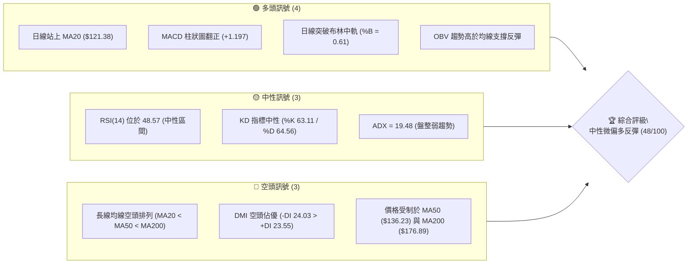
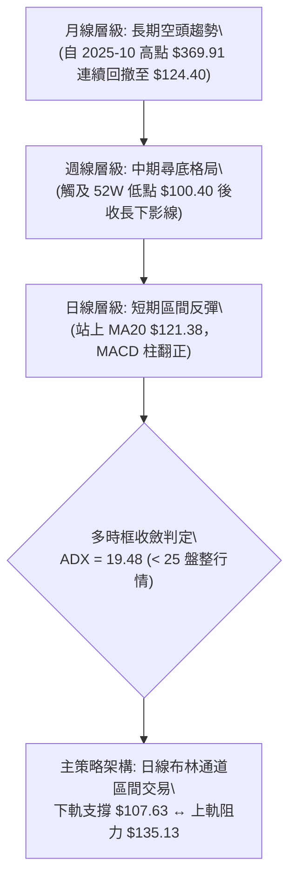
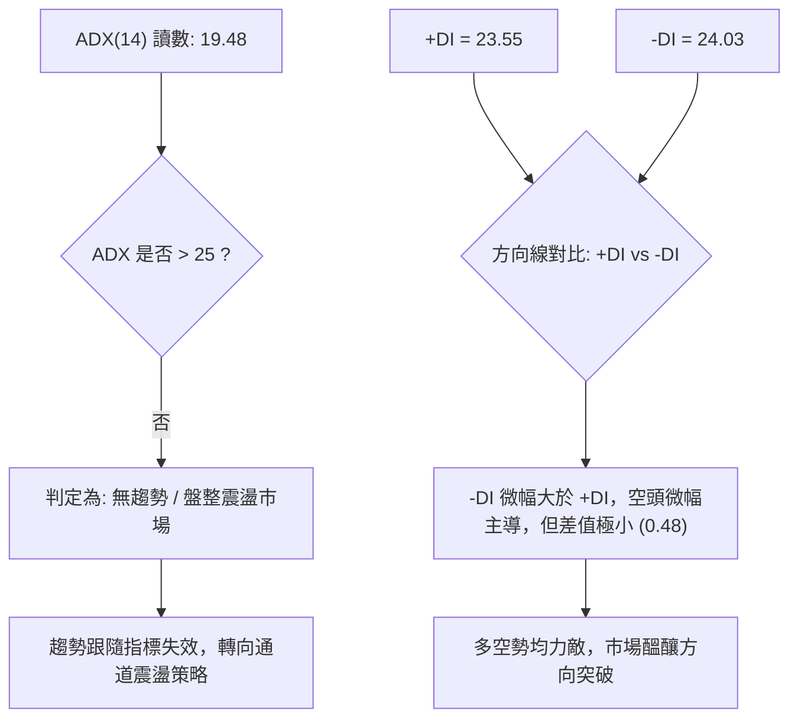
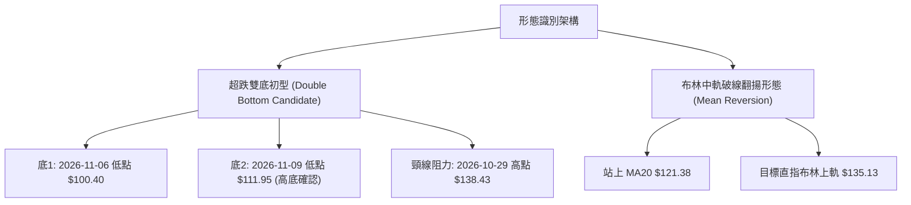
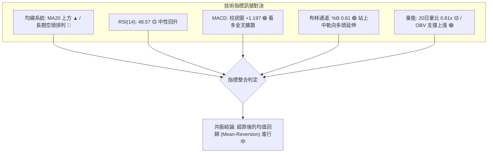
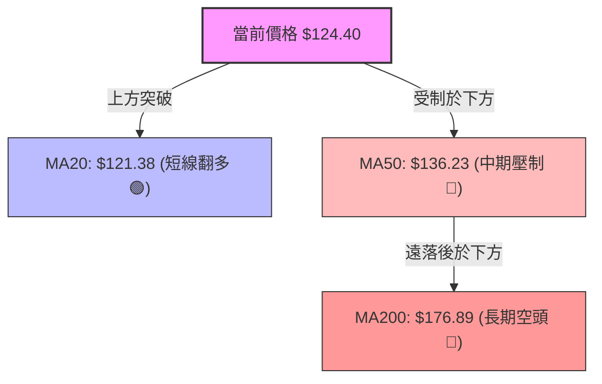
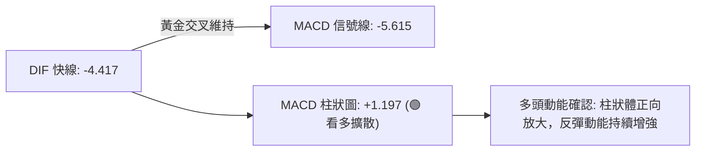
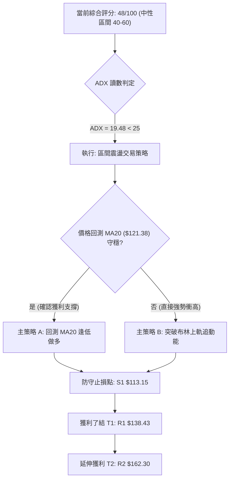
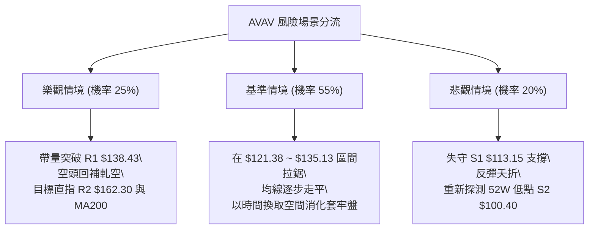

# AVAV 技術分析報告

> **報告日期**：2026-11-12 ｜ **語言**：繁體中文 ｜ **數據來源**：Yahoo Finance ｜ **當前價格**：$124.40

---

## 目錄

| 章節 | 內容 |
|------|------|
| [1. 技術面概覽](#1-技術面概覽) | 訊號儀表板、核心指標、評分卡 |
| [2. 趨勢分析](#2-趨勢分析) | 多時框趨勢、長中短期走勢 |
| [3. 圖表形態分析](#3-圖表形態分析) | 形態識別、K線組合、目標價 |
| [4. 支撐與阻力](#4-支撐與阻力) | 關鍵價位、斐波那契回調 |
| [5. 技術指標深度解讀](#5-技術指標深度解讀) | MA/RSI/MACD/布林/成交量 |
| [6. 動能與波動率](#6-動能與波動率) | 動能評估、ATR、Beta |
| [7. 多時框架總結](#7-多時框架總結) | 時框架評分矩陣 |
| [8. 交易策略建議](#8-交易策略建議) | 多空策略、風險報酬比 |
| [9. 風險提示與監控](#9-風險提示與監控) | 監控指標、風險場景 |

---

## 1. 技術面概覽

### 🎯 技術訊號儀表板



### 📊 核心指標速覽表

| 指標類別 | 指標名稱 | 當前數值 | 訊號 | 解讀 |
|----------|----------|----------|:----:|------|
| **價格** | 當前收盤價 | $124.40 | 🟡 | 位於52週區間7.8%處，短線自低點$100.40強勁反彈 |
| **均線** | MA20 | $121.38 | 🟢 | 現價高於 MA20，短線動能改善，轉為短線支撐 |
| **均線** | MA50 | $136.23 | 🔴 | 現價位於 MA50 下方約 8.68%，中期承壓 |
| **均線** | MA200 | $176.89 | 🔴 | 現價遠低於 MA200 約 29.67%，長期架構為空頭 |
| **動能** | RSI(14) | 48.57 | 🟡 | 脫離超賣區，回升至中性區，無頂底背離跡象 |
| **動能** | MACD | -4.417 | 🟢 | 快線高於慢線 (-5.615)，柱狀圖 +1.197 看多擴散 |
| **趨勢** | ADX(14) | 19.48 | 🟡 | ADX < 25，屬於無明顯單邊趨勢的盤整行情 |
| **通道** | 布林通道 %B | 0.61 | 🟢 | 突破中軌 $121.38，向布林上軌 $135.13 靠攏 |
| **波動** | ATR(14) | $8.28 | 🟡 | 波動率達股價 6.66%，日內振幅偏大，風險溢價高 |

### 🏆 技術評分卡

```
╔══════════════════════════════════════════════════════════════╗
║                技術評分卡 — AVAV (2026-11-12)                ║
╠══════════════════════════════════════════════════════════════╣
║ 趨勢強度 (ADX=19.48, 空頭排列)  ███████░░░░░░░░░░░░░  35/100 🔴 ║
║ 動能指標 (MACD翻正, RSI=48.57)   █████████████░░░░░░░  65/100 🟢 ║
║ 支撐穩定度 (守住52W低點S1驗證)  ████████████░░░░░░░░  60/100 🟡 ║
║ 成交量配合 (OBV翻揚, 量比0.81x) ██████████░░░░░░░░░░  50/100 🟡 ║
║ 形態完整度 (雙底初型, 頸線未破) ██████████░░░░░░░░░░  50/100 🟡 ║
║ 均線排列 (空頭排列, 但站上MA20) ██████░░░░░░░░░░░░░░  30/100 🔴 ║
╠══════════════════════════════════════════════════════════════╣
║ 綜合評分 (六項算術平均)        █████████░░░░░░░░░░░  48/100 🟡 ║
║ 評級結論：中性區間震盪（空頭趨勢中的超跌反彈階段）           ║
╚══════════════════════════════════════════════════════════════╝
```

*計算依據：(35 + 65 + 60 + 50 + 50 + 30) ÷ 6 = 48.33，四捨五入為 48/100。*

---

## 2. 趨勢分析

### 🌐 多時框趨勢分析



### 📈 長期趨勢 — 12個月走勢圖（Unicode）

```
AVAV 月線走勢圖（過去12個月：2025-12 至 2026-11）
價格軸 ($)
$300 ┤
$280 ┤ ●(2026-01: $278.39)
$260 ┤    ●(2026-02: $252.25)
$240 ┤●(2025-12: $241.89)
$220 ┤
$200 ┤          ●(2026-04: $195.02)  ●(2026-05: $207.24)
$180 ┤       ●(2026-03: $183.05)
$160 ┤                                  ●(2026-06: $165.07)
$140 ┤                                        ●(07: $149) ●(08: $148) ●(09: $142)
$120 ┤                                                                   ●(10: $126) ●(現在: $124.40)
$100 ┤                                                                                ●(低點: $100.40)
     └─┬────┬────┬────┬────┬────┬────┬────┬────┬────┬────┬────┬─
      12M  01M  02M  03M  04M  05M  06M  07M  08M  09M  10M  11M
```

#### 過去12個月歷史走勢特徵分析表

| 階段區間 | 起訖月份 | 起點收盤 | 終點收盤 | 區間漲跌幅 | 主要走勢特徵 |
|----------|----------|----------|----------|:----------:|--------------|
| 高檔振盪期 | 2025-12 ~ 2026-02 | $241.89 | $252.25 | +4.28% | 在 $240~$280 間高檔構築次級頭部 |
| 首波殺跌期 | 2026-02 ~ 2026-03 | $252.25 | $183.05 | -27.43% | 出現斷崖式下跌，跌破關鍵心理支撐 |
| 弱勢抵抗期 | 2026-03 ~ 2026-05 | $183.05 | $207.24 | +13.21% | 反彈測試 $200 心理關卡，動能衰竭 |
| 單邊下行期 | 2026-05 ~ 2026-10 | $207.24 | $126.11 | -39.15% | 形成典型下降階梯，成交量萎縮陰跌 |
| 觸底反彈期 | 2026-10 ~ 2026-11 | $126.11 | $124.40 | -1.36% | 下探 52W 低點 $100.40 後強力抽腳回升 |

### 📊 中期趨勢（週線分析）

中期走勢顯示，AVAV 自 2026 年 8 月高點 $192.81 一路下挫，週線 RSI 一度跌至 2026-10-16 的極端低值 28.6，隨後在 2026-11-06 當週打出最低價 $100.40（週K收 $112.76），並於次週（2026-11-11）收復至 $124.40，週線 MACD 柱狀圖同步由負值翻揚至 +1.197，確認短期底部初步成形。

```
週線支撐阻力結構示意：
$168.00 ────────────────────────────────────────── 阻力 R3
$162.30 ────────────────────────────────────────── 阻力 R2
$138.43 ────────────────────────────────────────── 阻力 R1 (2026-10-30 週高點)
$124.40 ══════════════════════════════════════════ 【當前現價】
$113.15 ────────────────────────────────────────── 支撐 S1 (2026-10-23 週低點)
$100.40 ────────────────────────────────────────── 52W 低點 (強支撐)
```

### ⚡ 趨勢強度評估（ADX 解讀）



#### ADX 強度對照與解讀表

| 指標變數 | 當前讀數 | 門檻區間 | 市場含義 | 操作啟示 |
|----------|:--------:|----------|----------|----------|
| **ADX(14)** | 19.48 | < 20 極弱趨勢 / 盤整 | 單邊走勢已停滯，價格進入收斂整理區間 | 避免追高殺跌，以布林通道與支撐阻力進行高拋低吸 |
| **+DI** | 23.55 | 基準動能 | 多頭進攻力道正從低位修復擴大 | 多方逐步聚積動能，需觀察是否上穿 25 |
| **-DI** | 24.03 | 基準動能 | 空方施壓力道自前期主導地位大幅減弱 | 空頭殺跌動能衰退，恐慌拋壓已獲吸收 |

---

## 3. 圖表形態分析

### 🔍 形態識別系統



#### 形態識別與信心度評估表

| 形態名稱 | 信心度 | 判斷依據（引用數據） | 完成度 | 目標價（附計算式） |
|----------|:------:|----------------------|:------:|--------------------|
| **微型雙重底 (W底)** | 55% | 2026-11-06 觸底 $100.40 後反彈，2026-11-09 回測低點 $111.95 未破前低，確立抬高底部結構 | 60% | 依形態推算：頸線 R1 $138.43 + 形態高度 ($138.43 − $100.40 = $38.03) = **$176.46**（接近 MA200 $176.89） |
| **布林通道破下軌翻多** | 70% | 2026-11-05 跌破布林下軌（$107.63）後於 11-06 探底 $100.40，隨後連續大陽線站回布林中軌 $121.38 | 90% | 依通道理論目標推算：布林上軌 = **$135.13** |

*註：由於 ADX 為 19.48，大型頭肩底等幾何結構尚未形成，以上微型 W 底信心度標註為 55%，主要交易仍以布林通道修復之指標形態（70% 信心度）為主。*

### 🕯️ 重要K線形態分析

根據提供之「近10根日K」與「近8根週K」四價，進行嚴謹形態辨識：

| 日期（日K/週K） | 開 | 高 | 低 | 收 | K線形態 | 解讀 | 訊號 |
|------------------|:----:|:----:|:----:|:----:|---------|------|:----:|
| **2026-11-04 (日K)** | 121.00 | 123.00 | 108.95 | 113.23 | 大陰帶長下影線 | 伴隨 2,795,000 大量恐慌拋售，空方力竭 | 🔴 |
| **2026-11-05 (日K)** | 110.28 | 112.33 | 101.07 | 102.08 | 空頭光頭陰線 | 加速趕底，收盤收在最低點附近 | 🔴 |
| **2026-11-06 (日K)** | 104.36 | 113.65 | 100.40 | 112.76 | **長下影錘頭陽線** | 盤中探 52W 新低 $100.40 後強烈抽腳收陽，反轉訊號 | 🟢 |
| **2026-11-09 (日K)** | 114.12 | 128.52 | 111.95 | 126.96 | **強勢大陽長紅棒** | 跳空高開高走，實體完全吞噬前兩日陰線，啟動反彈 | 🟢 |
| **2026-11-10 (日K)** | 123.39 | 126.99 | 121.47 | 123.50 | 高檔十字星/陀螺頂 | 在 MA20 ($121.38) 上方震盪整理，消化浮額 | 🟡 |
| **2026-11-11 (日K)** | 126.37 | 127.67 | 123.84 | 124.40 | 窄幅收縮小陰棒 | 波動率收縮，守穩於 MA20 之上，蓄勢待發 | 🟡 |
| **2026-11-06 (週K)** | 126.20 | 128.10 | 100.40 | 112.76 | **極長下影線週錘頭** | 8,672,900 週巨量於 $100.40 爆出，主力資金抄底進場 | 🟢 |
| **2026-11-11 (週K)** | 114.12 | 128.52 | 111.95 | 124.40 | **強勁反彈中陽線** | 週線實體翻揚，低點 $111.95 明顯高於前週 $100.40 | 🟢 |

### 📉 ASCII 走勢形態示意圖

```
AVAV 近期底部反轉形態示意圖 (日線層級)
價格 ($)
$138.43 ┼───────────────────────────────● (頸線 R1 / 10-29 高點)
        │                              ╱ ╲
$130.00 ┤                             ╱   ╲
        │                            ╱     ● (10-30 收 $126.11)
$124.40 ┼───────────────────────────┼───────★【現價 $124.40】
        │                          ╱         ▲ 站上 MA20
$120.00 ┤                         ╱           │ (11-09 大陽線 $126.96)
        │                        ╱            │
$110.00 ┤        ● (11-04 破位)  ╱             ● (11-09 底2 $111.95)
        │       ╱ ╲            ╱
$100.40 ┴──────●───┴──────────●──────────────────────────────
           (11-05 $102)     (11-06 底1 $100.40 錘頭)
```

### 🎯 形態目標價計算

根據微型 W 底形態學測幅：
1. **底部低點基準**：2026-11-06 盤中創下的波段低點 $100.40。
2. **頸線確認位置**：2026-10-29 形成的波段反彈高點 R1 $138.43。
3. **形態垂直高度**：$138.43 − $100.40 = **$38.03**。
4. **理論突破測幅目標**：頸線 $138.43 + 形態高度 $38.03 = **$176.46**。
   *(註：此推算目標價與長週期均線 MA200 $176.89 產生高度技術共振。)*

---

## 4. 支撐與阻力

### 🗺️ 關鍵價位分布圖（Unicode）

```
AVAV 價位結構分布圖
══════════════════════════════════════════════════════════════
$176.89 ║██████████████████████████████║ MA200 長期趨勢壓力線
$168.00 ║████████████████████████      ║ 強阻力 R3 (近一年波段高點)
$166.28 ║░░░░░░░░░░░░░░░░░░░░░░░░      ║ 斐波那契 78.6% 回調位
$162.30 ║██████████████████            ║ 阻力 R2 (波段密集高點)
$138.43 ║████████████████████████      ║ 關鍵阻力 R1 / W底頸線
$135.13 ║░░░░░░░░░░░░░░░░              ║ 布林通道上軌
$124.40 ╠══════════════════════════════╣ ◄ 當前收盤價 ($124.40)
$121.38 ║▓▓▓▓▓▓▓▓▓▓▓▓▓▓▓▓              ║ 布林中軌 / MA20 短線防守線
$113.15 ║████████████████              ║ 支撐 S1 (近期波段低點)
$107.63 ║░░░░░░░░░░░░                  ║ 布林通道下軌
$100.40 ║██████████████████████████████║ 強支撐 S2 (52週最低點 / 斐波 100%)
══════════════════════════════════════════════════════════════
```

### 🚧 阻力位分析表

所有阻力位嚴格引用系統計算之波段聚類數值：

| 阻力級別 | 價位 | 形成原因 | 突破難度 | 重要性 |
|----------|:----:|----------|:--------:|:------:|
| **R1** | $138.43 | 近一年波段高點聚類、2026-10-29 日高點、W底頸線位置 | 🟡 中等 | ★★★★☆ |
| **R2** | $162.30 | 近一年波段高點聚類、2026-08 下旬平台套牢區間 | 🔴 高 | ★★★☆☆ |
| **R3** | $168.00 | 近一年波段高點聚類、鄰近斐波那契 78.6% ($166.28) | 🔴 極高 | ★★★★☆ |

### 🛡️ 支撐位分析表

所有支撐位嚴格引用系統計算之波段聚類數值與歷史關鍵低點：

| 支撐級別 | 價位 | 形成原因 | 守住機率 | 重要性 |
|----------|:----:|----------|:--------:|:------:|
| **S1** | $113.15 | 近一年波段低點聚類、2026-10-23 週K低點、2026-11-09 日K開盤防守區 | 🟢 70% | ★★★★☆ |
| **S2 (強支撐)** | $100.40 | 52週歷史最低點 (2026-11-06 盤中低點)、斐波那契 100.0% 絕對底部 | 🟢 85% | ★★★★★ |
| **S3** | N/A（數據未提供） | 數據中未偵測到更低支撐層級 | N/A | N/A |

### 📐 斐波那契回調位分析

依據 52 週區間波段（高點 $408.25 至低點 $100.40，垂直落差 $307.85）之精確計算分佈：

| 回調比率 | 價位 | 技術意涵與現價相對位置 |
|----------|:----:|------------------------|
| **0.0% (52W High)** | $408.25 | 歷史頂部壓力區 |
| **23.6%** | $335.60 | 長期重度空頭回撤位 |
| **38.2%** | $290.65 | 中長期強壓力區間 |
| **50.0%** | $254.33 | 多空長期強弱分水嶺 |
| **61.8% (黃金分割)** | $218.00 | 長期牛熊轉換防守點 |
| **78.6%** | $166.28 | 中期強反彈關鍵壓力關卡（與 R3 $168.00 共振） |
| **100.0% (52W Low)**| $100.40 | 本輪週期絕對底部支撐（2026-11-06 觸底成功） |

**現價定位解讀**：
當前現價 **$124.40** 處於 **100.0% ($100.40)** 與 **78.6% ($166.28)** 之間，屬於極度深度回撤後的超跌修復區域。若能有效守穩 $100.40，理論反彈的第一階段延伸空間向上看至 78.6% 回調位 $166.28。

---

## 5. 技術指標深度解讀

### 🎛️ 指標訊號總覽



### 📈 移動平均線排列分析



#### 移動平均線系統參數表

| 均線名稱 | 當前價格 | 與現價乖離率 | 排列方向 | 趨勢解讀 |
|----------|:--------:|:------------:|:--------:|----------|
| **MA 5** | $117.94 | +5.48% | ▲ 向上 | 超短期動能轉強，強勁向上穿透短天期均線 |
| **MA 10** | $121.05 | +2.76% | ▲ 向上 | 短期底部抬高，為回測提供緩衝 |
| **MA 20** | $121.38 | +2.49% | ▲ 向上 | 現價站上 MA20，形成短期支撐平台 |
| **MA 60** | $138.99 | -10.50% | ▼ 向下 | 與 R1 ($138.43) 高度重疊，構成中期首要強壓力 |
| **MA 120** | $153.46 | -18.94% | ▼ 向下 | 中長期空頭壓制線持續向下移 |
| **MA 240** | $195.52 | -36.38% | ▼ 向下 | 長期牛熊線，偏離度過高顯示嚴重超賣 |

### 📉 RSI(14) 分析

- **當前數值**：**48.57**（Wilder 計算）
- **動能評分**：
  ```
  RSI(14) 強度：[█████████░░░░░░░░░░░] 48.57% (中性區間 30-70)
  ```
- **區間評估**：RSI 自 10 月中旬極度超賣區（2026-10-16 週 RSI 跌至 28.6）穩健爬升至 48.57，擺脫超賣壓抑，重回均衡區間。
- **背離分析**：
  - **日線背離判定**：檢視近 20 根 K 棒首尾價格與 RSI 走勢，價格與指標同步回升，**無明顯頂背離或底背離**。
  - **週線隱性訊號**：2026-10-16 週收盤 $121.79 對應 RSI 28.6，而 2026-11-06 週低點下殺至 $100.40（收 $112.76）時，週 RSI 卻維持在 38.8，**週線級別具備明顯的指標底背離特徵**，奠定中期築底反彈基礎。

### 📊 MACD(12/26/9) 訊號解讀



- **MACD 快線**：-4.417
- **Signal 慢線**：-5.615
- **Histogram 柱狀圖**：**+1.197**
- **解讀**：MACD 雖雙雙位於零軸之下（反映大週期仍處弱勢），但快線已順利由下向上金叉慢線，柱狀圖連續釋放正向多頭動能 (+1.197)，顯示低檔搶反彈資金持續流入。

### 📦 布林通道分析

```
AVAV 日線布林通道 (20, 2) 結構示意圖
價格 ($)
$135.13 ┬───────────────────────────────── 上軌 (強阻力壓力帶)
        │
$124.40 ┼───────────────★【現價 $124.40】 (%B = 0.61)
        │
$121.38 ┼───────────────────────────────── 中軌 (MA20 關鍵支撐線)
        │
$107.63 ┴───────────────────────────────── 下軌 (超跌極限防守線)
```

- **帶寬與位置**：通道上軌 $135.13、中軌 $121.38、下軌 $107.63。通道寬度為 $27.50。
- **%B 指標**：**0.61**（處於 0.5~1.0 之間的多頭優勢區）。
- **特徵解析**：價格自 11 月 5 日跌破下軌後迅速拉回中軌之上，目前位於中軌與上軌之間，技術上呈現向上軌 $135.13 尋求均值回歸擴展的態勢。

### 💹 成交量分析（量價配合度）

```
量能比較：
最新成交量:  [███████████████░░░░░] 1,134,100
20日均量:   [██████████████████░░] 1,398,965 (量比: 0.81x)
50日均量:   [████████████████████] 1,811,894
```

- **量價背離分析**：近期由 $100.40 彈升至 $124.40 過程中，最新成交量（1.13M）低於 20 日均量（1.40M），量比為 0.81x。
- **OBV 趨勢判定**：數據顯示「OBV > MA → 量能支撐上漲」。這代表在 11-04 與 11-06 爆量換手（分別為 2.79M 與 1.60M，週量更達 8.67M）後，主力資金在低檔完成籌碼沉澱，當前呈現縮量洗盤、籌碼鎖定良好的「良性量縮反彈」特徵。

---

## 6. 動能與波動率

### ⚡ 動能評估四象限

動能評估維度：動能強度（以 MACD 翻正及 RSI 回升評估）vs. 波動率（以 ATR% 評估）。

| 象限 | 動能維度 | 波動維度 | 代表特徵 | 當前狀態吻合度 | 戰略解讀 |
|:----:|:--------:|:--------:|:--------:|:--------------:|----------|
| **Q1** | 強動能 | 低波動 | 穩定趨勢推進 | — | 最佳波段加碼區 |
| **Q2** | 弱動能 | 低波動 | 窄幅盤整收斂 | — | 觀望等待方向確認 |
| **Q3** | **強動能** | **高波動** | **爆發反彈突破** | **✓ (吻合當前)** | **高風險高報酬，嚴格止損** |
| **Q4** | 弱動能 | 高波動 | 恐慌崩跌下殺 | — | 避免進場接刀 |

*說明：AVAV ATR(14) 佔比達 6.66%（高波動），同時日線 MACD 柱狀體翻正且突破 MA20（短線強動能），技術定位精確落入 **Q3 象限**。*

### 📊 ATR 波動率分析

- **ATR(14) 絕對數值**：**$8.28**（基於 Wilder 平滑法）。
- **ATR 相對價格比率**：$8.28 ÷ $124.40 = **6.66%**。
- **操作意義**：AVAV 每日平均正常波幅高達 $8.28，屬於高貝塔波動股。
- **風控止損設定標準**：
  - **極短線交易（1.0 × ATR）**：緩衝距 $8.28。
  - **波段交易（1.5 × ATR）**：緩衝距 $12.42。進場點若設在現價 $124.40，合理波段防守點為 $124.40 − $12.42 = $111.98（極度接近 2026-11-09 低點 $111.95 與 S1 $113.15）。

### 📐 Beta 與市場相關性

- **Beta 係數**：**1.403**
- **市場敏感度分析**：Beta 為 1.403，顯示該標的對標普 500 指數的波動具有 40.3% 的放大效應。在市場多頭環境下反彈爆發力強，但在大盤回調時亦承擔顯著放大地下行風險。
- **機構籌碼背景**：機構持股佔比高達 90.5%，空頭部位（Short % Float）達 13.3%，空頭回補天數（Short Ratio）為 3.63 天。一旦價格突破關鍵阻力（如 R1 $138.43），高 Beta 與雙位數空頭部位極易引發潛在的「軋空（Short Squeeze）」行情。

---

## 7. 多時框架總結

### 📋 時框架評分表

| 時框架 | 趨勢方向 | 動能狀態 | 均線排列 | 圖表形態 | 綜合評分 | 操作建議 |
|--------|:--------:|:--------:|:--------:|:--------:|:--------:|----------|
| **月線** | 🔴 空頭 | 🔴 疲弱 | 🔴 空頭 (遠低於MA240) | 長黑後尋求底線 | 25/100 | 長期投資者保持觀望 |
| **週線** | 🟡 盤整尋底 | 🟢 初步轉強 | 🔴 空頭壓制 | 週K錘頭+底背離 | 50/100 | 左側交易者輕倉試單 |
| **日線** | 🟢 短線反彈 | 🟢 轉強擴散 | 🟡 站上MA20/受制MA50 | 布林中軌翻揚/微型W底 | 65/100 | 右側短線者順勢做多 |

### 🔲 綜合訊號矩陣

```
時框架訊號矩陣檢視：
┌──────────┬──────────────┬──────────────┬──────────────┐
│  維度    │  短期 (日線) │  中期 (週線) │  長期 (月線) │
├──────────┼──────────────┼──────────────┼──────────────┤
│ 趨勢方向 │    🟢 偏多    │    🟡 中性   │    🔴 偏空   │
│ 動能指標 │    🟢 偏多    │    🟢 偏多   │    🔴 偏空   │
│ 均線架構 │    🟡 中性   │    🔴 偏空   │    🔴 偏空   │
│ 量能配合 │    🟢 偏多    │    🟢 偏多   │    🟡 中性   │
│ 形態確認 │    🟢 偏多    │    🟡 中性   │    🔴 偏空   │
└──────────┴──────────────┴──────────────┴──────────────┘
```

### ⚖️ 多時框收斂結論

依據多時框收斂優先級規則（規則 14）：
1. **行情屬性判定**：當前日線 ADX(14) 讀數為 **19.48**，嚴格小於 25 的趨勢門檻，確立當前市場處於**「盤整行情（區間震盪）」**而非單邊趨勢行情。
2. **主導維度收斂**：在 ADX < 25 的盤整結構中，均線趨勢系統鈍化，交易依據**以日線布林通道上下軌為主要交易邊界**（下軌支撐 $107.63，中軌 $121.38，上軌 $135.13）。
3. **方向性收斂唯一結論**：
   **【中性區間偏多操作】**。日線級別站穩 MA20 並伴隨 MACD 金叉，為空頭大趨勢中勝率較高之「超跌均值回歸」階段，主導策略為：**依託 MA20 / S1 支撐，博弈向布林上軌及 R1 阻力位反彈之波段交易**。

---

## 8. 交易策略建議

### 🗺️ 策略決策流程圖



### 🧭 策略路由（依評分卡分流）

> **當前主策略方向 = 區間震盪反彈操作（依綜合評分 48/100，落於 40–60 中性區間，以布林通道與近端支撐為核心依託）**

在長線偏空但短線超跌動能轉強的收斂結構下，主推在支撐確認點逢低介入的多頭修復策略；空頭策略則嚴格降階為跌破關鍵支撐時的「反轉風險避險觸發點」。

### 🎯 價格情境階梯（Price Scenarios）

所有價位均嚴格引用第 4 章波段計算數據：

| 觸發條件 | 下一目標 | 後續延伸 | 情境含義 |
|----------|:--------:|:--------:|----------|
| **強勢突破 R1 $138.43** | R2 $162.30 | R3 $168.00 | 短線反轉轉為中級波段反彈，W底測幅啟動 |
| **站穩現價 $124.40 / MA20** | 布林上軌 $135.13 | R1 $138.43 | 延續超跌反彈，測試區間頂部 |
| **跌破 S1 $113.15** | S2 $100.40 | N/A（數據未提供） | 反彈結構遭破壞，回測 52W 低點尋求雙底支撐 |

### 📊 情境機率分佈

| 情境劇本 | 機率 | 主要依據 |
|----------|:----:|----------|
| **情境一：震盪上行測試 R1** | **55%** | MACD 柱狀圖翻正 (+1.197)、OBV 趨勢向上、日線站上 MA20 |
| **情境二：布林帶內區間震盪** | **30%** | ADX = 19.48 呈現弱趨勢、量能維持 0.81x 未見爆發量 |
| **情境三：跌破支撐二次探底** | **15%** | 長天期均線仍呈空頭排列，中長期賣壓尚未完全去化 |

### 🟢 主策略詳情

依據規則 17，風險報酬比嚴格定義為 `(T1 − 進場價) ÷ (進場價 − 止損價)`，進場價若為區間，以區間中點計算：

| 策略要素 | 策略 A（回測防守型做多） | 策略 B（突破推進型做多） |
|----------|--------------------------|--------------------------|
| **進場條件** | 股價回測 MA20 獲支撐確認，收出下影線 | 強勢帶量突破布林上軌與短高點 |
| **進場價格** | **$121.50**（區間 $121.38~$121.62 中點） | **$126.50**（現價上方確認站穩突破點） |
| **目標價 T1** | **$138.43**（關鍵阻力 R1） | **$138.43**（關鍵阻力 R1） |
| **目標價 T2** | **$162.30**（關鍵阻力 R2） | **$162.30**（關鍵阻力 R2） |
| **止損價格** | **$113.15**（關鍵支撐 S1） | **$121.38**（布林中軌 / MA20） |
| **風險報酬比 (以 T1 計)** | **1 : 2.03** <br>*(計算: ($138.43−$121.50) ÷ ($121.50−$113.15) = $16.93 ÷ $8.35)* | **1 : 2.33** <br>*(計算: ($138.43−$126.50) ÷ ($126.50−$121.38) = $11.93 ÷ $5.12)* |
| **風險報酬比 (以 T2 計)** | **1 : 4.89** <br>*(計算: ($162.30−$121.50) ÷ $8.35 = $40.80 ÷ $8.35)* | **1 : 6.99** <br>*(計算: ($162.30−$126.50) ÷ $5.12 = $35.80 ÷ $5.12)* |
| **成功機率** | 55% | 50% |
| **建議倉位** | 10% - 15% 總資金 | 8% - 10% 總資金 |

### 🔴 反向風險觸發點（對沖提示）

- **做多全面失效觸發點**：若日K收盤價跌破 **S1 $113.15**，顯示自 $100.40 以來的反彈慣性徹底中斷。
- **對沖處置建議**：立即全面結清多頭倉位，並啟動空頭防禦，目標下看 **S2 $100.40**；若進一步失守 $100.40，市場將進入無技術支撐保護的加速探底階段。

### ⭐ 整體訊號強度評星

```
做多訊號強度：★★★☆☆  (3/5星 — 短線反彈動能充足，受制於中期均線壓制)
做空訊號強度：★★☆☆☆  (2/5星 — 空頭殺跌動能鈍化，低檔承接意願轉強)
整體可信度：  ★★★☆☆  (3/5星 — ADX盤整期指標易反覆，依賴區間邊界操作)
```

---

## 9. 風險提示與監控

### ✅ 關鍵監控指標 Checklist

```
╔══════════════════════════════════════════════════════════════╗
║                AVAV 每日盤後關鍵風控監控清單                  ║
╠══════════════════════════════════════════════════════════════╣
║ [ ] 價格防守線：收盤價是否守穩 MA20 ($121.38)？              ║
║ [ ] 阻力突破度：盤中是否觸碰或突破布林上軌 ($135.13)？        ║
║ [ ] 動能連續性：MACD 柱狀圖是否持續維持在正值 (>0)？          ║
║ [ ] 量能配合度：單日上漲時成交量是否擴大超越 1.40M (20日均量)？║
║ [ ] 波動率警示：單日振幅是否超過 ATR ($8.28) 形成異常爆量K線？║
║ [ ] 停損戒線：日內低點是否跌破關鍵支撐 S1 ($113.15)？         ║
╚══════════════════════════════════════════════════════════════╝
```

### ⚠️ 風險場景分析



### 🛡️ 風險管理重要提醒

1. **嚴格執行 ATR 止損機制**：
   AVAV 的 ATR 高達 **$8.28**（佔股價 6.66%），單日波動極其劇烈。持倉規模必須根據 ATR 進行動態倒推，單筆交易的最大資金虧損嚴格控制在總投資組合淨值的 **1.0% ~ 1.5%** 以內。
2. **謹防假突破風險**：
   當前 ADX 僅為 19.48，處於典型盤整市。在盤整市中，價格觸及布林通道上軌或突破短高時極易產生「假突破」後迅速回跌，切忌在阻力位（如 $135.13~$138.43）盲目追高。
3. **空頭未平倉比例之雙面刃**：
   AVAV Short % Float 達 13.3%，空頭回補天數 3.63 天。雖然提供軋空潛能，但高做空比例亦反映機構法人對公司獲利能力（當前 TTM EPS 為 -$4.05、淨利率 -10.1%）存在深刻疑慮，切不可將短線技術反彈誤判為長線反轉而過早進行重倉長抱。

---

## 📋 報告總結

```
╔══════════════════════════════════════════════════════════════╗
║                     AVAV 技術分析報告總結                    ║
╠══════════════════════════════════════════════════════════════╣
║ 報告日期：2026-11-12                                         ║
║ 當前價格：$124.40                                            ║
║ 分析評級：⚖️ 中性偏多區間震盪（技術評分：48/100）           ║
╠══════════════════════════════════════════════════════════════╣
║ 關鍵結論：                                                   ║
║ ├─ 長期趨勢：🔴 空頭排列（價格大幅承壓於 MA200 $176.89 之下）  ║
║ ├─ 中期趨勢：🟡 尋底構築（在 52W 低點 $100.40 爆量獲支撐抽腳） ║
║ ├─ 短期趨勢：🟢 區間反彈（站穩 MA20 $121.38，MACD 正向柱擴散） ║
║ ├─ 關鍵支撐：S1 $113.15 ｜ S2 (52W Low) $100.40              ║
║ ├─ 關鍵阻力：R1 $138.43 ｜ R2 $162.30 ｜ R3 $168.00          ║
║ └─ 分析師目標：均值 $212.20 (低 $148.57 / 高 $315.00)        ║
╠══════════════════════════════════════════════════════════════╣
║ 最優策略組合：                                               ║
║ 1. 🥇 最佳機會：策略 A — 回測 MA20 ($121.50) 守穩做多，       ║
║                 止損 S1 ($113.15)，目標 R1 ($138.43)，       ║
║                 風險報酬比高達 1 : 2.03。                     ║
║ 2. 🥈 次選機會：布林上軌突破策略 — 站上 $126.50 順勢短多，    ║
║                 止損 $121.38，目標 $138.43，風報比 1 : 2.33。 ║
║ 3. 🥉 保守選擇：場外空倉觀望，等待日線突破頸線 R1 $138.43     ║
║                 或 ADX 突破 25 確認趨勢行情啟動後再行介入。  ║
╚══════════════════════════════════════════════════════════════╝
```

---

> ⚠️ **免責聲明**：本報告為技術分析研究，所有數據、指標及價位均基於歷史量價資料之客觀推算。本報告**僅供研究與學術參考**，**不構成任何要約、招攬或投資買賣建議**。金融市場投資具有高風險性，操作應依個人風險承受力嚴格設立停損點，投資人須自負盈虧責任。

---

*報告生成時間：2026-11-12 ｜ 數據來源：Yahoo Finance ｜ 分析框架：多時框技術分析*