# AVAV 技術分析報告

> **報告日期**：2026-11-13 ｜ **語言**：繁體中文 ｜ **數據來源**：Yahoo Finance ｜ **當前價格**：$120.84

---

## 目錄

| 章節 | 內容 |
|------|------|
| [1. 技術面概覽](#1-技術面概覽) | 訊號儀表板、核心指標、評分卡 |
| [2. 趨勢分析](#2-趨勢分析) | 多時框趨勢、長中短期走勢 |
| [3. 圖表形態分析](#3-圖表形態分析) | 形態識別、K線組合、目標價 |
| [4. 支撐與阻力](#4-支撐與阻力) | 關鍵價位、斐波那契回調 |
| [5. 技術指標深度解讀](#5-技術指標深度解讀) | MA/RSI/MACD/布林/成交量 |
| [6. 動能與波動率](#6-動能與波動率) | 動能評估、ATR、Beta |
| [7. 多時框架總結](#7-多時框架總結) | 時框架評分矩陣 |
| [8. 交易策略建議](#8-交易策略建議) | 多空策略、風險報酬比 |
| [9. 風險提示與監控](#9-風險提示與監控) | 監控指標、風險場景 |

---

## 1. 技術面概覽

### 🎯 技術訊號儀表板

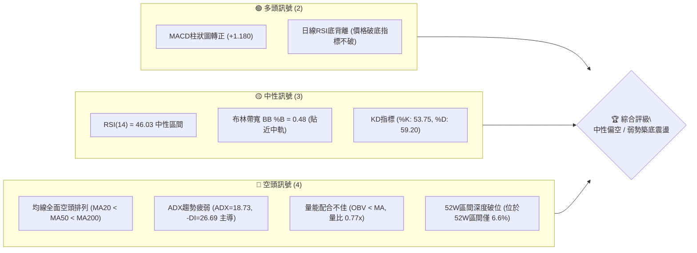

### 📊 核心指標速覽表

| 指標類別 | 指標名稱 | 當前數值 | 訊號 | 解讀 |
|----------|----------|----------|------|------|
| **價格** | 當前收盤價 | $120.84 | 🔴 | 位於52週高點 $408.25 與低點 $100.40 區間的 6.6%，極度弱勢 |
| **均線** | MA20 | $121.26 | 🔴 | 收盤價低於MA20，短期均線反壓，斜率微幅向下 (-0.35%) |
| **均線** | MA50 | $135.74 | 🔴 | 收盤價遠低於MA50 (-10.98%)，中期下降趨勢未改 |
| **均線** | MA200 | $175.96 | 🔴 | 收盤價遠低於年線 (-31.33%)，長期空頭壓制明確 |
| **動能** | RSI(14) | 46.03 | 🟡 | 脫離超賣區回升至中性區，伴隨20根K棒首尾之「底背離」訊號 |
| **動能** | MACD(12,26,9) | -4.140 / -5.320 | 🟢 | MACD位於零軸下方但柱狀圖 (+1.180) 金叉擴張，動能短期修復 |
| **趨勢** | ADX(14) | 18.73 | 🟡 | ADX < 25 表明單邊趨勢衰竭，進入低動能盤整；-DI(26.69) > +DI(22.29) 空方佔優 |
| **通道** | 布林通道 | 中軌 $121.26 | 🟡 | 價格貼近中軌，%B為0.48，處於下軌 $107.54 至上軌 $134.99 之中間帶 |
| **成交量** | 成交量 / 20MA | 1,055,300 | 🔴 | 量比 0.77x，量能低於20日均量(1,375,290)，OBV低於均線顯示追價乏力 |
| **波動** | ATR(14) | $8.12 | 🟡 | ATR佔股價達 6.72%，單日波動幅度顯著，操作需預留足夠停損寬容度 |

### 🏆 技術評分卡

```
╔══════════════════════════════════════════════════════════════════╗
║                   技術評分卡 — AVAV (2026-11-13)                ║
╠══════════════════════════════════════════════════════════════════╣
║ 趨勢強度      ██████░░░░░░░░░░░░░░  30/100  🔴 空頭壓制/ADX盤整 ║
║ 動能指標      ███████████░░░░░░░░░  55/100  🟡 MACD金叉/RSI底背離║
║ 支撐穩定度    ████████░░░░░░░░░░░░  40/100  🔴 僅測S1($113.15)/低點║
║ 成交量配合    ██████░░░░░░░░░░░░░░  30/100  🔴 量能萎縮/OBV疲弱  ║
║ 形態完整度    ████████░░░░░░░░░░░░  40/100  🟡 潛在雙底未越頸線 ║
║ 均線排列      ████░░░░░░░░░░░░░░░░  20/100  🔴 空頭排列(MA20<50<200)║
╠══════════════════════════════════════════════════════════════════╣
║ 綜合評分      ███████░░░░░░░░░░░░░  36/100  🔴 弱勢空頭防禦 (36分)║
╚══════════════════════════════════════════════════════════════════╝
```
*(註：綜合評分由六項子指標算術平均計算：(30 + 55 + 40 + 30 + 40 + 20) / 6 = 35.83，四捨五入為 36分。)*

---

## 2. 趨勢分析

### 🌐 多時框趨勢分析

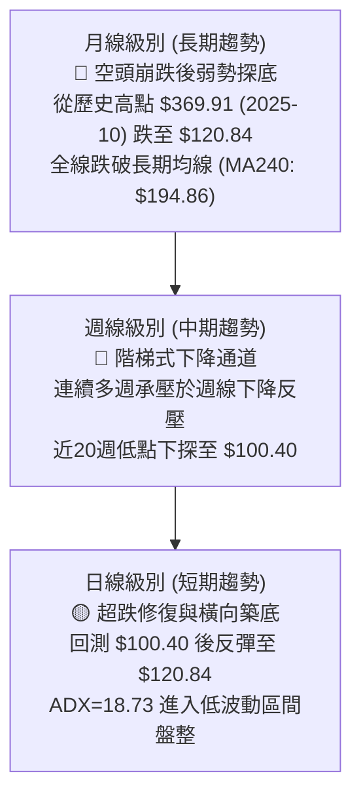

### 📈 長期趨勢 — 12個月走勢圖（Unicode）

```
AVAV 月線收盤走勢圖（過去12個月：2025-11 至 2026-11）
價格 ($)
$300 ┤ ●($279.46)     ●($278.39)
$270 ┤             
$240 ┤       ●($241.89)     ●($252.25)
$210 ┤                               ●($207.24)
$180 ┤                         ●($195.02)
$150 ┤                   ●($183.05)       ●($165.07)  ●($149.37) ●($148.35) ●($142.22)
$120 ┤                                                                      ●($126.11) ●($120.84)◄現價
     └─┬─────┬─────┬─────┬─────┬─────┬─────┬─────┬─────┬─────┬─────┬─────┬─────
     25-11 25-12 26-01 26-02 26-03 26-04 26-05 26-06 26-07 26-08 26-09 26-10 26-11
```

#### 長期月線走勢特徵分析表

| 階段區間 | 時間跨度 | 起迄月收盤價 | 區間漲跌幅 | 價量與趨勢特徵解讀 |
|:---|:---|:---|:---|:---|
| **第一階段：高檔震盪破位** | 2025-11 至 2026-02 | $279.46 → $252.25 | -9.74% | 於 $270~$280 間築雙頂結構失敗，價格失守月均線支撐。 |
| **第二階段：主跌浪下殺** | 2026-02 至 2026-03 | $252.25 → $183.05 | -27.43% | 放量單邊崩跌，跌破 $200 整數心理關卡，多頭趨勢完全破壞。 |
| **第三階段：弱勢反彈誘多** | 2026-03 至 2026-05 | $183.05 → $207.24 | +13.22% | 反彈未能突破 $218.00（斐波那契 61.8%），確認為空頭回抽。 |
| **第四階段：階梯陰跌探底** | 2026-05 至 2026-11 | $207.24 → $120.84 | -41.69% | 月K連6黑，連續失守多道關卡，最低見 $100.40，目前在 $120.84 掙扎。 |

### 📊 中期趨勢（週線分析）

中期走勢呈現連續的「反彈無力、破底加速」之下降階梯。近20週數據顯示，價格從 2026-07-02 的高點 $190.89 持續下滑，期間於 2026-08-14 見次高點 $192.81 後即展開單邊下墜。

```
AVAV 近期中期壓力與支撐結構示意圖 (週線層級)
 阻力 R2 ─── $162.30 ════════════════════════════════ (近一年高點聚類強壓)
                     \
 阻力 R1 ─── $138.43 ═══▲════════════════════════════ (2026-10-30 週K高點 $138.43)
                         \       /
 現價    ─── $120.84 ─────●───── (當前日線/週線糾結於MA20 $121.26)
                               /   \
 支撐 S1 ─── $113.15 ═════════▼═════ (2026-10-23 週K低點聚類)
                                     \
 52W低點 ─── $100.40 ═════════════════▼══════════════ (2026-11-06 測試之波段極值)
```

### ⚡ 趨勢強度評估（ADX 解讀）

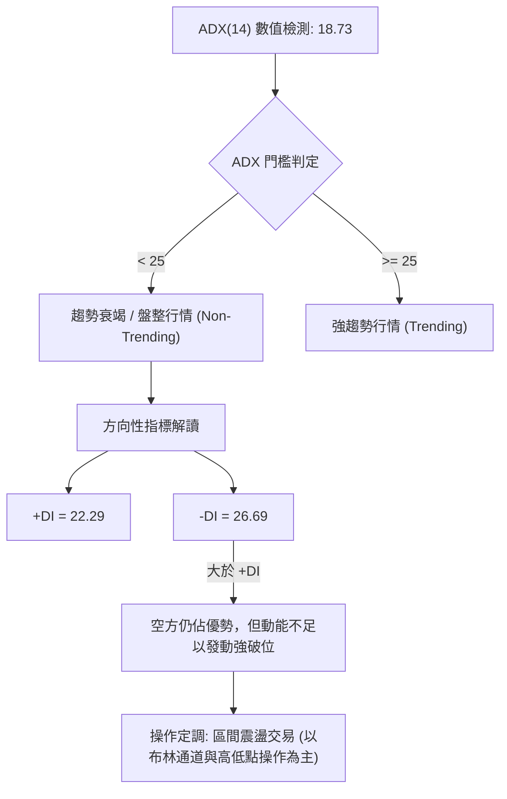

#### ADX 趨勢強度對照表

| 指標變數 | 當前讀數 | 門檻標準 | 趨勢判定 | 交易指引 |
|:---|:---|:---|:---|:---|
| **ADX (14)** | **18.73** | < 20 極弱; 20-25 偏弱; > 25 強勢 | **無明確單邊趨勢（弱盤整）** | 嚴禁使用順勢追價策略，轉為區間策略 |
| **+DI (14)** | **22.29** | 多方買盤力量 | 多頭反撲力道不足 | 缺乏持續性買盤推升 |
| **-DI (14)** | **26.69** | 空方賣盤力量 | 空方仍略佔上風 | 反彈易遭遇空頭回補後的再次拋壓 |
| **DI 差值** | **-4.40** | 空頭發散收斂中 | 空方優勢減弱中 | 暗示下行速率趨緩，進入震盪磨底 |

---

## 3. 圖表形態分析

### 🔍 形態識別系統

在日線與週線結構中，AVAV 在經歷了 2026-11-05 至 2026-11-06 的急挫後出現長下影線探底，目前正試圖建構短期形態。

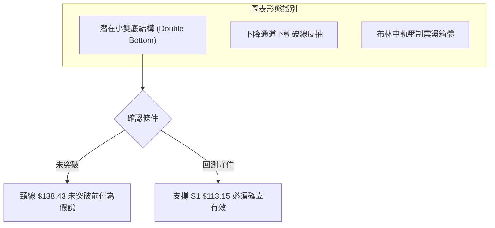

#### 形態識別與信心度評估表

| 形態名稱 | 信心度 | 判斷依據（引用數據） | 完成度 | 目標價（附精確計算式） |
|:---|:---|:---|:---|:---|
| **潛在日線雙底** | 55% | 第一次波段低點於 2026-10-23 之 $113.15（S1），第二次深插針於 2026-11-06 之 $100.40；兩次探底後收盤均拉回 $120.84 之上。 | 60% | 頸線為波段高點 R1 $138.43，形態高度 = 頸線 $138.43 − 低點 $113.15 = $25.28。推算目標價 = $138.43 + $25.28 = **$163.71**（接近阻力位 R2 $162.30）。 |
| **下降通道整理** | 75% | 自 2026-09-25 高點 $165.00 連接 2026-10-30 高點 $138.43，低點連接 $113.15 與 $100.40，價格保持受制於向下傾斜通道。 | 85% | 延續通道震盪，若下破 S1 則回測 52W 低點 **$100.40**；若突破通道上軌則挑戰 R1 **$138.43**。 |

### 🕯️ 重要K線形態分析

嚴格依據數據中「近10根日K」與「近8根週K」之實際開、高、低、收數據進行形態判定：

#### 近10根日K形態精確分析表

| 日期 | 開盤價 | 最高價 | 最低價 | 收盤價 | K線形態特徵 | 實質技術含義 | 訊號 |
|:---|:---|:---|:---|:---|:---|:---|:---|
| 2026-10-30 | 131.12 | 133.10 | 124.17 | 126.11 | 中陰線 (實體 5.01) | 跌破開盤，高檔賣壓湧現，確立短線轉弱 | 🔴 |
| 2026-11-02 | 126.20 | 127.80 | 121.94 | 123.08 | 下跌小陰線 | 連續回落，下影線長度不足，空方掌控局勢 | 🔴 |
| 2026-11-03 | 123.71 | 128.10 | 123.48 | 123.53 | 紡錘十字線 (波動小) | 多空僵持，高點受阻於 $128.10，量能萎縮 | 🟡 |
| 2026-11-04 | 121.00 | 123.00 | 108.95 | 113.23 | 放量長黑破位 (量279萬) | 恐慌性殺跌，跌破 S1 支撐，單日重挫 | 🔴 |
| 2026-11-05 | 110.28 | 112.33 | 101.07 | 102.08 | 跳空大陰線 (收近最低) | 延續性下殺，直逼 $100 整數大關，恐慌高潮 | 🔴 |
| 2026-11-06 | 104.36 | 113.65 | 100.40 | 112.76 | **長下影錘頭陽線** | 於52週低點 $100.40 見強勁買盤拉抬，下影線達 3.96 | 🟢 |
| 2026-11-09 | 114.12 | 128.52 | 111.95 | 126.96 | **大陽吞噬線 (漲14.20)** | 強勢反彈吞噬前三日實體，確立 $100.40 之短期底部 | 🟢 |
| 2026-11-10 | 123.39 | 126.99 | 121.47 | 123.50 | 震盪十字星 (量縮) | 遭遇 MA20 ($121.26) 附近之獲利回吐，量縮整固 | 🟡 |
| 2026-11-11 | 126.37 | 127.67 | 123.84 | 124.40 | 倒錘子小陰線 | 上攻 $127.67 未果，上影線顯示 $128 上方具短壓 | 🟡 |
| 2026-11-12 | 122.36 | 125.44 | 119.35 | 120.84 | 弱勢小陰線 (量105萬) | 回測中軌，收盤於 $120.84，下探支撐力道 | 🔴 |

#### 近8根週K形態精確分析表

| 週末日期 | 開盤價 | 最高價 | 最低價 | 收盤價 | 週K形態 | 技術含義 | 訊號 |
|:---|:---|:---|:---|:---|:---|:---|:---|
| 2026-09-25 | 161.28 | 165.00 | 151.50 | 152.05 | 中長黑K | 自高檔回落，宣告反彈波段結束 | 🔴 |
| 2026-10-02 | 149.77 | 151.30 | 138.31 | 140.82 | 連續大陰線 | 破位下殺，跌破 $150 關卡 | 🔴 |
| 2026-10-09 | 142.28 | 145.44 | 134.25 | 137.11 | 弱勢小陰線 | 跌勢延續，未能收復 $140 | 🔴 |
| 2026-10-16 | 137.10 | 137.50 | 116.43 | 121.79 | 長黑破底線 | 放量重挫，週成交量突破815萬股 | 🔴 |
| 2026-10-23 | 122.88 | 124.76 | 113.15 | 123.25 | **長下影十字K** | 於 $113.15 首度獲得支撐，出現抵抗買盤 | 🟢 |
| 2026-10-30 | 122.39 | 138.43 | 120.35 | 126.11 | **長上影射擊之星** | 衝高至 R1 $138.43 遭遇空頭重擊，週線反壓極重 | 🔴 |
| 2026-11-06 | 126.20 | 128.10 | 100.40 | 112.76 | **極長下影線倒錘** | 探底至52週新低 $100.40 後強烈收回，量放大至867萬股 | 🟡 |
| 2026-11-12 | 114.12 | 128.52 | 111.95 | 120.84 | 孕線收陽 | 週內波動收斂於前週實體之內，進入量縮觀望 | 🟡 |

### 📉 ASCII 走勢形態示意圖

```
AVAV 日線「雙重探底回抽」微觀形態圖 (2026-10-23 至 2026-11-12)
 價位
$138.43 ┤           ▲(2026-10-30 高點 R1 頸線位)
        │          / \
$130.00 ┤         /   \        ▲(11-09 高點 $128.52)
        │        /     \      / \
$120.84 ┤───────/───────\────●───●(當前收盤 $120.84 / MA20 $121.26 糾結處)
        │      /         \  /     \
$113.15 ┤     ●(底1)      \/       ▼(11-12 低點 $119.35)
        │    (10-23)
$100.40 ┤                  ●(底2：深刺針 11-06 52W低點)
        └─────────────────────────────────────────────
```

---

## 4. 支撐與阻力

### 🗺️ 關鍵價位分布圖（Unicode）

```
AVAV 價位結構分布圖 (依據歷史聚類與斐波那契點位)
══════════════════════════════════════════════════════════════════
$168.00 ║████████████████████████║ 強阻力 R3 (近一年波段高點聚類)
$166.28 ║▓▓▓▓▓▓▓▓▓▓▓▓▓▓▓▓▓▓▓▓▓▓▓▓║ 斐波那契 78.6% 回調位
$162.30 ║████████████████████    ║ 阻力 R2 (反彈高點聚類)
$138.43 ║████████████████████████║ 關鍵阻力 R1 (2026-10-30 波段高點)
$134.99 ║▓▓▓▓▓▓▓▓▓▓▓▓▓▓▓▓        ║ 布林通道上軌
$121.26 ║────────────────────────║ 布林中軌 / MA20 反壓線
$120.84 ╠════════════════════════╣ ◄ 當前收盤價 ($120.84)
$113.15 ║▓▓▓▓▓▓▓▓▓▓▓▓▓▓▓▓        ║ 近期支撐 S1 (2026-10-23 波段低點聚類)
$107.54 ║────────────────────────║ 布林通道下軌
$100.40 ║████████████████████████║ 52週極限低點 / 斐波那契 100.0%
══════════════════════════════════════════════════════════════════
```

### 🚧 阻力位分析表

所有阻力價位嚴格引用自數據之「關鍵價位」高點聚類：

| 阻力級別 | 準確價位 | 距現價幅動 | 形成原因與籌碼特徵 | 突破難度 | 重要性評級 |
|:---|:---|:---|:---|:---|:---|
| **R1** | **$138.43** | +14.56% | 2026-10-30 之波段高點聚類，亦為近期反彈頸線位置，日MA60 ($138.13) 重疊於此。 | 中等偏高 | 🟢 極重要（突破確認日線底部） |
| **R2** | **$162.30** | +34.31% | 2026-09-25 前後之波段密集成交高點，大量套牢籌碼沉澱區。 | 極高 | 🟡 中度重要（中期解套賣壓區） |
| **R3** | **$168.00** | +39.03% | 歷史波段強反壓高點聚類，與斐波那契 78.6% ($166.28) 形成重疊共振區。 | 極高 | 🔴 戰略級強壓（多頭中長線防線） |

### 🛡️ 支撐位分析表

所有支撐價位嚴格引用自數據之「關鍵價位」低點聚類：

| 支撐級別 | 準確價位 | 距現價幅動 | 形成原因與籌碼特徵 | 守住機率 | 重要性評級 |
|:---|:---|:---|:---|:---|:---|:---|
| **S1** | **$113.15** | -6.36% | 2026-10-23 週K低點聚類，11-04 跌破後又於 11-09 帶量收復，為多頭防守第一線。 | 60% | 🟢 短線生命線（失守則再度探底） |
| **S2** | N/A（數據未提供） | N/A | 關鍵價位區塊中未偵測到次級支撐聚類。 | N/A | N/A（數據未提供） |
| **S3** | N/A（數據未提供） | N/A | 關鍵價位區塊中未偵測到三級支撐聚類。 | N/A | N/A（數據未提供） |
| **52W Low**| **$100.40** | -16.92% | 52週絕對低點（2026-11-06盤中創下），斐波那契 100% 終極支撐。 | 75% | 🔴 終極防線（破位將引發系統性空頭） |

### 📐 斐波那契回調位分析

直接引用數據中 52 週區間（$100.40 → $408.25）回調水平：

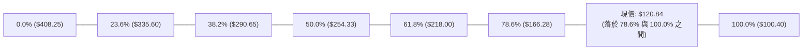

- **當前位置解讀**：現價 $120.84 處於 **78.6% ($166.28)** 與 **100.0% ($100.40)** 之間。在經典斐波那契理論中，當資產跌破 78.6% 回調位時，代表原有上升波段已徹底失效，技術面上將尋求 100.0% 完足回調（即完全回吐整年漲幅）。當前價格極度貼近 100% 水平 ($100.40)，僅高出 6.6% 的區間幅度，表示該處屬於長期價值超跌與極端投降拋售區，具有高勝率的技術性反彈動能，但上方在未突破 $166.28 前均不得視為反轉。

---

## 5. 技術指標深度解讀

### 🎛️ 指標訊號總覽

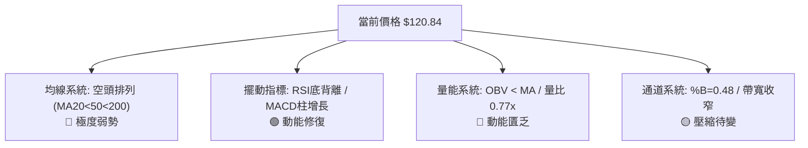

### 📈 移動平均線排列分析

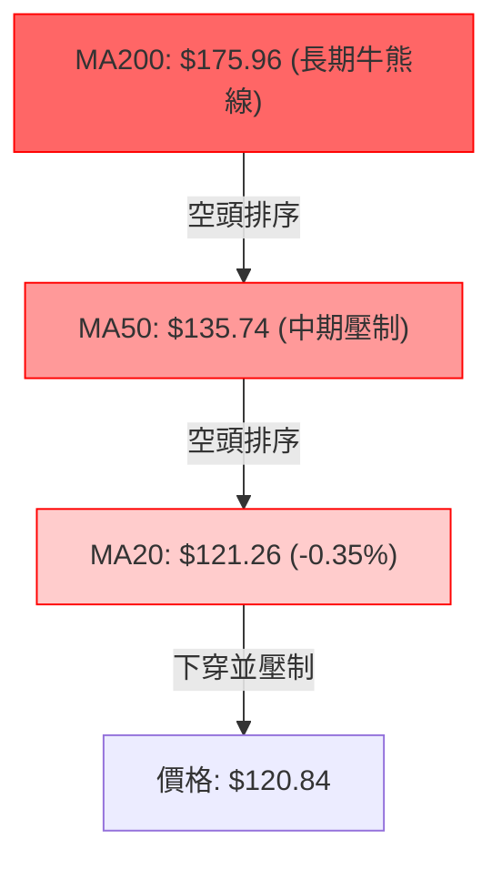

#### 移動平均線參數與狀態精確對照表

| 均線名稱 | 數值 | 與現價距離 | 近期趨勢與斜率 | 技術意涵解讀 |
|:---|:---|:---|:---|:---|
| **MA 5** | $121.69 | +0.70% | ▼ 下行 (-0.70%) | 短期5日衝高後走平微彎，壓制現價 |
| **MA 10** | $119.65 | -0.98% | ▲ 上行 (+1.00%) | 10日線由下向上穿，提供現價下方第一道超短期支撐 |
| **MA 20** | $121.26 | +0.35% | ▼ 下行 (-0.35%) | 布林中軌所在，現價緊貼於中軌下方，多空分水嶺 |
| **MA 50** | $135.74 | +12.33% | ▼ 下行 | 中期下降趨勢反壓，限制波段反彈空間 |
| **MA 60** | $138.13 | +14.31% | ▼ 下行 (-12.51%) | 季線下彎，與 R1 $138.43 構成極強共振阻力 |
| **MA 120**| $153.01 | +26.62% | ▼ 下行 (-21.03%) | 半年線持續崩落，中期賣壓沉重 |
| **MA 200**| $175.96 | +45.61% | ▼ 下行 | 長期年線，定義當前為絕對熊市格局 |
| **MA 240**| $194.86 | +61.25% | ▼ 下行 (-37.99%) | 超長期均線下壓，長期反轉非一朝一夕可成 |

### 📉 RSI(14) 分析

```
RSI(14) 讀數: 46.03 (Wilder)
0 ────[超賣 30]───────[當前 46.03]──────[中軸 50]───────[超買 70]──── 100
      ░░░░░░░░░░░░░░░░█████████░░░░░░░░░░░░░░░░░░░░░░░░░
```

- **超買超賣判定**：RSI 目前處於 46.03，由 10月中旬的超賣低點 28.6 脫離回升，屬於典型的「弱勢區間震盪整理」。
- **背離分析結論**：數據明確檢測出 **⚠️ 底背離 (Bullish Divergence)**。在近20根K棒首尾中，價格在 2026-11-06 跌破前期低點創下 52週新低 $100.40，然而 RSI 指標並未跟隨破底（由前低 28.6 提升至 38.8~46.03），呈現出「價格創深新低、指標底部抬高」的典型看多底背離形態。這表明白熱化的恐慌殺跌盤已衰竭，具備反彈動能。

### 📊 MACD(12/26/9) 訊號解讀

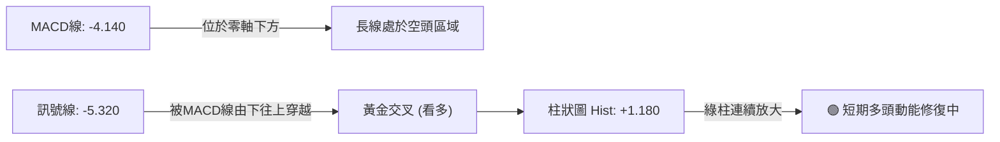

- **柱狀圖動能**：MACD 線 (-4.140) 大於訊號線 (-5.320)，Hist 數值為 **+1.180**，呈現翻紅擴張。在低檔區間出現黃金交叉，暗示空頭殺跌動能暫歇，多頭短線具備防守反撲實力。但因雙線均在零軸下方運行，此現象應界定為「空頭市場中的技術性反抽」，而非反轉牛市。

### 📦 布林通道分析

```
AVAV 日線布林通道 (20, 2) 結構示意圖
$134.99 ─────────────────────────────── 上軌 (強阻力區)
         \                           /
$121.26 ──\───────────●─────────────/── 中軌 (MA20 分水嶺)
           \        ▲(現價 $120.84)
            \      /               /
$107.54 ─────\────/───────────────/──── 下軌 (短期支撐區)
              └──▼(11-06 刺破下軌 $100.40 後迅速收回)
```

- **通道參數解讀**：上軌 $134.99，中軌 $121.26，下軌 $107.54。
- **BB %B 分析**：當前 %B 為 **0.48**，代表收盤價幾乎精確座落於布林通道的中心軸（0.5 即中軌）。價格在 11-06 跌破下軌進入極度超賣後展開均值回歸，目前通道帶寬（Bandwidth = ($134.99 − $107.54) / $121.26 ≈ 22.6%）正在向內收斂，預示單邊快速下殺階段結束，行情將在中下軌與上軌間進行橫向洗盤。

### 💹 成交量分析（量價配合度）

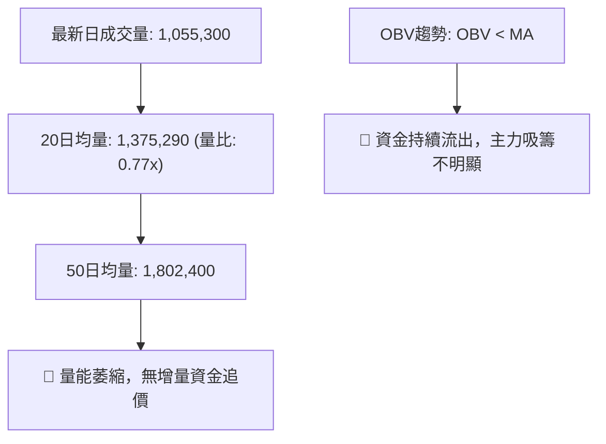

- **量價背離現象**：在 11-06 放量大跌（量達 1,599,000）與 11-09 報復性反彈（量達 1,732,800）後，近三日（11-10 至 11-12）成交量迅速萎縮至 98萬～105萬股，量比跌至 0.77x。反彈量縮表明機構與大資金並未大舉追高，買盤多為短線空頭回補。OBV 跌破其移動平均線，明確確認了當前量能疲弱，難以發動突破 R1 的單邊多頭行情。

---

## 6. 動能與波動率

### ⚡ 動能評估

| 象限分類 | 動能狀態 | 波動率狀態 | 當前標的吻合度 | 戰略特徵評估 |
|:---|:---|:---|:---:|:---|
| **第一象限 (Q1)** | 強動能 (Bullish) | 低波動 (Low Vol) | ❌ | 最佳牛市穩健做多機會（目前不符） |
| **第二象限 (Q2)** | 弱動能 (Bearish) | 低波動 (Low Vol) | ❌ | 窄幅陰跌磨底行情（目前不符） |
| **第三象限 (Q3)** | 強動能 (Expansion) | 高波動 (High Vol) | ❌ | 主升浪或主跌浪宣洩期（目前不符） |
| **第四象限 (Q4)** | **弱動能 (Weak/Trans)**| **高波動 (High Vol)** | **✓ (當前狀態)** | **高風險、超跌反抽、區間劇烈洗盤，操作難度高** |

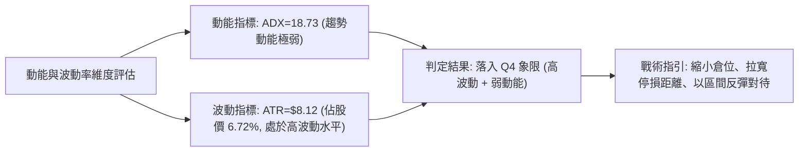

### 📊 ATR 波動率分析

- **ATR(14) 數值**：**$8.12**（Wilder 計算，佔當前股價高達 **6.72%**）。
- **波動特性解讀**：每日平均振幅超過 $8 美元，屬於典型的高波動防務與科技個股。在這種波動環境下，極易觸發過於狹窄的技術性止損。
- **止損距離建議**：
  - **保守型（波段操作）**：設定 1.5 倍至 2.0 倍 ATR = **$12.18 ～ $16.24**。
  - **積極型（短線交易）**：設定 1.0 倍 ATR = **$8.12**。以當前現價 $120.84 計算，下方關鍵支撐 S1 為 $113.15，二者距離為 $7.69，恰好接近 1.0 倍 ATR ($8.12)，顯示 S1 是絕佳且符合波動率邏輯的止損參照點。

### 📐 Beta 與市場相關性

- **Beta 係數**：**1.403**。
- **大盤相關性與彈性**：AVAV 相對標普500指數具備 1.4 倍的高彈性特質。在市場風險偏好（Risk-on）回升時，其反彈爆發力顯著高於大盤；然而在防禦性下行週期中，其跌幅亦會被放大。配合高達 **13.3%** 的空頭部位佔比（Short % Float）與 **3.63** 的回補天數（Short Ratio），一旦出現突破性利多，極易誘發軋空（Short Squeeze）走勢，放大短期波動。

---

## 7. 多時框架總結

### 📋 時框架評分表

| 時框架 | 趨勢方向 | 動能狀態 | 均線排列 | 形態特徵 | 綜合評分 | 戰術建議 |
|:---|:---|:---|:---|:---|:---:|:---|
| **長期 (月線)** | 🔴 極空 | 🔴 疲弱，月K連陰 | 🔴 全線空頭 (破MA240) | $369 崩跌後的弱勢尋底 | **25/100** | 長期投資者保持觀望，切忌左側重倉 |
| **中期 (週線)** | 🔴 偏空 | 🟡 跌勢趨緩，柱狀修復 | 🔴 空頭排列 (承壓MA50) | 測試 $100.40 獲長下影支撐 | **35/100** | 中期等待突破 R1 ($138.43) 再行定奪 |
| **短期 (日線)** | 🟡 震盪 | 🟢 RSI底背離 / MACD金叉| 🔴 MA20受阻，空頭排列 | 探底後弱勢整理，小雙底雛形 | **50/100** | 於布林通道中下軌區間低吸高拋 |

### 🔲 綜合訊號矩陣

```
時框與指標訊號一致性評估矩陣
────────────────────────────────────────────────────────────────
時框架       均線系統   擺動指標   量能表現   形態結構   方向收斂
短期 (日K)    🔴 空頭    🟢 多頭    🔴 疲弱    🟡 中性    🟡 區間反彈
中期 (週K)    🔴 空頭    🟡 中性    🔴 疲弱    🔴 偏空    🔴 下降通道
長期 (月K)    🔴 空頭    🔴 空頭    🔴 疲弱    🔴 破位    🔴 深度熊市
────────────────────────────────────────────────────────────────
收斂結果：長中期趨勢呈現堅固空頭，短期僅為超跌技術性修正，無反轉信號。
```

### ⚖️ 多時框收斂結論

依據多時框收斂規則（嚴格要求 14）：
1. **行情屬性判定**：當前日線 **ADX(14) 為 18.73 (< 25)**，明確屬於**盤整行情（Non-Trending / Range-Bound）**。
2. **主導時框與交易邏輯**：在盤整行情中，市場缺乏單邊趨勢動能，交易必須以日線布林通道（下軌 $107.54 至上軌 $134.99）及高低點聚類區間操作為核心，而不宜採用均線突破追價策略。
3. **方向性最終結論**：**【中性觀望，偏向防守型區間低吸】**。儘管長期與中期趨勢為空頭，但短線在 $100.40 展現強烈探底回升，並伴隨日線底背離與 MACD 金叉，直接在現價殺空的盈虧比極差；因此，戰術上認定現階段處於「下降趨勢中的低波動築底箱體」，以防守型區間震盪交易為主導。

---

## 8. 交易策略建議

### 🗺️ 策略決策流程圖

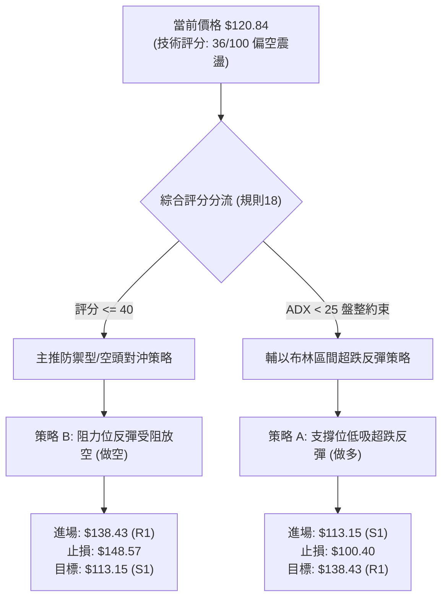

### 🧭 策略路由（依評分卡分流）

**當前主策略方向 = 空頭防禦與高空主導（依評分 36/100）**
依據第 1 章評分卡，綜合評分為 **36/100（≤ 40）**，屬於明確的弱勢空頭格局。但考量到 ADX = 18.73 進入盤整階段，不建議追空，主推「**反彈至重要阻力放空（策略 B）**」，並將「**下軌支撐短線摸底（策略 A）**」作為次要博弈策略。

### 🎯 價格情境階梯（Price Scenarios）

所有價位均嚴格引用第 4 章及數據源數值：

| 觸發條件 | 下一目標 | 後續延伸 | 情境技術含義 |
|:---|:---|:---|:---|
| **向上突破 R1 $138.43** | R2 $162.30 | R3 $168.00 | 確認日線級別雙底成型，展開中期強反彈行情 |
| **站穩現價區間 ($120.84)** | BB中軌 $121.26 | BB上軌 $134.99 | 維持日線布林通道內橫向洗盤震盪 |
| **跌破 S1 $113.15** | 52W低點 $100.40 | N/A（數據未提供） | 底背離修復失敗，空頭重啟跌勢下探歷史低位 |

### 📊 情境機率分佈

| 情境走勢 | 發生機率 | 主要技術指標依據 |
|:---|:---:|:---|
| **情境一：區間震盪築底** | **50%** | ADX 降至 18.73 趨勢衰竭；布林通道帶寬收窄；成交量萎縮至均量以下。 |
| **情境二：反彈受阻回落** | **35%** | 均線系統呈空頭排列 (MA20<50<200)；OBV 低於均線無增量資金；-DI 仍大於 +DI。 |
| **情境三：突破展開反轉** | **15%** | MACD 柱狀圖翻紅擴張 (+1.180)；RSI 底背離成立。但需大額成交量配合。 |

### 🟢 主策略詳情

依據規則 17，風險報酬比嚴格定義為：
- **做多**：(目標價 T1 − 進場價) ÷ (進場價 − 止損價)
- **做空**：(進場價 − 目標價 T1) ÷ (止損價 − 進場價)

| 策略要素 | 策略 A（區間超跌反彈 - 多單） | 策略 B（高空順勢對沖 - 空單，主推） |
|:---|:---|:---|
| **策略類型** | 逆勢左側支撐低吸 | 順勢逢高阻力放空 |
| **進場條件** | 價格回踩 S1 且出現收腳或綠柱延續 | 價格反彈至 R1 阻力且日K出現長上影線 |
| **進場價格** | **$113.15**（精確引用 S1 支撐位） | **$138.43**（精確引用 R1 阻力位） |
| **目標價 T1** | **$138.43**（精確引用 R1 阻力位） | **$113.15**（精確引用 S1 支撐位） |
| **目標價 T2** | **$162.30**（精確引用 R2 阻力位） | **$100.40**（精確引用 52W 低點） |
| **止損價格** | **$100.40**（跌破 52W 低點止損） | **$148.57**（分析師共識最低目標價/突破止損） |
| **風險報酬比 (T1)** | **1 : 1.98**（以 T1 計）<br>算式: (138.43 - 113.15) ÷ (113.15 - 100.40) = 25.28 ÷ 12.75 | **1 : 2.49**（以 T1 計）<br>算式: (138.43 - 113.15) ÷ (148.57 - 138.43) = 25.28 ÷ 10.14 |
| **風險報酬比 (T2)** | **1 : 3.85**（以 T2 計）<br>算式: (162.30 - 113.15) ÷ (113.15 - 100.40) = 49.15 ÷ 12.75 | **1 : 3.75**（以 T2 計）<br>算式: (138.43 - 100.40) ÷ (148.57 - 138.43) = 38.03 ÷ 10.14 |
| **預估勝率** | 45% | 60% |
| **建議倉位** | 5%（輕倉試探） | 10%（標準空頭配置） |

### 🔴 反向風險觸發點（對沖提示）

- **推翻做空策略的條件**：若日線放量收盤**實體站穩 R1 $138.43 之上**，則下降趨勢被破壞，雙底形態確立，所有空頭必須無條件停損，並可反手追多。
- **推翻做多策略的條件**：若價格以日收盤價**有效跌破 S1 $113.15**，甚至摜破 **$100.40**，表明底背離修復徹底失敗，進入無支撐的新一輪崩盤，多頭必須果斷停損。

### ⭐ 整體訊號強度評星

```
做多訊號強度：★★☆☆☆  (2/5星 - 僅屬超跌反彈與指標背離，均線全面反壓)
做空訊號強度：★★★★☆  (4/5星 - 大週期空頭排列完好，阻力帶拋壓明確)
整體可信度：  ★★★☆☆  (3/5星 - ADX<25 震盪雜訊較多，需等待區間邊界確認)
```

---

## 9. 風險提示與監控

### ✅ 關鍵監控指標 Checklist

```
╔══════════════════════════════════════════════════════════════════╗
║               AVAV 技術監控每日檢查表 (Checklist)               ║
╠══════════════════════════════════════════════════════════════════╣
║ [ ] 價格是否跌破 S1 ($113.15) 或 52W低點 ($100.40) (破位風險)    ║
║ [ ] 價格是否放量突破 R1 ($138.43) 頸線 (形態反轉訊號)           ║
║ [ ] 日成交量是否放大至 20MA (137萬) 或 50MA (180萬) 以上 (動能)  ║
║ [ ] RSI(14) 是否跌破 40 (底背離失效) 或突破 50 (強弱分界線)      ║
║ [ ] MACD 柱狀圖是否由紅翻綠 (反彈動能衰竭信號)                  ║
║ [ ] ADX(14) 是否回升至 25 以上 (趨勢行情重新啟動)               ║
╚══════════════════════════════════════════════════════════════════╝
```

### ⚠️ 風險場景分析

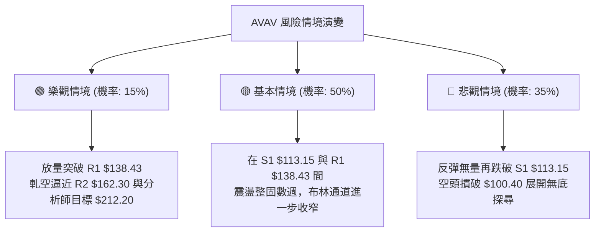

### 🛡️ 風險管理重要提醒

1. **極端波動風險（ATR 高達 6.72%）**：AVAV 每日平均波動達 $8.12，任何超過 15% 的重倉操作在單日內都可能面臨巨大的帳戶回撤。單筆交易曝險金額務必控制在總資產的 1.0%～1.5% 以內。
2. **基本面淨利虧損壓制**：TTM EPS 為 **$-4.05**，自由現金流為 **$-44.78M**，營業利益率為 **-0.6%**。技術面走勢極大程度反映了公司當前的虧損與獲利逆風，切勿因分析師平均目標價 $212.20 而盲目重倉長線做多。
3. **空頭部位軋空風險**：Short % Float 高達 **13.3%**。雖然趨勢偏空，但若空頭部位過於擁擠，容易因突發防務訂單利多而誘發軋空大陽線（如 11-09 之單日暴漲 14 美元）。因此嚴格禁止在無保護狀況下追空，放空必須設立於阻力位附近且嚴格執行止損。

---

## 📋 報告總結

```
AVAV 技術分析報告總結
════════════════════════════════════════════════════════
報告日期：2026-11-13
當前價格：$120.84
分析評級：🔴 弱勢空頭防禦 / 區間震盪 (綜合評分: 36/100)

關鍵結論：
├─ 長期趨勢：🔴 深度熊市 (自歷史高點回撤近 70%，破長期均線)
├─ 中期趨勢：🔴 階梯式下降通道，反壓密集
├─ 短期趨勢：🟡 超跌反彈，進入低動能整理 (ADX=18.73)
├─ 關鍵支撐：S1 $113.15 ｜ 終極防線 $100.40
├─ 關鍵阻力：R1 $138.43 ｜ 次級阻力 $162.30
└─ 分析師目標：均價 $212.20 ｜ 最低 $148.57 ｜ 最高 $315.00

最優策略組合：
1. 🥇 最佳機會 (順勢主推)：策略 B (高空對沖) — 反彈至 R1 $138.43 放空，
   止損設於 $148.57，目標 T1 $113.15，風報比 1 : 2.49。
2. 🥈 次選機會 (逆勢博弈)：策略 A (超跌低吸) — 回踩 S1 $113.15 試多，
   止損設於 $100.40，目標 T1 $138.43，風報比 1 : 1.98。
3. 🥉 保守選擇：完全空倉觀望，等待日線突破 R1 ($138.43) 或跌破 $100.40
   產生明確趨勢單邊方向後，再行順勢跟進。
════════════════════════════════════════════════════════
```

---

> ⚠️ **免責聲明**：本報告為技術分析研究，所有數據、圖表及估算均基於所提供之歷史價格與指標資訊。本報告**僅供研究與學術參考**，**不構成任何要約、招攬或投資建議**。金融市場具有高度風險，投資人應獨立評估自身財務狀況並自行承擔交易結果。

---

*報告生成時間：2026-11-13 ｜ 數據來源：Yahoo Finance ｜ 分析框架：資深多時框量化技術分析*