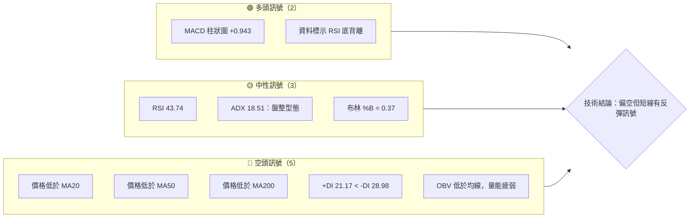
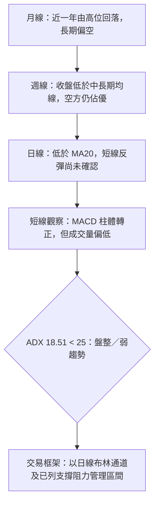
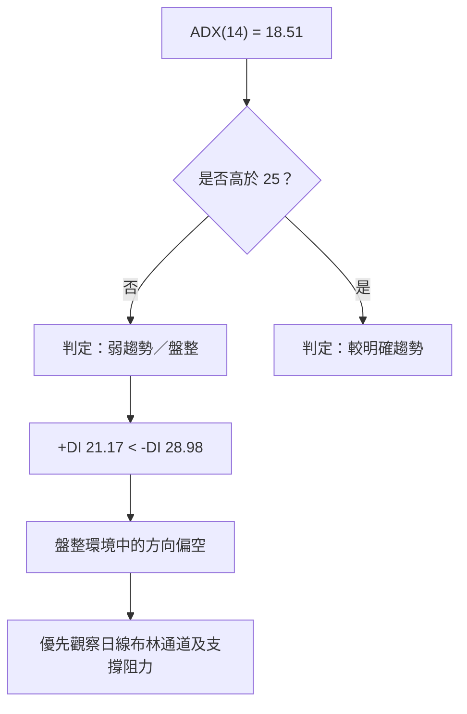
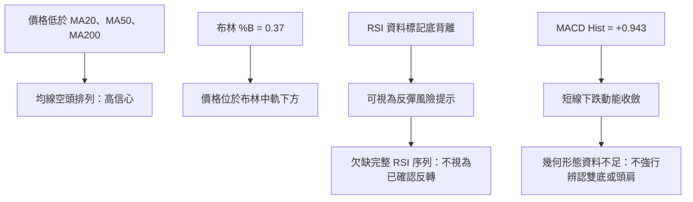
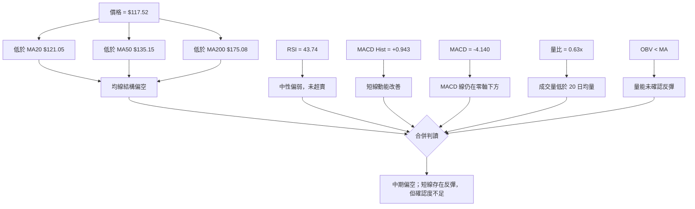
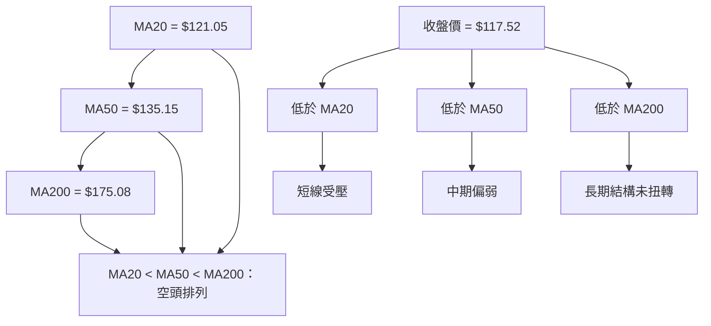
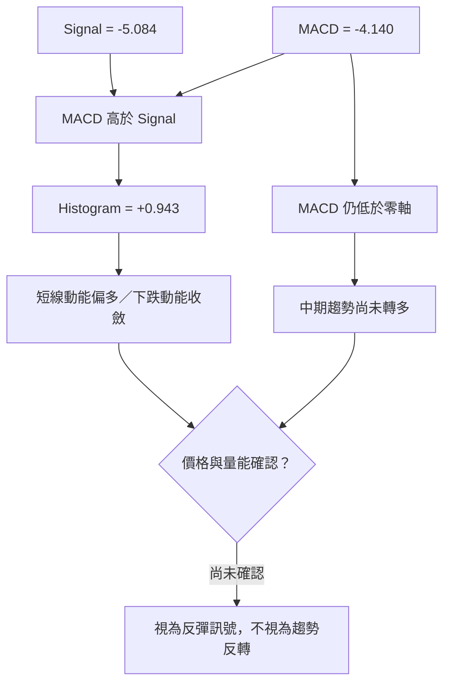
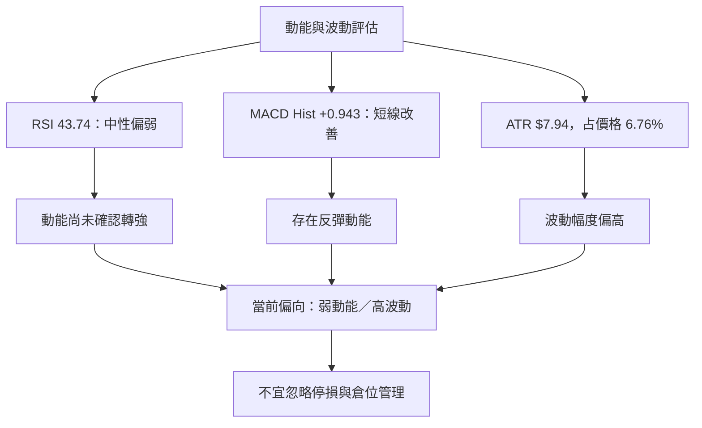
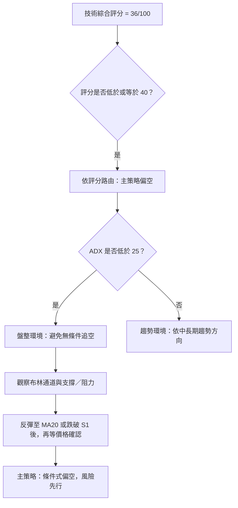
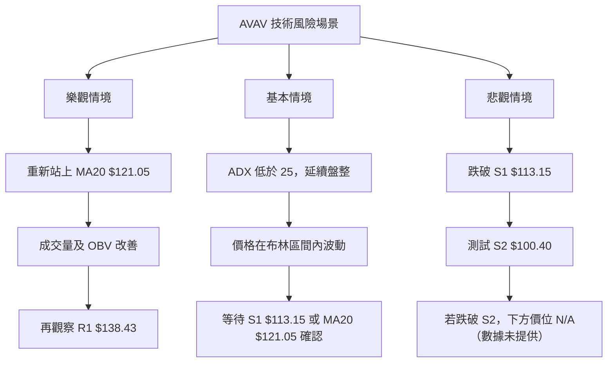

# AVAV 技術分析報告

> **報告日期**：2026-11-14 ｜ **語言**：繁體中文 ｜ **數據來源**：使用者提供之 Yahoo Finance 技術數據  
> **當前價格**：**$117.52**（2026-11-13 收盤價）  
> **分析立場**：短、中、長期均線偏空；ADX 顯示盤整環境，短線動能有改善跡象，但尚未獲成交量與主要均線確認。

---

## 目錄

| 章節 | 內容 |
|------|------|
| [1. 技術面概覽](#1-技術面概覽) | 訊號儀表板、核心指標、評分卡 |
| [2. 趨勢分析](#2-趨勢分析) | 多時框趨勢、長中短期走勢 |
| [3. 圖表形態分析](#3-圖表形態分析) | 形態識別、K線組合、目標價 |
| [4. 支撐與阻力](#4-支撐與阻力) | 關鍵價位、斐波那契回調 |
| [5. 技術指標深度解讀](#5-技術指標深度解讀) | MA/RSI/MACD/布林/成交量 |
| [6. 動能與波動率](#6-動能與波動率) | 動能評估、ATR、Beta |
| [7. 多時框架總結](#7-多時框架總結) | 時框架評分矩陣 |
| [8. 交易策略建議](#8-交易策略建議) | 多空策略、風險報酬比 |
| [9. 風險提示與監控](#9-風險提示與監控) | 監控指標、風險場景 |

---

## 1. 技術面概覽

### 🎯 技術訊號儀表板

下圖將主要訊號按方向分類。由於多頭訊號主要來自 MACD 柱體回升及所提供的 RSI 底背離提示，而價格仍低於 MA20、MA50、MA200，訊號呈現「中期偏空、短線反彈可能」的組合。



### 📊 核心指標速覽表

| 指標類別 | 指標名稱 | 當前數值 | 訊號 | 解讀 |
|----------|----------|----------:|:----:|------|
| 價格 | 收盤價 | **$117.52** | 🔴 | 位於 52 週區間的低端；距 52 週低點 $100.40 尚有空間 |
| 價格 | 52 週區間位置 | 5.6% | 🔴 | 報價接近區間低端；不是「已確認反轉」訊號 |
| 均線 | MA20 | $121.05 | 🔴 | 收盤低於 MA20，短線仍受壓 |
| 均線 | MA50 | $135.15 | 🔴 | 收盤低於 MA50，中期趨勢仍弱 |
| 均線 | MA200 | $175.08 | 🔴 | 收盤遠低於 MA200，長期趨勢尚未扭轉 |
| 動能 | RSI(14) | 43.74 | 🟡 | 中性偏弱，未達超賣區 |
| 動能 | MACD | -4.140 | 🔴 | MACD 線仍低於零軸 |
| 動能 | MACD 柱狀圖 | +0.943 | 🟢 | 柱體轉正，短線下跌動能有收斂 |
| 趨勢 | ADX(14) | 18.51 | 🟡 | 低於 25，屬弱趨勢／盤整區 |
| 趨勢 | +DI / -DI | 21.17 / 28.98 | 🔴 | -DI 較高，方向仍由空方主導 |
| 波動 | ATR(14) | $7.94 | 🔴 | 相當於收盤價的 6.76%，日內波動幅度偏高 |
| 布林 | %B | 0.37 | 🟡 | 位於下半區，但未貼近下軌 |
| 量能 | 最新量／20 日均量 | 0.63 倍 | 🔴 | 最新量低於 20 日均量 |
| 量能 | OBV | 低於均線 | 🔴 | 量能尚未確認價格反彈 |

### 🏆 技術評分卡

評分採 0–100 分，六項子分數採算術平均。評分反映技術面強弱，不代表預期報酬率或成功機率。

```text
╔══════════════════════════════════════════════════════════════╗
║              技術評分卡 — AVAV（2026-11-14）                ║
╠══════════════════════════════════════════════════════════════╣
║ 趨勢強度      ███████░░░░░░░░░░░░░░░  36/100  🔴           ║
║ 動能指標      ██████████░░░░░░░░░░░░  48/100  🟡           ║
║ 支撐穩定度    █████████░░░░░░░░░░░░░  45/100  🟡           ║
║ 成交量配合    ██████░░░░░░░░░░░░░░░░  30/100  🔴           ║
║ 形態完整度    ███████░░░░░░░░░░░░░░░  35/100  🔴           ║
║ 均線排列      ████░░░░░░░░░░░░░░░░░░  22/100  🔴           ║
╠══════════════════════════════════════════════════════════════╣
║ 綜合評分      ███████░░░░░░░░░░░░░░░  36/100  🔴 偏空       ║
║ 算術平均      (36 + 48 + 45 + 30 + 35 + 22) ÷ 6 = 36.0      ║
╚══════════════════════════════════════════════════════════════╝
```

**評分理由：**

- **趨勢強度 36/100**：ADX 為 18.51，代表趨勢性不強；但 -DI 高於 +DI，且股價低於 MA20、MA50、MA200，方向偏空。
- **動能指標 48/100**：RSI 仍高於 30，MACD 柱體轉正是改善訊號，但 MACD 線仍為負值。
- **支撐穩定度 45/100**：S1 為 $113.15，較接近現價；更下方 S2 為 $100.40。近期週線低點觸及 $100.40，支撐有依據，但尚未證明可持續守住。
- **成交量配合 30/100**：最新成交量只有 20 日均量的 0.63 倍，OBV 低於均線。
- **形態完整度 35/100**：目前資料支持均線空頭排列及指標型反彈，不足以確認高信心幾何反轉形態。
- **均線排列 22/100**：MA20 < MA50 < MA200，且現價低於三條均線，排列明確偏空。

---

## 2. 趨勢分析

### 🌐 多時框趨勢分析



**時框架判讀：**

1. **月線／長期**：過去一年價格從 2025 年 10 月月收盤 $369.91 持續回落至 2026 年 11 月 $117.52；年內高點 $408.25 至現價跌幅明顯。股價低於 MA200 $175.08，長期趨勢仍偏空。
2. **週線／中期**：近 20 週收盤從 2026-07-02 的 $190.89 降至 2026-11-13 的 $117.52。週線 RSI 在最近幾週自低位回升，但週 MACD 柱體雖轉正，仍未改變價格低於重要均線的結構。
3. **日線／短期**：最新收盤 $117.52 低於 MA20 $121.05。MACD 柱體轉正、RSI 底背離提示提供短線反彈可能，但成交量及 OBV 未確認。

### 📈 長期趨勢 — 12 個月走勢圖

以下取 **2025 年 12 月至 2026 年 11 月**月收盤價，共 12 個月。圖表刻度為視覺化近似，右側列出實際收盤價；關鍵 52 週高低點使用資料包提供的價位標示，並非月收盤價。

```text
AVAV 月線走勢圖（2025-12 至 2026-11）
價格區間與月收盤價（$）

280 ┤ ●
260 ┤●   ●
240 ┤
220 ┤
200 ┤          ●
180 ┤     ●
160 ┤               ●
140 ┤                    ●  ●  ●
120 ┤                              ●  ●
    └────────────────────────────────────────
      12  01  02  03  04  05  06  07  08  09  10  11
      241.89 278.39 252.25 183.05 195.02 207.24
      165.07 149.37 148.35 142.22 126.11 117.52

區間參考：52 週高點 $408.25 ｜ 52 週低點 $100.40
最新收盤：$117.52
```

### 📊 走勢特徵與階段漲跌

| 階段 | 起點收盤 | 終點收盤 | 區間變化 | 技術特徵 |
|------|---------:|---------:|---------:|----------|
| 2025-12 至 2026-01 | $241.89 | $278.39 | **+15.1%** | 月收盤反彈，但不足以代表長期反轉 |
| 2026-01 至 2026-03 | $278.39 | $183.05 | **-34.3%** | 明顯回落，價格動能轉弱 |
| 2026-03 至 2026-05 | $183.05 | $207.24 | **+13.2%** | 出現反彈，但未延續至下半年 |
| 2026-05 至 2026-11 | $207.24 | $117.52 | **-43.3%** | 下行趨勢延續，月收盤接近 52 週區間底部 |
| 2025-11 至 2026-11 | $279.46 | $117.52 | **-58.0%** | 一年期收盤變化偏空 |

*區間百分比以表中月收盤價計算；月度收盤價不等同於月內最高／最低價。*

### 📊 中期趨勢（週線分析）

近 20 週收盤由 2026-07-02 的 $190.89 降至 2026-11-13 的 $117.52，約下跌 **38.4%**。最近一週收盤高於前週的 $112.76，但仍低於 2026-10-30 的 $126.11，故短線反彈未能改變週線下降結構。

```text
週線價格結構示意（近 8 根週K；文字為收盤價）

$165 ┤● 2026-09-25：152.05
$150 ┤  ● 10-02：140.82
$135 ┤     ● 10-09：137.11
$120 ┤        ● 10-16：121.79 ─ ● 10-23：123.25 ─ ● 10-30：126.11
$105 ┤                                              ╲
     ┤                                     ● 11-06：112.76 ─ ● 11-13：117.52
     └──────────────────────────────────────────────────────────────

下方已列支撐：S1 $113.15 ｜ S2 $100.40
上方已列阻力：R1 $138.43 ｜ R2 $162.30 ｜ R3 $168.00
```

### ⚡ 趨勢強度評估（ADX 解讀）

| ADX(14) 區間 | 常見解讀 | AVAV 當前狀態 |
|--------------|----------|----------------|
| < 20 | 弱趨勢、盤整傾向 | **18.51：符合** |
| 20–25 | 趨勢形成／過渡 | 不適用 |
| > 25 | 趨勢較明確 | 不適用 |
| > 40 | 強趨勢 | 不適用 |



**結論：**依多時框收斂規則，ADX 低於 25，市場應歸類為**盤整／弱趨勢**，而非強趨勢行情。因此日線布林通道是短線交易框架的主要參考；但價格低於主要均線、-DI 高於 +DI，使區間內的方向性偏向空方。

---

## 3. 圖表形態分析

### 🔍 形態識別系統

資料足以判斷均線排列、布林位置、近期低點及動能變化，但不足以確認頭肩、雙底、旗形或三角形等幾何形態。以下只列出可由所提供資料支撐的判讀。

| 形態／訊號 | 信心度 | 判斷依據 | 完成度 | 目標價 |
|------|:------:|------|------|------|
| 均線空頭排列 | **95%** | MA20 $121.05 < MA50 $135.15 < MA200 $175.08；現價低於三者 | 已成立 | 不適用：均線訊號，不是形態量度目標 |
| 布林通道下半區運行 | **85%** | %B = 0.37，價格低於中軌 $121.05、高於下軌 $107.23 | 已成立 | 不適用：依通道位置判讀 |
| RSI 底背離提示 | **資料提示存在；獨立驗證信心不足** | 數據包標示 RSI 底背離，但只說明比較近 20 根 K 首尾方向，未提供每根 RSI 與價格序列 | 待價格動能確認 | 不適用 |
| MACD 短線動能改善 | **70%** | MACD Hist +0.943，前一週資料為 -0.635；柱體由負轉正 | 初步成立，尚待延續 | 不適用：非幾何形態 |
| 雙底／頭肩／三角形等 | **低於 50%** | 缺少完整形態幾何、頸線與足夠局部轉折點資料 | **訊號不足，僅做指標型解讀** | **數據中未偵測到** |



### 🕯️ 重要 K 線形態分析

下表只使用資料包「近 10 根日 K」及「近 8 根週 K」的開、高、低、收。K 線名稱是依該根 OHLC 形狀描述，不能單獨視為反轉確認。

| 日期（日K／週K） | 開 | 高 | 低 | 收 | K線形態觀察 | 解讀 | 訊號 |
|------|------:|------:|------:|------:|------|------|:---:|
| 2026-11-04 日K | $121.00 | $123.00 | $108.95 | $113.23 | 大幅下跌實體、上下影線均存在 | 當日賣壓明顯；收盤低於開盤 | 🔴 |
| 2026-11-05 日K | $110.28 | $112.33 | $101.07 | $102.08 | 長陰線，收盤接近日低 | 空方主導，低位收盤顯示賣方控制力強 | 🔴 |
| 2026-11-06 日K | $104.36 | $113.65 | $100.40 | $112.76 | 反彈陽線，收盤接近當日高位 | 低位買盤回補，但單根反彈不能證明底部成立 | 🟡 |
| 2026-11-09 日K | $114.12 | $128.52 | $111.95 | $126.96 | 實體陽線，收盤接近高位 | 反彈延續，惟尚未突破 MA20 的中期壓力 | 🟢 |
| 2026-11-13 日K | $120.62 | $120.90 | $115.31 | $117.52 | 陰線、上影線明顯長於下影線 | 反彈遇壓，收盤低於開盤 | 🔴 |
| 2026-11-06 週K | $126.20 | $128.10 | $100.40 | $112.76 | 寬幅週線陰棒 | 週內低點觸及 52 週低點，仍收於開盤下方 | 🔴 |
| 2026-11-13 週K | $114.12 | $128.52 | $111.95 | $117.52 | 小實體、上影線較長 | 週內上攻未能維持；顯示上方供給仍在 | 🟡／🔴 |

**整合解讀：**

- 11 月 5 日的低位收盤與 11 月 6 日的反彈陽線，呈現短線「急跌後反彈」序列。
- 11 月 9 日反彈幅度較大，但 11 月 13 日收盤下跌且週線留有明顯上影線，顯示反彈遭遇賣壓。
- 11 月 6 日觸及 $100.40 後反彈，為支撐觀察提供 OHLC 依據；但價格仍處於長期均線下方，不能據此宣布趨勢反轉。

### 📉 ASCII 走勢形態示意圖

下圖只呈現近期低點反彈後再度受壓的示意，不將其命名為雙底或其他高階形態。

```text
AVAV 近期價格行為示意（近 10 根日K收盤方向，非比例圖）

$128 ┤                         ● 11/09 收 $126.96
$124 ┤● 11/02    ● 11/03                  ● 11/11
$120 ┤                                     ● 11/10     ● 11/12
$116 ┤           ╲                                      ╲ ● 11/13 $117.52
$112 ┤                  ● 11/04       ● 11/06
$108 ┤
$102 ┤                        ● 11/05 收 $102.08
     └────────────────────────────────────────────────────────
       11/02  11/03  11/04  11/05  11/06  11/09 ... 11/13

已知重要價位：S1 $113.15 ｜ S2 $100.40 ｜ R1 $138.43
```

### 🎯 形態目標價計算

目前沒有足夠資料建立可驗證的頸線、形態高度或有效突破點，因此：

- **頭肩／雙底／旗形／三角形目標價：數據中未偵測到。**
- **不以形態高度推算目標價**，避免將不完整的圖表視覺解讀誤當成精確價位。
- 可執行的短線價位只採用資料包已列出的 S1、S2、R1–R3 及布林通道價位；交易策略中的停損則採用已提供均線價位。

---

## 4. 支撐與阻力

### 🗺️ 關鍵價位分布圖

下列支撐與阻力只使用資料包「關鍵價位」區塊所列數值。S3 未提供，故標記為 N/A。

```text
AVAV 價位結構分布圖（非比例示意）
══════════════════════════════════════════════════════════════
$168.00 ║████████████████████████║ R3：波段高點聚類
$162.30 ║████████████████████    ║ R2：波段高點聚類
$138.43 ║████████████████████████║ R1：第一道重要阻力
$117.52 ╠════════════ 現價 ═════╣ 收盤價
$113.15 ║▓▓▓▓▓▓▓▓▓▓▓▓▓▓▓▓        ║ S1：第一道支撐
$100.40 ║████████████████████████║ S2：52週低點／強支撐參考
  N/A   ║                        ║ S3：數據未提供
══════════════════════════════════════════════════════════════
```

### 🚧 阻力位分析表

| 阻力級別 | 價位 | 形成原因 | 突破難度 | 重要性 |
|----------|------:|----------|----------|--------|
| R1 | **$138.43** | 近一年波段高點聚類 | 高 | 高；若未能收復，反彈結構仍偏弱 |
| R2 | **$162.30** | 近一年波段高點聚類 | 高 | 中高；位於更上方供給區 |
| R3 | **$168.00** | 近一年波段高點聚類 | 高 | 高；另與 78.6% 斐波那契位 $166.28 相近，但兩者是不同來源的價位 |

**補充觀察：**

- MA20 **$121.05** 也是短線均線壓力參考，但它不是資料包列出的波段阻力 R1–R3。
- R1 $138.43 距現價約 **17.8%**；若價格未先站回 MA20，直接突破 R1 的技術難度較高。
- 阻力價位代表觀察區，不代表價格必然在該處反轉。

### 🛡️ 支撐位分析表

| 支撐級別 | 價位 | 形成原因 | 守住機率評估 | 重要性 |
|----------|------:|----------|----------------|--------|
| S1 | **$113.15** | 近一年波段低點聚類 | 中低；短期有支撐參考，但近期週線價格已在其下方收盤過 | 高 |
| S2 | **$100.40** | 近一年波段低點聚類；亦為資料所列 52 週低點 | 中；為重要低點，但尚無資料證明已形成長期底部 | 很高 |
| S3 | **N/A（數據未提供）** | 資料包未提供 | N/A（數據未提供） | N/A（數據未提供） |

**支撐解讀：**

- 收盤價 $117.52 高於 S1 $113.15，但差距不大；同時近週價格曾跌破 S1 後反彈，因此不能將 S1 視為已確認的牢固底部。
- $100.40 是已列出的 52 週低點及 S2。若價格再次接近，需觀察成交量、日線收盤與 OBV 是否改善。
- 若 S2 被有效跌破，資料中沒有更低的已計算支撐位，不應自行推算新的精確支撐或目標價。

### 📐 斐波那契回調位分析

以下完全引用資料包已提供的 52 週高低區間回調位，不另行重算。

| 回調位 | 價位 | 相對現價位置 |
|-------:|------:|--------------|
| 23.6% | $335.60 | 遠高於現價 |
| 38.2% | $290.65 | 遠高於現價 |
| 50.0% | $254.33 | 遠高於現價 |
| 61.8% | $218.00 | 遠高於現價 |
| 78.6% | $166.28 | 高於現價 |
| 100.0%（52週低點） | $100.40 | 低於現價 |

**現價位置：**$117.52 位於 **78.6% 回調位 $166.28 與 100% 回調位 $100.40 之間**，且較接近 52 週低點。這表示過去一輪由低位到高位的漲幅已大幅回吐；但「接近完整回撤」本身不是買入訊號，仍須等待價格及成交量確認。

---

## 5. 技術指標深度解讀

### 🎛️ 指標訊號總覽



### 📈 移動平均線排列分析



| 均線 | 數值 | 現價相對位置 | 訊號 |
|------|------:|--------------|------|
| MA20 | $121.05 | 現價低 **$3.53** | 🔴 短線偏空 |
| MA50 | $135.15 | 現價低 **$17.63** | 🔴 中期偏空 |
| MA200 | $175.08 | 現價低 **$57.56** | 🔴 長期偏空 |
| 均線排列 | MA20 < MA50 < MA200 | 空頭排列 | 🔴 |

MA5 $122.64、MA10 $118.79 亦低於收盤價所需的反轉確認條件未成立；MA5 及 MA10 均高於收盤價 $117.52。MA60 $137.42、MA120 $152.47、MA240 $194.28 也均高於收盤價，短、中、長期均線斜率資料顯示下行。

### 📉 RSI(14) 分析

**RSI(14) = 43.74**

```text
RSI 強度刻度（0 至 100）
0       20       30       43.74       50       70       80      100
|--------|--------|---------●----------|--------|--------|--------|
極弱區    弱勢區   超賣線    當前值       中性      超買線    強勢區
                          █████░░░░░ 43.74%
```

- **超買／超賣**：RSI 43.74 位於 30–70 的一般中性範圍，沒有超賣讀數。
- **方向解讀**：RSI 低於 50，動能仍偏弱；但未達 30，不能單靠 RSI 宣稱股價已超跌。
- **RSI 背離**：資料包明確標示「底背離」，且註明比較近 20 根 K 棒首尾的價格與 RSI 方向。這是短線反彈的正面提示。
- **驗證限制**：未提供每根 K 棒對應的 RSI 序列與價格轉折點，因此無法獨立重建背離；此處採用資料包標記，但將其視為**需價格確認的警示訊號**，不是已完成的反轉證據。
- **操作含義**：若 RSI 持續向上且價格重新站回 MA20，底背離的參考價值提高；若股價續跌，則背離可能失效。

### 📊 MACD(12/26/9) 訊號解讀

| 指標 | 數值 | 技術含義 |
|------|------:|----------|
| MACD 線 | -4.140 | 仍位於零軸下，整體趨勢動能仍弱 |
| Signal 線 | -5.084 | 低於零軸 |
| MACD Histogram | +0.943 | MACD 高於 Signal，柱體為正，短線動能改善 |



**MACD 背離判斷：**

- 資料包沒有提供 MACD 線、柱體與價格在相同波段的完整序列。
- 因此，**MACD 頂背離／底背離：N/A（數據未提供）**。
- 最新 MACD 柱體為正，且近 20 週資料中 2026-11-06 的 MACD 柱為 -0.635，2026-11-13 為 +0.943，顯示週頻柱體改善；這屬於動能變化，不等於背離確認。

### 📦 布林通道分析

| 布林項目 | 數值 |
|----------|------:|
| 上軌 | $134.87 |
| 中軌（MA20） | $121.05 |
| 下軌 | $107.23 |
| 收盤價 | $117.52 |
| %B | 0.37 |

```text
布林通道價格位置示意

$134.87 ───────────────── 上軌
                  │
$121.05 ──────────┼────── 中軌（MA20）
                  │
$117.52 ──────── ●       現價；位於中軌下方
                  │       %B = 0.37
$107.23 ───────────────── 下軌

%B 位置刻度：0.00（下軌） ──●──────── 0.50（中軌） ───── 1.00（上軌）
                               0.37
```

- 現價位於布林中軌下方，處於通道下半區，反映短線仍偏弱。
- 現價高於下軌，沒有出現資料所示的下軌外側收盤；因此不宜單以布林通道判斷極端超賣。
- ADX 低於 25，依指定規則，盤整時應把日線布林上、下軌作為區間框架；但交易仍須結合支撐阻力與量能確認。
- 中軌 $121.05 也是短線方向分界參考，不是資料包列出的波段阻力位。

### 💹 成交量分析（量價配合度）

| 成交量指標 | 數值 | 解讀 |
|------------|------:|------|
| 最新成交量 | 847,600 | 低於 20 日均量 |
| 20 日均量 | 1,355,795 | 最新量約為其 0.63 倍 |
| 50 日均量 | 1,771,704 | 最新量亦低於 50 日均量 |
| OBV 趨勢 | OBV < MA | 量能趨勢疲弱 |

**量價整合：**

1. 近期價格從 $100.40 一帶反彈至 2026-11-09 收盤 $126.96，但提供的 2026-11-09 成交量為 1,732,800，高於最新成交量；近期反彈沒有在最新交易日延續放量。
2. 最新量僅為 20 日均量的 0.63 倍，且 OBV 低於均線，表示買盤尚未充分確認反彈。
3. 週成交量在 2026-09-11 曾達 20,402,600，但缺少完整的週內價格及量能分布，無法單憑該週成交量推斷機構吸籌或派發。
4. 因此，量價確認評估為**偏弱**：反彈可能存在，但不是已獲量能確認的趨勢反轉。

---

## 6. 動能與波動率

### ⚡ 動能評估四象限

此處以指標狀態描述象限，不使用未提供的統計分位數或自行建立歷史波動門檻。

| 象限 | 動能 | 波動 | 當前狀態 | 評估 |
|------|------|------|----------|------|
| Q1 | 強 | 低 | — | 趨勢穩定、延續性佳 |
| Q2 | 弱 | 低 | — | 可能是低波動整理 |
| Q3 | 強或方向性反彈 | 高 | **部分符合** | MACD 柱體轉正，但 RSI、均線與量能未確認 |
| Q4 | 弱 | 高 | **較接近此區** | 低於主要均線、ATR 佔價格 6.76%、-DI 主導 |



### 📊 ATR 波動率分析

- **ATR(14)：$7.94**
- **ATR／現價：6.76%**
- ATR 是平均真實波幅參考，不代表每日必然波動固定 $7.94，也不是價格方向預測。
- 停損若窄於一個 ATR，較容易被一般波動觸發；若停損遠於一個 ATR，單筆風險金額會增加，須相應降低倉位。
- 本報告策略停損採用已提供的技術價位（MA20 或 MA20 一帶），並非單純以 ATR 推算新的價位。
- 由於 ATR 相對現價偏高，**不建議僅依固定股數下單**；應先決定可承受的帳戶風險，再反推部位大小。

### 📐 Beta 與市場相關性

| 項目 | 數值／狀態 | 解讀 |
|------|-------------|------|
| Beta | 1.403 | 歷史敏感度高於市場基準；理論上市場變動時，股價波動可能較大 |
| 相關係數 | N/A（數據未提供） | Beta 不能取代相關係數；不能由 Beta 推算 AVAV 與大盤的實際同步程度 |
| 波動管理 | ATR 為現價 6.76% | 技術性停損與倉位需要留意較高日常波幅 |

Beta 是歷史統計敏感度，不保證未來股價與市場以固定比例變動，也不能單獨作為方向訊號。

---

## 7. 多時框架總結

### 📋 時框架評分表

下表為本報告的技術性判讀分數；第 1 章綜合評分仍為 **36/100**，以下時框分數不取代該評分。

| 時框架 | 趨勢方向 | 動能 | 均線排列 | 形態／價位 | 綜合評分 | 建議 |
|--------|----------|------|----------|------------|---------:|------|
| 長期（月線／MA200） | 🔴 偏空 | 🔴 弱 | 🔴 價格低於 MA200 | 🔴 月收盤大幅回落 | **25/100** | 以風險控制為先，等待長期趨勢改善 |
| 中期（週線） | 🔴 偏空 | 🟡 有回升跡象 | 🔴 價格低於主要均線 | 🟡 低位反彈未確認 | **34/100** | 避免把單週反彈當作趨勢反轉 |
| 短期（日線） | 🟡 弱勢盤整 | 🟡 MACD 改善 | 🔴 現價低於 MA20 | 🟡 位於布林下半區 | **49/100** | 以布林通道與已列支撐阻力等待確認 |
| 整體 | 🔴 偏空 | 🟡 混合 | 🔴 空頭排列 | 🟡 反彈尚待確認 | **36/100** | 主策略偏空，採條件式交易 |

### 🔲 綜合訊號矩陣

| 維度 | 短期（日線） | 中期（週線） | 長期（月線／MA200） | 收斂判讀 |
|------|--------------|--------------|----------------------|----------|
| 價格趨勢 | 弱勢、低於 MA20 | 低位反彈但仍偏空 | 大幅低於 MA200 | 空方結構占優 |
| 動能 | MACD 柱體轉正 | 最近週 MACD 柱改善 | 長期價格趨勢仍弱 | 反彈訊號與趨勢訊號矛盾 |
| 成交量 | 低於均量 | OBV 整體偏弱 | 缺少長期 OBV 數值 | 未確認反彈 |
| 支撐阻力 | S1 $113.15、布林區間 | S2 $100.40 為重要低點 | 52 週區間接近低端 | 下方需觀察 S1/S2 |
| 主導判斷 | 盤整內偏弱 | 空方仍佔優 | 長期偏空 | 偏空，但不等於立即追空 |

### ⚖️ 多時框收斂結論

1. **行情分類**：ADX(14) = 18.51，低於 25，按規則判定為**弱趨勢／盤整行情**。
2. **主導時框**：盤整行情以日線布林通道上下軌作為主要短線框架；方向判讀仍參考中長期均線及週線結構。
3. **方向衝突處理**：日線 MACD 柱體轉正及 RSI 底背離提示有反彈可能，但週線價格、主要均線、-DI 與 OBV 尚未確認轉多；因此把反彈訊號定位為「短線改善」，不升級為中長期多頭反轉。
4. **唯一方向性結論：偏空。** 具體操作應等待價格接近明確價位並出現確認訊號，不建議在盤整狀態下無條件追空。

---

## 8. 交易策略建議

### 🗺️ 策略決策流程圖



### 🧭 策略路由

> **當前主策略方向 = 偏空（依評分 36/100）**

第 1 章綜合評分為 36/100，低於 40，故主策略採偏空路由；但 ADX 18.51 顯示盤整／弱趨勢，因此不把「偏空」等同於在現價無條件賣空。策略需等待反彈受阻或支撐破位後才考慮執行。

### 🎯 價格情境階梯

| 觸發條件 | 下一目標 | 後續延伸 | 情境含義 |
|----------|----------|----------|----------|
| 突破並有效站穩 R1 **$138.43** | R2 **$162.30** | R3 **$168.00** | 中短線轉強，但仍須重新評估 MA200 與成交量 |
| 價格維持在已知區間內 | 布林中軌 **$121.05** 作短線分界 | 布林上軌 **$134.87**／下軌 **$107.23** | 盤整區間觀察；這兩個布林值不是波段支撐阻力標籤 |
| 跌破 S1 **$113.15** | S2 **$100.40** | S3 **N/A（數據未提供）** | 支撐轉弱，可能測試 52 週低點 |
| 跌破 S2 **$100.40** | **數據中未偵測到下一級價位** | 不外推未提供價位 | 需要重新取得新 OHLCV 資料，不自行編造下方目標 |

### 📊 情境機率分佈

以下為依現有技術指標所作的**主觀情境權重**，不是統計模型輸出，也不是保證性預測。總和為 100%。

| 情境 | 機率估計 | 主要依據 |
|------|---------:|----------|
| 繼續上行／短線反彈 | **20%** | MACD 柱體 +0.943、RSI 資料標示底背離；但價格低於均線且 OBV 偏弱 |
| 區間震盪 | **35%** | ADX 18.51 低於 25；價格位於布林中軌下方但高於下軌 |
| 回落／再探底 | **45%** | MA20/50/200 空頭排列、-DI > +DI、量比 0.63 倍、OBV 低於均線，且下方有 S1/S2 可供觀察 |

### 🟢 主策略詳情（偏空、條件式執行）

#### 策略 A：S1 跌破後的續弱交易

**觸發條件：**價格有效跌破 S1 $113.15，並且回測時未能重新站回該價位；避免只因盤中短暫跌破便追單。

| 策略要素 | 策略 A |
|----------|--------|
| 方向 | 偏空 |
| 進場條件 | S1 $113.15 跌破後，反彈回測未能收復 |
| 進場價格 | **$113.15**（以支撐轉阻力的回測價作策略參考） |
| 止損價格 | **$121.05**（MA20；價格重新站回短線均線上方則原空方條件減弱） |
| 目標價 T1 | **$100.40**（S2／52 週低點） |
| 目標價 T2 | **N/A（數據未提供）** |
| 風險報酬比 | **1 : 1.61（以 T1 計）** |
| 計算 | 做空：(進場 $113.15 − T1 $100.40) ÷ (止損 $121.05 − 進場 $113.15) = $12.75 ÷ $7.90 = **1.61** |
| 成功機率 | **主觀估計 45%**；並非歷史回測結果 |
| 建議倉位 | 單筆風險建議不超過帳戶淨值 **0.5%–1.0%**；股數依停損距離計算 |

**執行注意：**該策略必須等待「跌破後回測失敗」的確認；若價格直接快速跌近 S2，剩餘空間縮小，不宜追價。

#### 策略 B：反彈至 MA20 後受阻的偏空交易

**觸發條件：**價格反彈至 MA20 $121.05 附近但無法有效站穩，並出現重新走弱的價格確認。$121.05 是資料所提供的均線值，不是額外捏造的波段阻力位。

| 策略要素 | 策略 B |
|----------|--------|
| 方向 | 偏空 |
| 進場條件 | 反彈至 MA20 後受阻，且價格重新轉弱 |
| 進場價格 | **$121.05**（單一參考點） |
| 止損價格 | **$138.43**（R1） |
| 目標價 T1 | **$113.15**（S1） |
| 目標價 T2 | **$100.40**（S2） |
| 風險報酬比 | **1 : 0.45（以 T1 計）** |
| 風險報酬比 | **1 : 1.19（以 T2 計）** |
| 計算（T1） | 做空：(進場 $121.05 − T1 $113.15) ÷ (止損 $138.43 − 進場 $121.05) = $7.90 ÷ $17.38 = **0.45** |
| 計算（T2） | 做空：(進場 $121.05 − T2 $100.40) ÷ (止損 $138.43 − 進場 $121.05) = $20.65 ÷ $17.38 = **1.19** |
| 成功機率 | **主觀估計 40%**；反彈受阻型策略需有價格確認 |
| 建議倉位 | 以 T1 風險報酬比偏低為由，若執行應縮小部位，且不超過帳戶淨值 **0.5%** 風險 |

**策略評價：**策略 B 以 T1 計的風險報酬比不足 1，因此若交易計畫要求最低報酬風險比 1:1，不宜只以 T1 為交易理由；若考慮 T2，仍須接受價格可能在 S1 反彈的風險。

### 🔴 反向風險觸發點（對沖提示）

以下訊號會削弱偏空主策略，但不代表自動轉為買進：

- 價格重新站上 MA20 **$121.05** 並能維持。
- 價格突破 R1 **$138.43**，同時成交量明顯改善、OBV 回到其均線上方。
- RSI 底背離提示後，價格形成持續較高低點；目前資料不足以確認此結構。
- 週線 MACD 柱體延續改善，且價格不再刷新近期低點。
- 若價格跌破 S2 **$100.40**，則原本基於 S2 的 T1 參考失效；下方目標價為 **N/A（數據未提供）**，不應自行延伸。

### ⭐ 整體訊號強度評星

```text
做多訊號強度：★★☆☆☆  (2/5 星)
做空訊號強度：★★★☆☆  (3/5 星)
整體可信度：  ★★★☆☆  (3/5 星)
```

評星不是評分卡的另一種計算。做空訊號較強，主要來自均線空頭排列、-DI 主導及量能偏弱；但 ADX 低於 25、MACD 柱體轉正，限制了直接追空的可信度。

---

## 9. 風險提示與監控

### ✅ 關鍵監控指標 Checklist

```text
╔══════════════════════════════════════════════════════════════╗
║                 AVAV 技術面監控清單                          ║
╠══════════════════════════════════════════════════════════════╣
║ □ 收盤價相對 MA20 $121.05：是否重新站上或持續受阻？          ║
║ □ S1 $113.15：是否有效跌破，或能否持續守住？                 ║
║ □ S2 $100.40：若再測試，觀察收盤位置與成交量確認             ║
║ □ R1 $138.43：若突破，是否伴隨成交量及 OBV 改善？            ║
║ □ RSI(14) 43.74：是否持續回升，或重新轉弱？                  ║
║ □ MACD Hist +0.943：柱體是否延續擴大，還是重新轉負？         ║
║ □ +DI 21.17 / -DI 28.98：方向差距是否收窄或反轉？            ║
║ □ OBV < MA：OBV 是否重新站上均線，確認買盤？                 ║
║ □ 最新成交量 847,600：是否回升至 20 日均量 1,355,795 以上？  ║
║ □ ATR $7.94：部位大小是否反映每日波動風險？                  ║
╚══════════════════════════════════════════════════════════════╝
```

### ⚠️ 風險場景分析



### 🛡️ 風險管理重要提醒

#### 1. 盤整中的假突破風險

ADX 18.51 代表趨勢不強，價格可能反覆穿越短線價位。S1 $113.15 的單次盤中跌破或 MA20 $121.05 的單次盤中收復，都不足以單獨確認方向；應觀察收盤價及成交量是否配合。

#### 2. 反彈訊號未獲量能確認

RSI 底背離標記及 MACD 柱體轉正，提供反彈可能，但：

- RSI 為 43.74，仍低於 50。
- MACD 線 -4.140 仍低於零軸。
- 最新成交量只有 20 日均量的 0.63 倍。
- OBV 低於均線。

因此，若將短線反彈視為已確認的多頭反轉，可能高估訊號強度。

#### 3. 波動與停損風險

ATR $7.94 約為現價的 6.76%，單日波幅可能對短停損造成影響。若使用固定股數而非依停損距離配置，實際帳戶風險可能超出預期。

**部位估算原則：**

> 可承受最大損失金額 ÷（進場價與停損價的每股差額）＝最大持股數

此處不提供固定股數，因為帳戶規模與個人風險承受度未提供。

#### 4. 關鍵價位失效風險

- S2 $100.40 是已提供的 52 週低點。若跌破，資料中沒有下一級支撐，應重新取得更新 OHLCV，不應沿用舊目標或自行捏造精確價位。
- 若 R1 $138.43 被有效突破，偏空情境應重新評估，而非忽略反向訊號。
- 報告中的支撐、阻力與策略價位依據所提供資料；市場開盤跳空、突發消息或流動性變化可能使實際成交價偏離參考價。

#### 5. 事件與消息風險

資料包列出多項大型國防訂單、雷射防禦系統訂單及分析師評級調整等消息。消息可能造成價格跳空或短時間放大波動；技術價位不是保證成交價，尤其在財報、重大合約公告或市場風險事件期間。

#### 6. 技術分析不等於基本面或估值判斷

本報告只評估技術資料。資料包中 TTM EPS 為負、FCF 為負等基本面資訊，並非本技術報告的交易訊號來源；不可將技術評分直接等同於企業價值或長期投資評級。

---

## 📋 報告總結

```text
╔══════════════════════════════════════════════════════════════╗
║                 AVAV 技術分析報告總結                       ║
╠══════════════════════════════════════════════════════════════╣
║ 報告日期：2026-11-14                                         ║
║ 當前價格：$117.52（2026-11-13 收盤）                         ║
║ 技術評分：36/100（六項子評分算術平均）                      ║
║ 綜合評級：🔴 偏空；但 ADX 顯示弱趨勢／盤整                   ║
╠══════════════════════════════════════════════════════════════╣
║ 長期趨勢：🔴 偏空；價格低於 MA200 $175.08                    ║
║ 中期趨勢：🔴 偏空；週線反彈未改變主要下降結構                ║
║ 短期趨勢：🟡 偏弱；MACD 柱體改善，但低於 MA20                ║
║ 關鍵支撐：S1 $113.15；S2 $100.40                             ║
║ 關鍵阻力：R1 $138.43；R2 $162.30；R3 $168.00                 ║
║ 分析師共識均價：$212.20（外部分析師目標，不是技術目標價）    ║
╠══════════════════════════════════════════════════════════════╣
║ 主策略：條件式偏空；等待 S1 跌破回測，或反彈至 MA20 受阻     ║
║ 重要限制：ADX < 25，盤整中不宜無條件追空                     ║
║ 反轉確認：收復 MA20、突破 R1，並由成交量及 OBV 確認          ║
║ 下方未知區域：跌破 S2 後目標價 N/A（數據未提供）             ║
╚══════════════════════════════════════════════════════════════╝
```

**最優策略組合：**

1. 🥇 **優先觀察**：若價格跌破 S1 **$113.15**，等待回測失敗後才考慮偏空；T1 參考 S2 **$100.40**。
2. 🥈 **次選策略**：若價格反彈至 MA20 **$121.05** 但受阻，觀察是否出現價格轉弱；該策略以 T1 計風險報酬比為 **1:0.45**，不符合偏高風險報酬的交易要求。
3. 🥉 **保守選擇**：若價格仍在布林通道與 S1、MA20 之間震盪，等待突破確認，不為了預設方向而提前交易。

---

> ⚠️ **免責聲明**：本報告為 AI 自動生成的技術分析，僅根據使用者提供的價格與技術資料進行研究，不構成投資、交易或財務建議。支撐、阻力及策略價位均為技術參考，不保證有效或可成交。投資有風險，入市需謹慎。

*報告生成時間：2026-11-14 ｜ 數據來源：使用者提供之 Yahoo Finance 數據 ｜ 分析框架：多時框技術分析*