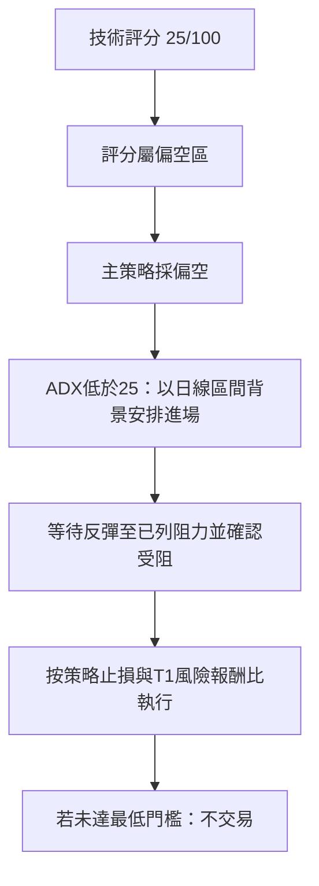

# AVAV 技術分析報告

> **報告日期**：2026-11-17 ｜ **語言**：繁體中文 ｜ **數據來源**：Yahoo Finance ｜ **當前價格**：$109.50 USD（2026-11-16 收盤）

---

## 目錄

| 章節 | 內容 |
|------|------|
| [1. 技術面概覽](#1-技術面概覽) | 核心指標速覽、評分卡 |
| [2. 趨勢分析](#2-趨勢分析) | 長中短期走勢、ADX |
| [3. 圖表形態分析](#3-圖表形態分析) | 形態、K 線、缺口 |
| [4. 支撐與阻力](#4-支撐與阻力) | 關鍵價位、斐波那契 |
| [5. 技術指標深度解讀](#5-技術指標深度解讀) | 均線、動能、布林、成交量、進階指標 |
| [6. 動能與波動率](#6-動能與波動率) | ATR、Beta、相對強度 |
| [7. 多時框架總結](#7-多時框架總結) | 時框架矩陣與收斂結論 |
| [8. 交易策略建議](#8-交易策略建議) | 歷史基準、情境、策略與風險報酬比 |
| [9. 風險提示與監控](#9-風險提示與監控) | 監控指標、風險場景 |

---

## 1. 技術面概覽

AVAV 的技術面整體偏空：價格低於主要均線，多時框訊號一致偏空，且成交量指標未顯示明確的吸籌確認。  
日線 ADX 顯示趨勢強度不足，短線宜按盤整行情處理，不宜把超跌或日線 MACD 柱轉正直接當成趨勢反轉。  
最大的反向風險是日線 RSI 底背離及 MACD 柱轉正，若價格在支撐區止跌並改善量價結構，空頭動能可能減弱。

### 📊 核心指標速覽表

| 指標類別 | 指標名稱 | 當前數值 | 訊號 | 解讀 |
|----------|----------|----------|------|------|
| **價格** | 當前價格 | $109.50 | 🔴 | 接近 52 週價格區間低端，趨勢仍弱。 |
| **均線** | MA20 / MA50 / MA200 | 見第 5 章 | 🔴 | 價格低於三條均線，均線呈空頭排列。 |
| **動能** | RSI(14)（日線） | 見第 5 章 | 🟡 | 尚未進入超賣區；有底背離提示，但仍屬弱勢區間。 |
| **動能** | MACD 柱（日線） | 見第 5 章 | 🟡 | 柱值轉正，但 MACD 線仍在零軸下方。 |
| **趨勢** | ADX(14) | 見第 2 章 | 🟡 | ADX 低於趨勢判定門檻，偏盤整而非強趨勢。 |
| **波動** | ATR(14) | 見第 6 章 | 🔴 | 相對價格的日波動幅度偏高，部位與止損需留意波動。 |
| **多時框** | 一致性 | 見第 7 章 | 🔴 | 日、週、月方向均偏空，方向訊號一致。 |

### 🏆 技術評分卡

六項子評分採整數，綜合評分為六項算術平均，四捨五入至整數。

| 維度 | 評分（0–100） | 訊號 | 主要依據（引用數值所在章節） |
|------|---------------|------|------------------------------|
| 趨勢強度 | 15 | 🔴 | 價格在長中期均線下方；ADX 偏低但 DI 仍由空方主導，見第 2、5 章。 |
| 動能指標 | 35 | 🔴 | RSI 仍弱，週、月動能偏空；日線 MACD 柱轉正及 RSI 底背離提供反向訊號，見第 5、7 章。 |
| 支撐穩定度 | 35 | 🔴 | 價格位於近年低位區域，支撐測試壓力較大；尚無量能反轉確認，見第 4、5 章。 |
| 成交量配合 | 25 | 🔴 | OBV 弱於其均線，A/D 與價格同向下行，見第 5 章。 |
| 形態完整度 | 30 | 🔴 | 尚無足夠幾何證據確認反轉形態，主要是弱勢趨勢與指標型訊號，見第 3 章。 |
| 均線排列 | 10 | 🔴 | 短、中、長期均線呈空頭排列，見第 5 章。 |
| **綜合評分** | **25** | **偏空** | 六項平均為 25；依評分路由，主策略採偏空方向。 |

---

## 2. 趨勢分析

**結論：**長期月線結構仍然偏空；週線亦低於其趨勢均線，近期週 RSI 處於弱勢區。日線 ADX 顯示目前不是強趨勢行情，因此依多時框規則，以日線布林通道作為短線區間背景；但中長期方向仍偏空，日線反彈只視為尋找空方進場時機，不據此宣告趨勢反轉。

### 📈 長期趨勢（近 12 個月）

以下按月收盤序列整理階段。最後一列的起訖收盤，以標題列所列最新收盤作為終點，不在本表重複抄錄該價格。

| 期間 | 起訖月收盤 | 漲跌幅 | 特徵 |
|------|------------|--------|------|
| 2025-12 至 2026-01 | $241.89 → $278.39 | +15.1% | 短暫反彈，未能形成持續上升結構。 |
| 2026-01 至 2026-03 | $278.39 → $183.05 | -34.2% | 明顯回落，月收盤連續下移。 |
| 2026-03 至 2026-05 | $183.05 → $207.24 | +13.2% | 反彈修復，但其後未能延續。 |
| 2026-05 至 2026-10 | $207.24 → $126.11 | -39.1% | 下跌趨勢延續，月線高低位整體走低。 |
| 2026-10 至 2026-11 | $126.11 → 最新收盤（見標題列） | -13.2% | 11 月序列截至最新交易日仍向下，月線尚未收定。 |

**長期判讀：**

- 月線趨勢均線與月線 RSI 均指向偏空，表示弱勢不只出現在日線。
- 近 12 個月呈現大幅回落後的反彈失敗；截至目前，尚無月線級別的反轉確認。
- 近月成交量有放大月份，但現有資料未顯示價格上漲與成交量持續配合的反轉結構。
- 因 11 月月 K 尚未完成，月收盤序列仍可能變動；方向判斷應視為截至最新交易日的暫定狀態。

### 📊 中期趨勢（週線）

週線方向依「多時框指標」為偏空：收盤低於週線趨勢均線，週 RSI 低於中性分界，週 MACD 柱為負。近週序列中，價格曾由 10 月初的 $140.82 下行至 10 月中旬的 $121.79，之後短暫回升至 10 月底的 $126.11，再於 11 月上旬跌至 $112.76；最新未完成週 K 仍偏弱。

| 週末日期 | 週收盤 | 週 RSI(14) | 週 MACD 柱 | 週成交量 | 解讀 |
|----------|--------|------------|------------|----------|------|
| 2026-10-02 | $140.82 | 41.9 | +1.648 | 6,770,400 | 週動能仍為正，但價格已處於回落階段。 |
| 2026-10-16 | $121.79 | 38.2 | -0.173 | 8,156,300 | 動能轉負，週線弱勢加深。 |
| 2026-10-30 | $126.11 | 39.6 | -0.618 | 5,923,400 | 價格反彈，但週 MACD 柱仍負。 |
| 2026-11-06 | $112.76 | 36.8 | -1.231 | 8,672,900 | 下行壓力加大，動能負值擴大。 |
| 2026-11-13 | $117.52 | 38.5 | -1.078 | 5,751,400 | 有反彈，但週 MACD 柱仍負。 |
| 2026-11-16 | 最新未完成週 K | 36.7 | -1.265 | 1,098,000 | 週線指標表仍偏空；本週 K 棒未完成。 |

### ⚡ 趨勢強度（ADX）

| 指標 | 數值 | 解讀 |
|------|------:|------|
| ADX(14) | 18.94 | 低於 25，屬弱趨勢／盤整判定。 |
| +DI | 19.58 | 多方方向指標較弱。 |
| −DI | 32.33 | 高於 +DI，方向上由空方主導。 |

ADX 低於趨勢行情門檻，因此短線依規則 14 採盤整行情優先級，以日線布林通道作為區間參考，而不是用日線單一反彈訊號推翻週、月線偏空結構。這代表「趨勢強度弱」不等於「方向中性」：DI、均線和多時框仍共同支持偏空方向。

---

## 3. 圖表形態分析

**結論：**現有價格序列可確認的是均線空頭排列、週線動能轉弱與近期價格下行，尚不足以可靠辨認頭肩、雙底、旗形等幾何形態。近期 K 棒出現過下影線與長上影線，但單根 K 棒不構成反轉確認；市場脈絡區塊未偵測到近期符合門檻的跳空缺口。

### 🔍 形態識別

| 形態 | 信心度 | 判斷依據 | 完成度 | 目標價 |
|------|--------|----------|--------|--------|
| 均線空頭排列 | 高 | MA20、MA50、MA200 的順序呈空頭排列，且價格低於三者，詳見第 5 章。 | 已形成，但屬趨勢指標，不是幾何圖形。 | 不適用；不以此形態高度推算目標。 |
| 日線 RSI 底背離訊號 | 低 | 程式以近 20 根 K 棒首尾的價格方向與 RSI 方向比較，標記為底背離；此訊號尚未獲週、月動能與量能確認。 | 只屬指標型提示，未確認反轉。 | 不適用；沒有可稽核的形態高度。 |
| 頭肩／雙底／旗形等幾何形態 | 低 | 現有日、週 OHLC 摘要不足以確認關鍵波峰、波谷與頸線的幾何結構。 | 訊號不足，僅做指標型解讀。 | N/A（數據未提供），不推算。 |

### 🕯️ 重要 K 線形態與缺口

下表只按「近 10 根日 K」與「近 8 根週 K」所列 OHLC 判斷。形態名稱描述單根 K 棒外觀，不等同反轉確認。

| 日期（日 K／週 K） | 開 | 高 | 低 | 收 | K 線形態 | 解讀 | 訊號 |
|------|----:|----:|----:|----:|----------|------|------|
| 2026-11-05（日 K） | $110.28 | $112.33 | $101.07 | $102.08 | 長實體黑 K，低位收盤 | 賣壓明顯，收盤接近當日低位；單根棒不證明後續必續跌。 | 🔴 |
| 2026-11-06（日 K） | $104.36 | $113.65 | $100.40 | $112.76 | 長下影陽 K | 低位出現承接並收高，但後續價格未延續成穩定反彈。 | 🟡 |
| 2026-11-09（日 K） | $114.12 | $128.52 | $111.95 | $126.96 | 長實體陽 K | 反彈力度顯著；之後數根日 K 回落，顯示反彈未獲延續。 | 🟡 |
| 2026-11-16（日 K） | $114.81 | $116.21 | $109.15 | $109.50 | 長實體黑 K，收盤接近低位 | 日內賣壓主導，與短線弱勢方向一致。 | 🔴 |
| 2026-11-06（週 K） | $126.20 | $128.10 | $100.40 | $112.76 | 長實體黑 K，帶長下影 | 週內曾大幅下探後收復部分跌幅，但週收仍弱。 | 🔴 |
| 2026-11-13（週 K） | $114.12 | $128.52 | $111.95 | $117.52 | 陽 K，長上影 | 高位遭遇賣壓，反彈未能收在週內高位附近。 | 🟡／🔴 |
| 2026-11-16（週 K） | $114.81 | $116.21 | $109.15 | $109.50 | 黑 K，收盤偏低 | 本週尚未收定；截至最新交易日，賣方仍占優。 | 🔴 |

**跳空缺口：**

| 觀察範圍 | 結果 |
|----------|------|
| 近 60 個交易日、門檻至少 1% | 無；市場脈絡區塊未偵測到符合門檻的缺口。 |
| 未回補缺口區間 | 數據中未偵測到。 |

---

## 4. 支撐與阻力

**結論：**價格位於近年低位區域，短線需要先觀察波段支撐能否有效承接；上方波段阻力與均線壓力同時存在。支撐／阻力以下均照列 OHLCV 波段聚類價位，不另以主觀畫線新增價位。

### 🚧 阻力位分析表

波段阻力聚類標題標示為「近一年波段高點聚類」。

| 阻力級別 | 價位 | 形成原因 | 突破難度 | 重要性 |
|----------|------:|----------|----------|--------|
| R1 | $128.52 | 近一年波段高點聚類的第一阻力。 | 中 | 反彈首先需要面對的波段供給區。 |
| R2 | $138.43 | 近一年波段高點聚類的第二阻力。 | 高 | 與週線價格結構及中期均線壓力相近，突破需有持續買盤確認。 |
| R3 | $162.30 | 近一年波段高點聚類的第三阻力。 | 高 | 若價格回升至此，代表反彈幅度已擴大，但仍不能單獨證明長期趨勢翻多。 |

### 🛡️ 支撐位分析表

波段支撐聚類標題標示為「近兩年波段低點聚類」，表示支撐側已放寬回溯期間。

| 支撐級別 | 價位 | 形成原因 | 守住可能性 | 重要性 |
|----------|------:|----------|------------|--------|
| S1 | $102.25 | 近兩年波段低點聚類的第一支撐。 | 中 | 短線價格若再度測試，須觀察收盤是否企穩及量價是否改善。 |
| S2 | $100.40 | 近兩年波段低點聚類的第二支撐；亦為 52 週低位。 | 低 | 若有效跌破，價格將處於更深的低位探索階段；下方未提供波段 S3。 |

**補充樞軸點：**波段阻力與支撐均至少有兩個已列價位，因此無須以樞軸點補足波段價位。本章不把樞軸公式值混列為 R 或 S。

### 📐 斐波那契回調位分析

回調位依已列的 52 週區間計算，以下只列指定斐波那契位階。現價低於已列的 78.6% 回調位，並高於 100% 回調位所代表的 52 週低點。

| 回調位階 | 價位 | 技術含義 |
|----------|------:|----------|
| 23.6% | $335.60 | 遠高於現價；現階段不是短線附近的交易參考。 |
| 38.2% | $290.65 | 若長期反彈，仍需先收復多個更近的阻力與均線區。 |
| 50.0% | $254.33 | 屬更高層級反彈回撤參考。 |
| 61.8% | $218.00 | 位於中長期反彈路徑上方，非當前近端支撐。 |
| 78.6% | $166.28 | 高於現價；價格仍在其下方，反映回撤已深入。 |

---

## 5. 技術指標深度解讀

**結論：**均線系統、週月線動能及價格相對進階指標的位置整體偏空；日線 RSI 底背離與 MACD 柱轉正則是短線反向訊號。這些反向訊號尚未得到週線 MACD、OBV、A/D 或均線排列確認，因此目前較合理的解讀是「下跌趨勢中的短線動能修復」，而非已確認反轉。

### 📈 均線、RSI、MACD、布林通道

| 指標 | 數值 | 訊號 | 解讀 |
|------|------|------|------|
| MA20 / MA50 / MA200 與排列 | MA20 $120.63；MA50 $134.44；MA200 $174.24；MA20 < MA50 < MA200 | 🔴 | 價格低於三條均線且均線空頭排列，短中長期趨勢壓力一致。 |
| RSI(14)（日線）與背離 | RSI 38.72；程式標記近 20 根 K 棒首尾比較為底背離 | 🟡 | RSI 位於中性偏弱區，未達超賣；底背離代表跌勢動能可能減弱，但尚未確認價格反轉。 |
| MACD 線 / Signal / 柱（日線） | MACD -4.733；Signal -5.014；柱 +0.280 | 🟡 | 柱值轉正且高於 Signal，短線動能改善；但 MACD 線仍為負值，仍在零軸下方，未形成完整多頭趨勢訊號。 |
| Stoch（日線） | %K 23.93；%D 40.90 | 🟡 | %K 低於 %D，短線反彈動能尚未確認；整體讀數列為中性。 |
| 布林通道（日線） | 上軌 $135.34；中軌 $120.63；下軌 $105.92；%B 0.12 | 🟡／🔴 | %B 靠近通道下側，價格偏弱；ADX 顯示盤整，因此通道上下軌適合作為短線區間背景，但不等於價格必然均值回歸。 |

**指標整合：**空頭均線排列、偏弱 RSI、負值 MACD 線、週線負 MACD 柱及布林 %B 靠近下側互相確認中短期弱勢。相對地，日線 MACD 柱轉正與程式標記的 RSI 底背離，顯示下跌動能可能放緩；然而二者仍未與週線、月線方向或成交量趨勢形成一致的反轉確認。故短線可以出現反彈，但在收復均線與改善量價之前，尚不足以把主方向改判為偏多。

### 💹 成交量（量價配合度）

| 指標 | 數值／狀態 | 訊號 | 解讀 |
|------|------------|------|------|
| 最新成交量 | 1,098,000 | 🟡 | 低於 20 日及 50 日均量；最新單日量能沒有顯示強力反轉需求。 |
| 20 日均量 | 1,339,870 | — | 作為短期量能比較基準。 |
| 50 日均量 | 1,763,060 | — | 高於最新成交量，顯示近期交易活躍度較較長短期均值低。 |
| 量比 | 0.82 倍 | 🔴 | 最新成交量低於 20 日均量，不構成量增上攻確認。 |
| OBV | OBV < MA | 🔴 | OBV 低於其均線，程式判定量能疲弱；尚無明確累積買盤訊號。 |
| A/D 線（近 20 根） | 不高於 20 日均值；A/D 下降、價格下跌 | 🔴 | A/D 與價格同向下行，量價關係確認近期弱勢，而非背離型吸籌。 |

**量價結論：**OBV 與 A/D 對價格下跌提供確認，最新量比亦未呈現積極買盤。日線反彈訊號目前未伴隨可靠的量能確認，若反彈量能仍弱，較容易在上方阻力處受壓；若下跌時量能明顯擴大，則需提高支撐失守風險評估。

### 🧭 進階指標

| 指標 | 數值 | 收盤相對位置 | 解讀 |
|------|------|--------------|------|
| 一目均衡表（轉換線／基準線／雲層） | 轉換線 $114.46；基準線 $119.41；最新雲層先行帶 A $146.44、B $171.04；前方 26 根雲層先行帶 A $116.94、B $134.20 | 收盤位於雲層下方；轉換線低於基準線；前方雲層 A 低於 B | 一目結構偏空，且前方雲層仍偏空；與均線排列、週線動能一致，與日線 MACD 柱轉正相矛盾。 |
| 成交量分布（近 252 個交易日） | POC $145.29；價值區 $138.88–$254.33（含 72% 成交量） | 收盤位於價值區下方 | 價格低於主要成交密集區，表示上方可能存在供給與解套壓力；需重新進入價值區才可視為結構改善。 |
| 錨定 VWAP（自 52 週高點） | $183.44 | 收盤在其下方 | 自高點以來的成交量加權成本高於現價，長期持倉的平均成本區可能構成上方壓力。 |
| 錨定 VWAP（自 52 週低點） | $118.52 | 收盤在其下方 | 即使以近期低點為錨，現價亦低於該錨定 VWAP；反彈仍須先改善近期成交成本結構。 |
| A/D 線（近 20 根） | 不高於其 20 日均值；下降 | — | 與價格下跌同向，未見 A/D 背離確認；和 OBV 弱勢結論一致。 |

---

## 6. 動能與波動率

**結論：**AVAV 的日波動幅度偏高，止損距離若過窄容易受正常波動觸發。相對 VTI 的各觀察期間均落後，且 Beta 高於 1，反映其市場敏感度較大；這些背景均不利於在未確認反彈前追買，也要求偏空策略控制倉位與跳空風險。

### 📊 ATR 波動率分析

| 指標 | 數值 | 解讀 |
|------|------:|------|
| ATR(14) | $7.97 | Wilder ATR，表示近期每日真實波動幅度。 |
| ATR 佔價格比例 | 7.28% | 相對價格的波動幅度偏高，短線止損容易受到日常振幅影響。 |
| 1.5 倍 ATR 距離 | $11.96 | 作為波動距離參考，不是依此新增支撐、阻力或策略止損價。 |
| 2 倍 ATR 距離 | $15.94 | 較寬的波動距離參考；實際止損仍須遵守第 8 章列出的已計算價位。 |

**ATR 使用方式：**

- ATR 是波動量尺，不是方向指標；不能單獨推斷漲跌。
- 在本股高波動背景下，倉位大小應按「進場至止損」的距離調整，而不是用固定股數。
- 若策略採用的圖表止損距離小於常態波動，須理解短暫波動可能造成止損觸發。
- 本報告的策略止損只採用已列出的關鍵價位，不用 ATR 推算新的精確價格。

### 📐 Beta 與相對強度

| 期間 | AVAV 價格報酬 | VTI 基準報酬 | 超額報酬 | 比值趨勢 |
|------|---------------:|-------------:|---------:|----------|
| 1 個月 | -4.6% | -1.9% | -2.7% | 相對走弱 |
| 3 個月 | -35.1% | -2.9% | -32.2% | 相對走弱 |
| 6 個月 | -25.6% | +2.3% | -27.9% | 相對走弱 |

| 參考指標 | 數值／狀態 | 解讀 |
|----------|------------|------|
| Beta | 1.403 | 對市場波動的敏感度高於基準；市場變動時，個股波動可能放大。 |
| 比值趨勢 | 比值低於其 50 日均值 | AVAV 相對 VTI 持續走弱，與偏空主策略方向一致。 |
| 相對產業 ETF | N/A（數據未提供） | 無法據此判斷 AVAV 相對產業 ETF 的超額表現。 |

相對強度不支持積極做多，並支持等待反彈後尋找偏空交易；但相對弱勢本身不是立即做空的充分條件，進場仍須等待策略觸發。

---

## 7. 多時框架總結

**結論：**多時框一致性為 **3/3 偏空**。雖然日線指標有底背離及 MACD 柱轉正等反向訊號，但週線與月線均偏空，且日線趨勢強度不足；因此最終方向收斂為偏空，短線策略重點是等待反彈至阻力區，而不是在低位追空。

### 📋 時框架評分表

方向、RSI、MACD 柱及趨勢均線均照抄「多時框指標」區塊；形態欄僅補充當前結構，不替代其方向分類。

| 時框架 | 趨勢方向 | RSI(14) | MACD 柱 | 收盤 vs 趨勢均線 | 形態 | 建議 |
|--------|----------|---------|---------|------------------|------|------|
| 日線 | 偏空 | 38.72 | +0.280 | MA50 $134.44 下方 | 均線空頭排列；有 RSI 底背離提示，未確認反轉 | 偏空背景下等待反彈確認，不追低。 |
| 週線 | 偏空 | 36.67 | -1.265 | MA20 $143.28 下方 | 週 MACD 柱為負，價格結構偏弱 | 週線方向作中期濾網，反彈仍先視為修復。 |
| 月線 | 偏空 | 29.20 | N/A（數據未提供） | MA10 $167.82 下方 | 月 RSI 偏弱；月 MACD 柱資料未提供 | 長期仍偏空，不以日線反彈改判。 |

**多時框一致性：3/3 偏空。**

### ⚖️ 多時框收斂結論

- 日線 ADX 低於 25，依規則 14 判為盤整／弱趨勢，短線以日線布林通道上下軌作為區間背景。
- 但日、週、月方向依多時框指標均偏空，因此方向判斷不因日線盤整而改為偏多。
- 日線只用於尋找空方進場時機；週線與月線的偏空方向，以及 MA50／MA200 下方結構，維持中長期偏空權重。
- **唯一方向性結論：偏空。**短線仍可能反彈，但反彈尚未改變多時框結構。

---

## 8. 交易策略建議

**當前主策略方向 = 偏空（依評分 25/100）。**日線 ADX 偏低，故執行上不追空，優先等待價格反彈至已列阻力並出現受阻確認；所有交易策略的 T1 風險報酬比均須達最低門檻。

### 🧭 策略路由

### 📊 歷史基準機率

今日狀態定義為「RSI(14) 位於 30–50，且收盤低於 MA200」。歷史樣本期間為 2016-11-14 至 2026-11-16，共 2,515 個交易日；以下是價格報酬，不含股息。

| 持有期 | 相同狀態樣本（段數） | 上漲比例 | 中位數報酬 | 25%–75% 分位 | 全部交易日上漲比例／中位數 |
|--------|----------------------|----------|------------|--------------|---------------------------|
| 5 日 | 535（84 段） | 53% | +0.4% | -3.3% 至 +4.9% | 52%／+0.3% |
| 20 日 | 526（81 段） | 56% | +2.0% | -7.5% 至 +10.6% | 53%／+0.8% |
| 60 日 | 498（79 段） | 51% | +0.7% | -17.1% 至 +19.6% | 52%／+2.0% |

相同狀態下的上漲比例與全部交易日基準接近，並未顯示足以強力支持方向性預測的差異。20 日持有期的歷史上漲比例高於全部交易日，但其中狀態連續出現且持有期互相重疊，段數較交易日樣本少，獨立事件資訊有限。這些歷史頻率是回顧性統計，不是預測；對偏空主策略而言，歷史基準提供有限抵銷，不能取代當前多時框偏空訊號，也不能視為做空成功機率。

### 🎯 價格情境階梯（Price Scenarios）

表中價位只引用第 4 章已列波段位階；情境可能性以高／中／低表示，不代表統計機率。

| 觸發條件 | 下一目標 | 後續延伸 | 可能性 | 依據 |
|----------|----------|----------|--------|------|
| 有效突破 R1 | R2 | R3 | 低 | 均線、一目與價值區均形成上方壓力；若突破伴隨量能改善，需重新評估偏空策略。 |
| 在 S1 與上方阻力間維持區間 | — | — | 中 | ADX 指向盤整；若價格在區間內反覆震盪，應等待方向確認，不宜追價。 |
| 有效跌破 S1 | S2 | 數據中未偵測到更低波段支撐 | 中 | 多時框偏空、OBV 弱勢支持下行風險；但臨近低位時需防止急速反彈。 |

### 🟢 主策略詳情（方向依上方路由）

策略 A 是首選反彈空方方案；策略 B 是較高位置的次選方案。兩者不可同時滿倉執行，且都須先出現價格到達預設阻力後的受阻確認。

| 策略要素 | 策略 A：R1 受阻做空 | 策略 B：R2 受阻做空 |
|----------|---------------------|---------------------|
| 進場條件 | 價格反彈至 R1，日線收盤未能有效站上，並出現受阻訊號。 | 價格進一步反彈至 R2，但仍無法有效站穩，且週、月方向未轉多。 |
| 進場價格 | $128.52 | $138.43 |
| 目標價 T1 | $102.25 | $102.25 |
| 目標價 T2 | $100.40 | $100.40 |
| 止損價格 | $138.43 | $162.30 |
| 風險報酬比 | **1 : 2.65（以 T1 計）** | **1 : 1.52（以 T1 計）** |
| 比值核對 | (128.52 − 102.25) ÷ (138.43 − 128.52) = 2.65 | (138.43 − 102.25) ÷ (162.30 − 138.43) = 1.52 |
| 把握度 | 中；多時框偏空，但須等待反彈受阻，且相對弱勢不等於必然續跌。 | 低至中；風險報酬比達門檻，但需較大幅度反彈才能觸發，空方結構仍需確認。 |
| 建議倉位 | 資金 1%，且以止損距離控制實際風險。 | 資金 0.5%；只有在策略 A 未進場且條件重新成立時考慮。 |
| 風險與持有 | 若持倉跨越第 9 章所列財報日，財報可能造成跳空，止損不保證成交。 | 若持倉跨越第 9 章所列財報日，財報可能造成跳空，止損不保證成交。 |

**執行限制：**

- 兩個策略的進場均須等待指定價位觸及及受阻確認；未觸及時不追空。
- 若跳空穿越止損價，實際成交可能劣於計畫止損。
- 若價格未按策略條件到達預設進場價，或量價訊號與多時框方向明顯改善，應取消原掛單並重新評估。
- 策略 A 為首選；策略 B 不與策略 A 疊加成雙倍方向曝險。

### 🔴 反向風險觸發點（對沖提示）

- 若價格有效突破並站穩 R1，短線空方受阻假設開始失效；若進一步收復 R2，應重新評估空方部位。
- 若日線 RSI 底背離延續，且 MACD 柱改善同時 OBV、A/D 不再走弱，空方動能減弱風險上升。
- 若收復主要均線並帶動週線方向翻轉，須重新執行多時框評估；單日反彈不構成反向交易訊號。

---

## 9. 風險提示與監控

**結論：**主要風險包括支撐失守後的加速下跌、低位急反彈造成空單回撤，以及財報事件引發的跳空。監控須以已列波段價位、量價變化和多時框方向為主；遇到價格跳空時，應假設止損可能無法按預設價格成交。

### ✅ 關鍵監控指標

| 監控項目 | 觸發條件 | 動作 |
|----------|----------|------|
| R1 | 反彈至 R1 後受阻 | 只按策略 A 的條件評估進場；未確認受阻不掛追價空單。 |
| R2 | 價格到達 R2 且未能站穩 | 只有在策略 A 未執行、且中長期空方結構未變時，評估策略 B。 |
| S1 | 價格測試 S1 | 檢查成交量、日線收盤及反彈力度；避免在支撐上方盲目追空。 |
| S2 | 價格跌破 S2 | 暫停以既有支撐作為下方目標的推論；數據未偵測到更低波段支撐，重新評估風險。 |
| 均線與多時框 | 日線反彈但週、月仍偏空，或週月方向出現變化 | 依第 7 章的多時框方向重新檢查；不以單一日線訊號改變主方向。 |
| OBV／A/D | 量能指標由弱轉強，或與價格方向背離 | 若出現持續改善，降低空方倉位或取消未觸發策略。 |
| 下次財報日 | 2026-12-02；距最新收盤日 16 個日曆天（Yahoo Finance，日期可能調整） | 檢查策略是否跨越財報；財報可能引發跳空，止損不保證成交。 |

### ⚠️ 風險場景

| 情境 | 觸發條件 | 參考價位 | 應對 | 可能性 |
|------|----------|----------|------|--------|
| 樂觀（空方風險） | 反彈突破 R1 並能延續，動能與量能同步改善 | R1，其後觀察 R2 | 不追空；重新核對日線與週線方向，必要時按原策略止損。 | 中 |
| 基本（區間整理） | 價格在 S1 與上方阻力間反覆，缺乏有效突破 | 參照第 4 章 S1、R1 | 等待價格到達已列策略位階並確認受阻；區間中段不追價。 | 中 |
| 悲觀（延續下跌） | 有效跌破 S1，並向 S2 推進 | S1、S2 | 不因既有空單獲利而忽略反彈風險；若跌破既列支撐，重新評估目標與風險。 | 中 |

以上可能性是依目前技術結構作高／中／低定性判斷，不是統計機率。歷史基準機率見第 8 章，與此情境評估用途不同。

### 🛡️ 風險管理提醒

1. 依策略進場價至止損價的距離計算股數，先設定可承受損失，再決定部位；高波動標的不宜沿用低波動股票的固定股數。
2. 不在價格接近支撐時追空；若未到達預設反彈進場位，維持觀望。
3. 財報期間可能出現跳空，止損價不是成交保證；若不願承受事件風險，應在事件前重新評估是否持倉。
4. 策略 A 與策略 B 是替代進場方案，不應在未重新評估總曝險下同時加碼。
5. 若價格、成交量與週月方向開始共同轉強，應優先重新評估主假設，而非只因目標價尚未到達而延後風控。

---

## 📋 報告總結

| 項目 | 結論 |
|------|------|
| 報告日期 | 2026-11-17 |
| 當前價格 | 見標題列（2026-11-16 收盤） |
| 綜合評分／方向 | 25/100，偏空 |
| 長期趨勢 | 🔴 月線結構走弱，月 RSI 仍偏弱。 |
| 中期趨勢 | 🔴 週線低於趨勢均線，週 MACD 柱為負。 |
| 短期趨勢 | 🟡 ADX 判定盤整，但 DI 與均線方向偏空；留意日線反向訊號。 |
| 關鍵支撐／關鍵阻力 | 支撐 S1、S2；阻力 R1、R2、R3，精確價位見第 4 章。 |
| 🥇 最佳機會 | 策略 A：等待反彈至 R1 並確認受阻後做空；若未觸發則觀望。 |
| 最大風險 | 低位急速反彈或財報跳空可能造成空單損失，且止損不保證按指定價格成交。 |

> ⚠️ **免責聲明**：本報告為 AI 自動生成之技術分析，所有數據及估算均基於歷史價格資訊。本報告**僅供研究與學術參考**，**不構成任何投資建議**。投資有風險，入市需謹慎。

---

## 資料與來源

| 項目 | 內容 |
|------|------|
| 價格 | 109.50 USD，2026-11-16 收盤（Yahoo Finance 日線） |
| K 棒 | 500 根日線，2024-11-18 至 2026-11-16（Yahoo Finance）；較長期間的價位與基準機率取自價格資料庫 |
| 關鍵價位回溯期間 | 阻力 近一年、支撐 近兩年 |
| 下次財報日 | 2026-12-02（Yahoo Finance，日期可能調整） |
| 有回應的資料來源 | Yahoo Finance、Finviz、StockAnalysis、Roic.ai |
| 由程式計算 | 所有指標、R1–S3 與斐波那契價位、多時框方向、相對強度、缺口、歷史基準機率、綜合評分 |
| 撰寫模型 | openai / gpt-6-luna |

> 本區塊由產生報告的程式依實際取得的資料填寫，非模型撰寫。「由程式計算」的數字不是模型的估計；其餘判斷（評分、情境、策略）是模型的分析。
