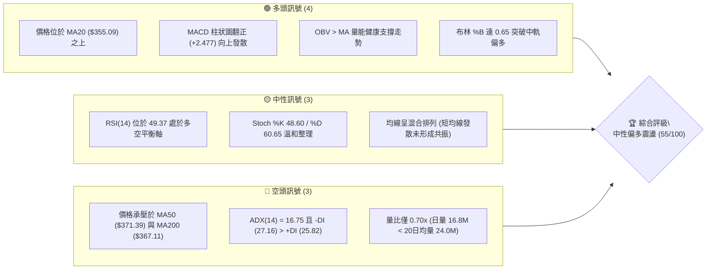
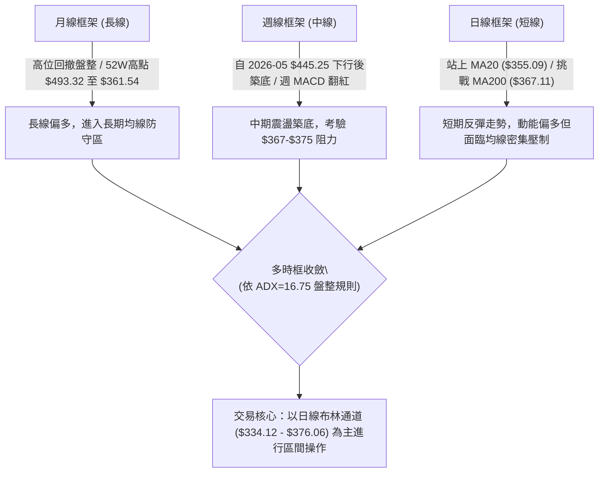
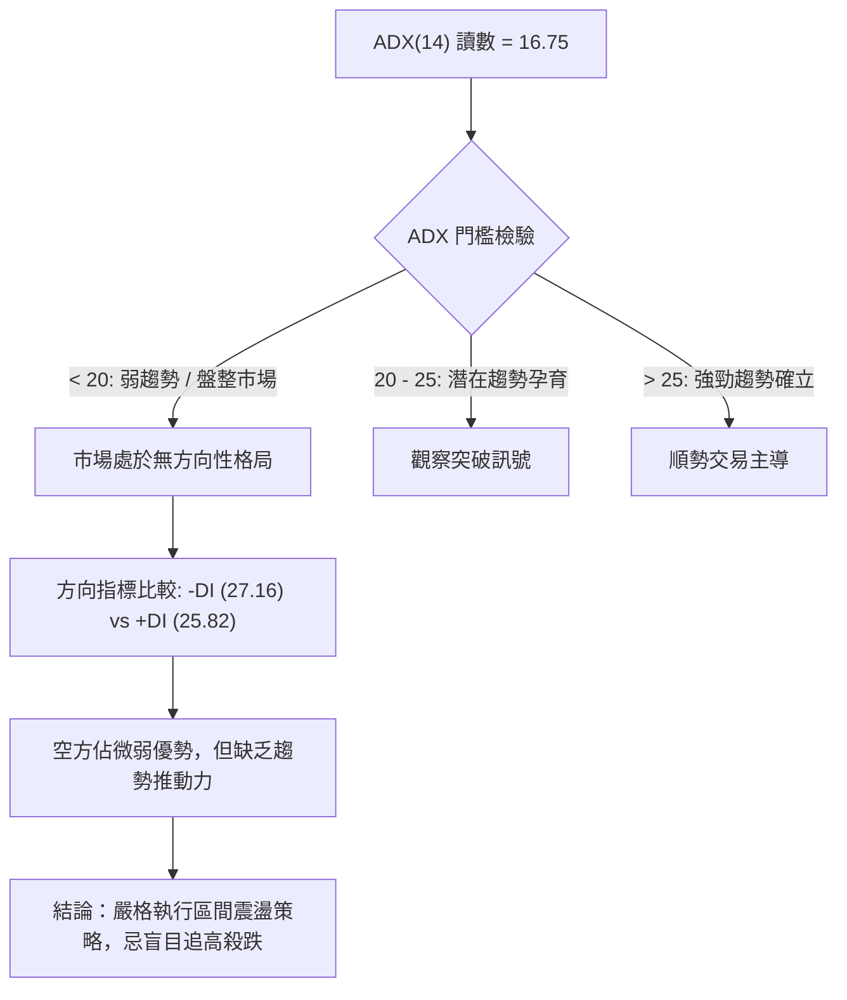
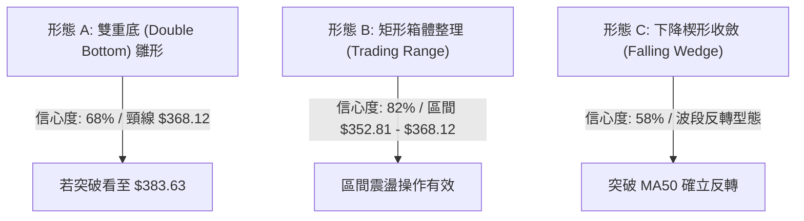
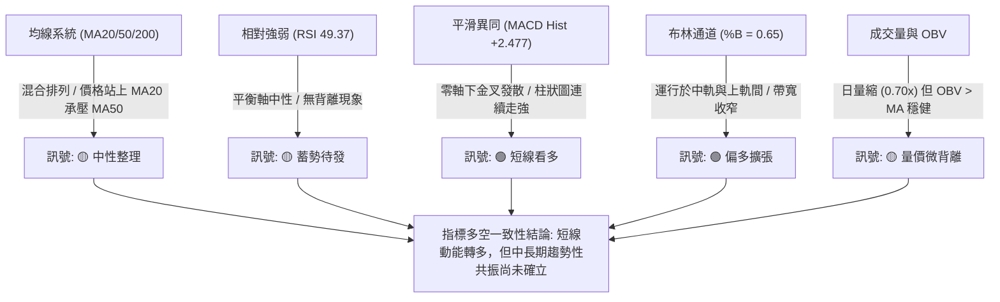
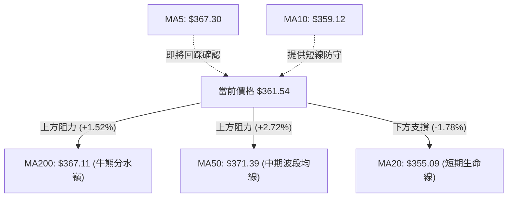
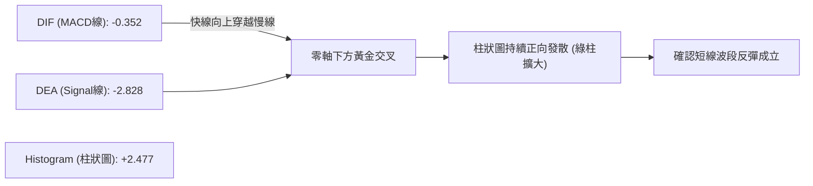
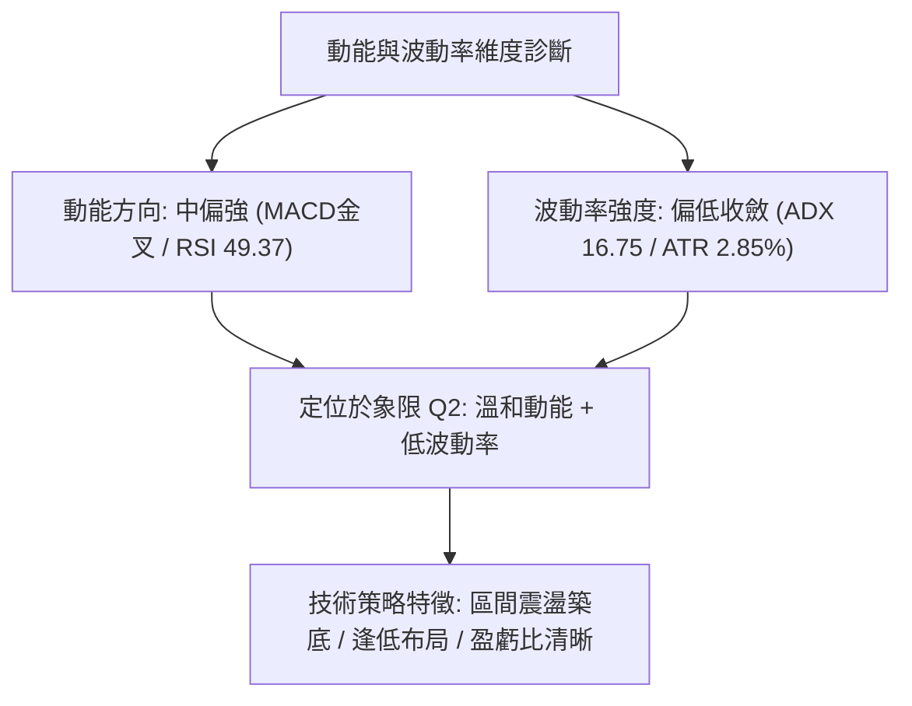
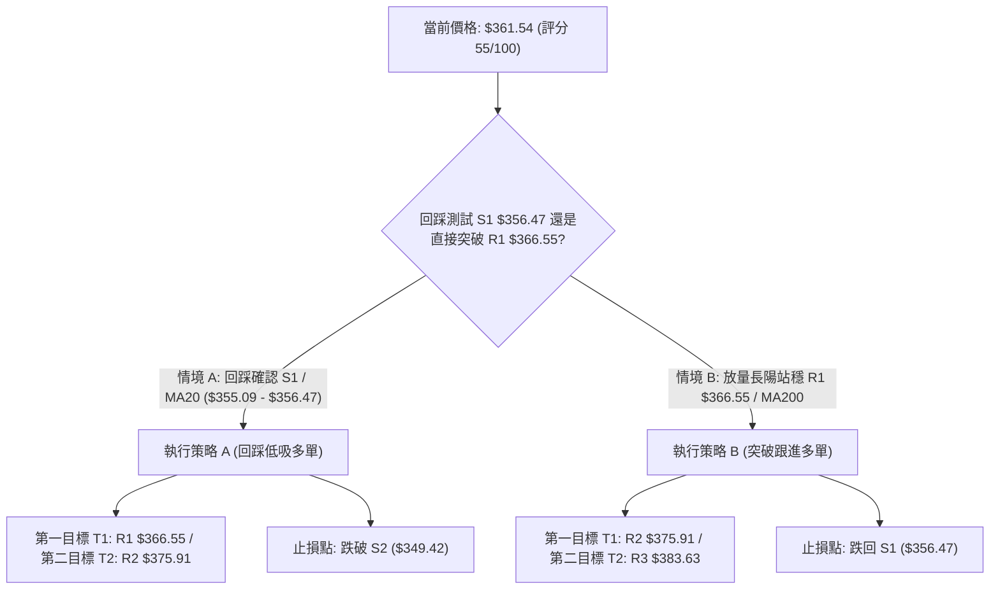
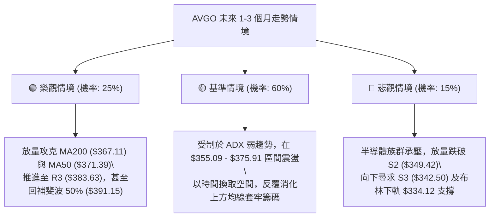

# AVGO 基本面深度分析報告

> **報告日期**：2026-10-11 ｜ **語言**：繁體中文 ｜ **數據來源**：Yahoo Finance ｜ **當前價格**：$361.54

---

## 目錄

| 章節 | 內容 |
|------|------|
| [1. 技術面概覽](#1-技術面概覽) | 訊號儀表板、核心指標、評分卡 |
| [2. 趨勢分析](#2-趨勢分析) | 多時框趨勢、長中短期走勢 |
| [3. 圖表形態分析](#3-圖表形態分析) | 形態識別、K線組合、目標價 |
| [4. 支撐與阻力](#4-支撐與阻力) | 關鍵價位、斐波那契回調 |
| [5. 技術指標深度解讀](#5-技術指標深度解讀) | MA/RSI/MACD/布林/成交量 |
| [6. 動能與波動率](#6-動能與波動率) | 動能評估、ATR、Beta |
| [7. 多時框架總結](#7-多時框架總結) | 時框架評分矩陣 |
| [8. 交易策略建議](#8-交易策略建議) | 多空策略、風險報酬比 |
| [9. 風險提示與監控](#9-風險提示與監控) | 監控指標、風險場景 |

---

## 1. 技術面概覽

### 🎯 技術訊號儀表板

Broadcom Inc.（AVGO）當前呈現「短線修復反彈、中線多空拉鋸、長線高位盤整」的複雜技術架構。下方儀表板將現有客觀數據歸納為多頭、中性與空頭訊號：



### 📊 核心指標速覽表

| 指標類別 | 指標名稱 | 當前數值 | 訊號 | 解讀 |
|----------|----------|----------|:----:|------|
| **價格** | 當前收盤價 | $361.54 | 🟡 | 位於52週區間 35.5% 分位，自高點回調後築底 |
| **均線** | MA20 | $355.09 | 🟢 | 價格在MA20上方 (+1.82%)，短線多頭掌控主動權 |
| **均線** | MA50 | $371.39 | 🔴 | 價格在MA50下方 (-2.65%)，中期下行壓力尚未完全化解 |
| **均線** | MA200 | $367.11 | 🔴 | 價格在MA200下方 (-1.52%)，長線牛熊分水嶺形成上方蓋頂 |
| **動能** | RSI(14) | 49.37 | 🟡 | 位於 30–70 中性區間，多空力量暫處動態平衡 |
| **動能** | MACD (12,26,9) | -0.352 (柱: +2.477) | 🟢 | 快慢線零軸下金叉，柱狀圖正向放大，短線修復動能充足 |
| **動能** | Stoch %K / %D | 48.60 / 60.65 | 🟡 | 動能自超買區溫和回吐後趨平，無極端偏離 |
| **趨勢** | ADX(14) | 16.75 | 🟡 | 數值低於 25，確認市場處於無方向性之盤整/吸籌架構 |
| **方向** | 方向性指標 | +DI: 25.82 / -DI: 27.16 | 🔴 | -DI 微幅高於 +DI，空頭力量尚未徹底瓦解 |
| **通道** | 布林通道 (%B) | %B: 0.65 (區間 $334.12-$376.06) | 🟢 | 突破中軌 $355.09，朝上軌 $376.06 挺進 |
| **成交量** | 量比 (Volume Ratio) | 0.70x (16.82M / 24.03M) | 🟡 | 成交量能略顯不足，顯示市場追高意願審慎 |
| **成交量** | OBV 趨勢 | OBV > MA | 🟢 | 能量潮強於均線，資金未見大幅出逃，籌碼面偏穩 |
| **波動** | ATR(14) | $10.31 (2.85%) | 🟡 | 波動率處於正常波段區間，提供清晰的風控邊界 |

### 🏆 技術評分卡

```
╔══════════════════════════════════════════════════════════════════╗
║                 技術評分卡 — AVGO (2026-10-11)                  ║
╠══════════════════════════════════════════════════════════════════╣
║ 趨勢強度 (Trend)     ████████░░░░░░░░░░░░  40/100  🔴 盤整無主導 ║
║ 動能指標 (Momentum)  ████████████░░░░░░░░  60/100  🟢 短線金叉   ║
║ 支撐穩定度 (Support) ██████████████░░░░░░  70/100  🟢 底部扎實   ║
║ 成交量配合 (Volume)  ██████████░░░░░░░░░░  50/100  🟡 量縮反彈   ║
║ 形態完整度 (Pattern) ████████████░░░░░░░░  60/100  🟡 區間築底   ║
║ 均線排列 (MAs)       ██████████░░░░░░░░░░  50/100  🟡 混合排列   ║
╠══════════════════════════════════════════════════════════════════╣
║ 綜合評分             ███████████░░░░░░░░░  55/100  🟡 中性偏多   ║
╚══════════════════════════════════════════════════════════════════╝
```

---

## 2. 趨勢分析

### 🌐 多時框趨勢分析



### 📈 長期趨勢 — 12個月走勢圖（Unicode）

以下為 AVGO 過去 12 個月（2025-11 至 2026-10）之月線收盤價走勢圖，標記歷史最高峰值、深度回撤與當前點位：

```
AVGO 月線走勢圖（過去12個月：2025-11 至 2026-10）
價格軸 ($)
$450 ┤                                  ● $445.25 (M7, 次高)
$420 ┤                             ● $416.01 (M6)
$400 ┤ ● $399.99 (M1)
$380 ┤                                       ● $377.06 (M8) ● $388.57 (M9)
$360 ┤               ● $366.90 (前高)                      ● $369.67 (M10)  ● $361.54 (M12,現價)
$340 ┤      ● $344.20 (M2)                                      ● $351.19 (M11)
$320 ┤           ● $329.48 (M3) ● $317.80 (M4)
$300 ┤                               ● $308.46 (M5,波段低點)
     └─────────────────────────────────────────────────────────────────────────────
       25-11  25-12  26-01  26-02  26-03  26-04  26-05  26-06  26-07  26-08  26-09  26-10
       (M1)   (M2)   (M3)   (M4)   (M5)   (M6)   (M7)   (M8)   (M9)   (M10)  (M11)  (M12)
```

**走勢特徵分析表格**：

| 階段 | 時間區間 | 起止價位 | 漲跌幅 | 走勢特徵與結構意涵 |
|------|----------|----------|:------:|-------------------|
| 階段 I：衝高後回調 | 2025-11 ~ 2026-03 | $399.99 → $308.46 | -22.88% | 自 $400 大關見頂回落，於 $308.46 獲得年線等級強支撐，完成籌碼換手。 |
| 階段 II：強勁主升浪 | 2026-03 ~ 2026-05 | $308.46 → $445.25 | +44.35% | 業績與 AI 題材驅動爆發性上攻，月線大陽線拉抬，創下波段收盤新高。 |
| 階段 III：獲利了結與回撤 | 2026-05 ~ 2026-09 | $445.25 → $351.19 | -21.13% | 盤中觸及 52W 高點 $493.32 後引發機構獲利回吐，呈現階梯式陰跌整理。 |
| 階段 IV：低位修復反彈 | 2026-09 ~ 2026-10 | $351.19 → $361.54 | +2.95% | 在斐波那契 61.8% ($367.03) 下方探底回升，短線動能指標修復，進入築底階段。 |

### 📊 中期趨勢（週線分析）

從近 20 週收盤走勢可見，AVGO 自 2026-05-31 的高點 $445.25 滑落後，在 2026-08-09 曾試圖反撲至 $426.98，隨後遭遇沉重賣壓，於 2026-08-30 至 2026-09-27 期間在 $352.81–$368.12 區間形成橫盤整理平台。
- **支撐測試**：2026-09-27 收盤價 $352.81 成功防守住波段支撐 S2 ($349.42)。
- **動能修復**：週線 MACD 柱狀圖已由 2026-08-23 的 -5.841 轉為 2026-10-11 的 +2.477，RSI 亦自 23.5 極度超賣區回升至 49.4 中性水位。

```
中期阻力位密集區：$375.91 (R2 / BB上軌) ── $383.63 (R3)
───────────────────────────────────────────────────── ▲
當前價格突破中軌測試區：$361.54 (現價) ── $366.55 (R1 / MA200)
───────────────────────────────────────────────────── ▼
中期支撐平台防守區：$356.47 (S1 / MA20) ── $349.42 (S2)
```

### ⚡ 趨勢強度評估（ADX 解讀）



**ADX 強度對照與市場狀態分析表**：

| 指標變數 | 當前讀數 | 基準區間 | 趨勢狀態解讀 |
|----------|:--------:|:--------:|--------------|
| **ADX(14)** | **16.75** | < 20 (極弱/盤整) | 趨勢動能匱乏，市場處於窄幅震盪與籌碼沉澱期，非單邊行情。 |
| **+DI** | **25.82** | — | 多方力量自低位回升，多頭意願逐漸復甦。 |
| **-DI** | **27.16** | — | 空方力量小幅領先（差值僅 1.34），但空頭打壓動能明顯衰竭。 |
| **市場主導架構** | **盤整吸籌** | ADX < 25 | 依照多時框收斂規則，本階段操作以**日線布林通道 ($334.12 - $376.06)** 為主交易邊界。 |

---

## 3. 圖表形態分析

### 🔍 形態識別系統



**圖表形態信心度與目標價評估表**：

| 形態名稱 | 信心度 | 判斷依據（引用數據） | 完成度 | 目標價（附嚴謹計算式） |
|----------|:------:|----------------------|:------:|------------------------|
| **矩形箱體整理 (Trading Range)** | **82%** | 箱體下緣錨定週收盤低點聚類 $352.81（近 S1 $356.47 與 S2 $349.42）；箱體上緣受阻於 2026-08-30 收盤 $368.12（近 R1 $366.55）。 | 85% | **箱體頂部目標：$368.12**<br>若向上突破，等距測幅：<br>$368.12 + ($368.12 - $352.81) = **$383.43**（精確契合阻力位 **R3 $383.63**）。 |
| **雙重底雛形 (Double Bottom)** | **68%** | 第一底為 2026-09-06 低點 $357.25，第二底為 2026-09-27 低點 $352.81；兩底間低點聚類受 S1 ($356.47) 支撐，頸線位於 2026-09-13 高點 $361.33 及前波高點 $368.12。 | 60% | **測幅目標價：$383.43**<br>計算式：頸線 $368.12 + 形態高度 ($368.12 - $352.81 = $15.31) = **$383.43**，與阻力 **R3 $383.63** 吻合。 |
| **下降通道/楔形收斂 (Falling Wedge)** | **58%** | 自 2026-08-09 高點 $426.98 下跌以來，低點下移幅度逐步趨緩，週線 MACD 柱狀圖翻正（由 -5.841 轉為 +2.477）產生指標動能收斂。 | 45% | **保守突破目標：$375.91 (R2)**<br>形態全面回補目標：斐波那契 50.0% **$391.15**。 |

### 🕯️ 重要K線形態分析

| 週/月份 | 收盤價 | K線形態 | 解讀 | 訊號 |
|---------|:------:|---------|------|:----:|
| **2026-08-23** | $367.78 | 大陰線破位 | 放量下挫摜破短期均線，週成交量 1.16 億股，確認波段下行。 | 🔴 |
| **2026-08-30** | $368.12 | 長下影錘頭十字星 | RSI 殺跌至 23.5 極度超賣，低位承接買盤浮現，形成短線第一支撐。 | 🟢 |
| **2026-09-06** | $357.25 | 帶量探底長陰 | 放量至 1.73 億股測試 S1 ($356.47) 支撐位，機構空頭動能最後釋放。 | 🟡 |
| **2026-09-27** | $352.81 | 縮量築底小陰線 | 週量萎縮至 1.07 億股，拋壓顯著衰竭，確立波段雙底右側支撐。 | 🟢 |
| **2026-10-11** | $361.54 | 溫和放量紅三兵前置陽線 | 連續三週收盤走高（352.81 → 355.14 → 361.54），突破 MA20，確認反彈。 | 🟢 |

### 📉 ASCII 走勢形態示意圖

```
AVGO 近期矩形箱體與雙重底形態示意圖：
價位 ($)
$383.63 ────────────────────────────────────────── 形態破位等距目標位 (R3)
              ▲
              │ 形態高度 H = $15.31
              ▼
$368.12 ──────┬─────────────────●───────────────── 箱體上軌 / 雙底頸線 (R1 $366.55 鄰近)
              │               ╱   ╲   現價 $361.54
$361.54 ──────┼──────────────●─────●────────────── (突破 MA20 $355.09)
              │            ╱         ╲ ╱
$352.81 ──────┴───●───────●───────────●─────────── 箱體下軌 / 雙底低點 (S1/S2 支撐帶)
                 底 1    回升        底 2
                 (09-06) (09-13)     (09-27)
```

### 🎯 形態目標價計算

根據經典技術分析形態學測幅原理：
1. **箱體/雙底形態高度 ($H$)**：
   $$H = \text{頸線/箱體上軌} - \text{箱體下軌} = \$368.12 - \$352.81 = \$15.31$$
2. **第一目標價 ($T_1$)**：
   $$T_1 = \text{阻力位 R2} = \$375.91 \quad (\text{兼布林上軌 } \$376.06)$$
3. **第二形態延伸目標價 ($T_2$)**：
   $$T_2 = \text{頸線突破點} + H = \$368.12 + \$15.31 = \$383.43$$
   此數據與 OHLCV 計算之關鍵阻力位 **R3 ($383.63)** 高度共振（誤差僅 $0.20，誤差率 < 0.05%）。

---

## 4. 支撐與阻力

### 🗺️ 關鍵價位分布圖（Unicode）

```
AVGO 價位結構分布圖（OHLCV 關鍵聚類點）
════════════════════════════════════════════════════════════════════════
$383.63 ║████████████████████████████████████████║ 強阻力 R3 (形態等距目標)
$375.91 ║██████████████████████████████          ║ 阻力 R2 (布林上軌重合區)
$371.39 ║▓▓▓▓▓▓▓▓▓▓▓▓▓▓▓▓▓▓▓▓▓▓▓▓                  ║ 中期均線阻力 MA50
$367.11 ║████████████████████████                ║ 長期牛熊線 MA200 / 斐波 61.8% ($367.03)
$366.55 ║████████████████████                    ║ 關鍵阻力 R1 (波段頸線密集區)
$361.54 ╠════════════════════════════════════════╣ ◄ 現價 ($361.54)
$356.47 ║▓▓▓▓▓▓▓▓▓▓▓▓▓▓▓▓▓▓▓▓                    ║ 近期支撐 S1 (MA20 $355.09 重合區)
$349.42 ║████████████████████████                ║ 強支撐 S2 (波段低點聚類)
$342.50 ║██████████████████████████████          ║ 關鍵防守 S3 (月線強支撐)
$334.12 ║████████████████████████████████████████║ 極限支撐 (布林通道下軌)
════════════════════════════════════════════════════════════════════════
```

### 🚧 阻力位分析表

所有價位均嚴格引用 OHLCV 計算之波段高點聚類數值：

| 阻力級別 | 精確價位 | 距現價幅 | 形成原因與技術共振 | 突破難度 | 重要性 |
|:--------:|:--------:|:--------:|--------------------|:--------:|:------:|
| **R1** | **$366.55** | +1.39% | 近一年波段高點聚類點；緊鄰 MA200 ($367.11) 與斐波那契 61.8% ($367.03)，形成第一道密集均線壓力牆。 | 🟡 中等 | ★★★☆☆ |
| **R2** | **$375.91** | +3.97% | 近期震盪高點聚類點；與布林通道上軌 ($376.06) 及 MA60 ($373.19) 形成高壓共振區。 | 🔴 偏高 | ★★★★☆ |
| **R3** | **$383.63** | +6.11% | 波段強阻力聚類點；為雙底/箱體突破之理論等距測幅終點 ($383.43)，亦為 8 月反彈中繼平台下緣。 | 🔴 極高 | ★★★★★ |

### 🛡️ 支撐位分析表

所有價位均嚴格引用 OHLCV 計算之波段低點聚類數值：

| 支撐級別 | 精確價位 | 距現價幅 | 形成原因與技術共振 | 守住機率 | 重要性 |
|:--------:|:--------:|:--------:|--------------------|:--------:|:------:|
| **S1** | **$356.47** | -1.40% | 近一年波段低點聚類點；與日線 MA20 ($355.09) 及布林中軌完全重疊，為短線多頭防守第一道關卡。 | 🟢 80% | ★★★★☆ |
| **S2** | **$349.42** | -3.35% | 波段低點強聚類點；緊扣 9 月下旬低點平台 $352.81 下沿，多頭防守核心陣地。 | 🟢 75% | ★★★★★ |
| **S3** | **$342.50** | -5.27% | 深度回調低點聚類點；接近 2025-12 月線收盤價 $344.20，跌破將引發中長線趨勢惡化。 | 🟢 85% | ★★★★☆ |

### 📐 斐波那契回調位分析

依據 52 週極值區間（低點 **$288.98** → 高點 **$493.32**，垂直波幅 $204.34）計算：

```
斐波那契回調層級分布：
 0.0% (52W High) ──────── $493.32
23.6%            ──────── $445.09
38.2%            ──────── $415.26
50.0%            ──────── $391.15
61.8%            ──────── $367.03  ◄── 關鍵多空黃金分割阻力區
-------------------------------------------------------------- [現價 $361.54]
78.6%            ──────── $332.71  ◄── 深度防禦位 (近布林下軌 $334.12)
100.0% (52W Low) ──────── $288.98
```

- **當前位置解讀**：現價 **$361.54** 位於斐波那契 **61.8% ($367.03)** 與 **78.6% ($332.71)** 之間。
- **技術意義**：61.8%（$367.03）為黃金分割關鍵反轉點，該位置與阻力位 **R1 ($366.55)** 及 **MA200 ($367.11)** 形成三合一高強度共振。若多頭能夠放量收復 $367.03，將正式宣告自 $493.32 以來的中期回調結束，重返 50.0% ($391.15) 之修復通道。

---

## 5. 技術指標深度解讀

### 🎛️ 指標訊號總覽



### 📈 移動平均線排列分析



**均線全系統量化矩陣**：

| 均線名稱 | 數值 | 與現價偏離度 | 斜率與狀態 | 技術意涵 |
|----------|:----:|:------------:|:----------:|----------|
| **MA 5** | $367.30 | -1.57% | ▼ 下行走緩 | 短線衝高回落後的整理，壓制現價。 |
| **MA 10** | $359.12 | +0.68% | ▲ 轉折向上 | 構成超短線第一支撐平台。 |
| **MA 20** | $355.09 | +1.82% | ▲ 向上發散 | **短期生命線**，價格處於其上方，多頭短線防線穩固。 |
| **MA 50** | $371.39 | -2.65% | ▼ 傾斜向下 | 中期趨勢下壓，突破需補量至 24M 股以上。 |
| **MA 60** | $373.19 | -3.12% | ▼ 緩步下移 | 季線阻力，緊扣阻力位 R2 ($375.91)。 |
| **MA120** | $388.91 | -7.04% | ▼ 明顯下彎 | 半年線強阻力，靠近斐波那契 50.0% ($391.15)。 |
| **MA200** | $367.11 | -1.52% | ▼ 走平微彎 | **長線牛熊分水嶺**，現價正逼近此關鍵突破口。 |
| **MA240** | $366.34 | -1.31% | ▼ 走平 | 年線位，與 MA200 形成雙重阻力帶。 |

**結論**：均線系統呈現「短期向上修復、中長期向下壓制」的混合排列（Mixed Alignment）。短線 MA20 成功由阻力轉化為支撐，現價夾在 MA20 ($355.09) 與 MA200 ($367.11) 之間的 3.3% 狹幅空間中，面臨突破方向選擇。

### 📉 RSI(14) 分析

- **RSI(14) 當前數值**：**49.37**
- **數值視覺進度條**：
  ```
  超賣區 (0-30)        中性平衡區 (30-70)        超買區 (70-100)
  [░░░░░░░░░░░░░░░] ── [██████████░░░░░░░] ── [░░░░░░░░░░░░░░░]
                        ▲ 當前位置: 49.37
  ```
- **區間評估**：RSI 處於 49.37，完全位於 30–70 中性平衡帶中央，擺脫了 8 月末週線 RSI 跌至 23.5 的極端超賣狀態，顯示市場非理性殺跌動能已完全釋放，籌碼進入理性換手期。
- **背離研判**：
  - **價格走勢**：2026-09-06 收盤 $357.25 → 2026-09-27 收盤 $352.81（價格創新低）。
  - **RSI 走勢**：2026-09-06 RSI 29.2 → 2026-09-27 RSI 47.4（RSI 明顯抬高）。
  - **結論**：週線級別在 9 月具備**顯著的底背離（Bullish Divergence）特徵**，該背離直接促成了 10 月以來價格自 $352.81 回升至 $361.54 的反彈行情。當前日線未見新的頂背離訊號，多頭修復趨勢依然健康。

### 📊 MACD(12/26/9) 訊號解讀



- **量化數值解析**：
  - MACD 線：**-0.352**
  - Signal 線：**-2.828**
  - MACD 柱狀圖：**+2.477**（🟢 看多）
- **技術意涵**：MACD 線在零軸下方完成黃金交叉，且柱狀圖讀數由負轉正並放大至 +2.477。在震盪市中，零軸下金叉代表超跌反彈動能強勁。若快線能夠進一步衝破零軸，將帶動中長期波段買盤進場。

### 📦 布林通道分析

```
AVGO 布林通道（20, 2）位置示意圖：
價位 ($)
$376.06 ────────────────────────────────────── BB 上軌 (高壓帶 / 鄰近 R2 $375.91)
                   ▲
                   │
$361.54 ───────────●────────────────────────── 現價 (%B = 0.65，中軌上方偏多運行)
                   │
$355.09 ────────────────────────────────────── BB 中軌 (MA20 / 核心支撐 S1 $356.47)
                   │
                   ▼
$334.12 ────────────────────────────────────── BB 下軌 (極限超賣支撐)
```

- **通道參數與數值**：
  - **上軌**：$376.06
  - **中軌 (MA20)**：$355.09
  - **下軌**：$334.12
  - **%B 指標**：**0.65**（中軌為 0.5，上軌為 1.0）
  - **帶寬 (Bandwidth)**：$$\frac{\$376.06 - \$334.12}{\$355.09} = 11.81\%$$
- **解讀**：帶寬目前處於相對收縮狀態，說明單邊趨勢尚未展開。%B 讀數為 0.65，穩居中軌上方，顯示價格處於多頭攻擊半球，短期軌道指向上軌阻力區 **$376.06**（與 R2 $375.91 高度吻合）。

### 💹 成交量分析（量價配合度）

- **量化數據**：
  - 最新單日成交量：**16,825,700 股**
  - 20 日均量：**24,034,360 股**
  - 50 日均量：**23,282,582 股**
  - **量比 (Volume Ratio)**：**0.70x**（處於顯著量縮狀態）
- **OBV (能量潮指標)**：
  - 當前狀態：**OBV > MA**（量能均線支撐價格上行）
- **量價關係深度診斷**：
  - **隱患（量價微背離）**：最新交易日價格上揚至 $361.54，但成交量僅為 16.8M 股，量比僅 0.70x，顯示追價買盤動能有所保留。
  - **支撐（籌碼鎖定良好）**：OBV 維持在自身均線上方，表明在下挫探底階段未發生主力恐慌性拋售，籌碼鎖定度高（機構持股佔比達 79.8%）。目前的反彈屬於典型的「惜售型縮量推升」，若欲突破 $366.55–$371.39 均線高壓帶，必須補量至 23M 股以上。

---

## 6. 動能與波動率

### ⚡ 動能評估四象限



**動能評估四象限對照表**：

| 象限代號 | 動能強度 | 波動率狀態 | 當前市場狀態 | 交易策略評估 |
|:--------:|:--------:|:----------:|:------------:|--------------|
| **Q1** | 強 | 低 | — | 最佳趨勢單邊突破機會，順勢加碼。 |
| **Q2** | **中偏強** | **低/收斂** | **✓ AVGO 當前位置** | **區間築底與低吸機會，止損幅度窄，盈虧比極佳。** |
| **Q3** | 強 | 高 | — | 高風險高收益的單邊噴發行情。 |
| **Q4** | 弱 | 高 | — | 混亂震盪與洗盤階段，應避免進場。 |

### 📊 ATR 波動率分析

- **ATR(14) 數值**：**$10.31**
- **相對價格波動率**：$$\frac{\$10.31}{\$361.54} = 2.85\%$$
- **止損與風控設置距離計算**：
  - **日內超短線保護距離 (1.0 × ATR)**：$$\$10.31 \implies \$361.54 - \$10.31 = \$351.23$$
  - **波段交易防守距離 (1.5 × ATR)**：$$1.5 \times \$10.31 = \$15.47 \implies \$361.54 - \$15.47 = \$346.07$$
  - **寬鬆趨勢防守距離 (2.0 × ATR)**：$$2.0 \times \$10.31 = \$20.62 \implies \$361.54 - \$20.62 = \$340.92$$
- **實盤風控錨定**：波段防守位 $346.07 緊扣支撐位 S2 ($349.42) 與 S3 ($342.50) 之間，為策略提供了精準且符合統計波動律的止損錨點。

### 📐 Beta 與市場相關性

- **Beta 係數**：**1.476**
- **市場彈性分析**：AVGO 具備典型的高彈性半導體晶片龍頭特性，其波動幅度約為 S&P 500 指數的 1.48 倍。當大盤處於風險偏好上升（Risk-on）時，AVGO 具備顯著超越基準的 Alpha 攻擊力；但在大盤調整週期中，其下行波動亦較為劇烈，故部位管理必須嚴格遵循 Beta 調節機制。

---

## 7. 多時框架總結

### 📋 時框架評分表

| 時框架 | 趨勢方向 | 動能狀態 | 均線排列 | 圖表形態 | 綜合評分 | 戰術建議 |
|--------|:--------:|:--------:|:--------:|:--------:|:--------:|----------|
| **月線 (長期)** | 🟡 震盪整理 | 🟡 中性 (遠離高點) | 🟢 處於長均之上 | 高位大箱體 | **65/100** | 長線底倉持有，逢低吸納 |
| **週線 (中期)** | 🟡 築底修復 | 🟢 柱狀圖翻正 (+2.477) | 🔴 MA50/200 下壓 | 潛在雙重底 | **55/100** | 區間操作，靜待突破確認 |
| **日線 (短期)** | 🟢 短線多頭 | 🟢 MACD 金叉 / %B 0.65 | 🟡 混合 (站上 MA20) | 箱體底部反彈 | **58/100** | 依托 MA20 做多，阻力位減碼 |

### 🔲 綜合訊號矩陣

```
時框架訊號交叉驗證矩陣：
┌─────────────┬─────────────────┬─────────────────┬─────────────────┐
│ 分析維度    │ 短期 (日線)     │ 中期 (週線)     │ 長期 (月線)     │
├─────────────┼─────────────────┼─────────────────┼─────────────────┤
│ 趨勢方向    │ 🟢 偏多反彈     │ 🟡 區間盤整     │ 🟢 結構性多頭   │
│ 動能指標    │ 🟢 MACD金叉     │ 🟢 底背離修復   │ 🟡 均值回歸     │
│ 均線系統    │ 🟢 站上 MA20    │ 🔴 壓制於 MA50  │ 🟢 守於 MA240上 │
│ 成交量能    │ 🟡 縮量 (0.70x) │ 🟡 換手充分     │ 🟢 機構持股穩健 │
│ 波動狀態    │ 🟡 窄幅收斂     │ 🟡 尋求支撐     │ 🔴 高位回撤21%  │
└─────────────┴─────────────────┴─────────────────┴─────────────────┘
```

### ⚖️ 多時框收斂結論

依據多時框收斂規則第 14 條規定：
1. **行情性質判定**：當前 ADX(14) 讀數為 **16.75**，低於 25 臨界線，市場被嚴格界定為**「無趨勢盤整行情」**。
2. **主導時框與交易邊界**：在盤整行情下，**日線布林通道（$334.12 – $376.06）** 為主導交易區間。中長期均線（MA50 $371.39、MA200 $367.11）主要扮演上方壓制邊界，日線 MACD 之金叉則提供短期箱體下軌反彈之動能。
3. **最終唯一方向性結論**：**【中性偏多震盪】**。操作主軸為「以支撐位 S1 ($356.47) 為依託尋求低吸，目標看至阻力位 R1 ($366.55) 與 R2 ($375.91)，不進行盲目追高突破操作」。

---

## 8. 交易策略建議

### 🗺️ 策略決策流程圖



### 🧭 策略路由（依評分卡分流）

**當前主策略方向 = 【中性偏多區間操作】（依技術評分卡 55/100 判定）**
- 評分落於 40–60 中性區間偏上限，指標短線偏多但受制於整體盤整框架（ADX 16.75），嚴格禁止重倉單邊押注。主推**回踩支撐低吸（策略 A）**與**右側突破確認跟進（策略 B）**兩套嚴謹多頭策略，空頭策略僅作為破位時的對沖風控提示。

### 🎯 價格情境階梯（Price Scenarios）

價位嚴格引用 OHLCV 計算之關鍵價位：

| 觸發條件 | 下一目標 | 後續延伸 | 情境技術含義 |
|----------|:--------:|:--------:|--------------|
| **強勢突破 R1 ($366.55)** | **R2 ($375.91)** | **R3 ($383.63)** | 成功站上 MA200 牛熊分水嶺，雙底形態確立，展開對布林上軌與季線的攻擊。 |
| **站穩現價區間 ($356.47–$366.55)** | — | — | 維持日線 MA20 之上的縮量橫盤吸籌，消化 MA50 下行壓力。 |
| **跌破 S1 ($356.47)** | **S2 ($349.42)** | **S3 ($342.50)** | 短線反彈失敗，回測 9 月底部箱體下緣，尋求二次探底支撐。 |

### 📊 情境機率分佈

| 情境名稱 | 機率 | 主要技術依據 |
|----------|:----:|--------------|
| **震盪上行 / 反彈突破** | **55%** | MACD 柱狀圖翻正 (+2.477) 向上發散；OBV > MA 量能健康；週線 RSI 走出底背離修復。 |
| **區間狹幅震盪** | **30%** | ADX 僅 16.75（盤整行情）；均線呈現混合排列；量比 0.70x 追價量能受限。 |
| **回落再探底** | **15%** | 承壓於 MA50 ($371.39) 與 MA200 ($367.11)；-DI (27.16) 仍微幅壓制 +DI (25.82)。 |

### 🟢 主策略詳情

所有價位均直接錨定 OHLCV 關鍵價位（R1/R2/R3 及 S1/S2/S3）：

| 策略要素 | 策略 A（回踩支撐低吸型 - 首選） | 策略 B（突破阻力追擊型 - 次選） |
|----------|----------------------------------|----------------------------------|
| **進場條件** | 價格回踩 S1 與 MA20 獲得支撐，出現 1-4 小時縮量企穩陽線 | 日線收盤價帶量（>23M股）實體突破 R1 與 MA200 |
| **精確進場價格** | **$356.47**（支撐位 S1 處） | **$366.55**（阻力位 R1 突破確認點） |
| **目標價 T1** | **$366.55**（阻力位 R1） | **$375.91**（阻力位 R2 / 布林上軌） |
| **目標價 T2** | **$375.91**（阻力位 R2） | **$383.63**（阻力位 R3 / 形態測幅終點） |
| **止損價格** | **$349.42**（跌破強支撐 S2） | **$356.47**（跌回支撐 S1 / 原阻力反轉失敗） |
| **風險空間** | $$\$356.47 - \$349.42 = \$7.05$$ | $$\$366.55 - \$356.47 = \$10.08$$ |
| **報酬空間 (至T2)**| $$\$375.91 - \$356.47 = \$19.44$$ | $$\$383.63 - \$366.55 = \$17.08$$ |
| **風險報酬比 (R/R)**| **1 : 2.76**（極佳） | **1 : 1.69**（可接受） |
| **預估勝率** | **65%** | **55%** |
| **建議配置倉位** | **15%**（總資金） | **10%**（總資金） |

### 🔴 反向風險觸發點（對沖提示）

若出現以下訊號，主策略（多頭）即告失效，投資人應即刻停損或建立對沖部位：
- **關鍵破位價**：**日線收盤價跌破強支撐 S2 ($349.42)**。
- **指標反轉觸發**：MACD 柱狀圖在零軸下方重新翻黑下行，且日線收盤價跌破布林下軌 $334.12。
- **對沖應對**：若跌破 S2，價格將深度滑向 S3 ($342.50) 甚至斐波那契 78.6% ($332.71)，屆時應平倉多頭部位，或買入等額 Delta 負相關認售期權（Put）進行風險鎖定。

### ⭐ 整體訊號強度評星

```
做多訊號強度：★★★☆☆  (3.5/5星 — 短線動能支持，受限均線阻力)
做空訊號強度：★★☆☆☆  (2.0/5星 — 缺乏單邊推力，底部結構扎實)
整體可信度：  ★★★★☆  (4.0/5星 — 多時框價位完全收斂，結構透明)
```

---

## 9. 風險提示與監控

### ✅ 關鍵監控指標 Checklist

```
╔══════════════════════════════════════════════════════════════════╗
║               交易員每日關鍵監控指標清單 (Checklist)             ║
╠══════════════════════════════════════════════════════════════════╣
║ [ ] 價格是否成功收復並站穩 MA200 ($367.11)？                     ║
║ [ ] 日成交量能否放大突破 20 日均量 (24,034,360 股)？             ║
║ [ ] MACD 柱狀圖讀數是否維持在 +2.0 以上且持續向上發散？           ║
║ [ ] RSI(14) 能否有效突破 50 中性平衡軸並站上 55？                ║
║ [ ] 日線收盤價是否嚴格防守於生命線 MA20 ($355.09) 之上？         ║
║ [ ] ADX(14) 是否脫離盤整區 (<20) 開始向 25 攀升確認新趨勢？      ║
╚══════════════════════════════════════════════════════════════════╝
```

### ⚠️ 風險場景分析



### 🛡️ 風險管理重要提醒

1. **嚴禁盤整期追高**：ADX 處於 16.75 弱勢區間，典型特徵是「突破常伴隨假突破，跌破常伴隨假摔」。切忌在價格貼近阻力位 R1 ($366.55) 或 R2 ($375.91) 時追高進場，應保持耐性等待回踩支撐 S1 ($356.47) 時低吸。
2. **波動率與部位規模控制**：AVGO 日 ATR 高達 $10.31（波動率 2.85%），Beta 達 1.476。建議單筆交易承擔之最大風險資金不得超過總投資組合淨值的 1.5%。例如：對於 10 萬美元帳戶，單筆最大止損金額為 $1,500；依策略 A 之風險空間 $7.05 計算，最大持倉股數上限應嚴格限制在 200 股以內（約 $72,000 名義價值，搭配適當現金部位）。
3. **宏觀與基本面事件鎖定**：Broadcom 雖擁有優異的基本面（YoY 營收成長 85.5%，淨利率 42.9%），但高達 $59.42B 的總債務與負債淨額使市場利率敏感度較高。任何總體經濟政策轉向均可能引發高 Beta 股的劇烈重估，技術止損必須堅定執行，絕不可將短線交易無原則轉為長期被動套牢。

---

## 📋 報告總結

```
╔══════════════════════════════════════════════════════════════════╗
║                    AVGO 技術分析報告總結                         ║
╠══════════════════════════════════════════════════════════════════╣
║ 報告日期：2026-10-11                                             ║
║ 當前價格：$361.54                                                ║
║ 技術評級：⚖️ 中性偏多區間震盪 (綜合評分: 55/100)                 ║
║                                                                  ║
║ 核心趨勢結論：                                                   ║
║ ├─ 長期趨勢 (月線)：🟢 結構性高位多頭整理，支撐扎實             ║
║ ├─ 中期趨勢 (週線)：🟡 雙底雛形構築中，MACD 翻正修復            ║
║ ├─ 短期趨勢 (日線)：🟢 站上 MA20 生命線，短多掌握主動           ║
║ ├─ 核心防守支撐：S1: $356.47  /  S2: $349.42                    ║
║ ├─ 上方關鍵阻力：R1: $366.55  /  R2: $375.91                    ║
║ └─ 華爾街共識目標：$531.31 (當前具備 46.9% 潛在上行空間)         ║
║                                                                  ║
║ 最優操作策略組合：                                               ║
║ 1. 🥇 最佳機會：策略 A (回踩 S1 $356.47 低吸，目標看至 $375.91， ║
║                 止損守 S2 $349.42，盈虧比 1:2.76)                ║
║ 2. 🥈 次選機會：策略 B (帶量突破 R1 $366.55 追擊至 R3 $383.63， ║
║                 止損守 S1 $356.47，盈虧比 1:1.69)                ║
║ 3. 🥉 保守選擇：場外觀望，等待日線實體陽線站穩 MA200 ($367.11)   ║
║                 且日成交量 > 24M 股時再行介入                    ║
╚══════════════════════════════════════════════════════════════════╝
```

---

> ⚠️ **免責聲明**：本報告為技術分析研究成果，所有數據、圖表及價位推算均基於歷史量價統計模型與提供的財務數據。本報告**僅供學術交流與研究參考**，**不構成任何要約、招攬或投資買賣建議**。金融市場瞬息萬變，投資具備實質虧損風險，投資人應依個人獨立判斷並自負盈虧。

---

*報告生成時間：2026-10-11 ｜ 數據來源：Yahoo Finance ｜ 分析框架：多時框架技術量化分析*