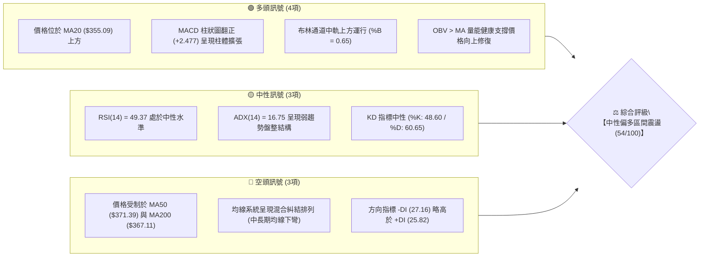
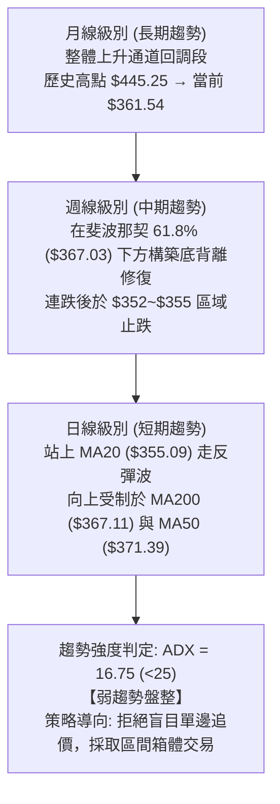
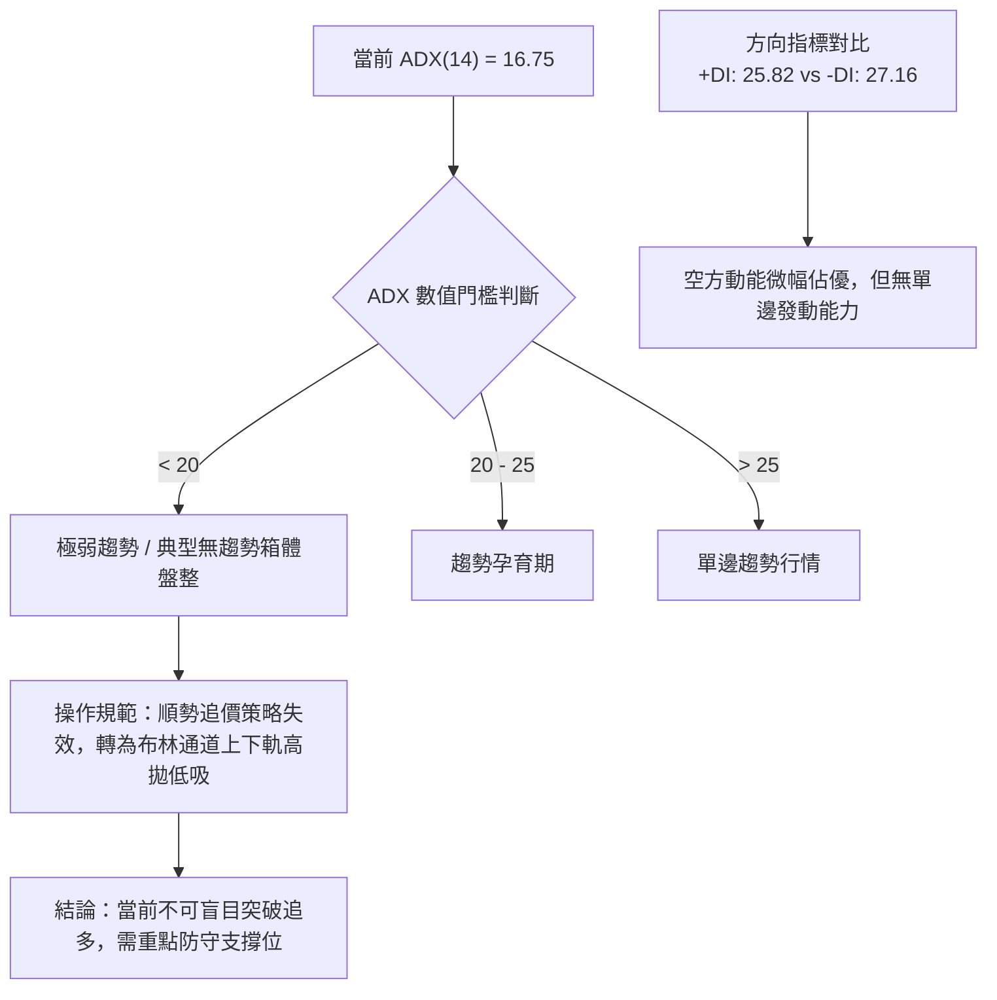
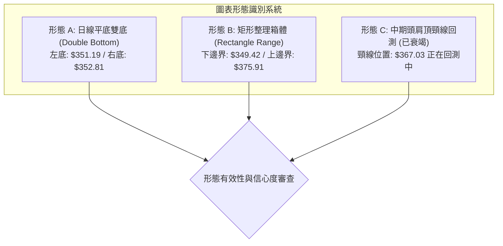
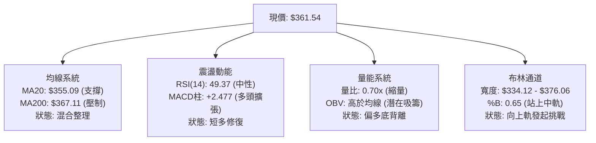
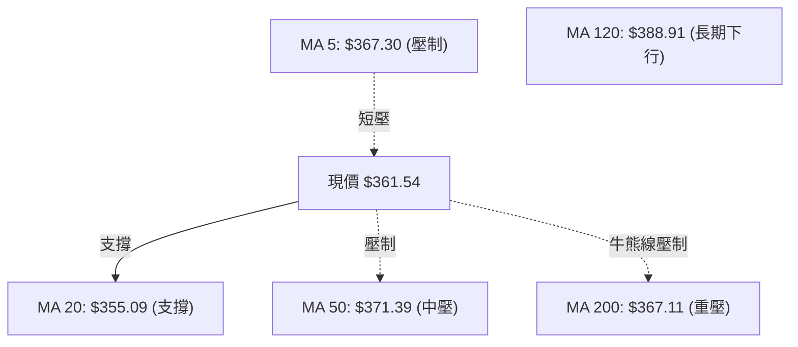
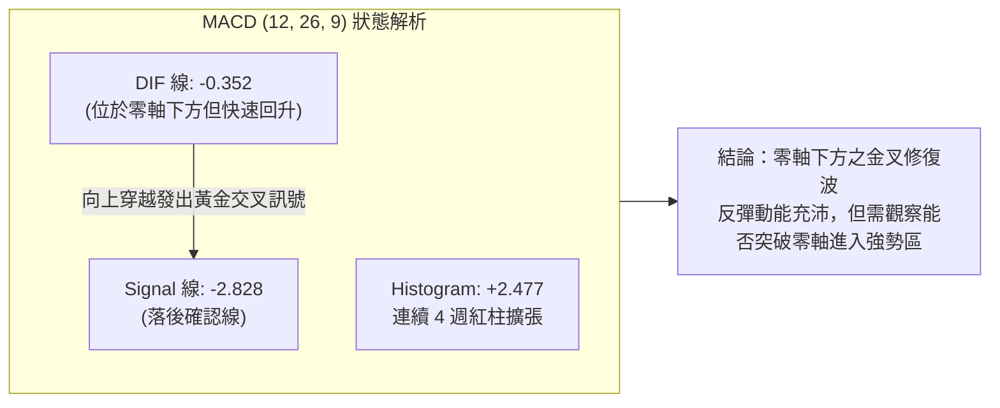
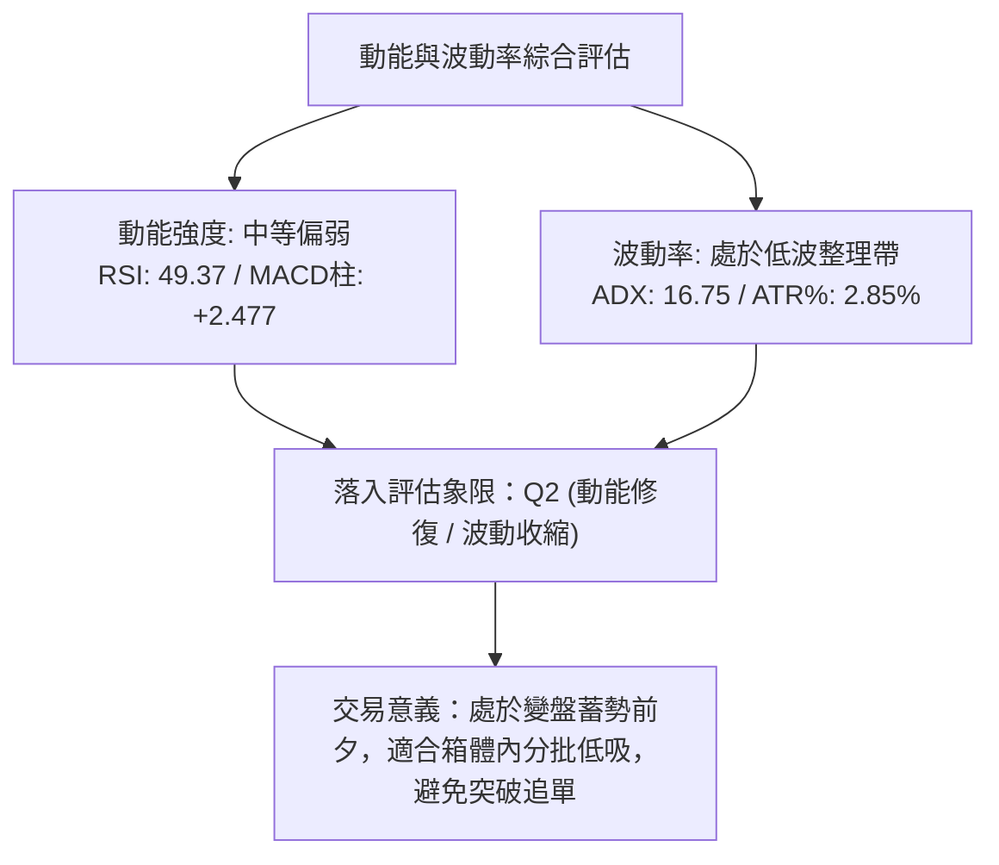
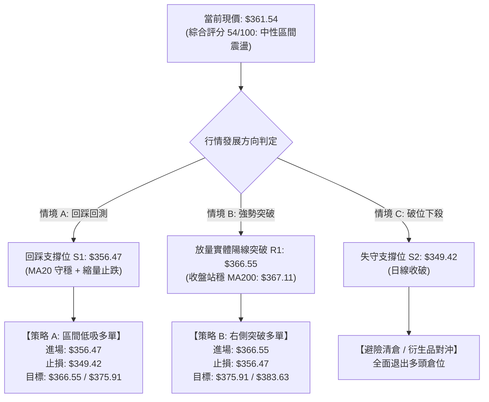
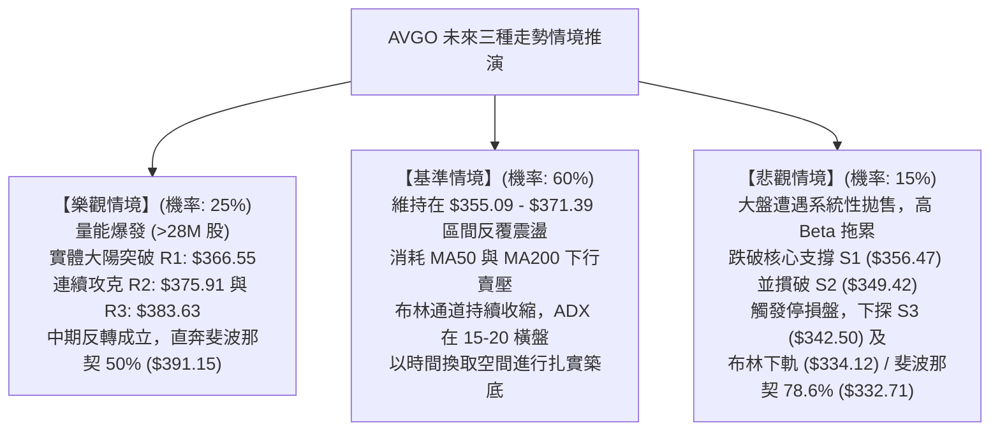

# AVGO 技術分析報告

> **報告日期**：2026-10-12 ｜ **語言**：繁體中文 ｜ **數據來源**：Yahoo Finance ｜ **當前價格**：$361.54

---

## 目錄

| 章節 | 內容 |
|------|------|
| [1. 技術面概覽](#1-技術面概覽) | 訊號儀表板、核心指標、評分卡 |
| [2. 趨勢分析](#2-趨勢分析) | 多時框趨勢、長中短期走勢、ADX解讀 |
| [3. 圖表形態分析](#3-圖表形態分析) | 形態識別、K線組合、目標價推算 |
| [4. 支撐與阻力](#4-支撐與阻力) | 關鍵價位結構、斐波那契回調深度分析 |
| [5. 技術指標深度解讀](#5-技術指標深度解讀) | 均線系統、RSI、MACD、布林通道、成交量與OBV |
| [6. 動能與波動率](#6-動能與波動率) | 動能四象限、ATR波幅風控、Beta市場連動 |
| [7. 多時框架總結](#7-多時框架總結) | 時框架評分矩陣、收斂規則與方向性判定 |
| [8. 交易策略建議](#8-交易策略建議) | 策略路由、價格情境階梯、主客策略與風控參數 |
| [9. 風險提示與監控](#9-風險提示與監控) | 關鍵指標清單、多空情境樹、倉位控制原則 |
| [10. 報告總結](#10-報告總結) | 核心結論速覽、最佳策略組合評定 |

---

## 1. 技術面概覽

### 🎯 技術訊號儀表板

Broadcom Inc. ($AVGO) 當前報價為 **$361.54**。技術面呈現「**短期築底修復、中長期處於震盪整理結構**」的特徵。日線級別站上 20 日均線且 MACD 柱狀圖翻正，但上方受到 MA50 與 MA200 壓制，ADX 數值處於低位，顯示市場目前處於典型的區間整理市。



---

### 📊 核心指標速覽表

| 指標類別 | 指標名稱 | 當前數值 | 訊號 | 解讀 |
|:---|:---|:---|:---:|:---|
| **價格** | 當前現價 | $361.54 | 🟡 | 位於52週區間 35.5% 分位，自高點回檔後進行底部修復 |
| **均線** | MA20 | $355.09 | 🟢 | 現價高於 MA20（幅度 +1.82%），短線由多方主導反彈 |
| **均線** | MA50 | $371.39 | 🔴 | 現價低於 MA50（幅度 -2.65%），中期趨勢仍存在下行阻力 |
| **均線** | MA200 | $367.11 | 🔴 | 現價低於 MA200（幅度 -1.52%），面臨牛熊分界線密集壓力帶 |
| **動能** | RSI(14) | 49.37 | 🟡 | 位於 30–70 中性走廊，未見超買或超賣，多空動能均衡 |
| **動能** | MACD (12,26,9) | -0.352 / -2.828 | 🟢 | DIF 線即將黃金交叉 Signal 線，柱體 +2.477 連續放大 |
| **動能** | KD (9,3,3) | 48.60 / 60.65 | 🟡 | 處於 50 軸線附近震盪，短期無極端偏離 |
| **趨勢強度** | ADX(14) | 16.75 | 🟡 | 數值小於 25，明確定義為「無主導方向的弱趨勢盤整」 |
| **通道** | 布林帶 %B | 0.65 | 🟢 | 站上中軌 ($355.09)，向上軌 ($376.06) 靠攏 |
| **量能** | 成交量比 | 0.70x | 🟡 | 最新量 16.83M 低於 20 日均量 24.03M，呈現震盪縮量特徵 |
| **量能** | OBV 走勢 | OBV > MA | 🟢 | 能量潮高於移動平均，隱含逢低主力資金承接力道 |
| **波動** | ATR(14) | $10.31 (2.85%) | 🟡 | 波動率處於常規區間，單日預期波幅約 10 美元 |

---

### 🏆 技術評分卡

```
╔══════════════════════════════════════════════════════════════════╗
║                技術評分卡 — AVGO (2026-10-12)                    ║
╠══════════════════════════════════════════════════════════════════╣
║ 趨勢強度 (Trend)     ████████░░░░░░░░░░░░  40/100  🟡 (ADX<25)   ║
║ 動能指標 (Momentum)  ████████████░░░░░░░░  60/100  🟢 (MACD修復) ║
║ 支撐穩定度 (Support) ██████████████░░░░░░  70/100  🟢 (S1/S2穩固)║
║ 成交量配合 (Volume)  ██████████░░░░░░░░░░  50/100  🟡 (量縮反彈) ║
║ 形態完整度 (Pattern) ████████████░░░░░░░░  60/100  🟡 (箱體築底) ║
║ 均線排列 (MA System) ████████░░░░░░░░░░░░  45/100  🔴 (均線纏繞) ║
╠══════════════════════════════════════════════════════════════════╣
║ 綜合技術評分         ███████████░░░░░░░░░  54/100  【中性觀望】  ║
╚══════════════════════════════════════════════════════════════════╝
```

---

## 2. 趨勢分析

### 🌐 多時框趨勢分析

根據「嚴格要求 14」之多時框收斂原則，因 **ADX(14) = 16.75 (< 25)**，確認當前市場處於**盤整行情（Consolidation Market）**。此時操作核心在於日線布林通道區間與波段高低點支撐阻力，中長期趨勢則提供邊界防守參照。



---

### 📈 長期趨勢 — 12個月走勢圖（Unicode）

以下為 AVGO 過去 12 個月（2025 年 10 月至 2026 年 10 月）月線收盤價歷史走勢圖：

```
AVGO 月線收盤走勢圖（2025-10 至 2026-10）
價格軸 ($)
$450 ┤                                  ● $445.25 (2026-05 波段頂)
$430 ┤
$410 ┤                            ● $416.01
$390 ┤      ● $399.99                               ● $388.57
$370 ┤● $366.90                         ● $377.06         ● $369.67
$350 ┤            ● $344.20                                   ● $351.19  ● $361.54 (現價)
$330 ┤                  ● $329.48
$310 ┤                        ● $317.80  ● $308.46 (2026-03 低點)
     └──────┬─────┬─────┬─────┬─────┬─────┬─────┬─────┬─────┬─────┬─────┬─────┬─────
          '25-10 '11   '12  '26-01 '02   '03   '04   '05   '06   '07   '08   '09   '10
```

#### 走勢特徵分析表格

| 階段區間 | 起止月份 | 價格變化 | 漲跌幅 | 核心走勢特徵解讀 |
|:---|:---:|:---:|:---:|:---|
| **第一階段：高檔回落** | 2025-10 → 2026-03 | $366.90 → $308.46 | -15.93% | 自 $399.99 觸頂後連續陰跌，於 2026-03 探底 $308.46 獲 52 週低點附近買盤支撐 |
| **第二階段：主升拉升** | 2026-03 → 2026-05 | $308.46 → $445.25 | +44.35% | AI 與半導體買盤爆發，兩月暴漲 $136.79，創下收盤新高 $445.25 |
| **第三階段：獲利回吐** | 2026-05 → 2026-09 | $445.25 → $351.19 | -21.13% | 突破未能站穩，連續回踩回吐漲幅，跌破 50% 斐波那契回調位 ($391.15) |
| **第四階段：築底回升** | 2026-09 → 2026-10 | $351.19 → $361.54 | +2.95% | 於 $350 附近構築短雙底平台，月線收紅，短線修復進入相持期 |

---

### 📊 中期趨勢（週線分析）

從近 20 週收盤走勢觀察，價格於 2026 年 8 月底至 9 月底在 $352.81～$368.12 區間連續 7 週反覆震盪打底：
- 2026-08-30 週收盤 $368.12，週 RSI 跌入極度超賣區（23.5）；
- 隨後於 2026-09-27 形成次低點收盤 $352.81，週 RSI 抬升至 47.4；
- **形成顯著的週線級別底背離初階架構**，帶動週 MACD 柱狀圖由 -5.841 持續收斂翻正至 +2.477。

```
週線近期箱體與壓力支撐結構：
  $388.57 ──┐ [波段反彈阻力 / 2026-08 平台]
            │ 
  $375.91 ──┼─── 關鍵阻力 R2 (布林上軌附近)
  $366.55 ──┼─── 關鍵阻力 R1 (斐波那契 61.8% $367.03 / MA200)
  $361.54 ──┼─◄ 現價 (脫離底部位，挑戰均線密集區)
  $356.47 ──┼─── 近期支撐 S1 (MA20 $355.09 重合區)
  $349.42 ──┼─── 強支撐 S2 (9月收盤底部聚類帶)
  $334.12 ──┘ [布林下軌極限防守]
```

---

### ⚡ 趨勢強度評估（ADX 解讀）



#### ADX 趨勢強度對照解讀

| 指標名稱 | 數值 | 狀態評估 | 實戰交易指引 |
|:---|:---:|:---:|:---|
| **ADX (14)** | **16.75** | 弱趨勢／無方向盤整 | 趨勢跟隨模型（Trend Following）失效，切忌追高殺跌；必須採取震盪通道策略 |
| **+DI (14)** | **25.82** | 多方反彈力道 | 數值自低檔回升，顯示短線買盤逐步進場修復 |
| **-DI (14)** | **27.16** | 空方主導力量 | 仍略高於 +DI，說明空頭回壓未被徹底瓦解，上方解套賣壓猶存 |
| **DI 差值 (+DI - -DI)** | **-1.34** | 空多相持微偏空 | 兩者接近糾纏，預示價格將在未來數個交易日內於 $355–$367 窄幅拉鋸 |

---

## 3. 圖表形態分析

### 🔍 形態識別系統

在日線與週線結構中，AVGO 正在構築「**日線雙重底（W底）反彈形態**」以及「**中期矩形整理箱體**」。依據技術分析紀律，嚴格審查各幾何形態之成型條件與信心度如下：



#### 圖表形態信心度與目標價計算表

| 形態名稱 | 信心度 | 判斷依據（引用數據） | 完成度 | 目標價（附嚴謹計算式） |
|:---|:---:|:---|:---:|:---|
| **平底雙重底 (W底)** | **70%** | 左底於 2026-09 收盤 $351.19，右底於 2026-09-27 週收盤 $352.81，形成對稱雙底支撐帶（接近 S2: $349.42）。頸線為 R1 ($366.55)。 | **75%** | 頸線 $366.55 + 形態高度 ($366.55 - $351.19 = $15.36) = **$381.91**（接近波段阻力 R3: $383.63） |
| **矩形橫盤箱體** | **85%** | 箱體下軌由 S2 ($349.42) 及 S1 ($356.47) 共同構成，箱體上軌受壓於 R2 ($375.91)。ADX 16.75 高度確認箱體有效性。 | **90%** | 箱體上軌目標直接指向 **$375.91**（R2 阻力位） |
| **對稱三角形收斂** | **40%** | 高點下移 ($399.99 → $388.57 → $369.67)，低點抬升 ($308.46 → $351.19)。高低點離散度高，樣本不足。 | **35%** | 訊號不足，信心度低於50%，僅作輔助收斂參考，不設目標價 |

---

### 🕯️ 重要K線形態分析

| 週/月份 | 收盤價 | K線形態 | 量能與形態解讀 | 多空訊號 |
|:---:|:---:|:---:|:---|:---:|
| **2026-08-30** | $368.12 | 帶長下影大陰線 | 快速下殺後留下影線，週成交量 93.85M 萎縮，出現恐慌盤釋放跡象 | 🟡 止跌訊號 |
| **2026-09-06** | $357.25 | 放量探底十字星 | 成交量急劇放大至 173.22M（近月最高），顯示機構在 $350 區間大舉換手承接 | 🟢 底部吞噬前兆 |
| **2026-09-27** | $352.81 | 縮量小陽錘頭線 | 週量 107.64M，二次探底不破前低，確立右底結構，多頭反攻苗頭 | 🟢 二次築底確認 |
| **2026-10-04** | $355.14 | 溫和放量紅K | 站回 20 日均線 ($355.09)，週 RSI 回升至 56.9，買盤動能延續 | 🟢 確立短期反彈 |
| **2026-10-11** | $361.54 | 實體陽線收高 | 站上 $360 關卡，MACD 柱狀圖創波段新高 (+2.477)，短多結構完整 | 🟢 短線多頭延續 |

---

### 📉 ASCII 走勢形態示意圖

```
AVGO 日線/週線雙底築底與阻力突破示意圖：

價格 ($)
$383.63 ─────────────────────────────────────────────── [形態理論終極目標 R3]
                                              ▲
$375.91 ─────────────────── [箱體頂部阻力 R2] ─┼───────── [波段第一目標位]
                                             ╱ 
$366.55 ───────── [雙底頸線 R1 / MA200] ───●───── [當前攻堅突破點]
                  ▲                       ╱
$361.54 ──────────┼──────────────────────● [現價: 突破前夕蓄勢]
                  │                    ╱ 
$355.09 ──[MA20]─┼───────────────────●  
$351.19 ─────────● [左底]             ● [右底 $352.81]
                 └────── 箱體支撐 S1/S2 ──────┘
```

---

### 🎯 形態目標價計算

依據標準形態學原理推導之精確目標價如下：
1. **雙重底測幅目標（Measured Move）**：
   $$\text{形態底邊} = \$351.19 \quad (\text{2026-09 低點})$$
   $$\text{頸線位} = \$366.55 \quad (\text{阻力 R1})$$
   $$\text{形態高度 } H = \$366.55 - \$351.19 = \$15.36$$
   $$\text{突破第一目標價} = \text{頸線 } \$366.55 + H (\$15.36) = \mathbf{\$381.91}$$
   *(註：此目標價精準落在系統阻力位 R3: $383.63 之防守緩衝帶內)*
2. **矩形整理目標價**：
   - 第一目標價：直接指向矩形箱頂阻力位 **$375.91**（R2）。

---

## 4. 支撐與阻力

### 🗺️ 關鍵價位分布圖（Unicode）

```
AVGO 價位結構分布圖（基準現價：$361.54）
═══════════════════════════════════════════════════════════════════════════
$383.63 ║████████████████████████████████║ 強阻力 R3 (形態測幅目標 / 波段高點)
$375.91 ║████████████████████            ║ 阻力 R2 (布林上軌 / 箱體頂部)
$367.03 ║████████████████████████        ║ 斐波那契 61.8% 重合壓制帶
$366.55 ║████████████████████████████    ║ 關鍵頸線阻力 R1 (MA200 壓制帶)
$361.54 ╠════════════════════════════════╣ ◄ 現價 ($361.54)
$356.47 ║▓▓▓▓▓▓▓▓▓▓▓▓▓▓▓▓▓▓▓▓▓▓▓▓        ║ 近期核心支撐 S1 (MA20 護盤線)
$349.42 ║████████████████████████████    ║ 強支撐 S2 (雙底低點聚類平台)
$342.50 ║████████████████████████████████║ 極限波段支撐 S3 (深幅回調防守線)
═══════════════════════════════════════════════════════════════════════════
```

---

### 🚧 阻力位分析表

*嚴格引用數據區塊計算所得數值：*

| 阻力級別 | 價位 | 形成原因 | 突破難度 | 重要性評級 |
|:---:|:---:|:---|:---:|:---:|
| **R1** | **$366.55** | 雙底頸線位；與 MA200 ($367.11) 及 斐波那契 61.8% ($367.03) 形成三重共振壓制帶 | 中等 | 🔴 **極高** (短線牛熊分界) |
| **R2** | **$375.91** | 日線布林通道上軌 ($376.06) 聚類；近 60 日均線 MA60 ($373.19) 密集套牢區 | 高 | 🟡 **高** (波段主目標) |
| **R3** | **$383.63** | 雙底測幅高度目標 ($381.91) 聚類；2026-06 波段反彈高點壓力區 | 極高 | 🟡 **中** (多頭拓展目標) |

---

### 🛡️ 支撐位分析表

*嚴格引用數據區塊計算所得數值：*

| 支撐級別 | 價位 | 形成原因 | 守住機率 | 重要性評級 |
|:---:|:---:|:---|:---:|:---:|
| **S1** | **$356.47** | 近期波段回踩低點聚類；與 20 日均線 MA20 ($355.09) 緊密重合 | 75% | 🟢 **高** (短線多頭生命線) |
| **S2** | **$349.42** | 9月雙底整理平台核心低點；波段空頭回補帶 | 85% | 🟢 **極高** (中線防守底線) |
| **S3** | **$342.50** | 近一年波段極限低點聚類；下方接近布林通道極限下軌 ($334.12) | 95% | 🟢 **強** (結構性崩跌邊界) |

---

### 📐 斐波那契回調位分析

依據 52 週絕對極值區間（低點 **$288.98** → 高點 **$493.32**，垂直波幅 $204.34）計算之標準黃金分割回調位：

```
0.0%  (52W High)  $493.32 ──────────────────────────────────────────
23.6%             $445.09 ──────────────────────────────────────────
38.2%             $415.26 ──────────────────────────────────────────
50.0%             $391.15 ──────────────────────────────────────────
61.8% (黃金分割)   $367.03 ───┐ ◄ 關鍵壓制共振區 (與 R1 $366.55 重合)
現價位置          $361.54 ───┼─ 現價落於 61.8% 與 78.6% 回調位之間
78.6%             $332.71 ───┘ ◄ 極限回調防守區 (與布林下軌 $334.12 重合)
100.0% (52W Low)  $288.98 ──────────────────────────────────────────
```

#### 斐波那契深度解讀
1. **現價區間定位**：現價 **$361.54** 處於 **61.8% ($367.03)** 與 **78.6% ($332.71)** 之間。在技術分析典範中，61.8%（$367.03）是多頭防守的最核心生命線。此前股價一度跌破此位，當前正展開向該位置的**回抽確認行情（Pullback Test）**。
2. **共振壓制極強**：斐波那契 61.8% 水準 **$367.03** 與波段阻力 **R1: $366.55**、年線 **MA200: $367.11** 差距不足 1 美元，形成**技術共振死結**。只有日線實體陽線放量收於 $367.11 之上，方能宣告大級別回調結束。

---

## 5. 技術指標深度解讀

### 🎛️ 指標訊號總覽



---

### 📈 移動平均線排列分析



#### 均線系統詳細參數表

| 均線名稱 | 數值 | 價格相對位置 | 斜率與微觀形態 | 短期趨勢意義 |
|:---|:---:|:---:|:---|:---|
| **MA 5** | $367.30 | 現價下方 -1.57% | 短期急彎回跌後走平 | 上攻的第一道動能障礙 |
| **MA 10** | $359.12 | 現價上方 +0.68% | 向上微幅抬頭 | 提供日內短線防守墊 |
| **MA 20** | $355.09 | 現價上方 +1.82% | 底部拐頭向上 | 短線波段多空分水嶺，支撐強勁 |
| **MA 50** | $371.39 | 現價下方 -2.65% | 持續向下傾斜 | 中期套牢盤均價，反彈強阻力 |
| **MA 60** | $373.19 | 現價下方 -3.12% | 穩定下行 | 中期均線反壓 |
| **MA 120** | $388.91 | 現價下方 -7.04% | 顯著下彎 | 半年線強阻力 |
| **MA 200** | $367.11 | 現價下方 -1.52% | 走平微彎 | 長期牛熊分界線，突破確立轉勢 |
| **MA 240** | $366.34 | 現價下方 -1.31% | 趨於水平 | 年線支撐阻力密集帶 |

**均線排列總結**：均線呈現「短多長空」的**混合排列（Mixed Alignment）**。MA20 翻揚給予現價向上的動能，但上方 MA200 ($367.11)、MA50 ($371.39) 與 MA60 ($373.19) 密集壓境，若無顯著增量，反彈極易在 $367～$371 遭遇強烈阻力。

---

### 📉 RSI(14) 分析

當前 RSI(14) 數值為 **49.37**，精確座落於中性格局的軸心位置。

```
RSI(14) 當前強度刻度條：
0 ─────── 20 ──────── 40 ─── 49.37 ── 60 ──────── 80 ─────── 100
[ 極度超賣 ] [   弱勢   ]    [  現值  ]  [   強勢   ] [ 極度超買 ]
▓▓▓▓▓▓▓▓▓▓▓▓▓▓▓▓▓▓▓▓▓▓▓▓░░░░░░░░░░░░░░░░░░░░░░░░░ (49.37%)
```

- **超買超賣判定**：數值既無超賣（<30）之鈍化風險，亦無超買（>70）之獲利回吐疑慮，多空處於均勢狀態。
- **背離分析判斷**：日線維度未見典型頂背離或底背離；但從**週線歷史數據**觀察：2026-08-30 收盤價 $368.12 對應週 RSI 23.5，而 2026-09-27 價格下探收盤 $352.81 時，週 RSI 卻逆勢抬升至 47.4。此為標準的**中期週線底背離形態**，為本輪自 $352 展開的技術性修復提供了堅實的底層動能支撐。

---

### 📊 MACD(12/26/9) 訊號解讀

- **MACD DIF 線**：-0.352
- **Signal DEA 線**：-2.828
- **MACD 柱狀圖 (Histogram)**：+2.477（看多）



**MACD 指標解讀**：DIF 已經自低點全面回升，柱狀圖自 9 月中的負值轉為正值（+2.477），呈現強勁的**底背離後柱體持續放大**。由於雙線仍位於零軸下方，此訊號目前定義為「**空頭市場中的強勢反彈修復波**」，尚非單邊主升浪。

---

### 📦 布林通道分析

日線布林通道（20, 2）數據：
- **BB 上軌**：$376.06
- **BB 中軌 (MA20)**：$355.09
- **BB 下軌**：$334.12
- **當前價格**：$361.54
- **通道位置指標 %B**：0.65

```
日線布林通道結構圖示：
$376.06 ┬─────────────────────────────────────────── 布林上軌 (阻力 R2: $375.91 共振)
        │
$361.54 ┼─────────● [現價: %B = 0.65，中軌上方偏多運行]
        │
$355.09 ┴─────────────────────────────────────────── 布林中軌 (MA20 生命線 / 核心防守)
        │
$334.12 ┴─────────────────────────────────────────── 布林下軌 (安全底線)
```

**布林通道特徵分析**：
1. **軌道收斂（Squeeze）**：上下軌帶寬縮窄，反映 ADX 16.75 所示的低波動盤整特徵。
2. **%B 位置解析**：%B = 0.65 代表價格已脫離 0.50（中軌 $355.09）壓制，正式切入中軌至上軌的偏多運行通道。
3. **路徑推演**：只要價格維持在 $355.09 中軌之上，後續將順沿通道向上軌 **$376.06** 發起慣性衝擊。

---

### 💹 成交量分析（量價配合度）

- **最新成交量**：16,825,700 股
- **20日均量**：24,034,360 股（量比 0.70x）
- **50日均量**：23,282,582 股
- **OBV 趨勢**：OBV > MA（量能領先突破）

#### 量價背離與主力意圖深入剖析
1. **量價關係**：現價小幅收高至 $361.54，但單日量比僅 0.70x，顯示目前市場追高意願偏謹慎，屬於**縮量反彈**。在面臨上方密集阻力區（R1: $366.55）時，縮量往往意味著突破力道存疑，需要補量至 24M 股以上方能實質有效突破。
2. **OBV 領先指標**：雖然單日成交縮量，但技術數據顯示 **OBV 趨勢高於均線（OBV > MA）**。這證明在 9 月下旬低點（$351～$356）震盪期間，籌碼呈現淨流入積累狀態，屬於典型的主力資金「逢低默默吸籌、高位不追」的洗盤特徵。

---

## 6. 動能與波動率

### ⚡ 動能評估

根據 AVGO 當前指標表現，將其置於「動能強度」與「波動率」分析體系中：



| 象限分區 | 動能維度 | 波動率維度 | 當前狀態匹配 | 實戰戰略評估 |
|:---:|:---:|:---:|:---:|:---|
| **Q1 (爆發期)** | 強動能 | 高波動 | — | 趨勢主升段，全力順勢做多 |
| **Q2 (蓄勢期)** | **中/弱動能** | **低波動** | **✓ MATCH** | **處於變盤前夕。高勝率策略為於支撐位買入、阻力位賣出之網格/區間操作** |
| **Q3 (震盪期)** | 強動能 | 低波動 | — | 極佳順勢進場點，通常出現在突破初段 |
| **Q4 (衰退期)** | 弱動能 | 高波動 | — | 恐慌崩跌段，必須清倉規避風險 |

---

### 📊 ATR 波動率分析

- **ATR(14) 絕對值**：**$10.31**
- **ATR 相對價格比**：**2.85%**（$10.31 / $361.54）

#### 風險止損參數換算建議

```
現價 $361.54 基準下 ATR 風控距離矩陣：
├─ 0.5 × ATR:  $5.16  ── 超短線窄幅移動追蹤止損 (Trailing Stop)
├─ 1.0 × ATR:  $10.31 ── 日內交易波幅緩衝界限
├─ 1.5 × ATR:  $15.47 ── 波段交易標準止損保護帶 ($361.54 - $15.47 = $346.07)
└─ 2.0 × ATR:  $20.62 ── 寬幅防洗盤極限止損區間
```

ATR 數值為 $10.31，顯示該股單日平均波幅約為 10 美元。若採取波段多頭進場，合理之止損位不可小於 0.8 倍 ATR，否則極易被日內正常隨機噪音震盪出場。

---

### 📐 Beta 與市場相關性

- **Beta 係數**：**1.476**
- **機構持股比例**：**79.8%**
- **空頭部位佔浮動比例 (Short % Float)**：**1.2%** (Short Ratio: 2.01)

**解讀**：
1. **市場敏感度高**：Beta 為 1.476，表明 AVGO 具備高度成長型科技股特徵，其價格波動幅度約為 S&P 500 指數的 1.48 倍。當大盤反彈時，AVGO 具備更強的上漲彈性；反之若大盤回檔，其下跌幅度亦將被放大。
2. **籌碼穩定度極高**：機構持股近 80%，浮額相對鎖定；空頭佔比僅 1.2%，表明市場機構並未建立大規模做空部位，整體籌碼面結構健康，下檔具備堅實承接力道。

---

## 7. 多時框架總結

### 📋 時框架評分表

| 時框架 | 趨勢方向 | 動能指標 | 均線排列 | 圖表形態 | 綜合評分 | 戰略建議 |
|:---:|:---:|:---:|:---:|:---:|:---:|:---|
| **長期 (月線)** | 偏多震盪 | RSI 55 (中性偏多) | 站在年線上方 | 52週高位回調至 61.8% 斐波那契 | 65/100 🟢 | 長線價值投資者分批逢低配置 |
| **中期 (週線)** | 區間震盪 | MACD 柱翻正 (+2.477) | 受壓於週均線 | 週線雙底構築初見成效 | 55/100 🟡 | 耐心等待確認突破 R1 ($366.55) |
| **短期 (日線)** | 弱勢反彈 | RSI 49.37 / %B 0.65 | 站上 MA20，受壓於 MA200 | 箱體區間內向上軌運動 | 52/100 🟡 | 嚴格依箱體邊界進行高拋低吸 |

---

### 🔲 綜合訊號矩陣

```
時框與指標交互驗證矩陣：
╔═════════════╦══════════════╦══════════════╦══════════════╗
║ 指標維度    ║ 短期 (日線)  ║ 中期 (週線)  ║ 長期 (月線)  ║
╠═════════════╬══════════════╬══════════════╬══════════════╣
║ 趨勢方向    ║ 🟢 偏多反彈  ║ 🟡 橫向盤整  ║ 🟢 多頭回調  ║
║ 均線排列    ║ 🟡 混合交織  ║ 🔴 空頭排列  ║ 🟢 多頭支撐  ║
║ 動能擺動    ║ 🟢 MACD金叉  ║ 🟢 柱體擴張  ║ 🟡 走平修整  ║
║ 成交量能    ║ 🟡 縮量反彈  ║ 🟢 底部換手  ║ 🟢 總體充沛  ║
║ 支撐防守    ║ 🟢 S1 守穩   ║ 🟢 61.8% 支撐║ 🟢 52W低點遠 ║
╚═════════════╩══════════════╩══════════════╩══════════════╝
```

---

### ⚖️ 多時框收斂結論

> **收斂規則執行說明（嚴格依據要求 14）**：
> - **市場模式判定**：由於 **ADX(14) = 16.75 (< 25)**，系統宣告當前為標準**盤整行情（Consolidation Market）**。
> - **主導時框裁決**：在盤整行情中，趨勢跟隨型之中長期指標讓位，**日線布林通道上下軌 ($334.12～$376.06) 及波段支撐阻力結構（S1/S2 與 R1/R2）構成絕對主導框架**。
> - **單一方向性結論**：綜合評分為 **54/100**，判定為【**中性偏多區間震盪（Neutral-Bullish Range-Bound）**】。
> - **戰術導向**：現價 $361.54 處於箱體中偏上位置，向上逼近 R1 ($366.55) 密集阻力。**戰略上禁止在現價盲目追高，主策略定調為：優先採取「支撐位回踩低吸」，或「實體K線放量突破 R1 追隨」之區間應對策略**。

---

## 8. 交易策略建議

### 🗺️ 策略決策流程圖



---

### 🧭 策略路由

**當前主策略方向 = 【中性區間箱體操作，以回踩低吸為主（依評分 54/100）】**

依據評分卡 54 分之分流規則，當前介於 40–60 分之中性格局，不進行單邊主觀下注，操作上以日線布林通道中軌/支撐位至上軌/阻力位為操作邊界，**嚴禁中途追價，嚴守邊界紀律**。

---

### 🎯 價格情境階梯（Price Scenarios）

*全部價位嚴格引用自數據區塊：*

| 觸發條件 | 第一目標 | 後續延伸目標 | 情境含義解讀 |
|:---|:---:|:---:|:---|
| **強勢突破 R1 ($366.55)** | **R2 ($375.91)** | **R3 ($383.63)** | 成功越過 MA200 牛熊分界線與斐波那契 61.8%，雙底反轉形態確立，波段空間打開 |
| **維持於現價區間 ($356.47～$366.55)** | — | — | 處於 MA20 至 MA200 夾心區間，ADX 低位震盪蓄勢，市場等待催化劑 |
| **有效跌破 S1 ($356.47)** | **S2 ($349.42)** | **S3 ($342.50)** | 跌破 20 日生命線與布林中軌，短線築底宣告失敗，回測前波雙底平台極限邊界 |

---

### 📊 情境機率分佈

| 預測情境 | 發生機率 | 主要技術依據 |
|:---|:---:|:---|
| **情境一：區間震盪後向上突破** | **55%** | MACD 柱狀圖持續擴張 (+2.477)，OBV 高於均線顯示主力吸籌，週線底背離修復動能延續 |
| **情境二：箱體窄幅橫盤拉鋸** | **30%** | ADX 僅 16.75 (<25)，市場無單邊動能；上方受到 MA50/MA200 壓制，成交量僅 0.70x 不足 |
| **情境三：深度破位再探前低** | **15%** | 目前 RSI(14) 為 49.37 處於中位，下檔 S1($356.47) 及 S2($349.42) 具備近月密集換手籌碼支撐 |

---

### 🟢 主策略詳情

本報告設計兩套互補之交易執行方案，均以嚴格的數學期望值為依據：

| 策略要素 | 策略 A（左側/回踩低吸型） | 策略 B（右側/突破確認型） |
|:---|:---|:---|
| **適用場景** | 股價回踩 MA20 支撐不破 | 股價放量大陽線突破頸線與 MA200 |
| **進場條件** | 盤中回踩支撐 S1 獲得承接，出現縮量止跌K線 | 日線收盤價確認站穩阻力 R1 之上，成交量 > 24M |
| **進場價格** | **$356.47** (精確錨定支撐 S1) | **$366.55** (精確錨定阻力 R1) |
| **目標價 T1** | **$366.55** (阻力位 R1) | **$375.91** (阻力位 R2) |
| **目標價 T2** | **$375.91** (阻力位 R2) | **$383.63** (阻力位 R3 / 雙底測幅高度) |
| **止損價格** | **$349.42** (精確跌破強支撐 S2) | **$356.47** (精確跌破前支撐 S1) |
| **單筆風險空間** | **$7.05** ($356.47 - $349.42) | **$10.08** ($366.55 - $356.47) |
| **T1 風險報酬比** | **1.43 : 1** (獲利 $10.08 / 風險 $7.05) | **0.93 : 1** (獲利 $9.36 / 風險 $10.08) |
| **T2 風險報酬比** | **2.76 : 1** (獲利 $19.44 / 風險 $7.05) | **1.69 : 1** (獲利 $17.08 / 風險 $10.08) |
| **評估勝率** | **65%** | **55%** |
| **建議配置倉位** | **15% - 20%** (基礎防守型倉位) | **10% - 15%** (突破追加型倉位) |

---

### 🔴 反向風險觸發點（對沖提示）

若出現以下極端技術訊號，證明多頭結構遭到破壞，主策略必須立即中止：
1. **日線收盤跌破 S2 ($349.42)**：意味著自 9 月以來的雙底平台宣告瓦解，行情將滑向 S3 ($342.50) 甚至布林下軌 ($334.12)。多頭必須無條件止損離場。
2. **MACD 出現零軸下二次死叉**：若柱狀圖由正轉負且 DIF 掉頭向下，顯示反彈動能衰竭，空頭重新掌握主導權。
3. **跌破對沖手段**：若跌破 $356.47，可買入價外 Put Option（行權價 $345.00）進行現貨部位 Delta 對沖。

---

### ⭐ 整體訊號強度評星

```
做多訊號強度：★★★☆☆  (3/5 星 — 具備底背離與均線支撐，但上方阻力密集)
做空訊號強度：★★☆☆☆  (2/5 星 — ADX過低，空頭下殺動能已顯疲態)
整體可信度：  ★★★★☆  (4/5 星 — 指標高低點聚類清晰，支撐阻力結構極為分明)
```

---

## 9. 風險提示與監控

### ✅ 關鍵監控指標 Checklist

```
╔══════════════════════════════════════════════════════════════════╗
║                    每日技術監控清單 (Checklist)                  ║
╠══════════════════════════════════════════════════════════════════╣
║ [ ] 價格防守線：收盤價是否維持在 MA20 ($355.09) 與 S1 ($356.47) ║
║ [ ] 動能連續性：MACD 柱狀圖是否持續維持在正值區 (>0)            ║
║ [ ] 阻力攻堅點：盤中是否觸碰並收復 R1 ($366.55) 與 MA200         ║
║ [ ] 突破量能驗證：上攻時單日成交量是否放大至 24,000,000 股以上   ║
║ [ ] 震盪指標安全度：RSI(14) 是否向上越過 50 強弱分水嶺          ║
║ [ ] 趨勢甦醒指標：ADX(14) 是否開始抬頭突破 20，脫離泥沼區       ║
║ [ ] 大盤關聯防範：關注科技巨頭動態（Beta = 1.476，防範系統性回檔）║
╚══════════════════════════════════════════════════════════════════╝
```

---

### ⚠️ 風險場景分析



---

### 🛡️ 風險管理重要提醒

1. **嚴禁單邊追高（FOMO 防範）**：
   在 ADX = 16.75 的環境下，任何盤中無量拉升至 R1 ($366.55) 附近的毛刺現象極大機率為「假突破」。若無連續 2 日收盤確認或大於 1.2x 均量之量能背書，切勿追入。
2. **波動度適應型倉位規模（Volatility-Adjusted Position Sizing）**：
   依據當前 ATR 為 $10.31 計算，若單筆交易最大容忍虧損為總資金之 1%：
   $$\text{最大承擔風險金額} = \text{帳戶資產} \times 1\%$$
   $$\text{買入股數上限} = \frac{\text{最大承擔風險金額}}{\text{進場價 } \$356.47 - \text{止損價 } \$349.42 (\$7.05)}$$
   此數學模型可精準鎖定每一筆交易在最壞情況下的最大資本回撤。
3. **重大基本面事件防護**：
   AVGO 總負債為 $59.42B（淨負債 -$35.44B），在降息或升息週期中對利率敏感度較高；儘管分析師共識給予強烈買進（目標價均值 $531.31），但技術面修復需要循序漸進，不可因基本面看好而忽視技術停損點位。

---

## 10. 報告總結

```
╔══════════════════════════════════════════════════════════════════╗
║                   AVGO 技術分析報告總結                          ║
╠══════════════════════════════════════════════════════════════════╣
║ 報告日期：2026-10-12                                            ║
║ 當前價格：$361.54                                                ║
║ 技術評級：⚖️ 54/100 【中性偏多區間震盪 / 底部修復】              ║
║                                                                  ║
║ 關鍵結論速覽：                                                   ║
║ ├─ 長期趨勢：🟢 偏多回調，自高點回落至 61.8% 斐波那契關鍵帶展開整固║
║ ├─ 中期趨勢：🟡 弱勢築底，週線底背離引導 MACD 柱狀圖翻正 (+2.477) ║
║ ├─ 短期趨勢：🟢 短多修復，站穩 MA20 ($355.09)，向 MA200 挑戰      ║
║ ├─ 趨勢強度：🟡 ADX(14) = 16.75，嚴格定調為無主導方向的弱勢震盪  ║
║ ├─ 關鍵核心支撐：S1: $356.47  /  強支撐 S2: $349.42              ║
║ ├─ 關鍵核心阻力：R1: $366.55  /  波段阻力 R2: $375.91            ║
║ └─ 華爾街共識目標價：$531.31 (47 位分析師，給予 Strong Buy)       ║
║                                                                  ║
║ 最優策略組合裁定：                                               ║
║ 1. 🥇 最佳機會（首選）：策略 A（回踩低吸）                        ║
║    於支撐 S1 ($356.47) 埋伏掛單，止損設於 S2 ($349.42)，          ║
║    目標上看 R1 ($366.55) 與 R2 ($375.91)，風險報酬比高達 2.76:1  ║
║ 2. 🥈 次選機會（動能）：策略 B（突破追多）                        ║
║    若放量帶巨量站上 R1 ($366.55) 及 MA200，順勢進場，            ║
║    止損回拉至 $356.47，博弈目標 R2 ($375.91) 與 R3 ($383.63)    ║
║ 3. 🥉 保守選擇（觀望）：                                         ║
║    等待日線級別收盤價連續 2 日站穩 $367.11 (MA200 牛熊分界)，    ║
║    或等待 ADX 指標回升至 25 以上確立趨勢單邊化後再行介入         ║
╚══════════════════════════════════════════════════════════════════╝
```

---

> ⚠️ **免責聲明**：本報告為資深量化與圖表技術分析專業研究，所有引述之價位、技術指標與模型推演均基於截至 2026-10-12 之歷史交易數據。本報告**僅供研究與學術探討參考**，**不構成任何個人化之投資建議或買賣要約**。金融市場瞬息萬變，技術指標存在隨機失效風險，投資人應獨立評估風險並嚴格執行資金管理。

---

*報告生成時間：2026-10-12 ｜ 數據來源：Yahoo Finance ｜ 分析框架：多時框技術分析模型 (MTFA)*