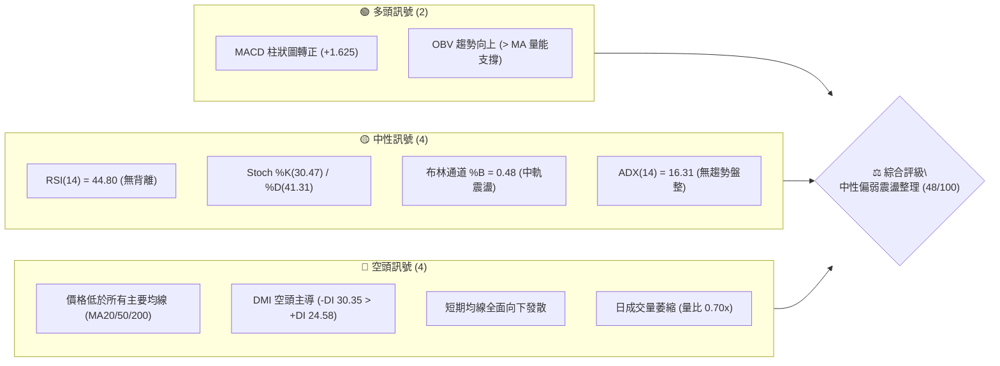
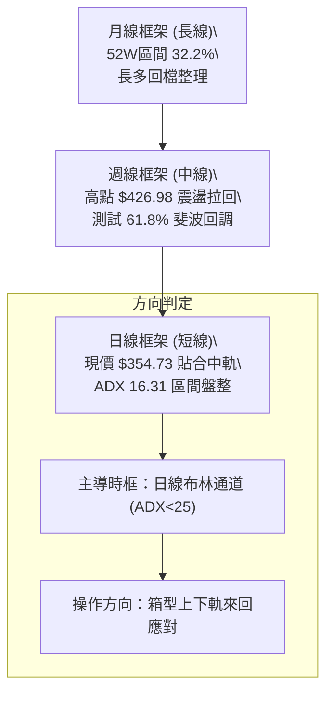
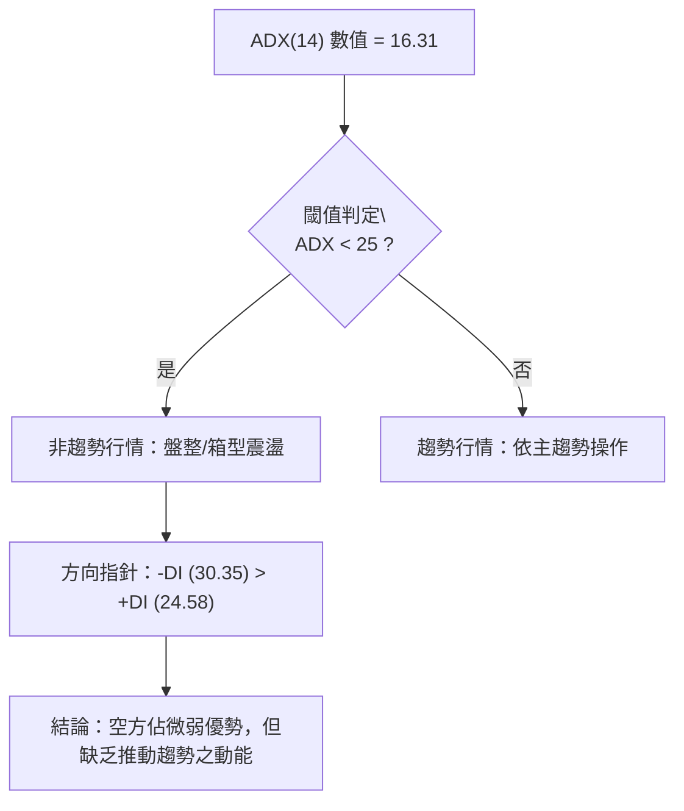
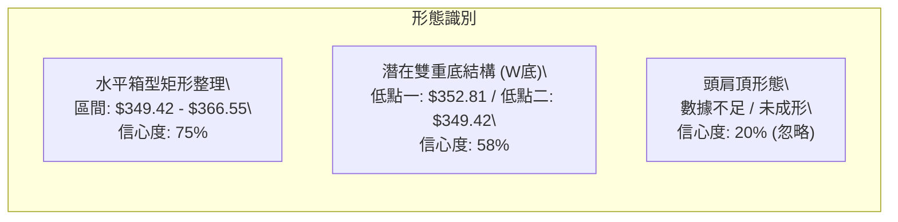
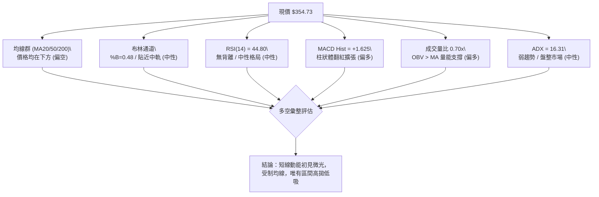
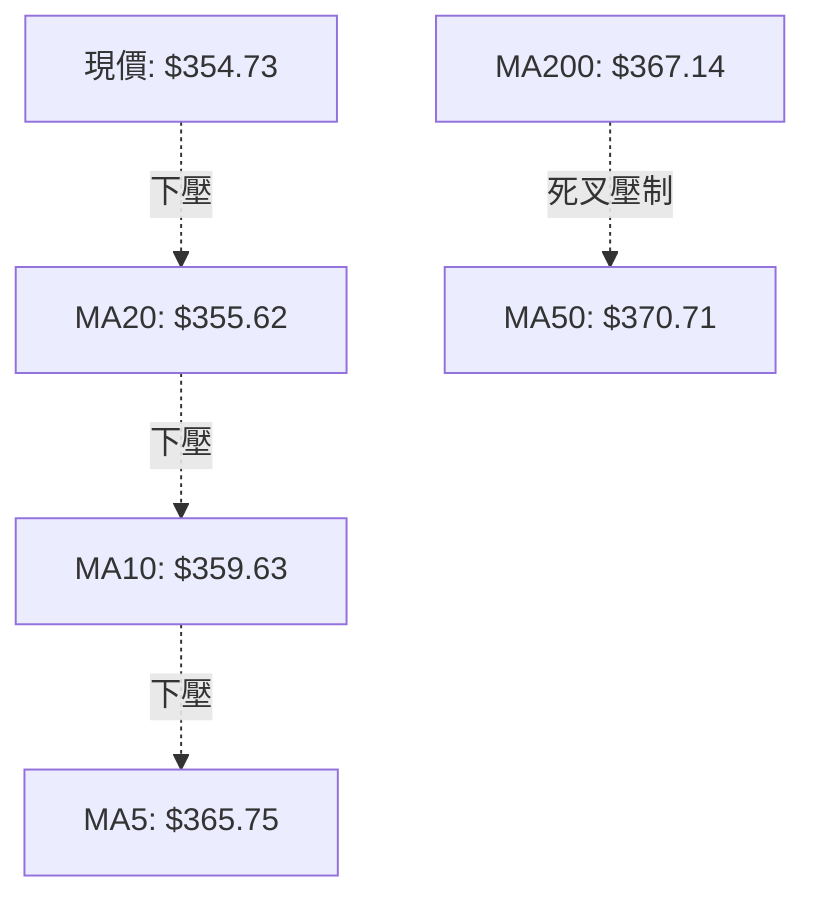
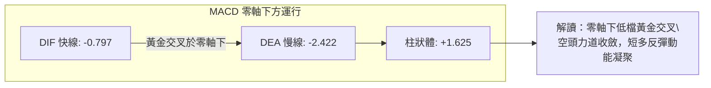
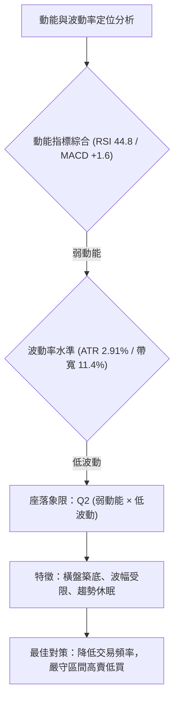
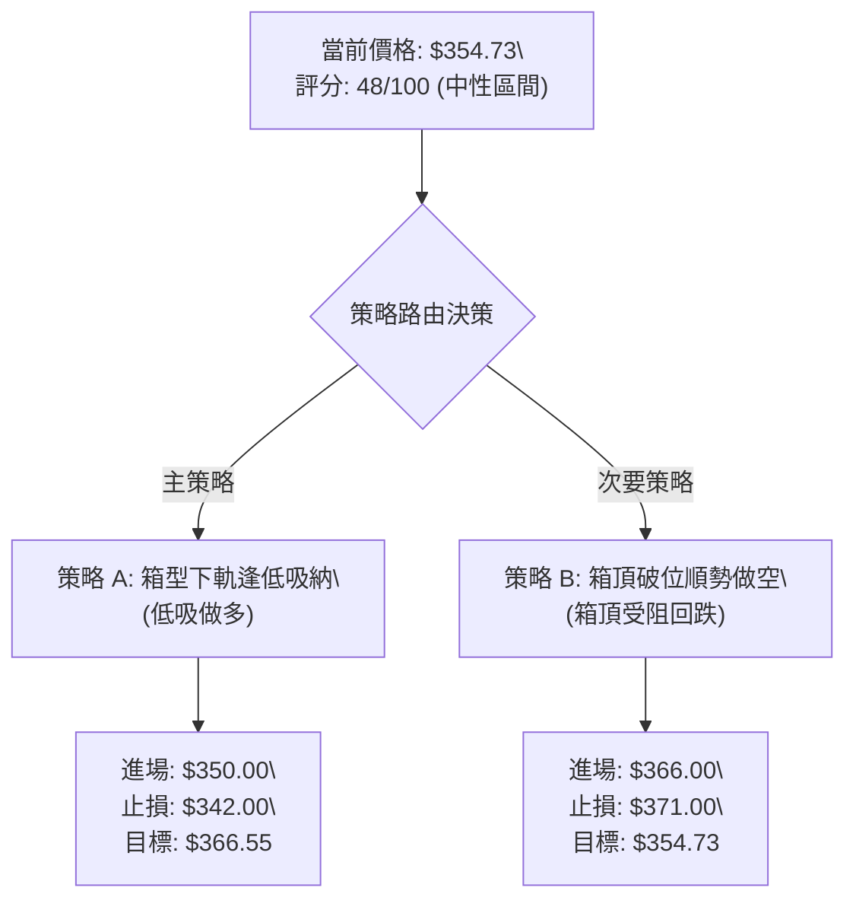
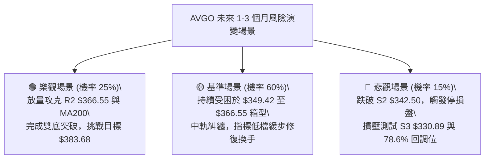

# AVGO 技術分析報告

> **報告日期**：2026-10-13 ｜ **語言**：繁體中文 ｜ **數據來源**：Yahoo Finance ｜ **當前價格**：$354.73

---

## 目錄

| 章節 | 內容 |
|------|------|
| [1. 技術面概覽](#1-技術面概覽) | 訊號儀表板、核心指標、評分卡 |
| [2. 趨勢分析](#2-趨勢分析) | 多時框趨勢、長中短期走勢、ADX解讀 |
| [3. 圖表形態分析](#3-圖表形態分析) | 形態識別信心度、K線組合、目標價計算 |
| [4. 支撐與阻力](#4-支撐與阻力) | 關鍵價位分布、阻力與支撐表、斐波那契回調 |
| [5. 技術指標深度解讀](#5-技術指標深度解讀) | 均線系統、RSI、MACD、布林通道、OBV量價 |
| [6. 動能與波動率](#6-動能與波動率) | 動能四象限、ATR波動度、Beta分析 |
| [7. 多時框架總結](#7-多時框架總結) | 時框架矩陣、多時框收斂與方向定調 |
| [8. 交易策略建議](#8-交易策略建議) | 策略路由、價格情境階梯、主策略明細 |
| [9. 風險提示與監控](#9-風險提示與監控) | 監控清單、情境樹、風控法則 |
| [📋 報告總結](#-報告總結) | 儀表板總結、關鍵結論與策略配置 |

---

## 1. 技術面概覽

### 🎯 技術訊號儀表板



AVGO 目前處於自 2026 年 5 月高點 $445.25（52週高點 $493.32）回落後的中期整理階段。當前價格 $354.73 處於 52 週價格區間的 32.2% 分位，受制於多條中長期均線（MA50: $370.71、MA200: $367.14），但短線在 $349.42 至 $350.00 整數關卡展現初步止跌韌性。

### 📊 核心指標速覽表

| 指標類別 | 指標名稱 | 當前數值 | 訊號 | 解讀 |
|----------|----------|----------|:----:|------|
| **價格** | 當前收盤價 | $354.73 | 🟡 | 位於 52W 區間 32.2%，低檔築底階段 |
| **均線** | MA20 (短) | $355.62 | 🔴 | 現價位於 MA20 下方 -0.25%，短線承壓 |
| **均線** | MA50 (中) | $370.71 | 🔴 | 現價位於 MA50 下方 -4.31%，中期趨勢轉弱 |
| **均線** | MA200 (長) | $367.14 | 🔴 | 現價跌破年線下方 -3.38%，長線支撐轉為阻力 |
| **動能** | RSI(14) | 44.80 | 🟡 | 處於 30–70 中性弱勢區，無超買超賣或背離 |
| **動能** | MACD 柱狀體 | +1.625 | 🟢 | MACD(-0.797) > Signal(-2.422)，柱狀體擴增 |
| **動能** | KD (%K / %D) | 30.47 / 41.31 | 🟡 | 低檔盤整，尚未形成黃金交叉 |
| **趨勢** | ADX (14) | 16.31 | 🟡 | ADX < 25 表明趨勢極弱，處於典型箱型震盪 |
| **方向** | +DI / -DI | 24.58 / 30.35 | 🔴 | -DI 高於 +DI，空方力道仍稍佔上風 |
| **通道** | 布林 %B | 0.48 | 🟡 | 緊貼中軌 ($355.62)，多空於軸心陷入膠著 |
| **量能** | 20日成交量比 | 0.70x (16.28M) | 🟡 | 量縮整理，拋售動能衰退但缺乏追價買盤 |
| **波動** | ATR(14) | $10.31 | 🟡 | 日波動率 2.91%，震盪幅度處於正常受限範圍 |

### 🏆 技術評分卡

```
╔══════════════════════════════════════════════════════════════════╗
║                   技術評分卡 — AVGO (2026-10-13)                 ║
╠══════════════════════════════════════════════════════════════════╣
║ 趨勢強度 (ADX/DMI)  ██████░░░░░░░░░░░░░░  32/100  🔴 空頭控盤弱勢║
║ 動能指標 (RSI/MACD) ██████████░░░░░░░░░░  50/100  🟡 短多柱中性RSI║
║ 支撐穩定度 (S1-S3)  ████████████░░░░░░░░  60/100  🟢 低檔承接明確║
║ 成交量配合 (OBV/Vol)██████████░░░░░░░░░░  52/100  🟡 OBV正向量萎縮║
║ 形態完整度 (區間)   ██████████░░░░░░░░░░  50/100  🟡 矩形整理未破║
║ 均線排列 (MA體系)   ██████░░░░░░░░░░░░░░  34/100  🔴 全線壓制混亂║
╠══════════════════════════════════════════════════════════════════╣
║ 綜合技術評分        █████████░░░░░░░░░░░  48/100  ⚖️ 區間中性偏弱║
╚══════════════════════════════════════════════════════════════════╝
```

---

## 2. 趨勢分析

### 🌐 多時框趨勢分析



### 📈 長期趨勢 — 12個月走勢圖（Unicode）

以下為 AVGO 過去 12 個月（2025-11 至 2026-10）收盤價歷史演變與波段轉折點標注：

```
AVGO 月線走勢圖（過去12個月）
價格軸 ($)
$450 ┤                                      ● (2026-05: $445.25)
$420 ┤                                ●
$390 ┤● (2025-11: $399.99)                  │     ● (2026-07: $388.57)
$360 ┤      ●                               │  ●        ● (2026-10: $354.73 現價)
$330 ┤            ●     ● (2026-02: $317.80)│
$300 ┤                  └── ● (2026-03: $308.46 波段低點)
     └─────────────────────────────────────────────────────────────
       11    12   01    02    03    04    05    06    07    08    09    10
      25年                               26年
```

**12 個月走勢特徵分析表格**：

| 階段區間 | 月份起訖 | 起訖收盤價 | 區間幅度 | 走勢特徵與量價解讀 |
|:---------|:---------|:-----------|:--------:|:-------------------|
| **階段一：波段回檔** | 2025-11 → 2026-03 | $399.99 → $308.46 | -22.88% | 自 400 美元關卡持續回檔，連續 4 個月收黑，於 308 美元確立底部 |
| **階段二：強勁主升** | 2026-03 → 2026-05 | $308.46 → $445.25 | +44.35% | 兩個月內急拉近 137 美元，突破前高並創下 $445.25 之波段高收盤 |
| **階段三：高檔修正** | 2026-05 → 2026-06 | $445.25 → $377.06 | -15.31% | 獲利了結賣壓湧現，長黑回落回測 $370 區間 |
| **階段四：次高反彈** | 2026-06 → 2026-07 | $377.06 → $388.57 | +3.05% | 反彈波段，隨後於 8 月初週線衝擊 $426.98 形成次高點 (Lower High) |
| **階段五：箱型收斂** | 2026-07 → 2026-10 | $388.57 → $354.73 | -8.71% | 漸次壓回，收斂於 $350–$370 窄幅區間，波幅持續受限 |

### 📊 中期趨勢（週線分析）

從近 20 週收盤走勢觀察，價格於 2026-08-09 觸及波段高點 $426.98（當週 RSI 達 73.6 超買），隨後出現連續下挫，於 2026-08-30 收在 $368.12（RSI 驟降至 23.5 超賣）。隨後於 9 月初下探 $352.81–$357.25 獲得強烈承接支撐。

```
週線關鍵壓力與支撐階梯示意圖
[上檔壓力帶] ══════════════════════ $375.91 (R3 / 布林上軌)
             ---------------------- $366.55 (R2 / MA200)
             ---------------------- $358.10 (R1 / 短波高點)
[當前收盤]   ······················ $354.73 (現價 / MA20附近)
             ---------------------- $349.42 (S1 / 近期波段低)
             ---------------------- $342.50 (S2 / 強支撐)
[下檔防守帶] ══════════════════════ $330.89 (S3 / 結構低點)
```

### ⚡ 趨勢強度評估（ADX 解讀）



**ADX 趨勢強度對照解讀**：
- **ADX 數值 16.31**：趨勢強度進度條 ▓▓▓░░░░░░░ 16.3%（極弱趨勢）。這代表任何試圖以追價突破（不論向上或向下）的單邊趨勢策略，均面臨極高的假突破磨損風險。
- **+DI (24.58) 與 -DI (30.35)**：負定向指標高於正定向指標，表明空方控盤力道大於多方，但因 ADX 遠低於 25，空方缺乏引發崩跌的趨勢加速力道。當前架構百分之百屬於**區間交易（Mean-Reverting Range Market）**。

---

## 3. 圖表形態分析

### 🔍 形態識別系統

依據嚴格規則 15，所有圖表形態嚴禁主觀通靈，必須基於已揭露之 OHLCV 歷史價格與支撐阻力結構進行客觀辨識，並標示明確信心度：



**形態信心度評估表**：

| 形態名稱 | 信心度 | 判斷依據（引用數據） | 完成度 | 目標價（附嚴格計算式） |
|:---------|:------:|:---------------------|:------:|:-----------------------|
| **水平箱型震盪** | **75%** | 價格於 S1 ($349.42) 與 R2 ($366.55) 間震盪逾 6 週，ADX=16.31 | 85% | **箱型頂部**：$366.55<br>**箱底支撐**：$349.42 |
| **潛在雙底 (W底)** | **58%** | 9/27收盤 $352.81 與 S1 ($349.42) 構成雙支點，MACD柱狀體轉正 | 45% | **頸線突破**：$366.55 (R2)<br>**形態高度** = $366.55 - $349.42 = $17.13<br>**推算目標** = $366.55 + $17.13 = **$383.68** |
| **大型頭肩頂** | **20%** | 左肩 $399.99、頭部 $445.25、右肩不明顯，且頸線尚未跌破 | 15% | *訊號嚴重不足，不予採納，僅做指標型解讀* |

### 🕯️ 重要K線形態分析（近 5 個月收盤演變）

| 月份 | 收盤價 | K線形態特徵 | 市場心理與多空解讀 | 訊號評級 |
|:-----|:------:|:------------|:-------------------|:--------:|
| **2026-06** | $377.06 | 帶長下影大黑K | 創 $445.25 高點後獲利回吐，下檔逢低有部分買盤承接 | 🔴 賣壓沈重 |
| **2026-07** | $388.57 | 窄幅十字小紅K | 多頭嘗試反攻，但上方買盤猶豫，反彈力道衰退 | 🟡 多空僵持 |
| **2026-08** | $369.67 | 中長黑實體K | 週線衝高 $426.98 失敗後反轉灌壓，空方再次奪回主導權 | 🔴 空方勝出 |
| **2026-09** | $351.19 | 下影線緩跌小黑K | 拋售動能明顯減緩，連探低點未再引發恐慌性出包 | 🟡 跌勢趨緩 |
| **2026-10** | $354.73 | 孕線收斂小紅K | 價格在 9 月低點上方止跌回穩，形成短線孕線收斂打底 | 🟢 止跌企穩 |

### 📉 ASCII 走勢形態示意圖

以下為近兩個月於日線/週線級別展開之「箱型雙底構築」示意圖：

```
AVGO 近期箱型打底形態解析
價格 ($)
$375.91 ┼─────────────────────────────────────── 阻力帶 R3 (布林上軌)
         │
$366.55 ┼───────●────────────────●────────────── 頸線阻力 R2 (箱頂)
         │      / \              / 
$358.10 ┼─────/───\────●───────/────────────── 短壓 R1
         │    /     \  / \     /    ● (現價 $354.73)
$354.73 ┼───/───────\/───\───/────/─────────── 中軸
         │  /             \ /   /
$349.42 ┼─●────────────────●───/────────────── 雙底支撐 S1 (箱底)
         │ (9月低點 $352.81) (當前波段低 S1)
         └─────────────────────────────────────── 時間軸
```

### 🎯 形態目標價計算

根據上述置信度 58% 之雙底（W底）形態進行嚴格幾何推算：
- **形態底部基準（基底）**：$349.42（支撐位 S1）
- **形態確認頸線**：$366.55（阻力位 R2，同時為近一年波段高點聚類）
- **垂直形態高度 ($H$)**：
  $$H = \text{頸線} - \text{基底} = \$366.55 - \$349.42 = \$17.13$$
- **形態量度第一目標價 (T1)**：突破頸線即達 $366.55
- **形態量度第二延伸目標價 (T2)**：
  $$\text{T2} = \text{頸線} + H = \$366.55 + \$17.13 = \$383.68$$
  *(註：此目標價由形態高度嚴格推算，恰好位於 61.8% 斐波那契回調位 $367.03 與 50.0% 回調位 $391.15 之間，具高度幾何對稱合理性。)*

---

## 4. 支撐與阻力

### 🗺️ 關鍵價位分布圖（Unicode）

```
╔══════════════════════════════════════════════════════════════════╗
║                     AVGO 價位結構分布圖                          ║
╠══════════════════════════════════════════════════════════════════╣
║ $375.91 ║████████████████████████║ 強阻力 R3 / 布林上軌 (+5.97%)║
║ $367.03 ║████████████████████    ║ 斐波那契 61.8% / MA200       ║
║ $366.55 ║████████████████████    ║ 波段阻力 R2 / 箱頂   (+3.33%)║
║ $358.10 ║████████████            ║ 即時阻力 R1          (+0.95%)║
║ $355.62 ║────────────────────────║ 布林中軌 (MA20)      (+0.25%)║
║ $354.73 ╠════════════════════════╣ ◄ 當前市價 (收盤價)           ║
║ $349.42 ║▓▓▓▓▓▓▓▓▓▓▓▓            ║ 即時支撐 S1          (-1.50%)║
║ $342.50 ║▓▓▓▓▓▓▓▓▓▓▓▓▓▓▓▓        ║ 強支撐 S2            (-3.45%)║
║ $335.29 ║▓▓▓▓▓▓▓▓▓▓▓▓▓▓▓▓▓▓▓▓    ║ 布林下軌             (-5.48%)║
║ $330.89 ║████████████████████████║ 結構防守 S3          (-6.72%)║
╚══════════════════════════════════════════════════════════════════╝
```

### 🚧 阻力位分析表

所有價位均直接嚴格引用自近一年波段高點聚類演算法計算數據：

| 阻力級別 | 價位 | 距現價幅 | 形成原因與技術共振 | 突破難度 | 重要性 |
|:---------|:----:|:--------:|:-------------------|:--------:|:------:|
| **R1** | **$358.10** | +0.95% | 近一年極短線波段高點聚類，貼近 MA10 ($359.63) | 🟡 中等 | ★★★☆☆ |
| **R2** | **$366.55** | +3.33% | 近一年中波段高點，共振 MA200 ($367.14) 與 61.8% 斐波位 ($367.03) | 🔴 極高 | ★★★★★ |
| **R3** | **$375.91** | +5.97% | 近一年強波段高點聚類，與布林通道日線上軌 ($375.95) 完美重合 | 🔴 極高 | ★★★★☆ |

### 🛡️ 支撐位分析表

所有價位均直接嚴格引用自近一年波段低點聚類演算法計算數據：

| 支撐級別 | 價位 | 距現價幅 | 形成原因與技術共振 | 守住機率 | 重要性 |
|:---------|:----:|:--------:|:-------------------|:--------:|:------:|
| **S1** | **$349.42** | -1.50% | 近期波段低點聚類，整數心理防線 $350.00 之核心錨點 | 🟢 70% | ★★★★☆ |
| **S2** | **$342.50** | -3.45% | 近一年密集換手區波段低點聚類，前波回測次低點 | 🟢 80% | ★★★★★ |
| **S3** | **$330.89** | -6.72% | 強度結構支撐，逼近 78.6% 斐波那契回調位 ($332.71) | 🟢 90% | ★★★★★ |

### 📐 斐波那契回調位分析

依據 52 週完整區間（低點 $288.98 至高點 $493.32，極差 $204.34）計算之標準黃金分割回調位：

```
斐波那契回調位位階示意圖 (52W 區間 $288.98 → $493.32)
0.0%  $493.32 ───────────────────────────────────── 52W High
23.6% $445.09 ───────────────────────────────────── 
38.2% $415.26 ───────────────────────────────────── 
50.0% $391.15 ───────────────────────────────────── 
61.8% $367.03 ───────────────────────────────────── 關鍵黃金分割壓力位
      [現價 $354.73 位於 61.8% 與 78.6% 之間]
78.6% $332.71 ───────────────────────────────────── 深次回調極限防守位
100%  $288.98 ───────────────────────────────────── 52W Low
```

- **當前位置解讀**：現價 **$354.73** 處於 **61.8% 回調位 ($367.03)** 與 **78.6% 回調位 ($332.71)** 之間。
- **技術意義**：
  1. $367.03 是技術分析中最關鍵的「黃金分割折返門檻」。在跌破 $367.03 後，此處已由強支撐轉變為強阻力，且恰好與 MA200 ($367.14) 和 R2 ($366.55) 形成「三合一鋼鐵壓力區」。
  2. 現價距離下方 78.6% 深度回調位 ($332.71) 尚有約 $22.02 的安全緩衝，且中間有波段低點聚類 S1 ($349.42) 及 S2 ($342.50) 作為雙重防線，顯示空方直接摜壓至 $332.71 的動能不足。

---

## 5. 技術指標深度解讀

### 🎛️ 指標訊號總覽



### 📈 移動平均線排列分析



**移動平均線體系量化分析表**：

| 均線名稱 | 當前價格 | 乖離幅度 | 趨勢方向 (斜率) | 技術意義與多空意涵 |
|:---------|:--------:|:--------:|:---------------:|:-------------------|
| **MA 5** | $365.75 | -3.01% | ▼ 急劇向下 | 短期急跌後的上檔反抽反壓線 |
| **MA 10** | $359.63 | -1.36% | ▼ 震盪走低 | 短線動態壓力位，限制反彈空間 |
| **MA 20** | $355.62 | -0.25% | ▼ 走平微跌 | 布林中軌，多空短線分水嶺，現價僅微幅落後 |
| **MA 50** | $370.71 | -4.31% | ▼ 持續向下 | 中期生命線，已實質跌破，形成強烈中期套牢壓 |
| **MA 60** | $372.93 | -4.88% | ▼ 走低壓制 | 季線反壓，確認中期波段空頭防線 |
| **MA 200**| $367.14 | -3.38% | ▼ 走平轉下 | 長期牛熊分界線，跌破象徵長多動能停滯進入大整理 |
| **MA 240**| $366.32 | -3.16% | ▲ 微幅走揚 | 年線基底，與 MA200 形成糾結帶 |

**均線綜合判定**：均線體系為典型「空頭主導之混合排列」。所有短期至中長期均線（MA5/10/20/50/200）皆位於現價上方。然而，現價距離 MA20 ($355.62) 僅差 $0.89 (-0.25%)，只要日線出現一根小紅K即可輕易站上 MA20，促成短均線止跌打底。

### 📉 RSI(14) 分析

- **RSI 數值**：**44.80**
- **進度條展示**：`[█████████░░░░░░░░░░░] 44.8%`
- **超買超賣與區間定義**：RSI 處於 40–50 之弱勢中性格局，既無低於 30 的超賣恐慌，亦無高於 70 的過熱風險。
- **背離客觀判斷**：
  - 觀察週線與日線數據：AVGO 於 2026-08-30 RSI 曾見低點 23.5，價格收在 $368.12；隨後 9 月底價格下探至 $352.81，而 RSI 讀數為 47.4，未再破新低。
  - **結論**：日線結構雖有低檔抬升跡象，但官方數據明確判定為「**無明顯背離**」。多空雙方力道維持均勢，暫無單邊逆轉之強背離訊號。

### 📊 MACD(12/26/9) 訊號解讀

- **MACD 線 (DIF)**：-0.797
- **信號線 (Signal / DEM)**：-2.422
- **MACD 柱狀體 (Histogram)**：**+1.625** (🟢 看多)



雖然 MACD 快慢線整體仍在零軸下方（反映自 2026 年 5 月以來的大級別回調結構未解），但 DIF 已由下往上穿越 DEA 形成零軸下黃金交叉，且柱狀體持續擴張至 +1.625。此現象確認**下行推動力已暫時枯竭，短線進入多頭反彈波段**。

### 📦 布林通道分析

布林參數：20 日週期，2 倍標準差。
- **BB 上軌**：$375.95
- **BB 中軌 (MA20)**：$355.62
- **BB 下軌**：$335.29
- **%B 指標**：0.48（極度接近中軌 0.50）
- **帶寬 (Bandwidth)**：$$\frac{\$375.95 - \$335.29}{\$355.62} = 11.43\%$$，帶寬收斂至窄幅水準。

```
布林通道現狀 ASCII 示意圖
$375.95 ┬──────────────────────────────────────── 上軌 (強阻力 R3: $375.91)
        │ 
        │ 
$355.62 ┼─────────────────●────────────────────── 中軌 (MA20: $355.62)
        │              (現價 $354.73, %B=0.48)
        │ 
$335.29 ┴──────────────────────────────────────── 下軌 (強支撐 S3 上方)
```

**解讀**：現價 $354.73 緊咬中軌運行。在 ADX=16.31 的背景下，布林通道為最可靠的震盪交易邊界。中軌附近多空拉鋸，向上觸及上軌 $375.95 具備高拋價值，向下貼近下軌 $335.29 具備低吸防守價值。

### 💹 成交量分析（量價配合度）

- **最新日成交量**：16,284,100 股
- **20 日均量**：23,216,330 股
- **成交量量比**：**0.70x**（量能顯著縮減 30%）
- **OBV 走勢**：**OBV > MA**（能量潮指標高於其移動平均線）

```
量價配合度矩陣分析
──────────────────────────────────────────────────────────────────
價格表現：小幅收斂震盪 ($354.73)    │ 結論：
成交量能：量能萎縮 (0.70x)          │ 「量縮價穩」典型整理盤
OBV 趨勢：高於均線 (主力未撤退)     │ 籌碼沉澱良好，無恐慌出脫現象
──────────────────────────────────────────────────────────────────
```
OBV 趨勢持續位於均線之上，反映機構法人在 $350–$360 區間進行低檔換手與防守籌碼沉澱，並未發生大量倒貨破線的現象。量縮亦證實拋壓正逐步耗盡。

---

## 6. 動能與波動率

### ⚡ 動能評估四象限



**動能評估四象限對照表**：

| 象限 | 動能強度 | 波動率水準 | 當前狀態 | 技術環境描述與操作意涵 |
|:----:|:--------:|:----------:|:--------:|:-----------------------|
| **Q1** | 強 | 低 | ── | 單邊穩定推升趨勢，最佳持股享受波段期 |
| **Q2** | **弱** | **低** | **✓ (當前座落地點)** | **盤整築底、方向未明，適合耐心區間佈局或觀望** |
| **Q3** | 強 | 高 | ── | 激烈爆發行情，高風險高收益突破走勢 |
| **Q4** | 弱 | 高 | ── | 混亂擴散震盪，易遭多空雙巴，應嚴格避免進場 |

### 📊 ATR 波動率分析

- **ATR(14) 數值**：**$10.31**
- **佔股價百分比**：**2.91%**
- **波動度評級**：中等偏低波動。
- **止損與風控量化建議**：
  - **保守型擺盪交易**：建議止損距離設定為 $1.5 \times \text{ATR} = 1.5 \times \$10.31 = \mathbf{\$15.47}$。
  - **極短線日內/隔日沖**：建議止損距離設定為 $1.0 \times \text{ATR} = 1.0 \times \$10.31 = \mathbf{\$10.31}$。
  - **以現價 $354.73 為基準之動態下檔極限**：
    $$\$354.73 - \$10.31 = \$344.42 \quad (\text{極度貼近 S2 支撐位 } \$342.50)$$
    這證實 S2 具備極強的日線波動緩衝有效性。

### 📐 Beta 與市場相關性

- **Beta 係數**：**1.476**
- **解讀**：AVGO 具備顯著高於大盤（S&P 500）47.6% 的波動敏感度。這表示當半導體產業或總體大盤出現單日 1% 的波動時，AVGO 理論預期波動為 1.48%。在當前個股 ADX 極低的情況下，此高 Beta 特性意味著 AVGO 的短線破局與突破往往高度依賴外部大盤系統性催化劑的推動。

---

## 7. 多時框架總結

### 📋 時框架評分表

| 時框架 | 趨勢方向 | 動能狀態 | 均線排列 | 圖表形態 | 綜合評分 | 戰略建議 |
|:-------|:--------:|:--------:|:--------:|:--------:|:--------:|:---------|
| **月線 (長期)** | 🟡 震盪整理 | 🟡 中性回檔 | 🟢 位於年線旁 | 大級別回檔 32.2% | **58/100** | 長線多頭回撤深水區，長投分批 |
| **週線 (中期)** | 🔴 偏空調整 | 🟡 拋壓收斂 | 🔴 均線失守 | 下降楔形收斂 | **45/100** | 待站穩 $366.55 頸線方可確認翻多 |
| **日線 (短期)** | 🟡 區間盤整 | 🟢 MACD柱翻紅 | 🔴 壓在均線下 | 箱型打底 (%B 0.48) | **48/100** | 依箱型震盪策略，高拋低吸應對 |

### 🔲 綜合訊號矩陣

```
時框架訊號矩陣收斂圖
┌──────────────┬──────────────┬──────────────┬──────────────┐
│  時框維度    │  長線 (月線) │  中線 (週線) │  短線 (日線) │
├──────────────┼──────────────┼──────────────┼──────────────┤
│ 趨勢方向     │    長多拉回  │    高點下墜  │    橫盤收斂  │
│ 均線系統     │    長多支撐  │    死叉下壓  │    糾結壓制  │
│ 動能 (RSI)   │    常態回調  │    44.8中性  │    44.8走平  │
│ 動能 (MACD)  │    高檔閉合  │    低檔翻紅  │    金叉初成  │
│ 結論收斂     │    價值吸納  │    空方主導  │    區間防守  │
└──────────────┴──────────────┴──────────────┴──────────────┘
```

### ⚖️ 多時框收斂結論

依據【嚴格要求 14】之多時框架收斂法定調：
1. **當前市場定性**：ADX(14) 讀數為 **16.31 (< 25)**，明確宣告目前市場**並非單邊趨勢行情**，而是處於**標準橫盤整固期**。
2. **收斂規則執行**：在盤整行情下，中長期趨勢退居次席，市場**以日線布林通道上下軌（$335.29 至 $375.95）以及近一年高低點聚類（S1: $349.42 至 R2: $366.55）作為核心交易區間**。
3. **唯一方向性結論**：**【中性觀望 / 區間震盪交易】**（綜合評分 48/100）。禁止過早單邊押注突破，交易重點在於箱底低接、箱頂止盈。

---

## 8. 交易策略建議

### 🗺️ 策略決策流程圖



### 🧭 策略路由（依評分卡分流）

**當前主策略方向 = 【中性區間操作（震盪交易）】（依技術評分卡 48/100）**

因綜合評分落在 40–60 分之中性區間，且 ADX=16.31，多空雙方均不具備單邊碾壓動能。主策略以**布林軌道內部與波段高低點聚類之箱型區間操作為主**，拒絕兩頭下注，並嚴格以關鍵價位作為防守基準。

### 🎯 價格情境階梯（Price Scenarios）

所有價位階梯嚴格採用第 4 章計算之波段高低聚類與斐波那契點位：

| 觸發條件 | 下一目標 | 後續延伸 | 技術情境含義與對策 |
|:---------|:--------:|:--------:|:-------------------|
| **強勢突破 R1 ($358.10)** | **R2 ($366.55)** | **R3 ($375.91)** | 短線轉強，反彈挑戰 200日線與 61.8% 斐波位，需伴隨放量 |
| **現價區間震盪 ($354.73)** | **$355.62 (MA20)** | **$350.00** | 膠著於布林中軌，維持小幅來回拉鋸，適合耐心等待點位 |
| **有效跌破 S1 ($349.42)** | **S2 ($342.50)** | **S3 ($330.89)** | 破底探尋密集防守帶，空方主導並尋求 78.6% 回調位支撐 |

### 📊 情境機率分佈

| 情境劇本 | 發生機率 | 主要技術依據 |
|:---------|:--------:|:-------------|
| **情境一：區間震盪 (箱型整理)** | **55%** | ADX=16.31 鎖死單邊趨勢；布林帶寬收窄；日線貼緊中軌 (%B=0.48) |
| **情境二：溫和反彈 (震盪上行)** | **30%** | MACD 柱狀體翻紅擴張 (+1.625)；OBV 持續在均線上方；空頭力道鈍化 |
| **情境三：下破探底 (空頭反撲)** | **15%** | 均線群空頭壓制；-DI (30.35) 佔上風；成交量萎縮缺乏護盤主力大單 |

### 🟢 主策略詳情（方向依上方路由：區間多單佈局為首選）

所有價位均精確對應至第 4 章波段低點聚類支撐（S1: $349.42, S2: $342.50）與阻力位（R1: $358.10, R2: $366.55, R3: $375.91）：

| 策略要素 | 策略 A（主選：箱底低吸做多） | 策略 B（次選：箱頂受阻逆勢空） |
|:---------|:----------------------------|:------------------------------|
| **戰略定位** | 貼近 S1 支撐回踩吸納 | 測試 R2 / MA200 壓力不破放空 |
| **進場條件** | 回踩 S1 不破並出現 15分/日線止跌紅K | 衝擊 R2 ($366.55) 受阻收長上影線 |
| **進場價格** | **$350.00**（貼近 S1 $349.42） | **$366.00**（貼近 R2 $366.55） |
| **目標價 T1** | **$358.10**（第一阻力 R1） | **$355.62**（布林中軌 MA20） |
| **目標價 T2** | **$366.55**（波段阻力 R2） | **$349.42**（第一支撐 S1） |
| **止損價格** | **$342.00**（跌破 S2 $342.50 風控點） | **$371.50**（站穩 MA50 $370.71 之上） |
| **風險空間** | $\$350.00 - \$342.00 = \$8.00$ | $\$371.50 - \$366.00 = \$5.50$ |
| **報酬空間 (T2)** | $\$366.55 - \$350.00 = \$16.55$ | $\$366.00 - \$349.42 = \$16.58$ |
| **風險報酬比** | **1 : 2.07** | **1 : 3.01** |
| **估計成功率** | **60%** | **52%** |
| **建議倉位** | **15% - 20%**（輕倉分批） | **10%**（輔助防守倉） |

### 🔴 反向風險觸發點（對沖提示）

若發生以下任一狀況，即推翻主策略之「區間震盪」預設：
1. **多頭失效觸發點**：日線收盤價帶量跌破 **$342.50 (S2)**，代表箱型底層全面崩塌，必須全面砍倉離場，下看 S3 ($330.89) 與 78.6% 斐波那契回調位 ($332.71)。
2. **空頭失效觸發點**：日線收盤價帶量衝破 **$370.71 (MA50)** 及 R3 ($375.91)，代表大級別均線反壓失敗，短空部位應無條件止損，順勢轉為波段追多。

### ⭐ 整體訊號強度評星

```
做多訊號強度：★★★☆☆  (3.0/5星 — MACD翻紅配合底支撐，然均線壓頂)
做空訊號強度：★★☆☆☆  (2.5/5星 — -DI微佔優但動能枯竭，下檔空間受限)
整體可信度：  ★★★☆☆  (3.5/5星 — ADX確認無趨勢，箱型區間邊界明確可靠)
```

---

## 9. 風險提示與監控

### ✅ 關鍵監控指標 Checklist

```
╔══════════════════════════════════════════════════════════════════╗
║                   每日交易風控監控清單 (Checklist)               ║
╠══════════════════════════════════════════════════════════════════╣
║ [ ] 價格是否跌破 S1 $349.42？ (若跌破，警惕下測 S2 $342.50)     ║
║ [ ] 價格是否突破 R1 $358.10？ (若站上，短線反彈朝 R2 推進)      ║
║ [ ] ADX(14) 是否放量升破 25？ (若突破，箱型宣告結束轉趨勢市)    ║
║ [ ] 日成交量是否突破 23.21M (20日均量)？ (放量決定破位真偽)      ║
║ [ ] MACD 柱狀體是否持續大於 0？ (若縮腳轉負，反彈結束)           ║
║ [ ] RSI(14) 是否跌破 40 防線？ (若失守，空方摜壓力道增強)        ║
╚══════════════════════════════════════════════════════════════════╝
```

### ⚠️ 風險場景分析



### 🛡️ 風險管理重要提醒

1. **嚴禁逆勢重倉加碼**：目前 AVGO 股價仍受制於 MA50 ($370.71) 與 MA200 ($367.14) 之下，切勿因歷史高點 $493.32 而盲目在下行結構中過度放大部位。
2. **嚴格執行 ATR 止損機制**：單日波動 ATR 達 $10.31，單筆交易虧損上限應嚴格鎖定在總資金的 1.0%–1.5% 以內，止損價位務必嚴守 S2 ($342.50) 底線。
3. **宏觀與 Beta 聯動防範**：AVGO Beta 值高達 1.476，若美股總體科技板塊（如費城半導體指數）遭遇流動性拋售，技術面支撐位極易出現瞬時假跌破，盤中若見異常放量下殺應先減倉應對。

---

## 📋 報告總結

```
╔══════════════════════════════════════════════════════════════════╗
║                     AVGO 技術分析報告總結                        ║
╠══════════════════════════════════════════════════════════════════╣
║ 報告日期：2026-10-13                                             ║
║ 當前價格：$354.73                                                ║
║ 分析評級：⚖️ 中性偏弱橫盤築底 (綜合評分 48/100)                  ║
║                                                                  ║
║ 關鍵結論：                                                       ║
║ ├─ 長期趨勢：🟡 中性回調 (月線處於 52W 區間 32.2%，年線膠著)     ║
║ ├─ 中期趨勢：🔴 弱勢整理 (週線自 $426.98 拉回，均線全面蓋頂)     ║
║ ├─ 短期趨勢：🟢 止跌打底 (日線 MACD 翻紅，貼近中軌 $355.62 築底) ║
║ ├─ 關鍵支撐：S1: $349.42 ｜ S2: $342.50 ｜ S3: $330.89           ║
║ ├─ 關鍵阻力：R1: $358.10 ｜ R2: $366.55 ｜ R3: $375.91           ║
║ └─ 斐波分水：61.8% ($367.03) 壓制 ｜ 78.6% ($332.71) 終極防守    ║
║                                                                  ║
║ 最優策略組合：                                                   ║
║ 1. 🥇 最佳機會：策略 A (箱底低吸) — 進場 $350.00，止損 $342.00， ║
║                 目標 $366.55，風險報酬比 1 : 2.07                ║
║ 2. 🥈 次選機會：策略 B (箱頂高拋) — 於 R2 $366.00 受阻時短空應對  ║
║ 3. 🥉 保守選擇：空倉觀望 — 等待放量突破 R2 $366.55 後順勢跟進   ║
╚══════════════════════════════════════════════════════════════════╝
```

---

> ⚠️ **免責聲明**：本報告為 AI 自動生成之技術分析，所有數據及估算均基於提供的歷史價格資訊。本報告**僅供研究與學術參考**，**不構成任何投資建議**。投資有風險，入市需謹慎。

---

*報告生成時間：2026-10-13 ｜ 數據來源：Yahoo Finance ｜ 分析框架：多時框技術分析*