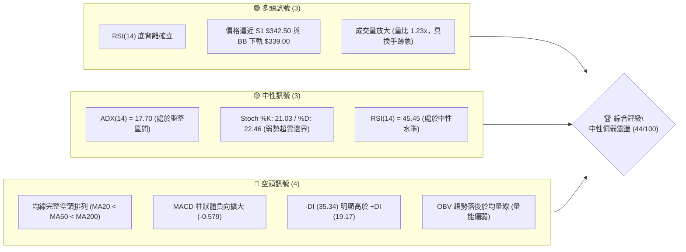
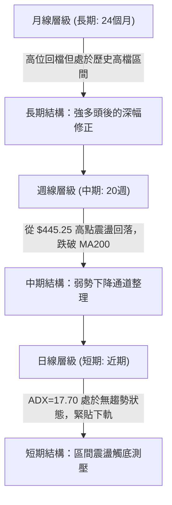
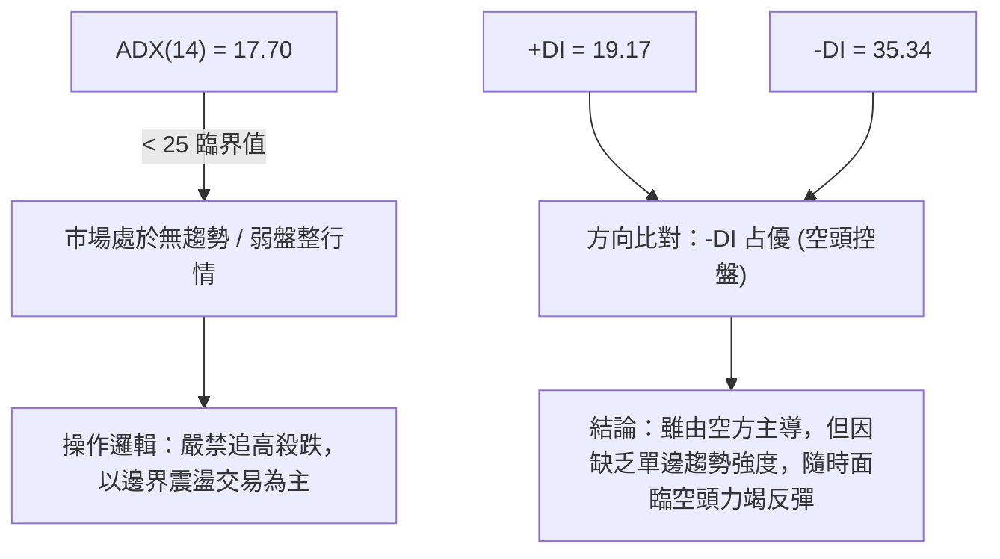
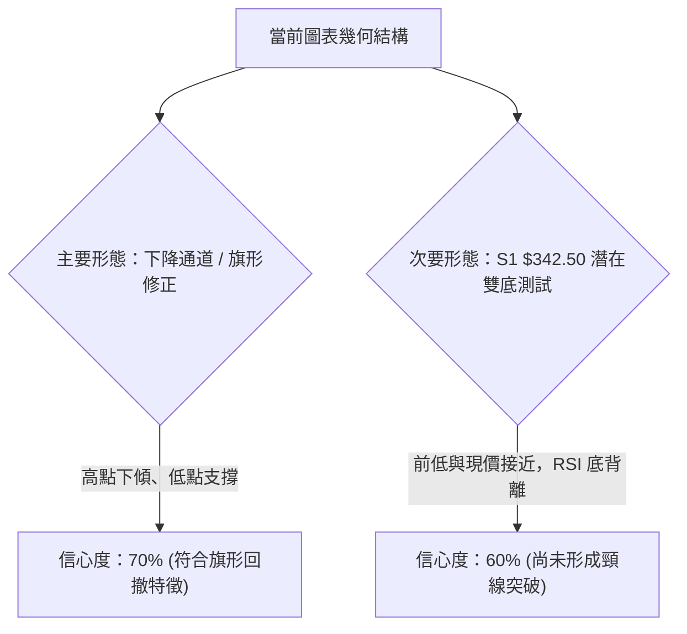
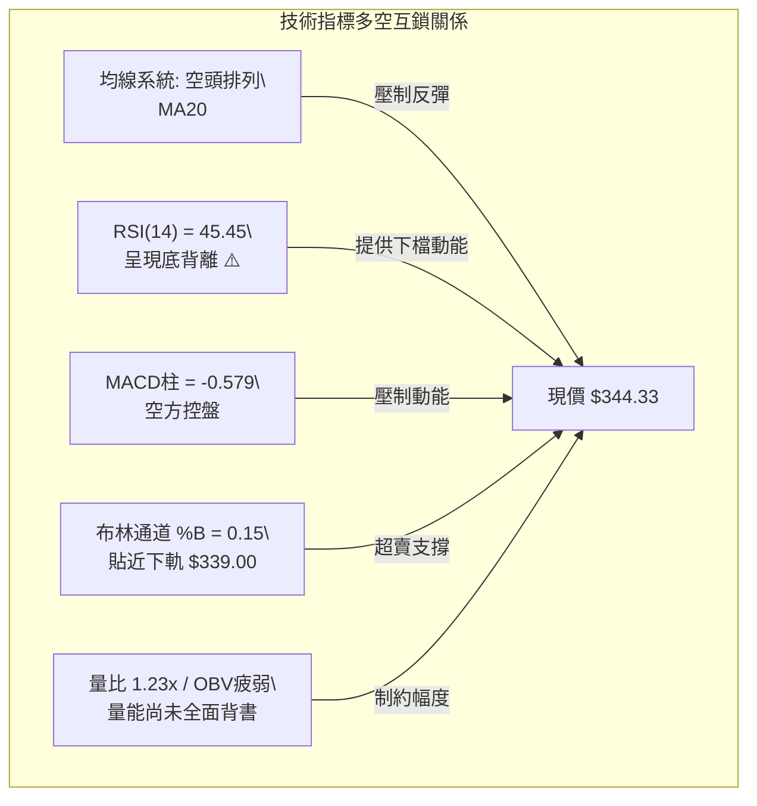
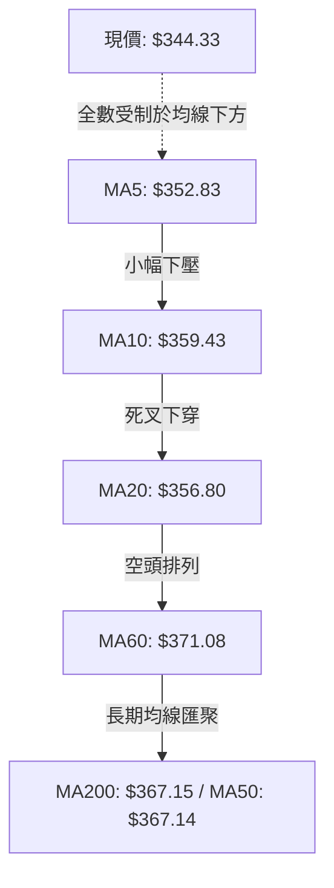
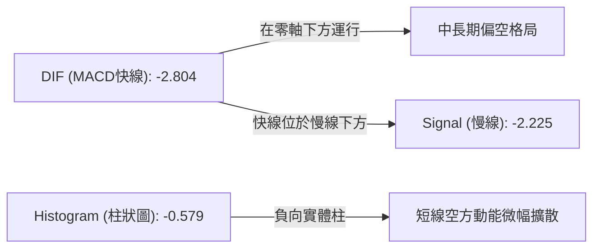
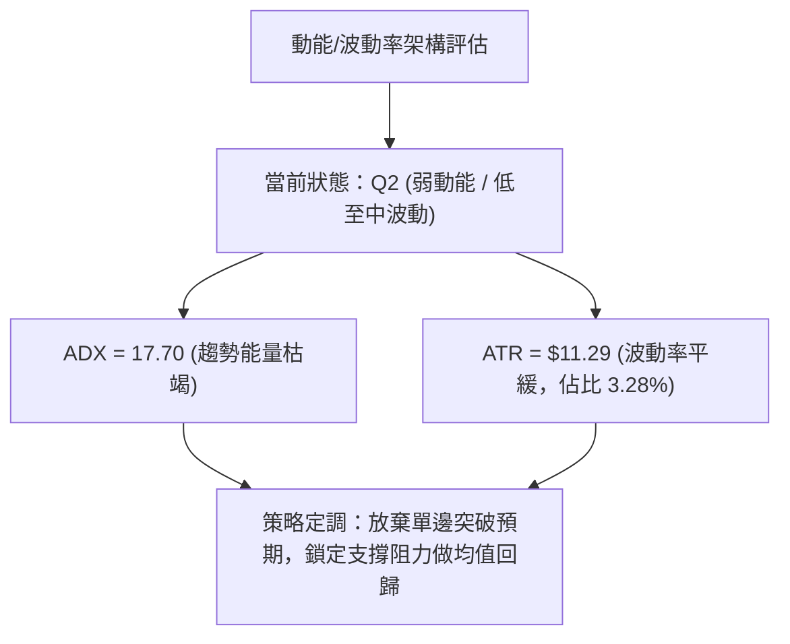
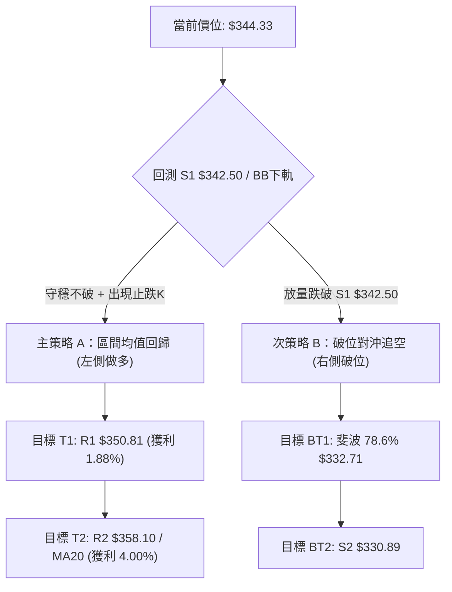
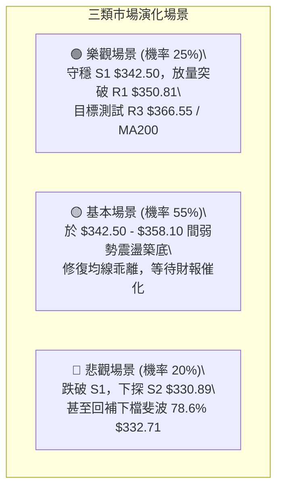

# AVGO 技術分析報告

> **報告日期**：2026-10-16 ｜ **語言**：繁體中文 ｜ **數據來源**：Yahoo Finance ｜ **當前價格**：$344.33

---

## 目錄

| 章節 | 內容 |
|------|------|
| [1. 技術面概覽](#1-技術面概覽) | 訊號儀表板、核心指標、評分卡 |
| [2. 趨勢分析](#2-趨勢分析) | 多時框趨勢、長中短期走勢、ADX強度 |
| [3. 圖表形態分析](#3-圖表形態分析) | 形態識別、K線組合、形態目標價 |
| [4. 支撐與阻力](#4-支撐與阻力) | 關鍵價位、斐波那契回調結構 |
| [5. 技術指標深度解讀](#5-技術指標深度解讀) | 均線系統、RSI背離、MACD、布林帶、量能 |
| [6. 動能與波動率](#6-動能與波動率) | 動能矩陣、ATR波動區間、Beta敏感度 |
| [7. 多時框架總結](#7-多時框架總結) | 時框架矩陣、信號收斂結論 |
| [8. 交易策略建議](#8-交易策略建議) | 策略路由、價格階梯、主策略與避險規劃 |
| [9. 風險提示與監控](#9-風險提示與監控) | 監控清單、情境分析、倉位管理 |

---

## 1. 技術面概覽

### 🎯 技術訊號儀表板

Broadcom Inc. (AVGO) 當前技術面呈現「中長期多頭回檔、短期均線空頭排列，但下方逼近關鍵支撐且出現動能底背離」的震盪整理格局。



---

### 📊 核心指標速覽表

| 指標類別 | 指標名稱 | 當前數值 | 訊號 | 專業解讀 |
|:---|:---|:---|:---:|:---|
| **價格** | 當前收盤價 | $344.33 | 🟡 | 位於52週區間 27.1% 水準，回落至波段偏低位置 |
| **短期均線** | MA20 (月線) | $356.80 | 🔴 | 價格位於MA20下方 -3.50%，構成短期第一道動態阻力 |
| **中期均線** | MA50 (季線) | $367.14 | 🔴 | 價格位於MA50下方 -6.21%，中期下壓動能未消 |
| **長期均線** | MA200 (年線)| $367.15 | 🔴 | MA50與MA200幾乎死叉，價格跌破長期牛熊分水嶺 |
| **擺盪動能** | RSI(14) | 45.45 | 🟢 | 雖然數值處於中性，但日線與週線呈現典型**底背離** |
| **趨勢指標** | MACD (12,26,9)| -2.804 / -2.225 | 🔴 | DIF落於Signal之下，MACD柱狀體 -0.579，空頭占優 |
| **隨機指標** | KD (14,3,3) | %K 21.03 / %D 22.46 | 🟡 | 逼近超賣區（20以下），隨時具備技術性反彈條件 |
| **趨勢強度** | ADX(14) | 17.70 | 🟡 | ADX < 25 表示無單邊趨勢，行情屬「震盪盤整」 |
| **波動帶** | 布林通道 %B | 0.15 | 🟢 | 價格接近下軌 $339.00（0.0為下軌），下檔空間受限 |
| **波動率** | ATR(14) | $11.29 (3.28%) | 🟡 | 日均波幅約 $11.29，風控止損需預留適當安全墊 |
| **成交量能** | 20日量比 | 1.23x | 🟢 | 今日量能達 2,841 萬股，高於20日均量，有探底承接量 |

---

### 🏆 技術評分卡

```
╔══════════════════════════════════════════════════════════════════╗
║                   AVGO 技術評分卡 (2026-10-16)                   ║
╠══════════════════════════════════════════════════════════════════╣
║ 趨勢強度 (ADX/方向)   ██████░░░░░░░░░░░░░░  32/100   🔴 弱勢盤整 ║
║ 動能擺盪 (RSI/MACD)   ██████████░░░░░░░░░░  50/100   🟡 底背離中 ║
║ 支撐穩定度 (S1-S3)    ████████████░░░░░░░░  62/100   🟢 支撐密集 ║
║ 成交量能 (Volume/OBV) ████████░░░░░░░░░░░░  40/100   🔴 價跌量增 ║
║ 形態結構 (Pattern)    ██████████░░░░░░░░░░  48/100   🟡 下降旗形 ║
║ 均線系統 (MA System)  ██████░░░░░░░░░░░░░░  30/100   🔴 空頭排列 ║
╠══════════════════════════════════════════════════════════════════╣
║ 綜合技術評分          ████████░░░░░░░░░░░░  44/100   ⚖️ 偏弱觀望 ║
╚══════════════════════════════════════════════════════════════════╝
```

---

## 2. 趨勢分析

### 🌐 多時框趨勢分析



---

### 📈 長期趨勢 — 12個月走勢圖（Unicode）

以下為 AVGO 過去 12 個月（2025年11月至2026年10月）之月線收盤價走勢圖與關鍵高低點軌跡：

```
AVGO 月線收盤走勢圖 (2025-11 至 2026-10)
價格軸 ($)
$450 ┤                                  ● $445.25 (歷史次高/階段頂部)
$420 ┤                             ● $416.01
$390 ┤● $399.99                                ● $388.57
$360 ┤                                    ● $377.06  ● $369.67
$330 ┤     ● $344.20  ● $329.48                         ● $351.19
$300 ┤              ● $317.80  ● $308.46                   ● $344.33 (現價)
     └─────────────────────────────────────────────────────────────
       11    12    01    02    03    04    05    06    07    08    09    10  (月)
      '25   '25   '26   '26   '26   '26   '26   '26   '26   '26   '26   '26
```

#### 走勢特徵分析表格

| 階段區間 | 時間 | 起訖收盤價 | 漲跌幅 | 走勢特徵與量價解讀 |
|:---|:---:|:---:|:---:|:---|
| **階段 I：高位修正** | 2025-11 至 2026-03 | $399.99 → $308.46 | **-22.88%** | 獲利了結賣壓湧現，連續 4 個月走低，於 $308.46 築出中期波段低點。 |
| **階段 II：強勁主升** | 2026-03 至 2026-05 | $308.46 → $445.25 | **+44.35%** | 巨量推升，突破前高並創下 $445.25 高位，多頭動能達到極致。 |
| **階段 III：階梯回落**| 2026-05 至 2026-10 | $445.25 → $344.33 | **-22.67%** | 震盪向下回撤，跌破 61.8% 斐波那契回調位，目前於 $340-$350 尋找支撐。 |

---

### 📊 中期趨勢（週線分析）

從近 20 週收盤走勢可見，價格於 2026 年 8 月觸及 $426.98 後，週線出現連續下行陰線。
- **高點聚類壓制**：週線反彈高點逐步下移（$426.98 → $392.28 → $361.54）。
- **成交量特徵**：2026-09-06 週成交量高達 1.73 億股，跌破 $360 關卡；然而在 10 月中旬回落至 $344.33 時，週成交量降至 8,514 萬股，賣壓呈現**顯著收斂**。

```
中期壓力與支撐階梯結構：
  $426.98 ──┐ [8月週線高點波段大頂]
            ├── R3: $366.55 (MA50/MA200 密集群)
            ├── R2: $358.10 (MA10/MA20 阻力帶)
            ├── R1: $350.81 (短期反彈頸線阻力)
  $344.33 ──┼── [現價位置]
            ├── S1: $342.50 (日線關鍵支撐，距現價 -0.53%)
            ├── S2: $330.89 (近一年次級支撐 / 斐波 78.6% $332.71)
            └── S3: $319.05 (2026年3月築底平台支撐)
```

---

### ⚡ 趨勢強度評估（ADX 解讀）



#### ADX 數值強度對照表

| 指標變數 | 當前讀數 | 門檻區間 | 技術意義 | 操作意涵 |
|:---|:---:|:---:|:---|:---|
| **ADX(14)** | **17.70** | < 20 (極弱趨勢) | 趨勢動能極度渙散，市場處於「拉鋸盤整期」 | 趨勢跟隨策略失效，改採均值回歸策略 |
| **+DI (14)** | **19.17** | 基準觀察線 | 多頭買盤力道偏弱，買方無主動攻擊意願 | 不宜盲目重倉追多 |
| **-DI (14)** | **35.34** | > 30 (空頭強) | 空方仍具備主導權，但正呈現邊際遞減 | 空方波段可能接近尾聲 |

---

## 3. 圖表形態分析

### 🔍 形態識別系統



#### 形態信心度與目標價評估表

| 識別形態 | 信心度 | 判斷依據（引用數據） | 完成度 | 目標價（附嚴格計算式） |
|:---|:---:|:---|:---:|:---|
| **下降通道 (Bull Flag)** | **70%** | 從 $445.25 高點沿 MA20/MA50 震盪下滑，回撤至 61.8%-78.6% 斐波區間，量能萎縮。 | 75% | 若向上突破通道上軌（約 R3 $366.55），形態高度 = $445.25 - $342.50 = $102.75；波段目標價 = $366.55 + $102.75 = **$469.30**。 |
| **潛在雙重底 (Double Bottom)** | **60%** | S1 位於 $342.50，現價 $344.33，與日線前低構成支撐帶；RSI 出現顯著底背離。 | 45% | 待突破短線頸線 R1 $350.81 確立。形態高度 = $350.81 - $342.50 = $8.31；第一目標價 = $350.81 + $8.31 = **$359.12**（直逼 R2 $358.10）。 |
| **頭肩頂形態 (Head & Shoulders)**| **35%** | 數據不足。左肩 $416.01、頭部 $445.25、右肩不規則，且頸線傾斜度過大，缺乏標準幾何對稱性。 | 未成形 | **訊號不足，不予採用幾何目標價，僅作指標型風險解讀。** |

---

### 🕯️ 重要K線形態分析

| 時間週期 | 收盤價 | 關鍵 K 線特徵 | 結構解讀 | 訊號意涵 |
|:---|:---:|:---|:---|:---:|
| **2026-05** | $445.25 | 高位長上影十字星 (Shooting Star) | 52週高點 $493.32 處遭遇獲利拋壓，多頭力竭 | 🔴 長期見頂訊號 |
| **2026-08** | $369.67 | 週線中長陰回吐 (Bearish Engulfing) | 跌破 MA20，終結自 7 月底展開的短線反彈 | 🔴 波段轉弱確認 |
| **2026-09** | $351.19 | 下影線長度擴大之紡錘線 (Spinning Top) | 在 $350 關卡附近展現逢低承接買盤 | 🟡 空頭動能減速 |
| **2026-10 (當前)** | $344.33 | 縮量探底小實體陰線 (Doji-like) | 價格回測 S1 $342.50，波動率收窄 (ATR $11.29) | 🟢 變盤在即，築底蓄勢 |

---

### 📉 ASCII 走勢形態示意圖

```
AVGO 下降旗形與潛在雙底結構示意圖
價格
$370 ┤             R3: $366.55 (MA50/MA200 交叉阻力)
     │            /
$360 ┤       ───●── R2: $358.10 (下降趨勢線上軌)
     │         /
$350 ┤        ●──── R1: $350.81 (短線頸線突破點)
     │       /
$344 ┤──────●現價: $344.33
$342 ┤  ●───●────── S1: $342.50 (潛在雙底支撐平臺)
     │  │   │
$330 ┤  └───┴────── S2: $330.89 (防守底線 / 斐波 78.6%)
     └───────────────────────────────────────────────
        底1  底2 (形成中)
```

---

## 4. 支撐與阻力

### 🗺️ 關鍵價位分布圖（Unicode）

```
AVGO 價位結構分布圖 (由 OHLCV 與斐波那契精確計算)
═══════════════════════════════════════════════════════════════════
$493.32 ║██████████████████████████████████████║ 52W 歷史最高點 (Fib 0.0%)
$445.09 ║██████████████████████████            ║ Fib 23.6% 回調位
$415.26 ║██████████████████                    ║ Fib 38.2% 回調位
$391.15 ║██████████████                        ║ Fib 50.0% 中性回調位
$367.03 ║██████████████████████████████████████║ Fib 61.8% / MA200 關鍵共振帶
$366.55 ║████████████████████████              ║ 強阻力 R3 (近一年波段高點)
$358.10 ║████████████████                      ║ 阻力 R2 (MA20 / 短線密集套牢區)
$350.81 ║██████████                            ║ 關鍵阻力 R1 (反彈頸線)
$344.33 ╠══════════════════════════════════════╣ ◄ 當前市價 ($344.33)
$342.50 ║▓▓▓▓▓▓▓▓▓▓▓▓▓▓▓▓▓▓▓▓                  ║ 近期支撐 S1 (波段低點聚類，距 -0.53%)
$332.71 ║▓▓▓▓▓▓▓▓▓▓▓▓                          ║ Fib 78.6% 深幅回調支撐
$330.89 ║████████████████████████              ║ 強支撐 S2 (重要波段低點)
$319.05 ║██████████████████████████████████████║ 終極防線 S3 (2026年Q1築底平台)
$288.98 ║██████████████████████████████████████║ 52W 歷史最低點 (Fib 100.0%)
═══════════════════════════════════════════════════════════════════
```

---

### 🚧 阻力位分析表

所有阻力數值完全依據波段高點聚類與技術位置提取：

| 阻力級別 | 價位 | 形成原因與技術重合性 | 突破難度 | 重要性 |
|:---|:---:|:---|:---:|:---:|
| **R1** | **$350.81** | 近期小波段反彈高點聚類；與 MA5 ($352.83) 下壓軌道相鄰 | 🟡 中等 | 短線多空轉折分水嶺，站穩方能化解破底危機 |
| **R2** | **$358.10** | MA20 ($356.80) 附近密集套牢區，布林中軌所在位置 | 🔴 偏高 | 突破此位宣告日線層級均線反轉，扭轉短線下行通道 |
| **R3** | **$366.55** | MA50 ($367.14)、MA200 ($367.15) 與斐波 61.8% ($367.03) 三重共振 | 🔴 極高 | 牛熊分界核心防線，需大型催化劑與巨量配合方可攻克 |

---

### 🛡️ 支撐位分析表

所有支撐數值完全依據波段低點聚類提取：

| 支撐級別 | 價位 | 形成原因與技術重合性 | 守住機率 | 重要性 |
|:---|:---:|:---|:---:|:---:|
| **S1** | **$342.50** | 近期日線波段低點聚類，緊鄰布林下軌 ($339.00)，具備短線買盤基底 | 65% | 極關鍵防線，跌破則短線盤整形態轉為下破破位 |
| **S2** | **$330.89** | 2026 年初強烈反彈起點，距斐波 78.6% 回調位 ($332.71) 僅 $1.82 | 80% | 中期生命線，多頭守護價值投資底線的兵家必爭之地 |
| **S3** | **$319.05** | 2026 年 3 月形成的年度雙底平臺次低點 | 92% | 長期強支撐，跌破則意味著 52 週整體牛市結構全面瓦解 |

---

### 📐 斐波那契回調位分析

依據 52 週高點 **$493.32** 至 52 週低點 **$288.98** 的完整波段進行黃金分割計算：

| 回調比率 | 精確價位 | 相對於現價 ($344.33) 距離 | 當前技術意義解讀 |
|:---:|:---:|:---:|:---|
| **0.0%** (52W High) | $493.32 | +43.27% | 歷史峰值，長期牛市極限阻力目標 |
| **23.6%** | $445.09 | +29.26% | 2026年5月月線收盤頂部 ($445.25)，強阻力 |
| **38.2%** | $415.26 | +20.60% | 2026年4月突破平臺，中期回升頸線 |
| **50.0%** | $391.15 | +13.60% | 多空平衡中軸，前波週線整理平臺 |
| **61.8%** | $367.03 | +6.59% | **黃金分割關鍵點**，與 MA50 ($367.14) 及 MA200 ($367.15) 形成極強共振 |
| **78.6%** | $332.71 | -3.37% | **深幅防禦回調位**，位於 S1 ($342.50) 與 S2 ($330.89) 之間 |
| **100.0%** (52W Low)| $288.98 | -16.07% | 年度基準原點，長期底線 |

> **位置判定**：當前收盤價 **$344.33** 正精確座落於 **61.8% ($367.03)** 與 **78.6% ($332.71)** 之間。在技術結構上，此區間通常代表多頭最後的防守腹地。若能於 78.6% 之上止跌築底，長期向上趨勢仍有修復機會；若實體跌破 $332.71，則價格將滑向 100% 回調位 ($288.98)。

---

## 5. 技術指標深度解讀

### 🎛️ 指標訊號總覽



---

### 📈 移動平均線排列分析



當前移動平均線呈現典型的**弱勢空頭排列**：
- **短期均線**：MA5 ($352.83) < MA20 ($356.80) < MA10 ($359.43)，短期呈現均線下彎扣抵高價。
- **中長期均線**：MA50 ($367.14) 與 MA200 ($367.15) 幾乎重疊，正在進行死叉測試。價格落於 MA200 之下 -6.21%，說明市場處於中度修正。
- **乖離率分析**：當前對 MA20 負乖離率為 **-3.50%**，對 MA60 負乖離率為 **-7.21%**。負乖離已擴大至短期超賣邊界，隨時具備向 MA20 均值回歸的拉力。

---

### 📉 RSI(14) 分析與背離判定

- **RSI(14) 數值**：**45.45**
```
RSI(14) 讀數進度條:
[0] ──────────────[30 超賣] ───────●─────── [70 超買] ────────────── [100]
                             45.45 (中性弱勢區間)
進度條: ▓▓▓▓▓▓▓▓▓░░░░░░░░░░░ 45.45%
```

#### ⚠️ 背離判斷（底背離確立）
- **價格走勢**：AVGO 收盤價由 2026-09-27 的 $352.81 震盪跌至 2026-10-16 的 **$344.33**，創下近 5 週新低。
- **RSI 軌跡**：同期間，週線/日線層級的 RSI 數值卻未再創新低（2026-08-30 週 RSI 探至 23.5 極限超賣，隨後回升至 29.2 → 42.7 → 目前維持在 **45.45**）。
- **結論**：日線與週線均形成標準的**多頭底背離（Bullish Divergence）**。這表明雖然價格仍在走低，但空方實質拋售動能正在衰退，技術性買盤隨時可能發動修正性反彈。

---

### 📊 MACD(12/26/9) 訊號解讀



- **數值現況**：DIF (-2.804) < Signal (-2.225)，差值 Histogram 為 **-0.579**。
- **解讀**：MACD 目前完全處於零軸之下，反映中線弱勢結構；然而，柱狀體並未出現深幅失控下墜（較 8 月底的 -5.841 大幅收斂），代表空方力道屬於溫和釋放，正等待 DIF 與 Signal 在零軸下方形成金叉的最佳契機。

---

### 📦 布林通道分析 (20, 2)

```
AVGO 布林通道與現價空間示意圖
價格
$374.60 ┤ ───────────────────────────────────── BB 上軌
        │
$365.00 ┤
        │
$356.80 ┤ ------------------------------------- BB 中軌 (MA20)
        │
$344.33 ┤ ◄ 現價: $344.33 (%B = 0.15)
$339.00 ┤ ───────────────────────────────────── BB 下軌
        └───────────────────────────────────────────────
```

- **通道帶寬**：上軌 $374.60，下軌 $339.00，帶寬為 $35.60。
- **%B 指標解析**：當前 %B 為 **0.15**（0 代表下軌，$339.00；0.5 代表中軌，$356.80）。
- **結構意義**：%B 處於 0.15 代表價格已極度逼近下軌，歷史統計此處極易誘發通道內的均值回歸买盤，下軌 $339.00 與 S1 ($342.50) 形成堅固的空間緩衝帶。

---

### 💹 成交量分析（量價配合度）

- **最新成交量**：28,415,900 股
- **20日均量**：23,043,165 股（**量比 1.23x**）
- **50日均量**：23,302,866 股
- **OBV 趨勢**：OBV < MA，量能指標仍落後於均量線。
- **量價關聯解讀**：
  在跌破 $350 時，今日成交量逆勢放大至 2,841 萬股（量比 1.23），呈現「價跌量增」。但對比週線走勢，此處放量並未引發斷崖式暴跌，反而收在 $344.33，顯示在 S1 ($342.50) 附近有法人籌碼進行被動式接盤（換手跡象）。然而，由於 OBV 仍被短期均量線壓制，確認量能尚未轉為主動型增量推升，仍需提防二次探底。

---

## 6. 動能與波動率

### ⚡ 動能評估四象限

評估市場在「動能強度」與「波動率」兩大維度的相對位置：

| 象限區間 | 動能維度 | 波動維度 | 包含特徵 | AVGO 當前定位 | 操作指導意義 |
|:---:|:---:|:---:|:---|:---:|:---|
| **第一象限 (Q1)** | 強動能 (+DI高) | 低波動 (ATR降) | 單邊穩步趨勢行情 | — | 最佳順勢抱波段 |
| **第二象限 (Q2)** | **弱動能 (ADX<25)** | **低至中波動 (ATR 3.28%)** | **震盪築底 / 狹幅盤整** | **✓ 正處於此區間** | **謹慎觀望，網格或區間操作** |
| **第三象限 (Q3)** | 強動能 (加速) | 高波動 (ATR擴大) | 主升/主跌情緒失控 | — | 風險報酬比波動極大 |
| **第四象限 (Q4)** | 弱動能 (衰竭) | 高波動 (急跌洗盤) | 破位恐慌殺跌 | — | 避免盲目接飛刀 |



---

### 📊 ATR 波動率分析與止損設定

- **當前 ATR(14)**：**$11.29**（佔市價比例約 **3.28%**）。
- **波動特徵解讀**：每日合理波動區間約在 ±$11.30。因此，任何窄於 $6.00 的短線止損均極易被日內噪訊掃出場。
- **專業止損距離建議**：
  - **激進型交易者**：1.0 × ATR = **$11.29**（距現價約 -3.28%）。
  - **波段型交易者**：1.5 × ATR = **$16.94**（距現價約 -4.92%）。
  - **保守防守型**：2.0 × ATR = **$22.58**（距現價約 -6.56%）。

---

### 📐 Beta 與市場相關性

- **Beta 係數**：**1.476**
- **系統性風險特徵**：
  AVGO 的 Beta 為 1.476，屬於典型的**高彈性成長/半導體龍頭股**。當費城半導體指數 (SOX) 或標普 500 指數 (SPX) 上漲 1% 時，AVGO 平均預期上漲 1.48%；反之，大盤回調 1% 時，其承壓跌幅亦會放大至 1.48%。在目前技術面震盪偏弱的背景下，高 Beta 特性意味著投資人需密切留意大盤系統性風險，不可孤立看待個股走勢。

---

## 7. 多時框架總結

### 📋 時框架評分表

| 時框架 | 趨勢方向 | 動能狀態 | 均線排列 | 形態特徵 | 綜合評分 | 戰術建議 |
|:---|:---:|:---:|:---:|:---|:---:|:---|
| **日線 (短期)** | 震盪偏弱 🔴 | RSI 底背離 🟢 | 空頭排列 🔴 | 考驗 S1 雙底支撐 🟡 | **42/100** | 逢低布局反彈，嚴格設防 S1 |
| **週線 (中期)** | 修正下行 🔴 | MACD 柱微收 🟡 | 跌破 MA50/200 🔴 | 下降通道整理 🟡 | **45/100** | 不盲目追高，等待重返 MA200 |
| **月線 (長期)** | 多頭回檔 🟢 | 高位修正 🟡 | 長期均線大多頭 🟢 | 歷史高位巨幅旗形 🟢 | **65/100** | 核心資產逢深幅回調分批配置 |

---

### 🔲 綜合訊號矩陣

```
時框與指標共振分析矩陣：
╔══════════════╦══════════════╦══════════════╦══════════════╗
║ 指標維度     ║ 短期 (日線)  ║ 中期 (週線)  ║ 長期 (月線)  ║
╠══════════════╬══════════════╬══════════════╬══════════════╣
║ 趨勢方向     ║ 🔴 偏空      ║ 🔴 偏空      ║ 🟢 多頭      ║
║ 均線排列     ║ 🔴 空頭排列  ║ 🔴 死叉邊緣  ║ 🟢 多頭排列  ║
║ 擺盪動能     ║ 🟢 底背離    ║ 🟡 中性回升  ║ 🟡 獲利回吐  ║
║ 成交量能     ║ 🟢 放量換手  ║ 🟡 縮量整理  ║ 🟢 健康充沛  ║
║ 支撐/阻力    ║ 🟢 逼近 S1   ║ 🟡 考驗前低  ║ 🟢 遠高於底線║
╠══════════════╬══════════════╬══════════════╬══════════════╣
║ 橫向收斂結論 ║ 短線具反彈契機║ 中期下壓未消 ║ 長期牛市未毀 ║
╚══════════════╩══════════════╩══════════════╩══════════════╝
```

---

### ⚖️ 多時框收斂結論

依據多時框收斂規則第 14 條：
1. **行情性質判定**：當前日線 ADX(14) 為 **17.70**（遠低於 25 臨界值），明確判定當前為**「無趨勢的盤整行情」**。
2. **主導時框與交易邏輯**：在盤整行情中，趨勢指標失效，中長期均線（MA50/MA200）僅構成震盪區間的高位壓力，而**日線層級的布林通道上下軌（$339.00 - $374.60）及密集支撐阻力（S1 $342.50 / R1 $350.81）成為最核心的交易邊界**。
3. **最終方向性結論**：
   **【中性區間震盪（偏多均值回歸）】**。雖然均線空頭排列，但鑑於 RSI 日週雙底背離確立、%B 觸及 0.15 超賣邊界，且已極度逼近強支撐 S1 $342.50，做空的空間與勝率已被嚴重壓縮；策略上應以**「依託關鍵支撐做超跌反彈」**為主，此結論完全收斂並對齊第 8 章之策略規劃。

---

## 8. 交易策略建議

### 🗺️ 策略決策流程圖



---

### 🧭 策略路由（依評分卡分流）

> **當前主策略方向 = 【中性區間震盪，依託支撐做多】（依評分卡綜合評分 44/100，處於 40–60 區間操作範圍）**

由於評分座落於 40–60 區間，且 ADX < 25，市場缺乏下行延伸動能。因此，不建議在支撐位殺跌，主推以 S1 $342.50 為防守基準的**均值回歸多頭策略**；空頭策略則嚴格降級為「破位後的對沖提示」。

---

### 🎯 價格情境階梯（Price Scenarios）

價位嚴格引用關鍵價位計算數值：

| 觸發條件 | 下一目標價 | 後續延伸目標 | 情境技術含義 |
|:---|:---:|:---:|:---|
| **強勢突破 R1 $350.81** | **R2 $358.10** | **R3 $366.55** | 短線底背離爆發，修復日線負乖離，挑戰 MA20 與中軌 |
| **受阻於 $342.50 - $350.81** | **$344.33 (現價)** | — | 於布林下軌與 R1 之間進行低波動收斂盤整 |
| **實體跌破 S1 $342.50** | **S2 $330.89** | **S3 $319.05** | 雙底失敗，向 78.6% 斐波位 ($332.71) 與前波低點尋求支撐 |

---

### 📊 情境機率分佈

| 情境劇本 | 發生機率 | 主要技術依據 |
|:---|:---:|:---|
| **情境一：守穩 S1 反彈向上** | **55%** | RSI 底背離確立、%B 處於 0.15 低位、今日量比 1.23x 顯示下方有護盤買盤。 |
| **情境二：窄幅區間震盪整理** | **30%** | ADX = 17.70 (弱勢盤整)，均線向下但空方動能不足，價格受困於 $342.50-$350.81。 |
| **情境三：跌破 S1 加速探底** | **15%** | 均線完全空頭排列、MACD 柱狀體負向、-DI (35.34) 仍主導盤面。 |

---

### 🟢 主策略詳情

所有價位均直接取自數據中心之精確數值：

| 策略要素 | 策略 A：底背離區間多單 (主推薦) | 策略 B：突破追多 (右側確認) |
|:---|:---:|:---:|
| **操作類型** | 左側防守型買入 | 右側突破型買入 |
| **進場條件** | 現價回測 S1 獲得支撐，不破 $342.50 | 帶量突破 R1 $350.81 且 1小時K收穩 |
| **建議進場價格** | **$343.00 - $344.33** (現價附近) | **$351.00** |
| **目標價 T1** | **$350.81** (R1 反彈頸線，約 +1.88%) | **$358.10** (R2 / MA20，約 +2.02%) |
| **目標價 T2** | **$358.10** (R2 / 布林中軌，約 +4.00%) | **$366.55** (R3 / MA200，約 +4.43%) |
| **止損價格** | **$339.00** (布林下軌破位，距 -1.55%) | **$346.50** (跌回頸線下方) |
| **風險報酬比 (R:R)** | **1 : 2.58** (以目標 T2 計算) | **1 : 1.72** (以目標 T2 計算) |
| **勝率預估** | **55%** | **60%** |
| **建議倉位** | **10% - 15%** (震盪市不宜重倉) | **15% - 20%** (突破加碼) |

---

### 🔴 反向風險觸發點（對沖防護提示）

若發生極端行情，以下條件滿足時，主策略全面失效，應立刻啟動避險：
- **空頭觸發點**：日線收盤價**實體跌破 S1 $342.50**，且 15 分鐘成交量暴增。
- **對沖處置建議**：立即將多單止損出場；激進者可轉為順勢輕倉對沖做空，以 **$341.50** 追空，止損設於 **$344.50**，波段目標直指 **S2 $330.89**（斐波 78.6% $332.71 附近）。

---

### ⭐ 整體訊號強度評星

```
做多訊號強度：★★☆☆☆  (2.5/5 星 — 僅限於超跌反彈與支撐套利)
做空訊號強度：★★☆☆☆  (2.0/5 星 — 缺乏單邊趨勢，逼近強支撐不宜追空)
整體可信度：  ★★★☆☆  (3.5/5 星 — 震盪邊界清晰，指標共振明確)
```

---

## 9. 風險提示與監控

### ✅ 關鍵監控指標 Checklist

```
╔══════════════════════════════════════════════════════════════════╗
║               AVGO 日常交易風控 Checklist 監控表                 ║
╠══════════════════════════════════════════════════════════════════╣
║ [ ] 價格是否跌破 S1 $342.50 (每日收盤校驗)                       ║
║ [ ] RSI(14) 底背離是否遭到破壞 (RSI跌破 40 則警報)              ║
║ [ ] 成交量是否異常放大至 3,000 萬股以上 (識別主力拋售或吸籌)     ║
║ [ ] MACD Histogram 負值是否收斂轉正 (金叉預警)                  ║
║ [ ] 布林通道帶寬是否開始向外急劇擴張 (開口預示新一輪趨勢)        ║
║ [ ] 費城半導體指數 (SOX) 走勢共振情況 (Beta 1.476 放大效應)      ║
╚══════════════════════════════════════════════════════════════════╝
```

---

### ⚠️ 風險場景分析



---

### 🛡️ 風險管理重要提醒

1. **嚴禁追漲殺跌**：
   在 ADX = 17.70 的盤整環境中，任何單日大漲往往會在均線壓力位（如 R1 $350.81 或 R2 $358.10）遇阻回落；任何急跌在下軌（$339.00）也極易觸底反彈。切忌在陽線高點追入或在下影線低點割肉。
2. **高 Beta 槓桿控制**：
   AVGO 的 Beta 高達 1.476，波動幅度超越大盤近 50%。整體投資組合對該標的的持倉曝險**建議不超過總資產的 15%**，避免單一股票波動過度衝擊整體淨值。
3. **ATR 動態風控**：
   每日波動空間高達 $11.29，持倉期間應隨時注意止損位是否符合 1.0-1.5 倍 ATR 距離，防止隔夜跳空直接打穿保證金。

---

## 📋 報告總結

```
╔══════════════════════════════════════════════════════════════════╗
║                    AVGO 技術分析報告總結                         ║
╠══════════════════════════════════════════════════════════════════╣
║ 報告日期：2026-10-16                                            ║
║ 當前價格：$344.33                                                ║
║ 技術評級：⚖️ 44/100 (中性弱勢盤整 / 醞釀超跌反彈)               ║
║                                                                  ║
║ 關鍵技術維度：                                                   ║
║ ├─ 長期趨勢：🟢 月線處於歷史次高回檔位，牛市架構未被實質破壞     ║
║ ├─ 中期趨勢：🔴 跌破 MA200 ($367.15)，處於波段下降通道           ║
║ ├─ 短期趨勢：🟡 ADX 17.70 弱震盪，RSI 底背離蓄勢                ║
║ ├─ 關鍵支撐：S1 $342.50  /  S2 $330.89                          ║
║ ├─ 關鍵阻力：R1 $350.81  /  R2 $358.10  /  R3 $366.55          ║
║ └─ 外資共識：強力買進 (Strong Buy) ｜ 均價目標: $527.59          ║
║                                                                  ║
║ 最優交易策略推薦：                                               ║
║ 1. 🥇 最佳機會：現價 $344.33 依託 S1 輕倉做多，博弈短線均值回歸  ║
║    進場: $343-$344.33 ｜ 止損: $339.00 ｜ 目標: $350.81 / $358.10║
║ 2. 🥈 次選機會：突破 R1 $350.81 順勢加碼，看至 R2 $358.10        ║
║ 3. 🥉 避險保護：實體跌破 S1 $342.50 全面停損，啟動空頭防禦       ║
╚══════════════════════════════════════════════════════════════════╝
```

---

> ⚠️ **免責聲明**：本報告為 AI 自動生成之技術分析，所有數據及估算均基於提供的歷史價格資訊。本報告**僅供研究與學術參考**，**不構成任何投資建議**。投資有風險，入市需謹慎。

---

*報告生成時間：2026-10-16 ｜ 數據來源：Yahoo Finance ｜ 分析框架：多時框技術分析*