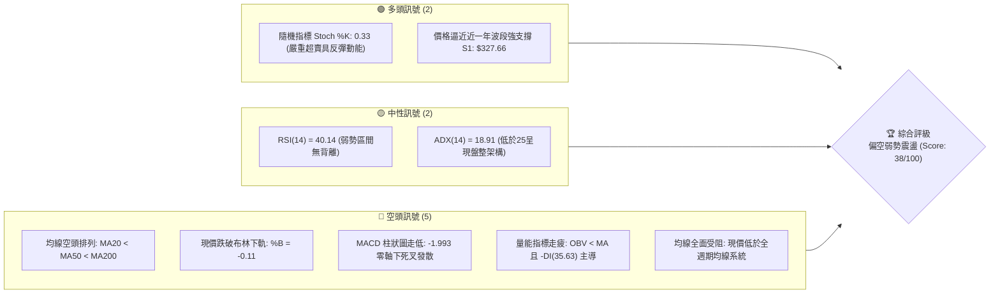
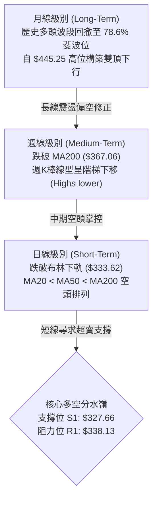
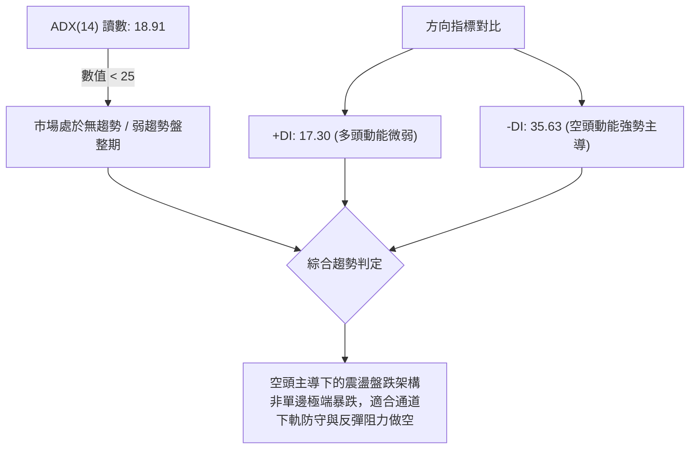
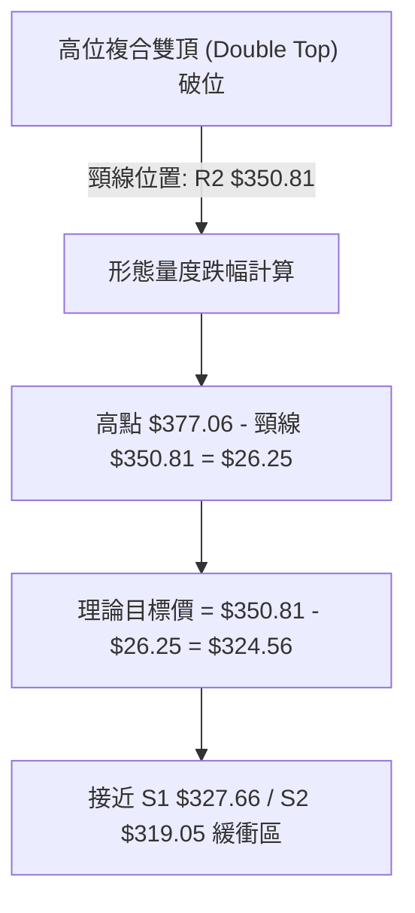
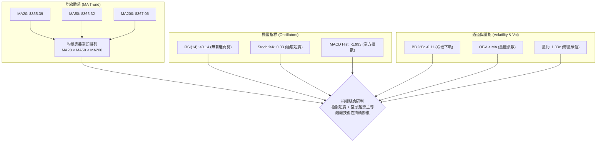
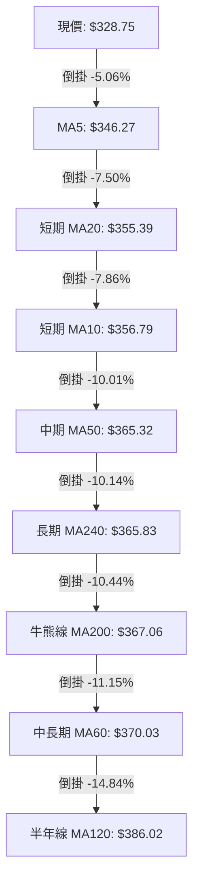
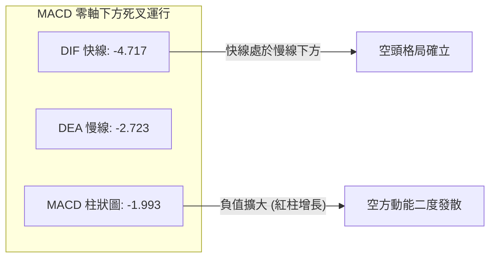
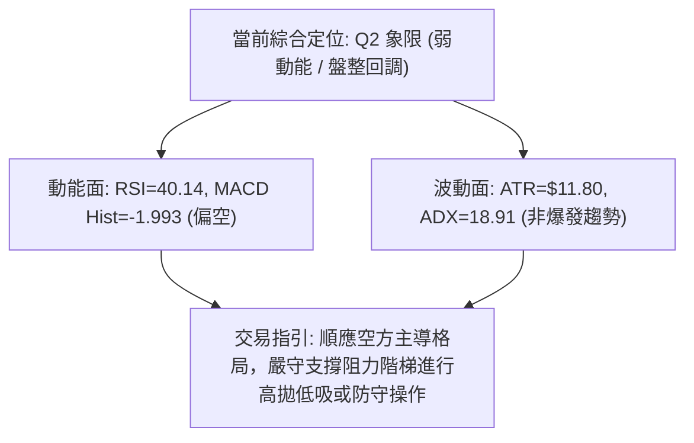
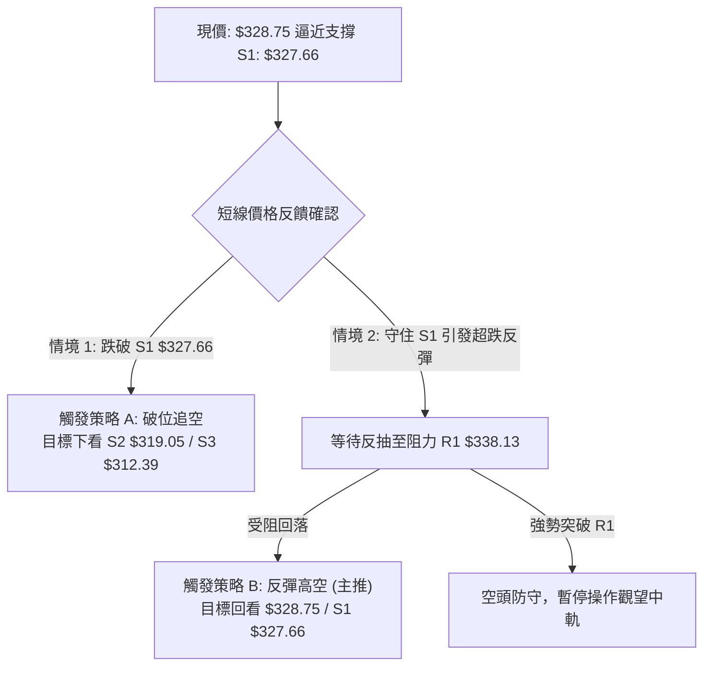
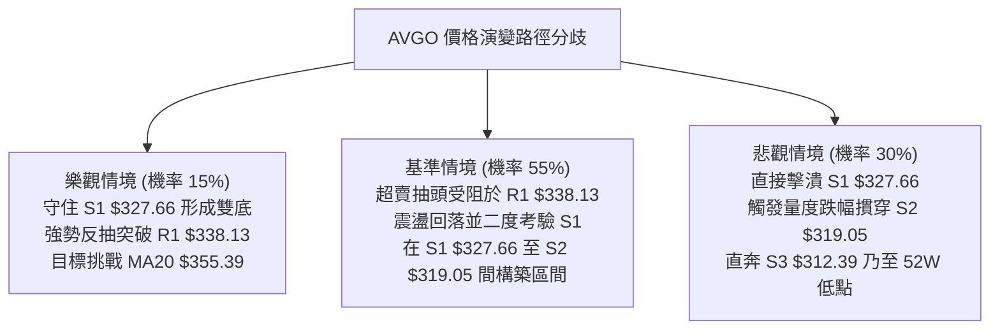

# AVGO 技術分析報告

> **報告日期**：2026-10-17 ｜ **語言**：繁體中文 ｜ **數據來源**：Yahoo Finance ｜ **當前價格**：$328.75

---

## 目錄

| 章節 | 內容 |
|------|------|
| [1. 技術面概覽](#1-技術面概覽) | 訊號儀表板、核心指標、評分卡 |
| [2. 趨勢分析](#2-趨勢分析) | 多時框趨勢、長中短期走勢、ADX強弱 |
| [3. 圖表形態分析](#3-圖表形態分析) | 形態識別、K線組合、目標價推算 |
| [4. 支撐與阻力](#4-支撐與阻力) | 關鍵價位階梯、斐波那契回調結構 |
| [5. 技術指標深度解讀](#5-技術指標深度解讀) | MA體系、RSI、MACD、布林通道與OBV |
| [6. 動能與波動率](#6-動能與波動率) | 動能四象限、ATR防守、Beta相關性 |
| [7. 多時框架總結](#7-多時框架總結) | 時框架評分矩陣與收斂規則結論 |
| [8. 交易策略建議](#8-交易策略建議) | 策略路由、價格情境、多空操作規範 |
| [9. 風險提示與監控](#9-風險提示與監控) | 關鍵監控Checklist、三情境演變路徑 |
| [10. 報告總結](#10-報告總結) | 總結儀表板與最優策略組合 |

---

## 1. 技術面概覽

### 🎯 技術訊號儀表板



### 📊 核心指標速覽表

| 指標類別 | 指標名稱 | 當前數值 | 訊號 | 解讀 |
|:---|:---|:---:|:---:|:---|
| **價格** | 當前價格 | $328.75 | 🔴 | 位於52週區間19.5%低位，距離52週高點回撤達33.36% |
| **均線** | 短期 MA20 | $355.39 | 🔴 | 現價大幅倒掛 -7.50%，下行斜率陡峭，形成短期反彈首要天花板 |
| **均線** | 中期 MA50 | $365.32 | 🔴 | 現價低於MA50達 -10.01%，中期均線向下施壓，確認中期空頭主導 |
| **均線** | 長期 MA200| $367.06 | 🔴 | 跌破牛熊分界線 -10.44%，長期防守架構受損，長線多頭需築底修復 |
| **動能** | RSI(14) | 40.14 | 🟡 | 位於40防守中樞，尚未跌破30極度超賣區，動能疲軟但未現衰竭底背離 |
| **動能** | MACD | -4.717 | 🔴 | MACD線(-4.717)低於訊號線(-2.723)，柱狀圖為-1.993，空方量能擴散中 |
| **震盪** | Stoch %K / %D | 0.33 / 10.12 | 🟢 | 極限超賣水平（%K < 5），短線空方動能過度宣洩，隨時具技術性抽頭契機 |
| **通道** | 布林帶 %B | -0.11 | 🔴 | 跌破布林帶下軌($333.62)，處於極端超跌通道外，帶寬開口向下擴張 |
| **趨勢** | ADX (14) | 18.91 | 🟡 | ADX < 25 表明非強烈單邊趨勢，主要為弱勢盤整下跌，-DI(35.63)壓制+DI(17.30) |
| **量能** | 20日成交量比| 1.33x | 🔴 | 放量下挫至29,727,900股（均量22,329,915），量增價跌顯示空方主動拋壓 |
| **波動** | ATR(14) | $11.80 | 🟡 | 日波動率為 3.59%，波動幅度適中，提供短線止損設置的量化緩衝空間 |

### 🏆 技術評分卡

```
╔══════════════════════════════════════════════════════════════════╗
║              技術評分卡 — AVGO (2026-10-17)                      ║
╠══════════════════════════════════════════════════════════════════╣
║ 趨勢強度 (Trend)     ██████░░░░░░░░░░░░░░  30/100  🔴 空頭控盤   ║
║ 動能指標 (Momentum)  ███████░░░░░░░░░░░░░  35/100  🔴 動能疲軟   ║
║ 支撐穩定度 (Support) █████████████░░░░░░░  65/100  🟢 臨近S1關口 ║
║ 成交量配合 (Volume)  ████████░░░░░░░░░░░░  40/100  🔴 量增價跌   ║
║ 形態完整度 (Pattern) █████████░░░░░░░░░░░  45/100  🟡 弱勢箱體   ║
║ 均線系統 (MovingAvg) ████░░░░░░░░░░░░░░░░  20/100  🔴 完美空頭   ║
╠══════════════════════════════════════════════════════════════════╣
║ 綜合技術評分         ███████░░░░░░░░░░░░░  38/100  🔴 偏空弱勢   ║
╚══════════════════════════════════════════════════════════════════╝
```

---

## 2. 趨勢分析

### 🌐 多時框趨勢分析



### 📈 長期趨勢 — 12個月走勢圖（Unicode）

以下為 AVGO 過去 12 個月（2025-11 至 2026-10）收盤價走勢軌跡。價格自 2025 年底攻堅後，於 2026 年 5 月創下歷史收盤高點 $445.25，隨後進入中級回撤浪潮，目前回吐至 $328.75。

```
AVGO 月線走勢圖（過去12個月）
價格軸 ($)
$450 ┤                                  ● $445.25 (頂部結構)
$420 ┤                             ● $416.01
$400 ┤ ● $399.99                                       
$380 ┤                                       ● $377.06  ● $388.57
$360 ┤                                                       ● $369.67  ● $351.19
$340 ┤      ● $344.20                                                         
$320 ┤           ● $329.48  ● $317.80  ● $308.46                              ● $328.75 (當前)
     └─────────────────────────────────────────────────────────────────────────────►
       11   12   01   02   03   04   05   06   07   08   09   10  (月份)
      (2025)   (---------------------- 2026 ----------------------)
```

#### 走勢特徵分析表格

| 階段區間 | 時間區段 | 價格起訖 | 區間幅度 | 核心特徵與形態解讀 |
|:---|:---:|:---:|:---:|:---|
| **階段一：年終脈衝回踩** | 2025-11 ~ 2026-03 | $399.99 → $308.46 | -22.88% | 自高位放量獲利了結，於 $308.46 構築春季底部，測試長期均線支撐 |
| **階段二：主升浪狂飆** | 2026-03 ~ 2026-05 | $308.46 → $445.25 | +44.35% | 業績與AI浪潮驅動強勁單邊走勢，月K線實體放大，創歷史波段新高 |
| **階段三：高位分歧派發** | 2026-05 ~ 2026-07 | $445.25 → $388.57 | -12.73% | 衝高 $493.32(52W High)後收盤於 $445.25，高位劇烈震盪，機構換手派發 |
| **階段四：階梯破位陰跌** | 2026-07 ~ 2026-10 | $388.57 → $328.75 | -15.39% | 跌破中短期均線，週線連環走弱，直逼 52 週低點回調帶下沿 |

### 📊 中期趨勢（週線分析）

從近 20 週收盤走勢可清晰識別出，市場於 2026-08-09 曾拉出反彈高點 $426.98（週 RSI 達 73.6），隨後迅速失守，MACD 柱狀圖在近兩週由正轉負（從 +2.477 陡降至 -1.993），形成「假突破、真破位」的誘多結構。

```
週線級別阻力與支撐階梯架構：
阻力 R3 ──── $358.10 (波段密集套牢區間下緣)
阻力 R2 ──── $350.81 (近四週收盤中樞與日線阻力聚類)
阻力 R1 ──── $338.13 (布林下軌破位反抽阻力)
現價   ──── $328.75 (當前位置，逼近波段邊界)
支撐 S1 ──── $327.66 (近一年波段低點聚類，僅距 -0.33%)
支撐 S2 ──── $319.05 (2026年2月築底平台支撐)
支撐 S3 ──── $312.39 (2026年3月春季低點前哨 $308.46 防線)
```

### ⚡ 趨勢強度評估（ADX 解讀）



#### ADX 強度對照表

| 指標變數 | 當前讀數 | 門檻區間 | 市場狀態解讀 |
|:---|:---:|:---:|:---|
| **ADX(14)** | **18.91** | < 25.00 | **弱趨勢 / 盤整市場**：行情未進入單邊強趨勢爆發期，禁止盲目追空，應以區間邊界與均線反抽為核心依據。 |
| **+DI (14)** | **17.30** | 基準線 20 | **多頭衰竭**：多方主動進攻能量低迷，無法發起有效波段攻擊。 |
| **-DI (14)** | **35.63** | 基準線 20 | **空頭優勢明顯**：-DI 大幅超越 +DI 逾一倍，顯示回落行情中空頭賣壓處於主導地位。 |

---

## 3. 圖表形態分析

### 🔍 形態識別系統

在日線與週線結構中，AVGO 在 $350.00 - $365.00 構築了密集頭部，隨後破位向下。依照形態學嚴格認證規則，識別出下列形態：



#### 形態識別信心度評估表

| 識別形態名稱 | 信心度 | 判斷依據（引用數據） | 完成度 | 目標價計算式與數值 |
|:---|:---:|:---|:---:|:---|
| **高位破位雙頂** | **78%** | 2026-08高位 $388.57 與反彈高點 $377.06 形成雙重高點聚類，本週收盤跌破頸線 $350.81 | 90% | 頸線 $350.81 - 形態高度 ($377.06 - $350.81 = $26.25) = **$324.56** (逼近 S1: $327.66 與 S2: $319.05 間) |
| **布林帶極端破位** | **85%** | 最新日K線刺破布林下軌 $333.62，%B 跌至 -0.11，形成技術性通道超跌拋售 | 100% | 通道下軌修復目標：向中軌 MA20 **$355.39** 尋求均值回歸修復 |
| **頭肩頂形態** | **35%** | 左肩 $426.98、頭部 $493.32，但右肩結構不對稱且歷史跨度超過半年，缺乏均勻量能結構 | 40% | *訊號不足，信心度低於50%，僅做指標型解讀，不納入主操作依據* |

### 🕯️ 重要K線形態分析

| 日期區間 | 最新收盤價 | K線形態名稱 | 實質技術解讀 | 多空訊號 |
|:---|:---:|:---|:---|:---:|
| **2026-10-18 (當週)** | $328.75 | **破位中長黑K棒** | 實體由 $361.54 直墜至 $328.75，一舉跌破前低支撐帶，週成交量達 1.149 億股，賣壓沈重 | 🔴 空頭 |
| **2026-10-11** | $361.54 | **衝高回落十字星** | 盤中反抽受制於 60日均線($370.03)，收盤留長上影線，MACD 柱狀圖見頂轉折 | 🟡 滯漲 |
| **2026-08-09** | $426.98 | **竭盡長陽線** | 單週 RSI 衝破 73.6 極度超買區，成交量9,236萬股未能補量，形成中期多頭最後脈衝 | 🔴 見頂 |
| **2026-06-21** | $409.95 | **高位孕線跌破** | 衝高回踩確立 $416.01-$445.25 區間阻力強大，開啟三浪下行回撤修正 | 🔴 轉弱 |

### 📉 ASCII 走勢形態示意圖

```
AVGO 近期雙頂破位與通道超跌示意圖
價格 ($)
$377.06 ─────── 頂部 1           頂部 2
                ╭───╮           ╭───╮
$365.32 ───────│   │           │   │  (MA50 / MA200 交叉壓制區)
                │   ╰─────╮     │   ╰─────╮
$350.81 ────────┴─────────┴─────┴─────────┴────── 頸線聚類阻力 (R2)
                          ╰─────╮         │
$338.13 ────────────────────────┴─────────┴────── 反抽第1道阻力 (R1)
                                          │
$333.62 ──────────────────────────────────┼────── 布林通道下軌
                                          ▼
$328.75 ───────────────────────────── 現價 ●     (極端超賣超跌區)
                                          ┆
$327.66 ──────────────────────────────────┴────── 波段支撐 (S1)
$319.05 ───────────────────────────────────────── 強防守支撐 (S2)
```

### 🎯 形態目標價計算

依據高位雙重頂部破位測量法則：
1. **形態頸線**：鎖定於近一年重要阻力聚類位 **R2 = $350.81**。
2. **形態頂部高點**：鎖定於 2026 年 6 月月線收盤與波段高點 **$377.06**。
3. **垂直形態高度 ($H$)**：
   $$H = \$377.06 - \$350.81 = \$26.25$$
4. **最小量度下行目標 (Price Target, PT)**：
   $$PT = \text{頸線} - H = \$350.81 - \$26.25 = \$324.56$$
5. **位置對齊評估**：量度目標價 **$324.56** 精準落於數據庫計算之第一支撐 **S1 ($327.66)** 與第二支撐 **S2 ($319.05)** 之間。這意味著當前價格 **$328.75** 距離空頭終極形態目標僅有不足 $4.19（約 1.27%）的空間，空頭下行獲利空間已大幅收窄。

---

## 4. 支撐與阻力

### 🗺️ 關鍵價位分布圖（Unicode）

```
AVGO 價位結構分布圖 (Resistance & Support Map)
═════════════════════════════════════════════════════════════════════
$367.03 ║██████████████████████████████║ 斐波那契 61.8% / MA200 密集共振
$358.10 ║████████████████████████      ║ 強阻力 R3 (波段高點聚類)
$350.81 ║████████████████████          ║ 關鍵阻力 R2 (頸線位置 / 密集套牢)
$338.13 ║██████████████                ║ 短線阻力 R1 (布林下軌修復首關)
$332.71 ║░░░░░░░░░░░░░░░░░░░░░░░░░░░░░░║ 斐波那契 78.6% 回調關鍵位
$328.75 ╠══════════════════════════════╣ ◄ 現價 ($328.75) 穿透下軌
$327.66 ║▓▓▓▓▓▓▓▓▓▓▓▓▓▓▓▓▓▓▓▓▓▓▓▓▓▓▓▓▓▓║ 關鍵支撐 S1 (近一年波段低點聚類)
$319.05 ║▓▓▓▓▓▓▓▓▓▓▓▓▓▓▓▓▓▓▓▓          ║ 強支撐 S2 (2026Q1平台底部)
$312.39 ║▓▓▓▓▓▓▓▓▓▓                    ║ 極限支撐 S3 (春季波段低點防線)
$288.98 ║██████████████████████████████║ 52週絕對低點 (100.0% 回調位)
═════════════════════════════════════════════════════════════════════
```

### 🚧 阻力位分析表

所有價位均嚴格引用 OHLCV 計算聚類之阻力價位：

| 阻力級別 | 具體價位 | 距現價空間 | 技術面形成原因與共振要素 | 突破難度評級 | 戰略重要性 |
|:---:|:---:|:---:|:---|:---:|:---:|
| **R1** | **$338.13** | +2.85% | 跌破布林下軌($333.62)後的反抽測試點，日線短週期停損賣壓集中區 | 🟡 中等 | 短線多空轉換線 |
| **R2** | **$350.81** | +6.71% | 雙頂形態頸線位置，MA20($355.39)下壓前哨站，近4週密集成交區 | 🔴 極高 | 中期強弱分水嶺 |
| **R3** | **$358.10** | +8.93% | MA10($356.79)與波段高點聚類重合處，多頭反轉之防守大本營 | 🔴 極高 | 趨勢扭轉關鍵位 |

### 🛡️ 支撐位分析表

所有價位均嚴格引用 OHLCV 計算聚類之支撐價位：

| 支撐級別 | 具體價位 | 距現價空間 | 技術面形成原因與共振要素 | 守住機率評估 | 戰略重要性 |
|:---:|:---:|:---:|:---|:---:|:---:|
| **S1** | **$327.66** | -0.33% | 近一年波段低點聚類核心，當前技術指標超賣鈍化的第一道承接盤 | 🟡 60% | 極短線生命線 |
| **S2** | **$319.05** | -2.95% | 2026年2月月線收盤($317.80)築底支撐區間，強力的機構籌碼沉澱位 | 🟢 75% | 波段防禦護城河 |
| **S3** | **$312.39** | -4.98% | 2026年3月春季低點聚類($308.46)外圍保護層，跌破將下探 52W 低點 | 🟢 85% | 結構性底線支撐 |

### 📐 斐波那契回調位分析

依據 52 週絕對波動區間（高點 **$493.32** 至 低點 **$288.98**，垂直落差 $204.34）計算：

| 斐波那契回調比例 | 對應價位 | 與現價 ($328.75) 相對關係與深度解讀 |
|:---:|:---:|:---|
| **0.0% (52W High)** | **$493.32** | 歷史峰值，本輪大週期上行行情的終點阻力 |
| **23.6%** | **$445.09** | 2026年5月月線收盤位 ($445.25)，第一波中級回調確認點 |
| **38.2%** | **$415.26** | 2026年4月突破平台 ($416.01)，高位震盪箱體底沿 |
| **50.0%** | **$391.15** | 2026年7-8月收盤中樞 ($388.57)，多空強弱勢均衡轉換軸心 |
| **61.8% (黃金分割)** | **$367.03** | **重大均線共振**：與 MA200 ($367.06) 產生精確到小數點的技術重合，此處已宣告全面失守 |
| **78.6% (深度回撤)** | **$332.71** | **當前關鍵分水嶺**：現價 $328.75 已微幅穿透 78.6% 回調位 ($332.71) 約 1.19% |
| **100.0% (52W Low)**| **$288.98** | 本輪大週期牛市起漲原點，極端悲觀情境下的終極底線 |

**技術深度解讀**：
現價 $328.75 處於 **78.6% ($332.71)** 與 **100.0% ($288.98)** 深度回撤區間。通常在強勢股的健康回檔中，61.8% ($367.03) 應具備強支撐，但 AVGO 跌破該位並摜破 78.6%，顯示中長線資金正在進行深度的估值與技術清洗。由於已跌穿 $332.71，下方距離 S1 ($327.66) 僅咫尺之遙，多頭短線僅存的防守依托正是 S1 至 S2 ($319.05) 的密集低點聚類。

---

## 5. 技術指標深度解讀

### 🎛️ 指標訊號總覽



### 📈 移動平均線排列分析



#### 均線發散狀態詳細評估
當前均線系統呈現標準的**發散型空頭排列（MA20 < MA50 < MA200）**。
- **短期均線（MA5、MA10、MA20）**：全線以負角度向下傾斜。MA5 位於 $346.27，較現價高出 $17.52，暗示短線即使出現反彈，遭遇 MA5 與 R1 ($338.13) 即會面臨解套反壓。
- **長期均線（MA200）**：位於 $367.06，與斐波那契 61.8% ($367.03) 完全重合。股價運行於 MA200 下方，宣告長線多頭架構被破壞，該位置轉化為未來數月的中長線強阻力頂蓋。

### 📉 RSI(14) 分析

當前 RSI(14) 讀數為 **40.14**，處於中性偏空弱勢區間。

```
RSI(14) 動能強度表：
0       20       30       40.14          50                 70       100
├────────┼────────┼──────────┼────────────┼──────────────────┼────────┤
│ 極度超賣│ 超賣區 │ 弱勢邊界 │   當前值   │     多空平衡     │ 超買區 │
└────────┴────────┴──────────┴────────────┴──────────────────┴────────┘
當前進度條: [████████░░░░░░░░░░░░] 40.14% 🟡
```

- **超買超賣判定**：數值尚未觸及 30 以下之極端超賣界限，意味著純指標層面尚未形成恐慌性低點。
- **背離分析結論**：
  - **日線層面**：價格創近幾週收盤新低（$328.75），而 RSI 相應自前期 49.4 降至 40.14，**無底背離，亦無頂背離**，動能與價格同向回落，顯示空頭下行動能仍在順理成章釋放。
  - **週線層面**：8月衝高至 $426.98 時週 RSI 為 73.6，隨後價格震盪走低，週 RSI 同步下探至 40.1，指標走勢與 K 線步調一致。**確認當前無底背離買訊**。

### 📊 MACD(12/26/9) 訊號解讀



- **數值結構**：MACD 線（-4.717）遠低於訊號線（-2.723），雙線均深陷於零軸下方負值區域，顯示中短期市場由空方全面控盤。
- **柱狀圖動態**：直方圖最新讀數為 **-1.993**，較前週之正值柱狀圖迅速逆轉並向下放大。這證實了本週並非良性洗盤，而是實質性的空方加速下挫。短期在 MACD 柱狀圖未出現收斂之前，不宜臆測底部。

### 📦 布林通道分析

```
AVGO 布林通道日線截面結構 (BB 20, 2)
══════════════════════════════════════════════════════════════════
$377.17 ──────────────────────────────────────── 上軌 (Upper Band)
                     │
$355.39 ──────────────────────────────────────── 中軌 (MA20)
                     │
$333.62 ──────────────────────────────────────── 下軌 (Lower Band)
══════════════════════════════════════════════════════════════════
$328.75 ◄─── 現價 (%B = -0.11) 刺破通道下軌外側
```

- **通道帶寬與形態**：上軌 $377.17，下軌 $333.62，帶寬達 $43.55。隨著收盤跌破下軌，通道喇叭口呈現向外擴張跡象。
- **%B 指標深度解讀**：最新 **%B 讀數為 -0.11**。當 %B < 0 時，代表價格已脫離常態統計分佈區間（2個標準差之外）。這種「開口破下軌」走勢通常反映極端恐慌性拋盤，短期極易引發均值回歸的「技術性反抽」或「鈍化盤跌」。反抽目標首看下軌原支撐轉化之阻力位 **$333.62 - $338.13**。

### 💹 成交量分析（量價配合度）

- **量比與均量對比**：最新日成交量達 **29,727,900 股**，對比 20 日均量（22,329,915 股）之**量比為 1.33x**，亦高於 50 日均量（23,620,072 股）。
- **量價特徵**：在跌破關鍵支撐過程中伴隨成交量放大超過三成，表明機構部位存在去槓桿拋壓，屬於標準的「量增價跌」空方主導架構。
- **OBV 能量潮判斷**：數據明確顯示 **OBV < MA**，代表資金流向線持續被自身均線壓制，資金持續淨流出，量能疲弱，尚未看見大資金進場吸籌的放量駐底跡象。

---

## 6. 動能與波動率

### ⚡ 動能評估四象限

根據技術動能（以 RSI 40.14 與 MACD 為依據）及歷史隱含波動水準（ATR% = 3.59%、Beta = 1.476）：

| 象限 | 動能維度 (Momentum) | 波動維度 (Volatility) | 當前狀態判定 | 戰術因應與評估 |
|:---:|:---:|:---:|:---:|:---|
| **Q1 (爆發區)** | 強動能 (趨勢向上) | 低波動 (穩定拉升) | — | 最佳波段加碼點 |
| **Q2 (修正區)** | **弱動能 (空頭主導)** | **中低波動 (ADX<25)** | **✓ (當前所處象限)** | **弱勢陰跌盤整：市場處於弱動能震盪回落，嚴禁盲目追多，以反彈逢高減倉或順勢做空為主** |
| **Q3 (風險區)** | 強動能 (急跌下殺) | 高波動 (極度恐慌) | — | 恐慌拋售打底，左側投機交易 |
| **Q4 (觀望區)** | 弱動能 (無方向) | 高波動 (雜訊劇烈) | — | 避免頻繁進出 |



### 📊 ATR 波動率分析

- **ATR(14) 絕對值**：**$11.80**，佔當前股價百分比為 **3.59%**。
- **交易風控量化指引**：
  - **短線停損緩衝距離（1.0 × ATR）**：$11.80。在當前價位建立任何反彈多單，停損必須至少拉開 $11.80 以外，以規避盤中常態雜訊掃單。
  - **波段趨勢防守距離（1.5 × ATR）**：$17.70。
  - **現價至關鍵支撐空間**：距離 S1 ($327.66) 僅 $1.09，遠小於 1 個 ATR；而距離 S2 ($319.05) 為 $9.70（約 0.82 ATR）。這表明若 S1 跌破，價格可在單一日內輕易測試 S2。

### 📐 Beta 與市場相關性

- **Beta 係數**：**1.476**（高彈性半導體科技股）。
- **市場特徵**：AVGO 對大盤（標普500/那斯達克）之波動敏感度高達 1.48 倍。在當前個股技術面弱於大盤的背景下，大盤若出現 1% 的回調，AVGO 存在下挫 1.5% 的系統性 beta 放大效應。因此，在整體科技板塊回穩前，AVGO 難以單獨走強。

---

## 7. 多時框架總結

### 📋 時框架評分表

| 時框架 | 趨勢方向 | 動能狀態 | 均線排列 | 圖表形態 | 綜合評分 | 建議方向 |
|:---:|:---:|:---:|:---:|:---:|:---:|:---:|
| **月線 (長期)** | 🟡 震盪回調 | 48/100 (回落中) | 🟢 處於歷史長週期上方 | 雙頂回撤測斐波78.6% | **50/100** | 長線多頭回調，觀望 |
| **週線 (中期)** | 🔴 明確空頭 | 35/100 (MACD死叉) | 🔴 跌破週 MA50/MA200 | 階梯破位，頸線承壓 | **35/100** | 中期偏空，反彈減碼 |
| **日線 (短期)** | 🔴 破位超賣 | 32/100 (跌破布林) | 🔴 MA20<50<200 空頭 | 跌破下軌，逼近S1 | **30/100** | 順勢偏空，提防超賣抽頭 |

### 🔲 綜合訊號矩陣

```
時框與指標維度矩陣分析：
┌─────────────┬───────────┬───────────┬───────────┬───────────┐
│ 維度 / 時框 │  趨勢指標  │  動能指標  │  通道量價  │  形態結論  │
├─────────────┼───────────┼───────────┼───────────┼───────────┤
│ 短期 (Daily)│ 🔴 空頭排列│ 🟡 極限超賣│ 🔴 破下軌 │ 🔴 弱勢破位│
│ 中期 (Weekly│ 🔴 跌破MA200│ 🔴 負柱放大│ 🔴 量增價跌│ 🔴 雙頂成型│
│ 長期 (Month)│ 🟡 測試支撐│ 🟡 中性鈍化│ 🟡 獲利回吐│ 🟡 深幅回踩│
└─────────────┴───────────┴───────────┴───────────┴───────────┘
```

### ⚖️ 多時框收斂結論

嚴格遵循多時框收斂規則第 14 條：
1. **行情體系判定**：當前 **ADX(14) 為 18.91（< 25）**，明確界定當前市場處於**弱趨勢盤整 / 區間震盪陰跌體系**，而非無序單邊暴跌。
2. **主導時框與優先級**：依規則，盤整行情中**以日線布林通道（下軌 $333.62 / 中軌 $355.39）與關鍵支撐阻力階梯為主要交易區間**；中期週線均線空頭排列（MA200 $367.06）則界定了反彈的絕對天花板。
3. **唯一方向性結論**：**【偏空弱勢震盪，等待超賣反彈逢高沽空】**。
   目前股價跌破日線布林下軌（%B = -0.11）且 Stoch %K 僅 0.33，處於短線衰竭狀態，空頭在此位置不宜過度追殺；然而日、週線均線空頭排列未變，任何反彈均視為解套波，整體戰術維持偏空處置。

---

## 8. 交易策略建議

### 🗺️ 策略決策流程圖



### 🧭 策略路由（依評分卡分流）

> **當前主策略方向 = 【偏空弱勢操作】（依技術評分卡：38/100 ≤ 40）**

因綜合技術評分低於 40 分，均線呈空頭排列，系統全面路由至**空頭主導策略**。任何多頭操作均屬於超賣反抽的逆勢短線博弈，不作為主推方案。

### 🎯 價格情境階梯（Price Scenarios）

所有觸發位與目標位皆嚴格引用第 4 章 OHLCV 聚類價位：

| 階梯層次 | 觸發條件 | 第一目標 (T1) | 第二目標 (T2) | 市場技術意涵 |
|:---|:---|:---:|:---:|:---|
| **上行突破階梯** | 有效突破 R1 **$338.13** | R2 **$350.81** | R3 **$358.10** | 修復布林下軌，展開向日線中軌 MA20 之技術性回抽 |
| **當前震盪階梯** | 於 **$327.66 - $338.13** 波動 | — | — | 極限超賣鈍化，多空在 S1 關口進行籌碼換手拉鋸 |
| **下行破位階梯** | 帶量跌破 S1 **$327.66** | S2 **$319.05** | S3 **$312.39** | 雙頂量度跌幅全面展開，下探 2026 年初築底低點平台 |

### 📊 情境機率分佈

| 預測情境名稱 | 發生機率 | 主要技術與量化依據 |
|:---|:---:|:---|
| **情境一：超跌弱反彈後受阻續跌 (反彈做空)** | **55%** | 均線空頭排列 + MACD 零軸下死叉發散；但因 Stoch %K=0.33 極度超賣，極易先反抽 R1($338.13) 再行破位。 |
| **情境二：直接摜破 S1 延續探底 (破位順勢)** | **30%** | 量比放大至 1.33x，OBV < MA 資金流出，-DI(35.63) 佔據壓倒性優勢，引發多頭停損踩踏。 |
| **情境三：V型反轉站回 R2 轉強 (趨勢逆轉)** | **15%** | 目前 ADX 僅 18.91 且 RSI 無底背離支持，需連續放巨量突破 MA20($355.39)，機率甚低。 |

### 🟢 主策略詳情（空頭雙策略）

嚴格依據 OHLCV 數據庫聚類點位與 ATR 測算之操作規範：

| 策略要素 | 策略 A：反彈遇阻做空 (主推策略) | 策略 B：破位順勢做空 (突破跟進) |
|:---|:---|:---|
| **策略類型** | 逆反彈順趨勢空單 | 關鍵支撐破位追空單 |
| **進場條件** | 股價受超賣帶動反抽至 R1 附近，出現長上影線滯漲 | 5分鐘/日線實體跌破 S1，伴隨成交量放大 |
| **具體進場價格** | **$338.13** (精確掛單於阻力位 R1) | **$327.00** (確認跌破 S1: $327.66 後追進) |
| **第一目標價 (T1)** | **$328.75** (現價區域，獲利約 2.77%) | **$319.05** (支撐位 S2，獲利約 2.43%) |
| **第二目標價 (T2)** | **$327.66** (支撐位 S1，獲利約 3.10%) | **$312.39** (支撐位 S3，獲利約 4.47%) |
| **防守止損價格** | **$344.03** (R1 + 0.5×ATR = $338.13 + $5.90) | **$332.90** (S1 + 0.5×ATR = $327.66 + $5.24) |
| **風險空間** | $5.90 (1.74%) | $5.90 (1.80%) |
| **報酬空間 (T2)** | $10.47 (3.10%) | $14.61 (4.47%) |
| **風險報酬比 (R:R)**| **1 : 1.77** (以 T2 計算) | **1 : 2.48** (以 T2 計算) |
| **預估勝率** | **65%** | **55%** |
| **建議配置倉位** | **總資金之 10% - 15%** | **總資金之 5% - 8%** |

### 🔴 反向風險觸發點（多頭反轉對沖提示）

若出現以下特定技術異象，主推之空頭策略將被立即推翻，空單須全數止損離場：
1. **收盤價強勢突破 R1 ($338.13)**：並伴隨日成交量超越 3,500 萬股，代表布林下軌破位為「假破位、真洗盤」。
2. **日線 MACD 柱狀圖翻正**：柱狀圖自 -1.993 強勢收窄並穿越零軸，且 Stoch %K 形成低位黃金交叉脫離超賣區。
3. **直接站上 MA20 ($355.39)**：中期空頭防線遭摧毀，行情由盤整陰跌轉為雙底反彈。

### ⭐ 整體訊號強度評星

```
做多訊號強度：★★☆☆☆  (2/5星 - 僅具超跌技術抽頭，無底背離)
做空訊號強度：★★★★☆  (4/5星 - 均線空頭排列 + 帶量破位)
整體技術可信度：★★★★☆  (4/5星 - 各時框均線與支撐阻力收斂一致)
```

---

## 9. 風險提示與監控

### ✅ 關鍵監控指標 Checklist

```
╔══════════════════════════════════════════════════════════════════════╗
║               AVGO 技術面核心監控指標 CHECKLIST                      ║
╠══════════════════════════════════════════════════════════════════════╣
║ [ ] 關鍵價位攻防：現價 $328.75 是否收盤跌破 S1 ($327.66)             ║
║ [ ] 通道狀態監控：收盤價是否連續 2 日位於布林下軌 ($333.62) 下方     ║
║ [ ] 震盪指標修正：Stoch %K (0.33) 是否回升穿破 20.00 觸發金叉反抽    ║
║ [ ] 量能異動跟蹤：單日成交量是否異常超越 35,000,000 股（量比 > 1.5） ║
║ [ ] 趨勢強度變革：ADX(14) 是否由 18.91 向上突破 25，確認空頭單邊爆發 ║
║ [ ] 均線動態壓制：短線反彈是否在 MA5 ($346.27) 遭遇實體黑K壓制       ║
╚══════════════════════════════════════════════════════════════════════╝
```

### ⚠️ 風險場景分析



### 🛡️ 風險管理重要提醒

1. **Beta 敞口風險防範**：AVGO 擁有高達 1.476 的 Beta 係數，在半導體族群波動放大時期，單日震盪極易超過 ATR ($11.80)。交易者切忌滿倉，總持倉風險暴露不宜超過帳戶總資產的 15%。
2. **極限超賣的「空頭夾殺」風險**：目前 Stoch %K 僅為 0.33，處於歷史極值區間，%B 亦落於通道外。在這種技術狀態下直接追空，極易遭遇短線報復性抽頭。最安全的操作方式始終是**等待反彈測試阻力位 R1 ($338.13) 確認受阻後再行介入**。
3. **停損紀律的不可逆性**：若執行策略 B 在跌破 $327.00 進場追空，一旦價格收盤重新站回 $332.90 以上，即證明此次破位屬於假突破，必須無條件嚴格止損，杜絕抗單心理。

---

## 📋 報告總結

```
╔══════════════════════════════════════════════════════════════════════╗
║                    AVGO 技術分析報告總結                             ║
╠══════════════════════════════════════════════════════════════════════╣
║ 報告日期：2026-10-17          現價：$328.75                          ║
║ 分析評級：🔴 偏空弱勢震盪 (綜合評分: 38/100)                         ║
╠══════════════════════════════════════════════════════════════════════╣
║ 關鍵技術維度結論：                                                   ║
║ ├─ 長期趨勢：🟡 月線高位回撤，考驗斐波那契 78.6% ($332.71) 防線     ║
║ ├─ 中期趨勢：🔴 跌破 MA200 ($367.06)，雙頂形態量度下行中            ║
║ ├─ 短期趨勢：🔴 均線空頭排列，刺穿布林下軌 ($333.62)，短線極度超賣  ║
║ ├─ 核心支撐：S1: $327.66 ｜ S2: $319.05 ｜ S3: $312.39               ║
║ ├─ 核心阻力：R1: $338.13 ｜ R2: $350.81 ｜ R3: $358.10               ║
║ └─ 華爾街共識目標：$527.59 (基本面長期看好，但技術面顯著脫節)        ║
╠══════════════════════════════════════════════════════════════════════╣
║ 最優交易策略組合：                                                   ║
║ 1. 🥇 最佳機會（勝率最高）：【策略 A】反彈至 R1 $338.13 逢高做空，   ║
║    嚴格止損於 $344.03，目標直指現價 $328.75 及支撐 S1 $327.66。      ║
║ 2. 🥈 次選機會（順勢動能）：【策略 B】確認跌穿 S1 $327.66 順勢追空，  ║
║    嚴格止損於 $332.90，下看目標支撐 S2 $319.05 及 S3 $312.39。      ║
║ 3. 🥉 保守選擇（風控第一）：空倉觀望，等待日線 Stoch %K 與布林通道   ║
║    完成均值回歸修復，或等待股價築底守穩 S2 $319.05 再尋右側訊號。    ║
╚══════════════════════════════════════════════════════════════════════╝
```

---

> ⚠️ **免責聲明**：本報告為 AI 自動生成之技術分析，所有數據及估算均基於所提供的歷史價格與量化技術指標資訊。本報告**僅供研究與學術參考**，**不構成任何形式的投資建議或買賣邀約**。金融市場具有高度風險，交易決策應基於獨立思考與個人風險承受能力，入市需極度謹慎。

---

*報告生成時間：2026-10-17 ｜ 數據來源：Yahoo Finance ｜ 分析框架：多時框技術分析體系*