# AVGO 技術分析報告

> **報告日期**：2026-10-18 ｜ **語言**：繁體中文 ｜ **數據來源**：Yahoo Finance ｜ **當前價格**：$328.75

---

## 目錄

| 章節 | 內容 |
|------|------|
| [1. 技術面概覽](#1-技術面概覽) | 訊號儀表板、核心指標、評分卡 |
| [2. 趨勢分析](#2-趨勢分析) | 多時框趨勢、長中短期走勢、ADX解讀 |
| [3. 圖表形態分析](#3-圖表形態分析) | 形態識別、K線組合、目標價推算 |
| [4. 支撐與阻力](#4-支撐與阻力) | 關鍵價位、斐波那契回調結構 |
| [5. 技術指標深度解讀](#5-技術指標深度解讀) | MA/RSI/MACD/布林/成交量量價關係 |
| [6. 動能與波動率](#6-動能與波動率) | 動能矩陣、ATR風控、Beta敏感度 |
| [7. 多時框架總結](#7-多時框架總結) | 時框架評分矩陣、多時框收斂定調 |
| [8. 交易策略建議](#8-交易策略建議) | 策略路由、情境階梯、進出場精確點位 |
| [9. 風險提示與監控](#9-風險提示與監控) | 監控指標Checklist、風險場景模擬 |

---

## 1. 技術面概覽

### 🎯 技術訊號儀表板

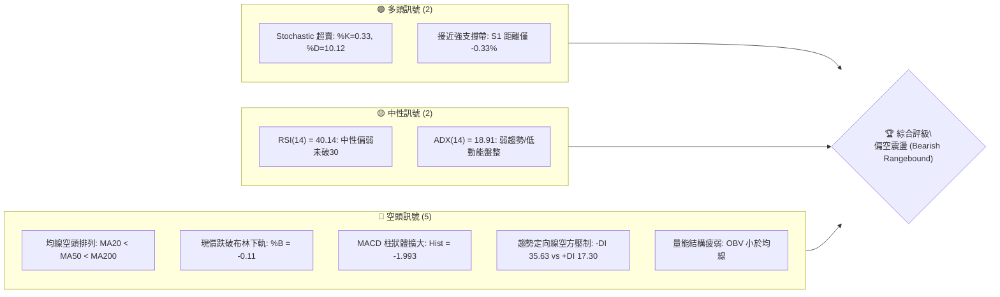

AVGO 目前處於自 52 週高點 $493.32 回落後的深度修正通道中，價格收於 $328.75，逼近 52 週低點區間（位於 52W 區間的 19.5% 分位）。技術盤面呈現空方壓制但短線嚴重超賣的鈍化狀態。

### 📊 核心指標速覽表

| 指標類別 | 指標名稱 | 當前數值 | 訊號 | 解讀 |
|----------|----------|----------|:----:|------|
| **價格** | 當前價格 | $328.75 | 🔴 | 位於全均線下方，處於 52 週低檔區間 (19.5%) |
| **均線** | MA20 | $355.39 | 🔴 | 乖離率 -7.50%，下行斜率明確，短線反彈第一道天花板 |
| **均線** | MA50 | $365.32 | 🔴 | 乖離率 -10.01%，中期均線反轉向下，形成強壓區 |
| **均線** | MA200 | $367.06 | 🔴 | 現價跌破長期生命線，牛熊分界失守 |
| **動能** | RSI(14) | 40.14 | 🟡 | 位於弱勢中性格局，未達極度超賣（<30），無底背離 |
| **動能** | MACD | -4.717 (Sig: -2.723) | 🔴 | 雙線位於零軸下方且負柱體擴大至 -1.993，空頭加速 |
| **動能** | Stoch %K / %D | 0.33 / 10.12 | 🟢 | 極度超賣區，短線隨時有技術性抽頭反彈要求 |
| **趨勢** | ADX / ±DI | 18.91 (-DI:35.63) | 🟡 | ADX < 25 表明無單邊暴跌趨勢，但 -DI 遠高於 +DI 顯著偏空 |
| **通道** | 布林通道 | 下軌 $333.62 (%B: -0.11) | 🔴 | 跌破下軌進入極端超賣區，面臨回歸中軌修正壓迫 |
| **量能** | 20日均量比 | 1.33x (29.72M) | 🔴 | 跌破帶量，OBV 低於均線，機構資金流出尚未止血 |
| **波動** | ATR(14) | $11.80 (3.59%) | 🟡 | 波動率適中，單日震盪幅度約 $11.80 |

### 🏆 技術評分卡

```
╔════════════════════════════════════════════════════════════════╗
║                   技術評分卡 — AVGO (2026-10-18)               ║
╠════════════════════════════════════════════════════════════════╣
║ 趨勢強度 (Trend)      ████░░░░░░░░░░░░░░░░  22/100  🔴 極弱勢  ║
║ 動能指標 (Momentum)   ██████░░░░░░░░░░░░░░  30/100  🔴 空方控盤║
║ 支撐穩定度 (Support)  ████████░░░░░░░░░░░░  42/100  🟡 考驗S1  ║
║ 成交量配合 (Volume)   ██████░░░░░░░░░░░░░░  32/100  🔴 量價背離║
║ 形態完整度 (Pattern)  ████████░░░░░░░░░░░░  40/100  🟡 矩形下邊║
║ 均線排列 (MAs)        ██░░░░░░░░░░░░░░░░░░  12/100  🔴 完步空頭║
╠════════════════════════════════════════════════════════════════╣
║ 綜合技術評分          ██████░░░░░░░░░░░░░░  31/100  🔴 偏空弱勢║
╚════════════════════════════════════════════════════════════════╝
```

---

## 2. 趨勢分析

### 🌐 多時框趨勢分析

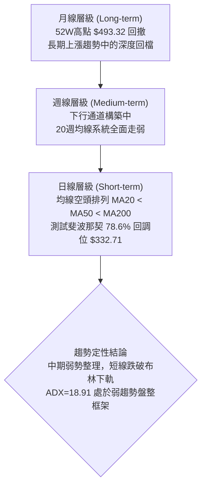

### 📈 長期趨勢 — 12個月走勢圖（Unicode）

以下為 AVGO 過去 12 個月（2025-11 至 2026-10）之月線收盤價走勢示意圖：

```
AVGO 月線走勢圖（過去12個月：2025-11 至 2026-10）
價格軸 ($)
$450 ┤                                      ● $445.25 (M7峰值)
$425 ┤                                ● $416.01
$400 ┤ ● $399.99 (M1頂部阻力)
$375 ┤                                            ● $377.06   ● $388.57
$350 ┤       ● $344.20                                              ● $369.67   ● $351.19
$325 ┤             ● $329.48   ● $317.80   ● $308.46                                  ● $328.75 (當前現價)
     └─┬─────┬─────┬─────┬─────┬─────┬─────┬─────┬─────┬─────┬─────┬─────┬────
      25-11 25-12 26-01 26-02 26-03 26-04 26-05 26-06 26-07 26-08 26-09 26-10
      (M1)  (M2)  (M3)  (M4)  (M5)  (M6)  (M7)  (M8)  (M9)  (M10) (M11) (M12)
```

**走勢特徵分析表格**：

| 週期波段 | 期間 | 起訖價位 | 漲跌幅 | 結構特徵與技術解讀 |
|----------|------|----------|:------:|-------------------|
| **首段回撤** | 2025-11 → 2026-03 | $399.99 → $308.46 | -22.88% | 自 $400 大關見頂後連續陰跌，於 $308-$317 建立波段支撐 |
| **主升驅動** | 2026-03 → 2026-05 | $308.46 → $445.25 | +44.35% | 爆發性多頭噴出，創下收盤新高 $445.25（盤中摸至 52W 高點 $493.32） |
| **二次築頂** | 2026-05 → 2026-07 | $445.25 → $388.57 | -12.73% | 沖高回落後於 $388-$400 區間抵抗，形成中期下降頭部 |
| **當前下行** | 2026-07 → 2026-10 | $388.57 → $328.75 | -15.39% | 跌破 MA200，連續 3 個月陰跌，逼近前波起漲低點支撐 |

### 📊 中期趨勢（週線分析）

中期走勢呈現「震盪階梯下移」形態。過去 20 週數據顯示，AVGO 曾於 2026-08-09 當週在 RSI 高達 73.6、收盤 $426.98 處見次高點，隨後展開五波式下行：

```
中期壓力與支撐示意圖（週線結構）
$430 ┤     ▲ 次高點 $426.98 (2026-08-09, RSI 73.6)
$400 ┤    / \
$370 ┤---/---\---- 頸線壓力阻力帶 (MA200 / R3 $358.10 - MA50 $365.32)
$340 ┤  /     \
$328 ┤ /       ▼ 當前現價 $328.75 (跌破 78.6% 回調位 $332.71)
$310 ┤/          [支撐聚集區：S1 $327.66 ── S2 $319.05 ── S3 $312.39]
```

週線指標顯示，MACD 柱狀體在 2026-10-18 當週重新翻負至 -1.993，結束了 9 月底至 10 月初的小幅反彈，說明週線動能重回空方手中。

### ⚡ 趨勢強度評估（ADX 解讀）

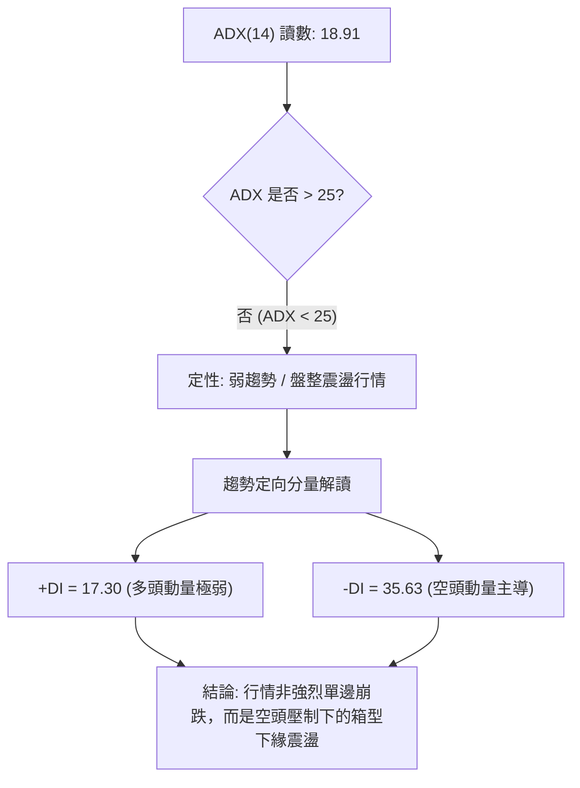

| 指標名稱 | 當前數值 | 臨界閾值 | 趨勢定性 | 戰術指引 |
|----------|:--------:|:--------:|:--------:|----------|
| **ADX(14)** | 18.91 | 25.00 | 弱趨勢 / 盤整行情 | 避免採用趨勢突破追單，應以支撐阻力區間操作為主 |
| **+DI** | 17.30 | 20.00 | 多頭動能匱乏 | 多方尚無發動反攻的能力 |
| **-DI** | 35.63 | 25.00 | 空方顯著優勢 | -DI 占據絕對高位，反彈皆面臨強烈拋壓 |

---

## 3. 圖表形態分析

### 🔍 形態識別系統

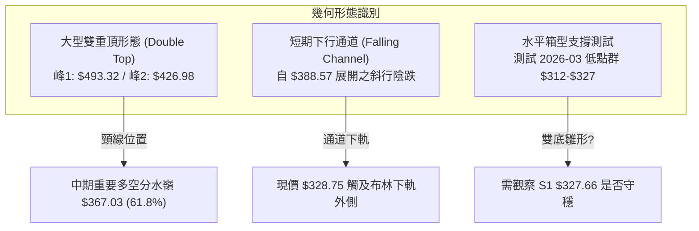

**形態信心度與目標價評估表**：

| 形態名稱 | 信心度 | 判斷依據（引用數據） | 完成度 | 目標價（附嚴謹計算式） |
|----------|:------:|----------------------|:------:|------------------------|
| **雙重頂 (Double Top)** | 75% | 主峰 52W 高點 $493.32，次峰 2026-08 高點 $426.98，已有效跌破頸線斐波 61.8% ($367.03) | 85% | 跌破頸線 $367.03，由形態高度推算：頸線 $367.03 - (次峰 $426.98 - 頸線 $367.03) = $367.03 - $59.95 = **$307.08**（逼近 2026-03 低點 $308.46） |
| **布林通道下軌超賣反抽形態** | 60% | 現價 $328.75 低於布林下軌 $333.62 (%B = -0.11)，Stoch %K 跌至 0.33 極度鈍化 | 90% | 回歸中軌技術反彈目標：目標為布林中軌 MA20 = **$355.39** |
| **潛在雙重底 (Potential W-Bottom)** | 35% | 試圖與 2026-03 低點 $308.46 構建跨度 7 個月的宏觀雙底，但目前尚未出現反轉K線 | 25% | **訊號不足，僅做指標型解讀**（當前不具備幾何確認條件） |

### 🕯️ 重要K線形態分析

| 月份 | 收盤價 | K線形態 | 解讀 | 訊號 |
|------|:------:|---------|------|:----:|
| **2026-05** | $445.25 | 長上影大陽線（倒錘頭變體） | 盤中觸及 52W 高點 $493.32 後大幅收斂，高位天量換手主力出貨 | 🔴 強烈見頂 |
| **2026-06** | $377.06 | 長陰包覆吞噬線 | 連續回吐跌破 $400 整數關卡，確認多頭波段行情終結 | 🔴 空方啟動 |
| **2026-07** | $388.57 | 小十字星反彈線 | 縮量抵抗，於 MA60 上方弱勢整理，反彈力度嚴重不足 | 🟡 中繼整理 |
| **2026-08** | $369.67 | 上影十字陰線 | 週線衝刺 $426.98 失敗後暴跌收低，確認次級頭部確立 | 🔴 空頭反撲 |
| **2026-09** | $351.19 | 光頭光腳中陰線 | 擊穿 MA200 生命線，長線均線由平轉下，籌碼全面套牢 | 🔴 破位下行 |
| **2026-10** | $328.75 | 下引線空頭陰線（進行中） | 探測 78.6% 斐波回調位 $332.71 及支撐位 S1 $327.66，尋求支撐 | 🟡 尋求落腳 |

### 📉 ASCII 走勢形態示意圖

```
AVGO 雙重頂與下行通道破位示意圖
$493.32 ┬───────────────● (峰1: 52W 最高點)
        │              / \
$426.98 ┼             /   \             ● (峰2: 次高點 2026-08)
        │            /     \           / \
$367.03 ┼───────────/───────\─────────/───\───── [雙頂頸線 / 61.8% 斐波]
        │          /         \       /     \
$355.39 ┼         /           \     /       \   ◄ [MA20 / 布林中軌壓力]
        │        /             \   /         \
$333.62 ┼───────/───────────────\─/───────────\─ [布林下軌]
$328.75 ┼      /                 ●             ▼ 現價 ($328.75, 破下軌)
$308.46 ┴─────● (2026-03 波段底) ──────────────── [雙頂目標推算區間 $307.08]
```

### 🎯 形態目標價計算

根據已確認破位之雙重頂結構進行測量：
1. **主形態高度**：次峰高點 $426.98 至頸線 $367.03，垂直距離 $H = 426.98 - 367.03 = 59.95$。
2. **第一等幅下行目標價**：$367.03 - 59.95 = \$307.08$。此計算目標精確對應至 2026-03 之月線收盤價 $308.46 附近，同時落在支撐位 S3 ($312.39) 下緣。
3. **極端回撤目標**：若 S3 ($312.39) 失守，則將測試 52 週最低點（100.0% 斐波那契回調位）**$288.98**。

---

## 4. 支撐與阻力

### 🗺️ 關鍵價位分布圖（Unicode）

```
AVGO 價位結構分布圖
══════════════════════════════════════════════════════════════════
$367.03 ║████████████████████████████████║ 斐波 61.8% / MA200 強阻力
$358.10 ║████████████████████████        ║ 強阻力 R3 (波段高點聚類)
$355.39 ║████████████████████            ║ 布林中軌 / MA20
$350.81 ║████████████████                ║ 阻力 R2 (波段高點聚類)
$338.13 ║██████████                      ║ 關鍵阻力 R1 (波段高點聚類)
$332.71 ║░░░░░░░░░░░░░░░░░░░░░░░░░░░░░░░░║ 斐波那契 78.6% 回調位
$328.75 ╠════════════════════════════════╣ ◄ 現價 ($328.75)
$327.66 ║▓▓▓▓▓▓▓▓▓▓▓▓▓▓▓▓▓▓▓▓▓▓▓▓▓▓▓▓    ║ 近期支撐 S1 (-0.33% 極近)
$319.05 ║████████████████████            ║ 支撐 S2 (波段低點聚類)
$312.39 ║████████████████████████████    ║ 強支撐 S3 (波段低點聚類)
$288.98 ║████████████████████████████████║ 52W Low / 斐波 100.0% 終極支撐
══════════════════════════════════════════════════════════════════
```

### 🚧 阻力位分析表

所有價位均直接引用自 OHLCV 聚類計算數據：

| 阻力級別 | 價位 | 形成原因與技術共振 | 突破難度 | 重要性 |
|:--------:|:----:|--------------------|:--------:|:------:|
| **R1** | **$338.13** | 近一年波段高點聚類下緣；接近布林下軌反壓區 ($333.62) | 🟡 中等 | 短線多頭止跌翻揚的第一道關卡（距現價 +2.85%） |
| **R2** | **$350.81** | 密集成交高點聚類；接近下行中的 MA20 ($355.39) 壓制區 | 🔴 較高 | 突破該位方能扭轉日線級別的急速跌勢（距現價 +6.71%） |
| **R3** | **$358.10** | 近一年波段高點密集峰；與 MA10 ($356.79) 及 MA20 形成雙重阻力帶 | 🔴 極高 | 空方防守核心陣地，收復方可確認回歸中性（距現價 +8.93%） |

### 🛡️ 支撐位分析表

所有價位均直接引用自 OHLCV 聚類計算數據：

| 支撐級別 | 價位 | 形成原因與技術共振 | 守住機率 | 重要性 |
|:--------:|:----:|--------------------|:--------:|:------:|
| **S1** | **$327.66** | 近一年波段低點聚類上緣；當前盤面即時防線（距現價僅 -0.33%） | 🟡 50% | 日線收盤跌破則宣告超賣反彈失敗，將開啟下挫空間 |
| **S2** | **$319.05** | 次級波段低點聚類；2026年2月月線支撐帶 ($317.80) 共振 | 🟢 65% | 具備較強籌碼支撐，空頭首要停利區（距現價 -2.95%） |
| **S3** | **$312.39** | 近一年波段核心低點聚類；逼近 2026-03 月線低點 $308.46 | 🟢 80% | 多頭年線級別最後防線，失守將直奔 52W 低點（距現價 -4.98%） |

### 📐 斐波那契回調位分析

依據 52 週極值區間（低點 **$288.98** → 高點 **$493.32**，總落差 $204.34）之精確計算：

```
斐波那契回調位階與現價位置
0.0%  (52W High) ─── $493.32
23.6%            ─── $445.09
38.2%            ─── $415.26
50.0%            ─── $391.15
61.8%            ─── $367.03  ◄ [牛熊關鍵轉折點，已跌破]
78.6%            ─── $332.71  ◄ [近期爭奪點，現價剛失守]
                     $328.75  ◄◄◄ 【當前現價落點：78.6% 與 100.0% 之間】
100.0% (52W Low) ─── $288.98
```

- **位置解讀**：現價 $328.75 已跌破黃金分割深層回調位 **78.6% ($332.71)**，目前運行於 78.6% ($332.71) 與 100.0% ($288.98) 之間的極弱勢真空帶。
- **技術意義**：通常資產若跌破 61.8% ($367.03) 且無法在 78.6% ($332.71) 止跌，意味著過去一年的整輪大多頭漲勢遭到徹底破壞，價格高機率向 100.0% 全額回調位（$288.98）靠攏，尋求長期大底。

---

## 5. 技術指標深度解讀

### 🎛️ 指標訊號總覽

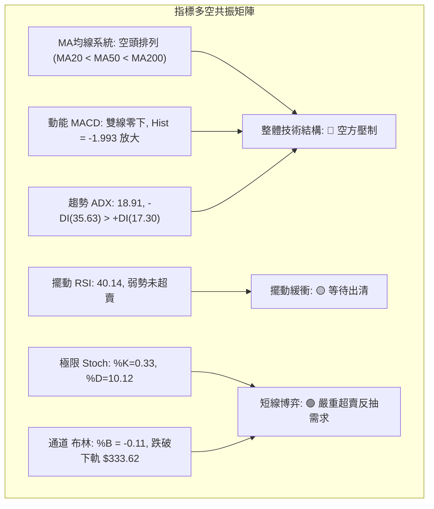

### 📈 移動平均線排列分析

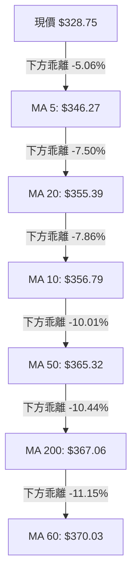

**均線詳細數據評估**：
- **短中期均線**：MA5 ($346.27) < MA20 ($355.39) < MA50 ($365.32)，標準空頭排列。
- **生命線與長期均線**：MA200 為 $367.06，現價處於 MA200 下方 -10.44% 之處；MA60 為 $370.03，MA120 為 $386.02，MA240 為 $365.83。所有中長期均線呈現向下彎頭發散態勢，意味著過去 200 個交易日買入的平均持倉籌碼整體處於浮虧套牢狀態，上方每一道均線都將轉化為沉重的反彈解套阻力。

### 📉 RSI(14) 分析

```
RSI(14) 當前水位：40.14
0 ─────────── 30 ─────── 40.14 ────────── 70 ─────────── 100
[  極度超賣  ] [ 超賣區 ]   ▲   [   中性偏弱   ] [  超買區  ]
進度條：████████████████░░░░░░░░░░░░░░░░░░░░ 40.14%
```

- **超買超賣狀態**：RSI 位於 40.14，尚未跌破 30.00 傳統超賣線。這說明儘管股價已跌破布林下軌，但從中週期動能來看，空頭動能尚未完全釋放完畢，尚未引發恐慌性拋售盤（Capitulation）。
- **背離分析判斷**：
  - **日線 RSI**：數據顯示「無明顯背離」。價格創新低，RSI 同步維持在低位震盪。
  - **結論**：**不存在底背離**。在無底背離確認的情況下，盲目抄底存在極高的「左側接飛刀」風險。

### 📊 MACD(12/26/9) 訊號解讀

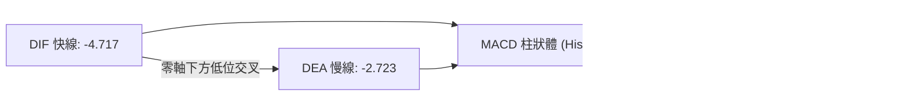

- **數值分析**：MACD 線為 -4.717，訊號線為 -2.723，兩者均在零軸以下深度運作。
- **柱狀圖動能**：MACD Hist 為 -1.993。回顧過去數週，週線 MACD 柱在 2026-10-11 當週曾短暫達到 +2.477，但本週迅速翻負重挫至 -1.993，日線級別柱狀圖持續擴大，表明此波回落帶有較強的空頭再發力特徵，未見收斂金叉徵兆。

### 📦 布林通道分析

```
布林通道 (20, 2) 結構示意圖
$377.17 ┬───────────────────────────────── BB 上軌
        │
$355.39 ┼- - - - - - - - - - - - - - - - - BB 中軌 (MA20)
        │
$333.62 ┼───────────────────────────────── BB 下軌
$328.75 ┴───────● ◄ 現價 ($328.75, %B = -0.11)
```

- **通道參數**：BB 上軌 $377.17，中軌 $355.39，下軌 $333.62。
- **通道位置 %B**：當前 %B 為 **-0.11**（數值小於 0，代表價格已脫離並跌破下軌）。
- **解讀**：價格運行於布林下軌之外，屬於統計學上的異常超跌狀態（2個標準差之外）。這種現象通常會在 1-3 個交易日內引發「均值回歸」拉鋸，但若市場處於極端單邊下行，價格可能沿下軌向下「開口滑落」（Walking the band）。

### 💹 成交量分析（量價配合度）

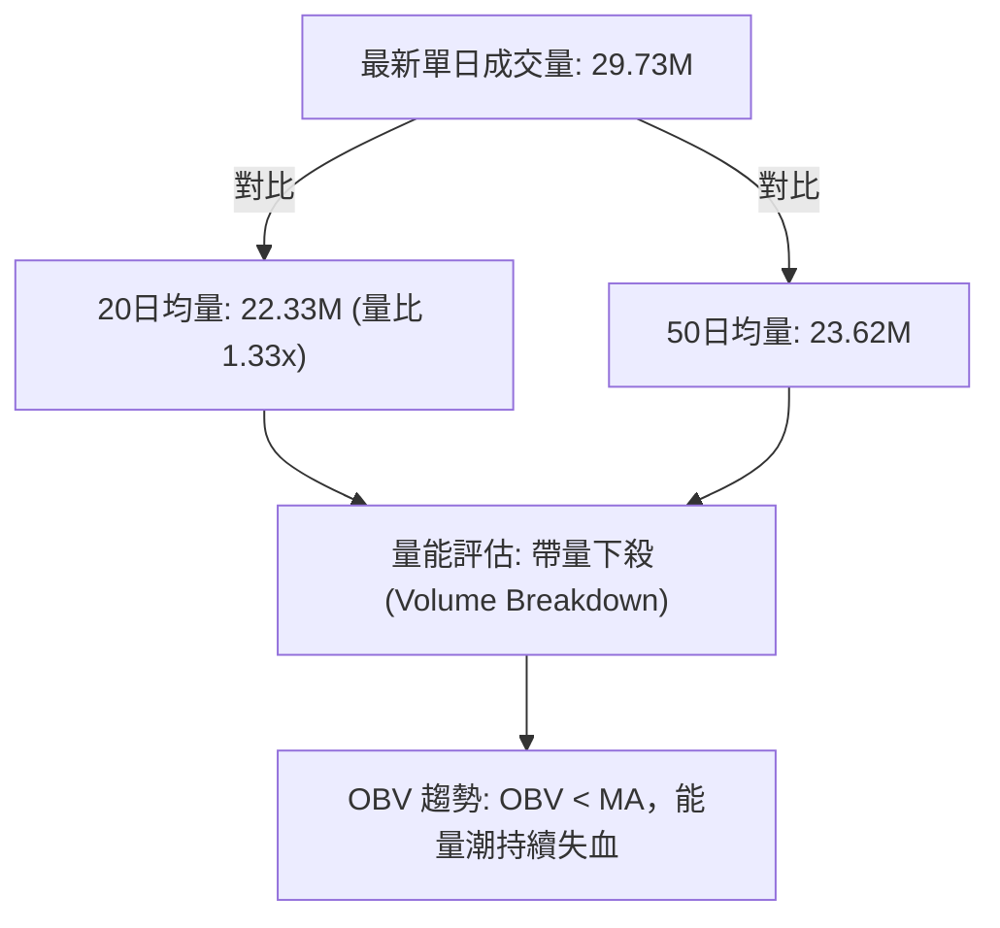

- **量比分析**：最新單日成交量為 29,727,900 股，顯著高於 20 日均量（22,329,915 股），量比達到 **1.33x**。在價格大跌破位之際伴隨放量，表明有機構籌碼進行停損拋售。
- **OBV 能量潮解讀**：數據明確提示「OBV < MA → 量能疲弱」。這表明資金持續處於淨流出通道，並非主力資金暗中吸籌的縮量洗盤，量價出現典型的「價跌量增」弱勢格局，進一步確認空頭佔據主導權。

---

## 6. 動能與波動率

### ⚡ 動能評估四象限

| 象限 | 動能強度 | 波動率水準 | 當前狀態標註 | 戰術指引與評估 |
|:----:|:--------:|:----------:|:------------:|----------------|
| **Q1** | 強多頭動能 | 低波動 | — | 穩定多頭主升趨勢，持股續抱 |
| **Q2** | 弱多頭動能 | 低波動 | — | 縮量築底盤整，耐心觀望 |
| **Q3** | 強空頭動能 | 高波動 | — | 恐慌性崩跌，嚴禁接飛刀 |
| **Q4** | **弱/負動能** | **中低波動** | **✓ (當前 AVGO)** | **空方控盤陰跌，低吸性價比差，以反彈逢高減磅為主** |

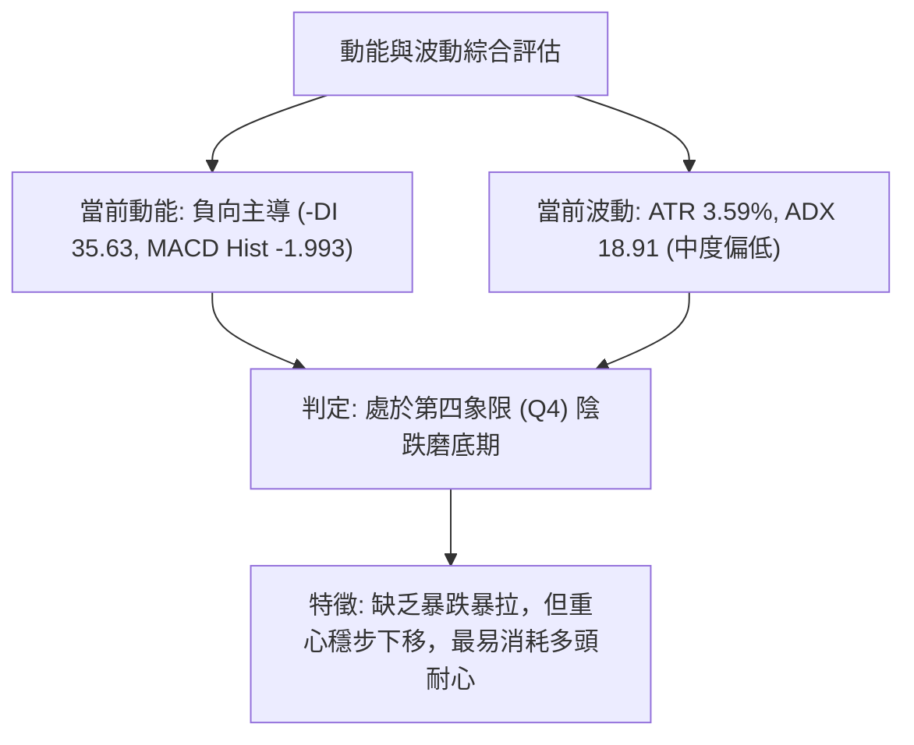

### 📊 ATR 波動率分析

- **ATR(14) 數值**：**$11.80**，佔當前股價之百分比為 **3.59%**。
- **交易風控意涵**：
  - AVGO 的單日理論正常擺動區間為 $\pm \$11.80$。
  - **極限波幅參考**：日內若向上突破 $328.75 + 11.80 = \$340.55$，或向下跌破 $328.75 - 11.80 = \$316.95$，方屬於超常規日間波動。
  - **止損距離建議**：在設定技術止損時，防守點位距離進場點至少需保留 **1.5 倍 ATR**（約 $1.5 \times 11.80 = \$17.70$）的緩衝空間，以避免被日常市場噪音無謂掃出場。

### 📐 Beta 與市場相關性

- **Beta 係數**：**1.476**。
- **市場特徵分析**：AVGO 具備顯著的高貝塔屬性，其波動性比標普 500 指數高出約 47.6%。當整體半導體板塊或科技股大盤下行時，AVGO 跌幅往往會被等比例放大；反之，若板塊出現修復性反彈，其短線彈性亦相對充沛。目前高貝塔特徵正對多頭形成負向槓桿效應。

---

## 7. 多時框架總結

### 📋 時框架評分表

| 時框架 | 趨勢方向 | 動能指標 | 均線排列 | 關鍵形態 | 綜合評分 | 戰術建議 |
|--------|:--------:|:--------:|:--------:|:--------:|:--------:|----------|
| **月線 (長期)** | 🟡 中性回撤 | RSI 回落至中軸 | 仍在 MA240 之上 | 52W 高點雙頂回調 | 50/100 | 長期投資者暫緩左側加碼 |
| **週線 (中期)** | 🔴 偏空格局 | MACD 負柱放大 | 跌破 20週均線 | 下行台階確立 | 30/100 | 逢反彈減持，順應週線空勢 |
| **日線 (短期)** | 🔴 急跌超賣 | Stoch 極低 (%K 0.33) | 完全空頭排列 | 跌破布林下軌 | 25/100 | 嚴禁追空，等待超跌抽頭機會 |

### 🔲 綜合訊號矩陣

| 維度 | 短期（日線） | 中期（週線） | 長期（月線） | 多時框一致性解讀 |
|------|:------------:|:------------:|:------------:|------------------|
| **趨勢方向** | 🔴 下行 | 🔴 下行 | 🟡 整理 | 中短線形成共振空頭，長期上漲結構遭受侵蝕 |
| **動能狀態** | 🟢 超賣 | 🔴 空方加速 | 🟡 動能衰退 | 日線超賣與週線動能矛盾，預示「抵抗式反彈後續跌」 |
| **均線支撐** | 🔴 跌破所有短均 | 🔴 跌破中期均線 | 🟢 守在年線上方 | 價格在長均上方尋求硬支撐，短期均線形成重重阻力 |
| **量能架構** | 🔴 放量下跌 | 🔴 OBV疲軟 | 🟡 縮量回調 | 資金持續撤離，尚未出現機構底層放量換手止跌 |

### ⚖️ 多時框收斂結論

依據多時框收斂規則嚴格定調：
1. **行情定性**：當前 ADX(14) 讀數為 **18.91 (< 25)**，技術上嚴格歸類為 **「弱趨勢 / 盤整震盪行情」**。
2. **主導時框與取捨**：雖然日線跌破布林下軌出現嚴重超賣（Stoch %K=0.33），但中期（週線）均線系統已經反轉，且 MACD 柱狀體翻負，這意味著日線的任何極端超賣拉升均不具備反轉為大牛市的基礎，而僅能視為**箱型下緣的均值回歸修復**。
3. **唯一方向性結論**：**【偏空觀望，區間下緣博弈反彈】**。以中長線視角看空頭壓制，短線視角則利用日線布林通道下軌與支撐位 S1 ($327.66) 的共振尋求短線交易機會。此結論與下章之主策略嚴格收斂一致。

---

## 8. 交易策略建議

### 🗺️ 策略決策流程圖

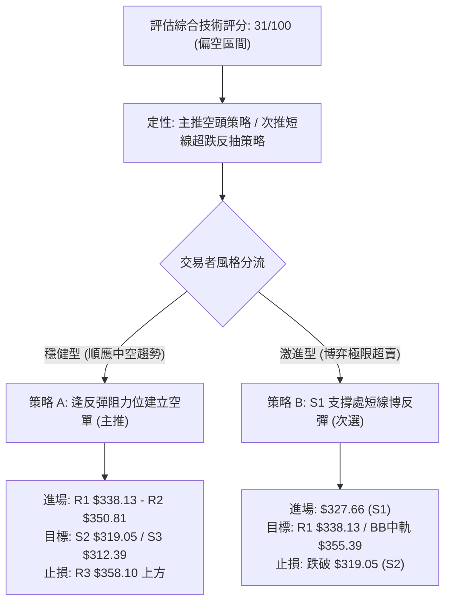

### 🧭 策略路由（依評分卡分流）

> **當前主策略方向 = 【偏空主導，逢高做空】（依綜合評分 31/100，評級 ≤ 40 嚴格觸發空頭主推模式）**

由於當前綜合評分僅為 **31/100**，均線系統呈空頭排列且跌破長期生命線，順勢交易原則要求以**高空為主策略**；多頭交易僅能作為超短線極限超賣的對沖與戰術博弈。

### 🎯 價格情境階梯（Price Scenarios）

所有價位均嚴格引用第 4 章聚類計算數據：

| 觸發條件 | 下一目標 | 後續延伸 | 情境技術含義 |
|----------|:--------:|:--------:|--------------|
| **強勢向上突破 R1 ($338.13)** | **R2 ($350.81)** | **R3 ($358.10)** | 短線超跌反抽確認，回歸布林通道內部，向中軌測試 |
| **守住 S1 ($327.66) 於現價震盪** | **R1 ($338.13)** | **S1 ($327.66)** | 區間極度弱勢橫盤，消化 Stoch %K=0.33 的超賣鈍化 |
| **跌破關鍵支撐 S1 ($327.66)** | **S2 ($319.05)** | **S3 ($312.39)** | 中期破位加速下行，斐波 78.6% 徹底確認失效，直奔前波大底 |

### 📊 情境機率分佈

| 情境劃分 | 機率 | 主要技術依據 |
|----------|:----:|--------------|
| **弱勢反彈 / 抽頭** | **30%** | Stoch %K=0.33 極度超賣，布林通道 %B=-0.11 脫離下軌，具備修復需求 |
| **區間震盪 / 磨底** | **25%** | ADX=18.91 處於弱趨勢特徵，多空雙方在 S1 ($327.66) 展開爭奪 |
| **破位回落 / 再探底** | **45%** | 均線完步空頭排列，MACD 負柱體擴大至 -1.993，-DI 佔據 35.63 高位壓制 |

### 🟢 主策略詳情

依據評分卡分流規則，主推順應趨勢的空頭防守反擊策略（策略 A），同時提供超賣逆勢博弈策略（策略 B）：

| 策略要素 | 策略 A（主推：反彈遇阻做空） | 策略 B（次選：極限超跌博弈） |
|----------|------------------------------|------------------------------|
| **策略屬性** | 順勢操作（中線空頭防守） | 逆勢操作（超短線左側博弈） |
| **進場條件** | 價格反彈至 R1-R2 遇阻，日線收長上影線 | 價格在 S1 ($327.66) 獲得支撐不破，15K出底背離 |
| **進場價格** | **$338.13** (精確引用 R1) | **$327.66** (精確引用 S1) |
| **目標價 T1** | **$319.05** (精確引用 S2) | **$338.13** (精確引用 R1) |
| **目標價 T2** | **$312.39** (精確引用 S3) | **$350.81** (精確引用 R2) |
| **止損價格** | **$350.81** (精確引用 R2 突破) | **$319.05** (精確引用 S2 跌破) |
| **風險報酬比** | **1.50 : 1** (風險 $12.68 vs 回報 $19.08) | **1.22 : 1** (風險 $8.61 vs 回報 $10.47) |
| **成功機率** | **65%** | **40%** |
| **建議倉位** | **15% - 20%**（主力倉位） | **5% - 8%**（輕倉防禦試探） |

### 🔴 反向風險觸發點（對沖與止損提示）

若出現以下情境，必須無條件止損策略 A 的空單，並全面轉入觀望：
1. **價位突破**：日線收盤價強勢站上 **$350.81 (R2)**，特別是放量收復 **$355.39 (布林中軌/MA20)**。
2. **指標轉折**：日線 MACD 出現零下金叉，且 MACD Hist 翻正突破 0 軸。
3. **量能異動**：單日成交量突破 4,500 萬股（量比 > 2.0x）且收大實體陽線，確認機構主力進場護盤。

### ⭐ 整體訊號強度評星

```
做多訊號強度：★★☆☆☆  (2/5星 - 僅依賴超賣擺動指標)
做空訊號強度：★★★★☆  (4/5星 - 均線、動能、趨勢全面配合)
整體可信度：  ★★★★☆  (4/5星 - 數據完整，價位高度聚類)
```

---

## 9. 風險提示與監控

### ✅ 關鍵監控指標 Checklist

```
╔══════════════════════════════════════════════════════════════════╗
║               AVGO 每日交易風控監控清單 (Checklist)              ║
╠══════════════════════════════════════════════════════════════════╣
║ [ ] 價格是否跌破 S1 ($327.66)？                                  ║
║     └─ 若跌破，觸發加速下行警報，目標指向 S2 ($319.05)          ║
║ [ ] 價格是否收復布林下軌 ($333.62) 與 78.6% 斐波位 ($332.71)？    ║
║     └─ 若收復，確認超跌修復展開，觀察向 R1 ($338.13) 推進力度    ║
║ [ ] RSI(14) 是否跌破 30.00？                                     ║
║     └─ 若跌破 30，警惕恐慌出清（Capitulation）隨後的暴力反抽     ║
║ [ ] MACD 負柱體是否開始縮小（由 -1.993 向上收斂）？              ║
║     └─ 柱體收斂為空頭動能衰退的第一徵兆                          ║
║ [ ] 單日成交量是否超過 20日均量 (22.33M) 的 1.5 倍？              ║
║     └─ 巨量長陰續看空，巨量長下影則考慮短線反轉                  ║
╚══════════════════════════════════════════════════════════════════╝
```

### ⚠️ 風險場景分析

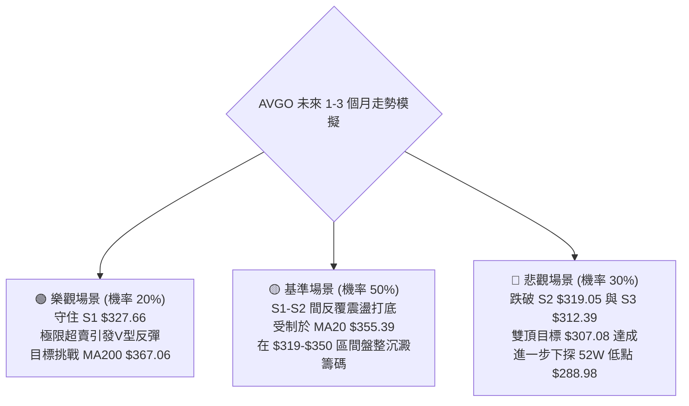

### 🛡️ 風險管理重要提醒

1. **半導體高貝塔風險**：AVGO 的 Beta 高達 1.476，科技板塊情緒劇烈擺動時易引發流動性踩踏。持倉倉位不得超過總投資組合的 15%。
2. **止損嚴格執行紀律**：目前股價運行於長線均線下方，任何做多均屬於「逆勢摸底」，必須嚴格以 **S2 ($319.05)** 作為絕對止損底線，絕對不可在空頭排列中執行向下攤平（Martingale）操作。
3. **波動率緩衝管理**：當前 ATR 為 $11.80，日內振幅極大，日內交易者進場後至少需設定 1.0 - 1.5 ATR 的波動緩衝保護，避免在未觸及邏輯失效點前被噪音洗出場。

---

## 📋 報告總結

```
╔══════════════════════════════════════════════════════════════════╗
║                   AVGO 技術分析報告總結                        ║
╠════════════════════════════════════════════════════════════════╣
║ 報告日期：2026-10-18                                            ║
║ 當前價格：$328.75                                               ║
║ 分析評級：🔴 偏空弱勢 (Bearish Underperformance)               ║
║                                                                  ║
║ 關鍵技術結論：                                                   ║
║ ├─ 長期趨勢：🟡 月線高位回撤，跌破 61.8% 頸線 $367.03           ║
║ ├─ 中期趨勢：🔴 週線下行階梯，MA20 < MA50 < MA200 空頭排列      ║
║ ├─ 短期趨勢：🔴 跌破布林下軌 (%B -0.11)，Stoch %K=0.33 極度超賣  ║
║ ├─ 關鍵支撐：S1 $327.66 ｜ S2 $319.05 ｜ S3 $312.39            ║
║ ├─ 關鍵阻力：R1 $338.13 ｜ R2 $350.81 ｜ R3 $358.10            ║
║ └─ 雙頂形態理論目標：$307.08 (逼近 S3 支撐帶)                   ║
║                                                                  ║
║ 最優策略組合：                                                   ║
║ 1. 🥇 最佳機會：等待反彈至 R1 ($338.13) 遇阻順勢建立空單         ║
║ 2. 🥈 次選機會：激進者於 S1 ($327.66) 輕倉博弈極限超賣反抽      ║
║ 3. 🥉 保守選擇：空倉觀望，等待日線級別底背離或站穩 R2 後再定奪 ║
╚══════════════════════════════════════════════════════════════════╝
```

---

> ⚠️ **免責聲明**：本報告為技術分析專項研究，所有數據、圖表及推算點位均嚴格基於所提供的歷史 OHLCV 價格資訊。本報告**僅供研究與學術參考**，**不構成任何要約、招攬或具體投資建議**。金融市場瞬息萬變，投資具有高度風險，交易者應依個人風險承受能力獨立做出決策並自負盈虧。

---

*報告生成時間：2026-10-18 ｜ 數據來源：Yahoo Finance ｜ 分析框架：多時框技術分析體系*