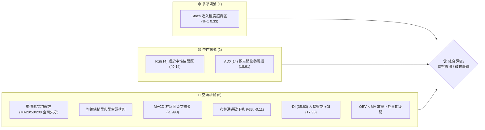
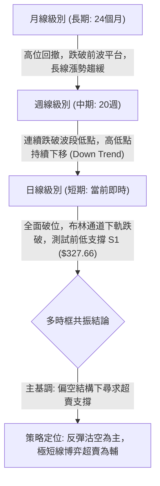
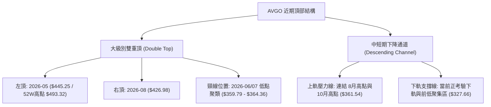
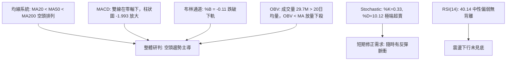
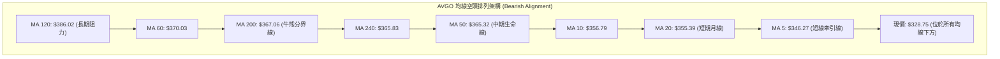
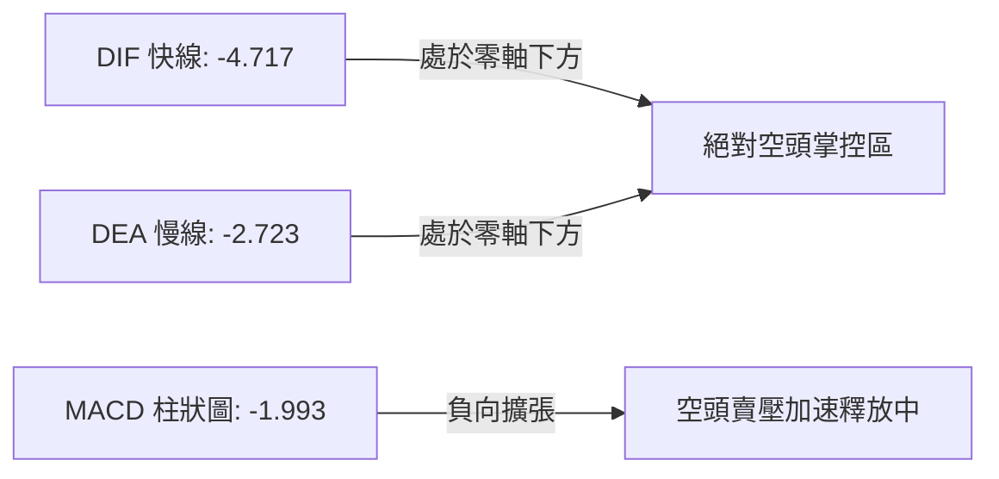
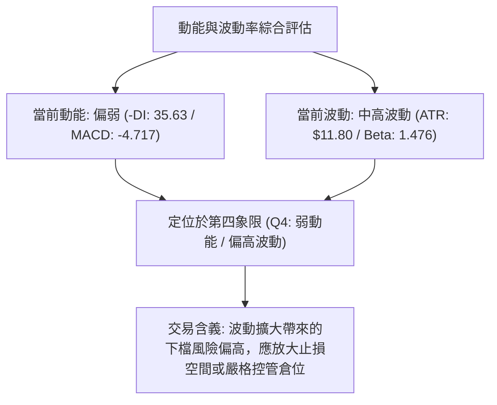
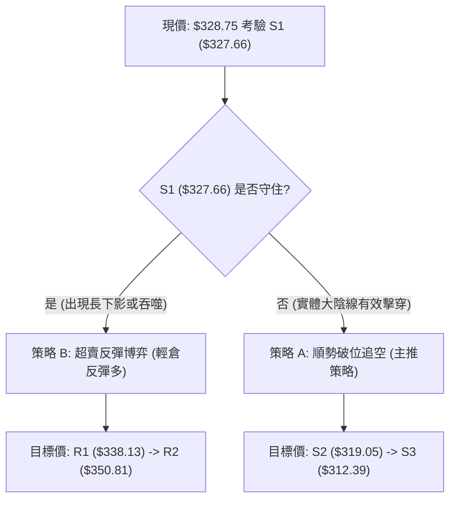
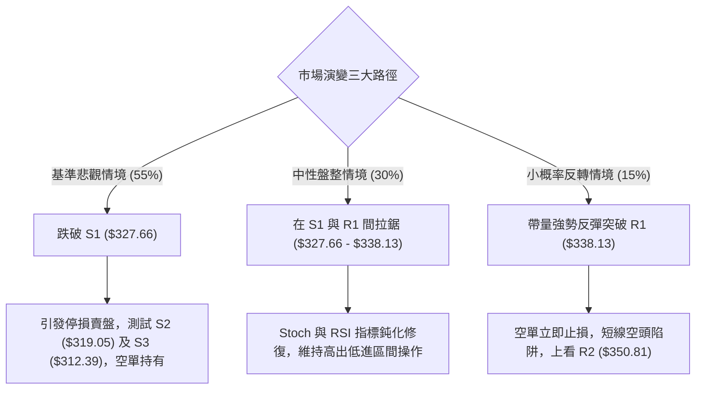

# AVGO 技術分析報告

> **報告日期**：2026-10-19 ｜ **語言**：繁體中文 ｜ **數據來源**：Yahoo Finance ｜ **當前價格**：$328.75

---

## 目錄

| 章節 | 內容 |
|------|------|
| [1. 技術面概覽](#1-技術面概覽) | 訊號儀表板、核心指標、評分卡 |
| [2. 趨勢分析](#2-趨勢分析) | 多時框趨勢、長中短期走勢、ADX解讀 |
| [3. 圖表形態分析](#3-圖表形態分析) | 形態識別、信心度評估、K線組合、目標價推算 |
| [4. 支撐與阻力](#4-支撐與阻力) | 關鍵價位分布圖、S/R分析表、斐波那契回調 |
| [5. 技術指標深度解讀](#5-技術指標深度解讀) | 均線系統、RSI、MACD、布林通道、OBV量價 |
| [6. 動能與波動率](#6-動能與波動率) | 動能四象限、ATR波動分析、Beta市場敏感度 |
| [7. 多時框架總結](#7-多時框架總結) | 時框架矩陣、多時框收斂與方向定調 |
| [8. 交易策略建議](#8-交易策略建議) | 策略路由、價格情境階梯、主策略明細、風報比 |
| [9. 風險提示與監控](#9-風險提示與監控) | 關鍵監控Checklist、三情境演變、倉位管理 |
| [報告總結](#報告總結) | 終局摘要與決策矩陣 |

---

## 1. 技術面概覽

### 🎯 技術訊號儀表板



### 📊 核心指標速覽表

| 指標類別 | 指標名稱 | 當前數值 | 訊號 | 專業解讀 |
|:---|:---|:---|:---:|:---|
| **價格定位** | 當前收盤價 | $328.75 | 🔴 | 位於 52 週區間 19.5% 處，逼近近一年波段低位區 |
| **均線系統** | MA20 (短均) | $355.39 | 🔴 | 股價位於 MA20 下方 -7.50%，短期下行斜率陡峭 |
| **均線系統** | MA50 (中均) | $365.32 | 🔴 | 跌破中期生命線，乖離率達 -10.01% |
| **均線系統** | MA200 (長均) | $367.06 | 🔴 | 跌破牛熊分界線，長線技術面轉入防守期 |
| **動能震盪** | RSI(14) | 40.14 | 🟡 | 位於弱勢區間（30-50），未見超賣底背離訊號 |
| **趨勢動能** | MACD (12,26,9) | -4.717 | 🔴 | DIF 低於 DEA (-2.723)，柱狀圖 (-1.993) 顯示空頭動能增強 |
| **震盪擺動** | Stoch %K / %D | 0.33 / 10.12 | 🟢 | 進入極端超賣區間，隨時存在技術性抽腳反彈可能 |
| **趨勢強度** | ADX(14) | 18.91 | 🟡 | ADX < 25 表明非單邊強趨勢，屬於空方主導的寬幅下行震盪 |
| **通道軌道** | 布林通道下軌 | $333.62 | 🔴 | %B 為 -0.11，收盤跌破下軌，呈現開口向下擴張態勢 |
| **波動量能** | ATR(14) | $11.80 | 🟡 | 每日平均波動幅度為 3.59%，波動風險處於中高水平 |

### 🏆 技術評分卡

```
╔══════════════════════════════════════════════════════════════╗
║               技術評分卡 — AVGO (2026-10-19)                  ║
╠══════════════════════════════════════════════════════════════╣
║ 趨勢方向 (Trend)     ████░░░░░░░░░░░░░░░░  20/100 🔴 空頭壓制 ║
║ 均線架構 (Moving Avg)██░░░░░░░░░░░░░░░░░░  15/100 🔴 死亡交叉 ║
║ 動能指標 (Momentum)  ███████░░░░░░░░░░░░░  35/100 🔴 動能疲軟 ║
║ 超賣修復 (Oversold)  ██████████████░░░░░░  70/100 🟢 具反彈力 ║
║ 支撐穩固度 (Support) ████████░░░░░░░░░░░░  40/100 🟡 考驗S1   ║
║ 量價配合度 (Volume)  ██████░░░░░░░░░░░░░░  30/100 🔴 帶量破位 ║
╠══════════════════════════════════════════════════════════════╣
║ 綜合技術評分         ███████░░░░░░░░░░░░░  35/100 🔴 偏空弱勢 ║
╚══════════════════════════════════════════════════════════════╝
```

---

## 2. 趨勢分析

### 🌐 多時框趨勢分析



### 📈 長期趨勢 — 12 個月走勢圖（ASCII）

```
AVGO 月線收盤走勢圖 (2025-10 至 2026-10)
價格 ($)
$450 ┤                                 ● $445.25 (2026-05)
$425 ┤                             ● $416.01
$400 ┤            ● $399.99            │
$375 ┤        ●   │                    └───● $377.06
$350 ┤    ●   │   └───● $344.20                └──● $369.67
$325 ┼────┼───┼───────┼───● $329.48───────────────┼───● $351.19
$300 ┤    │   │       │   │   ● $317.80           │       └──● $328.75 (現價)
$275 ┤    │   │       │   │   │   ● $308.46       │
     └────┴───┴───────┴───┴───┴───┴───────┴───────┴───────┴───────
         10  11  12  01  02  03  04  05  06  07  08  09  10 (月份)
         2025───────►│2026────────────────────────────────►
```

#### 走勢特徵分析表格

| 階段 | 時間區間 | 起訖價格區間 | 區間漲跌幅 | 走勢核心特徵與技術含義 |
|:---|:---|:---:|:---:|:---|
| **第一階段：高位分歧** | 2025-10 ~ 2025-11 | $366.90 → $399.99 | +9.02% | 創下首波高點 $399.99，但成交量未能有效放大，動能開始衰竭。 |
| **第二階段：中期修正** | 2025-12 ~ 2026-03 | $344.20 → $308.46 | -10.38% | 連續4個月震盪回調，在 $308.46（接近52週低點 $288.98 上方）獲得支撐。 |
| **第三階段：主升衝頂** | 2026-04 ~ 2026-05 | $416.01 → $445.25 | +44.35% | 爆發性拉升，最高觸及歷史峰值（52週高點 $493.32 出現於此波段內），加速見頂。 |
| **第四階段：次級回撤** | 2026-06 ~ 2026-10 | $377.06 → $328.75 | -12.81% | 峰值回落後反彈無力，連續5個月反覆破底，目前正下測斐波那契 78.6% 回調位。 |

### 📊 中期趨勢（週線分析）

從近 20 週的收盤價與動能指標演進觀察，中期趨勢呈現典型的階梯式下行：
- **頂部確認**：2026-08-09 週線衝刺至 $426.98，週 RSI 達到 73.6，隨後連續三週大陰線摜破 $370，宣告中級多頭趨勢終結。
- **阻力下移**：反彈波段高點從 8 月中旬的 $392.28 降至 10 月初的 $361.54，顯示反彈動能被空頭層層壓制。
- **最新週線破位**：2026-10-18 最新週報收 $328.75，單週暴跌逾 32 美元，週線 MACD 柱狀圖翻負至 -1.993，週 RSI 由 49.4 快速下墜至 40.1，確認中期破位下行。

### ⚡ 趨勢強度評估（ADX 解讀）

```mermaid
graph TD
    A["ADX(14) 數值: 18.91"] --> B{"ADX 門檻判定"}
    B -->|"< 25| C["趨勢強度: 弱趨勢 / 寬幅區間震盪"]
    D["方向指標 +DI: 17.30"] --> F{"DI 力量對比"}
    E["方向指標 -DI: 35.63"] --> F
    F -->|"-DI 遠大於 +DI| G["方向判定: 空方絕對控盤"]
    C --> H["結論: 當前非單邊強趨勢行情，而是處於空頭佔優的區間震盪下探階段"]
    G --> H
```

| 指標名稱 | 數值 | 臨界標準 | 狀態評估 | 實戰交易含義 |
|:---|:---:|:---:|:---:|:---|
| **ADX (14)** | **18.91** | 25.00 | 弱趨勢 / 震盪 | 行情尚未進入單邊主跌浪（ADX尚未突破25），避免盲目過度殺跌。 |
| **+DI** | **17.30** | - | 多方動能衰退 | 多方買盤極度萎縮，反彈缺乏持續性買盤介入。 |
| **-DI** | **35.63** | - | 空方顯著主導 | 空方完全掌控短期走勢，-DI 數值超過 30 代表下行賣壓強烈。 |

---

## 3. 圖表形態分析

### 🔍 形態識別系統



#### 形態識別信心度評估表

| 識別形態名稱 | 信心度 | 判斷依據（嚴格引用已知數據） | 完成度 | 理論目標價（附計算式） |
|:---|:---:|:---|:---:|:---|
| **雙重頂形態** (Double Top) | **75%** | 兩次高點分別見於 2026-05 ($445.25) 與 2026-08 ($426.98)，頸線位取 2026-07-05 收盤低點 $359.79。目前價格 $328.75 已確認有效跌破頸線。 | 90% | 頸線 $359.79 - 形態高度 ($426.98 - $359.79 = $67.19) = **$292.60**（高度契合 52W 低點 $288.98） |
| **下降通道破軌** | **65%** | 近期由 $361.54 (10-11) 快速摜破至 $328.75，直接擊穿通道中軸及布林下軌 $333.62。 | 85% | 跌破通道支撐後，下看歷史波段低點支撐聚類 S2 **$319.05** |
| **短線底背離形態** | **15%** | RSI 為 40.14，尚未進入 30 以下超賣區，且價格創新低同時指標並未抬高，數據未偵測到底背離。 | 0% | 條件不成立，不予計算。 |

### 🕯️ 重要 K 線形態分析

| 觀測週期 | 收盤價 | K 線結構特徵 | 技術意涵解讀 | 訊號評級 |
|:---|:---:|:---|:---|:---:|
| **2026-08-09 週** | $426.98 | 長上影流星線 (Shooting Star) | 衝擊 52W 高點未果，多頭力竭，主力資金獲利了結。 | 🔴 強空 |
| **2026-09-06 週** | $357.25 | 放量破位長陰線 (成交量 1.73億股) | 跌破 MA50 與 MA200，形成中期空頭防守位。 | 🔴 看空 |
| **2026-10-11 週** | $361.54 | 縮量十字星反彈 (成交量 1.14億股) | 受阻於阻力位 R3 ($358.10) 附近，反彈無量，為誘多結構。 | 🟡 中性偏空 |
| **2026-10-18 週** | $328.75 | 光腳實體大陰線 (跌幅 -9.07%) | 帶量長黑摜穿 S1 ($327.66) 臨界點，空頭動能完全宣洩。 | 🔴 極空 |

### 📉 ASCII 走勢形態示意圖

```
AVGO 頂部雙頂頸線破位示意圖
價格 ($)
$445 ┤             [頂 1: $445.25]
$425 ┤                     │            [頂 2: $426.98]
$400 ┤                     │                 │
$375 ┤        ─────────────┼─────────────────┼──────────────
$360 ┼──────[頸線破位點: $359.79]──────────────┴─────────────── (阻力區)
$340 ┤                                           ╲
$328 ┼────────────────────────────────────────────● [現價: $328.75 考驗S1]
$319 ┤                                             ╲ (下探S2: $319.05)
$290 ┤                                               ● [形態終極目標: $292.60]
     └──────────────────────────────────────────────────────────
```

---

## 4. 支撐與阻力

### 🗺️ 關鍵價位分布圖（ASCII）

```
AVGO 關鍵價位結構分布圖
══════════════════════════════════════════════════════════════
 $367.03 ║██████████████████████████████║ 斐波那契 61.8% / MA200 牛熊線
 $358.10 ║████████████████████████    ║ 強阻力 R3 (近一年波段高點聚類)
 $350.81 ║████████████████████        ║ 中阻力 R2 (反彈解套賣壓帶)
 $338.13 ║██████████████              ║ 短阻力 R1 (布林通道破位回抽位)
 $332.71 ║▓▓▓▓▓▓▓▓▓▓▓▓                ║ 斐波那契 78.6% 回調位
─────────╫────────────────────────────╫─────────────────────────
 $328.75 ╠════════════════════════════╣ ◄◄ 當前收盤價 ($328.75)
─────────╫────────────────────────────╫─────────────────────────
 $327.66 ║████████████████████████████║ 近期核心支撐 S1 (波段低點聚類)
 $319.05 ║████████████████████        ║ 次級強支撐 S2 (波段回撤防守位)
 $312.39 ║██████████████              ║ 深度支撐 S3 (前期起漲平台位)
 $288.98 ║████████████████████████████║ 52週歷史最低點 (斐波那契 100%)
══════════════════════════════════════════════════════════════
```

### 🚧 阻力位分析表

| 阻力級別 | 精確價位 | 距現價幅動 | 形成原因與籌碼技術結構 | 突破難度 | 技術重要性 |
|:---|:---:|:---:|:---|:---:|:---:|
| **R1** | **$338.13** | +2.85% | 近一年波段高點聚類；布林下軌 ($333.62) 破位後的反抽頸線位。 | 🟡 中等 | ★★★☆☆ |
| **R2** | **$350.81** | +6.71% | 密集籌碼套牢平台下沿，接近 MA20 ($355.39) 壓制帶。 | 🔴 較高 | ★★★★☆ |
| **R3** | **$358.10** | +8.93% | 10月初震盪反彈高點聚類，與斐波那契 61.8% ($367.03) 構成雙重天花板。 | 🔴 極高 | ★★★★★ |

### 🛡️ 支撐位分析表

| 支撐級別 | 精確價位 | 距現價幅動 | 形成原因與籌碼技術結構 | 守住機率 | 技術重要性 |
|:---|:---:|:---:|:---|:---:|:---:|
| **S1** | **$327.66** | -0.33% | 近一年波段低點聚類；當前價格直接踩在此臨界線上，多頭最後短線陣地。 | 🟡 45% | ★★★★☆ |
| **S2** | **$319.05** | -2.95% | 2026年首季打底整理平台高點聚類；具備較強籌碼支撐換手基礎。 | 🟢 65% | ★★★★☆ |
| **S3** | **$312.39** | -4.98% | 2026-03 收盤前低 ($308.46) 上方的主要波段低點密集區，中線防線。 | 🟢 80% | ★★★★★ |

### 📐 斐波那契回調位分析

依據 52 週絕對極值區間（低點 **$288.98** 至 高點 **$493.32**）計算，各黃金分割點位呈現如下：

| 回調比例 | 斐波那契價位 | 當前價格相對位置與解讀 |
|:---:|:---:|:---|
| **0.0%** (52W High) | **$493.32** | 歷史峰值，牛市終極目標位。 |
| **23.6%** | **$445.09** | 2026-05 月線收盤處 ($445.25)，強勢多頭回調臨界點（已失守）。 |
| **38.2%** | **$415.26** | 2026-04 突破平台，中繼回調支撐（已失守）。 |
| **50.0%** | **$391.15** | 多空心理平衡線，多重週K線均線糾結處（已失守）。 |
| **61.8%** | **$367.03** | **黃金分割牛熊分水嶺**，精準重合 MA200 ($367.06)，跌破標誌著大週期由牛轉熊。 |
| **78.6%** | **$332.71** | 深度極限回調位；當前價格 ($328.75) 位於此位下方，處於破位尋底階段。 |
| **100.0%** (52W Low) | **$288.98** | 52 週最低支撐，雙頂形態理論極限目標位。 |

> **當前落點解讀**：現價 $328.75 落在 **78.6% ($332.71) 至 100.0% ($288.98)** 區間內。在跌破 78.6% 黃金分割極限支撐後，市場弱勢特徵明顯，若本週無法收回 $332.71 上方，價格將順勢滑向 S2 ($319.05) 及 100% 回調位 ($288.98)。

---

## 5. 技術指標深度解讀

### 🎛️ 指標訊號總覽



### 📈 移動平均線排列分析



均線系統處於標準的**空頭擴散排列**。當前價格 $328.75 與各天期均線均呈現顯著負乖離：
- 距 MA5 ($346.27) 乖離率為 **-5.06%**
- 距 MA20 ($355.39) 乖離率為 **-7.50%**
- 距 MA200 ($367.06) 乖離率為 **-10.44%**
這表明短期拋壓極大，空方牢牢掌控盤面。由於短線乖離率已偏大（<-5%），短線雖具備超賣修復動能，但在均線由上而下反壓的格局下，反彈均屬「技術性回抽」。

### 📉 RSI(14) 分析

```
RSI(14) 當前水平: 40.14
0 ─────────── 30 ────────────────────── 50 ───────────────────── 70 ─────────── 100
[ 極度超賣區 ]  [        當前位置: 40.14 (弱勢區)        ]  [      超買區       ]
▓▓▓▓▓▓▓▓▓▓▓▓▓▓▓▓░░░░░░░░░░░░░░░░░░░░░░░░░░░░░░░░░░░░░░░░░░░░░░░░░░░░░░░░░░░░░░░
```

- **區間評估**：RSI 位於 40.14，屬於空頭控制的「弱勢調整區」（30-50 區間）。它既未達到 30 以下的深度超賣，也沒有突破 50 轉強，說明下行動能仍在釋放中。
- **背離判斷**：
  - **頂背離**：2026-08 週線高點 $426.98 時 RSI 為 73.6，隨後下挫，完成頂背離宣洩。
  - **底背離**：當前股價刷新下半年低點至 $328.75，但 RSI(14) 仍穩定在 40.14 附近（前低 2026-08-30 時 RSI 曾達 23.5），目前**未出現底背離特徵**，技術面未釋放見底反轉訊號。

### 📊 MACD(12,26,9) 訊號解讀



- **雙線位置**：快線 DIF (-4.717) 遠低於慢線 DEA (-2.723)，且雙線均深處於零軸之下，反映中線波段已被空頭徹底主導。
- **柱狀圖動態**：直方圖柱值為 **-1.993**（較上一週由正轉負），顯示綠柱（或空頭柱）重新放大，確認自 10 月初以來的弱勢反彈結束，新一輪空頭動能正在加速展開。

### 📦 布林通道分析

```
AVGO 布林通道軌道與價格位置 (ASCII)
$377.17 ┬────────────────────────────────────────── 布林上軌 (Upper Band)
        │
$355.39 ┼────────────────────────────────────────── 布林中軌 (MA20 Mid Band)
        │
$333.62 ┼────────────────────────────────────────── 布林下軌 (Lower Band)
        │  ▲
$328.75 ┴──●─────────────────────────────────────── 當前價格 (%B = -0.11，已破下軌)
```

- **軌道狀態**：布林帶寬度隨價格下挫出現開口擴大趨勢。
- **極值警訊**：%B 數值為 **-0.11**，意味著現價已經跌破布林下軌（下軌為 $333.62，現價 $328.75）。
- **實戰解讀**：當 %B < 0 時，代表市場處於極端超賣或「下軌向下推移（Band Walking）」的單邊弱勢狀態。在 ADX 較低 (18.91) 的背景下，破下軌容易誘發「均值回歸」的抽腳反彈，目標回抽下軌 $333.62 至 R1 ($338.13)。

### 💹 成交量分析（量價配合度）

- **量比與放量程度**：最新成交量為 **29,727,900 股**，相較於 20 日均量 (22,329,915 股)，量比達到 **1.33x**，相較於 50 日均量 (23,620,072 股) 同步放大。
- **量價關係**：價格以大陰線下挫的同時成交量同步放大（Volume Expansion on Downside），屬於標準的「放量破位」形態，顯示機構投資者在跌破關鍵均線後執行停損或減倉。
- **OBV (能量潮指標)**：目前 OBV 處於其移動平均線之下（OBV < MA），整體資金呈現淨流出狀態，量能結構不支持立即性的反轉。

---

## 6. 動能與波動率

### ⚡ 動能評估四象限

| 象限 | 動能維度 | 波動維度 | 典型特徵 | AVGO 當前定位與策略含義 |
|:---:|:---:|:---:|:---|:---|
| **第一象限 (Q1)** | 強動能 (多頭) | 低波動 | 穩健牛市走勢 | ✕ 不符合。 |
| **第二象限 (Q2)** | 弱動能 (震盪) | 低波動 | 窄幅盤整蓄勢 | ✕ 不符合。 |
| **第三象限 (Q3)** | 強動能 (多頭) | 高波動 | 突破爆發行情 | ✕ 不符合。 |
| **第四象限 (Q4)** | **弱動能 (空頭)** | **高波動** | **破位下殺釋放** | **✔ 當前定位 (Q4)**：動能極度偏空，ATR 達 3.59%，波動放大且空方完全控盤。嚴禁盲目重倉抄底，宜採防守與反彈沽空策略。 |



### 📊 ATR 波動率分析

- **當前數值**：ATR(14) 為 **$11.80**，佔當前股價的 **3.59%**。
- **日度波動區間**：意味著 AVGO 單日正常波動區間即達到約 ±$11.80。在制訂交易策略時，止損距離若小於 1.0 倍 ATR（即小於 $11.80），極易被日常隨機雜訊洗出場。
- **止損與風控設置基準**：
  - **極短線交易**：1.0x ATR = **$11.80**
  - **波段交易防守**：1.5x ATR = **$17.70**
  - **中線安全緩衝**：2.0x ATR = **$23.60**

### 📐 Beta 與市場相關性

- **Beta 數值**：**1.476**
- **市場敏感度解讀**：AVGO 的波動敏感度高出標普500大盤約 **47.6%**。當半導體板塊或美股大盤走弱時，該股將呈現顯著的「放大下跌」效應；反之，若科技股出現強烈技術性抽頭反彈，其反彈彈性亦相對可觀。高 Beta 特性決定了當前下行趨勢中，現貨持股者承受的下行風險遠大於指數型標的。

---

## 7. 多時框架總結

### 📋 時框架評分表

| 時框架 | 趨勢方向 | 核心動能指標 | 均線排列特徵 | 形態完成度 | 綜合評分 | 戰術建議 |
|:---|:---:|:---|:---|:---:|:---:|:---|
| **長期 (月線)** | 🟡 漲勢停滯 | RSI 位於高位回落區 | 現價跌破 MA5/10，回測長期均線 | 雙頂初步成型 | **45/100** | 減配防守，多頭保護 |
| **中期 (週線)** | 🔴 明確下行 | 週 MACD 負向放大，RSI: 40.1 | 跌破 20 週、50 週均線 | 頸線破位跌勢確立 | **30/100** | 逢反彈減磅或建空 |
| **短期 (日線)** | 🔴 破位超賣 | %B: -0.11，Stoch %K: 0.33 | MA20 < MA50 < MA200 空頭排列 | 下破布林下軌測試 S1 | **35/100** | 考驗 S1，防範超跌反彈 |

### 🔲 綜合訊號矩陣

```
訊號維度對照矩陣
┌──────────────┬────────────┬────────────┬────────────┐
│ 分析維度     │ 短期(日線) │ 中期(週線) │ 長期(月線) │
├──────────────┼────────────┼────────────┼────────────┤
│ 趨勢方向     │  🔴 偏空   │  🔴 偏空   │  🟡 中性   │
│ 均線架構     │  🔴 空頭   │  🔴 空頭   │  🟡 轉弱   │
│ 動能強度     │  🟢 超賣   │  🔴 衰竭   │  🔴 減弱   │
│ 量價結構     │  🔴 放量下 │  🔴 疲弱   │  🟡 縮量   │
│ 支撐測試     │  🟡 考驗S1 │  🔴 破位   │  🟢 守長期 │
└──────────────┴────────────┴────────────┴────────────┘
```

### ⚖️ 多時框收斂結論

依據多時框收斂規則嚴格定調：
1. **行情性質判定**：當前 ADX(14) 數值為 **18.91 (< 25)**，嚴格界定為**「弱趨勢 / 寬幅區間盤整破位」**行情，而非順暢的單邊超級趨勢行情。
2. **多時框衝突收斂原則**：當 ADX < 25 且短線進入極端超賣時，**日線布林通道下軌與日線支撐阻力位為主要交易依據**。日線跌破布林下軌 (%B: -0.11) 且 Stoch %K 跌至 0.33，顯示短線殺跌動能已達情緒極端；但因中期週線結構呈標準空頭排列，反彈動能將受到上檔均線層層壓制。
3. **最終方向性結論**：**【偏空主導下的極端超賣尋底】**。
   整體結論維持偏空（評分 35/100），但策略上絕對**不可在此處進行無腦追空**，而應以「反抽關鍵阻力沽空」為核心主線，或僅以極輕倉位博弈支撐位的超跌反彈。

---

## 8. 交易策略建議

### 🗺️ 策略決策流程圖



### 🧭 策略路由

> **當前主策略方向 = 【偏空主導 / 破位沽空與反抽沽空】（依綜合評分 35/100 判定）**
> 
> 由於綜合技術評分僅 35/100（≤ 40 區間），空方全面控盤，多頭系統性處於防守。主策略推導為**「空頭策略（破位空與反抽空）」**，多頭僅列為超跌博弈的輔助與對沖提示。

### 🎯 價格情境階梯（Price Scenarios）

價位完全嚴格引用數據庫之聚類點位與斐波那契點位：

| 觸發條件 | 下一目標點位 | 後續延伸點位 | 情境技術含義 |
|:---|:---:|:---:|:---|
| **強勢向上突破 R1 ($338.13)** | **R2 ($350.81)** | **R3 ($358.10)** | 宣佈布林破軌為「假跌破」，引發回補潮，短線轉強。 |
| **站穩現價與 S1 ($327.66)** | **R1 ($338.13)** | — | 在前低支撐展開小幅弱勢震盪，修復極度超賣的 Stoch。 |
| **有效跌破 S1 ($327.66)** | **S2 ($319.05)** | **S3 ($312.39)** | 宣告波段防線失守，開啟新一輪下探，直接測試 $319 支撐。 |

### 📊 情境機率分佈

| 情境假設 | 發生機率 | 主要技術依據 |
|:---|:---:|:---|
| **情境一：跌破 S1 順勢下探** | **55%** | 均線系統呈標準空頭排列，MACD 柱狀圖負向擴張 (-1.993)，量能放大且 -DI (35.63) 佔據主導地位。 |
| **情境二：在 S1 附近區間震盪** | **30%** | ADX 僅 18.91 缺乏強單邊動力，且 Stoch 進入 0.33 的極端超賣，殺跌動能容易短暫衰竭。 |
| **情境三：強勢反彈收復 R1** | **15%** | 目前成交量 OBV < MA，量價背離尚未出現，無任何底部形態支撐強 V 型反轉。 |

### 🔴 主策略詳情（空頭主導策略）

#### 策略 A（主推：破位順勢空）vs 策略 B（輔助：反抽受阻空）

| 策略要素 | 策略 A（順勢破位空單） | 策略 B（反彈受阻沽空） |
|:---|:---|:---|
| **操作邏輯** | 日K線確認跌穿 S1，順勢追擊空頭釋放 | 股價回抽布林下軌及 R1，遇阻無力時高空 |
| **進場條件** | 跌破 **$327.66** (S1) 且盤中確認無拉回 | 反彈至 **$338.13** (R1) 附近出現上影線或受阻 |
| **進場價格** | **$326.50**（確認破位 S1 緩衝區） | **$337.50**（R1 阻力位下方） |
| **目標價 T1** | **$319.05** (支撐位 S2) | **$327.66** (支撐位 S1) |
| **目標價 T2** | **$312.39** (支撐位 S3) | **$319.05** (支撐位 S2) |
| **止損價格** | **$332.71**（斐波那契 78.6% 回調位） | **$344.00**（高於 MA5 與短線阻力區） |
| **止損距離** | $6.21 (約 1.90%，< 1.0x ATR) | $6.50 (約 1.93%) |
| **第一風報比** | **1.20 : 1** (目標至 T1 空間 $7.45) | **1.51 : 1** (目標至 T1 空間 $9.84) |
| **第二風報比** | **2.27 : 1** (目標至 T2 空間 $14.11) | **2.83 : 1** (目標至 T2 空間 $18.45) |
| **預估勝率** | 60% | 65% |
| **建議倉位** | 總資產 8% - 10% | 總資產 10% - 12% |

### 🟢 反向風險觸發點（多頭極短線超跌交易）

若投資人意圖利用極端超賣進行博弈，須嚴格遵循以下「右側訊號」：
- **觸發進場點**：股價在 **$327.66** (S1) 獲得明顯支撐，日K線收陽線站上 **$329.50**。
- **嚴格止損點**：**$324.50**（嚴格跌破 S1 超過 1% 立即止損離場，絕對不可抗單）。
- **停利目標價**：T1 為 **$338.13** (R1，預期漲幅約 2.6%)；T2 為 **$350.81** (R2)。
- **限制條件**：倉位嚴格限制在 **3% - 5%** 以內，此乃逆勢短線交易，獲利即走。

### ⭐ 整體訊號強度評星

```
做空訊號強度：★★★★☆  (4/5星：趨勢破位，均線全面壓制，空頭佔優)
做多訊號強度：★☆☆☆☆  (1/5星：僅有極短線超賣指標支撐，逆勢風險極高)
整體可信度：  ★★★★☆  (4/5星：多時框指標共振指向弱勢，數據一致性高)
```

---

## 9. 風險提示與監控

### ✅ 關鍵監控指標 Checklist

```
╔══════════════════════════════════════════════════════════════╗
║               AVGO 即時風控監控清單 (Checklist)               ║
╠══════════════════════════════════════════════════════════════╣
║ [ ] 關鍵點位測試: 密切監控 $327.66 (S1) 的日K收盤防守狀況   ║
║ [ ] 指標超賣修復: 觀察 Stoch %K 是否自 0.33 翻上 20.00 形成金叉║
║ [ ] 均線動態壓制: 股價反彈至 MA5 ($346.27) 時的量價反應     ║
║ [ ] 量能異動監控: 成交量是否異常放大至 3,500 萬股以上（恐慌拋售）║
║ [ ] 布林軌道開口: 注意布林下軌 ($333.62) 是否持續向下陡峭擴張║
║ [ ] 趨勢強度轉折: ADX(14) 若向上突破 25，確認單邊主跌浪開啟 ║
╚══════════════════════════════════════════════════════════════╝
```

### ⚠️ 風險場景分析



### 🛡️ 風險管理重要提醒

1. **ATR 止損防護原則**：AVGO 當前 ATR 為 **$11.80**（佔比 3.59%），波動性極高。任何倉位止損距離切勿低於 $6.00 - $8.00，否則極易在日間波動中被震盪洗出。
2. **Beta 槓桿效應防範**：Beta 高達 **1.476**，若科技股大盤（QQQ/SOXX）出現系統性下殺，AVGO 跌幅將被顯著放大。在科技板塊未回穩前，現貨多頭應主動將整體倉位壓降至 30% 以下。
3. **倉位管控鐵律**：在 ADX < 25 且方向向下之弱勢期，單一標的操作倉位不應超過個人總可投資資產的 **10%**，並在操作時嚴格設定限價單與預設止損單，杜絕情緒化抗單。

---

## 📋 報告總結

```
╔══════════════════════════════════════════════════════════════════╗
║                    AVGO 技術分析報告總結                         ║
╠══════════════════════════════════════════════════════════════════╣
║ 報告日期：2026-10-19              當前收盤價格：$328.75         ║
║ 綜合技術評級：🔴 偏空震盪尋底 (技術評分: 35/100)                ║
╠══════════════════════════════════════════════════════════════════╣
║ 關鍵結論矩陣：                                                   ║
║ ├─ 長期趨勢 (月線)：🟡 歷史高位回撤，中長線漲勢停滯              ║
║ ├─ 中期趨勢 (週線)：🔴 均線死叉，頂部結構確認，確立下行通道      ║
║ ├─ 短期趨勢 (日線)：🔴 破布林下軌 (%B:-0.11)，正下測 S1 ($327.66)║
║ ├─ 關鍵支撐階梯：S1: $327.66 ｜ S2: $319.05 ｜ S3: $312.39       ║
║ ├─ 關鍵阻力階梯：R1: $338.13 ｜ R2: $350.81 ｜ R3: $358.10       ║
║ └─ 動能指標快照：RSI: 40.14 (無背離) ｜ MACD: -4.717 (擴散)      ║
╠══════════════════════════════════════════════════════════════════╣
║ 交易決策首選路徑：                                               ║
║ 1. 🥇 最優機會：跌破 S1 ($327.66) 順勢執行【策略 A 追空】，       ║
║                 目標直指 S2 ($319.05)，風報比達 2.27:1。         ║
║ 2. 🥈 次選機會：若短線抽腳反彈，於 R1 ($338.13) 佈局【策略 B 空單】，║
║                 止損置於 $344.00，博弈均線壓制有效性。           ║
║ 3. 🥉 保守選擇：多頭現貨暫時空倉觀望，切勿盲目抄底，             ║
║                 靜待股價跌至 S2-S3 區間或放量站回 R2 再行定奪。    ║
╚══════════════════════════════════════════════════════════════════╝
```

---

> ⚠️ **免責聲明**：本報告係依據 Yahoo Finance 歷史技術數據與量化指標模型自動運算之客觀技術分析，所有關鍵價位（支撐/阻力/斐波那契點位）均經嚴格幾何聚類計算。本報告**僅供學術研究與機構投資決策參考**，**絕不構成任何形式的投資邀約或買賣建議**。金融市場瞬息萬變，高 Beta 股票波動劇烈，投資人應獨立評估風險並自負盈虧。

---

*報告生成時間：2026-10-19 ｜ 數據來源：Yahoo Finance ｜ 核心架構：多時框架量化技術分析*