# AVGO 技術分析報告

> **報告日期**：2026-10-21 ｜ **語言**：繁體中文 ｜ **數據來源**：Yahoo Finance ｜ **當前價格**：$334.37

---

## 目錄

| 章節 | 內容 |
|------|------|
| [1. 技術面概覽](#1-技術面概覽) | 訊號儀表板、核心指標、評分卡 |
| [2. 趨勢分析](#2-趨勢分析) | 多時框趨勢、長中短期走勢 |
| [3. 圖表形態分析](#3-圖表形態分析) | 形態識別、K線組合、目標價 |
| [4. 支撐與阻力](#4-支撐與阻力) | 關鍵價位、斐波那契回調 |
| [5. 技術指標深度解讀](#5-技術指標深度解讀) | MA/RSI/MACD/布林/成交量 |
| [6. 動能與波動率](#6-動能與波動率) | 動能評估、ATR、Beta |
| [7. 多時框架總結](#7-多時框架總結) | 時框架評分矩陣 |
| [8. 交易策略建議](#8-交易策略建議) | 多空策略、風險報酬比 |
| [9. 風險提示與監控](#9-風險提示與監控) | 監控指標、風險場景 |

---

## 1. 技術面概覽

### 🎯 技術訊號儀表板

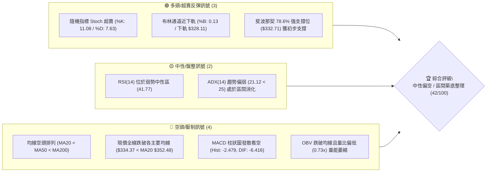

### 📊 核心指標速覽表

| 指標類別 | 指標名稱 | 當前數值 | 訊號 | 解讀 |
|----------|----------|----------|------|------|
| **價格** | 當前收盤價 | $334.37 | 🔴 | 位於 52 週區間 ($288.98 - $493.32) 之 22.2% 低分位 |
| **均線** | MA20 (短月線) | $352.48 | 🔴 | 現價低於 MA20 達 -5.14%，短線構成直接下壓阻力 |
| **均線** | MA50 (季線) | $361.73 | 🔴 | 現價低於 MA50，中期多頭架構遭到破壞 |
| **均線** | MA200 (年線) | $366.95 | 🔴 | 現價失守年線，且 MA20 < MA50 < MA200 呈現空頭排列 |
| **動能** | RSI(14) | 41.77 | 🟡 | 弱勢中性區間 (30-50)，尚未進入極端超賣 (<30) |
| **動能** | MACD (12,26,9) | -6.416 / -3.938 | 🔴 | 雙線位於零軸下方，Hist 擴大至 -2.479，空頭主導 |
| **動能** | Stoch %K / %D | 11.08 / 7.63 | 🟢 | 進入極度超賣區間 (<20)，隨時具備技術性跌深反彈動能 |
| **趨勢** | ADX (14) | 21.12 | 🟡 | 數值低於 25，顯示單邊下跌動能減弱，轉入區間震盪 |
| **方向** | +DI / -DI | 15.40 / 32.87 | 🔴 | -DI 大幅高於 +DI，空方依舊掌控盤面主導權 |
| **通道** | 布林通道 %B | 0.13 | 🟢 | 貼近下軌 ($328.11)，下檔空間受限，具下軌防禦力 |
| **量能** | 當日量 / 20日均量 | 15.85M / 21.65M | 🔴 | 量比 0.73x，量能不濟，OBV 疲弱顯示主力買盤觀望 |
| **波動** | ATR(14) | $11.96 | 🟡 | 波動率佔股價 3.58%，單日波幅適中，利於區間設定 |

### 🏆 技術評分卡

```
╔══════════════════════════════════════════════════════════════╗
║              技術評分卡 — AVGO (2026-10-21)                  ║
╠══════════════════════════════════════════════════════════════╣
║ 趨勢強度 (ADX=21.12)    ███████░░░░░░░░░░░░░  35/100  🔴 空頭壓制 ║
║ 動能指標 (RSI/Stoch)    ██████████░░░░░░░░░░  50/100  🟡 超賣醞釀 ║
║ 支撐穩定度 (S1/Fib78.6) ████████████░░░░░░░░  60/100  🟢 下檔承接 ║
║ 成交量配合 (OBV/Volume) ██████░░░░░░░░░░░░░░  30/100  🔴 買盤匱乏 ║
║ 形態結構 (區間尋底)     ████████░░░░░░░░░░░░  40/100  🟡 弱勢築底 ║
║ 均線排列 (空頭排列)     ██████░░░░░░░░░░░░░░  30/100  🔴 全線反壓 ║
╠══════════════════════════════════════════════════════════════╣
║ 綜合評分                ████████░░░░░░░░░░░░  42/100  中性偏弱區間║
╚══════════════════════════════════════════════════════════════╝
```

---

## 2. 趨勢分析

### 🌐 多時框趨勢分析

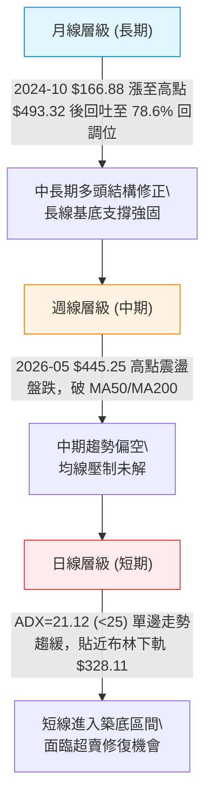

### 📈 長期趨勢 — 12個月走勢圖（Unicode）

以下為 AVGO 過去 12 個月（2025-11 至 2026-10）之月線收盤價走勢圖，清晰展示股價於 2026 年 5 月創下 $445.25 之波段高點（52週高點為 $493.32），隨後滑落修正至當前 $334.37 之歷程：

```
AVGO 月線走勢圖（過去12個月收盤價變動軌跡）
價格軸 ($)
$460 ┤                                  ● $445.25 (2026-05)
$440 ┤                           ● $416.01
$420 ┤
$400 ┤ ● $399.99
$380 ┤                                         ● $377.06   ● $388.57
$360 ┤        ● $344.20                                           ● $369.67
$340 ┤               ● $329.48                                           ● $351.19
$320 ┤                      ● $317.80                                           ● $334.37 (現價)
$300 ┤                             ● $308.46
     └─────────────────────────────────────────────────────────────────────────────►
        11     12     01     02     03     04     05     06     07     08     09     10 (月份)
       '25    '25    '26    '26    '26    '26    '26    '26    '26    '26    '26    '26
```

**走勢特徵分析表格**：

| 週期波段 | 價格區間 (收盤) | 漲跌幅 | 技術特徵與量價行為 |
|----------|-----------------|--------|--------------------|
| **波段高檔築頂回檔** (2025-11 ~ 2026-03) | $399.99 → $308.46 | -22.88% | 自 $400 大關回落，跌破短期均線，於 $308.46 尋獲第一道強支撐 |
| **強勢主升反彈段** (2026-03 ~ 2026-05) | $308.46 → $445.25 | +44.35% | 連續兩個月長陽線急拉，創收盤新高 $445.25，高點延伸至 $493.32 |
| **中級回撤震盪段** (2026-05 ~ 2026-08) | $445.25 → $369.67 | -16.97% | 自高檔大幅獲利了結回檔，反彈至 $388.57 形成次高點，未能重聚動能 |
| **弱勢下探尋底段** (2026-08 ~ 2026-10) | $369.67 → $334.37 | -9.55% | 均線相繼失守，成交量持續萎縮，目前考驗斐波那契 78.6% 回調位 ($332.71) |

### 📊 中期趨勢（週線分析）

中期走勢檢視近 20 週數據：
1. **高檔鈍化後破位**：2026 年 8 月初股價收盤一度上衝至 $426.98（當週 RSI 達 73.6），但隨後一週（2026-08-16）立即拉出大陰線回落至 $392.28，確認了頂部回調信號。
2. **週線 MACD 走弱**：自 2026 年 8 月底起，週線 MACD 柱狀圖多數落入負值區間（如 2026-08-23 達 -5.841），雖然 9 月中旬出現過短暫修復（+1.218、+2.477），但 10 月中旬再度回落至 -1.993 與 -2.479，表明中期下行壓制持續存在。
3. **區間支撐防守**：2026-10-18 當週收在 $328.75，精確打在布林下軌 $328.11 及支撐位 S1 ($327.66) 上方，本週（2026-10-25）微幅回升至 $334.37，顯示下檔浮現技術性買盤承接。

### ⚡ 趨勢強度評估（ADX 解讀）

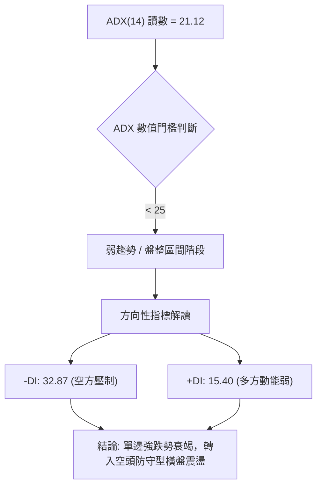

**ADX 趨勢強度對照解讀表**：

| 指標 | 數值 | 區間分類 | 趨勢研判與交易含義 |
|------|------|----------|--------------------|
| **ADX(14)** | 21.12 | 弱趨勢 / 盤整 (<25) | 趨勢行情的推進力量已不足，價格不再處於單邊重挫，轉為以震盪築底為主 |
| **+DI** | 15.40 | 偏弱動能 (<20) | 買方動能極為渙散，尚未形成突破性買盤 |
| **-DI** | 32.87 | 主導盤面 (>30) | 空方仍佔據相對優勢，多頭反彈皆先視為技術性解套賣壓與空頭回補 |
| **多時框收斂** | 盤整模式 | 依規則 14 | 由於 ADX < 25，交易策略嚴格以**日線布林通道 ($328.11 - $376.85) 及水平 S/R 區間操作**為主要指引 |

---

## 3. 圖表形態分析

### 🔍 形態識別系統

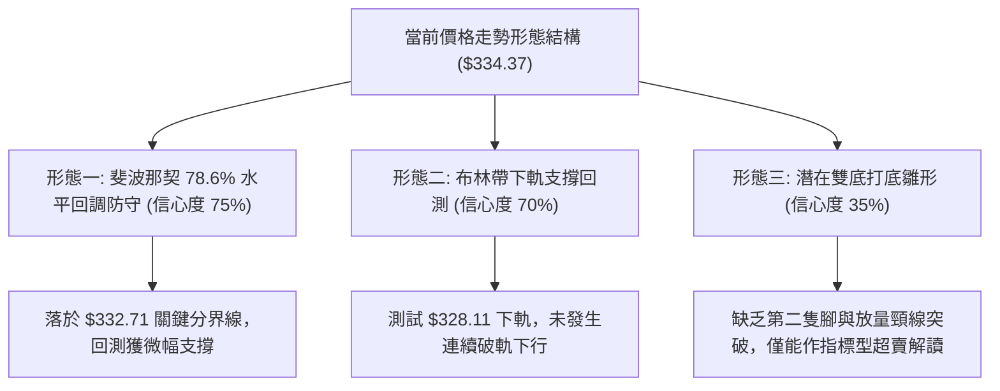

**形態信心度與目標評估表**（依規則 15 嚴格評估）：

| 形態類別 | 信心度 | 判斷依據（引用數據） | 完成度 | 目標價（附嚴謹計算式） |
|----------|--------|----------------------|--------|------------------------|
| **斐波那契 78.6% 水平支撐測試** | 75% | 現價 $334.37 貼近 52週區間 78.6% 回調位 $332.71，且前週收盤 $328.75 守住 S1 ($327.66) | 85% | **首要反彈目標**：中軌 MA20 = **$352.48**；<br>**第二目標**：61.8% 回調位 = **$367.03** |
| **布林通道下軌超賣收斂** | 70% | %B 跌至 0.13，Stoch %K (11.08) 進入極度超賣，價格在下軌 $328.11 止跌 | 80% | **反彈目標**：布林中軌阻力 = **$352.48** |
| **中級「頭肩頂」破位延伸** | 55% | 2026-05 $445.25 為頭部，2025-11 $399.99 與 2026-08 $388.57 為左右肩，跌破年線 $366.95 頸線位 | 90% | **理論滿足點**：頸線 $366.95 - (頭部 $445.25 - 頸線 $366.95) = **$288.65**（接近 52W 低點 $288.98） |
| **短線雙重底 (W底)** | 35% | 訊號不足。僅有 2026-10-18 之低收盤 $328.75 與本週 $334.37，尚未形成右底結構 | 20% | 信心度 < 50%，不預設幾何目標，僅做超賣指標解讀 |

### 🕯️ 重要K線形態分析

| 週/月份 | 基準價格 | K線形態特徵 | 市場心理與技術解讀 | 訊號 |
|---------|----------|-------------|--------------------|------|
| **2026-05** | $445.25 | 高檔長陽見頂 (衝高至 $493.32) | 歷史多頭獲利竭盡，天量換手後引發機構獲利結算 | 🔴 頂部確立 |
| **2026-08-09** | $426.98 | 次高點長上影陽線 (RSI: 73.6) | 假突破多頭陷阱，多方反撲無力，確認高檔次頂壓制形成 | 🔴 反轉確認 |
| **2026-09-06** | $357.25 | 大成交量長黑下挫 (173.2M 週量) | 帶量跌破季線 MA50 ($361.73)，籌碼呈現鬆動與停損賣壓 | 🔴 破位賣出 |
| **2026-10-18** | $328.75 | 下影探底陰線 (低點觸及 S1 $327.66) | 空方全力打壓但觸及布林下軌及 78.6% 回調位即引發低接 | 🟡 止跌孕育 |
| **2026-10-25** | $334.37 | 低檔十字星/小陽孕線 | 跌勢收斂，賣壓顯著減輕，但買盤量能仍偏謹慎 (量比 0.73x) | 🟢 築底醞釀 |

### 📉 ASCII 走勢形態示意圖

```
AVGO 近期價格結構與關鍵形態示意圖
═══════════════════════════════════════════════════════════════════════════
$445.25 ┤          ▲ [頭部 (2026-05)]
$426.98 ┤                   ▲ [次頂反彈高點 (2026-08)]
$388.57 ┤                        ▲
$366.95 ┼─────────────────────────────── [年線 MA200 / 61.8% 頸線破位點 $367.03]
$352.48 ┤                             [布林中軌 MA20 強阻力 R2: $350.81]
$338.13 ┤                              ┬ [短期波段反壓阻力 R1: $338.13]
$334.37 ┤                                ◄═══ 現價位置 ($334.37)
$332.71 ┼·································· [斐波那契 78.6% 黃金防守線]
$328.11 ┤                              ┴ [布林下軌 $328.11 / 波段支撐 S1: $327.66]
$319.05 ┤                                [強支撐 S2: $319.05]
$288.98 ┴───────────────────────────────── [52週低點 / 100.0% 回調位]
═══════════════════════════════════════════════════════════════════════════
```

### 🎯 形態目標價計算

根據現有確認之形態結構，推算短中線目標價位（依據提供的關鍵價位數值）：
1. **反彈測壓目標 1 (T1)**：突破 R1 ($338.13) 後，首要目標為波段高點聚類與 MA20 共振區 **$350.81 - $352.48**。
2. **反彈測壓目標 2 (T2)**：若進一步放量突破 MA20，將挑戰年線及 61.8% 回調位重疊區 **$366.95 - $367.03**（對應強阻力區間 R3 $358.10 之上延伸）。
3. **破位防守極限點 (止損)**：跌破 S1 **$327.66** 且收破布林下軌 **$328.11**，形態將向 S2 **$319.05** 及 S3 **$312.39** 尋求支撐。

---

## 4. 支撐與阻力

### 🗺️ 關鍵價位分布圖（Unicode）

```
AVGO 價位結構分布圖 (由波段 OHLCV 計算之關鍵支撐阻力網絡)
═══════════════════════════════════════════════════════════════════
$367.03 ║████████████████████████████████████║ MA200 / Fib 61.8% 強防線
$358.10 ║████████████████████████████        ║ 阻力 R3 (波段高點聚類)
$352.48 ║████████████████████                ║ MA20 / 布林中軌反壓
$350.81 ║████████████████████                ║ 阻力 R2 (關鍵籌碼聚集區)
$338.13 ║████████████                        ║ 關鍵阻力 R1 (短線突破點)
$334.37 ╠════════════════════════════════════╣ ◄ 現價位置 ($334.37)
$332.71 ║▓▓▓▓▓▓▓▓▓▓▓▓▓▓▓▓▓▓▓▓                ║ 斐波那契 78.6% 回調關鍵線
$328.11 ║▓▓▓▓▓▓▓▓▓▓▓▓▓▓▓▓▓▓▓▓▓▓▓▓            ║ 布林通道下軌動態支撐
$327.66 ║████████████████████████            ║ 支撐 S1 (近期波段低點聚類)
$319.05 ║████████████████████████████        ║ 強支撐 S2 (次級防守低點)
$312.39 ║████████████████████████████████    ║ 極限支撐 S3 (中級底部平台)
$288.98 ║████████████████████████████████████║ 52週低點 (100.0% 回調位)
═══════════════════════════════════════════════════════════════════
```

### 🚧 阻力位分析表

所有價位均嚴格引用關鍵價位聚類數據：

| 阻力級別 | 精確價位 | 距現價空間 | 形成技術原因 | 突破難度 | 重要性評級 |
|----------|----------|------------|--------------|----------|------------|
| **R1** | **$338.13** | +1.12% | 短線波段高點密集區、MA5 ($337.66) 貼近共振 | 🟡 中等 | ★★★☆☆ (短線轉強分水嶺) |
| **R2** | **$350.81** | +4.92% | 近一年波段高點聚類、MA10 ($349.85) 與 MA20 ($352.48) 夾擊區 | 🔴 較高 | ★★★★☆ (反彈波段核心考核點) |
| **R3** | **$358.10** | +7.10% | 密集籌碼套牢平台、接近 MA50 季線 ($361.73) 下方防禦 | 🔴 極高 | ★★★★★ (中期多空分界大關) |

### 🛡️ 支撐位分析表

所有價位均嚴格引用關鍵價位聚類數據：

| 支撐級別 | 精確價位 | 距現價空間 | 形成技術原因 | 守住機率 | 重要性評級 |
|----------|----------|------------|--------------|----------|------------|
| **S1** | **$327.66** | -2.01% | 近一年波段低點聚類、與布林下軌 ($328.11) 形成重疊護城河 | 🟢 70% | ★★★★☆ (短線多頭防禦底線) |
| **S2** | **$319.05** | -4.58% | 次級波段低點聚類、2026年2月月線回調低點支撐區 ($317.80) | 🟢 80% | ★★★★☆ (空頭深度回撤緩衝墊) |
| **S3** | **$312.39** | -6.57% | 近期波段極限低點聚類、2026年3月震盪築底收盤平台 ($308.46) | 🟢 90% | ★★★★★ (中期多頭最後生死線) |

### 📐 斐波那契回調位分析

依據 52 週最高點 **$493.32** 與最低點 **$288.98** 計算之黃金分割系統（完全引用數據庫精確值）：

| 回調比率 | 精確點位 | 當前相對位置 | 斐波那契意義與技術解讀 |
|----------|----------|--------------|------------------------|
| **0.0%** (52W High) | **$493.32** | +47.54% | 週期絕對頂部，歷史獲利了結天花板 |
| **23.6%** | **$445.09** | +33.11% | 2026年5月收盤價 ($445.25) 共振處，極強長期回調阻力 |
| **38.2%** | **$415.26** | +24.19% | 2026年4月突破放量平台 ($416.01) 處，中期強壓 |
| **50.0%** | **$391.15** | +16.98% | 半數回撤多空平衡點，接近 2026年8月反彈次高收盤 ($388.57) |
| **61.8%** | **$367.03** | +9.77% | 黃金分割強防線，精確與當前 MA200 年線 ($366.95) 形成生死交叉共振 |
| **78.6%** | **$332.71** | **-0.50%** | **◄ 現價 ($334.37) 精準守在該位上方！最後深層防守回調支撐** |
| **100.0%** (52W Low) | **$288.98** | -13.57% | 週期原點，波段徹底轉空後的終極保底線 |

> **深入解讀**：現價 $334.37 緊貼在 **78.6% 回調位 ($332.71)** 與 **支撐 S1 ($327.66)** 上方。78.6% 通常為機構深度洗盤或技術性修正的「最後防線」。此處一旦確立站穩，容易引發空頭回補的大級別均值回歸；若日線實體跌破該位，則回撤幅度將無奈朝向 100% 回調位 ($288.98) 尋求平衡。

---

## 5. 技術指標深度解讀

### 🎛️ 指標訊號總覽

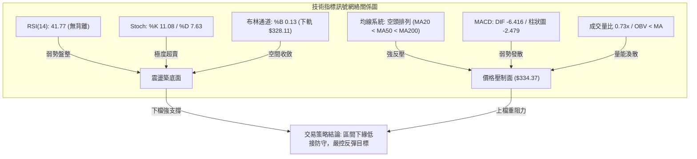

### 📈 移動平均線排列分析

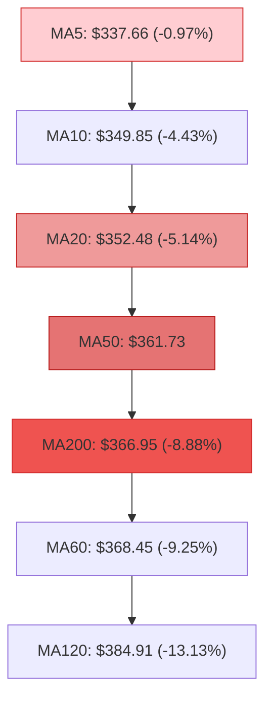

**移動平均線狀態詳細對照表**：

| 均線名稱 | 數值 | 距現價差距 | 排列關係 | 解讀與交易意義 |
|----------|------|------------|----------|----------------|
| **MA5** | $337.66 | -0.97% | 現價位於其下 | 極短線反彈第一道觸手，日內突破才有喘息機會 |
| **MA10** | $349.85 | -4.43% | 下行壓制 | 下降斜率陡峭，對應波段阻力 R2 ($350.81) |
| **MA20** | $352.48 | -5.14% | MA20 < MA50 | 20日月均線下移，為布林中軌，反彈初級目標及強阻力 |
| **MA50** | $361.73 | -7.56% | MA50 < MA200 | 中期死叉成立，中期多頭結構徹底轉換為空頭整理 |
| **MA200** | $366.95 | -8.88% | MA200 遭跌破 | 年線失守，長期走勢進入深度修正通道 |
| **MA240** | $365.66 | -8.56% | 走平彎頭 | 兩年牛熊分界線失守，顯示長線籌碼亦受波及 |

### 📉 RSI(14) 分析

* 當前 RSI(14) 讀數：**41.77**

```
RSI(14) 區間位置：
[超賣 0-30]      [弱勢震盪 30-50]          [強勢多頭 50-70]      [超買 70-100]
├───────────────┼────────────────────────┼─────────────────────┼────────────┤
                ▲ (41.77 處於弱勢中性區)
進度條展示：
█████████████████░░░░░░░░░░░░░░░░░░░░░░░░  41.77%
```

* **超買超賣與動能研判**：RSI 處於 41.77，既非 70 以上的超買過熱，亦未跌破 30 達到日線級別的極端恐慌超賣。這反映出股價下挫為陰跌與籌碼換手過程，而非情緒性恐慌殺盤。
* **背離研判結論**：
  * **價格與 RSI**：檢視近期週線與日線，AVGO 價格從 10 月初 $355.14 跌至 $334.37，RSI 從 56.9 降至 41.77，兩者同步創波段低點。
  * **背離結論**：明確確認目前 **無底背離（Bullish Divergence）**，亦 **無頂背離**，走勢完全遵循常規指標回撤，尚未出現多方背離逆轉信號。

### 📊 MACD(12/26/9) 訊號解讀

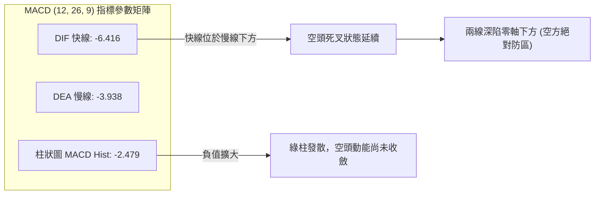

* **MACD 數值解析**：DIF (-6.416) 顯著低於 DEA (-3.938)，且二者均位於零軸（0.00）下方深處，柱狀圖為 -2.479。這表明中短期動能仍完全受制於空方掌控，綠柱尚未出現向上翻紅縮頭之拐點。短線任何拉升均僅能以「超賣後的均線乖離修正」視之，不可盲目判定為趨勢反轉。

### 📦 布林通道分析

```
AVGO 布林通道日線空間結構 (帶寬 BB Width: 13.83%)
═════════════════════════════════════════════════════════════════
$376.85 ┤───────────────────────────────────── 布林上軌 (Upper Band)
        │
$352.48 ┼ - - - - - - - - - - - - - - - - - - 布林中軌 (MA20 基準線)
        │
$334.37 ┤   ● [現價: $334.37, %B = 0.13]
$328.11 ┴───────────────────────────────────── 布林下軌 (Lower Band)
═════════════════════════════════════════════════════════════════
```

* **布林通道參數現狀**：上軌 $376.85，中軌 $352.48，下軌 $328.11。
* **%B 讀數分析**：當前 %B 為 **0.13**（0 代表下軌，0.5 為中軌，1.0 為上軌）。現價 $334.37 距離下軌 $328.11 僅有不到 2% 的安全緩衝，且距離中軌達 5.14%。
* **通道意涵**：%B = 0.13 配合 Stoch %K (11.08) 表明股價已進入極端通道下邊界，根據布林均值回歸理論，若未出現爆量連續向下「開口破軌（Walking the Band）」，價格將有強烈意願向中軌 ($352.48) 靠攏。

### 💹 成交量分析（量價配合度）

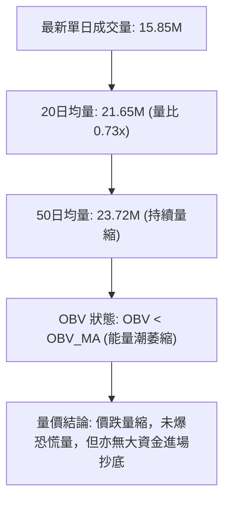

* **成交量深度診斷**：最新成交量僅 15,845,600 股，相較於 20 日均量 21,647,190 股，量比僅為 **0.73x**。相對於 9 月出量回跌（如 2026-09-06 週量達 173.2M），近期的下跌屬於「無量陰跌」。
* **OBV 走勢**：OBV 穩步下行且位居其均線下方，顯示籌碼沉澱緩慢，機構主力資金並未在此大舉建倉，量能並未確認多頭反轉信號，走勢仍需時間換取空間進行築底。

---

## 6. 動能與波動率

### ⚡ 動能評估四象限

根據「動能強度（Momentum）」與「波動率（Volatility）」二維矩陣進行診斷：

| 象限 | 動能維度 | 波動維度 | 處於此象限狀態之意涵 | 當前 AVGO 評估定位 |
|------|----------|----------|----------------------|--------------------|
| **Q1** | 強動能 (Bullish) | 低波動 (Low Vol) | 穩定單邊牛市，多頭最安全加碼期 | ✕ |
| **Q2** | 弱動能 (Bearish) | 低/中波動 (Mod Vol) | **空頭震盪盤跌，處於縮量磨底修復期** | **✓ (當前 AVGO 所處狀態)** |
| **Q3** | 強動能 (Bullish) | 高波動 (High Vol) | 狂熱主升浪或高檔天量換手 | ✕ |
| **Q4** | 弱動能 (Bearish) | 高波動 (High Vol) | 恐慌崩盤段，連續跳空重挫階段 | ✕ |

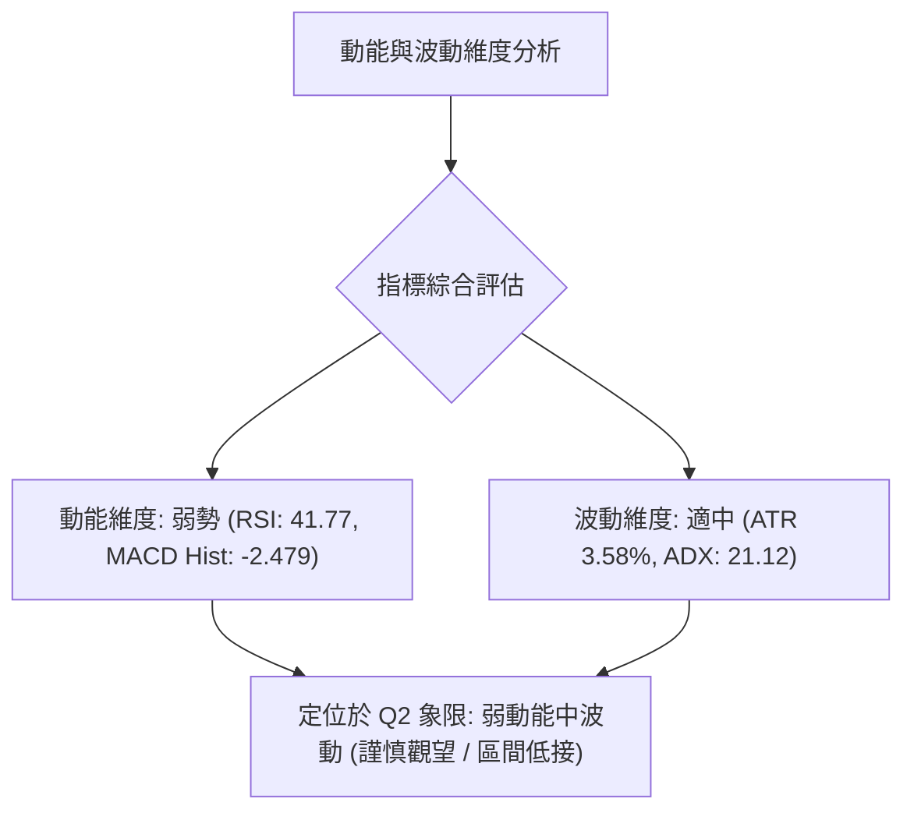

### 📊 ATR 波動率分析

* **ATR(14) 數值**：**$11.96**
* **相對波動幅度**：$11.96 / $334.37 = **3.58%**
* **止損與風控設置精算**：
  * **單日理論波動區間**：[現價 - 1×ATR, 現價 + 1×ATR] = [$322.41, $346.33]。
  * **波段交易防守安全墊 (1.0 × ATR)**：在 S1 支撐位 $327.66 處建倉時，應保留至少 1.0 倍 ATR ($11.96) 之緩衝空間，理論最硬止損點應設於 $327.66 - $11.96 = **$315.70**（剛好防守在 S2 $319.05 下方）。
  * **短期日內防守墊 (0.5 × ATR)**：$11.96 × 0.5 = $5.98，短線波段破位容忍度不得超過此區間。

### 📐 Beta 與市場相關性

* **Beta 係數**：**1.476**
* **市場敏感性解析**：
  * AVGO 具備顯著的高 Beta 特性，對費城半導體指數 (SOX) 與納斯達克 100 指數 (NDX) 的敏感度高達 1.48 倍。當大盤反彈 1% 時，理論上 AVGO 預期彈升 1.48%；反之，大盤回檔時其跌幅亦同步放大。
  * **機構持股 79.7%** 的結構下，高 Beta 意味著若整體科技板塊風險偏好回暖，其在極度超賣（Stoch 11.08）的情況下將具備極強的彈性。

---

## 7. 多時框架總結

### 📋 時框架評分表

| 時框架 | 趨勢方向 | 動能狀態 | 均線排列 | 圖表形態 | 綜合評分 | 戰術建議 |
|--------|----------|----------|----------|----------|----------|----------|
| **長期 (月線)** | 🟡 震盪回調 | 中性偏弱 (自頂部落下) | 多頭架構回測 (守於長均線之上) | 回測 78.6% 回調位 ($332.71) | 55/100 | 長期分批低接，維持核心部位 |
| **中期 (週線)** | 🔴 偏空修正 | 空方主導 (MACD Hist 負向) | 空頭排列 (跌破週 MA20/MA50) | 次高點後震盪盤跌通道 | 35/100 | 嚴格防守，不盲目猜底加碼 |
| **短期 (日線)** | 🟡 區間築底 | 極度超賣 (Stoch 11.08) | 空頭排列 (反壓重重) | 測試布林下軌及 S1 水平線 | 42/100 | 區間交易，依賴超賣指標低吸 |

### 🔲 綜合訊號矩陣

```
時框維度與技術要素一致性矩陣：
╔══════════════╦══════════════╦══════════════╦══════════════╗
║ 技術要素     ║ 短期 (日線)  ║ 中期 (週線)  ║ 長期 (月線)  ║
╠══════════════╬══════════════╬══════════════╬══════════════╣
║ 趨勢方向     ║ 🟡 橫向盤整  ║ 🔴 空頭下行  ║ 🟢 長期牛市  ║
║ 均線系統     ║ 🔴 均線死叉  ║ 🔴 跌破均線  ║ 🟢 守在低均線║
║ 擺盪動能     ║ 🟢 超賣修復  ║ 🔴 動能發散  ║ 🟡 獲利消化  ║
║ 量價結構     ║ 🔴 縮量陰跌  ║ 🔴 換手出逃  ║ 🟢 底部帶量  ║
║ 關鍵位置     ║ 🟢 守住 S1   ║ 🔴 失守年線  ║ 🟢 守 78.6%  ║
╚══════════════╩══════════════╩══════════════╩══════════════╝
一致性評估：短中期衝突，長期趨勢仍在，但中短期處於顯著修正期。
```

### ⚖️ 多時框收斂結論

依據多時框收斂優先級規則（Rule 14）：
1. **趨勢強度定性**：當前 ADX(14) 讀數為 **21.12 (< 25)**，明確定義為**盤整行情（Consolidation Market）**而非強趨勢推進。
2. **主導時框裁決**：在 ADX < 25 的條件下，日線布林通道上下軌 ($328.11 - $376.85) 與水平 S/R 區間將取代單邊均線趨勢，成為指導短線交易的核心依據。日線雖然均線呈空頭排列，但 Stoch %K (11.08) 與布林 %B (0.13) 出現罕見的極度超賣共振。
3. **收斂唯一方向**：**【中性觀望，區間下緣超賣防守反彈】**。不宜在此位置進行恐慌性追空（下行空間即刻遭遇 S1 $327.66 及 Fib 78.6% $332.71 雙重封鎖），亦不宜幻想立即可反轉展開 V 型單邊大牛市，主基調定為**「區間防守型反彈，觸及壓力減磅」**。

---

## 8. 交易策略建議

### 🗺️ 策略決策流程圖

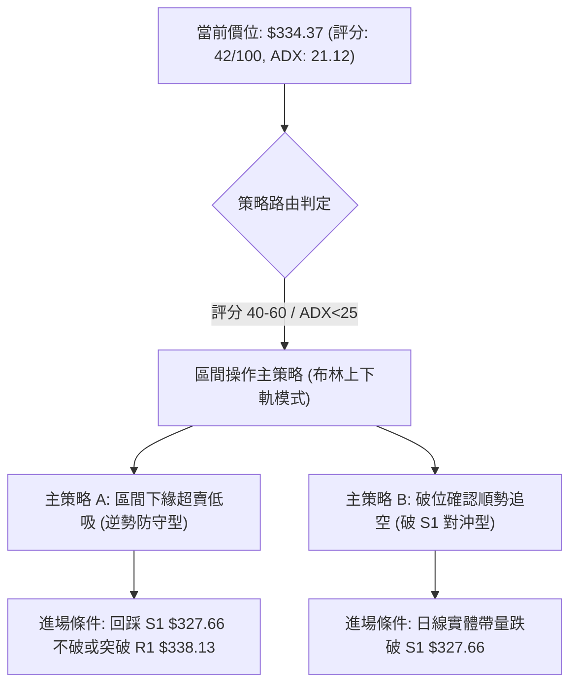

### 🧭 策略路由（依評分卡分流）

> **當前主策略方向 = 【中性偏弱／區間下緣超賣防守策略】（依評分 42/100，落於 40–60 區間）**
> 
> *依據嚴格規則，綜合評分處於 40–60 區間，ADX 為 21.12 (<25)，市場確立為無趨勢盤整磨底。主策略嚴格鎖定**布林通道下軌與關鍵支撐群的區間低接操作**，並以跌破防守點作為對沖停損依據，拒絕盲目單邊下注。*

### 🎯 價格情境階梯（Price Scenarios）

完全引用提供的關鍵價位數值：

| 觸發條件 | 第一目標 (T1) | 第二目標 (T2) | 後續延伸 (T3) | 情境技術含義 |
|----------|---------------|---------------|---------------|--------------|
| **放量突破 R1 ($338.13)** | R2 ($350.81) | MA20 ($352.48) | R3 ($358.10) | 短線超賣回補，確立向中軌發起均值回歸挑戰 |
| **穩守 S1 ($327.66) ~ 現價** | R1 ($338.13) | R2 ($350.81) | — | 於 78.6% 回調線構築底部箱體震盪 |
| **有效跌破 S1 ($327.66)** | S2 ($319.05) | S3 ($312.39) | 52W低 ($288.98) | 支撐破位，弱勢整理演變為加速尋底，空頭主導 |

### 📊 情境機率分佈

| 情境劇本 | 機率 | 主要依據與技術指標支撐 |
|----------|------|------------------------|
| **情境一：區間下緣築底反彈** | **50%** | Stoch 超賣 (%K 11.08 / %D 7.63)、布林 %B 0.13 逼近下軌、Fib 78.6% ($332.71) 具支撐韌性 |
| **情境二：狹幅區間持續震盪** | **30%** | ADX = 21.12 (<25) 趨勢微弱、成交量萎縮 (量比 0.73x)、資金觀望導致多空雙方均不願發力 |
| **情境三：跌破支撐加速探底** | **20%** | 均線呈空頭排列 (MA20 < MA50 < MA200)、MACD Hist 擴大至 -2.479，-DI (32.87) 掌控盤面 |

### 🟢 主策略詳情（方向依上方路由）

```
主策略 A (多頭/區間防守) vs 備選策略 B (破位做空/對沖)
```

| 策略要素 | 策略 A：區間下緣超賣反彈多單（主推） | 策略 B：跌破 S1 順勢追空避險（次推/對沖） |
|----------|-------------------------------------|------------------------------------------|
| **策略類型** | 逆勢右側接刀／均值回歸交易 | 順勢破位追空交易 |
| **進場條件** | 觸及 S1 ($327.66) 不破回升，或日內收復 R1 ($338.13) | 日線收盤價實體跌破 S1 ($327.66) 且成交量放大 |
| **精確進場價** | **$334.37** (現價或等拉回 $332.71 建第一批) | **$326.50** (確認摜破 S1 後觸發) |
| **目標價 T1** | **$350.81** (阻力 R2，距現價 +4.92%) | **$319.05** (支撐 S2，距進場位 -2.28%) |
| **目標價 T2** | **$358.10** (阻力 R3，距現價 +7.10%) | **$312.39** (支撐 S3，距進場位 -4.32%) |
| **嚴格止損價** | **$326.50** (跌破 S1 且低於下軌，虧損約 -2.35%) | **$334.50** (假跌破收復現價之上，虧損約 -2.45%) |
| **風險報酬比** | **2.09 : 1** (目標至 T1) / **3.02 : 1** (至 T2) | **1.94 : 1** (至 S2) / **3.67 : 1** (至 S3) |
| **勝率預估** | 60% | 40% |
| **建議倉位** | **15% - 20%** (防守型輕倉) | **10%** (嚴格對沖倉位) |

### 🔴 反向風險觸發點（對沖提示）

* 若建立策略 A 之多頭部位，一旦發生日線收盤價跌破 **$327.66 (S1)**，即代表 78.6% 回調線及布林下軌徹底失效。投資人必須**無條件執行止損**，並可反手啟動策略 B 對沖長期持股部位，目標下看 S2 ($319.05) 與 S3 ($312.39)。

### ⭐ 整體訊號強度評星

```
做多訊號強度：★★☆☆☆  (2.5/5 星 — 僅靠超賣及支撐支撐，缺乏量能)
做空訊號強度：★★★☆☆  (3.0/5 星 — 均線空頭排列，但短線空間受制於超賣)
整體可信度：  ★★★★☆  (4.0/5 星 — 指標無矛盾，ADX<25 完美印證震盪特徵)
```

---

## 9. 風險提示與監控

### ✅ 關鍵監控指標 Checklist

```
╔══════════════════════════════════════════════════════════════════╗
║               AVGO 技術監控清單 (Checklist)                      ║
╠══════════════════════════════════════════════════════════════════╣
║ [ ] 價格防線：收盤價是否嚴格守在 S1 ($327.66) 及 78.6% ($332.71) 之上？║
║ [ ] 阻力突破：能否帶量突破短期分水嶺 R1 ($338.13)？              ║
║ [ ] 擺盪指標：Stoch 是否於 20 以下形成 %K 向上穿過 %D 的黃金交叉？ ║
║ [ ] 均線動態：價格是否觸及並受制於下壓的 MA20 ($352.48)？       ║
║ [ ] 動能收斂：MACD 柱狀圖是否開始由負值峰值 (-2.479) 向上翻紅縮頭？ ║
║ [ ] 量能驗證：單日成交量是否回升突破 20 日均量 (21,647,190 股)？   ║
║ [ ] 波動預警：日波幅是否突破 1.5 倍 ATR ($17.94) 導致通道被動擴大？║
╚══════════════════════════════════════════════════════════════════╝
```

### ⚠️ 風險場景分析

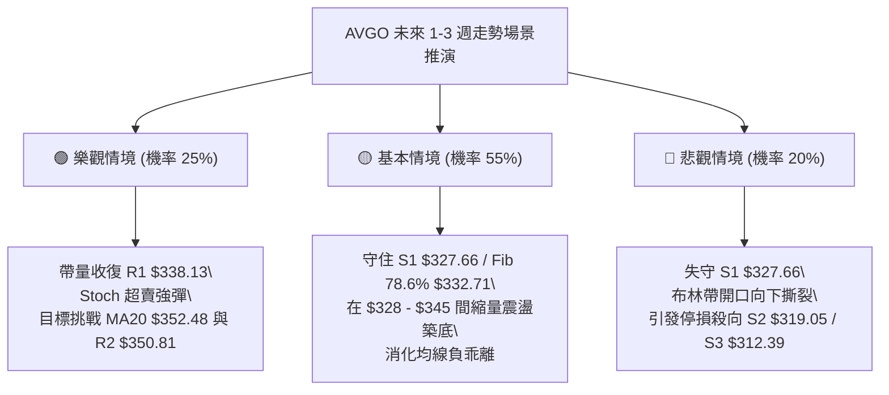

### 🛡️ 風險管理重要提醒

1. **嚴防高 Beta 放大效應**：AVGO 的 Beta 高達 1.476，科技板塊的整體情緒會劇烈放大該股走勢。當大盤指數出現弱勢震盪時，切忌在阻力位 R1 ($338.13) 或 R2 ($350.81) 追高。
2. **均線空頭壓制之倉位控管**：在 MA20 ($352.48) 與 MA200 ($366.95) 轉折向下並形成蓋頭反壓的格局下，總體持倉水平不宜超過常規配置之 30%，不可在趨勢未扭轉前以「長線投資」為藉口持續逆勢攤平。
3. **無量陰跌的隱性殺傷力**：量比僅 0.73x，顯示市場買盤謹慎。無量下跌往往考驗投資者耐心，此階段切忌重倉單押，應保留充足流動性等待日線出現放量突破 K 線作為右側訊號。

---

## 📋 報告總結

```
╔══════════════════════════════════════════════════════════════════╗
║                   AVGO 技術分析報告總結                          ║
╠══════════════════════════════════════════════════════════════════╣
║ 報告日期：2026-10-21                                            ║
║ 當前價格：$334.37                                                ║
║ 技術評級：⚖️ 42/100 (中性偏弱 / 區間超賣尋底)                     ║
╠══════════════════════════════════════════════════════════════════╣
║ 關鍵結論：                                                       ║
║ ├─ 長期趨勢：🟡 中性回調 (考驗牛市 78.6% 回調線 $332.71)        ║
║ ├─ 中期趨勢：🔴 空頭主導 (MA20 < MA50 < MA200 空頭排列反壓)     ║
║ ├─ 短期趨勢：🟢 超賣醞釀 (Stoch %K 11.08 / 布林 %B 0.13 臨下軌)   ║
║ ├─ 關鍵支撐：S1: $327.66 │ S2: $319.05 │ S3: $312.39          ║
║ ├─ 關鍵阻力：R1: $338.13 │ R2: $350.81 │ R3: $358.10          ║
║ └─ 外資共識：強力買進 (47 位分析師目標均價 $527.59)             ║
╠══════════════════════════════════════════════════════════════════╣
║ 最優交易策略組合：                                               ║
║ 1. 🥇 最佳機會：依循【策略 A】，於 $332.71 - $334.37 區間輕倉   ║
║    建立防守反彈多單，停損嚴設 $326.50，目標看至 $350.81。        ║
║ 2. 🥈 次選機會：靜待價格反彈至 MA20 / R2 ($350.81 - $352.48)   ║
║    受阻時，獲利了結或順勢建立中期空頭避險倉位。                  ║
║ 3. 🥉 保守選擇：完全空倉觀望，等待日線 MACD 柱狀圖翻紅且收復   ║
║    R1 ($338.13) 後，再行進場參與右側交易。                      ║
╚══════════════════════════════════════════════════════════════════╝
```

---

> ⚠️ **免責聲明**：本報告為 AI 自動生成之技術分析，所有數據及估算均基於提供的歷史價格資訊。本報告**僅供研究與學術參考**，**不構成任何投資建議**。投資有風險，入市需謹慎。

---

*報告生成時間：2026-10-21 ｜ 數據來源：Yahoo Finance ｜ 分析框架：多時框技術分析*