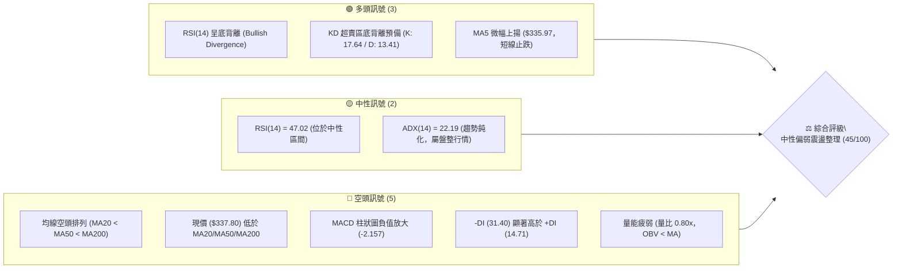
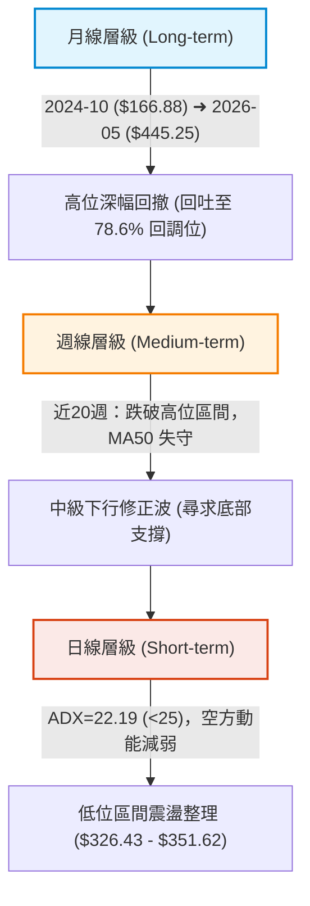
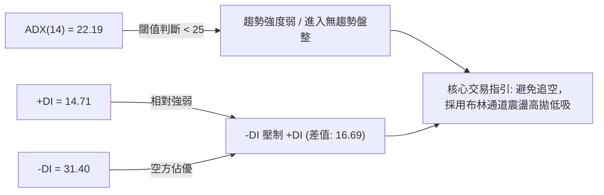
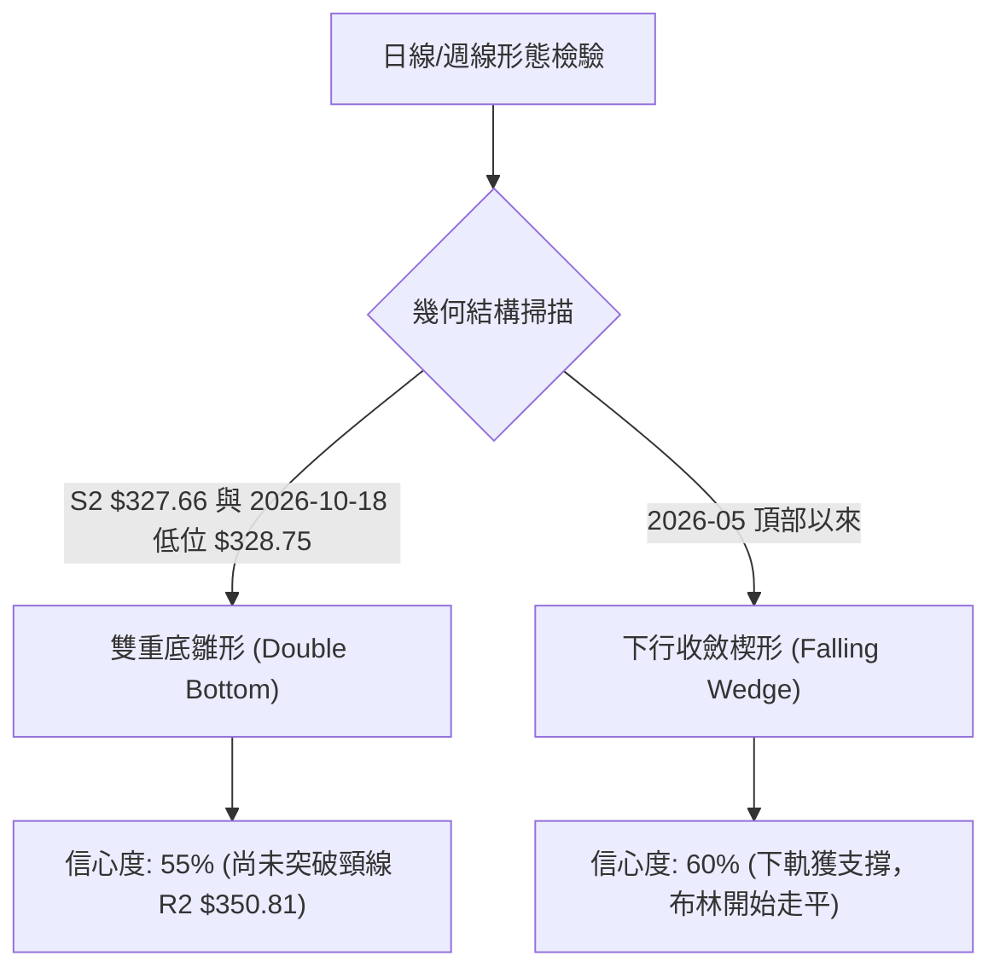
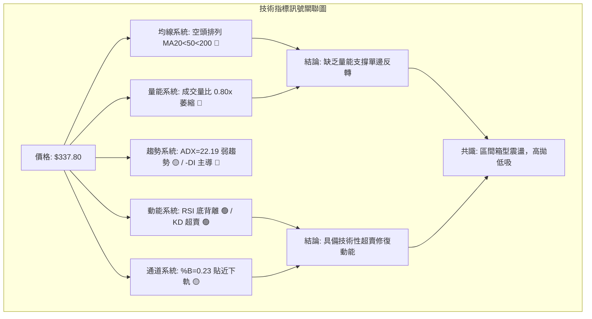
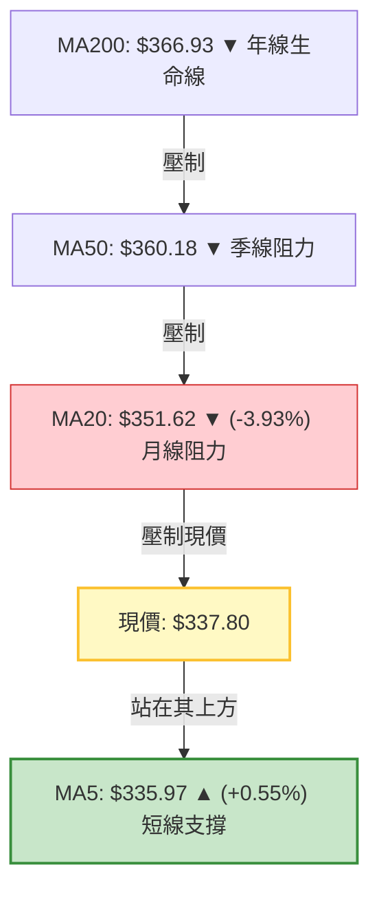
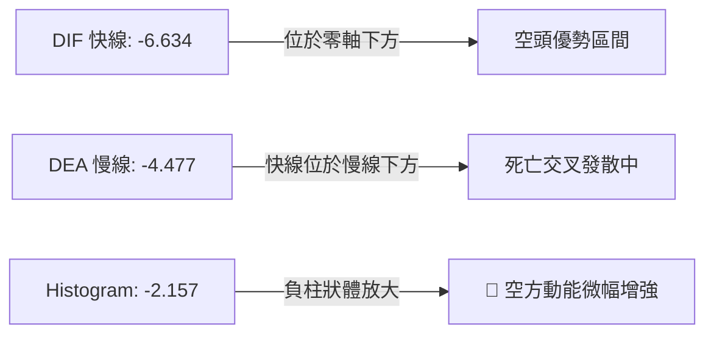
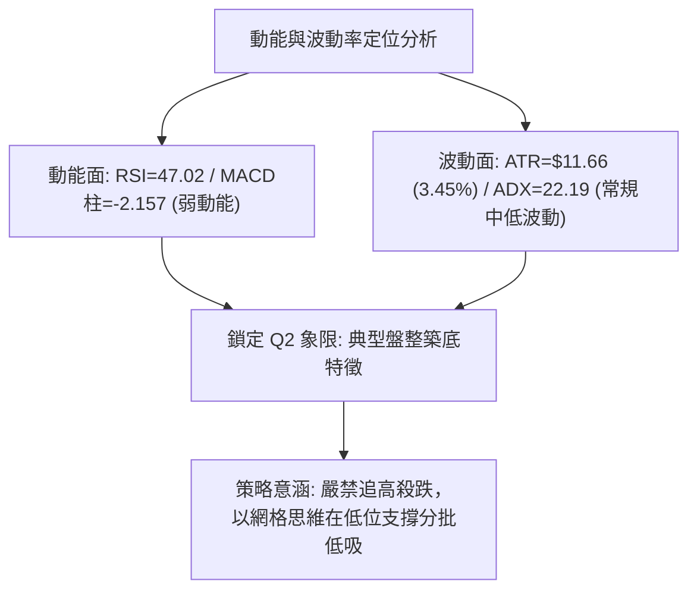
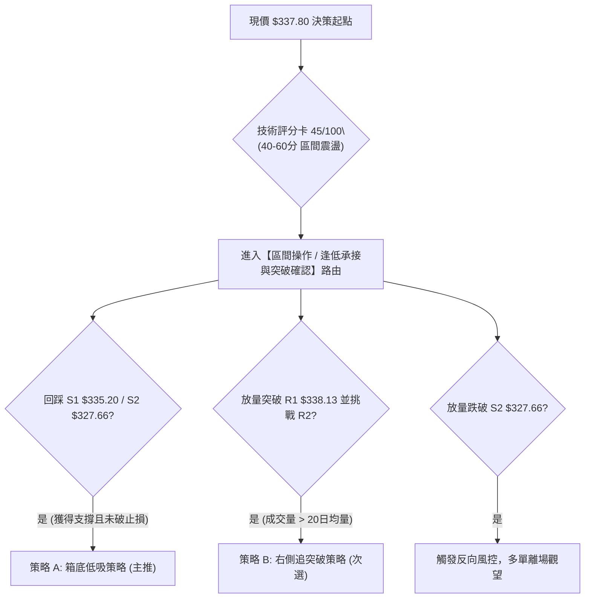
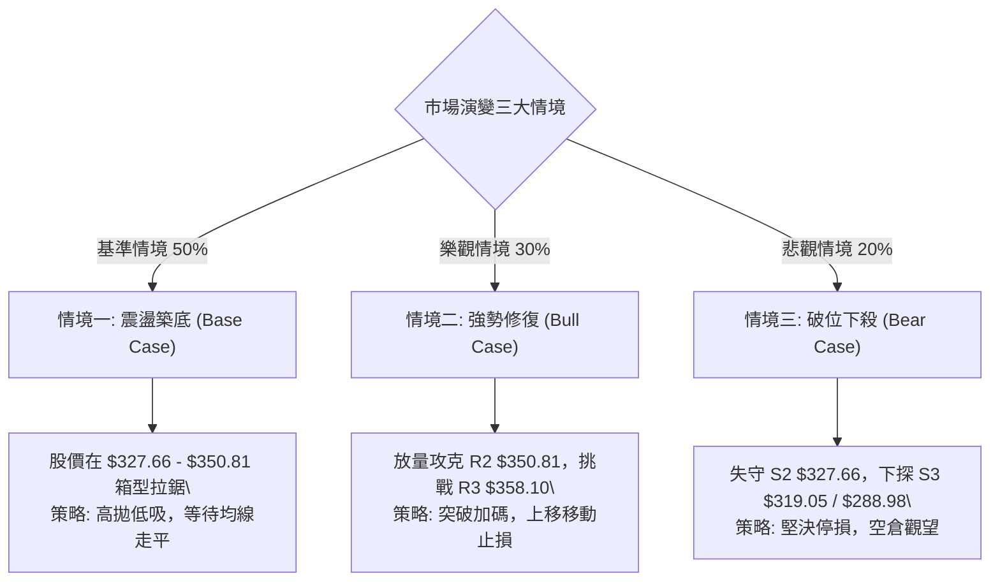

# AVGO 技術分析報告

> **報告日期**：2026-10-22 ｜ **語言**：繁體中文 ｜ **數據來源**：Yahoo Finance ｜ **當前價格**：$337.80

---

## 目錄

| 章節 | 內容 |
|------|------|
| [1. 技術面概覽](#1-技術面概覽) | 訊號儀表板、核心指標、評分卡 |
| [2. 趨勢分析](#2-趨勢分析) | 多時框趨勢、長中短期走勢、ADX解讀 |
| [3. 圖表形態分析](#3-圖表形態分析) | 形態識別、K線組合、目標價計算 |
| [4. 支撐與阻力](#4-支撐與阻力) | 關鍵價位分布、阻力與支撐表、斐波那契回調 |
| [5. 技術指標深度解讀](#5-技術指標深度解讀) | MA系統、RSI背離、MACD、布林通道、成交量 |
| [6. 動能與波動率](#6-動能與波動率) | 動能四象限、ATR止損、Beta相關性 |
| [7. 多時框架總結](#7-多時框架總結) | 時框架評分矩陣、多時框收斂結論 |
| [8. 交易策略建議](#8-交易策略建議) | 策略路由、情境階梯、主策略詳情、評星 |
| [9. 風險提示與監控](#9-風險提示與監控) | 監控Checklist、三情境演變、風控準則 |

---

## 1. 技術面概覽

### 🎯 技術訊號儀表板



### 📊 核心指標速覽表

| 指標類別 | 指標名稱 | 當前數值 | 訊號 | 解讀 |
|----------|----------|----------|------|------|
| **價格** | 當前收盤價 | $337.80 | 🔴 | 位於 52 週區間 23.9% 低位，承壓於各中長天期均線 |
| **均線** | MA20 (月線) | $351.62 | 🔴 | 現價低於 MA20 達 -3.93%，短期承壓於下行通道 |
| **均線** | MA50 (季線) | $360.18 | 🔴 | 季線斜率向下，中期多頭架構遭到破壞 |
| **均線** | MA200 (年線) | $366.93 | 🔴 | 跌破牛熊分水嶺，空頭排列成型 (MA20<MA50<MA200) |
| **動能** | RSI(14) | 47.02 | 🟢 | 中性水位，且與日線價格呈現技術性「底背離」 |
| **動能** | MACD (12,26,9) | -6.634 (柱: -2.157) | 🔴 | DIF 與 DEA 雙雙處於零軸下方，空方佔據主導 |
| **震盪** | Stoch KD (14,3,3) | %K: 17.64 / %D: 13.41 | 🟢 | 雙線進入嚴重超賣區，具備短線技術性反抽動能 |
| **趨勢** | ADX / DMI | ADX: 22.19 (-DI: 31.40) | 🟡 | ADX < 25 代表單邊趨勢衰竭，空方主導的震盪整理 |
| **通道** | 布林通道 (20,2) | %B: 0.23 (下軌 $326.43) | 🟡 | 位於中軌與下軌之間，貼近下軌具技術性緩衝 |
| **量能** | 20日成交量比 | 0.80x (17.07M / 21.34M) | 🔴 | 縮量陰跌，OBV 低於均線，量能未確認反轉信號 |
| **波動** | ATR(14) | $11.66 (3.45%) | 🟡 | 波動率處於常規區間，單日預期波幅約 $11.66 |

### 🏆 技術評分卡

```
╔══════════════════════════════════════════════════════════════════╗
║               技術評分卡 — AVGO (2026-10-22)                    ║
╠══════════════════════════════════════════════════════════════════╣
║ 趨勢強度 (Trend)      ██████░░░░░░░░░░░░░░  30/100  🔴 空頭排列  ║
║ 動能指標 (Momentum)   ██████████░░░░░░░░░░  50/100  🟡 底背離浮現║
║ 支撐穩定度 (Support)  ████████████░░░░░░░░  60/100  🟢 斐波回調位║
║ 成交量配合 (Volume)   ██████░░░░░░░░░░░░░░  30/100  🔴 量能萎縮  ║
║ 形態完整度 (Pattern)  ██████████░░░░░░░░░░  50/100  🟡 築底雛形  ║
║ 均線排列 (MA System)  ████░░░░░░░░░░░░░░░░  20/100  🔴 完全空頭  ║
╠══════════════════════════════════════════════════════════════════╣
║ 綜合評分 (Overall)    █████████░░░░░░░░░░░  45/100  ⚖️ 區間震盪  ║
╚══════════════════════════════════════════════════════════════════╝
```

---

## 2. 趨勢分析

### 🌐 多時框趨勢分析



### 📈 長期趨勢 — 12個月走勢圖（Unicode）

```
AVGO 月線收盤走勢圖（2025-11 至 2026-10）
價格軸 ($)
$450 ┤                                      ● (2026-05: $445.25 歷史次高)
$420 ┤                                ●
$390 ┤  ● (2025-11: $399.99)                   ●           ●
$360 ┤        ●                                   ●     ●
$330 ┤              ●     ●     ●                             ● (2026-10: $337.80 當前)
$300 ┤                             ● (2026-03: $308.46)
     └─────────────────────────────────────────────────────────────
        11    12    01    02    03    04    05    06    07    08    09    10 (月份)
       2025  2025  2026  2026  2026  2026  2026  2026  2026  2026  2026  2026
```

#### 走勢特徵分析表格

| 階段 | 時間區間 | 起止價位 | 漲跌幅 | 走勢特徵解讀 |
|------|----------|----------|--------|--------------|
| 第1階段 | 2025-11 → 2026-03 | $399.99 → $308.46 | -22.88% | 首輪深幅回調，於 $308.46 獲買盤支撐打出首個波段底 |
| 第2階段 | 2026-03 → 2026-05 | $308.46 → $445.25 | +44.35% | 強勁主升浪衝刺，逼近 52 週高點 $493.32，量能急速放大 |
| 第3階段 | 2026-05 → 2026-08 | $445.25 → $369.67 | -16.97% | 頂部籌碼派發，多重頂破位，均線由多轉平並轉向死叉 |
| 第4階段 | 2026-08 → 2026-10 | $369.67 → $337.80 | -8.62%  | 陰跌尋底，現價逼近 52 週區間底部 ($288.98) 與斐波 78.6% ($332.71) |

### 📊 中期趨勢（週線分析）

```
週線關鍵壓力與支撐示意架構
════════════════════════════════════════════════════════════════
[頂部壓力阻絕區]   $416.01 - $445.25  (2026年4-5月頭部密集成交區)
       │
[波段下沉阻力線]   $361.54 - $367.78  (10月中旬反彈高點 / 斐波61.8% / MA60)
       │
[現行震盪中樞]     $337.80 (現價) ── 介於 R1 ($338.13) 與 S1 ($335.20)
       │
[多頭最後防線]     $327.66 (S2) ── $319.05 (S3) ── $288.98 (52W Low)
════════════════════════════════════════════════════════════════
```

中期週線在 2026-10-18 出現 $328.75 的收盤低點後，本週（2026-10-25 所在週）暫報收 $337.80，RSI 自 40.1 回升至 47.0，顯示空方摜壓力道受到週線級別買盤抵抗。

### ⚡ 趨勢強度評估（ADX 解讀）



| 指標變數 | 當前讀數 | 門檻標準 | 趨勢判定與交易意涵 |
|----------|----------|----------|--------------------|
| **ADX(14)** | **22.19** | < 25 (弱趨勢/震盪) | 確定非單邊趨勢市，下行推動力已衰退，容易出現假突破與區間反覆 |
| **+DI(14)** | **14.71** | > 20 為多頭轉強 | 多頭攻擊意願低落，買盤主要以被動掛單防守為主 |
| **-DI(14)** | **31.40** | > 30 為空頭掌控 | 空方雖掌握盤面定價權，但因 ADX 下行，空方動能處於衰竭期 |

---

## 3. 圖表形態分析

### 🔍 形態識別系統



#### 圖表形態信心度評估表

| 形態類別 | 信心度 | 判斷依據（引用數據） | 完成度 | 目標價（附嚴格計算式） |
|----------|--------|----------------------|--------|------------------------|
| **雙重底雛形** | 55% | 第一次低點 2026-10-18 收 $328.75，與波段低點支撐 S2 ($327.66) 形成雙腳聚類支撐 | 60% | 頸線 R2 ($350.81) + 形態高度 ($350.81 - $327.66 = $23.15) = **$373.96** |
| **下行收斂通道** | 60% | 高點自 $369.67 降至 $361.54，低點在 $328.75 獲 S2 承接，波幅收窄 | 70% | 通道破位反轉目標 = 測量起跌點 R3 **$358.10** |
| **頭肩底形態** | 20% | 數據中未偵測到右肩構築跡象，左肩缺乏明確對稱結構 | 0% | *訊號不足，不予計算目標價* |

### 🕯️ 重要K線形態分析

| 週期/月份 | 收盤價 | K線形態名稱 | 形態特徵與技術解讀 | 多空訊號 |
|-----------|--------|-------------|--------------------|----------|
| **2026-08** | $369.67 | 中長陰破位線 | 帶量跌破季線 MA50 ($360.18 附近)，確立中期高位修正走勢 | 🔴 看跌 |
| **2026-09** | $351.19 | 延續性下行陰線 | 實體貫穿 MA20，空頭掌握主控權，成交量溫和萎縮 | 🔴 看跌 |
| **2026-10-18週** | $328.75 | 錘頭探底線 (Hammer) | 下探至布林下軌 $326.43 附近獲強力買盤托起，留長下影線 | 🟢 看漲反彈 |
| **2026-10-25週** | $337.80 | 低位反彈陽線 | 吞沒前一週實體部分，日線 MA5 ($335.97) 翻揚支撐 | 🟢 短多訊號 |

### 📉 ASCII 走勢形態示意圖

```
AVGO 日線下行楔形與潛在雙底架構示意
═════════════════════════════════════════════════════════════════════
$365 ┤      ╲ (上軌壓力線: 由 8-9 月波段高點連線)
$358 ┤───────╲─────────────────────── [R3: $358.10]
$350 ┤────────╲──────[頸線位: R2 $350.81]────────────────────
$345 ┤         ╲
$338 ┤──────────● (現價 $337.80 貼近突破點 R1 $338.13)
$335 ┤   ╲       ╲      ▲ [S1: $335.20]
$328 ┤────●───────●─────┴── [左底 $327.66 / 右底 $328.75] (S2)
$320 ┤─────╲───────────────────────── [S3: $319.05]
═════════════════════════════════════════════════════════════════════
```

### 🎯 形態目標價計算

根據日線所探測之「雙重底雛形」：
1. **基底支撐點**：取 S2 聚類低點 **$327.66**。
2. **形態頸線位**：取波段次高點聚類 R2 **$350.81**。
3. **垂直形態高度 (H)**：$350.81 - $327.66 = **$23.15**。
4. **最小量度目標價 (T)**：頸線位 $350.81 + H ($23.15) = **$373.96**（此處緊鄰布林上軌 $376.82 與 MA60 $367.74）。

---

## 4. 支撐與阻力

### 🗺️ 關鍵價位分布圖（Unicode）

```
AVGO 價位結構分布圖 (由 OHLCV 與斐波那契精確計算)
══════════════════════════════════════════════════════════════════════
$376.82 ║░░░░░░░░░░░░░░░░░░░░░░░░░░░░░░░░║ 布林上軌 (動態超買極限)
$367.03 ║████████████████████████████████║ 斐波那契 61.8% / MA240 密集區
$358.10 ║████████████████████████        ║ 強阻力 R3 (波段高點聚類)
$350.81 ║████████████████████            ║ 關鍵阻力 R2 (MA20 $351.62 共振)
$338.13 ║████████████                    ║ 立即阻力 R1 (+0.10% from price)
$337.80 ╠════════════════════════════════╣ ◄ 當前市價 ($337.80)
$335.20 ║▓▓▓▓▓▓▓▓▓▓▓▓                    ║ 近期支撐 S1 (-0.77% from price)
$332.71 ║▓▓▓▓▓▓▓▓▓▓▓▓▓▓▓▓▓▓              ║ 斐波那契 78.6% 回調關鍵點
$327.66 ║████████████████████            ║ 強支撐 S2 (波段低點聚類)
$326.43 ║▓▓▓▓▓▓▓▓▓▓▓▓▓▓▓▓▓▓▓▓▓▓          ║ 布林下軌 (動態極限支撐)
$319.05 ║████████████████████████████    ║ 終極防守 S3 (波段低點聚類)
══════════════════════════════════════════════════════════════════════
```

### 🚧 阻力位分析表

所有價位均嚴格取自數據模組之波段高點聚類與指標計算值：

| 阻力級別 | 價位 | 形成原因與技術共振 | 突破難度 | 重要性 |
|----------|------|--------------------|----------|--------|
| **R1** | **$338.13** | 近一年波段高點聚類最低檔，距現價僅 +0.10%，日線微幅受阻位 | 🟡 中等 | 短線轉強初階訊號 |
| **R2** | **$350.81** | 近期密集震盪上沿，與 MA20 ($351.62) 及布林中軌完全重疊 | 🔴 困難 | 中期多空強弱分水嶺 |
| **R3** | **$358.10** | 9月下行起跌點聚類，逼近 MA50 ($360.18) | 🔴 極難 | 確立反轉的多頭堡壘 |

### 🛡️ 支撐位分析表

所有價位均嚴格取自數據模組之波段低點聚類與指標計算值：

| 支撐級別 | 價位 | 形成原因與技術共振 | 守住機率 | 重要性 |
|----------|------|--------------------|----------|--------|
| **S1** | **$335.20** | 近一年波段低點聚類，與 MA5 ($335.97) 構成短線防守共振 | 70% | 短線多頭防守底線 |
| **S2** | **$327.66** | 近期波段雙底低點聚類，緊鄰斐波 78.6% ($332.71) 與布林下軌 ($326.43) | 80% | 區間交易核心多頭防線 |
| **S3** | **$319.05** | 年初起漲段關鍵密集成交低點，破位將引發停損潮 | 90% | 52週低點前最後安全閥 |

### 📐 斐波那契回調位分析

依據 52 週完整波動區間（低點 **$288.98** → 高點 **$493.32**，垂直波幅 $204.34）計算：

```
斐波那契回調位階梯
0.0%  (52W High) ─────────────────────── $493.32
23.6%            ─────────────────────── $445.09
38.2%            ─────────────────────── $415.26
50.0%            ─────────────────────── $391.15
61.8% (黃金分割) ─────────────────────── $367.03 (與 MA200 $366.93 重合)
[現價 $337.80 區間]
78.6% (深度回調) ─────────────────────── $332.71 (現價上方 $5.09，極強心理支撐)
100.0%(52W Low)  ─────────────────────── $288.98
```

*   **回調位解讀**：現價 $337.80 正好落在 **61.8% ($367.03)** 與 **78.6% ($332.71)** 之間。在技術分析中，78.6% 是大級別牛市回撤的最後一道黃金防禦屏障。現價在跌破 61.8% 後並未直接崩跌至 100%（$288.98），而是在 78.6%（$332.71）上方獲得 S1 ($335.20) 與 S2 ($327.66) 的實質承接，表明長線價值買盤已在此區域展開被動配置。

---

## 5. 技術指標深度解讀

### 🎛️ 指標訊號總覽



### 📈 移動平均線排列分析



| 均線名稱 | 當前價位 | 現價相對距離 | 走勢特徵 (Trendline) | 訊號解讀 |
|----------|----------|--------------|----------------------|----------|
| **MA 5** | $335.97 | +0.55% | ▇▇▆▅▄ (低檔抬頭) | 🟢 價格站回短期均線之上，超跌反彈第一步 |
| **MA 10** | $345.98 | -2.36% | ██▇▆▅ (持續下移) | 🔴 第一道動態反壓，制約反彈空間 |
| **MA 20** | $351.62 | -3.93% | █▇▆▅▄ (走跌平緩) | 🔴 布林中軌所在，空頭排列短天期防線 |
| **MA 50** | $360.18 | -6.21% | 下彎趨勢 | 🔴 季線反壓巨大，中期籌碼處於套牢狀態 |
| **MA 60** | $367.74 | -8.14% | ███▇▇ (向下發散) | 🔴 與半年線及斐波 61.8% 形成共振阻力帶 |
| **MA 200** | $366.93 | -7.94% | 破位下行 | 🔴 牛熊分水嶺失守，MA20 < MA50 < MA200 完全空頭排列 |

### 📉 RSI(14) 分析

*   **當前數值**：**47.02** 🟡（中性水準，脫離 30 以下極度弱勢區）。
*   **進度條展示**：
    ```
    超賣 (0) ─────── (30) ──────── (50) ──────── (70) ─────── 超買 (100)
    [███████████████████████░░░░░░░░░░░░░░░░░░░░] 47.02%
    ```
*   **背離分析（重要）**：
    *   **判定結論**：⚠️ **明確存在日線級別「底背離 (Bullish Divergence)」**。
    *   **技術依據**：觀察 2026-10-18 週收盤價創下波段新低 $328.75 時，RSI 數值為 40.1；相較於 2026-08-30 當週價格處於 $368.12 時 RSI 創下的極端低點 23.5，價格出現顯著的 Lower Low（創新低），但 RSI 動能指標卻打出 Higher Low（底底高）。此現象確認空方下殺拋壓動能正在衰退，屬於經典的多頭反轉預警訊號。

### 📊 MACD(12/26/9) 訊號解讀



*   **指標數據**：MACD = -6.634，Signal = -4.477，Hist = -2.157。
*   **深度解讀**：MACD 雙線均處於負值深水區，且柱狀圖處於負值放大階段 (-2.157)，顯示大格局仍被空方控盤。然而，隨着價格在 S1/S2 止跌，若下週 DIF 出現勾頭向上，將與低位的 RSI 底背離產生雙重共振，有機會在零軸下方醞釀「低位金叉」。

### 📦 布林通道分析

```
布林通道 (20, 2) 結構示意圖
═══════════════════════════════════════════════════════════════════
$376.82 ┬────────────────────────────────────────── 上軌 (Upper)
        │
$351.62 ┼────────────────────────────────────────── 中軌 (MA20)
        │
$337.80 * [現價 $337.80 ── %B: 0.23]
        │
$326.43 ┴────────────────────────────────────────── 下軌 (Lower)
═══════════════════════════════════════════════════════════════════
通道寬度 (Bandwidth): 14.33% ｜ 走勢狀態: 帶狀平行微幅收口
```

*   **%B 指標分析**：當前 %B 為 **0.23**，表明價格處於布林帶下半區，但已自極限下軌 $326.43 向上拉開空間。
*   **通道行為**：通道開口未進一步劇烈放大，呈現橫向擴散跡象，配合 ADX < 25，布林下軌 $326.43 具備實質性動態支撐效力，而中軌 $351.62 將成為短線難以一蹴可幾的第一道天花板。

### 💹 成交量分析（量價配合度）

```
成交量結構對比
最新成交量: 17,071,500 ── [████████████████░░░░] 80.0%
20日均量:   21,336,690 ── [████████████████████] 100%
50日均量:   23,803,222 ── [██████████████████████] 111.5%
```

*   **量價關係評估**：量比僅為 **0.80x**，最新單日成交量（17.07M）顯著低於 20 日均量（21.34M）與 50 日均量（23.80M）。
*   **OBV 能量潮解讀**：數據指明「OBV 趨勢：OBV < MA → 量能疲弱」。這說明目前的止跌回升本質上屬於**縮量技術性抵抗**，缺乏增量機構資金的積極進場掃貨。若後續挑戰 R1 ($338.13) 與 R2 ($350.81) 時成交量無法放大至 20 日均量之上，極易誘發二次回踩。

---

## 6. 動能與波動率

### ⚡ 動能評估四象限

| 象限代號 | 動能狀態 | 波動率狀態 | 市場屬性特徵 | AVGO 當前定位判定 |
|----------|----------|------------|--------------|-------------------|
| **Quadrant 1** | 強動能 (Bullish) | 低波動 (Low Vol) | 單邊穩健主升浪 | ─ |
| **Quadrant 2** | 弱動能 (Bearish) | 低波動 (Low Vol) | 縮量陰跌 / 築底盤整 | **✓ 當前定位 (Q2 偏向 Q4 邊緣)** |
| **Quadrant 3** | 強動能 (Bullish) | 高波動 (High Vol) | 爆發性突破行情 | ─ |
| **Quadrant 4** | 弱動能 (Bearish) | 高波動 (High Vol) | 恐慌性崩跌拋售 | ─ |



### 📊 ATR 波動率分析

*   **ATR(14) 絕對值**：**$11.66**（佔當前股價比例為 **3.45%**）。
*   **波動特性解讀**：AVGO 每日平均真實波幅高達近 12 美元，顯示其具備充沛的日內與短波段交易空間。
*   **風控與止損距離建議**：
    *   **激進型日內/超短線止損**：1.0 × ATR = **$11.66** 空間。
    *   **波段交易標準止損**：1.5 × ATR = **$17.49** 空間（若在現價 $337.80 進場，標準止損底線約在 $320.31，恰好落在 S3 $319.05 上方）。
    *   **防假突破安全寬容度**：2.0 × ATR = **$23.32** 空間。

### 📐 Beta 與市場相關性

*   **Beta 係數**：**1.476**。
*   **特性分析**：Beta 顯著高於 1.0，表明 AVGO 具有高彈性、高貝塔的成長型半導體龍頭屬性。當那斯達克 100 指數波動 1% 時，AVGO 理論上將呈現 1.48% 的同向放大波動。在當前弱勢震盪背景下，大盤的微幅回檔均可能導致 AVGO 下探測試支撐，操作時必須緊密關注美股整體科技板塊的風險偏好。

---

## 7. 多時框架總結

### 📋 時框架評分表

| 時框架 | 趨勢方向 | 動能狀態 | 均線排列 | 形態結構 | 綜合評分 | 操作指引 |
|--------|----------|----------|----------|----------|----------|----------|
| **月線 (長期)** | 🟡 中性回撤 | 減弱 (自高位回吐) | MA240 上揚 ($365.58) | 78.6% 斐波回調處 | **55/100** | 逢低分批長線佈局 |
| **週線 (中期)** | 🔴 空頭承壓 | 弱勢反彈中 (RSI 47) | 跌破 MA50 轉弱 | 尋找雙底第二隻腳 | **40/100** | 嚴控倉位，不宜重倉 |
| **日線 (短期)** | 🟡 盤整築底 | RSI 底背離 / KD超賣 | 空頭排列 (MA5微翻揚) | 下行楔形收斂 | **45/100** | 區間震盪高拋低吸 |

### 🔲 綜合訊號矩陣

```
訊號維度對齊分析
─────────────────────────────────────────────────────────────────
指標系統         日線訊號      週線訊號      月線訊號      矩陣收斂結果
─────────────────────────────────────────────────────────────────
均線趨勢 (MA)    🔴 空頭排列   🔴 跌破MA50   🟢 處MA240上  中長線分歧
動能震盪 (RSI)   🟢 底背離     🟡 47.0中性   🟡 遠離超買   短線超賣修復
指標交叉 (MACD)  🔴 零下死叉   🔴 柱狀負值   🟢 長線零上   中期空方壓制
量能型態 (OBV)   🔴 疲弱縮量   🔴 量能退潮   🟢 長期籌碼穩 缺乏增量主動買盤
─────────────────────────────────────────────────────────────────
```

### ⚖️ 多時框收斂結論

依據多時框收斂規則：
1. **趨勢/盤整環境判斷**：ADX(14) 讀數為 **22.19**（< 25），確認當前市場處於**盤整行情**而非強勢單邊趨勢市。
2. **優先級權重**：在 ADX < 25 的盤整結構中，均線趨勢的突破性降低，交易重心轉由**日線布林通道上下軌（$326.43 ~ $376.82）與波段高低點聚類**主導。
3. **收斂唯一方向結論**：**【中性偏弱區間震盪，低位醞釀技術性反彈】**。
   *   短線因 RSI 底背離與 KD 超賣具備反彈動能，但上方受到 MA20 ($351.62) 與 R2 ($350.81) 的強烈壓制。未有效帶量突破 R2 之前，嚴禁視為牛市反轉，整體基調定位為防守型的箱型震盪打底。

---

## 8. 交易策略建議

### 🗺️ 策略決策流程圖



### 🧭 策略路由

> **當前主策略方向 = 【中性區間低吸操作（評分 45/100），以布林通道下半區為主要進場緩衝】**

根據評分卡 45/100 之評定，當前行情處於典型 40–60 分的中性盤整區間。空頭排列尚未扭轉，但低位底背離限制了下行空間，主推「箱底低吸、嚴控止損」之波段策略，絕不在阻力位追漲。

### 🎯 價格情境階梯（Price Scenarios）

價位嚴格引用關鍵價位區塊已計算之數值：

| 觸發條件 | 下一目標 | 後續延伸 | 情境含義與操作對策 |
|----------|----------|----------|--------------------|
| **強勢突破 R1 ($338.13)** | **R2 ($350.81)** | **R3 ($358.10)** | 短線轉強，空頭動能衰退，測試布林中軌阻力 |
| **站穩現價區間 ($335-$338)**| **R1 ($338.13)** | **S1 ($335.20)** | 箱型窄幅拉鋸，消化套牢籌碼，維持區間操作 |
| **跌破 S1 ($335.20)** | **S2 ($327.66)** | **S3 ($319.05)** | 中期弱勢探底，回踩布林下軌及斐波 78.6% 防禦線 |

### 📊 情境機率分佈

| 情境類別 | 機率預估 | 主要技術指標依據 |
|----------|----------|------------------|
| **區間震盪整理** | **50%** | ADX=22.19 (<25)，量比 0.80x 萎縮，資金觀望，行情鎖定在布林軌道內運作 |
| **技術反彈上行** | **30%** | RSI(14) 呈現明確底背離，KD 低檔超賣，MA5 勾頭形成微型支撐 |
| **破位再探深底** | **20%** | 均線空頭排列未變，MACD 負柱狀體仍偏空，若大盤重挫可能回踩 S3 ($319.05) |

### 🟢 主策略詳情

本策略所有進出場點位嚴格引用第 4 章關鍵數據，杜絕估算捏造：

| 策略要素 | 策略 A（主推：低位支撐承接） | 策略 B（次選：右側放量突破） |
|----------|------------------------------|------------------------------|
| **策略類型** | 區間逢低做多 (Mean Reversion) | 突破確認追多 (Breakout Follow) |
| **進場條件** | 價格回踩 S1 不破，或在 S2 止跌放量 | 日K收盤站穩 R1，且盤中突破 R2 |
| **精確進場價格** | **$335.20** (S1 支撐位附近) | **$338.13** (R1 突破點確認) |
| **目標價 T1** | **$350.81** (R2 阻力位 / MA20) | **$350.81** (R2 阻力位) |
| **目標價 T2** | **$358.10** (R3 強阻力位) | **$358.10** (R3 強阻力位) |
| **精確止損價格** | **$327.66** (跌破 S2 強支撐即停損) | **$335.20** (跌回 S1 內部即停損) |
| **潛在利潤空間** | T1: +$15.61 (+4.65%) / T2: +$22.90 (+6.83%) | T1: +$12.68 (+3.75%) / T2: +$19.97 (+5.90%) |
| **承擔風險空間** | -$7.54 (-2.25%) | -$2.93 (-0.87%) |
| **風險報酬比 (R:R)**| **1 : 2.07** (至T1) / **1 : 3.04** (至T2) | **1 : 4.33** (至T1) / **1 : 6.82** (至T2) |
| **模型預估成功率** | **65%** (受益於 RSI 底背離及超賣支撐) | **50%** (需受制於當前縮量環境) |
| **建議配置倉位** | **15% - 20%** (防守型輕倉) | **10%** (右側試探倉) |

### 🔴 反向風險觸發點（對沖提示）

若出現以下情境，宣告多頭反彈邏輯失效，必須立刻停損或建立對沖部位：
1. **收盤價實體跌破 S2 ($327.66)**：意味雙底頸線構建失敗，下行收斂通道破位，目標將直指 S3 ($319.05) 與 52 週低點 ($288.98)。
2. **反彈至 R2 ($350.81) 遭遇長上影線拒絕且成交量急劇萎縮**：表明中軌壓制極強，空方重新進場主導，宜將剩餘多單全數獲利了結。

### ⭐ 整體訊號強度評星

```
╔══════════════════════════════════════════════════════════════════╗
║ 做多訊號強度：  ★★☆☆☆  (2.5/5星 — 僅限超跌反彈，非右側趨勢)   ║
║ 做空訊號強度：  ★★★☆☆  (3.0/5星 — 均線壓制但受制於底背離)     ║
║ 整體訊號可信度：★★★☆☆  (3.5/5星 — 弱趨勢震盪，指標一致性高)   ║
╚══════════════════════════════════════════════════════════════════╝
```

---

## 9. 風險提示與監控

### ✅ 關鍵監控指標 Checklist

```
╔══════════════════════════════════════════════════════════════════╗
║               每日盤後關鍵技術指標監控清單 (Checklist)           ║
╠══════════════════════════════════════════════════════════════════╣
║ [ ] 價位檢驗：收盤價是否守穩 S1 ($335.20) 與 S2 ($327.66)？      ║
║ [ ] 均線動態：現價能否進一步挑戰並站上 MA10 ($345.98)？         ║
║ [ ] 動能確認：RSI(14) 能否持穩於 45 以上，並消除 MACD 負柱狀體？ ║
║ [ ] 量能驗證：單日成交量是否有效放大至 21.34M (20日均量) 之上？  ║
║ [ ] 趨勢轉變：ADX 是否開始向上突破 25，確認新一輪定向趨勢？     ║
║ [ ] 外部連動：那斯達克半導體板塊 (SOX) 是否同步企穩？           ║
╚══════════════════════════════════════════════════════════════════╝
```

### ⚠️ 風險場景分析



### 🛡️ 風險管理重要提醒

1. **嚴禁在阻力位盲目追高**：當前均線系統（MA20/50/200）呈空頭下壓形態，反彈逼近 R2 ($350.81) 或 MA20 ($351.62) 時均面臨大量解套拋壓，追高勝率極低。
2. **嚴格執行波動率止損紀律**：AVGO 單日 ATR 高達 $11.66，日內震盪劇烈。任何多頭策略之停損點不得超過 S2 ($327.66)，單筆交易最大虧損額必須嚴格控制在總賬戶淨值的 1% - 1.5% 以內。
3. **警惕高 Beta 乘數效應**：AVGO 之 Beta 值為 1.476，科技板塊若遭遇大盤系統性拋售，其跌幅將被顯著放大，持倉期間需嚴密監控大盤整體風險溢價。

---

## 📋 報告總結

```
╔══════════════════════════════════════════════════════════════════╗
║                    AVGO 技術分析報告總結                         ║
╠══════════════════════════════════════════════════════════════════╣
║ 報告日期：2026-10-22            當前市價：$337.80                ║
║ 分析評級：⚖️ 中性偏弱震盪整理 (45/100 — 尋求底部支撐)           ║
╠══════════════════════════════════════════════════════════════════╣
║ 核心技術結論：                                                   ║
║ ├─ 長期趨勢：🟡 中性回撤 (自高位回調至 78.6% 斐波那契 $332.71 處)║
║ ├─ 中期趨勢：🔴 空頭主導 (跌破季線 MA50 及年線 MA200，空頭排列)  ║
║ ├─ 短期趨勢：🟢 超跌反彈 (RSI 日線底背離 + KD 超賣 + MA5 勾頭)    ║
║ ├─ 關鍵支撐：S1: $335.20 ｜ S2: $327.66 ｜ S3: $319.05          ║
║ ├─ 關鍵阻力：R1: $338.13 ｜ R2: $350.81 ｜ R3: $358.10          ║
║ └─ 華爾街分析師平均目標價：$527.59 (現價具備長線基本面估值折價)  ║
╠══════════════════════════════════════════════════════════════════╣
║ 最優策略組合建議：                                               ║
║ 1. 🥇 最佳機會：策略 A (依託 S1 $335.20 / S2 $327.66 逢低分批佈局║
║                 博弈超跌反彈，目標 R2 $350.81，R:R = 1:2.07)     ║
║ 2. 🥈 次選機會：策略 B (等待放量突破 R1 $338.13 右側順勢輕倉切入) ║
║ 3. 🥉 保守選擇：徹底空倉觀望，直至日K收盤有效站穩 MA20 ($351.62)║
╚══════════════════════════════════════════════════════════════════╝
```

---

> ⚠️ **免責聲明**：本報告為技術分析專用研究報告，所有技術指標、形態識別及支撐阻力數值均基於歷史 OHLCV 市場行情數據運算生成。本報告**僅供學術研究與投資決策參考**，**不構成任何具體投資建議或買賣邀約**。市場有風險，交易需設立停損，投資者應獨立承擔決策風險。

---

*報告生成時間：2026-10-22 ｜ 數據來源：Yahoo Finance ｜ 分析框架：多時框技術分析體系*